# CMU《最优控制和强化学习｜16-745： Optimal Control and Reinforcement Learning》中英字幕deepseek - P23：[23]Lecture 24_ Reinforcement Learning from a Control Perspective - GPT中英字幕课程资源 - BV1qHwke1EBX

啊。😊，Hi， everyone。Thanks for coming。What are we doing today， so oh yeah， I need。First off。

 logistical thing today is the last。Real lecture。Where I talk at you for an extended period of time。

 next time you will talk at me。For a short amount of time。And that should be fun。

 change it up a little bit， I'm excited about that。

So everyone knows yeah lightning talks next time I'm going to post an announcement and like have you force you guys to like upload your slides that so we can get them all on one laptop so we can kind of just bank things out homework do tonight officially。

诶。One good with that。Yes， excellent， anybody have any thoughts， questions， comments。Issues。

Re it good。Excellent。Okay， then。我记住啊。呃。So last time we did。How to drive a car？Very fun today。I a。啊。

Somewhat。Dramatic change of。So I suppose today I'm going to give you like my very biased。

Eiosyncratic， highly opinionated tour of reinforcement learning。

Wwhich we haven't talked about very much in this class。

 I would yeah I have lots of opinions on this take everything I say with lots of grains of salt I guess and like you may have other opinions you may disagree with me。

 feel free to argue I'm all about it。Speak up。Thatll make things more interesting for everyone。

 but yeah， so today I want to kind of like will do you like kind of a。

Brief tour of reinforcement learning and then dig in a little bit into like policy gradient methods。

 which probably everyone's heard of who's done policy gradient before。Yeah。

 so most of you guys have seen a lot of this stuff。嗯。

And then kind of like kind of finish up with like I don't know。

 a little bit of commentary on like challenges for the future of of kind of， you know。

Our field and stuff like that。嗯。And kind of where the where the fun stuff is in terms of research problems and things like that with all this stuff Okay cool so let's start out with just to you know go way back to basics。

嗯。We're going to start back up with the。Original optimal control problem that we've been looking at。

对。So minimizing over states。And controls。Basically。

 I'm going to derive like the policy gradientd stuff with the same notation and setup we've been using in here with X's and use and minimizing costs。

Instead of Ss and A's and maximizing rewards， it's all the same stuff。So here's。

The problem we are used to。嗯。Cost function， stage cost， right additive cost。

 and then our dynamics constraint。And we know， you know。castst。Gynas and maybe other stuff too。

 right？Okay， so the big question of of the day is we've kind of hinted at some of this before。

 but basically。What do we do if we have no dynamics model whatsoever。

 what if we don't know anything about the dynamics of the system， right？呃。And。

I would argue in a not so not even very like tongue and cheekic way that what you should do is probably。

Get a dynamics model somehow that's probably the right move and in practical engineering context I'm like。

I can't think of too many situations where that isn't the right move can anyone actually anyone here have have counter examples where you wouldn't want to build a model。

I don't have any good ones yeah。It is just for like a very。Prior time， we don't need to be precise。

PIDSo yeah you could do PiI I mean you can always do piID I would say in like let's say a more complex control scenario where you like want to do。

 you know you have a big complicated thing and you need like PID won't cut it， let's say。Yeah。

 you have a bunch of tasks and you want experience and users to be able to program those tasks。Yeah。

 that's a good one。I have lots of thoughts on that I guess sos there's been some really cool work。

 some of which I just saw at my first conference last month that it went to on like developing high levelve Goos to like and Boston dynamicsmics has a lot of cool work on this where they've had like choreographers and like artists come and design you know motion for their robots with like kind of animation tools and high level goys that are sort of suitable for users so I think like。

And they're doing all optimization based stuff， Right， I think there are ways of like setting up。

 you know， like。Keyframe posed is this kind of stuff that that are okay。

 but yeah I don't do you have something more specific like what did you have in mind I often to think about like kitchen but that like yeah you might know your robust dynamics but you're you might not know the dynamics of environment。

啊。I stand just do that。So you mean though like you would like to do like kind of imitation stuff。

Yeah， if I want to have my robot cut on pepper right pepper before unless I am a robotist I do not know how to inform the robot it needs to or I may not know how it needs to be able cut yeah。

 so what would you do？What would you do that would be modeled free there？Hey model3。

 you can go to imitation learning route， you can have a selection from some set of policies that we believe will be able to be composed to。

YeahYeah no， I think it's super interesting so when I say model here to be clear I don't necessarily mean like an analytic physics based model like learn models you know are totally cool like yeah。

 etc ceter， but like the idea of。Having a model versus not having a model at all and just trying to directly optimize a policy or whatever is more like yeah anyone else have any thoughts yeah if you have a bunch of days if you。

对这个。We make thing forever。St。玩我快。Yeah， I mean so in that situation like。

I would say like if it's actually。That's not that bad like it might be high dimensional but in principle that's like analytically modelable and if you didn't want to do it analytically like you could go do a bunch of experiments。

 collect a bunch of data and then like solve a regression problem or supervise learning problem right to fit a model to the data right so yeah like。

Doess anyone else have any thoughts yeah be。I'm more interested to see what you think about this。

What about like， like recovery causes for。Like the legged robot， like say like， you know。

 like it's hidden in a nice and like you want like one policy to do it you correspond from like。

Those specific examples that you made。Yeah， no， I think these are really good so in that situation you want to recover from like arbitrary crazy things though。

 right？Yeah， yeah， I guess like so my point there is that like if you don't have a model for that。

 that means you have to have experiences for all of these things。

Whereas if you have a model that like。You know， sort of can describe a bunch of those things。

 then you can potentially generalize much better to like things you haven't seen yet。

Just to clarify where are you drawing the line。Oh， absolutely yeah， yeah。

Kin of learning model rewards so I wouldn't so what I mean specifically is you have a model a dynamics model a dynamics function somewhere in your algorithm as opposed to not。

 so I would not include like a critic where you're fitting a Q function or value function approximation in this I would call that model free still。

Yeah， so I mean specifically dynamicsyn model。Anybody else have any thoughts on this？Okay。

 let's keep moving that。 Okay， so yeah， basically the。The Ral thing， I would say。

 is essentially just。Is optimal control。嗯。With。No like a priori。Model。

 so we're solving the exact same problem。We have a cost function we're just assuming that we don't have this anymore it's not given to us ahead of time right that's basically it it's the same problem otherwise。

And like the dream of RL is to develop algorithms that can figure out how to achieve control tasks。

By somehow performing like trial and error experiments on the system right to figure out what to do that's sort of the dream right and like I would say really the dream would be to do this on hardware right do it on the robot。

We kind of you know， can't necessarily do now， but that's the dream。啊。Okay。So。

Lots of ways to do this。I's obviously a super hot area for the last like decade plus so and you guys have item more of this than。

I have， in some cases。So options。The first one maybe。To talk about is model based R out。

And I would argue this is actually people have been doing this forever as long as we've been doing control and roughly speaking here。

 like what you want to do is learn a model。Say we'll call it F sub theta of X U。Then use。

Or simultaneously use。Sort of the standard control techniques we've talked about or others kind of whatever to then。

Do control。And to kind of make this a little bit more concrete。

 what you're doing here is you're taking a bunch of data。And fitting your F of x U。

 So you might have a bunch of。You know， you do a bunch of stuff on the system。

 you drive it a whole bunch of ways， you collect a bunch of states。

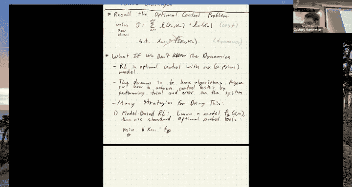

And control to the x's and U's here are all things you did on the robot and then you solve this sort of you know regression problem over the function F。

 so this is some kind of parametric function。Let's see， so these are all data you collect。

And then this guy is some function approximator， parametric function model， whatever。

With parameters theta。So this could be anything from like a parametric model right where you wrote down some physics and it has unknown stuff in it。

 or it could be a black box like neural network and these are the weights， kind of whatever。诶。

There's a broad range and there's a ton of examples of things like this that go back to well before anyone like called this stuff RL historically。

 I would say the roots of this lie in like adaptive control。

 which has been around since like at least the 50s。

Where people did various flavors of online gradient sort of desent on control parameters and model parameters。

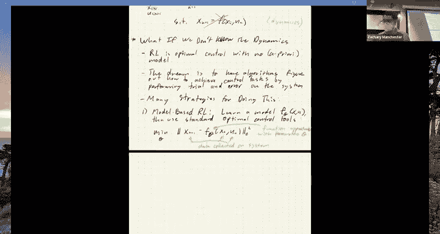

L， long history there。And deep connections to like adaptive control in general， okay。

 so that's like one way to go。Which is seemingly not very popular at the moment。

 but I would say like。Has maybe some pros depending on what you want to do Another thing you can do is Q learning。

Which is you learn。And action value function。Which we talked about when we did dynamic programming。

 right， so this would be sort of a Q theta of X U。Um from a bunch of data， right。

 you do a bunch of stuff， put a bunch of you know， controls inputs in， collect a bunch of states。

Evaluate the costs of those states and then you can calculate this thing if you do enough stuff and then you can get your controls from this by solving like the one step minimization。

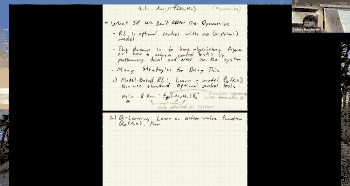

That looks like， you know， u equals。Argman over u of Q X U。So yeah， this comes from。

Dymic programming that we talked about。So we have this guy。Yeah， why isn't it Argm？

Because we're doing。The problem I wrote up there where we're minimizing a cost function。Oh， I see。

 but we're doing control。Would like how would you interpret the value in the action value function？

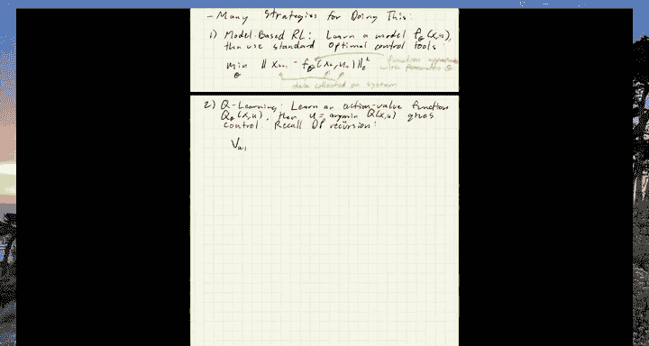

What do you mean by that I guess I thought in like traditional Rl like value means reward or like like the benefit of no it means cost to I see could it really cost to i'm going to write exactly what it is right now。

 so it's this thing from the dynamic programming recursion。So this is when we do dynamic programming。

 right we have the one step cost。And then we have the cost to go from there to the goal。

And inside there， we put the dynamics， right？So this is like classic what we did in class， right？

For dynamic programming when we derived LQR and a bunch of other stuff when we talked about how you know in general there's this cursive dimensionality thing this is terrible。

 the thing I want to point out so basically what we're doing here is approximating this thing right we're doing approximate dynamic programming with some neural network in the mix to approximate in this case action value function。

 not cost to go or value function。Can anyone tell me why we're doing that？Why not learn V？

Exactly yeah so that's the whole game here， so we're going to take the whole thing here。

That's inside the min。And this is Q。And the reason we do this is so now we can be model free if we learn Q instead of V。

 we never need the dynamics to do anything。So。I think we called this G when I did it because we used Q in the same set of nodes for LQR。

But the standard notation for it is to you。So today it'll be you。啊。So yeah。

 I'm deliberately stickking with all of the conventions and notation we've been using the class。

 but they're not the same as like what is common in RL。

 so V is cost to go right in our lingo from control。So I will mix and match。

I'll try to be as consistent as possible。啊。嗯。谁啊。You can fit cube by just running lots of experiments and evaluating costs。

On trajectories。Yeah， so there's Q like a function of K as well that changes。It can， yeah。

I guess I asking I consider like a similar nutrition。

Yeah it looks exactly like this yeah you can define the same recursion on Q you just like do some simple tweets to that so yeah its it's literally like actually when we derived DP I did it in terms of the Q function。

I called it Ge though because of notational overloading problems。Yeah， but yeah。Let's see。O。

So that's Q learning。 And then kind of the。Number three would be policy gradient methods。

We're mostly going to talk about today。Because these have been super hot for the last several years and like a lot of the major results and successes I think in RL for robotics have been these guys。

So here the idea is you just approximate。The control policy。So u of x parameterized by some thetas。

With whatever you want， so a neural network， if you like。

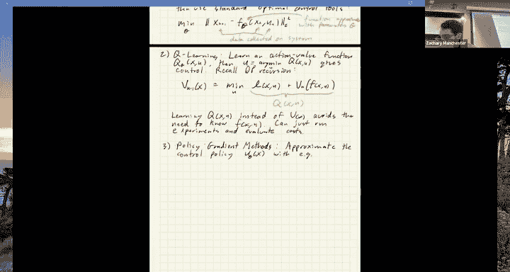

啊。嗯。And then you directly minimize。The cost function。With respect to the thetas。

So you find an optimal or approximation to the optimal policy。

So this looks roughly like min over theta of the thing we wrote down before。

 like our standard control cost。But we're going to plug this U in everywhere where this function U in everywhere。

 right so now。We get something like this。So we kind of eliminate U from the problem and now we just have x's and thetas。

 right？So really， this whole thing now is only a function of。嗯。Of x0 and theta now， right？

And then essentially， so we do this。So given an xO， it's basically just a minimization over theta。

And the kind of standard move then is to use random sampling。And a bunch of experiments。嗯。

On the system。To estimate。The approximate the gradient of the cost with respect to theta。

And then you use that to do gradient as。Allouts on the system collecting a bunch of trajectory data。

And then it's just evaluating the cost and if you do a bunch of samples you get a bunch of those evaluations and you can do thatmin for a gradient and then do gradient to that rate and then finally kind of the last category ish。

Yeah， are actor critic methods which basically glue together two and three， roughly speaking。

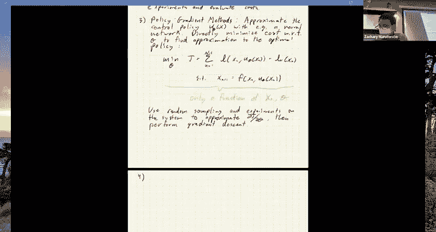

So you。Approximate。Both。The policy。So you have like a new。Prime caused by theta of x and。Q function。

 value function， something， something of that flavor。Q function cost to go， whatever。嗯。

And here you'd have different weights on this guy。And then you basically use them both together and jointly optimize。

And essentially people do this because it helps with the convergence of the stochastic gradient descent methods that are used to optimize these things。

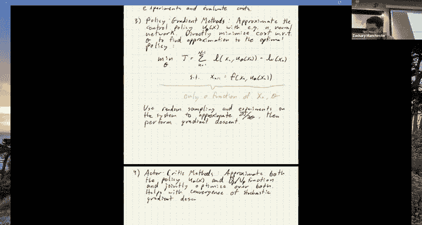

Okay， and there are like infinite variations on all of these in various ways of sing ideas from。

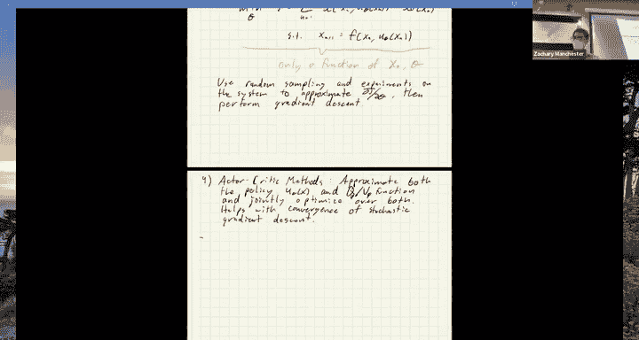

The different categories together。

Let's see and I would say like kind of the major like philosophical break from everything we've talked about before is that。

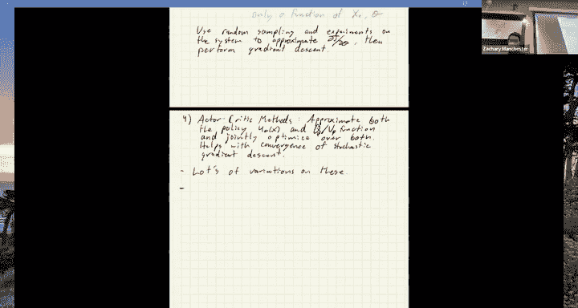

嗯。Basically， all of these algorithms try to assume as little knowledge as possible about these system environment dynamics。

 et cetera， that you're kind of trying to avoid。Having to know anything about those things。

 a priority。And I would say that philosophically， that's like at the core of RL versus optimal control。

 that's really， I would say the main difference。Here's where I get。Sort of。Bed， shall we say。

 I would say like in a in a practical like engineering context in like a robotics context， say。

I don't know that that's the assumption you want to make。Like。

 you can generally do better if you know more。Out the gate。

 and usually we do know a lot about these things。Okay， so I will。

Save some of that commentary for later。So so let's do the the policy grading thing like how many。

 I think a lot of you have seen this right， who hasn't done this before？couplele people。I think like。

The derivation of this is like。Kind of fun that's like a couple of clever tricks in here that are that are cute。

 but I don't know。I have mixed feelings about the algorithms themselves。

These are super popular though。It'sLike all of the cool。

Stuff of the 2010s were very variations on this right and its still super popular。

And also fairly simple。To implement。Okay， so。There's like a weird major assumption in here。

 I consider it kind of weird。So we're solving the optimal control problem we wrote up here that we've been solving the whole time。

And we're assuming this is like a robot， you know， whatever。And it has deterministic dynamics， right？

It is modelable first physics， it's not like crazy noisy or anything right。

 but to make these methods work， you make a major assumption。That the control policy。Is。

A stochastic function。Even if the real thing is not。

And we write it now as a probability distribution。嗯。So it's。

A lot of times written like this pi sub theta of u conditioned on x， that says like given some x。

 you have this conditional distribution that gives you like a probability overus。So。You'd say like。

Proalability of。You。Condition on or given X。Okay， so because of this。

 even if we have deterministic normal dynamics now the optimal control problem is now a stochastic optimal control problem by and the trajectories are stochastic because if I run this controller。

 what I'm doing is drawing samples from the distribution。

As I run the controller and it's noisy so it's going to push noise through everything right so all the trajectories now this induces a distribution over the trajectories right。

 a state distribution， ettera。对。So the whole thing's stochastic even if the dynamics。

Are deterministic。And we're going to assume they are， and I would argue， you know。

 most robotics problems are pretty much deter so this is kind of a weird thing to do。Mh。😊。

So why do we do this？Since you have expectations。哦，什么是。我系第事嗯。Yeah， I don't know。

 like why would you choose to do this？对。Some of exploration。Yeah， you could argue this。

 but I would say like most of the methods that do this。

So generally these methods still only find local opttima right and they're not actually particularly good at doing exploration。

 so I maybe practically disagree with that。Yeah。It might not be a lot of words， but for some words。

 they're modeling not exactly the robot Im controlling M I give white space， boys and other。

So in the environment like about something that。喂。So I think that people enjoy experiences this too in my。

I don't think I followed that， sorry。Yeah I mean there's a robotI would say you're trying to interact with some other thing that you don't have a good model of yeah so I mean that might be a truly stochastic control problem right that would be not here we're talking about noise on in the control policy right that would be noise in in the environment like in the dynamics right that'd be like process noise I would call it maybe。

This is like I'm deliberately injecting noise into my control signals。

I'm choosing to deliberately add noise to my controller。That I'm driving the system with， right？

If you have like a joint space for those with Jimmy me and another thing， like I'm trying to catch。

And if I cannot really model what the object is doing then can I say I can get to that object yeah but that's in the dynamics that's not in my controller right so this is a different thing that would be like you know。

What I'm talking about is like say I'm you know the robot and that things over there maybe wiggling around weird。

 but right that's in like the environment right in the dynamics somewhere。

 I'm saying I'm like adding noise to my joints and like wiggling around like crazy， right？

That doesn't really help you catch the ball。Or whatever yeah， this might be was a previous argument。

 but I would expect that adding noise your control policy will share your gradients。Qu faster。

 you just made the point the final off， maybe it's not。So how would that help， actually， I'm curious。

Intuitively， if you sample a larger portion of the space， you would have。Better。

With a deter of policy， you're more likely to fall into。Maybe， so yeah。

 there might be some argument for like escaping saddle points and things like this。

 but generally gradient based methods are actually pretty good at that on their own。

And don't usually get stuck in saddle points and things like this anyway。

 but yeah so so what it does do for sure is smooth things so if you have like a non-smooth cost function or some non-s weirdness going on in the dynamics these what you're doing here is taking a bunch of samples randomly in some neighborhood and then using that to estimate a gradient rate so like it's going to kind of smear everything out and smooth stuff so that's potentially one upside but I would say in general what you're doing it though is you're computing some like noisy approximation of everything so in terms of convergence rate these are strictly worse actually。

Because you're not getting exact raance you're getting compared。

Compared to like a non stoastic actual gradient， this is like some noisy approximation to the gradient right so in terms of like convergence behavior it's not as good as if you had the real gradients。

So yeah， I would say like the smoothing thing is real， but really what this is。

The reason you do this is it's really a sampling scheme to compute gradients like why you're doing this basically so you can do SGD。

啊。And it basically， you do this。You can， it's yet another way of getting the dynamics to disappear from the problem essentially because if you were to compute the real gradients。

 you'd need to di through the dynamics and here basically by doing the sampling。

 you're effectively kind disorder not really finite diffing。

given a bunch of you're collecting a bunch of trajectoryor data these random samples I mean you're kind of sort of doing like effectively finite diing on the trajectories to get gradient in approximations not exactly right but but something like that so yeah I would say。

The noise is really there。嗯。As a。Yeah。As a mechanism to generate samples。Yeah。To compute gradients。

And you know， there's other ways to do that for sure， but this is， you know how these things work。

Okay， so thats said。I feel like this is super abstract， so to make this a little more concrete。

 pretty standard assumption in a lot of the robotics applications of this stuff。

In terms of what this policy looks like。Is deterministic。

Like you that we talked about having before plus。Additiveitive Gaussian noise。So。

So what we mean here is that this thing looks like。You。😔，Prameterized by the theta。

 so we basically have a regular deterministic policy and we add white noise to it。

 which we'll call V， and that's drawn from normal distribution with zero mean and covariance big V。

So that's like what is there's a couple variations on this but this is like super super standard and this is like kind of what people use so you know looking at it this way it really does feel like basically this is just pertuurrbing around my current policy right so I can collect some sample so I can estimate a local gradient approximation right？

Okay， cool。So。What are we doing now Okay， so now we have this noisy control policy that looks like this。

Let's write out， we're going to use this a little bit later。嗯。But's right now。

The distribution over trajectories that you get from this control policy thing， right？

And this we're going to use this later， so here we go。

 so this is this gets like super notationally heavy。So I don't know， bear with me。

So this is the tau here is trajectories。The theta are the the parameters of the controller right the weights or whatever this and this is a probability distribution this thing looks like a product。

So this is time。 So here's the。State distribution at time K plus one condition on。Stta time K UK。

 so this is basically the dynamics， right and then。Times Dar our policy thing。

So these are just fancy stochastic ways of writing。Dynamics。And。Controller。

This is like spreading out the distribution， right？

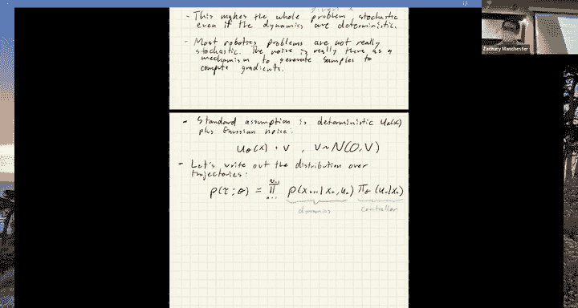

Okay， so given this thing， now this is like our distribution over trajectories right and this tau is。

So this trajectory is like you know， x1。U1 x2。

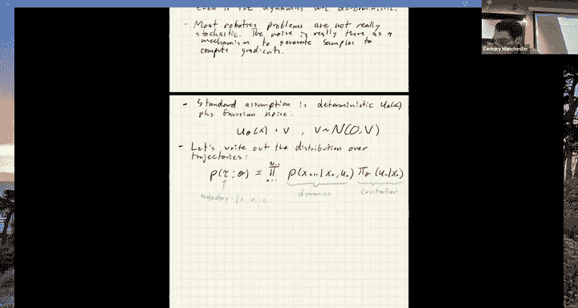

哒得哒。Through XN right so it's all the states and controls that the trajectory kind of stacked up in one big vector。

 that's what we mean there。Okay， so。Now， with this thing in mind。

 I can write out our optimal control problem， which is now a stochastic optimal control problem。So。

We're going to now be doing min over the thetas。Expectation。Of。The cost function。

Which we evaluate on a trajectory， right？And this is taken with respect to this distribution over trajectories that I just wrote down。

co啊。All three parameters。😔，Cos function。A trajectory。Distribution。Yeah。

 it's the thing that just above there P of。That's the probability distribution of the trajectories。

Prameterterized by the thes this is like the standard notation in the field。 I don't love it。

 it's I think it's like super notationally heavy and like。

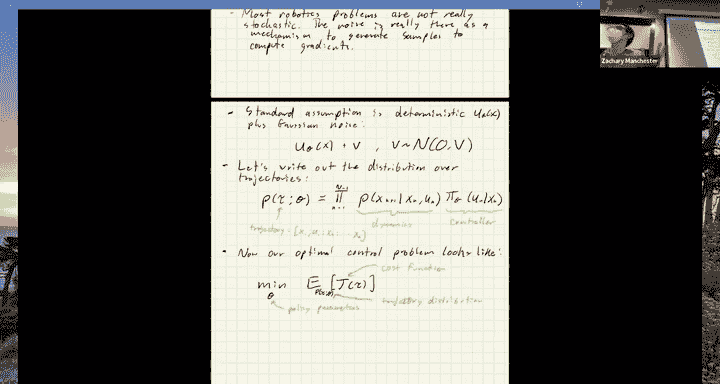

Very abstract， but this is kind of the standard stuff。Okay， so now。Moving on。

We're going to remember the definition of an expectation。Which is。So in this particular case， right。

 so this guy's Tau。Data I try to be。Meated with the handwriting， so this expectation， right？

This is the integral over all trajectories。Of。This cost function。

Times the probability density function。ERight so we have this thing over this you know function trajectories we have a distribution PDF over the trajectories we integrate over all possible trajectories right that's the definition of expectation and what we want to do now this is our cost function right that we're trying to minimize with respect to the thetas so we want to do gradient on this thing so what I want to do now is just take the gradient of that thing with respect to the thetas so I can do gradient ofcent right。

So that's the next news。And this is sort of。呃。Where the classic policy gradient theorem or trick comes up So what we want is this thing。

Grad with respect to data of。This expectation。Of my cost。And if I。

Carry the derivative through the integrals over the trajectories。

so thetas doesn't show up so I can bring the derivative inside the integral and the cost function isn't a function of theta。

 only that probability distribution is， right？So we're going to dip through the integral and get。

Grad with respect theta of the PDF。And now we play the famous trick。That probably had one seen。

 it like fun log trick。Okay， so。So that thing is。So the trick is。I'm going to。Multiply and divide by。

ピ？And I'm going to write it like this， so here's what I started with。Grad P。

And I'm going to divide this by P。I'm going to group these things together inside the bracket and then I'm going to multiply also by P。

So I didn't change anything。And now the thing in the brackets。

Is equal to the gradient of the log of P， so we're going to plug that in。

So thing and brackets is the same。嗯。你。Does it matter if it's the natural log or the log？

It's a natural log。O。嗯。And then now we recognize that this thing that I just wrote down is an expectation right it's a thing multiplied by a PDFf integrated overall trajectories。

 so this thing is。So if I write this all out。This is equal to。Expectation over this distribution。Of。

All the stuff in front of the P so this。Times grad log。FP。That's the whole thing。😔，呃。Bers。Cool。Okay。

嗯。One past move。Which is。Now what we're going to do is go back to the definition of that。

Distribution of ourjectories， which is this。Product over time steps then。With the dynamics in it。

 and we're going to give through that， we're going to like change our product rule， I guess。

 into that thing right we're going to take the log of that。

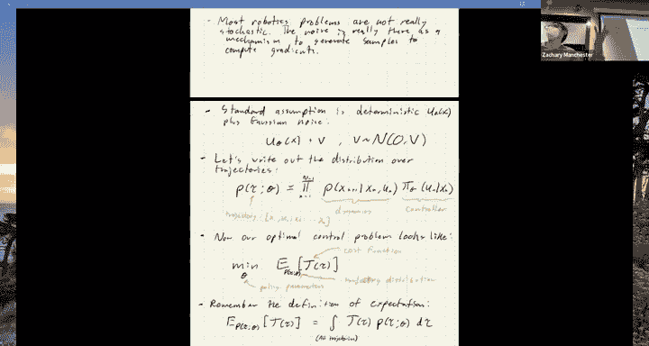

Which now log of a product is the sum of the lives thing， right so we're going to get。

Some over log of P plus log of theta or pi or whatever。

 so we're going to play that trick and we're just going to di through that thing and do the usual usual stuff。

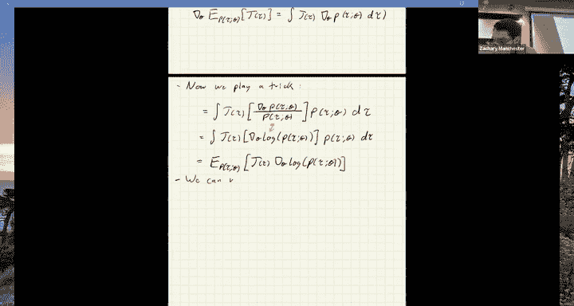

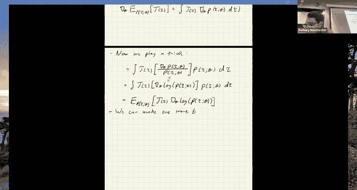

So what's going to happen here， which is kind of important， right， is that the。

The dynamics term doesn't depend on theta， so when I take the grad with respect to theta that's going to drop out too so they dynamics go away right which is like what we want and then we're just left with the controller stuff。

So that looks like。So this thing。Is grad of。So here's where I do the。

 I pull the log inside the product and I get some。Over time steps。

Lolog of the dynamics distribution thing。Plus， log of the。Policy distribution。

Apologies for the squishiness。And then this term goes away because it doesn't depend on theta when I take the derivative。

So this equals。And I can pull the derivative inside。So we get。Grad log。Of。嘅。

Control policy thing distribution。Okay， so。I plug this back in。The final result that we want is。

Grad with respect to theta of our expected cost。Is。Expectation。Of。

Cost function evaluated along the trajectory times。This term。

Which is also evaluated along the trajectory and it's。Grab spec theta of the log of the。

Control policy distribution thing。Okay， this is the major put a box around it result。

So that whole mess is called the policy gradient theorem， that basically says like。

We can do a bunch of fancy math and end up with this expression。

That lets us evaluate the gradient of the expectation of the cost function。

With respect to our policy parameters。By evaluating this expectation along trajectories。

 So the main like important takeaway here is that。The dynamics don't show up anywhere in there。

And the whole thing is an expectation， which means I can go evaluate it by taking a bunch of sample points from the distribution so specifically here what that means is i've got this control。

Policy distribution thing， which we just said is like really in practice。

 just our actual control policy plus white noise。 So I'm going to sample。

Gausian white noise basically and add it on to my control policy to get this noisy thing and I'm just going to do a bunch of rollouts on the system where I just you know drive it with that controller。

 collect a bunch of trajectories and now this thing is just a sum over those trajectory samples of that thing and I can evaluate that the J is just the cost function and then that log thing over there is just derivative basically derivative stuff from my current control policy which I can give through because I know that。

So that's the。The whole thing。好。So we draw。Samples。From our。Stochastic control policy。

And then we run experiments。Okay， so。Personally， I find this to be super abstract and it doesn't make a whole lot of sense to me。

What you actually do to implement this thing。 So what we're going to do next is。

Apply this to the LQR problem that we know and love。We've done lots of stuff with yeah。Okay。

 so it comes from up here this trick so we have this so we have this grad with respect to this distribution over trajectories in there right so what I do is I literally plug in p over p which equals one。

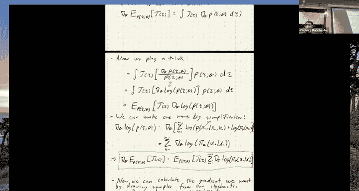

Right and I just group it so I have。

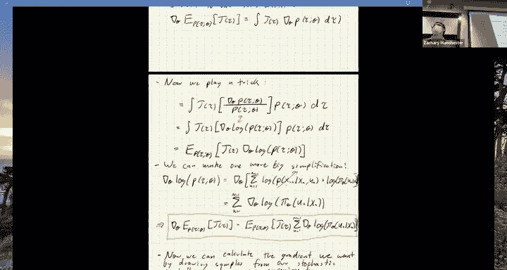

The thing I started with divided by P and then I grouped it in that bracket and then I multipied by P on the outside and what you recognize is that grad of log of P if I chain rule log grad of log of P I get derivative the inside thing which is the thing up top the grad of P and then the derivative of log is one over right stuff so that's grad of log that's the trick like that one trick is like the whole thing。

And shows up all over machine learning。I don't know what to call that like the log trick or something。

I think that one trick is basically。The policy gradient theorem。And it's very famous， but yeah。

 it looks kind of cool， it' fun it's a fun trip， I don't know。😊，Okay， so far so good。Okay。

 so the move now is and let's see how are do doing on a time basically。

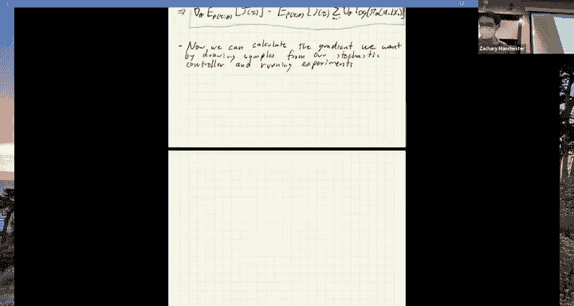

I want to plug in， I want to like do this on the LQR problem now。嗯。

And the reason is that for LQR like things are nice and easy and we actually know the form of the optimal feedback policy right it's a linear feedback K matrix so we don't need to do anything crazy with function appromators。

 we just plug that in and go to town。So。What we're going to do now is min over theta equals k。

Of this expected cost that we've done a million times。So。

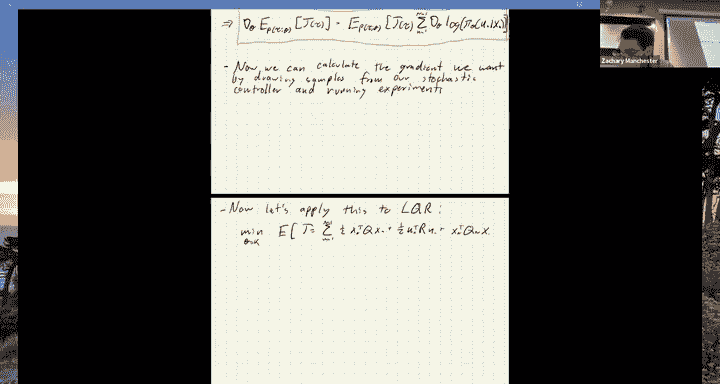

So this whole thing subject to our linear dynamics。Which we assume we don't know anything about。And。

UK equals minus K。X。Plus is V。Where again， VK is drawn from a normal distribution。

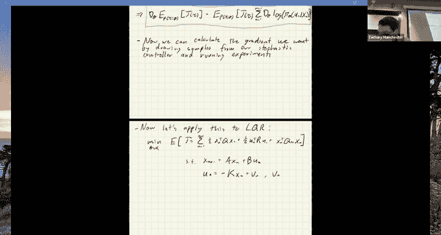

And we make up this covariance V， it's like a design parameter of the algorithm。

So that's what we're going to do。嗯。So to do this， I think like this isn't super interesting or fun really in practice to do this。

 you write this down and then call you know auto diffing whatever toolbox right but just to like give you a。

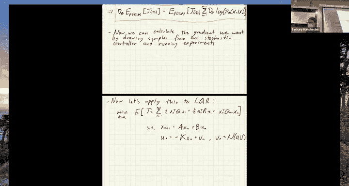

Hin， so like we have the cost function There's J。 So we know how to evaluate that on the trajectories。

 I do a rollout。 I get a trajectory。 I just plug it in and I get the J of tau term。

 The only missing thing here is this。Grab with respect to theta of the log of the probability distribution thing That's super weird。

 What does that actually look like in this particular case。

 So I guess I'll start writing it out and maybe we can。Stop when it gets too ugly。

So what the hell is this thing？Okay， so。That policy distribution， remember it's。

It's just U equals minus kx plus。Gausian zero mean Gausian white noise right so that means it comes from a Gaussian distribution so the distribution is a Gausian and we only know what that looks like so here's。

The distribution。It's got a normalization constant which I'm not going to bother writing out because it drops out。

And then it's exponential of。Minus12。And here what we did， right， minus Kx， so Vk， the noise term。

 we're saying that's drawn from a zero mean Gaussian distribution， right。

 So the mean then on that whole thing， the mean of u is minus Kx， right？

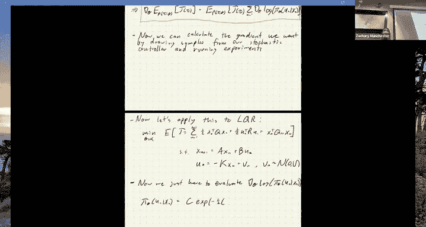

So the distribution here it's x minus the mean that shows up normally。

 so that's actually here UK plus K Xk。Transpose and then the you get V inverse。

The covariance inverse， and then same thing over here。So that's。The Gaussian distribution。

 and I want to take the log of this thing， right？

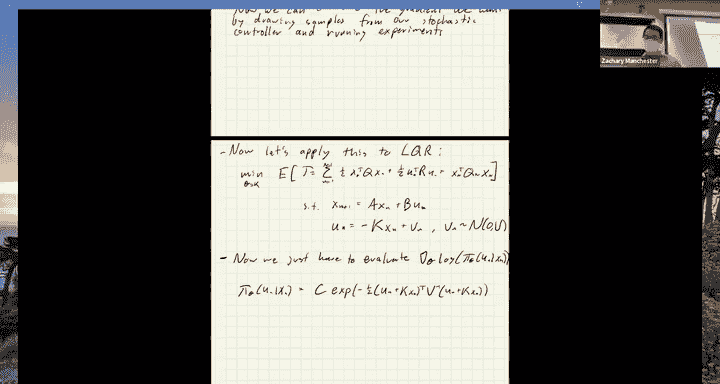

So that's easy。It's you know， some of the logs， so I get the log C out front plus the log of this exponential thing。

 which now is just the thing that's inside the exponential。

 so it's just this nice quadratic function。Now it gets pulled out here。

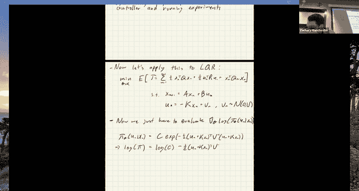

And now I just want to take the gradientding of this thing with respect to the phases。

 which in this case is literally just K right which is just a matrix。

 so I'm just diing I'm just chaining through that quadratic， it's super easy。

You could write this a few different ways。It's sort of like。It's sort of messy。

 depends how you want to do it。We can use the Chronvex stuff that we talked about before。

But basically I go through theta right equals k。So this is， I'm going to di。

This thing with respect to。嗯。第。Bing in the parentheses first。And then it's chain rule with partial。

Okay， partial data， whatever， which is the identity。 So it turns out it's use the Chroronvex stuff。

 you can write it like this。 This isn't super。

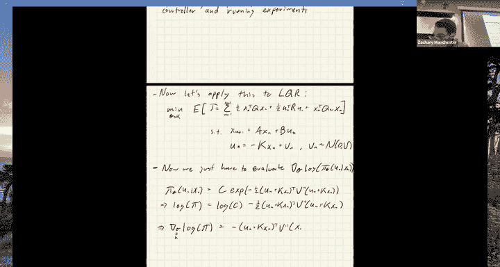

Important。Yeah， okay， so that's it， I don't know。Maybe kind of useful， maybe not that interesting。

 but normally yeah， like if you use a machine learning toolbox。

 this is done for you by magical auto givinging。Okay。

 so this is everything that you need to do this in the LQG case like written out pretty explicitly。

 so let's do like pseudocode algorithm for this thing。So the most basic。Policy gradient method。

So first， you're going to initialize with some initial guesses for stuff。

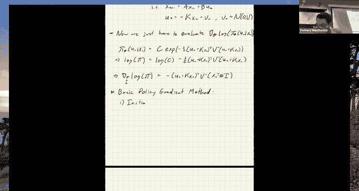

We're then going to go。

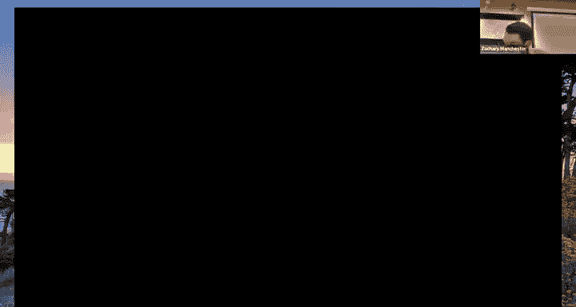

Samples and trajectories。Sample， we'll call it a batch。Of trajectories。

I guess the term of art is mini batch， so people call this， I don't really know why。嗯。

By just rolling out。The dynamics。mOf this the rolling out the system or like。Yes。With the UK。

Sample from the distribution。Then you take this batch of trajectories that you just sampled and you use that batch to just you sum over them to evaluate that expectation that gives you the gradient。

So literally what you're going to do is the gradient， which we'll call G for now。

Which is this thing that we just wrote a whole bunch of math to derive。嗯。

And so this thing we can approximate this with samples。So if we have S samples。

It's going to be sum over these S's。I guess what did I do here， this is kind of dumb notation wise。

So。This thing， I mean， it's the obvious thing you get like this。

Some along the trajectories of this thing。That we already know how to evaluate for this particular case。

That's one thing so now and then once we have the gradient。We do a gradient descent step。

What we do now。死咧。Get啊。Theta minus some step length alpha times G。

So a step length like we've seen before。Except in machine learning， people call it a learning rate。

Let's see， and then you just go to two and repeat this。Okay。Questions about that。Yeah， I think you。

So not so much， turns out like the stated reason is that these problems tend to be very large。

And the Newton methods tend to like you know not scale super well to like problems with like millions of variables。

 especially when there's not nice sparsity structure in the problem and here typically。

Things are pretty dense so you like the weight matrices and the neural networks are typically dense the networks tend to be pretty big and if you use the same policy you know weights across all the time steps now those derivatives are all coupled across all of time so doesn't it doesn't decoupled nicely in that band structure like you have in a tra job problem so the matrices tend to be pretty dense and they can be pretty big so people don't generally use newton methods they usually use first order methods。

 gradient type methods and tons of flavors of accelerated gradient methods the closest thing to Newton method that may be in like common practice practical use is people do use limited memory BfGs is fairly common which is an approximate like quasi Newton methods but that does get used but yeah people generally don't do full of Newton we have played around with it and you can make it work generally like those second order methods they have really great convergence when you're close to the optimum right when you're far away。

So like one option， if you car to have really accurate answers would be to like do some first order gradienty thing for a while and then when you get close to the answer。

 you could like polish the solution with like a round of Newton or something， but yeah。

 generally people don't do this。It's also just generally more expensive to compute like all that hesian stuff and a lot of times people don't do it There are exceptions to this I think older。

TrRPO algorithms， trust region policy optimization methods。

 they used Newton CG actually like in a lot of those methods。

 which so they were doing approximate Newton stuff to deal with the trust region terms。

UmBecause those have like second order things going on， but I think in general。

 people don't do second order stuff。Very， very uncommon， yeah。proposed positive methods on being。

We continue actions。嗯。That's where they get used for sure the most。

And I don't really know like I don't do you know discrete state action stuff pretty much at all。

 so it's really not my thing I don't think that people use that stuff there I think those methods you can do like tabular。

To learning blah blah blah kind of stuff， I think these are pretty much the go to method for like continuous state action。

Flored things。Okay， let's do some stuff unless anyone has anything else they want to talk about is code so here's。

I don know a lot to talk about。Let's see， okay， so here's。This on a super benign LQR problem。

 so 15 time steps， 1D double integrator problem。Wrote down some cost matrices。

Stuff we've done before cost function， here's a ground truth solution。

 so this is the true optimal policy right， the LQR solution。嗯。

Here's closed leaves hym of this for fun。Cool drives it to the origin super fast here's policy gradient。

So we're going to run it for a thousand iterations。

 this batch size is how many trajectory samples we do， right？

These are a bunch of algorithm parameters， this is basically your step length。

This we'll talk about in a second。This is my noise covariance。

 this was I played around with process noise by a set of zero， so it's deterministic。

Initialize the K matrix with zeros。Talk about this in a sackac and then in the other rest of this is just storing stuff because so the first thing I want to do is super vanilla stochastic gradient descent which is exactly like the thing we just wrote down。

It turns out this doesn't work like it totally fails and you need a hack to make this work it's called a baseline who's seen this before like everyone's seen this before so it turns out there's various things you can do here but the like cool thing to do there is actually to plug in a value function here and so this is where like actic stuff comes in basically you estimate the value function and stick it in here。

We're not going to do that we're going to do the dumb version which is to just plug in the average cost over the trajectory samples here it turns out I tried a bunch of things that this straight up does not work without a baseline thing in there so。

The stock vanilla versions don't work without some hacks。

 but otherwise this is exactly what we did so this is just subtracting constant off which seems like it shouldn't really affect the answer but apparently makes a big difference which I feel vaguely uncomfortable about okay so yeah this is like we sum over the batch the thing we wrote down this is that you know baseline thing which is the average cost I'm just subtracting off the average I take the gradient step and then I roll it out to ticket the cost so we'll run this for 1 thousand00 iterations of 50 samples so this is 50000 individual rollouts right that I'm doing let's go plot some stuff。

So this is cost versus oh， that didn't go well， what happened？It definitely work。

Before class so I super screwed something else somehow that looks better I don't know which just happened Okay。

 that looks pretty here's the the like truth ground truth cost from the real LQR policy this is what we just got so it's pretty close。

Let's look at the k matrices， so this is the ground trees LQR one。

 this is one we just got so it's actually the k matrix is not very close。

The costs are pretty close though and that's what we're optimizing for let's look at the rollout this looks a little bit different right than like so it's not super close but it's getting there。

Okay， so that's like as vanilla as I could make work modulate that little baseline hack。

 the other thing that might be kind of fun is okay。Turns out this atom。

 probably a lot of you heard of this， this is an accelerated grain design method so it uses some tricks。

Basically what it really is is kind of a bad approximation of LBFGS uses momentum like so it uses past grading evaluations to try to speed up progress。

 otherwise that's what's going on here， everything else is the same。

Turns out this works a lot better than the vanillaist stuff。And actually on this problem。

 we can basically get the optimal thing with this Okay so there it looks the curve looks the same but。

Turns out this gets a lot closer and really the K matrix looks a lot better right it's basically there to a couple decimal places and this looks like dead on cool Okay so this is as easy an LQR problem I can write down it's 2D double intetor dynamics it's open loopop stable right let's do a slightly harder still LQR problem。

This is the 2D quad rotor linearized that we did with LQR like a long time ago。

Same stuff from like those earlier notebooks and we're gonna linear as about hover and I'm only going to run it on the linear dynamics just the LQR stuff right but the main okay let's just do it so this is a six dimensional state two inputs blah。

 blah， blah， otherwise pretty similar giving an initial offset like a meter over a meter half a meter off in the Z cost function blah。

 blah， blah。Bround truth， OQR gains。Blah， blah， blah， this all't work cool so here's。

We're going to do the same exact thing I played with the parameters a little bit to try to get this to work。

 so batch size is bigger， most of the stuff's the same though。

goingAnd here we're only going to do Adam because the other stuff just doesn't work。

And this is going to take a while， but the punchline is this sort of works。

this doesn't work well so okay， this is actually worth looking this is going to take a while so。

We'll use the sale numbers This is kind of what comes out of this thing and these are fairly representative so this really doesn't converge and it turns out if you like try harder and give it more a play around the kind of never does。

And one interesting thing that like comes out of this， let's see if this this finished nope。

 okay so like。Why doesn't this work so its it's remember it's driving this thing with random actions pretty much at first a big difference between this and the last system is that this systems open loop unstable so if I started out like in this hover and I give it random noise it's going to just flop over and might kind of blow up on you right which is not great。

And it turns out like if you check the closed loop eigenvalues of the system with the K matrix of this thing optimized after a thousand iterations。

 it's still。Unstable， the closed system unstable it so this thing basically like。

It's just flailing around with random noise and like it never finds a stabilizing controller so I think there's some deeper things to say about this basically like this sort of random input sort of vibe。

Probably doesn't work great okay now we can actually look at this stuff if you have an open loop on stable system this might have worked a little better and that looks kind of still like garbage but yeah look the costs are kind of terrible the true K and the thing that this fit don't look anything like each other。

Clloosely yeah super unstable still right eigenvalue is greater than one I think that's about all there is to say about that so here's the the final thing I want to leave you with what I'm going to do now so this is all like model free blah blah blah what i'm going to do now is like the dumbest thing I can possibly write down to optimize this。

Given some model information。 So I'm going to solve the same problem。 Everything else is the same。

白爸瓜。Here's where it gets different。啊。I'm now， this is all the same instead of this SGD policy gradient thing。

I'm actually going to just take the gradient with respect to the policy。Of the cost function， like。

Through the dynamics model。And I'm going to do everything else the same。

But yeah you can see what this looks like I'm literally doing forward gift through the cost function with respect to the Ks and then I'm going to do like a similar gradient momentum thing and I'm going to do a line search that's the other big thing the other stuff we didn't have a line search right So if I run this。

啊。300 iterations。It like totally nails it and it gets basically the， you know。

 more or less the exact same K matrix。The costs are almost the same and like it's stable。

 closed loop stable and the rollouts look pretty much identical to。系下。

Stuff that we got from like the optimal thing， so let's see。couple minutes left that's like。

I think that's all I wanted to show you， let's see， okay， so concluding remarks。😊，嗯。

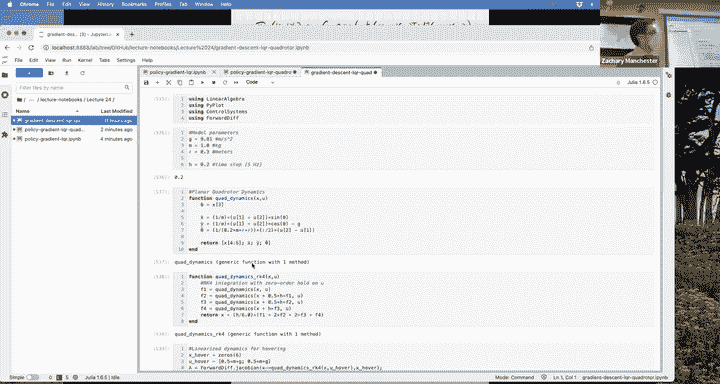

Basically， I would argue that。These policy gradient things。

They're probably assuming too little knowledge of what's going on and in particular like。Okay， so。

Let's read some stuff。So also I should say you know like my implementations these are super naive right you can obviously do better things。

 but I think the general trend I was also running them on the easiest possible problems you could you could have basically right so I think that's sort of fair。

So I don't know。嗯。A few more tricks are needed to make this stuff work in practice。

I'll post the code to if you guys want to play with it。If anyone wants to implement like。

St of theRL algorithms on top of this。And then yeah。

 the other thing is like we were doing a thousand things with like 100 or thousand00 batch size of like order 100000 individual rollouts right whereas when I did it with the real gradients。

 I did like and I was still getting crap results basically right whereas I did like a couple hundred rollouts with real gradients and got like just nailed it right so I would say these these things are pretty sampleefficient。

Which is like， a known issue。Compared to real gradients。Okay， so yeah。

 does anybody like to just like to determine this reamp？Seems like a good idea， right。

A few people have， but it's surprisingly unpopular。

Emo Toderov did a bunch of this stuff like 10 years ago， the Mujoko guy。

Did things like this where you just actually di through the simulator and get the real gradientdiance。

 but here's some like I don't know parting thoughts for the day from me。呃。So first of all。

 I will say controversial things now， so I would argue that RL trained in simulation。

 which is what everyone does because they're not sample efficient enough to get enough data on hardware RL trained in simulation is model based control。

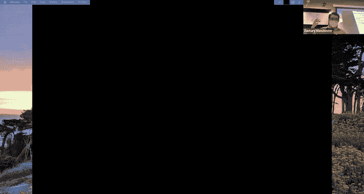

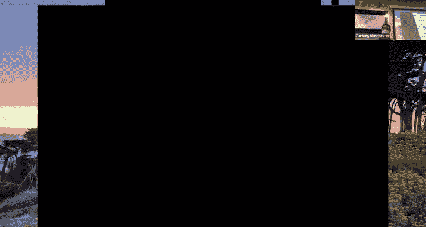

Like you're just pretending it's not。That's what I would argue。

 like literally if you are doing this in a simulator。

There are equations inside the simulator for everything that's going on that someone coded up right。

 and you're just ignoring them。

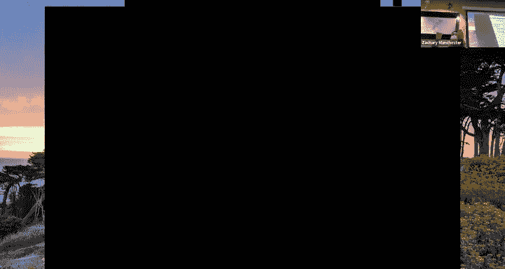

You're doing model based control， you have a model。Inside your simulator。

 you're just ignoring it and doing black box sampling。

Which is not maybe the best thing to do。

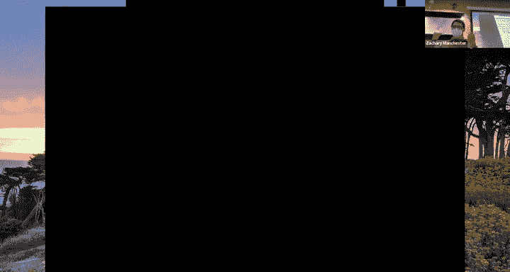

Number one， and then also like。I would you can dramatically improve sample efficiency and convergence behavior by like leveraging a little bit more model information right namely gradients of the model right so the stuff we did there。

 by the way， even if we have a bad model。

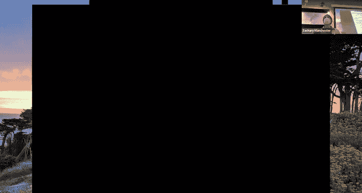

I can still get gradients through the bad model。

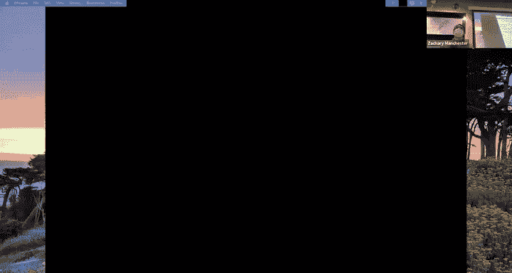

And those gradients will still probably be better and way more efficient than the stochastic sample。

 know， approximate gradients I get with this policy gradient stuff。

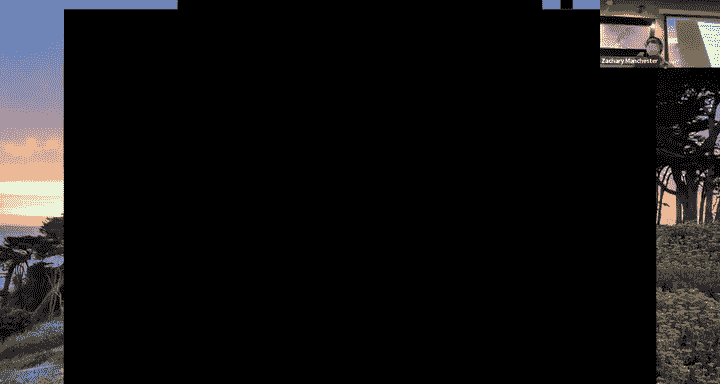

So like。That's a whole thing， that's basically what ILC is。

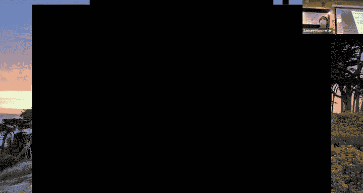