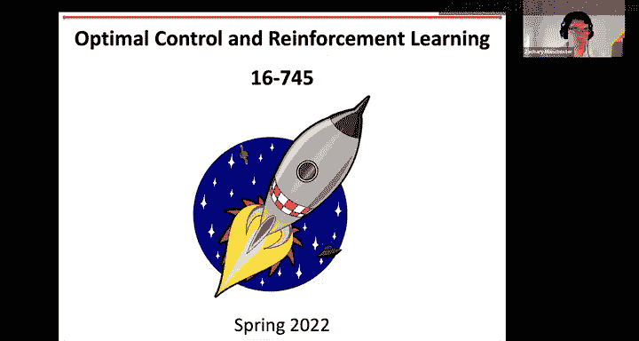
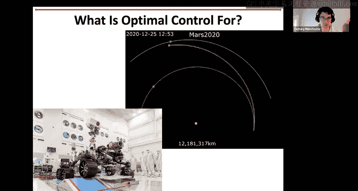
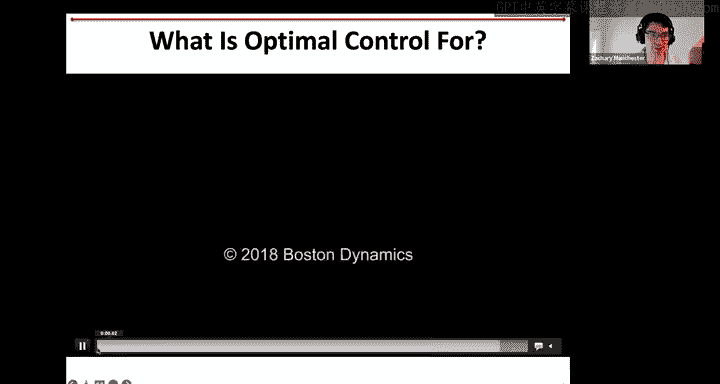
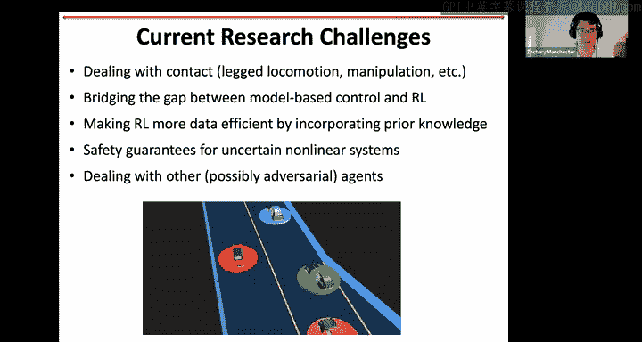
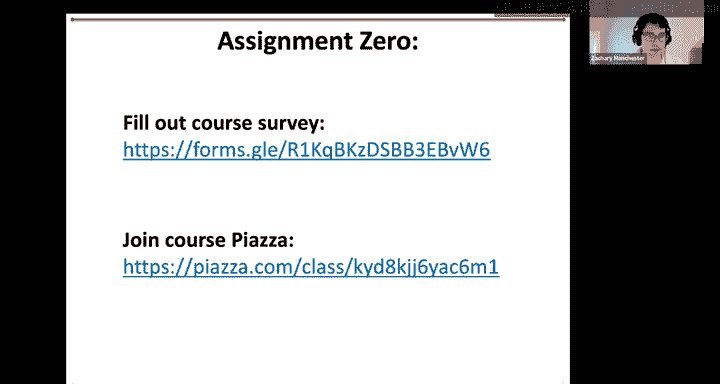
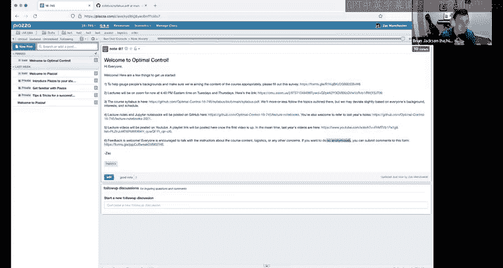
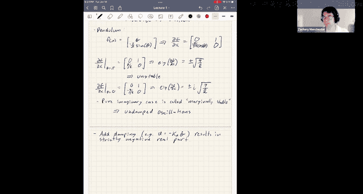

# CMU《最优控制和强化学习｜16-745： Optimal Control and Reinforcement Learning》中英字幕deepseek - P2：[02]Lecture 1_ Dynamics Review.zh_en - GPT中英字幕课程资源 - BV1qHwke1EBX

All right， I think that's probably safe to get started now。All right， so hey everybody。

 welcome to 16， 745， also known as optimalmal control and reinforcement learning。

I wish we were sort of all all together but this is a flashback to a year ago this exact time doing this from home again so we'll see how this goes so I guess as just a quick logistical thing definitely it's kind of hard to see the I can't see all your faces at once on the there's too many people so it's hard to see the little hand raise thing so。

😊，If you've got a question or something to say just for now just unmute and speak up and when you do that I'd appreciate if you turn your camera on where you're talking just so I'm not like staring into the void and be cool to see who's talking if that becomes a problem with too many people trying to talk at the same time then we'll figure something out。

With with the hand raised thing or something like that but for now yeah just onmute and then speak up and that should be fine a couple quick logistics things I guess that was one so the next step is the course team who'll be dealing with this semester so i'm Zach you can call me Zach I'm an assistant professor in the robotics Institute and I lead the robotic exploration lab and our research is in。

Opttial control as you might expect we do a lot of stuff with numerical methods and kind of very applied flavor of optimal control which is basically what you're going to get in this class so' it should be fun we can talk about our research to to some extent if you guys are curious don't hesitate to ask myself or any of the Ts Brian Jackson on my PhD students who was the TA for this course last year and did an awesome job we'll be kind of the lead TA this time around again so you guys are in good hands there and Kevin Tracy another one of my PhD students took the course and as Ting at this time around actually why don't you guys do a quick intro if you're Throne here sorry for that Brian you want to say hi real quick I'll let you guys introduce yourselves instead of me talking about you which is weird。

Oh， we can't hear you。How about me you can。 Yeah， here you go。You can hear me now。Okay yeah hey guys。

 my name is Brian， like Zach said， I did this course last year。

 I'm a fifth year PhD student and my research is in like applied numerical methods for optimal control so yeah here to help and don't hesitate to reach out with any questions about anything class related。

😊，And then Kevin's next up， Kevin， you want to say， hey。Set hey guys。

 Kevin I'm a second year PhD student， I do a lot of stuff pretty similar to Brian off control for aerospace stuff so animal stock aerospace stuff always let me know。

All right， and then ChiHb， who also took the class last year is Chihab video here。Maybe not。Okay。

 we'll skip Chihab and then last up Alex who。Also did the class last year and has been doing work in the lab with us。

And to say hi。Hi everybody here I'm a second year master's student in mechanical engineering and I work with Zach on my quad motor control stuff。

All right， cool， so that's your course team for the semester and don't hesitate to reach out to any of us anytime。

So okay， so now I'm going to kind of like。Lay out a little bit of kind of the state of the art in the field and some of the applications we're going to talk about later in the course so this is sort of things you can look forward to and kind of the direction we're going to go and where we should get you to by the end of the semester so first off kind of what is optimal control for and what are people using it for right now so in originally the earliest applications for for optimal control where a lot of it was originally developed is in the aerospace field which my lab still works in quite a bit and originally this was developed for solving for rocket trajectories for launch vehicles starting in kind of the 50s and 60s and then for computing things like today how to get to Mars for example so like designing the trajectories to fly a spacecraft from the Earth to Mars is done with the sort of trajectory optimization methods that we're going to talk about in a class specifically this gets done with No nonlinearar trajectory optimization methods。

Often direct colocation is kind of the method of choice for this stuff at places like JPL so we'll talk about this a little bit and this is sort of you know one of the current applications and historically one of the main drivers for a lot of the developments in this field so。

So more sort of state of the art fun current stuff that probably most of you're aware of is SpaceX landing rockets。

 some more aerospace stuff， does anyone know how this gets done？

Anyone who isn't one of the TAs or is it in my lab。

 anyone have any any thoughts what sort of control methods are used to make this stuff happen？

Land a rocket on a barge middle of the ocean。Pretty awesome。Has anyone followed this stuff at all？

Nobody， no one has any thoughts。Take a guess， someone take a guess。I'll guess that it's some sort of。

Model predictive control yeah so as a lot of kind of the stock stuff is these days this is convex model predictive control with a lot of kind of secret sauce and robust lowlel tracking and control stuff there's been actually a lot of progress in this sort of what's called the rocket soft landing problem in the last 10 or 15 years there's been some major breakthroughs and some seminal results on how to do this with convex optimization basically how to like sort of reformulate this rocket landing problem is a convex optimization problems this is how we land on Mars and things like that be pretty cool。

Someone said graduateraate student descent， it is thankfully not quite that bad。😊，All right so。

That's that okay so another kind of current hot area autonomous driving Tesla here being kind of one of the big players in this and one of the interesting examples。

 so arguably the control problem here is not really the hard part a lot of the kind of really tough challenges here are in on the perception side of this problem。

 but anyone have any thoughts on how this gets done。

Does anyone looked into this or do even work on driving stuff on this kind of end of things？Thoughts。

 comments， somebody say something。Help me out， to。Spect be an adaptive an adaptive controller So this stuff not so much actually so like kind of what the standard approach here is as again NPC for a lot of it and then often some lower level linear tracking control stuff so here the kind of the standard approach is to use a simplified dynamics model for the car a lot of times people use what are called single track or bicycle models and then it's kind of nonlinear NPC with constraints for collisions and obstacle avoidance and that kind of stuff is kind of the standard way of doing this but there is some really exciting frontier research some of which we've done in our lab on what's called got of game theoretic control which is where you try to reason about the behavior of the other drivers and how your control moves might interact with them and what they might do in response to you for things like when emerging and passing and stuff like this which is pretty cool so that's kind of interesting stuff in the driving realm。

Okay， so some more stuff。That's sort of state of the art and cool MIT chtah。

 a lot of people know about this and have seen this and this is one of the more exciting and more dynamic wged robots。

 so this is once again model predictive control a lot of tricks in here to make this into a linear model predictive control problem so that it can be solved online quickly but some of the more state of the art stuff is actually now venturing into nonlinear NPC here so this is sort of there's a linearmpC layer at the top and then there's a bunch of kind of clever low-level control stuff going on so that you can treat this thing at the high level as a linear system which it is most definitely not a super nonlinear so there's a bunch of secrets sauce in there but at the highest level it is again a linear model predictive control problem or convex model predictive control problem that gets solved。

And。Sort of。Maybe most exciting and kind of state of the art of all the stuff is everyone's seeing this stuff you know bus dynamics is you know pretty much at the cutting edge of our field and this stuff is you know just an incredible look at what they can get these robots to do anyone have any thoughts on what these guys are doing。

This is actually pretty speculative on my part as well like I have friends who work there and like know a little bit about what they're doing and I have some good ideas。

 but these guys don't publish and don't talk about it so were all guessing does even have any thoughts on what these guys are doing。

Do they do an offline trajectory optimization and then an online NPC？

Yeah yeah that's you know as far as we know that's and like as far as I'll talk about that's pretty much it's going on so roughly speaking what they're doing is an offline you know very slow nonlinear trajectory optimization step to plan these motions so they're like with the full nonlinear dynamics of the robot。

 all the details in there all the motor dynamics etc etctera so they're doing this like really kind of intense high dimensionmensional big non nonlinear optimization problem offline to figure out how to move the robot and then online they're doing some sort of convex model predictive control again。

 probably solving QPs again using a bunch of simpleimplifications and linearizations to track these precomputed trajectories along with some really clever stuff where they can sort of。

Build a library of trajectories that they've computed offline and then select from them or switch between them online sort of like template style and then track them。

In kind of interesting ways， so that's sort of what we think they're doing。

So yeah as far so I see people writing this chat thanks for doing that that's cool unfortunately I can't see the chat with the PowerPoint on when we switch over it might be easier when I stop doing PowerPoint but for now you have to speak up。

This is a much closer to graduate student descent whoever said that， that's kind of true。

Okay cool so Boston now these are kind of some you know totally state of the arc is and by the way。

 we're gonna explicitly go through most of these at the end of the class as kind of case study examples so we'll get you pretty close like right up to the frontier hopefully with some of this stuff and hopefully you can average so some kind of like more forward looking current research challenges like what are we working on in our lab and what are others working on in this field and where kind of the really hard problems that we still don't know how to solve here's a handful so one is dealing with contact in general so like a locomotion would be a good example of this you saw cheetah you saw Atlas and also in manipulation tasks where're grasping and things like this so anywhere where you making great contact things get really nasty and really complicated and right now pretty much every controller that deals with scenarios like that has some hacky heuristics in it to deal with what exactly goes around on around where you make great contact and there isn't really。

A good general theoretically well grounded set of tools for dealing with contact rigorously in control theory right now so that's a big one that we do a lot of work on in the lab another one is and we'll talk more about this but。

Really kind of bridging the gap between model based control kind of more classical stuff and reinforcement learning ideas and then you know kind of very related to that making RL more data efficient by incorporating prior knowledge aka incorporating more model based control so bridging the gaps between these things is kind of really interesting right now there's a lot of work going on that's a very hot area in general from my perspective RL and optimal control are really the same thing they're kind of just historically existed in different communities or different from different viewpoints or different departments but they're really the same thing and so now they're sort of starting to come together a little bit which is kind of cool。

So a couple more one another one is safety guarantees for uncertain and or nonlinear systems so how can you actually guarantee that your thing's not going to face planned or blow up or crash given you know we have imperfect models of the world and bad things can happen can we give any guarantees and what sort of guarantees can we give on performance and robustness and things like that and then lastly。

Sor of related to this driving stuff and the game theory stuff。

 how do we deal with other possibly adversarial agents， so this serves up。

Most prominently right now in autonomous driving is a huge deal so these are a handful of like forward looking things we're happy to talk about all this stuff you know we work on a bunch of this stuff in the lab。

Okay， so that's kind of。That story so what are we doing here in this class specifically so number one we're going to be focused on optimization based control techniques so the title optimal control I mean that has a lot of sort of baggage or implications maybe attached to it and what we mean by that is we're going to use optimization to do control and that's sort of a very broad set of tools and ideas we're going to focus on very heavily on applications robotics applications in particular over theoryory so this isn't really going to be a course where we are like proving theorems or know deriving the you know ponttry and minimum principle or things like that where most they going be focusing on on coding up algorithms and really doing it with an eye towards hopefully you guys being able to take this stuff and go apply in your own research or in your own careers after this。

We're going to have four kind of major homeworks over the course of the semester they'll be again they'll be coding assignments focused on implementing algorithms try and step out that kind of thing so they'll be sort of。

Jupiter notebook based things and do on GitHub and this kind of stuff and then lastly we're gonna have a course project that you guys are going to work on in groups not only groups of one to five I think would I think it's a better idea if you do this with somebody else so if you're inclined to do by yourself I mean that's okay if you really want to if you have something from your research that you want to do here that's cool but I think you'll have a better time doing a friend or two and the idea here is to do something cool do something interesting that interests you hopefully if you're a graduate student you can do something that's sort of directly related to your research and hopefully get a kickstart sort of jumpstart on a conference paper or something like that and do something that's just totally relevant there we don't want you to like spin your wheels on something you know random here。

 do something that matters to you do something cool。

Okay and I should say as a disclaimer out the gate。

 this is definitely more of an optimal control class。

 it's definitely from an optimal control viewpoint as opposed to a reinforcement learning viewpoint as I kind of alluded to before。

 from my perspective these are really the same thing and it's really just a matter of perspective and viewpoints and a lot of times to use a polynomial or a neural net in your function and approximation is really what separates these things so we're going kind of try to look at this from a uniform viewpoint mostly deal with with model based up but we'll also talk a bunch about what you do when you don't have good models how you can use data-drin techniques and sort of where all the connections are between optimal control and R。

They're really kind of， you know， it's a continuum and they're really kind of in the same same space generally。

 so hopefully we'll set you up with kind of a good baseline set of tools here and techniques and sort of knowledge base that you can use and apply in any of these settings。

Okay， so logistical stuff lectures are on zoom as you all know for now because you're here we hopefully will be back in person in a couple weeks T so more on that I guess in the next couple of weeks and I will record and post the lectures this is getting recorded right now I'll post them on YouTube and a playlist and。

Even when we go in person， I'll still record and post lectures So let's see I'll also post my notes I'm going to write on a tablet and those I'll PDFf them and upload them to GitHub。

 I'll also do a lot of Jupyter notebooks and kind demos in class we play around with code live hopefully it works most of the time。

 And so I'll post those Jupyter notebooks along with my kind of handwritten notes we're gonna use piazza for kind of course communication。

 realtime Q&A， et cea。 hopefully all the course communication we can kind of just do with piazza and avoid email and I really don't want to use Can I'm probably gonna use it just for posting grades but we're not gonna like collect assignments on there or do any sort of communication really through Can at all So definitely get on the piazza site we're gonna to use that for pretty much everything。

 we're gonna use Github to collect assignments I think that's about it。

Yeah so GitHub we're going to use Gitthub extensively so need a GiHub account i'm going to send out some kind of poll for office hours so those are t they'll be on zoom for now and we'll see in a couple of weeks but we'll kind of dynamically address as we go for this stuff and don't hesitate to reach out if you you know need to talk anytime we're pretty flexible and there's a bunch of us okay so any questions about any of this stuff any of the logistic stuff and just onm mut and speak up got any questions。

Anything I talked about so far， questions， concerns， comments， thoughts。Okay， so。

On onward then so we have two kind of like two things for you guys assignment zero we'll call it so first is there's a course survey Google form that's just me asking questions about like。

Courses you've taken before kind of background things to try to gauge where everyone's at and hopefully target the content a little bit and stuff like that and then we're the Piazza site which we need everybody to join so there's the links this all get posted I can probably put these in the chat as well I'm going to stop sharing the screen for a sec and then i'm actually just going to pull up the Piazza site and we can。

Look at some stuff there。Okay， so let's try this。So a couple more things。Okay。

 so here's the Piazza site and then right on the front page， here's kind of the survey link。

The zoo link。The syllabus which we can take a quick look at just kind of go through anyone has any questions on this so really what we're going to look at here also grading it's going to basically be half projects and then sort of 40% homework meaning each homework toward 10% and then 10% participation which is really like giving the wiggle room to bump people and the event that things are around the edge stuff like that Okay so here's kind of what we're going to talk about so today we're going to get after we're done with all this upfront stuff we're going get into dynamics and this is just kind of background on dynamic systems that you need to be be able to do control and hopefully that's mostly review next time we'll talk a bit more about stability and discrete time dynamics which is how we get these into a computer。

Then we're going to have a few lectures on just optimization in general。

 so kind of intro optimization， and then a bunch of stuff about numerical optimization。

 how you actually solve these optimization problems with computer。

 getting into how we deal with constraints， things like that。

And then we'll get into sort of optimal control， which is kind of a special case of optimization in general。

 some classic stuff， the contragon minimum principle shooting methods， LQR。

 sort of bread and butter stuff。onic equations dynamic programming then we're gonna to get into a sort of convex model predictive control a bunch of which is used all over the place right now is have one of the standard things to do then we're get into sort of nonlinear trajectory optimization how you solve those problems a bunch more tweaks on top of that setup direct methods colocation methods things like that then we're going to talk about how to apply these methods specifically to systems with that have 3D rotations which shows up all over the place in robotics so anytime you have nonfixedbased systems of legged robots that can rotate around all the way or flips aerial vehicles。

 drones spacecraft underwater vehicles right so anything that's not bolted to the world like anything other than a classic manulator arm so we're gonna to talk a bunch about that stuff because it shows up in practice a ton and it's sort of a pet peeve of mine people。

Do it the wrong way a lot so we'll teach you how to do it the right way so we'll do a bunch of that stuff then we're gonna get into some more robotic specific things so we'll talk about contact systems that make a great contact all you know like at robots and manipulators how you do trajectory optimization for those systems so how you do kind of the CheA Boston dynamics stuff then we'll talk a bit about data drivenri methods and what to do when you don't have super good models。

Then we'll talk about stochastic optimal control， so noisy sensors， things like this。

 and the LQG problem which is a special case， which is kind of one of a classic bread and butter results in all of optimal control。

 so this is basically LQR plus a common filter。Then well talk a little bit about robust control so what if you have uncertainties on your model and some methods for solving those problems then we'll do a little bit of a quick whirlwind tour of RL hopefully kind of with the same perspective and notation and stuff from the rest of the course we'll do some I mean this stuff's RL as well it's but this is sort of kind of maybe a broader survey of stuff some this is we did this last year and I think it was a good thing to have so kind of a practical tips and tricks session that shares a bunch of random things that you should know about but that aren't necessarily。

Eory things that taught in most courses and then last year we did these case studies which I think were pretty cool I'm open to adding more of these or having different ones。

 but last year we did the rocket landing problem and then we did a bunch of stuff about driving and how the car stuff works and then a bunch of stuff about walking systems and how kind of a quadrup humanoid stuff works and then the last week is going to be for project presentations so we'll kind of have you guys to do lightning talks for the last couple lectures and hopefully hopefully we can have some Q&A and you know that'll be fun so that's kind of idea the homeworks here these will probably get spread out a little bit more but its kind of just generic for right now and then I'm even kind of a good few weeks at the end for you guys to really kind of dig into the projects that's the intent at least and the projects will be due like as late as I can do it kind at the end of finals time or whatever just a few days before the deadline for me to hand in the grades so I'll give you guys as much time as possible there so you'll have a bunch of time after。

the presentation slots to keep working on the project right up and on that note you guys can all agree this but just to give you a heads up for the project you'll have to do this kind of lightning talk thing a couple minutes the last week we won't expect you to have your full report done at that point you'll have another couple weeks over the finals and everything to write it up but the idea there is to basically make it look like a conference papers so we're going to have you do kind of the standard Acra IRAOS conference paper format so it's a six page two column IEEE format kind of the standard thing and so that's kind of the level we're looking for here is roughly six pages and you know kind of at the level of something you know that you could turn into a conference paper hopefully。

Okay， so that's， I think。Kind of all the important highlights of what we're going to do in the class any questions about any of this stuff oh yeah there's some other stuff okay so late homework policies so I'm going just give you a budget of late days I think we did six last time and that worked out okay so you just have six late days you can use on any of the homeworks and any combination you want is there any other important things。

I think that should be so we talked about this， no textbook， but I'm going to post videos， notes。

 all that stuff posted。Yeah， anybody have anything？For we kind of。Think that's。And's it for that。

 for sure。Okay soll those lecture notes will be on Github here's links last year's are up there too if you want to look at last year's I'm going to make a YouTube channel playlist with all the videos you can see last years and then the last thing is with this Google form so first off yeah。

We're not perfect I make mistakes all the time we can always make this better so especially with weird remote kind of logistics it's kind of weird so if anybody has any feedback I always want to hear it talk to me talk to the Ts anytime about anything content logistics concerns whatever you got。

Yeah don't be afraid to to speak up and then if you don't want to sort of like talk face to face or zoom or whatever you can also do so anonymously we have this Google form which is does not record your email address not shared I promise it's anonymous and I just get a like totally anonymous email from this whenever you submit something with whatever you said so yeah I think that's it。

So anyone has any questions， feel free to speak up while I。Switch over to。Actual stuff。

Yeah I have a question。Are the homeworks auto graded on GitHub？So we have some。

 we have an auto grader thing and we actually we try to be nice guys and we actually post sort of like along with the assignments we'll post。

Sort of unit tests that will evaluate your answers so you can check your answers before you turn it in so that you'll know if you got it right essentially so it'll be like a set of tests that you can run yourself before you submit and then when you submit we'll run a different set of tests on it just to verify but yeah so there will be like some autograding stuff if you don't pass the tests we'll actually go look at it you know by hand and stuff like that and for the grading but yeah you should I mean basically it set up such that like if you just put the time in like you'll know if you did it right if give yourself enough time you should be able to go through it you know make sure you're passing the test you're not passing a test come talk to us in office hours and figure it out right so I definitely I want you guys to succeed you're not trying to check you or anything like that and as long as you kind of like put the time in there's no reason you shouldn't be able to get perfect scores on the longers。

Co， thanks。I have a quick question Yeah are there any readings for the class or like text or anything we should refer to so there's there's a bunch of optimal control textbooks I can post some of those as references as sort of general references I'd say like I'm kind of taking a bit of a nonstand path through this that's a lot more sort of like computational you know implementation focused and there aren't really a ton of good books on that a lot of stuff we're going to do but there are definitely are some good general references and I can definitely like post some material and try to like along with the lecture notes from each week I can like definitely post some references to check out to sort of like go deeper and look for more so that's a good one I will take that as an action。

Cool， thank you， okay， yeah。For the quick question for the homework what programming languages yeah that's a very good one so Brian would you mind taking that one real quick and we'll use your stuff from last time。

Sure。So yeah we'll be using Julia in this class for those of you who haven't used Julia which is probably a good number of you。

 it's very similar to MatTLb and it's very easy to pick up if you're coming from either MAlab or Python really don't worry about it too much it should be fine so I'll post a bunch of content to help you guys kind of transition from either one of those languages and get ramped up pretty quickly so I can put like a 45 minute tutorial and then like a cheat sheet so I'll post all that on piazza in the next couple days。

😊。

And like I'm I've been using Julia for a while since like pre version 1。

0 so like if you have any questions like whatsoever like Julia related like please hit me out。

Thanks Brian， Brian is definitely our resident Julia expert he's sort of。啊。Definitely better than me。

But yeah， it's mean I came from MATLb and for a long time I basically copy and pasted my MATLb code into Julia and fixed the handful of errors that would come up so it's it's。

It's ridiculously similar to Matlab at least you know the easy stuff so it shouldn't be too steep of a learning curve if you've done MATlab it's super easy you've done Python it's pretty easy still there's a few more differences between it's a lot closer to MAlab than Python but like it's really not bad so as long as you've had experience in one of those or both of those you'll be totally fine and it should be pretty easy to pick up and we're gonna give you live template code and stuff like this with the homeworks so it'll be kind of fill in the blank so as long as you know how to do like array math matrix math using like MATlab or My it shouldn't really be a prone。

O。😊，Anybody else？All right， cool， so I'm now attempting to make my tablet work。And。This is。

A perennial challenge is always harder the first time and I haven't done this while， so here we go。

Share screen， start。

All right， I think it's working。啊酷。Right， we're in business。All right。So and like I said， yeah。

 if you have questions while I'm doing this， just just speak out because I'm like off in my own little world here looking down at things and I can't see the chat super easily。

Okay， so what we're going to talk about today is kind of dynamics， I would say。

 I guess continuous time dynamics in particular。Of controlled systems。

So hopefully this is a review for most of you guys and you've all done some of this before。

 if you haven't definitely you know speak up talk to us and we should be able to get you up to speed。

Okay， so the most general。Slash generic。Form for a smooth dynamical system。Is the following。

 so we have a first order。Vectctor differential equation。That looks like this。So X here。

Is generically called。The state。And this is a vector in Rn。

Usually although we usually make this assumption that it's a vector in Rn but it's often not in fact most of the time in robotics it's not but we still kind of assume this in a lot of cases so that's sort of you know positions velocities everything you need to describe where your system is and how fast it's going so for most robots this would be like。

knowMaybe the center mass position and velocity plus all the joint angles and the joint angle velocitylocities that kind of thing so that state。

The you here。It' is called the input。And again， this is a vector usually in a different dimension from we say RM for this guy and this in our most robotic systems。

 this would be like your joint torques， for example， on an arm or on a humanoid for a quad rotor。

 this is like the thrust from your propellers or the motor currents if you want to go lower level say for rocket this would be like the thrust and the gimbal angle for the engines。

 this kind of stuff right so this is the stuff you have control on your control system and then Xta is actually obviously the derivative of your state。

And then this thing F， this F function。We call this function the dynamics。Right， okay， so that's。

 I think。There to say both that so for any smooth system， we can always write it in this form。

 it's a super， super generic but for a mechanical system。So most robotic systems。This looks。

 the state vector will look like。What we call the configuration。

 so this is kind of position and or joint angles， we call that Q and then the velocities V。

So this guy is called configuration。使。And in particular， this configuration queue is not always。

A vector that's going to be important later。But V is always a vector。Okay。And questions about that？

Okay， so we're now going to do everyone's favorite。Dynaical system。Be pendulum。So。

I mean I'm sure everybody's seen a pendulum before， so this is hopefully a super review so this guy。

We're going to be the classic thing we've got you know。Some mass M over here in the end of it。

 we've got the。Length L hereable。 And then we got an angle theta。F like this。

And if you do kind of your standard f equals in a torque balance or oil lagrange equation。

 however you want to do it， you get dynamics that look like this Ml squared theta double dot。Plus， M。

 G， L sign。Theta and we're going to assume since we're in a controls class that we have a control torque here that we have an input that we can actually do something to the pendulum right so we'll say equals tau so we assume we are a torque about the base of the pendulum the same angle theta right there and this torque is going to be we're going to treat this is our control input you。

Okay， so those are our dynamics。 I guess。And here right so looking at our kind of generic form of sort of dynamics there。

 we're going to put this into that generic form， so to do that we need to define our configuration and our velocity and kind of stack it up in that standard form。

 so here our configuration Q is just theta the angle and our velocity V is going to be theta dot。

And if we put this together， we get x equals。Theta， theta dot。And then our dynamics。

It's going to be x dot， which here is equal to。Theta dot。Data double dot。It's equal to。

So obviously theta dot we've already got that in the state vector so that's super easy that's just theta dot and then theta double dot we're just going to solve this equation in the box for theta double dot and kind of move things over so we're going to get minus G over L sine theta。

Plus1 over Ml squared U。Okay， any questions about that？

So that's pretty straightforward everyone's seen this before i'm hoping here's the fun bonus question so we said you know this whole thing about configurations not always being vectors does anyone know what the configuration space actually is for the pendulum？

It's not our RN。T or no。Dont ask question。呃。Depending on how you're。

 if you're saying there's a ceiling or not， it's sort of。

I believe S1 Yeah circle excellent yeah so it's it's a circle right I mean this is very intuitive step but geometrically it's not the real line right and in particular it's topologically different from the real line because it wraps around on itself right so this is actually kind of interesting it's a compact manifold as in it wraps around it doesn't go out to infinity like the real line with so actually here the Q is not a vector it's actually an element of this S1 a circle。

嗯。And on that what's the state space then， so we have the configuration space or configuration manifold is the circle。

What's the？What's the date space when I have both？Configuration and velocity。As a touristus。Yeah。

 so why is it a tourus？Oh no sorry's not i'm sorry that's that's wrong sorry that wasn't I was listening so it it's not a tourist so。

😊，Remember okay so the configuration is a circle the velocities here are not an angle。

 the velocities R vector in Rn so in particular here they're just R right so think about circle the velocity vector is tangent to the circle right so it's this tangent line at any point on the circle so actually the state space here is actually S1 cross R it's a circle and then at every point on the circle the velocity is just R so topologically if you think about that geometrically but that actually is a cylinder。

It's sort of a circle and then you， you know at every point on the circle you get the real line。

 so you have two coordinates and' that's the cylinder。然就是算。

Fun facts that often don't get talked about。I think interesting Okay， and yeah。

 this guys a next you here， Okay， cool， that was a fun little aside。But yeah。

 this shows up all the play so the Taurus someone talked about that was Taurus is actually the configuration not state configuration manifold for the double pendulum right because there you've got S1 cross S1。

 you have two circles right the first link in then the second link and that if you imagine you have the circle and then every point on that circle you have another circle that makes a tourus。

Okay， cool， so moving on then of random distractions from me。All right。

 so now we're going to talk about a slightly more sort of specific class of system or restricted class of CM cult。

Control ane。Okay， so these look like the following x dot equals， we're going to call it f not of x。

 which importantly this is only a function of the state。Plus。What should we call this。

 We'll call this。啊。D of x times u。So this Fmont。We call the drift。True。

And then this guy is called like the input Jacobian。

So we call this control aine because in the control input U this is affine right totally it can be totally nonlinear in the state。

 so like f not of x can be totally nonlinear B of x can be totally nonlinear but B is a matrix right that multiplies you so in terms of just U this thing is control aine。

U。And the interesting thing about this， so this has a lot more structure than the first problem right。

 and it turns out that most systems can be written this way in particular all mechanical systems can be written this way and I would say actually I think any smooth system basically you can write this way。

And this has some important control implications。So even know if I have a system that doesn't look like this。

There's a trick for rewriting it in this form。あ。I can so like if I have sort of weird nonlinear coupling between an X and a U there's a trick mathematical trick at least where I basically introduce new states that correspond to my original U and then I make my new control into it the derivative of whatever U was before and if I do that it becomes control aine so there's always mathematical tricks you can play to put。

Not control a systems into this form as long as they're smoother than differentiable and like good stuff so if we do this to our pendulum。

啊。Here's what that looks like， so I'll put my pendulum in this form if not then。I's gonna be。

Theta dot appear。 no problem。 And then the。G over L s theta term。And then this sum。B of x。

Guy is gonna be。Zero and then。1 over M L squared。Down here。

 so whatever was multiplying you up top there。So make sense to everybody。Okay。So that's that。

So next up is one that if you're you're a robotics person。

 you've almost certainly seen taken KDC I know you've seen it so this is。Manipulator。Dynamics。And。

This looks like the following， there's several flavors of this that you'll see。

But we're going to do this in a particular way because that's what our。

Dynamics toolbox that we're going to use。How how it does it so。this looks like。嗯。

This is maybe bad notation overloading on my part。I don't know。 It happens。

 And this is what people do。 So we'll go with this。 Okay。

 so this M guy up here is called the mass matrix。This C。Here is called the D bias。Our direct bias。

Or just bias。And this includes like， for example， your choriist terms， your gravity terms。

People often wrap damping terms in there as well。And there's a few ways to write this。

 but this is sort of the one that the toolbox we use in Julia uses so that's what we're going to do This thing once again is called the input Jacobian。

And the rest of this stuff， you know what it is， I think。我。Okay。

 so this is the dynamic stuff and then often we will also have sort of a second piece of this。

 so notice this only this let's us solve for the accelerations right V dot。Accelations。

 we still need to solve for the cues， so how we get those， we need a second ODE。And that。

Looks like this。And a lot of times we don't talk about this。

 we will because I hope this show up later， and these we're going to call this the velocity kinematics。

哎。So a lot of times the Jacobian in there that G ofq is the identity。

 so a lot of times we have you know v equals Q dot and then this is kind of trivial and often we don't even bother were talking about it but many。

 many times that's not the case and there's sort of a Jacobian in there and in fact a lot of times V and Q dot of different dimensions that happens but for example we have attitude dynamics going on。

Okay， so if we have a system in this form， we can always kind of put it in our kind of more generic form。

Like。So the velocity stuff is just。G of Q times V right and then the other stuff we just take that manipulator equation and solve it for v dot so that we just kind of move everything over we're going to get minus M of Q inverse。

Times。B of Q， U minus C。 And I'll leave out the the details there。The arguments。Okay。

 so going back to our pendulum。And I'm kind of running it this way。It's pretty。

 you can kind of sort of squint at the equations up above and kind of see what these terms are so M of Q here。

Is just ML squared， and you can see this up here。Right so it's the thing multiplying V dot so our v dot here is beta double dot so ML squared is the mass matrix or sh realized inertia tensor if you want to be fancy。

The Coriis term or dynamic bias term here。The see。Is our is basically the other term there， So GL。

Sine theta。So the other term from up here。Right， from this guy。And then。What else we have？Yeah。诶。

Right and then the other stuff super easy。 So then the B here is the identity and because Q do equals V here。

 we using theta dot for V that。That Cinematic Jacobbian guy is also the identity。Okay。

 so any questions about that？All right， and the last note on this is that all mechanical systems。

Every mechanical system you'll encounter so pretty much every robot can be written in this form mand form so this shows up all the time super useful does anyone know why that's true。

Take a guess I don't most of you guys have seen this before so anyone know where this comes from or why this should be true like why can I always do this for a robot。

嗯。Someone， someone make a guess。No one has any thoughts。签完没。All right。

 so this will be I'll make this a bonus question if anyone can like work this out I'll give you I'll tell you why basically。

 but then if anyone actually wants to work out the detail。

This is a worth bonus this point so this manipulator equation where this comes from。

 this is actually just a way of rewriting the oil and laggrange equation from like lagangian mechanics。

Yeah。啊。So in particular， if you're Lagrangian。Equals one half v transpose M of Q V。

 like the usual M squared thing minus like a potential。

If you turn the crank on that and just plug it into the ground equation and you know simplify it down you'll get the manipulate equation so if anyone does that and actually crans through this。

You get bonus points。我。Okay， any questions about anything？All right。

So let's see now we should talk about linear systems so we're kind of going from more general to more specific and this one is basically the bread and butter of control so there's lots and lots to say about linear systems。

And there's entire courses on linear systems， if you really want to get into this field。

 I highly highly recommend taking a linear systems theory course at some point I know one an ECE here。

So we're not going to go that in depth on these guys。

 but you should know the basics so just in case you haven't done a ton of this before。

 here's the basics so a linear system looks like this。

So x dot equals a times x plus b times u where A and V are matrices I put time arguments on them because they're allowed to be you know functions of time there's a few cases here so the linear system is called。

Time invariant。If A of T。Equals just a， some constant A and B of T equals some constant B for all time。

It's called time varying otherwise。So if those things do vary in time， you know。

 it's sort of obvious， there's some other interesting cases you can get into as well。For example。

 you can have linear periodic systems where like A and B of T are actually periodic with some period。

Capital T that that can be interesting。 that actually shows up a lot in walking systems， for example。

 So if you're walking gate a periodic walking gate， you can end up sort of。

Turning that into a linear periodic system and there's special properties there that you can take advantage of these are kind of like a kind of literally super super important in control and control theory and control design so。

They're everywhere。And that's for sort of very practical reasons these are the only systems we know how we always can solve right we can always solve linear systems and a capture of those other things and yeah that's sort of that's why that's the case and so because of that because there's like。

A whole well developed theory for these things we essentially can know everything there is to know about any linear system right so we often approximate nonlinear systems with linear ones as as follows。

So if you've got the generic nonlinear system， xt equals f of x， you you can linearize this and。

Do A is partial F partial X take the Jacobbian and B is partial F partial U and you can do all kinds of fancy things obviously you need to evaluate those derivative somewhere and you can do this whole bunch of ways there's all kinds of tricks but if you can play this game then you can take advantage of all the standard control results for linear systems and apply them to nonlinear systems and that is really kind of the name of the game most of the time is to somehow take your crazy system and sush it into the form of a linear system where we know how to do things。

Yeah， one of the sort of founding fathers of control Bryson， Art Bryson。

 who you will will whose name will come up again， had a quote that was in like one of his books somewhere is something called that was B wises linearar Eye。

Okay， cool so that's that's sort of， I think。Roughly all will need for。dynamicynaal systems。

 continuous time dynamical systems， there's a little bit more to talk about。

 we're going to dig in a little more now to smaller stuff but this is sort of the kinds of systems we'll generally talk about and that you'll need to be aware of。

U，And I can post some references on this stuff after， okay， questions， speak up anytime。Okay。

 so what we're going to talk about now are。嗯。Equilibbriria。So this is a， again。

 a pretty core concept in control。And so the intuition for what this is。

 it's a point where a system will sort of remain at rest。

And can anyone tell me what that looks like in terms of the dynamics， in terms of F of XU？Come on。

When it equals zero yeah， thanks okay， so that's right so you know。

 remain at rest not move so you know intuitively then the derivative here。Needs to be 0。

That's the definition of an equilibrium point so algebraically we can kind of just look at this as a root finding problem。

 I just need to solve f of x u40 and if I can do that if I can find a zero of that function。

 I've got an equilibrium point。All right， so let's go back to our pendulum again。

So if we write those dynamics down one more time。We've got theta dot and minus g over l sine theta。

 so this will just deal with the uncontrolled dynamics for now and we want to set this all equal to zero。

So the top part easy， theta dot equals 0 velocity zero that's sort of a no braininer。

 how about theta？What does theta need to be here for this to be have an equilibrium point thiss pretty intuitive also。

Por virtue。So it depends on how you define your angles right so the way I defined them before in the picture this is。

This is theta equals zero。Right， so sine theta， sine sine theta， sine of 0， zero， right。

 and there's one more。So where else does theta equals0？So straight up right tie。

So we got zero and pi， so there's kind of two equilibrium。Here。Okay。

 so now we're going to do our first control problem。

 so now I've got to look at this with with the control torque in there。Okay， so question。

 can I move the equilibrium points？So do you think。Can I sos。We can by applying some input。Yeah。

 that's exactly right， so what I'm going to ask now is let's try to put it at say pi or two。

Let's try to put it straight out here。So now I'm going to write the dynamics with the torque input and we'll take a look。

 so here we've got theta dot， which we want to be0 and we've got minus G over L sine。

 so we'll put pi over two in here and then we've got the input torque。

So we need this whole thing to be zero， right？So velocity is easy。

 but I need to solve that second equation now。For for zero， right？

So if I kind of just go ahead and do that， I get。I get one over Ml squared U equals。G over L sign。

Pi over two， pi over two is， obviously you。Spi2 is one， so this tells me that u equals。MGL。

And so I mean this is super intuitive that I'm basically applying a torque that's going to cancel out gravity at that position right I could make this wherever I want right so with this trick I can plug in any the I want solve that equation for you and get an equilibrium equilibrium and move it anywhere I feel like right a quick question yeah。

So in this case what this the interpretation of this would be that like if let's say the pendulum was at the equals pi over2 already and then you wanted to hold it there。

 then you'd have to apply this U but it wouldn't necessarily get you to that equilibrium position that's right so what this is saying is if I want this other point to be an equilibrium。

To be a place where the system will hang out if it starts there this is what I need to do right it doesn't say anything about how you get it from some arbitrary point to there that's sort of yeah we're going to talk about that for sure。

 but yeah this is kind of one of the core core ideas。

It's like if I want to drive a system to a set point right。

 first I need to know what the set point is and I may need to do some weird stuff to create a set point that I like to drive it to right？

Cool so。In general， we can just solve a root fighting problem here in you。So。So given some。You know。

X star that I want to be an equilibrium。I can plug that in to the dynamics set that equal to zero and just solveulfur for the U that makes that happen I can't always do that It depends on the dynamics of the system for the pendulum I can always do it in general。

 if the systems fully actuatede I have as many control inputs is I have degrees of freedom I can do this pretty much it gets more complicated for under actuated systems Okay so that's equilibrium point or equilibriumria plural so the next thing to talk about is stability。

Of。Equilibria。And this is kind of。Starting to follow up on the question that was just asked。

How do you get there， et cetera Okay， so the idea we want to get at here is if we start up near an equilibrium point。

 will we stay near it under say small perturbations？So that's kind of question。When will we。Stay。

Fuzzy， near。诶。Equiilibrium。Point， say。Under under likes。Small perturbations。And to get at this。

 we're going to look at a super simple 1D dynamical system， it will be a nonlinear system but。

A1D system and here I mean 1 d the state space is 1D so the pendulum it has one degree of freedom。

 the configuration space is 1 d but the state space there is actually 2D right because the state has theta data up here I mean the state is 1 d。

Yeah。So these are kind of interesting。In that。We can basically understand everything there is to understand about 1D nonlinear systems。

Which is kind of cool。So here's a I'm going to draw a 1D nonlinear system。Where。

The X axis is going to be x。And the sort of vertical axis here is going to be x dot。

Which is our dynamics right FMX and here there's no control it's just an autonomous system and I'm going to draw sort of the dynamics function。

 let's say it looks sort of like like a cubic maybe looks like this。Yeah。

So let's say that's our dynamics function and you can think of this like some weirdo you know cubic polynomial or something like that so first question is where are the equilibrium points？

Yeah。Yeah。3 zero crosses yeah crosses zero exactly so we got three equivalent drain points at these zero crossings so next question let's look at the one of the origin here so and keep in mind right like x dots the vertical sort of axis so if I get pushed a little tiny bit to the right in this picture。

嗯。X dot is negative that means I'm going to sort of drift back towards the equilibrium point right so draw this so if I get pushed a little bit to the right I'm going to I'm going to end up getting the dynamics are going to naturally nudge me back to the left and vice versa if I get pushed a little bit to the right X dots positive and I'm going to get pushed back。

I can push the left， if I get perturbed towards the left。

 the dynamics will naturally push me back to the right。

 so I'm going to sort of naturally stay in the neighborhood of this equilibrium point。

So let's go look at one of the other ones now， so's let's take the right one for example。

 so in this case， if I get pushed to the left。X dot is negative。

 that means I'm going to go further to the left。V versa if I get pushed to the right x dots positive I'm going to go further to the right the dynamics are going to carry me sort of farther away and then same thing on the left one if I get pushed left i'm going left if I get pushed right i'm going right so looking at this very intuitively we say。

The middle one here。We say this guy is。Stable。Because under small perturbations。

 the dynamics will sort of naturally kind of restore me towards the equilibriumerating point and then the other two。

We say are unstable。Because if I get nudged a tiny bit away from the equilibrium point， that's it。

 I'm going。Okay， so any questions about that， does that make sense to everybody？Cool。

 so we're going to now sort of like take this really intuitive picture and we're going to kind of generalize it to n dimensions。

Almost trivially so what we're going to do is look at the slope of F of x right so we kind of did here as we reason about is X stop positive or negative on either side。

And we found you how this works， so if we look at the slope now of F of x in the neighborhood of the equilibrium point。

 you'll notice in the stable case， the slope is negative。Partial F。Partial X。Negative。

Implies that the equilibrium point is stable。And conversely， if you look at the unstable cases。

 the slope at the equilibrium point is positive， and that implies that if you have partial F。

 partial X，Positive， you're going to be unstable。 your equilibrium is going to be unstable。

So that's coming just right from this picture that we just did。In higher dimensions。

We can still take these derivatives， but they're no longer scalers， they're just Jacobban matrices。

 right？So what do you think happens in higher dimensions？So we get partial partial eggs。

This is a Jacobbian matrix。And so it's n by n where n is the state dimension。

 so it's a square matrix and。Does it depend on the semideinness definiteness No so that's sort of property that's for a quadratic form right so that's a symmetric matrix we can we can talk about definiteness this is not necessarily a symmetric matrix this is just the the Jacobbi matrix of some random dynamics function so this we can't really say anything about the definiteness of this matrix and it's not a quadratic forms that's sort of not the right thing to talk about it's a linear linear map a linear function so we're actually going to do。

I we're going to take a square matrix and we can do an eigen decomposition of it right and what that's really doing。

Is decoupling this system into N one dimensional systems right so when if you think about an agg and decomposition sort of geometrically what it's doing is finding you a coordinate transformation such that that matrix is diagonal and in this context what that means is we're finding some funky coordinate transformation such that I've decoupled all of the degrees of freedom of this system and I basically just have n one dimensional systems。

And once I do that， I mean exactly this place again that I just drew the picture for。

 so the eigen decomposition is basically a trick for finding a clever coordinate transformation that puts us back in this 1D picture and then we can apply the 1D result。

So。Yeah。对。This sort of decouples us。Into N 1D systems。And then the N1D systems， right。

 the eigenvalues are the diagonal elements of that。

That matrix and those are kind of telling us what each 1D system is doing and we can look at the real parts of those eigenvalues it turns out。

So we'll red like this。So I take this eigen decomposition by Jacobbia。

 I look at the real parts of the eigenvalues if they're all negative。

This is saying like all n of those little decoupled 1D systems is stable。

 so then we can say that the whole system is stable。And otherwise。It's unstable。

There's some subtlety in here but practically speaking。

 that's sort of what you'll want to look out for。Any questions about that。

 I know did that kind of quick， expect that most of you seen this before。

 if you haven't seen this before， just send me a ping and I can shoot yourselfs have to read or we can talk more about in office hours but shouldn be if there's any questions that don't hesitate to speak out。

Okay， so now we're going to do this。For a pendulum。And the results should not be surprising。

 So we got our F of X。The dot minus G over L s theta。I can take the Jacobian of this。Partial F。

 partial x。This is going to be a two by two matrix right and that matrix I'm just going to do this real quick by hand so I do the first row I take partial partial the first row with respect to theta zero。

 partial the first row with respect to theta dot one。And we do the bottom row。

 partial with respect to theta。Is derivativesine is cosine， so it's minus G over l cos theta。

And then partial the bottom row with respect to theta dot is zero， so I get this and yeah。

Just kind of following on of that previous the previous question about like positive definness。

 this is definitely not symmetric right， so they're sort of not sort of weird to talk about。

Definiteness in that way for something like this Okay。

 so now we we've got our Jacobian and all we have to do is evaluate it。

At the equilibrium points that we want to check out。嗯。😊，Let's look at the top one first。

 so we do partial F， partial x evaluated at。Theta equals pi。If we plug that in， we get。

Zero1 G over L。0。I can take the eigenvalues of this guy and this for two by two。

 it's pretty easy to do by hand or with the calculator， I'll spare to you。In this case。

 it turns out this is plus or minus root G over L。And we check the signs on these guys right。

 so obviously this guy has a single positive eigenvalue and a single negative eigenvalue and then because of that the positive eigenvalue means that we're unstable。

So if we do the same thing for the other case。Where can I get？A minus sign down here。

And if I take the eigenvalues of this guy。It turns out what I'm going to get is。Plus or minus I or J。

 depending on your persuasion root G realm。And so this is pure imaginary， no real part。

 this is a bit of a weird case that we didn't talk about， but now we're going to talk about it。

Sort of in the theory of linear systems， we call this pure imaginary case。Margiinally stable。て。

Does anyone know what this means like physically for the pendulum？No friction。

 it just keeps going back and forth。Yeah it means that there's no damping in the system and that essentially pure imaginary eigenvalues correspond to oscillations right so this kind of means you basically have undamped oscillations and that things are just going to oscillate forever。

嗯。But。Theres catch to this so this is true in the linear case and the linear systems case。

 but if we're doing this， if we're applying this linear analysis to a nonlinear system。

What this means is that there's going to be higher order terms in the tail expansion that we're ignoring right here and if you've got you know the first derivatives here that design knows if these have zero real part you can have these oscillations but。

You've got the nonlinear turns in there too and kind of all bets are off on those so for a linear system you have this sort of marginally stable undamped。

Oh。Oscillations kind of think。But if you're doing this on a nonlinear system this is sketchy and you can't really trust it it turns out for the pendulum here。

 which is a nonlinear system， it turns out it really is kind of this pure oscillatory motion thing。

 but in general， if you have a nonlinear system and this happens you can't trust the result and you basically want to。

Be very careful and or assume it's unstable as just a last comment on this， if we add damping。

To the system， which we can definitely do with our control input， right？So if I， for example。

 wrote down a。Feedback controller， and I set u equal to minus say， Kd times state dot。

Whi is the equation for a damper， if I added this to the dynamics and then redid this analysis and computed the eigenvalues again。

 this would give this pure imaginary case would give it a negative real part。

And would make it stable。Yeah。Okay， so that's that's time guys sorry little over there I'm happy to hang out for a little bit if anyone has questions。

Otherwise， you know， join the piazza and we'll see you guys on Thursday， thanks everybody。

嗯。Thanks。