# CMU《最优控制和强化学习｜16-745： Optimal Control and Reinforcement Learning》中英字幕deepseek - P3：[03]Lecture 2_ Dynamics Discretization and Stability.zh_en - GPT中英字幕课程资源 - BV1qHwke1EBX

でない。So I guess。While we're kind of waiting a little bit for people to shuffle in。

 does anybody have any questions about any of the stuff we talked about last time？Of course stuff。

 life in general。Any othering。If anybody has anything。Now would be a good time。

Professor added question will we be dealing with nonlinear control as well？

We are mostly dealing with nonlinear control yeah almost almost yeah that's like the meat yeah it's all all the nonlinear good stuff is what we're going to talk about the the linear stuff is because like。

It's the stuff we know how to solve。And almost everything in nonlinear control is like based on sort of bootstrapping from linear stuff。

And like trying to iteratively you know approximate based on linearizations and things like this so yeah there's like I guess deep insights to be gained from the linear stuff and also practical algorithms that are based at like the inner loop of a lot of the algorithms is linear as as with you know all things I think in computers right like we know how to solve linear equations we know how to do matrix math so that's what we those are the tools we have and we try to make the best of them I think that's kind of the。

デよ。Yeah， anybody else？Anything in manipulation， Do you have any problems that relates to say dynamic manipulation。

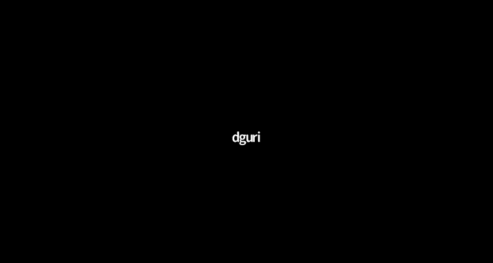

I don't know that we're going to have so that's not what I do and in my particular like in my research that said the tools are definitely applicable and。

If that's your primary area of interest， like I would love to have you like work on a project that's manipulation and focused。

I think that would be yeah totally fair game and definitely doable and I think there's a lot of cool things we can definitely work in like some examples and some homework problems like on like a seven do arm for example that's very doable yeah so there's no reason not to do manipulation I supposes just it's not my wheelhouse so I'm like less likely to draw from I'm more likely to draw from like manipulation locomotion and like aerospace examples just because it's my background but yeah it's totally applicable and would be great to have we'd love to have you and love to have you work on some。

A manipulation project perfect， thank you。Cool， so yeah， anybody else。

 I'm going to like get my tablet queued up here。Yeah， last time you said that if we add damping。

 then we will get strictly negative eigenvalues yeah， but there will still be some oscillations。

Theres still be oscillations， but the real parts will be will be negative yeah yeah yeah。

 yeah yeah that's what I meant okay okay。no that that's it's yeah still normal physics and everything applied what I meant by that is it's strictly stable in the sense that the real parts of the eigodvalues are strictly negative not zero right cool。

滴滴嘟滴。jo name。And if I made any mistakes in the notes definitely let me know we're getting so I have my PDF ones that I put up and also。

We are going to be。T May， one of the Ts is graciously agreed toscribe my scribbles into LEC so for all of your reading pleasures so that you don't have to read my horrendus handwriting。

 so hopefully that helps。And so yeah along those lines like we'll be posting those PDFs soon and definitely like it's the first time running through this and like I made mistakes so so if you catch stuff definitely speak up and tell me like preferably during lecture I feel free to just。

peak up in lecture and then all if you catch stuff afterwards that's mistakes are unclear。

 whatever definitely let me know and they can try to try thick stuff。Best can。Alright。

This is working。Share screen。嗯。Okay。The iPad is live。Horay， everyone see that。All right， goodio。

So yeah， if there's like also， anyone has suggestions on how to do this better， I'm only I to。Okay。

 cool， so just a quick recap from last time last time。You know， in addition to the intro material。

 we kind of we talked about dynamical systems controlled。dynamicnaical systems。And continuous time。

 right？嗯。And what do we do we talk about manipulator dynamics。Those are important。

We talked about equiria。For these kind of systems。And the fact that you can kind of。

Engineer them with control。In fun ways。By the way that's a sort of quite nonlinear thing and it's sort of almost inherently nonlinear the fact that you can like erase and create equilibrium points and bifurcations that's a very very nonlinear territory and yeah I have some references for these things to you that get into the PDF notes。

If you're curious about more of this kind of stuff。

 and then the last thing we talked about was stability ideas。And specifically。

 if we talk about local stability， this linear stuff， we also talk about basins of attraction。

 which is a more global notion of stability， but kind of only in that 1D case。Okay， cool。

 So that's like last time what we did today， what we're going to do。

They start heading more into computational land with this stuff。

 so we're going to really talk mostly about making this。

Continuous to discrete transition so like how to go from continuous ODs to discrete time。Simulations。

That you would implement in software and。That we'll actually end up using in our algorithms right for the most part。

 and a little bit more about stability。And how that kind of looks in this discrete time setting and some of the。

Fun additional things you have to worry about when you start discretizing things。Cool。

 so just as a quick motivational sort of。Aside on why we're talking about this stuff。

As I'm sure most of you are aware， now that you're sort of you know。

 far enough along your engineering lives， in general， we can't solve these equations， right？嗯。So。不。

So they are of limited use to us right even even if we have this nice ODE model， we can't get XFT。

So so that's annoying in the so we need ways of simulating things also we need tools for control design right if we can't solve V ODs we also can't can't in general design good controllers using those things so and also you know in a computer inevitably we need to go from discrete we need to we need discrete quantities finite dimensional things so like X of T is a continuous function。

And we can't really represent that in the computer other than as a set of discrete points， right？嗯。

And also there's some other sort of interesting things about that， so like in some sense。

 discrete maps， these discrete time dynamics we're going to talk about。

in a couple of senses they're actually more general than the continuous time at ODEs there are actually dynamical effects that we can capture with discrete time models that we can't capture with continuous ODEs and that has to do with the fact that the ODEs have to be smooth just by definition their smooth functions right so there are functions there's things that happen in dynamics that are nonsooth namely impacts friction etc。

 and those things can't be written down as ODEs period end of story like but they can be posed as discrete time maps and so there are things where the discrete time stuff is like more valuable and more general than continuous time stuff。

All right， cool， so that's it for that。Commentary and what we're up to so let's get into it so first off。

Like generic discrete time dynamical systems。So first we're going to talk about what I would call。

The explicit form of these things。So that's where you have a function that。

Takes in the current state at time K。And the current control at time K and spits out the state at the next discrete time step K plus1 and willll for for now just because we're going to like have to write down both continuous and discrete versions in the same lecture。

 I'm going to put a little subscript D for discrete。On on these guys。

To distinguish them from the continuous version without the D。

And probably I will drop this later and then sort of overload notation and trust that it's clear from the context Okay so that's。

Pretty easy。And probably everyone seen before this like simplest version of this。

Which is the classic。Albeit somewhat terrible forward Eer integration。

So this looks like xk plus1 equals。Xk plus。Sometimes step H times your continuous dynamics and phenomena like leave off the collection I'll put it on for this one。

I the use in there okay， so this is forward Eer integration， this is a time step。哦。

And I'm assuming like pretty much everyone has seen this before， if not， let me know。

 so we'll go a little fast on this stuff。Okay， so that's super simple。

 What we're going to do next is we're going to take this thing and I have to switch gears now we're going to try this out on。

The pendulum from last time。So。And sharing fun。

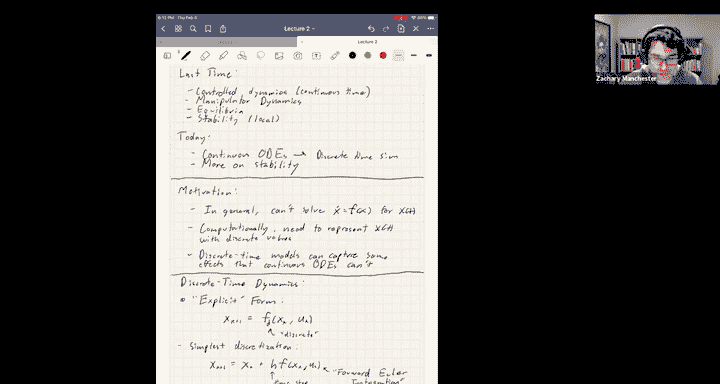

I going stop sharing this one。😔。

No。O。Can you guys see this？Yeah， yeah， awesome， okay so Jupiter notebook。

 Julia for those who've never seen it before， not too terrible Jupiter notebook still exist。

For all you Python folks， so here's my pendulum dynamics with like m equals L equals1 that we talked about last time super easy。

 right？And then here in this function and I've written down exactly what we just wrote down right。

 so xk plus 1 equals xk plus time step h times f of x rate。Okay， so there we go。

 I'm going to simulate this from like an initial condition pretty close to the downward equilibrium so initial velocity zero and initial angle 0。

1 radius so just like nudged over a tiny bit that's the x knot。

We're going to run this for like five seconds with a time step of 0。1 seconds。

 same reasonable to 10 Hertz。Five seconds， let's see what happens。

So you start out with our little little oscillation there and it looks like it's blowing up on us and if I like carry this out a little bit farther。

 let's say I go with to 10 seconds， it really blows up。Uh if I shrink the time step。

 maybe maybe I think， oh， 0。1 seconds too big， let's go to like。

 I don't know if we can do 10 hertz if you want。It's still blowing up。

So it means like I can take tinyier time steps it'll take longer to blow up。

 but it's still blowing up。Okay， so。Now， the question is。What is going on here？

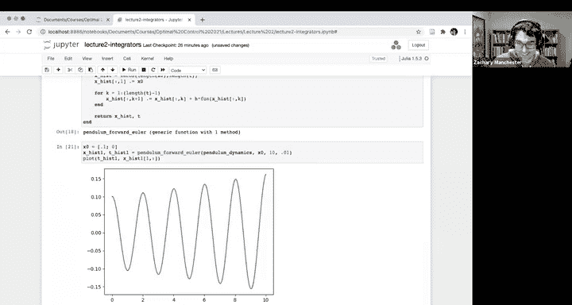

So I'm going to switch back to the tablet now， the switching is very awkward。Make me feel like。嗯。

I don't know how to like here。呃。Okay， so。That's awkward， what happened？So I'll just put up a place。

 we'll try to like stuff that in the PDF somehow， I guess。But oh like。I'll just throw in here。

Now equals m equals one。😔，H equals I don't know， 0。1 we also did 0。01， blah， blah， blah。

 but blows up right， what's going on？嗯。So in order to answer the why part of this question。

We now get to talk about。Stability of discrete time systems。So， that's。So I guess this disturbs it。

Section break， okay， so in continuous time。What do we have？For our stability condition。

At this thing that was like the real parts。Of the eigenvalues。Of Jacobian。

Had to be strictly negative to be stable。So let's look at the discrete time case it's I don't have as pretty a picture for this one as last time for that 1 B case。

 I really like that like little 1B example， but there's like a fairly intuitive way to get at this in discrete time too so。

And discrete time we can think of the dynamics like a simulation like I just run。

 like I just ran for you guys， we can think of that as an iterated map。

 so I'll show you that what I mean by that exactly。So like if I want to simulate， you know。

 n time steps up to time step n， I'm going to get like F of F of F of dot dot dot。

F x not right so I'm applying the function f like n times to get myself to time step end， right？Cool。

 so does everyone go to that？So now if I linearize this thing。What's going to happen？嗯。

But I just like chainroll this time right like the obvious thing is going to happen So what I'm going to try to do right now is I want like D X and。

DX map right， I want the Jacobian of the whole iterated map， right？And that's going to be just like。

Partial S， partial x。You know， but the first one， blah blah blah chained。All the way down like this。

 right so I'm just multiplying those Jacobcoians。Exact the F here is actually easy F sorry， yes。

 you were right， I already already slackped off on my notation。Good， thank you。Correct。

 this is the FD， right， Okay， so that's what happens。And Laura。

 we're going to abbreviate this guy as standard and linear systems control， et cetera as A。

 so I'm going to start writing A's and we'll call this one A。For discrete time A just to be。

Careful so this is basically what I got here right is if if I assume that I'm like you know really close to the equilibrium point。

 I'm miniizing about the x0 as like near to the equilibrium and whatever。

 then this a stay is kind of the same and it's just a to the n right for n time steps。

So then let's like you know， simplify our labs and assume that the equilibrium point is the origin。

 which we can always do by just like using a change of coordinates， so assuming that。

Assuming we chose nice coordinates。嗯。So。Yeah。Then what we're going to find is stability of this thing。

It implies that。If I take the limit of this iterated map thing。

So I'm what I want here is like limit as k goes to infinity of。A住 the k。Distreet A。

 right times x not， this has to go to zero。For all XOs。That's what stable means。

 it means if I pick any little X not in the neighborhood。

And I like iterate this map forever stability means it's going to converge the to the equilibrium important to the origin right Okay。

 so if that has to be true for any x not。That means basically that the matrix a to the K。

 like a to the infinity has to go to zero right， so it means really I can for all x means I can basically pull the X not out and it means that。

This limit。This guy has to go to zero， right， so my matrix has to go to zero。Okay。

 so now what does that tell me about the eigenvalues？Of of AD itself。So it tells me something about。

 oh yeah， it obviously says。But something about these eigenvalues。I want to infer something about。

About this thing based on this condition。Less than one that's right so it means specifically the modulus complex modulus events so they're complex whatever they all have to be less than one right so as I as I multiply them by each other over and over and over again。

If they're at all less than one， then that infinite sort of product is going to get driven to zero。

Right so if all the eigenvalues have modulus less than one norm less than one if I take like an infinite product of them eventually they're going to get driven to zero so that means all initial states are going to go to zero so another way of stating this and like the wave maybe heard it before is that all of the eigenvalues have to be inside the unit circle。

In the complex plane。O。So I'm guessing most people have seen this stuff before。

 anybody have any questions about this？Okay， all right cool。

 so let's try doing that to the pendulum with our forward Euler integration。Okay， so。It。We have。

X K plus1 equals x K plus H times F。Of Xk or like uncontrolled system。This guy is our。FD。

And so what we're going to try to do here is come up with AD。

And we're going to do this about the lower equilibrium point， right？As。Partial F D， partial X。

And I can just do this by eyeballing the sky right so this is going to be approach x k。

 it's going to be I from the Xk term here。And then。Plus。

Just h times like the continuous time a matrix， right？

We worked that continuous time A matrix out last time。 I'm just going to write it in here。

 So it's like。Look's like this。Yeah。So let's see， so what I want to do now is evaluate the eigenvalues of this guy using the parameters we just used for our simulation。

 right？So if I plug in， so I want to evaluate this thing。诶。

Let's say what do we do 30 equals zero and like everything one， basically， right？So if I do this。

I'm going to get。One plus or minus。0。313， some other stuff， I。So is that thing in the unit circle？

Most definitely not， right？So。Unstable。So let's look at some now I will switch back awkwardly too high。

In notebook， this definitely needs to be。Inroved。对的。Switching is awkward。

Okay， so this was what we did Okay， so what I'm going to do now is here's my discrete a matrix。

I vertical toable function to implement back guy like I just wrote down。

I can evaluate the eigenvalues of it， I'm going to do it at 0。1 seconds。

 like our first simulation here where it blew up。Pretty drastically。So let's do that。

There's that number that I wrote down on the notes so I didn't lie to you that's what it is Okay so you could say here you know okay that seems bad maybe point1 seconds is too big of a time step so maybe I want to make it smaller blah。

 blah， blah， we kind of did that last time where we went up to 100 hertz instead of。

Instead of 10 hertz and yeah that looks better， but it's still blow up so let's see what this so what I'm going to do here is I'm going to evaluate these eigenvalues。

Or。For a whole bunch of possible time steps from h equals0 up to I guess I went up to h equals 0。

1 because they already knows 0。1 is unstable and i'm going to plot this so here's what happens and i'm plotting by the way yeah like the complex modulus of this of these things right so what you find is that I mean you can kind of see it from looking at the matrix too。

This this thing's only marginally stable not blowing up inside the unit circle， et cetera， et cetera。

 in the limit as H goes to zero so if you have any finite time step with this forwardd oiler integration it's going to blow up it's going to be unstable it's like provably unstable from this simple like argument we just made about。

About the dying values， right？That's kind of weird。Doone have any thoughts on this？

You listening to this before？Okay。嗯。没有。

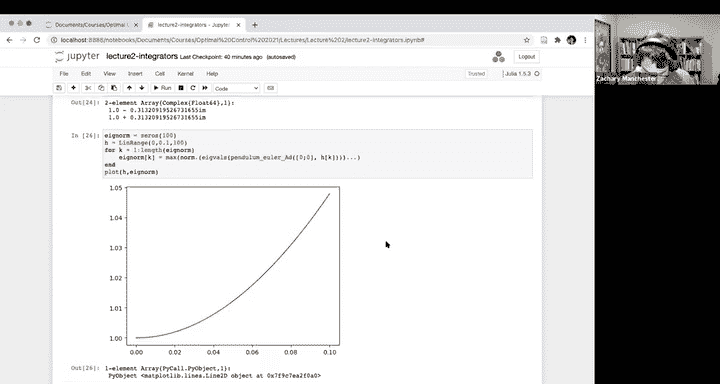

Now I have to switch back。Isn't it because we're assuming it's ideal？Say that again。

Isn't it because we're assuming it's ideal， there's no friction， there's no loss。Not really。

What happened here is like we took a system that was。啊。Okay， technically marginally stable， right。

 but has founded oscillations， right， is not blowing up。

I discretized it and simulated it with this integrator， and it blows up in the simulator。

So like there's energy being added to the simulation artificially from the integrator that's not in the physics。

Come on iPad。 You can do it。So there's something weird going on here that's unphysical。Right。

 like there's nothing。It happens for any time step like what happened here is like。

I can make the time steps as small as I want。You know I can take 10 kilohertz time steps and it's just a matter of time it's going to blow up all I can do by taking smaller and smaller time steps is like。

Sve that off for a while， it's always going to blow up。So it has not。

 it's like purely like it's a weird artifact of boiler integration basically like。

So I'm just going to like make some notes here。I about what we did and then we'll dump this in later。

Hi， Zach， can you just clarify what you mean by blow up？Yeah， so I mean that it's unstable。

 like if I take the system that's supposed to oscillate。You know， nice， like if I。

 if I have a perfect ideal pendulum and I just like do this to it and let it go。

It's going to swing back and forth like that with like the same amplitude forever。

 right in like an ideal setting， right？Right， so what happened here is instead of that。

 I did the exact same thing， same initial conditions and what's happening in this simulation is that the amplitude is growing。

 growing growing and eventually just goes nuts and starts it's like weeping around like crazy。

So that's what I mean by blow up， does that make sense？Yes。Okay， so yeah。

 that's not supposed to happen， right？Okay， so yeah， the cartoon thing is。

Hopefully clear so this thing is only only becomes。你 know。Basically， for any time step this is bad。

 this simulation will give you garbage basically for any。Finite times step。Okay。

 so I want to just kind of， yeah， we we'll kind of like。Make some commentary on this， I guess。

 so there's a takeaway message in hearing that I wanted to share with all of you because I've seen lots of people use earlier integration。

And。You know。You shouldn。啊。So。Number one is。啊。Disretization， i。e。 like using an ODE integrator。

Is never perfect and it can in fact add qualitatively change the behavior of the dynamics。

From the disreization， like weird things can happen， right， so like。Basically， you always want to be。

Be careful。And like。Sanity check what comes out。嗯。So yeah。Exsact。

 so the intuition here is that during that small time， time period age。

Your acceleration is actually smaller than Fx and or smaller but now you're adding Hfx and you assuming during that period of time acceleration is always Fx and that yeah that's kind of right yeah so you're getting at it there's actually a kind of a nice picture for this what's happening is your yeah you're kind of overestimating the magnitude of the acceleration all the time with this approximation let me draw you a picture yeah that's like very much what you're saying right so imagine like I have my sinusoid is what the solution should be right so let me draw a sinusoid real quick and then let's look what happened so like if'm I'm here and evaluate。

The dynamics here， I'm getting like the tangent to this curve， right？

If I take a step in that tangent direction， I'm going to step， I'm going to overshoot， right？

And now if I like let's say' you knowm now I'm down here same things going to happen down here if i'm like here and I evaluate F here i'm going to overshoot the sinus side right so you end up with this like overshooting behavior that just kind of compounds and it's it's like impossible to not do this with with with naive boiler integration essentially you're always going to overshoot you're always going to get this kind of bad energy behavior and you're going to get blow ups so。

Yeah。Yeah， that makes a lot of sense。Okay， so so yeah things you should always keep in mind right be careful and you disretize always sanity check your simulations。

 good ways of good things to check when you sanity check our energy behavior so like plot the total energy of the system。

If it's like a really good benchmark thing to do when you're trying stuff out is put in a conservative system that should conserve energy。

 simulate it， plot the energy over time， make sure it's not going nuts if you have a system with damping。

 plot the energy， make sure it's going down， make sure you're actually getting energy dissipation right stuff like that。

嗯。What else you have to say and then like the big takeaway thing which。嗯。Just's down here。

I really honestly should not be using forward oilers。It's the easy thing to code up。

 but it's sort of parable， so if you've been doing this you should probably not do it anymore。

It can help it。This is universally true for any dynamical system。

I'm going to go ahead and say you should never use for earlier immigration yeah because doing better is very it's very easy to do better basically you can do much much better for like two extra lines of code which is what i'm going to show you next so like just don't do this basically it's never it's really never a good idea and it's almost never worth it in practice。

You can get away with it。So if you have a system that's heavily damped naturally。

 like if the real physics have heavy amounts of damping in them。

 then this will work and won't blow up because the natural damping in the system is enough to counter the energy sort of inflation behavior of the integrator。

But there's basically just better things that you can do that you don't have to worry about this with。

Okay， so let's talk about better things to do。So。We're going to talk about a couple different better things to do。

First thing is。And hopefully everyone。Don't any of this before' seen this before。

 the fourth order runak cutta method， which is the classic sort of industry standard method。

 right that everyone uses。So really quick just overview of what that looks like。

And some fun plots like the ones we just did。This is sort of the， yeah， like I said the workhorse。

Okay， so。The intuition for this， I'm not going to derive this。

I think probably everyone's ever seen this before using it before。

 basically what's going on here is Euler integration。

 its assuming the trajectory is piecewise linear and fitting lines over each trajectory segment。

And rather than just fitting a line， RK4 basically fits a cubic。Polynomial。

 so like it's fitting little splines over each step。So this quite obviously gets you。

Much better accuracy。All right， so and just yeah， you need this on Wikipedia。I'll do this。

Just because， but if you have questions about this， I'm happy to go into like。

More depths on any of it。But the basic gist of this is we need to do four function evaluations instead of just one。

So we evaluate the dynamics at the initial step， then we do a bunch of like in the middle kind of evaluations。

 so we evaluate it like a mid point。A different flavor of the midpoint。And then at the end。

And at the end of this， we like basically take the step。As a weighted average of the。

But different evaluations。So the middle ones get weighted heavier。That's the recipe。

I this Galus that it's been around forever and likens of tons of stuff uses this。Okay。

 so what I want to do now is I want to like go revisit those pendulum simulations。

So that means I have to do the awkward switch again， so if anyone has any questions。

 will they awkward to switch。

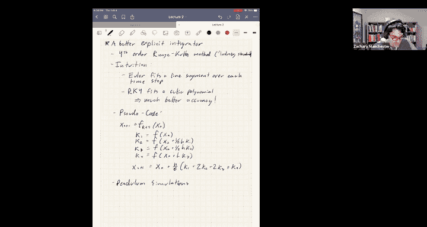

Please professorfe I have a question so previously you mentioned this overshoot is this overshoot is caused by instability of the system。

 but it seems like this is caused by the some numerical issue so I'm kind of confused like why what's the root cause of this root cause system。

ItIt's the piecewise linear approximation in the Euler integrator。

So it's not a numerical precision roundoff kind of thing。

 it's due to the approximations you're making in the discretization。

So like when you fit a straight line segment， so like the cartoon is if I draw the sinusoid and then I like take a point on it and fit a straight line。

When the sinusoid curves， I'm overshooting， right？because I'm not getting any of the curvature in my approximation and so because of that overshoot。

 it always overshoots basically and so as I do that over and over again。

 I'm going to basically just blow up because of the consistent overshoot of the linear approximation。

But previously we are talking about the instability of the system。

 so we prove the integration is not stable so what I showed specifically is that the original continuous dynamics。

Are marginally stable。But then if I discretize with Euler。

The discrete time approximation using oiluler is unstable， so the the discretization。

Made it unstable。Right okay in a way that's not physical that is not true of the continuous system。

 so the message is the integrtor is doing weird stuff to you and the discrete time model that you got from that integrator is sort of not to be trusted。

And you have to be careful with discritizing that's the idea it's that the stability properties of the original system。

Are different from what you got from the discretization Okay okay that very sense thank you so what i'm going to do now is we're going to do the exact same thing with R4 so here's the R4 that I just wrote down in the notes。

Here's like， yeah， just time stepping it。And what I'm going to do now is same deal。

 same initial conditions 01， and we're going to try you know 10 seconds， 0。

1 second time steps just like we originally tried with the Euler。

And as you can see this looks pretty good， right， like it's not growing， it's not shrinking。

 it's doing what it's supposed to do。So that's nice let's try some other stuff So what i'm going to do now is here's some fancier Julia usage so what's going on here this is automatic differentiation for di which I think probably most people have used if you doing any like。

machine learning stuff， so I'm just forward diffing through the RK step this with this guy to get the Jacoban。

 the discrete Jacobian that I mean because I't want to write this by hand and look at the eigenvalues they're basically right on the money on one out to like five six decimal places。

So like that's about as good as you can hope for right with something like this。

 so pretty good then they're just inside the inner circles so these are stable。

And they're like they match what the continuous time dynamics should say to like five successful places so pretty nice Okay so now if you had a coars or time step this would blow up too is that you're saying yeah so here's the next plot but that's exactly so what I'm to do in the next plot is exactly what I do with oiler I'm going to plot these eigenvalues versus the time step length。

So here i'm plotting this between zero and one so time step varying from zero like limited zero to like up to one second time steps right so a huge huge age so let's look what this does。

So check it out so like for small time steps I basically write on the money write on one。

 which is what we just saw for 0。1 seconds right I over here。

 but as I grow the time step I start to get weird stuff so for some values here basically it starts to go down under one so for some values of H I get damping artificial damping so i'm going to dissipate energy artificially and then there's this cutoff point and it starts to blow up and now i'm adding energy and getting artificial energy increased and blow up。

So I don't know， it's kind of fun， kind of interesting。

The message is be careful with your discretizations and you can get very easily get on physical behavior should always check the stuff so let's let's actually just visualize this real quick right so like if I go and change this so for small values it's super nice right so I do 100 herz beautiful now let's make it big let's try to get into this this damped territory so like if I put in a like 0。

4 I should start to see artificial damping sort of behavior it's also going to be really coar but yeah so at 。

4 seconds you can see it's damped artificially right starting to go down。😊，As I mentioned to you。

 this is not related like it's super coarse here right so you can see it's like really gross looking。

 but keep in mind like I'm only plotting the XK knot points。

The integrator is actually doing cubic interpolation between all these so if I actually plot what's what's inside the integrator it's still like cubically still looks pretty good right it still pretty smooth and you're getting the damping effect right so this is not a Nquis thing it's still sampling like dense enough to like easily reconstruct the function in terms of like frequency content it's like a weird integrator time step phenomenon。

Okay， any questions about this stuff？I'm sorry could you repeat what you did in that last plot Yeah this last plot is the same one I did before。

 so what I'm doing is I'm computing these eigenvalues of the discrete time sorry the one before this。

This one this one gotcha yeah so I just changed the time step so right the original thing I did was 0。

1 seconds H so the time steps that I'm taking in the integrator， the times between my xks。

And so I buried this so like this is 0。1 seconds between like the length of the steps I'm taking with the simulator rate。

So what I did here in this plot is I varied that time step from like super tiny up to a full second so I'm taking one second steps and I plot the sort of the modulus of these eigenvalues and for the real system it should be one exactly one right so we see this guy it's pretty good it's like pretty flat right on one for like small time steps you know like 10 herz no problem5 herz no problem if I start to stretch it out though they start to drop below one which means i'm getting artificial damping so that the simulation is damped and it's sucking energy out when the real system the real physics are undamped and like should oscillate forever at uniform amplitude so what I did was I just went over here I said okay yeah like it starts to look damped。

Like 0。4 seconds is probably you know where we'll start to see some of that damping。

 so I went back up to my simulation up here。And I'm just simulating for 10 seconds， I put in 0。

4 seconds as the time step。And run this again at 0。4 seconds instead of 0。

1 seconds and now you can clearly see the energy dissipation right it's damping out if I ran this longer I ran this out to like 100 seconds。

 you see it basically depths to zero right so like this system it's getting the energy suck out of it and it's gonna to like go to nothing after 100 seconds like know which is totally un physicals this is not what the system should be doing right so if I went and put this back out to like the 0。

1 seconds or 0。01 seconds if I take 100 earthtz time steps uniform amplitude right that's what it should do physically we know from like intuitive energy conservation basic physics 0。

1 seconds pretty good uniform amplitude right no problem。

And now that there's this kind of threshold when I go to like the bigger values。

 now it's damped right and it should not be damped。Yeah。

 makes sense when you had like a very small total time， the the plug was a little jagged。

 does that have to do with？That's just because the sampling is coarse right like I'm not doing fancy interpolation like strictly speaking with with this integrator the integrtor is doing cubic interpolation。

 I'm only doing linear in my plot because I'm just giving it the Xk is a letting pi plot like do linear interpolation for me so it looks super jagged just because of the coarseness of a discretization but what I was saying before is it' it's not like it's still got enough samples in there for like my qui and whatever like it's still accurately should be able to do this it's only yeah it's this weird integrators are doing weird stuff to you kind of effect right？

Thank you， all right， cool。Issor a quick question。The the plot you had below with the eigenvalues does that reveal any sort of physical attributes of the pendulum because it seeing a plot like that reminds you of me of like something out of like feedback controls or small simple system responding to a impulse yeah I'm sure there is some relationship there this is not。

This is sort of related to like Z transforms and stability of like of discrete time systems with like。

 I mean， that's basically what this is right I'm basically plotting with the。

Sort of itemvalue things associated with a Z transform it's not like strictly any of those things。

 I guess I'm just like trying to。Um， trying to get some some intuition into what's going on of these things and just show you that there's like there's demons lurking in there that you got to be careful with them。

But yeah， like there's there's almost certainly some relationship you can pull out with like sort of discrete time you know。

 sample to control systems and like the Z transform ideas， yeah， off the top of my head。

 I don't have like a good hook。To tell roughly related to the。Period， the epoch of this spend。

 like if we change the length from 0。1 to  one and its time period increases。

 we would probably be able to simulate with the largest time step without running into this。Yeah。

 so what that would do is stretch this plot out right， but the fundamental like。

Sort of effect still exists。 So yeah， you're absolutely right。

 there's sort of this interplay between the dynamics and the frequency content and the dynamics and the and the integration method and the interpont that the integrtor is using and the time step like there's these things are all coupled and all related So like exactly what you say if I stretch the pendulum out make the natural frequency lower。

The dynamics are slower right so I should be able to stretch the time steps of the integrator out。

 you would get this exact same curve， but it would be stretched in the time axis basically right？

yeah cool all right， so let me switch back on the same plot I have a question have a question can you try out when you highball the plot when it recovers from damping Oh yeah。

 like over here Yeah， can you try that Yeah， let's try that it's a good idea I don't know What do you think this is 8599。

9 let's try I mean， it's going to be super cose is the problem。But yeah。

 it sort of starts to look like。You know， it's not we can run it for a long time and see what happens。

So that's still damped， so maybe I went， I didn't go far enough。So like if I go to like nine， five。

Yeah， but yeah we're like way under sampling now right so now we are going to run into like myOS issues。

So so yeah， somewhere in there there's a region where it's sort of magically。

 but that's also probably like weird aliasing effects and like under samplingling effects to you。

 so there's a bunch of weird stuff in there。So I would be take that with grains of salt。But yeah。

 so none that's still under dampamped。like eight five。Yeah， that's really weird。

It's going to do weird stuff because we've taken way too big steps， I think。

You said for Euler every time step。Blows up。For this particular system。

Yeah for for and more more generally for like for undamped systems that are supposed to conserve energy Oer will pretty much always blow up Ouler has this like。

Energy increasing behavior to it。That's kind of always there so if you something yes I good。I mean。

There are some lines where it undershoots if you just do like Ouler。嗯。

And interpolation like if you if you match the frequency or something because you'd not blow up or something maybe but it's like a weird it'd be a weird corner case so yeah if you want to try this out let me like definitely go for it and like。

Tell me what you find probably do it for like some weird edge case you could probably engineer a situation where the combination of like asing weirdness and and stuff would like perfectly cancel each other out it's probably possible I don't know but yeah if you want to if you want to go look into that like please please be my guest it might be interesting cool。

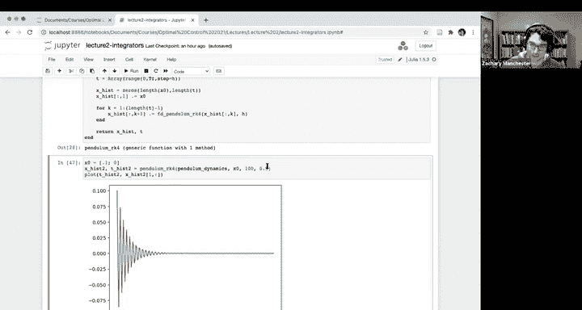

Okay， cool。 so let's switch back Pro there no questions。Morrow。一。Yeah。

 so the minimum of that eigenvalue versus edge fl is there some significance to that edge。

Not that I know it。But maybe yeah I don't know I don't have anything good on cue for that so i'm not sure there might be。

But yeah again like these things are complicated right these are all like weird nonlinear things so like that that curve is dependent on the exact system so if you did a different system with different dynamics it would look totally different right it depends on all these details so there's like the only thing that I think you can really generalize from this sort of line of reasoning that i'm trying to show you guys is that like you have to always be careful with this stuff and you have to always kind of like watch out for these things so like whenever you try to simulate something and discrete time basically never use For Eer there's always a better option RK4 is kind of the standard thing that everybody uses all the time because it's pretty good it's like a good compromise between you know compute。

And accuracy and stuff like that， but it still has the same demons lurking and you have to like kind of keep an eye out。

For all these things。Okay， cool。A quick question sampling resolution beyond heuristics？So。

For for simple stuff， yeah it's really like at the end of the day there's like myOSst sort of limits associated with this stuff。

 so like you have to sample fast enough to capture the highest frequency in the dynamic in the trajectory right that's sort of at the end of the day where the real limits come in。

嗯。Yeah。All right， so my share just crept out apparently， so let's get back to this。

Let's see how we doing on time all right， yeah， we got to hustle a little bit。I' going it shut here。

😔，So okay， so take away messages from this part of the discussion。嗯。So first off， for Rcade4。

 basically like。The accuracy win。Yes。Like far outweighs the additional compute cost of versus like For oiler。

This is born out in practice like you could try a whole bunch of experiments yourself if you care it's like pretty much always a win so like。

You know， do it， basically。What else so yeah like and then the other thing here is based on what I just showed you right is that even sophisticated integrators。

 even like high order fancy stuff。Has these demons lurking under the hood so no matter what you do like you always kind of have to have this stuff in the back of your mind。

 you still want to check sanity check your results against like conservative things。

 dissipative things， make sure energy does what you expect that kind of stuff。嗯。What is going on？

I'm like writing sideways on my desk because my。m freak it out。And yeah。

 just in terms of bigger picture， the reason we're doing this stuff is like these things happen very easily you start doing trajectory optimization kind of things。

 you always have to like really think hard about what what you're doing make sense when you get these answers out all right cool so。

That's explicit integrators， we're going to talk real quick about implicit methods。Okay。So implicit。

 say form of these discrete time。Dynamics。Let's call this。

I guess should be clear is I'll use little D for this criteria。

So these are called implicit because the x K plus one is buried inside the nonlinear f and so we have to like。

Work a little harder to solve these things at least in a foreign simulation context。

 so simplest example。Is。The following thing。So this looks like Euler。

But I'm evaluating the F at the future time step。So this is called backward Euler。

Instead of forward Eer。So yeah， that's weird。So that's sort of weird how do we do that so in general right so x is is our nonlinear dynamics the x is buried in there so this this whole thing is nonlinear in the future time step。

So when we simulate this thing。We basically end up having to solve a root finding problem to time step the system。

So。So I can rearrange that equation right that I just wrote as in the form I showed before， right？

And this will look like。X， K plus。So I read it like this and then I solved a root finding problem in。

And that's K+1。And like generally you'll start with a guess of you start with a guess value like xk plus 1 equals xk it' usually a safe bet and almost always works and then you just solve this for xk plus one。

We'll talk more about the solving the root finding thing next week as we get into optimization。And。

Real quick now I want to switch over back this is super annoying。

 I need to find a better way to do this。

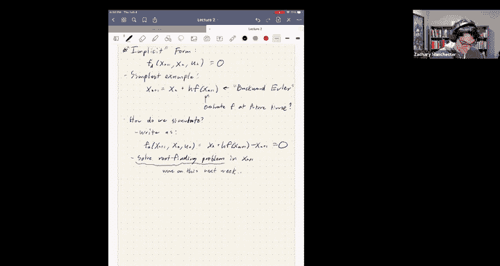

Stop， share。 share again。 Yeah， quick suggestion for。 If you don't like to switch between them。

 you may try to stream your pass screen to your computer。 And then， yeah。

 I tried to get that set up before this。 and it didn't work。 So I need to try again。Yeah okay。

 so here's the backward oiler now same stuff as before there's some weird details in here about the like backward implicit part that i'm not going to talk about yet。

 but you know don't worry about that basically it's in here trust me so backward Eer we're now going to plot the pendulum same deal 0。

1 second time steps 10 seconds。What's going to happen？佢叫咩。It's now it's damped。

And I can stretch this out， let's do 100 hertz instead of 10 hertz， 00 hertz still damp。

 so backward Oer has exactly the opposite energy behavior from forward Eer instead of adding energy。

 it's artificially it's artificially damping the system。

So thats that's it so any questions about that， does anyone try plugging in different weird stuff in here？

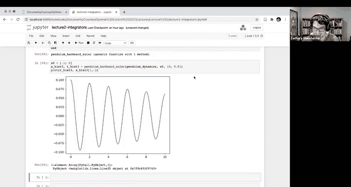

Cool， alright。So。How to calculate the Jacoban for this way。

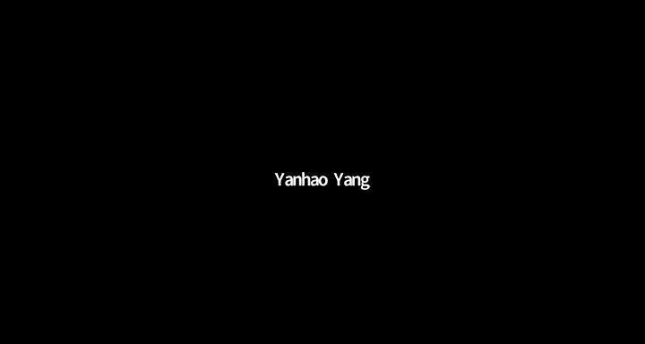

Yeah， so we're going to this is going to be in the first homework， so I'm not going to tell you。

You will do it next week。Okay。Yeah like if you so yeah it's going to be on the homework like some of the stuff so likell i'm going to tease it now but then you'll have to do it so like if you have questions about it next week we'll we can talk about it in office hours。

Okay， do okay， pendulum simulation。So I have a question about what the ideal inte then is sort of just。

Just at the boundary of the unit cycle， right？Yeah。

 and so a perfect integrator would produce the exact behavior of the real system， right？

Of the reproduce the ODE， exactly。I guess what yeah。

 what's kind of counterintuitive to me is the idea that when you have a more stable system way within the unit cycle。

 it's actually ideal for integrating your system。No no not really like it'll so so even if you have a stable system with damping this is going to add more damping so it's going to give you an answer that doesn't blow up but it'll still be wrong right so so the ideal thing will like exactly behave like the real system and that doesn't exist but there are definitely methods that are closer to that than these things right that are super common okay so I just wanted to okay so so this thing has。

Opposite。Energy behavior。And actually that little plot about the overshoot on the sinusoid。

 if you do backward Oer， what you're doing is you're evaluating the slope at the future step。

 so you'll notice exactly the same thing before， but it undershoots always instead of overshoots so like you can kind of intuitively get the cartoon picture there。

From that。Okay。What else do we say？Okay so comments on this it added artificial damping this is unphysical and nominally bad if it care about physical accuracy but yeah like whoever I don't know who is just talking to me sorry but yeah like this is unphysical but it's sort of in some sense if all I care about is getting a simulator to run and not look stupid and like not explode on me then this is maybe somewhat desirable to have this sort of artificial damping it sort of makes things more stable in some sense right so。

So while this is un physicalsical it lets us take bigger time steps in the simulator without things blowing up and it's sort of convenient so because of that convenience these backward oiler methods are actually very common and low fidelity simulators used in like computer graphics。

 a lot of game engine type stuff and in some robotic simulators they're also widely used in a lot of simulators so a lot a lot of simulators use these methods because they basically let you get away with things when you take big steps they let you get away with fast running the simulator fast but large time steps because of this artificial landing。

So just you'll probably see these in your life in various places because of that。Co。

Is there a way to somehow like take an average of the forward and backward Oer to like。

So that they cancel out each other's energies yeah there it is there's there's stuff like this yeah so there's some other stuff that's going to be on the homework yet again Okay so yeah stay tuned for it'll be out next week。

嗯。😊，I had a question。I've heard this term。stiffafness， yeah， I don't know what it is， though。

 the question is like what is it？It's actually very ill defined。

 you'll find like there aren't really good consistent hard mathematical definitions。

 it generically refers to systems that are hard to simulate。

And where it's actually coming from is specifically like stiffness in the sense of a stiff spring。

So if you try to simulate like a spring damper system with a really large stiffness。

 even if it's like super damped right so you can have like an ideally perfectly damped but really stiff linear system。

 if I give that like a big impulse and then try to simulate it with these methods because of the stiff spring。

 there's like high natural frequencies associated with the system so I end up having to take really really small time steps in these integrators to make the simulation not blow up。

So yeah that's what it's referring to that's where it comes from。

 but it's also applied to like all kinds of nonlinear things that don't have stiff springs on them that are just generically hard to simulate it generally means it's a system where you have to take really tiny time steps so isn's like a property of the ODE yeah exactly it's a property of the original ODE of the original physics of the system。

Yeah， there's lots of examples of these things just， but yeah。

 you'll find in the in the engineering community it just generically means hard to simulate。Cool。

Exach， I think our RK4 is evaluating the dynamics at the different points between H。

 so theoretically。Like if there we simulate if we evaluate dynamics at multiple points。

 like 100 times。Evenly distributed on this time interval。You can get an arbitrary。

Like larger precision you can yeah， this is absolutely true yeah and it uses it's just not necessarily a whim。

 it turns out。So what you're talking about are like sometimes called colocation methods or pseudopectral methods。

 it basically comes down to like a forest fitting cubic so you need four points to fit a cubic you can play that game as far out as you want so you can start taking more and more samples and fit higher and higher order polynomials it just turns out that it's not always really advantageous because the real dynamics are not always that smooth。

So that only works right if the systems like smoothness up to that order right so for the cubic you really it only really buys you a win if the real dynamics are like C3 smooth or whatever right so if they're not then then the cubic is not a good fit and so you can't it doesn't win and so if you go to higher order polynomials you need more and more smoothness out of the real dynamics in order for it to actually be advantageous and it's often not the case that that's true。

맞other。嗯Okay。CoolOkay， so last thing to talk about。Oh yeah， so like some sort some takeaway stuff。

On that stuff。Okay so generically speaking implicit integrators are typically like more stable than their explicit counterparts so there's like for just about every order a reingrator can come up with there's like an explicit and implicit version they can come up with different versions of these things。

 the implicit ones， they're usually more expensive to for stem because you have to do this refin business but they're often more stable and so better in certain respects right。

And。So yeah， like for Ford SIimM， we have to solve this implicit equation。

 which can be more expensive。So that's kind of annoying。But sometimes it is worth it。

And in particular like really gnarly stiff things implicits better so like the stiff stuff happens a lot in for example。

 finite element methods where you're trying to simulate like floppy flexible things those are often very stiff equations and implicit methods are standard in those fields because of that and then the other caveat though okay so these things you have to solve this refining problem that's annoying if you just care about forward rollouts but and a lot of direct trajectory optimization methods we're not doing forward rollouts we're applying these things as constraints and there it's basically free it doesn't actually imply any computational extra cost so they're widely used in direct trajectory optimization methods。

Which is why we're talking about them。Cool so yeah so that's so they can be a big win for direct trajectory optimization so in fact the classic direct flow location method that probably a lot of you have heard of uses an implicit third order integrator。

For this reason。Okay， cool。啊。😮，Last thing， real quick。

Hofully we think that yeah will be cool on time so the last thing I'll to talk about is so all the stuff we talked about so far has been about discretizing the state。

 the state trajectory like x of T。We're going talk really quick。About disretizing the controls。

And this is like much simpler or shorter topic than。On the states death。Largely。

 I think because we get to pick it。は。Okay， so first simplest option。Is。The following thing。

 it's sample and hold， Aka zero order hold。You just set。U of T equal to UK。Over the whole time step。

And okay， this is called zero to hold。And it looks like this if I plot it， super。

 super kind of intuitive。Look look at that snaps to a straight line for me， amazing。

So you get stuff like this right so i'm going to sample it at this time step integrate and keep it and then same thing over here right so it's a piece wise。

Constant type a deal。This kind of thing， okay？So this is really easy to implement。

 so that's sort of one reason it's good。But if I。If my trajectory is smooth。

If if I like some continuous U of T， then this is a pretty bad fit to a continuous u of T and therefore it can take lots and lots of knot points。

 lots of sample points in order to like accurately reproduce some continuous U of T。

So that's not great。And sorry， the lingo here， not point is like control trajectory optimization lingo for sample point also it's a common lingo thing。

 so I slip into that without telling you what it is。啊。😮，Okay， next option， so zero to hold easy。

Simple。Possibly。Better option， not necessarily for sure， depends on the situation。

Is a following thing。So。It's。So this is sort of maybe annoying。

 this is a piecewise linear interpolation called a first order hold。

What is that that well thats some H as in the time set？Yeah。Cool， so yeah。

 if I can do the cartoon plot on this thing。If I have， you know。

 a bunch of samples sort of like this， it's you know， pretty obvious what's going on。

 it's going to do this。同屏明。There you go， something like that。So this is。

Potentially better if you have a continuous control signal right if I have a continuous U of T。

 this is a better approximation than the zero to hold and so for things that are kind of continuous or smooth。

 this is you can probably get away with far fewer knot points with this kind of setup。

Which means smaller problem sizes， faster solve times， all the good stuff， right。Can you explain。

 is T actual time here， why is H H is Delta T right right？Yeah。

 so what I'm doing there is I'm just getting the slope over the interval。Right， UK plus1 minus UK。

Over， over Bt。 So that's the slope。And then I'm just like multiplying that by the time。Into the step。

 which is t minus TK， right？So it's just affan right it's like the UK。

 the initial value at the beginning of the step and then like the slope times the time over the stuff right thats that's all it is it's like really simple it's just sort of like。

Probably given them too much notation。嗯。Okay， continuous you。Okay。Yeah， so if you use continuous。

 this is a win， you want to do this probably if if your control signals are like smooth。

Continueuous at least right？Um and it's also extremely cheap to implement so like it's basically not it's almost zero extra work over the zero order hold in terms of like problem size。

 complexity solve time， etc cetera， it's almost not any extra work。So it's definitely if you have。

 if you know the things are kind of continuous or smooth， definitely do it， it's worth it。So。

 in practice the the。Basically the issue of disccratization is limited by say your ADC right。

 so ADC is a zero order holding in general， is that true？Yes。

 but I would this is we're talking about stuff that like all a stuff we're talking about lives like many layers above the ADC in your practical system like these controllers we're talking about here。

 if we were to do likempC on something these typically run at like tens of hertz up to hundreds of hertz on practical robotic systems and then like your low levelvel stuff on the motors right your motor drivers are probably running to killerhertz and your ADCs are running like killerhertz right so this is all like。

Sort of abstracted a couple layers from that stuff from those hardware details， I would say。Okay。

 but but in terms of the discretization of what is possible to control。

 you' are still limited by what what the hardware can produce right？ Sure， sure。

 what I'm saying here though is like。What this might let me do is this might let me take 10 Hz。

Time steps in my trajectory solver instead of 100 hertz steps in my trajectory solver。

 which means my problem size is110th is big， which means I can solve it way faster online。

 so this might be the difference between a realtime algorithm and like something that's not fast enough to run real time right and then like what I would do in practice is if I got this answer out that looks like this I can interpolate into it at。

A kilohertz to feed into my ADC if I want to right so I got what i'm saying is that this is going to happen like way lower frequency than than like the ADC stuff you're talking about。

Pretty much always。All right， so that's cool yeah， and then the last thing right that that I want to say about this is like。

This is okay， so this is super common in practice。This first orderhold thing is in the benchmark standard direct collocation method。

 this is like classic。So yeah， it works， it's good。And we're going to talk about this stuff。诶。

So yeah， so then the the last thing I wanted to like briefly touch on is like。We kind of already。

Hinted at this with S's comment， you can keep playing this game forever right like I can keep like adding in higher order polynomial and turbpulentence and stuff。

But and there are methods that do that there are methods that were like super popular and like made lots of noise in the like late 90s early 2000s that basically use like ultra highor polynomials called pseudospectral methods turns out practically they're not that useful they don't actually do better and the reason is that the control signals are very frequently in our problems non-sth so like if anyone's studied control at all。

 you probably heard to bang bang control things like this so like especially when you have constraints on the system like torque limits it's really really common to get control commands out that like saturate the actuators and go right up to the torque limits and bounce around like that and those kind of signals that go right up to the torque limits and saturate etc so even if the system dynamics are smooth if you're going up to your torque limits and saturated the control signals are not smooth so as a result these higher order you know like smooth polynomial interpolations on the control signal are totally useless and don't buy or anything practically because they're just bad approximate。

For these non smooth sort of jerky control signals。

 so that's kind of the last thing I wanted to mention。Yeah， I will write that down， but yeah。

 we're basically out of time so anyone's got to take off go ahead。

 I'm just going to jot that down if have questions while Ill do that。是。Yes。

 can you give like a while you're writing if you can do both you is like maybe like an output。

 maybe it's like a torque or like a voltage to。The the motors can you give some more physical intuition for what you is here again Yeah you is the control command so yeah in general like it can be anything。

 but practically it's usually motor torques or thrusts。

Or throttle commands on a car right it can be like it depends on how you set up your model and what exactly you choose to model and there's like often varying levels of fidelity here so like you know you could。

 for example， if you're using like a straight physics model for like a quad rottor say you might throw in the thrusts for the for the。

The propeller is right you might just do it in terms of thrust and then the use would be thrust and then you'd have some lower level like motor controller that's taking that thrust value and translating that into a motor voltage that's pretty common。

To have like some hierarchical kind of setup where this stuff is doing like the physics stuff and then like there's some low level thing taking care of like the details of the motors and stuff like that。

 but yeah you could also write a more high fidelity model that bakes in like details of the motor dynamics and weird you know effects of like the fluid in the prop and then you would use those motor voltages directly in in your model as they use and you could do that too although that's sort of less common I would say so yeah like it can be it can be a kind of anything but generally speaking like I would say most common thing is for these to be like the physical quantities of like torques thrusts that kind of stuff。

But yeah， there's no reason that it can't be sort of more in the weed stuff。Okay， so yeah。

 I'm just looking at the questions here I just finally getting。

Somebodys sorry so one of the questions was does RK4 run in the back end of ODE solvers in Python Matla yes with with more complicated raper magic so OD 45 in Matlab is as someone pointed out。

 it's R4 plus a fifth order interment and they run them both in parallel and then they do adaptive step size error control so they basically like run the fourth order and the fifth order step simultaneously compare them if they don't match well it implies that your step size is too big and then you shrink the step size so they use that that's a really common trick with run cut of method you run two at different orders and try to enforce them matching and you run like an adaptation kind of loop on that so that's what OD45 does so is that leg do。

dependss what you mean by state of the art right so like this is a broad field and there's like lots and lots of methods and lots of state of the art in one area is different from the other right so like。

In like finite element and cD land the state of the art stuff are like our implicit methods and then if you go to like。

Astrodynamics， which is a field I like used to play around it。

 which is like spacecraft stuff like trajectories to get to Mars the state of the art there are very high order runga cutta methods variable step runa cutta methods like like RK78 or even higher like people use even up to like 14th 15th order runga cutta methods because those trajectories are very smooth and they're really long like months to get to Mars so it helps there the high order polynomials do work because they're so smooth and so long and that was you take really big steps which is advantageous right so it depends on the problem really those astrodynamics problems are not stiff they're very like benign and smooth so like high order explicit runa cutter works well whereas in FA they're like really fast dynamics both fast and slow all in the same OdeE really large and like lower order implicit methods are what you want there right so like it's sort of all over the place。

 but yeah， for like benign。First thing you should try kind of stuff like in your own work like runna cuta mid fidelity Ra cutta is like no way to go so like RK4 or something like OD45 that's got the adaptive stepping are like the standard sort of things that'll get you like reasonable answers most of the time unless you're trying to do something harder。

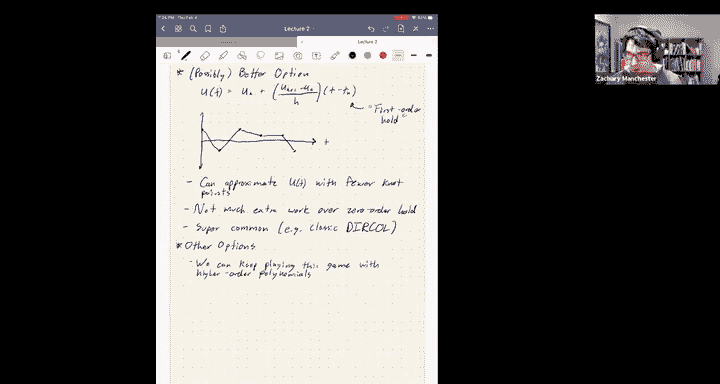

Yeah， Brian suggested the Julia OdeE package that package is beautiful。

 it's probably the best ODE package on earth ever， so it's definitely worth a look。啊。嘟嘟嘟。Yeah。

 if anyone has anything else， definitely like hit me up， I'll hang out for like a few minutes here。

I have a question。So going back to like the first order hold thing。

 right that is that same sort of issue as like the backward oiler right where you have to know the thing ahead of time。

Yeah sort of but not it turns out it's not the same flavor of problem here so this is in the context of trajectory optimization now where we're trying to solve for the you instead of just running a forward simulation so like if I'm doing Traoff I'm saying yeah I'm looking ahead into the future I'm doing this offline and i'm saying like okay there's my robot here's like initial state goal state I want to know what to do。

Here's my trajectory of like 100 time steps， here's my 100 views。

Optimize tell me what the right use are so in that context i'm looking at the whole trajectory all at once in one big optimization problem and they're all decision variables and so in that context like this sort of like non causality business doesn't really show up and isn't really a problem。

I think yeah makes sense it makes sense yeah so that that issue that like non causal kind of thing is only an issue。

With these and for that same reason， by the way， the implicit integrators are also no big deal in a trajectory optimization context for exactly the same reason。

 they only incur this weird extra cost of like having to do a root find on this like noncasal equation if you're just doing a forward rollout if you're doing forward simulation so that's the only time they're like actually problematic and like have some extra work associated with them otherwise they're totally fine for a lot of the stuff we do。

Okayい。Will you share the Jupyter notebook bookss you use today Yeah yeah absolutely that's all going up with the note thank you right after as soon as I get a chance to PDFf everything。

啊。If a system is not smooth to the fourth order。Can you sometimes use like RK3 per se， yeah。

 and yeah？Okay， so like， can you maybe three is this？嗯。

RK3 is in the same original classic paper that RK4 is derived in， so they both exist just that RK4s。

 for whatever reason become the de facto standard。And I'm like whatever uses， so yeah， sorry。

 what else are you going to say？I was just going to ask like I'm guessing you can kind of analyze a system and get an idea of what order or what acade。

And would be best and then kind of apply whatever is best to that specific system Yeah I would say like probably that effort is like not worth it in a lot of cases like probably the right move there is to use like if you're worried about that kind of thing but the standard toolbox So this is worth worrying about maybe if if you are doing some like realtime thing like what we're talking about doing with a control problem where we like absolutely need to dial it in and needed to be super fast and super optimized for some realtime application then yeah you might want to do this and go through this effort but if you're just like sitting there offline and like care about simulating some stuff to see what's gonna to happen the thing I would do is just use one of these standard off the shelf run to cutta solvers that do variable step like adaptive step because what those will do is you basically tell them an error tolerance and they'll like run to run to cutta steps in parallel and like adapt the step size to make sure they hit the error tolerance you asked for and those for like nonstiff systems they just like。

They just work and you don't have to worry about it and like they're they're kind of magical they do break down on like hard problems so like there's stuff they won't work for but if you're just trying to like you know casually simulate stuff those are like kind of a thing to do I would say okay thanks。

啊。干 sir。For like for the generating the continuous time controls from like a discrete number of points。

It's it like。可use。The trajectory， at least for like the first letter hold seems very you basically have like discontinuities at every every point。

 right？They're not discounting new it。They're that's continuous so so that trajectory history is C zero right yeah。

 you're right it's not differententiable to those points yeah in time that exactly you right。嗯哼。😊。

So do people like because when I look at the first thing I thought was like maybe like polynomial fitting is that？

Is there like a reason to。Maybe we do something with that instead or yeah yeah so that's exactly what i'm writing and was trying to talk about there so yes you can do that and people absolutely do it and the。

In fact in like certain applications like I mentioned。

 aerospace stuff where you're doing spacecraft trajectories to like Mars or whatever and those applications。

 the trajectories are very smooth， the dynamics are very smooth and high order polynomials do work well so in that context yes people absolutely do what you're talking about they'll use high order splines they'll use like seventh eighth order polynomials and all that good stuff and it works there for a lot of robotics applications though the dynamics are not that smooth and as a result the highor polynomials don't buy you anything and in fact you get like runungga phenomenon this like overshoot ringing craziness where you try to like approximate you know like a non-smoo jump with with a polynomial you get like artifacts and all kinds of weird stuff so it's like it's actually not a good idea to do it on a nonsmth function so if U of T is really really smooth then yeah it's a win to use the high order polynomial if u ofs like jumpy jerky kind of thing then it's not a win and in。

of practical control settings that's the case like it just happens that like even just just because of torque limits like just when you have torque limits on your motors and you like hit the limits that's going to induce like you know sort of like this kind of jerky stuff where you're saturating and then saturating the other way and you get this is like so-called bang bang control and that comes out a lot and in those cases like the smooth polynomial representation is not good it just doesn't it doesn't buy you anything right and in fact it can be worse than the like zero first order hold stuff。

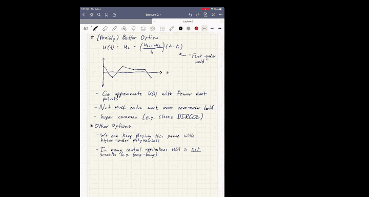

嗯哼。If you were to use maybe like a like for example， like a PID， like a well tuned PID wouldn。

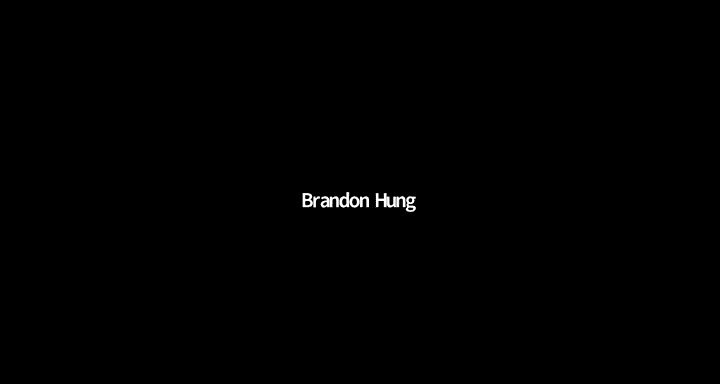

I guess。嗯。I guess it kind of the I guess PID kind of does simulate like a second order。

Well if you write it down in continuous time like it's a continuous function right what this sort of is all applicable to is like when you discretize that and do it in a computer right so like that's this whole discussion is all about like when i'm doing things in discrete time on a computer like this is what you get right so the PI stuff yeah like you have to discretize it right at some point if you want to implement it on a computer so then some of this stuff would show up we're talking the stuff we're talking about here is like more applicable to like。

Trajectory optimization kind of stuff which is what we're mostly going to talk about in here and an NPC and that kind of stuff less so the classical like PID stuff but but yeah like it's relevant whenever you're trying to discretize stuff in time yeah that's kind of what I was trying to trying to get at today。

嗯 okay， got it。 thank you。Yeah。So for RK4 when we're stimulating forward， we kind of for the states。

 we look ahead in time like for several like points， like what about for the control signal。

 is that do we do the same thing here but using this disorder hope function？Yeah。

 so you so like if you wanted to do and RK4 step， let me go back to that。

so where I write it down here we go so r4 here's long R4 step right if I do this with controls if I do it with the zero order hold I would just plug in the same UK for all of them right so I would have like you know UK UK。

UK blah blah， blah， if I did the first order hold with the linear interpolation。

 this would be UK then here it's the midpoint right so I have UK plus。The the average。

 basically right， like UK plus one minus UK over I guess it would be I can average the。Yeah。

 so this would be an easier way to write that down。UK plus1 plus over two。

 so this would be for this guy and this guy and then the last step would get U plus one。Okay。

 so that's exactly like if in RK4 how I would implement the first order hold and then zero order hold obvious。

 you just always plug in U。Okay， got it， thank you。嗯。

I had a question you had mentioned the bang bang control as kind of an example of that discontinuous signal if you're。

Control signal is a PDWM duty cycle that is essentially just setting the frequency of that on off saturate and closed is that still considered continuous in that case or would would it matter kind of the end effect of what you're controlling Yeah I would say like so that PDWM stuff is happening really have frequencies right like much higher than the relevant system dynamics so like I would probably not try to make that you know so the idea with this stuff is like what we're trying to do here at the end of the day is come up with the smallest you know like representation of the trajectories of the dynamics possible like the most computationally expedient representation we can because we want to solve this stuff fast typically so yeah like usually you're going formulate this in the way that's the cheapest to numerically solved so like there yeah like if you have like I would probably not put the details。

Like that PWM stuff in here right instead would just have it be like the the average value that the PWM thing is trying to like achieve right would be what I stick in here probably。

And so like then the saturating thing would be like， you know。

 where the PWM's on the whole interval right， versus like off the whole interval or whatever， okay。

 I see。Like those extreme values which yeah I mean it depends on the application So like if your stuff's really smooth。

 then yeah like first order hold works pretty good for that you may be able to get a win and when I say a win what I mean specifically is if your signal is smooth if you have to use smooth then like going from zero order hold to first order hold is a big win you'll be able to use wave you are not points to capture the dynamics and like solve the problem and then your problem size gets smaller and then you can do it faster online right so that's what I mean by win so like if it's really smooth first order holds a win you'll do better you'll be able to solve faster you can use a smaller formulation if it's really smooth then you can keep playing that game and probably keep winning right so like you could go from linear interpolation to quadratic sp and interpolation and maybe then if it's really nice and smooth you can like that's a win and then you'll like keep going and like you can use a smaller problem size right so that's kind of what I'm talking about so like。

Always in that process there's some trade off like if the control is really smooth then higher order polynoials work then maybe even can get away with fewer knot points。

 smaller problem， go faster， et cetera， but yeah often like it gets more complicated to implement and like there might be diminishing returns right it just depends on the problem。

Thank you。All right。Oh sorry， oh go ahead yeah， I'm done。 So like oh yeah。

 if anyone has extra stuff I'll hang out whatever Yeah， back to the analysis of the eenvalue。

 a normal eigenvalue Jacobbian matrix， youre saying that it should be constant one with zero input。

 So it seems you treated like a energy changing rate of the system。

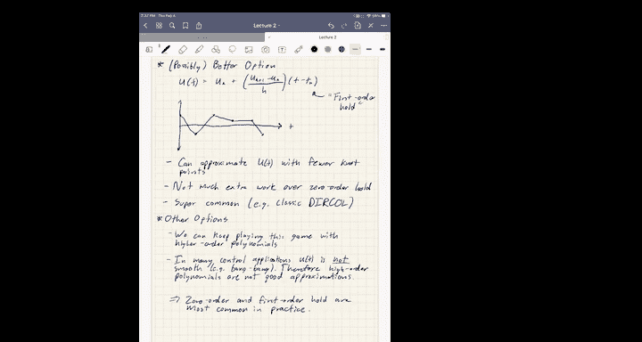

What's the connection between them？So what I was trying to get at there is。嗯。For the real system。

 like the pendulum that we were trying to simulate。The real behavior is。Perfectly。

Perfectly conserves energy。Undamped， right， and so the real dynamics。

Should have so the real dynamics and continuous time have zero eigenvalue zero real part eigenvalues in discrete time。

The real thing would that would correspond to having eigenvalues with exactly modulus one。

 like right on the unit circle， right， Does that make sense。Yeah。But what if you have no zero input。

 So could you still get a like a desired discreetized eigenvalue， not of eigenvalue。

So what I'm what I'm。We're talking about here is like just passive dynamics， just simulation。

 all I'm trying to tell you is that like。This process of discretization of like approximating the continuous time dynamics ODEs in a computer with like some sort of discretization。

 some Rakatta method， whatever you want to use。Is always going to introduce some kind of artifacts and some kind of approximation no matter what you try and like this was you know it applies with controls as well。

 but it applies even without the controls right so I was just trying to show you the simplest kind of cases I could come up with so no control。

Simple pendulum right， simplest like nonlinear system I can pick of and yeah you see this behavior where the real physics should have exactly eigenvalue modulus exactly one in this time。

And then when you put it through forward Eer， you get bigger than one and it blows up and it's unstable。

You put it into backward oiler。 you get smaller than one and it decays when it's not supposed to。

 you put it into RK4。 It's pretty good。 It's like out to like5，6 decimal places。

 It's almost exactly one right it's good to five decimal places。

 six decimal places So that's really good。 So that's sort of the idea behind that is yeah RK4 is really good。

 And it's going to get you pretty good answers that you can depend on most of the time。

 So it's why it's sort of like this word course algorithm。U but even there， right it's good to five。

 six decimal places， but it's little off， so if you stimulate that for a long time。

 you'll see the decay。Yeah right， so that's kind of all I'm trying to say is like these things all do weird stuff when you disretize that's not physical and you should know about it and you should check。

 you know， sity check， make sure you're sort of getting the behavior that you expect that you should get。

In the simulator。一阿 c thank you。Cool。Okay， anybody else have anything？

Yeah actually I had a question I've been recently reading into a group of papers that are looking for nonlinear dynamic conversion for high performance control where you're trying to restructure the system dynamics in order to make the problem a little bit easier and you this is used in flight systems where they're basically you they have really good modeling and good they can throw lots of money at the problem effectively to solve that where we may not have that same opportunity in a robotic system like what we would deal with so can you maybe get some of the tradeoffs of doing system design for high performance control whenever you could be doing some sort of like nonlinearar dynamic conversion versus what we might be considering with more like directory optimization and peace。

Yeah， so this is like a really， really like。Yeah sort of interesting areas so like yeah all these kind of like dynamic aversion dynamic cancellation kind of things they are very common in robotics as well they're sort of。

Commonly called feedback linearization or partial feedback linearization。

Have you heard of those things before？Yes we we talked about it with Dr Guer before with the manipulators Okay yeah so that'sulator that's the same exact idea like what you're trying to do there is you have a model of the system you're essentially using your controls to cancel out the natural dynamics and then like do whatever you want from there right？

So yeah， it goes by a lot of meanss and there's like subtle variations。

 but that like feedback linearization， partial feedback linearization。Model inversion。

 whatever like there's a bunch of names for its that's kind of the core idea behind all of them is you try to cancel out the dynamics。

Using your model and your control inputs， right？Is that where we're talking about Yeah so I was just kind of curious mean if you can do that and replace the dynamics with something similar why wouldn't you Yeah okay yeah we're on the same page so the why wouldn't you is number one often you can't in particular if you're under actuated and you have fewer control inputs then you have degrees of freedom etc you can't do it so you can sometimes do partial cancellation a partial feedback linearization but then you still have to deal with some of the known nonlinear dynamics you still need something else So that's number one number two is performance and there's a couple flavors of this so one is if you don't have a super accurate model that dynamics cancellation business is quite dangerous and can lead to like weird effects that are there's demons there so that that sort of causes robustness problems and then the other one is performance in the absolute like performance metric sense in that what's going to happen when you cancel those dynamics out is in your controller you can't take。

Avantage of them so often these kind of the classic example of this sort of cancellation feedback meization stuff in robotics is Asimmo the the Honda humanoid are you familiar with this you seen in the videos。

Yeah， so it's the classic robot right in that it always walks in this like hunched sort of like looking pose and it's it looks very robotic and very unnatural and it turns out it's very。

 very energetically inefficient。And they do exactly the stuff， they do partial feedback meization。

 they try to cancel out all the robots and natural dynamics。

 and then they just get it to try to track you know some trajectory for the feed or whatever the result is that。

The thing can only stay running for like 10 minutes on a battery charge and if you look at its total cost of transport like the energetics of its walking。

 they're horrendous and like way， way worse than what a human achieves and in fact what some of the robots that don't use this kind of control can achieve。

And the reason is yeah that dynamic cancellation stuff you're doing that with your actuators and that has an energetic cost right and what natural walking does instead is embrace the real nonlinear dynamics。

 it's like when we walk we basically like we only use our muscles for like some parts of our leg swing and we're relying on the passive like pendulum dynamics for the rest of the time and so you can get away with like way less can actuator effort if you actually think about reason about and leverage the natural dynamics of the system。

So that's sort of the big reason energetic efficiency is like way better if you actually embrace the dynamics。

Right and so I guess in the case that I was seeing， you know。

 since it's it's a jet then effectively you have about as much energy and you have as many actuators as you effectively want right so yeah。

 so in that context it maybe makes some sense and these methods are are like potentially can be yeah like so so。

For like certain aggressive flight regimes this can work。

 but I'll tell you yeah from like personal experience those the models for like very aggressive flight regimes like high angle of attack high side slip are not good and there's lots of demons in there and there's lots of crazy things you can do at those high angle of attacks by taking advantage of the full dynamics that you can't cancel out so like as far as they are like jets are still inated and。

The only context in which you would be fully actuated and be able to cancel everything out would be if you have like crazy thrust vector in right。

That kind of thing so yeah like quadruators are super aobatic because they're underactated they only have four inputs for six off so yeah jets are the same way like if you have your full full set of control surfaces。

 you have thrust control yaw that's not that's four that's not six right。Great， thank you， Yeah。

 cool。All right， we did， anybody else。All right， going to call it a night then guys。Thanks everybody。

 talk you next time。