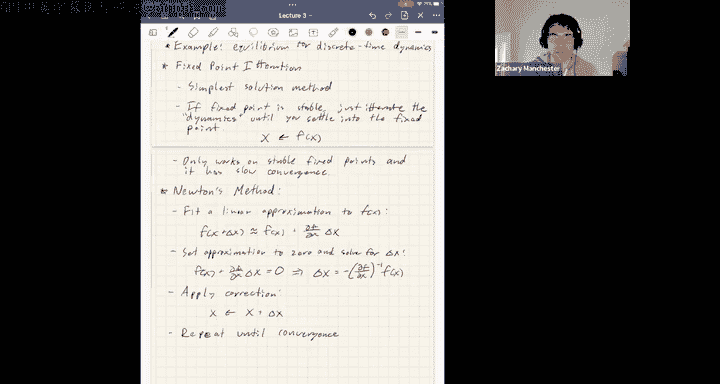
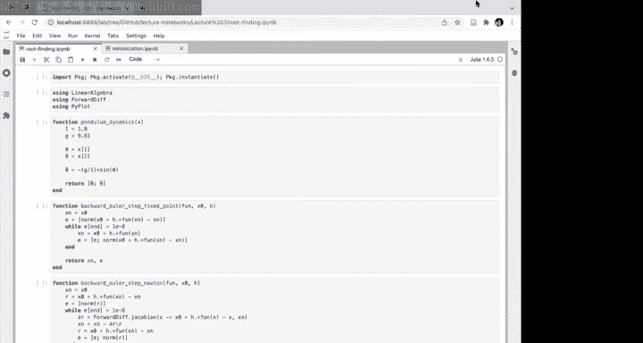
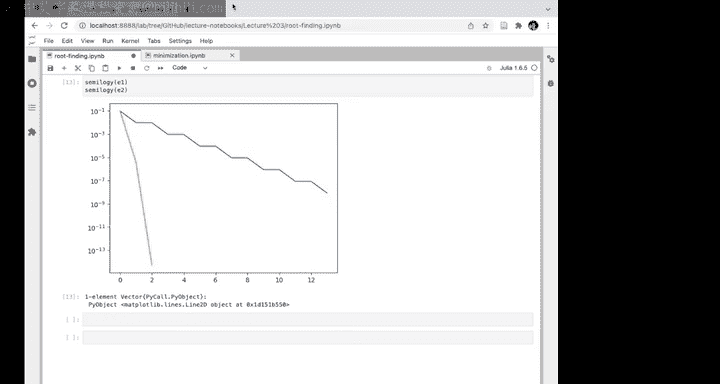
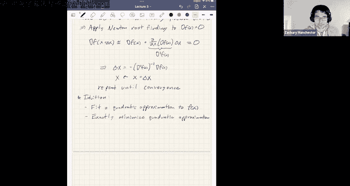
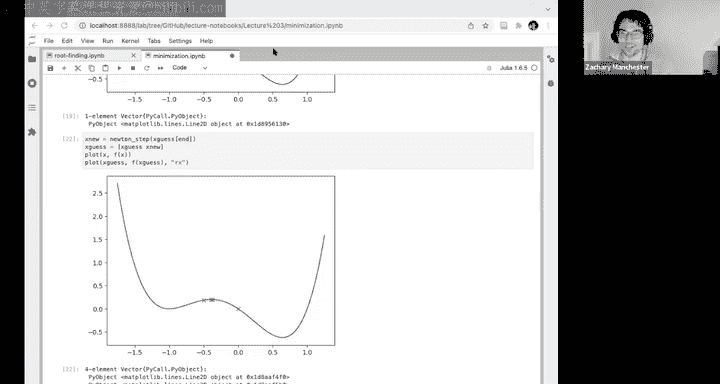
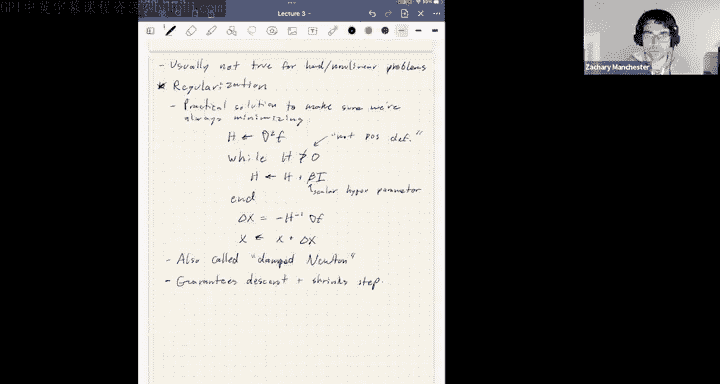
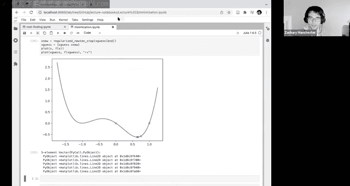
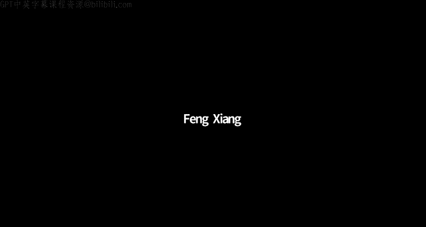
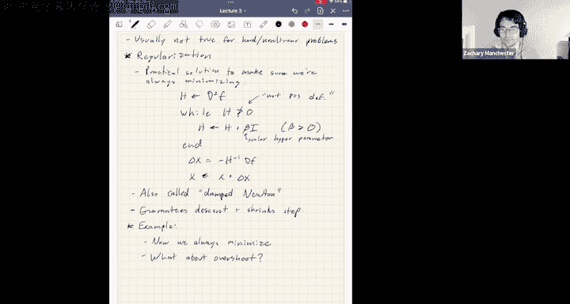

# CMU《最优控制和强化学习｜16-745： Optimal Control and Reinforcement Learning》中英字幕deepseek - P4：[04]Lecture 3_ Optimization Pt. 1.zh_en - GPT中英字幕课程资源 - BV1qHwke1EBX

Okay， so last time what did we talk about。We kind of， we talked about sort of。

Discrete time simulation of dynamics。So how you get your nice continuous ODEs into a computer。

 we talked about some of the gotchas associated with doing that， we talked about stability。

Of just three time sort of stuff。And we talked about， you know， sort of。

The weird things that can happen as an artifact of disc discretization and how you should kind of be careful for that but that sort of thing and keep an eye out we talked about in particular some methods we talked about for this sort of discretization we talked about。

Forward and backward Euler。Also known as explicit and implicit Oer。

And then we talked also about the classic fourth order Rungukka method。

 which is basically the go to method if it's the first thing you should try cool and then we talked on the control side about how to disctize controls and we talked about zero and first order。

UHold。On the controls。So that's pretty much the recipe for taking your nice continuous ODE。

 so you've got your dynamics， your robot， whatever you can discpize the continuous ODE with RK4 as kind of the go to and maybe some other method and then basically decide on kind of zero order or first order hold on the controls and now you've got your nice。

Discrete formulation that you can simulate in the computer and that you're kind of now ready to go do kind of numerical optimal control stuff with so today。

嗯。😊，We're going to kind of make a pivot so we've then do some dynamics background now we're going to sort of start heading in the main sort of thrust direction of the course and we're going to start talking about kind of a background sort of discussion about optimization so I'm not going to assume that you've done any optimization before it'll be kind of a nice little self-contain couple of lectures to give you enough background on numerical optimization to sort of be dangerous and like understand what we're going to talk about the subject goes a lot deeper and we'll put put some references up on the piazza to like go further if you want to talk more about this stuff feel free to talk to me or the TAs all of whom have done lots of this stuff but yeah we'll kind of at least get you started in this field and hopefully give you enough to。

To it going。 So the first thing we're going to talk about is notation。

And sort of notation for specifically for writing down derivatives， Jacobians， gradients， hesss。

 this kind of stuff， just to mention we're all clear on this。

 then we're going to talk about root finding。And then we're going to talk about unconstrained minimization。

So we're going to talk about specifically about numerical algorithms for solving those two kinds of problems。

Okay， so let's get into it。 So the first topic of conversation is。Some notation stuff。That。

We will not argue about we will just。We'll just do it this way in this class。

If you want to do it some other way in your own life outside of this class， that's fine with me。

ThisThis is the correct way according to me and how we're going to do it so first off so I'm going to say give some F of x。

That is a。Scalar valued function。That eats vectors in RN。

And spits out scalrs So this is sort of the sort of function that you that we generally try to to optimize right this would be like a loss function or a cost function right so going eats a big factor and gives you some scalar scalar cost as an output so this kind of function very often we want to take derivatives of these things right for rapidization purposes so for us we're going to write down partial F partial X often called the gradient here in this setting This is a。

For us， this is always going to be a row vector。1 by n。So gradients are always row vectors for。

Scalar valued function of a vector and there's good reasons for this a lot of people write these as column vectors that is wrong it's a row vector for the following couple of reasons。

嗯。I'm waiting for someone to push back on me with this。

 but not here are my rationalizations for why this is the right way to do it。So the first one is。

Partial F， partial X。The gradient here is the linear operator。That maps。嗯。Little changes in x。

 so little deelta x is。Into little changes in F。 So， so Delta F。

 And so like if I take a first order Taylor expansion of F about。Ex。

I get you know f of x plus partial f partial x times delta x right and so for this to work out just in terms of dimensions。

Delta x is a M by one vector。The same size dimension is x right and the output of this thing has to be a scalar to make sense and so therefore partial f partial x has to be a real vector such that。

Partial F partial x times delta x comes out to be a scar， right？Okay。

 so that's one reason and we're there's one more reason that we're going to get to in a sec。

 but we're going to keep kind of。Moving in this vein， so similarly。If I have a function。Say G of y。

 a different function now， that is a function。That eats a vector of size M。

And spits out a vector of size M。Vectctor valued function of a vector and I said this would be maybe like a dynamics function or something like that right if I take the derivative of this guy aka it's Jacobian matrix。

So partial G， partial Y， this thing has dimension。And by M， and it's for the exact same reason。

 I want the。The first order Taylor expansion to work out。So I want， you know。G of y plus Delta Y。

To sort of approximately be G y plus partial G partial y， delta y。

 and for that partial G partial y matrix linger operator would everyone call it for that to work out dimensionally。

 it has to be the right size to multiply delta y and the right size to spit out。

A deelta G on the other side， right， so just dimensionally。

 that's that's how we kind of figure these things out。Okay。

 so those are kind of that's one reason why and the real reason why we want to be consistent about these these notation things and these sort of dimension conventions for derivatives is that it makes sure that the chain rule still works that's the real reason。

 so both of these are super important for this real reason。

So if I sort of take these two functions I've written down and I compose them right。

 and I write down like F of G of。Y plus Delta y。And I Tayloror expand this to first order。

 this is approximately F of G of y。Plus。Partial F。Partial X evaluated at G of y times partial G。

Pushial why evaluated at。Y times delta Y and this sort of multiplication of these guys the partial F partial X and the partial G partial y works out because of the consistency of these rules so you might you have seen in other courses or books or whatever gradients being written as column vectors and then this sort of has a transpose in it if you do that then a bunch of this stuff starts to break down and act weird and you end up with lots of bugs in your code where you need to randomly transpose matrices all over the place to debug and it's really messy and really annoying and a huge sort of source of pain and suffering for no reason so stick to these conventions Cha rule works your code is nicer you don't have transpo bugs all over the place and then because this stuff shows up so often and as a nod to the other convention we're also just for convenience。

We're going to also define some other stuff。So very partial F， partial X， I mean the row， if I write。

Grad or Nala F of x， this is going to be the column version， so this is partial F。

 partial x transpose。And this is the column vector version on then， right？

And then I'm also going to define the Hessian dell squared。F X。And this is。

 you can write this a bunch of ways。 So this is partial， partial X of。Grad F of x。Equals D squared f。

Yes， squared。And this is a。Square n by n matrix and this one is like a little bit less of a big deal because it should be symmetric so it doesn't really matter what order you do things in and it's it equals its own transpose but that's a you know that's that's kind of the right way to define it Okay there any questions about this anyone how many anyone want to argue against why。

Sort of standard convention stuff here， to you be might guess。Okay， cool。

 so we'll kind of keep it in。Some I'm going to ask about forward diF specifically， forward diF。

 if you call it mass for gradient， it will give you the column so is it generally does it the wrong way。

So you have to be careful。Okay， so next up we're going to get into root finding right now。Okay， so。

What are we doing here So the main idea here is I have some function， say F of x。嗯。

And I want to find some X star。Such that F of x star equals0。

 So I want to find a zero crossing a root， whatever you want to call it of。

Our given function F right so an example of this that we can I sorry like a dynamics example of this that we've already seen。

That we will revisit many times。Is finding an equilibrium point for a continuous time dynamical system。

 right？嗯。Okay， and just sort of a super closely related concept。嗯。To this is a fixed point。

That we should also talk about this。And the idea here is。Rather than f of x star equals zero。

 we want。F of x star to equal x star。 So we want。You want the function to fit back you know the the the same input can anyone anyone know what we're like a sort of analogous sort of equilibrium concept for this one for fixed point。

Based on what we've talked about last time。Its equilibrium？So specifically， equilibrium for what？

So the zero the root is an equilibrium agreement point for a continuous time dynamics function。

The fixed point is an equilibrium point for a discrete time dynamics function， right？

Does that make sense？Okay， cool。So these are sort of these are things we'll run into a lot we'll be doing this up a lot and sort of those are kind of。

Simple examples， okay， so if I give you an F and I ask you for one of these things， either one。

 does anyone have any thoughts on how you go about doing that？Suggestions。嗯。

Nobody has any thoughts and no one's done us before it， I know somebody guys done this before。

Newton'sYeah， so Newton's method is kind of the gold standard and we're going to talk about that。

First， I want to mention just briefly a。A simpler kind of method。

 which is called fixed point iteration。The idea here is specifically for the fixed point case。

 if your fixed point is a stable fixed point in the sense of a dynamics function then you can get to the fixed point by just running the dynamics forward right so by just iterating F of x a bunch of times if it's you're in the basin of attraction for a stable fixed point the dynamics will just naturally move you down into the fixed point and you'll land at the fixed point eventually so that's what fixed point iteration is。

So this is super simple。But it only works on stable fixed points。

And I'm putting this in quotes here because in a lot of cases， these aren't dynamics。

 they can be anything。Yeah。I have a terminology question about that。T。So when we say dynamics。

 are we just referring to this like generic x dot equals F of x U so there doesn't have to be like accelerations involved necessarily。

 Yeah so this is like so in this case actually what we're talking about the discrete time version right which is x K plus one equals f of xk but yeah either way continuous or discrete this is sort of a slightly more abstractive way of thinking about a dynamics model so we can take that you know from f equals M we can take it from you know completely unrelated branch of physics could be like a fluid dynamics model could be an electrical model right of a circuit you know it could be literally anything right and we just take so dynamics like in its most generic form here refers to any sort of。

Anything thats sort of time that changes with time is what that means that can be modeled by some function right it's a function that's given given some state at some initial time I can use this dynamic function to propagate the state forward in time like that's what it refers to and given any sort of model of this we can always kind of put it into this standard form either of a first or your vector differential equation x equal F x or a sort of discrete time map xk plus1 equals f xk so you can kind of always whatever your physics is or wherever you're getting this you can alwaysm things into that form that makes sense。

And we're kind of dealing with that slightly more abstract general form here and throughout the class。

 so we're kind of agnostic in hear how you get the F。

We're kind of just assuming you have one and then we can do control on it。ok。Cool。Okay。

 so so what you do here right this is just， you know， x gets。

F of x until it converges right until like x no longer is changing， super simple but。Only works。

On stable， you know。Fix points。And it has slow convergence。

Meaning it can take a really long time from a given starting guess to land at Xstar。

lot a lot of iterations so that's one way to go that's sort of the simplest thing to do about that option yeah。

So for this， is this only for discrete time for like continuous time you'd have to integrate？

this specifically refers to this fixed point thing。

 so yeah in general this would be for like a discrete time equilibrium point or some other system where you're looking for a fixed point where you're looking for you know F of x star equals x star and you can kind of trivially switch these things back and forth。

嗯。But yeah， does that make sense， yeah， this is the discrete time version。

Rather yeah so it's really easy though to go back for that so if I a if I have an x star equals f of x star sort of situation。

 I can turn that into a root finding problem by just moving everything over the right right I do like F of x star minus x star equals zero and now I have a root finding problem if that makes sense。

So I can so I can transform one into the other kind of super easily Okay， cool。

 so now what we're going to talk about is。The better way and kind of the standard way and we're going to use this a ton in the class and hopefully everyone's seen this before somewhere。

So， this is。Sort of the granddaddy of all optimization kind of methods。Newton's method。

 the idea here is I have my F of x， as long as I have access to its first derivative。

 I can fit a first order tailor expansion to F at my current desk point X。

So that looks like know F of x plus delta x is approximately。F of x plus partial F。

 partial x times delta x。So cool， I this Taylor expansion in some small correction delta x right now in deelta x。

 this is a linear function， right？In particular， that means I can always solve it， I don't know。

 almost always。And so now what I'm going to do is I'm going to set this approximation。To0。

And solve for Delta x， solve for correction。So I do F of x plus。

F partialial x times delta x equals0 implies。Delta x equals minus。Partial F， partial X。Inverse。

Athems。Cool now I take the deelta X that I just solved for and I apply this as a correction。

So X gets oops。X getss x plus deelta X。And then I repeat。Until。Convergence。

So I'll just keep doing this until。Stop sort of。Until I sort of get to the root and acts as no under changing。

And at that point， I found X star。Cool， so I think we should probably just go ahead and do this。

So let's fire up Jupiter。

Yeah， so like just notation Y is like if that partial F partial x is a row vector。

What what is like meant by the inverse Yeah so specifically here the mechanics of that Yeah。

 so so this does not apply to to that setting Okay okay cool that this is a scalar value function Yeah a scalar value function or a vector valued function of a vector Yeah R to Rm so this does not where basically what happens in these other cases where it's not a square matrix where it's it's like rectangular these are either underdetermined or overdetermined problems so Ie like you have more variables than。

On the input side， then you do zeros on the output side in which case there's potentially a null space there where there's not a unique solution or the opposite where you have like an overdetermined problem where you have like essentially like more output zeros than you have input xs to twiddle and therefore like you can't necessarily find an optimum all right as a root。

So like there's some sort of like issues along those lines that makes sense So make a lot of sense you cool yeah so this specifically we're talking about the scalar case right now but in general this applies to square systems or scalar systems this refining thing that we're doing now there's more to say about this in more general settings those specific two examples I just mentioned they don't have solutions like classical solutions like this but they can have least square solutions right so there's like extensions of these ideas that that still work out okay so just to double check can everyone see my my Jupi notebook right here。

Yeah， awesome answers。Okay。Z as acting。Weird。Sorry。

 can someone just talk at me really quick so I know that we're still here。Okay。

This thing is acting super super weird i'm sorry so it sounds like people are here in general so that's good all right let's do it so here's a Jupyter notebook running Julia code we didn't get a chance to do this really last time because of all the technical。

Challenges so here's this is just importing a package and setting some stuff up。

For the package management system so that like when you guys go run this i'm going to process on Gitthubs you can try it yourselves this will make sure that you pull in all the same versions of the packages as I have so this will work for you then i'm just importing a few standard packages so linear algebra which gives us matrix math forward GF which is on homework zero which we're going to use a ton in the course which is an automatic differentiation package that lets us just write down a random function and then ask Juliat for its gradient hesiancogan and whatever and it'll give us exact。

啊。Derivatives and then just pie plot for plotting here so these we're going to use these packages what we're going to go through in this example is we're going to revisit the backward Ouler method that we talked about last time and we're going to use both fixed point iteration and Newton's method to solve for xk plus1 to solve that rootfin problem for the next time step in the backward Oer method that we talk about so here's a pendulum like we did last time the continuous dynamics and then i'm going to discretize those continuous dynamics with backward Oer So xk plus1 equals xk plus time step times f of xk and this is written down right here as a fixed point iteration to solve that thing so I basically make had an initial guess of xk plus1 equals xk and then I just loop I have a loop here where I just keep plugging it back in to the。

Backward wheeler sort of condition until it hits some convergence tolerance this works on this system but it doesn't work all the time when there's some stability caveats to this working it does work on this problem because it's a pretty benign problem here this version quick question yeah do you think the screen is moving because we can't see any movement on the here screen right now Okay give me one sec。

What is oh。Let's try again， sorry I'm really having a rough time with all this stuff this time。

How on now can you guys see it again yes okay yeah awesome thanks sorry about that this has been like a hellish zoom teaching experiences have around with the technical stuff。

Between dying laptops and whatever else okay so backward Ouler with fixed point iteration and so like we said we just literally just keep plugging our current X back in and looping this until it converges and in this particular case this works because it's a nice stable kind of mapping and it's pretty benign it doesn't work in general so caveat and then here's the same backward Eer but done with Newton's method so let's take a look at this so we're going to make an initial guess that the next time step is the current time step。

I'm going to plug this into my backward Oer dynamics and what I've done here right backward Oer is x at the next time step equals x at the current time step plus time step times f of x here down here what I've done is turn this into a root finding problem by just moving XN over to the right hand side right so I've got what I had before minus Xn and this thing is supposed to equals zero right。

So I'm going to do root finding on this specific function here。

 I turn the fixed point into a root filing problem and I'm going to call this function my residual so this is the thing that I'm driving to zero。

 this residual function cool so I take take compute this residual function I evaluate its norm。

And then what i'm trying to do is drive that norm to zero and here I've put in a tolerance of 10 to the minus8 which is not particularly T tolerance。

 but you know that's good enough for us so here's what i'm going to do i'm going to take。

I'm going to use this forward di package。That lets us get derivatives for free Im going to call for di job Jacobbian。

 which is going to give me the Jacobian of this。Resual function， So I ask for the。

Jacoian of this guy， this residual thing at the current XN then right here is the Newton step。

 so I do minus you know DRDx。Inverse times R so this is the back slash operator。

 So if anyone's used MatTlab before or Julia before this basically means。

DR inverse times R right but it's a more efficient way of solving that problem's this is the way you should solve linear systems basically so this is you know DR the Jacobian backslash times R this is my newton step I apply that as a correction on XN get my new XN I plug the new XN back in to the residual function evaluate the residual function evaluate this。

This the norm of the residual again and then I go around the loop until this is small until this is less than 10 to minus8 so there's my Newton version just like what we wrote down in the notes just implement in code now what I'm going to do is I'm actually going to go ahead and simulate the pendulum using both methods using backward order with the fixed point iteration and backward order with the Newton。

Rerefining algorithm and so we just ran those for I don't know， a few seconds。

 we're going to plot these guys。Ploot the solutions that is right so see I ran it for 10 seconds at 100 hertz and this is what we would have seen last time if my computer hadn't died this is showing you that the pendulum simulation and this sort of energy damping behavior that backward Ouler has that we talked about last time that's just kind of inherent to the backward oiler algorithm and what you see here is I've actually plotted both the fixed point and Newton versions on top of each other on the same plot and you see exactly on top of each other they match which you would expect since the actual like discretization is the same I'm just changing how I'm solving that rooffining problem and just to try that point home the two solutions agree with a maximum error between the the 10 of the minus6 which is fine considering my tolerances were pretty low over here so they agree to like six decimal places that's pretty good。

So now what I want to do is so I kept track of how many iterations it was taking these guys to solve both F point and Newton。

 how many iterations it took to get to the。Theolution tolerance， so let's take a look at that。

So to solve this rootfin problem to like 0 minus 20 minus8 tolerances the fixed point iteration took about 14 iterations and you kind of see what that looks like theuler are sort the Newton version takes about three iterations so you can see one of these is better that's sort of obvious and just to like drive that home a little bit more here's a plot and what you'll see in particular is that if you look at these lines essentially。

The fixed point iteration has kind of linear convergence as a function of iteration count whereas Newton has quadratic convergence so what that means roughly is that with Newton you double the number of significant digits in your answer。

 the number of digits of precision in your answer basically doubles each iteration and you can kind of see that here the first one we have like a couple digits and we have about six digits and we have about 15 digits it's even a little better than that in this particular problem but roughly speaking you'll double the number of digits of precision in your answer at each iteration assuming you're close your starting guesses pretty close so basically with Newton you can nail the answer all the way to like full machine precision this is full double precision down here at Gen minus 15 whereas with fixed point iteration gradient descent kind of stuff it can take a ton of iterations and you're going have a really hard time getting to really tight tolerances like your。

You won't be able to get super， super accurate， like machine precision level。

 accurate answers in general with those methods or it's a lot harder to do that。Cool。

 any questions about this when we try anything weird while we're here。

 we'll come back to the Jupiter stuff to。Yeah。I'll go ahead and switch back。

ち。お。Yes。不。啊，我妈。My internets and computer things are。Not cooperating today。Or last on for that matter。

My iPad is connected。Okay。I think we're back。Yes。

Okay， so that's Newton's method， we did it in code。

Saw it kind of work against the fixed point iteration thing。

 so let's just write down some quick most about this。

So also now you know how to do implicit integration right how to use an implicit method like backward Oer。

 so takeaway stuff， you get very fast convergence with Newton。

It's sort of a gold standard in terms of convergence rate。

 it's really the best you can do and if you can do it， you should do it。So some sort of like。

Take away messages on this。The first one is Newton gives you quadratic convergence。

So double the significant digits in your answer at each iteration。

 which is awesome and means you can easily get to machine precision。Really quickly。Um。

How about does anyone have any thoughts on like why we might not do？Full up Newton like this。

If it's so， it's expensive to compute the inverse。Yeah。

 so it's not only expensive to solve that linear system。

 like kind of compute this inverse effectively， it also can be expensive to even compute that Jacobian if you're dealing with a really。

 really large problem， right？Okay。It also doesn't do well with not analytical functions or if there's like discontinuities。

 right？Yeah， so one thing we didn't talk about is for this to work。

You need at least a C1 function and really the technical there's some technical details in here for sort of officially for Newton to work you need to have lips shits continuous first derivatives that's sort of the official math sort of thing there are some like there's some wickgle room on this and you can use it on non-smooth functions actually and still do okay as long as they there are sort of only occasional like discontinuous sort of spots in those first derivative so you can actually do it on functions with kinks as long as there aren't too many kinks it still kind of works but the convergence rate slower is kind of the deal so yeah like you do need some smoothness properties for it to work well。

But yeah， the big thing is that solving the linear system。Is。

ON cubed so if your system really if ends really big can be very expensive。

 that said for a lot of cases like in particular the ones we're going to deal with these kind of trajectory optimization。

 motion planning uphold control problems。The problems have a lot of structure。

 and specifically what I mean by structure here is that the Jacobians and Hessians of these problems。

 these really big optimal control problems。They're very sparse so the matrices we get have lots of like they maybe have like they might be like block diagonal or block banded and lots and lots of zeros and as a result。

 if you're clever about solving these linear systems in such a way that you kind of only keep track of the nonzero blocks and kind of don't do anything with the zeros and you kind of harness that sparsity you can do way better than N cubeed and as a result。

 we can actually solve huge optimal control problems like tens of thousands of variables on a laptop pretty quickly so you can still solve big problem but you have to be smart about it you have to leverage problem structure。

And we'll talk more about this。A quick question。Does that also have a singularity problem because of the words。

Yeah， so we're going to talk more about this very soon， that is a good point， but yeah so。

You have to invert the Jacoban， right？And that thing therefore has to be invertible。

And you can get into weird situations。Where it goes singular and stuff like this。

 So there are kind of like。Basically hacks for fixing that up。

 which we're going to talk about in a little bit so yeah， technically there's some issues there。

 but as long as the singularities are like isolated，At isolated points and not everywhere。

 then it still works and you can kind of fix that。Cool。Okay， any other questions on root finding。

 Gten， this sort of thing？So we're going to now start talking about optimization。

 specifically minimization。And this is the first sort of great void between optimal control and reinforcement lending and optimal control we always minimize and in RL people tend to maximize rewards so you know that's one of the big differences。

😊，So let's talk now about sort of a little bit different kind of problem。

 so minimize some we have some function f of x a scalar value to function from。R and to R。

And we want to minimize this thing with respect to X， right？So how should I do this？

The function convex。I don't know。My team might not be。In general， no。

 but we're going to assume for now that it's smooth。

So we'll assume that it has sort of say lipids continue as first derivatives like we've been kind of saying or or here actually we're going to generally assume C2 smooth。

 so we'll assume these things have nice first and second derivatives for our purposes in this class。

It takes the derivative and salt for zero。Yeah， so what we're going to do is we're going to turn this minimization problem into a root finding problem and everybody seen this before right freshman calculus。

 so as long as F is smooth， which we're going to assume it is。Then this partial F。

 partial x gradient。At a minimum。X star equals zero。

And so what this has done is now we have a root finding problem right I basically can now solve a root finding problem on grad F。

And I can now play the same games we just talked about in particular。

 I can apply Newton's method to the function grad F equals zero right so I'm going to apply Newton's method to the gradient now。

是。Yes。Okay and yeah I want to drive this point home because this is a point of confusion a lot of people you know think about Newton as an optimization algorithm and like I've seen it in that context and it gets talked about kind of and compared to de gradient desent and stuff like this Newton's method is really not a minimization。

Algorithm it's really a root finding algorithm and what we're doing when we do minimization or maximization with Newton's method is we're actually taking the minimization problem。

 transforming it into a root finding problem by using this gradient equals zero trick and then applying the Newton root finding method to the gradient equals zero condition this is also called first order necessary condition。

Or Kkt condition we're going to talk more about that stuff Okay。

 so so what we do then is we'll take the function。Grad F is x。

 and we're going to do our newton thing。 So x plus delta x in there。

 this guy is approximately grad F evaluated x plus。Partial respect to x of gra。Times deelta x。

And here， right， this guy。This is just my vanilla Newton recipe it just so happens right。

 this is our hesian， so this is dell squared enough。V。We set this guy equal to zero。

 and then we solve for deelta x。So deelta x equals in this case， minus。Delll squared F。

Valu of x inverse， so that Hessian inverse。Times。嗯。😊，啊。Gradf。

I just solved the equation above for the deelta x。And then I apply kind of the correction just like before。

是。And kind of repeat until conversions， right？So is that clear to everybody。

 I'm doing exactly the same things before just to grata to do this minimization thing。Okay。

 so let's see what else is there to say about this so a little bit of intuition now if we kind of think about this a little bit。

 what this is kind of doing。Just looking at the the Taylor expansion kind of math in there I've got the hessian and the gradient kind of floating around in here so one way to。

Kind of intuitively think about what's going on。Is that I'm。啊。Fitting a quadratic approximation。2。

F of X。Using the second order tail expansion right at the gradient in the hesian。

And then I'm exactly minimizing。That quadratic approximation， which I can do。

 right I just did the math of that。Okay。😊，Questions about this。All right。

 so we'll go ahead and do it now。

Computer cooperates doesn't do weird things to me again Al right。

 so let's do some minimizing so here we go again。Same package of stuff as before。

 and I'm just going to write down a random polynomial function for fun。

Here we go so it is like x to the fourth plus x to the third minus x squared minus x so this is my f because it's a nice little polynomial I wrote down the derivatives by hand in closed forms。

 so here's the gradient of F。And here's the hessian of F。And so we can look at this guy， here we go。

 we're going to plot it。Sort of in the neighborhood of the origin。

 so nice little smooth polynomial function。And。We're going to do some minimizing。

Let's so here's my Newton step for the minimization problem right I sort of do you know Hessian inverse minus Hessian inverse times gradient and I solve this with backslash in the usual way at the Newton step I'm going now we're going to play some games so let's see what do I want to do first let's sort of plot this guy so I want to do Newton from some initial starting guess let's use we start one。

Okay， so here's where I'm starting over here。And then we're going to do Newton on this guy。

 does anyone have any thoughts on what's going to happen？What should happen。

 what would be like to happen？Has I Ron Newton on this guy？She。

It'll converge to the closer the closest minimum Yeah so we think it's probably going to go down here。

 right？Let's try that out。So one iteration， there we go， it's moved down。

 it's pretty close to the bottom。Two iterations it's basically there right let's do one more just in case it barely moves so okay so yeah basically three iterations and we were there so that's kind of consistent with our previous experience of Newton being really fast and getting us to the bottom you know in like three or four iterations cool let's start it somewhere else now so let me start it like over a year somewhere so maybe like one and a half。

Minus one and half for that on the left， that's where I want I go。Okay。

 so let's start that out on the other side now， what do we think is going to happen from here。

 what do we think this is going to do now？We'll converge at minus1。

Yeah somewhere over here right it's probably going to so it's right it's going to find basically find the the closest local local minimum right so we think it's probably going to go down and kind of land here and stay there and that's a local minimum so that's probably。

Right， let's try it out。So yeah， that seems to be happening。Cool to three iterations were there。

 right， Okay， so like three iterations nailed it cool。 So that's pretty consistent。

 We think that that all makes sense。 Let's try another one， so。

Now I'm going to start at sort of in the middle somewhere， so let's try like zeros， you know。Okay。

 so now what do we think is going to happen， who wants to take a guess？It's going to go to0。

 six Yeah， so we think it's going to go back to this right minimum here。Yes， I think so okay。

 that's a reasonable guess， let's see what happens。Okay， so we'll do a Newton step。😊。

Oo what's happening， it's like another one。O we converged something else what do you think after true yeah it's because there's loaded with zero also so yeah at that point so。

This is going back to what we said about Newton not really being an optimization or minim or maximization algorithm。

 it's a root finding algorithm right and to get it to work on this minimization problem we wrote down this grading equals zero condition and we're doing root finding on that but that doesn't tell us if we're going to get to a max or min it's just going to go to the nearest fixed point right the nearest grading equals zero spot and in this case when I started here the closest one was this max local max right so Newton's method doesn't care if I'm maximizing it and minimizing it's just going to go to the nearest local flat spot which could be a max or min so in this particular case it turned out that was that was over here cool so that's a little weird and we kind of don't like that right that's。

That's something we want to avoid actually we'd like to be minimizing all the time。

 so let's talk a little bit about that now so we'll switch back。

Okay， so we did this like little example。And what do we do？Yes。

So this was like this function and again I'll post the notebooks so you guys can try this out and play around yourselves。

Which you should always do。And we started。We started at like one。One and a half。

 minus one and half and then zero， and this one maximized。Which is。

That we didn't want to do that we wanted to minimize Okay。

 so like take away message from this little。Sort of example is that。嗯。Basically。

 Newton is a local sort of local root finding method。

 it's going to always find the closest fixed point to the initial gas and that could be a max min or saddle。

And kind of just the way we wrote it down here， the naive Newton method。

 there's no saying where it's going to go， could do any of these things。

Okay and yeah we don't want this right we want to be minimizing so how do we make sure we minimize this is what we're going to talk about next so to get into this。

I'm going to talk about sufficient conditions。For a local optimum。

So this gradient equals zero condition that's called a first order necessary condition what that means is that you know。

If we're at a minimum。The gradient has to be zero right at a minimum。

 but the gradient being but it's not an if and only if one implies the other right so being at a min implies the gradient has to be zero if the gradient zero doesn't mean necessarily that you're at a min you could also be at a max you could also be a saddle right so there's only like one way implication there。

啊。是。So necessary， but not sufficient， we need something else to make sure we're the minimum。

And the easiest way to kind of get into this and the most intuitive way I think。

 is to look at the Newton step again and think about it in the scalar case。是。

And specifically I might lean on some of you guys you've done like some gradient descent machine learning type stuff in the past。

 so let's look at this。This here in stone real quick。Okay，The thing on the right here。

 this is the gradient， right？And if I were just thinking about this as gradient descent right。

 I have the gradient， I have a minus sign out front here that sort of says to go down。

 go in the opposite direction of the gradient。And then the Hessian thing in here。

What does this look like from like your？Sort of maybe machine learning the gradient descent experiences。

It means like the secondary derivative no， but I mean like what what it's in the space if I were just doing gradient descent。

 what would be in that spot kind。The identitydent matrix。Or I mean。I mean。

 you wouldn't have a matrix there if you'd have something else， right？

S K yeah scalar what learning rate learning rate right so okay。

 so one way to think about this is that this thing is the hessian here。

 the inverse hessian in particular is serving the role of a learning rate。Or step length。

If you're more of a classical optimization person if you're not a machine learning person okay so the idea is yeah。

 when I do this mutantton thing I have my gradient I have a minus sign out front meaning go down to descend opposite direction of the gradient and then I've got this inverse hessian thing here taking the place of the learning rate or step length which is kind of interesting okay so can now based on this kind of intuition can you tell me like is there a condition on the hessian that I need to make sure i'm actually descending versus。

Yeah so if it's a scalar like here it just has to be positive right so in particular in order to make this descent if i'm doing gradient descent the this hessian inverse thing here the learning rate needs to be positive if it goes negative then i'm not going down anymore i'm going uphill in the positive gradient direction right it's going to flip me around so。

We can say dell squared F。Positive。Implies dissent。ItMeans we're minimizing。And del squared F。

Negative means ascent。Or hill climbing or whatever or maximization。Okay so yeah。

 this is the scalar case the extending this to the vector case is trivial and people already said this out loud so in the RN sort of case。

Um we want the Hessian matrix to be strictly positive definite and there's this weird you know。

 succession notation for this or whatever。Another way to write this。Is。That's square enough in。S。

 and。SM plus plus。G mean the same thing。Positive definite。

And this means that all its eigenvalues are positive or equivalently that it's positive in any direction。

 right？So it's really just the same thing as the scalar case just in every single direction right like if all the eigenvalues are positive。

 that means it gives you a positive scalar in any direction vector you plug into it right？Professor。

You said that the Hasian is the step length。But like my understanding is that the hessian would be just the direction and step length would be one in this case。

So specifically， right， we're talking here up here about the scalar case， right？

So in the scalar case。The hessian is just a number， just a scalar， right？

And this dell squared F inverse thing。Over here。Right， this guy， this is just a number。

 just a scalar， right？So it's sort of taking the role of the learning rate or step length in gradient descent。

 and there you can think about it as sort of like an optimal learning rate。Does that make sense？

Yeah yeah in the RN like vector case where it's a matrix then it's not just a step length right there it is changing the direction as well so that's a little bit more complicated but the kind of intuition is still the same basically you can always write you can always like diagonalize that thing with like an eigendecomposition and in that case you would want it to always be positive in any direction。

 which means all those eigenvalues have to be positive if any of those eigenvalues has a negative sign in it that means if you put in a vector in that particular direction along with one that has you know aligned with one of those eigenvectors corresponding to the negative eigenvalue in that particular direction you're going to go uphill instead of downhill does that make sense。

Yeah that makes sense thank you that's that's what we're getting at yeah so the intuition is definitely the scalar case right and then like it generalizes kind of pretty trivially to do to RN。

Okay， so that's sort of the Newton story and the intuition behind us and what's going on there's a couple of just kind of terminology things then to follow up with here so。

If our function is。嗯啊。If our function has a hessian that is。Strictly positive， definite everywhere。

So if elsewhere F is always positive， definite。This is the quote this is。What we call then。嗯。😊。

A strongly convex function。So if we write down F and we can show that its Hessian is always positive fin in anywhere。

 then you say that F is strictly convex and the implication there is that Newton's method will always work。

Because these conditions you know， dissent and all this kind of stuff are automatically always satisfied and life is good。

 right？So this is one of the reasons convex optimization is such a big deal and why there's so much theory about it is that like there the problems we always know how to solve essentially。

So that's nice if we have if we happen to have a strongly complex F life is good we could just do Newton not worry about it and it'll always find us the。

The global minimum， however， for most problems that we care about， particularly in optimal control。

 anytime you're dealing with like a nonlinear system like a robot， this is not the case。

 unfortunately。So we have to play some more games to kind of apply this in。In general。是。Okay， so。

What do we do in the hard case so you know like the case we just saw right in the example where it went up instead of down how do we fix that and make sure we're always going downhill the answer is。

Something called regularization so this is sort of like basically a hack。

 but there's some good theory behind it and it works really well and basically every non nonlinear solver does this。

So here's what you do。First， we're going to evaluate our hessian and we're going to sort of。

Put that in some variable H。Then we're going to check。😡，Hge。

And we're going to do the following thing。 So while H is。Not positive definite。

We're going to basically pad H with a multiple of the identity， so we're going to do H。Gets。

It's a horrible。Horrible la。H gets some like scalar beta times the identity。And谢。

Some like scalar hyperparameter。That we pick。啊。So we do this until H is positive definite。

 and the idea right is we're basically adding all the eigenvalues by adding this multiple of the identity and eventually if there's any negative ones。

 eventually they're going to be pushed positive by adding this multiple of the identity。Yeah。

 if you have a question， go ahead。Yeah， so here does H like it added like the scalar multiple identity matrix or does Har。

 Yeah， this was bad。Okay， thanks Zach， thanks for pointing that out and this should be obviously this is H。

Plus。Data， so basically， I want to add a。Keep adding a multiple of the identity to age right patting its eigenvalue up until they're all positive and then once I've got that to work once I've like I just do this in a loop until age is strictly positive definite。

Once that's true， then I go ahead and do my normal mutantton step。Using H instead of the real hesian。

And then the usual x gets x plus deta x。Okay， so that's kind of we're going to basically stick this hession padding trick into Newton's method。

This also goes so this is called regularization， this is kind of padding of the hesian trick when you do this inside Newton's method it's sometimes referred to as damped。

 so a damped Newton's method。Through that and the idea is what this is doing it's simultaneously doing two things number one is it's it's guaranteeing that you get a positive。

Desent step or that you're getting a descent， right step？By making sure that hessing' is positive。

 definite and making sure you're not flipping and doing ascent。It's also doing something else。

Remember in the Newton step H inverse is showing up there and acting like a step length or a learning rate right so by making H bigger and bigger with like this multiple of the identity we're making H inverse smaller and smaller so we're also shrinking the step size that the Newton methods going to take and sort of making it like more conservative in some sense。

 more cautious and take smaller steps which if you're in a situation where H is indefinite and means you're kind of like far away from a local  optima and you're doing this padding of the Hessian trick anyway。

 things are a little sketchy you maybe be like shouldn't be doing this right like you shouldn't be taking big steps there maybe you shouldn't really be trusting your talent expansion lot。

So that's kind of okay， so now we're going to go switch back to the example。

And we're going to do this so let's check first thing is let's check the hessian at that starting point we had last time。

I sure enough it's negative right so's it's doing ascent not decent so we could have kind of predicted that。

And then。We're now going to implement this regularization trick I'm going to set beta one and we're just going to do this kind of exactly we did before H set equal equal to thatn I'm going to check if it's positive definite。

 if it's not positive definite， I'm going to pat it and then I'm going to once that's worked I'm going to just do my normal Newton thing now I'm going to start in the exact same spot。

And then i'm going to go ahead and like take these newton steps let's see what happens now so in this particular case I like this is kind of interesting we'll talk about this in a sec I went right so I went in the right direction I went in like the disscent direction instead of the uphill direction but it overshot the minimum which is maybe bad so we're going to talk about that next but if I keep running you know this it goes downhill now and it sort of settles into the expected spot so we're finding the nearest local minimum now instead of the nearest local next that's good right。

Okay so regularization fixes fixes the descent versus ascent thing and make sure we always go downhill and always find a minimum but we still have this other issue to fix which is this kind of overshoot problem but we are now out of time I think partially because of my technicalnafus there was like one more thing I wanted to do but we'll do that next time it'll take like five more minutes so I'll let you guys go if anyone has questions i'll hang out for a little bit and i'll also kind of。

Go back and write down this last piece。He Z。Is it so so what happens if you enforce a second conditional in that wild loop。

 say if the eigenvalues are also。

Greater than a certain value or less than a certain value， can you constrain that step size？

Yeah， so that's sort of one way to go there's another way to go so yeah you can like。

Try to like keep jacking up that regularization to shrink the step size in an effort to not have this overshoot behavior that's actually kind of related to an optimization strategy called a trust region method。

ALittle more complicated but that's sort of headed in that direction there's another way to go though which is what we're actually going to talk about next time which is it's called a line search so yeah stay tuned I'll do it at the beginning of class next time's it'll be quick and they'll just kind of finish up this discussion。

So it's a slightly different trick。Okay， so just a finish up， but yeah。

 anyone has questions feel free you。yeah go ahead so I if adding this data term to theian will lead to any new look optimal。

No， right， because what's the condition for an optimum？嗯。So it's 0， right。What's dis communities？

These Hanic zero， no。What am I doing root finding on in Newton's method？Yes， finding the gradient。

 something equal zero right well'm I'm saying I'm solving for gradient equals zero right so the having a fixed point depends on the gradient。

And when I do this regularization， I'm not touching the gradient， right。

 I'm only touching the hessian。So it's not modifying the actual sort of landscape of the function and where you have local optimal。

And so you got it， thanks， yep。I have a question。 So when we were doing the recommendation。

 why are we like adding beta， not doing something else， Like， say， flip those elements that are。

N yeah so that's also a reasonable strategy and you could totally do that and in this particular case you could absolutely do that the reason we don't do it that way in general is that actually computing that eigen decomposition for a big matrix is super expensive like more expensive than just solving the linear system inside you to begin with and we also we already said that that's like N cubed and expensive when we kind of don't like doing it for big problems so so doing what you're suggesting like actually computing a full eigen decomposition for imagine this is like a 10000 dimensional problem right which is not crazy at all for large trajectory optimization problem。

If H is 10，000 by 10，000 computing at 10，000 by 1000 you know eigen decompositions super expensive and then youd have to go in flip the signs and then you still have to solve the linear system at the end of this。

 so that's why we don't do it this particular trick of just adding some multiple of the identity and then checking if H is positive definite it turns out we can check if H is positive definite or not much much cheaper than computing a full eigen decomposition so that's why this is numerically cheaper if you're dealing with large problems specifically how you practically check for positive definiteness。

 the simplest and quickest way is to try computing a chilesky factorization of H and Chilesky only works on positive definite matrices and so it will fail if the matrix happens to have any negative eigenvalues so you can basically just try doing a chilesky factorization and Chileski will like error out and fail and yell at you if it's not positive definite。

You just do this padding trick and then repeat so this is pause def function that we used in Julia to check this is not doing an identity composition。

 it's doing sort of much faster， cheaper tricky things。Okay， cool。 Also well， like。

 I imagine the previous overshoot problem is caused by this padding。

 So if we do like the the the eigen decomposition and flipps， will it solve。

 So that's not quite right。 It turns out the overshoot problem is sort of another problem。

 It's an independent。 It's independent of this issue。 Yeah。

 you can get overshooting even on like strongly convex functions。

It basically has to do with the fact that like at the end of the day。

 we're using like a lower tailor expansion to approximate F。

F is is a lot more sort of wiggily or curved than that you're not going to have the approximation is not that great and in that case it's like pretty easy to overshoot so yeah you can you can design like kind of like。

Particularly nasty convex functions that will have these overshoot issues。

 even if they're stronger convex and don't need the regularization。Cool。

 thank you and we're going to talk about how to fix that next time。Professor。

 how can we make sure that our loop is driving us to the right direction like。

To the direction of the local minimum。So I guess exactly what sort of sort of situation are you referring to here yeah so like。

Like we just said， kind of， you know， if you're。The answer is generally do Newton's method and Newton's method has a couple of quirks that can cause you problems。

 the first one is that you might go uphill instead of downhill if the hessian is not strictly positive definite。

 so to fix that the answer is you regularize the hessian until it's positive definite and then you're guaranteed to go downhill。

啊。There's also the overshoot problem， separate problem， but that's sort of a different problem。

 different flavor of problem， like as long as you're Hessian's positive definite。

 which you can guarantee by doing this regularization trick， you'll go downhi for sure。

Does that sort of answer the question， I'm not sure。like but in in the loop， inside the loop。

 do we always put a what do you mean by inside the loop？In here， it's inside the cloud loop。Yeah。

 so in here I'm always adding， you know， so beta is positive。Does that help？

So I'm adding a positive multiple of the identity here so the idea is that if I make beta really big then H has to be positive definite right like I like okay so practically speaking if whatever H is。

 if beta is bigger than the you know biggest eigenvalue in H。

 then it's going always be you know positive right？Yeah。

 I think make beta big enough that it basically dominates you know。

 over it and like I'm effectively just giving I having a really big you know。

 positive identity matrix in there does that make sense Yeah I see， thank you， Okay， cool。Profesor。

 I have a question。Regarding as， as， necessarily， the Haitian is the like。The， the step。

So can't it be just replaced by some constant positive definite matrix and it will。No， yeah。

 so the step length thing is。Strictly really only true in the scalar like 1D scalar case in the ND case。

 it's not just a step length that's also changing the direction， right？

Yeah does that make sense so yeah in N dimensions it's more subtle and it is actually moving the descent direction quite a bit if away from the gradient direction it's not just a length thing and yeah if you if you so there's lots of what are called quasi Newton methods which are ways of approximating Newton's method that are cheaper because like we said like。

forming this hessian matrix and inverting it and all that can be quite expensive for large problems。

 so there's lots of approximations people make to Newton's method to try to make it cheaper Socal quasi Newton methods all of those are trying to approximate h inverse some other cheaper way than evaluating it and completely refactorizing it every step lots of ways to do that so to save on compute but like you can't just use a kind of constant positive matrix in there that would be if you did that right that's basically just doing gradient descent now with a fixed learning rate which we know kind of doesn't work right。

Correct， please。 Thank you。Professor。I had a question about the padding， the padding equation。

 So when we are adding beta identity to the hessian。

 what we are doing is we are basically changing all the diagonal elements of the hessian by equal amount。

So。Will that like， How exactly does it change the descend direction。

So and how do we make sure that we are not altering the hesian completely or like I'm a little confused by that so I mean you are altering the hesian completely right like you are altering it a whole bunch。

Like this is a hack this is kind of a standard hack because it's cheap to do there are more sophisticated hacks you can try to do to like minimally perturb the hessian like you could for example if it's a small problem and you're willing to like you know do the compute you can sit there and compute an eigen decomposition a full eigen decomposition of H and then go into that eigen decomposition and only change the negative eigenvalues so you could do something like that right like like someone mentioned earlier that's going to be really expensive compared to this right so for a small problem you could get away with this for a big problem like 10。

000 variables or whatever like the sort of problems that we're gonna have in optimal control it's too expensive to do that and this kind of simple hack is kind of the standard thing to do。

So yes， you absolutely are like massively perturbing the hesian and you're not getting the true Newton step。

And as a result， it might take you more steps to converge。

 but the idea with this is that this sort of trick。

 it's only necessary when you're far away from the optimum。

And so you might have to do it for the first couple of steps。

 but then once you're sort of in the ballpark of a local minimum H is going to be positive definite and so then you can stop doing this。

 so these these kind of hacks are sort of only there to fix up bad behavior when you're far away from the answer once you get close to the answer these problems kind of disappear and then you can do full Newton steps and get really fast convergence at the end。

Which is ultimately kind of what matters。Yeah， that makes sense also another question about line search。

So I'm familiar with our Mio line search is that the same line search you're talking about Yep。

 that's exactly what we were going to talk about at the end today。

 but we're going to do it next time。Because we ran that time。So yes。

 that is exactly what we're talking about the ArmyO role outline。All right。

 I'm just going to wait until the next class to ask questions on that Okay， sure， thank you。

He's a similar question to the previous question like I wanted to understand。

What you're losing out on by so you're basically not paying the cost of repairing each of the negative eigenvalues right Yeah so what what are you losing out on by doing the simple plus beta I Yeah so you're you're pertturbing all the eigenvalues now right and in particular you're making them all bigger or all more positive right right and what you're really doing there you're doing kind of two things so you're fixing up any negative ones you're you're essentially what you're doing is you're turning the step you're turning the Newton step closer to a gradient step。

Right so in the limit as beta gets really big and just like dominates over H really what you're getting then is a minus beta times grad f right so in the limit of large beta where H sort of doesn't matter anymore。

 you're really just getting gradient descent at that point and you're doing it with a step length of one over beta。

Gotcha because's it's h inverse so you're getting essentially one over beta times grad F at that point in the limit of really large beta so you're you're essentially like you can think of it a bunch of ways。

 another interpretation of this is that you're like interpolating between a Newton step and a gradient step。

And by jacking up data， you're sort of turning the step closer to the gradient descent direction。

Goshsh， perfect， thank you and also shrinking the step length。

And that shrinking step length thing is also generally desirable in this context because you're perturbing everything。

 you're approximating everything you know more， it's more approximate right and so we're saying like in my approximation less confident about exactly you're saying my approximation is a little sketchy here。

 I'm less confident in my Taylor expansion approximation being good now。

 so it's not a bad idea to also take a smaller step。Got you， Bob。 thank you yep。Yeah。Anybody else？

One question professor like a follow up question to the last question like if you are increasing beta aren't you also shrinking the step size so in the limit when beta goes infinitely even the step size would go to zero yes absolutely right。

So like can we like if you don't look at it in terms of infinities。

 can we just say that when we are increasing beta， we are more focusing on eigenvalues that are bigger than on eigenvalues that are small。

Or like some some kind of spectral shift in the gradient direction。Yeah， so yeah。

 what you're doing there， right， is you're， you're making the。The steps will be shorter。

 obviously in directions with larger eigenvalues right and bigger in directions with。

More negative eigenvalues。That makes sense which is actually what you want because the directions with negative eigenvalues have negative curvature and means they are actually going down so like that's actually okay and sort of maybe desirable as well so I mean there's a bunch of kind of fuzzy interpretation kind of things here I would say probably the best way to think about this is it's number one it's kind of a heuristic hack but you know it's theoretically well grounded and make sense and you can prove that it works but it's essentially doing it's doing two things it's taking your Newton step and turning it closer to a gradient descent step。

So it's that sort of direction wise it's making it go closer to the gradient descent direction right and then number two is it's shrinking the step length。

 those are the two things。And you can like sort of interpret that a million ways。

 but practically like that's sort of， you know the flavor of what's going on yeah in the limit of large beta it just totally goes towards the gradient insense step if you're somewhere in the middle you're going to effectively get larger steps in the directions corresponding to the most negative eigenvalues of H right。

Which is desirable。Because those are directions of negative curvature that are sort of curving down。

 right？She。Yeah， that's thank you。All right， anybody else？有。

