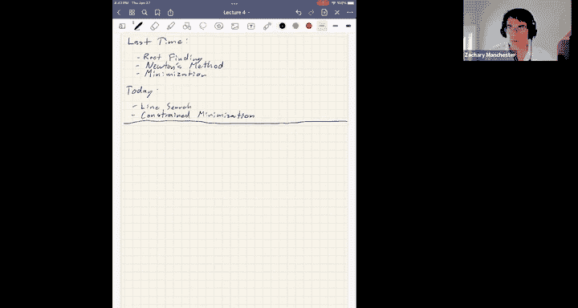
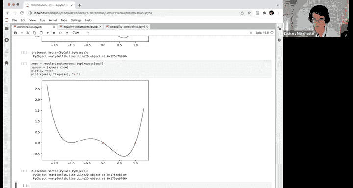
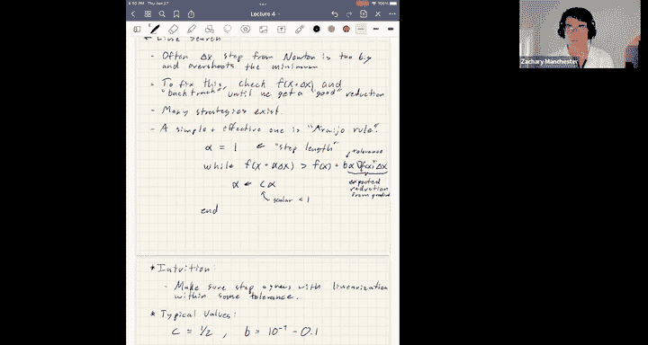
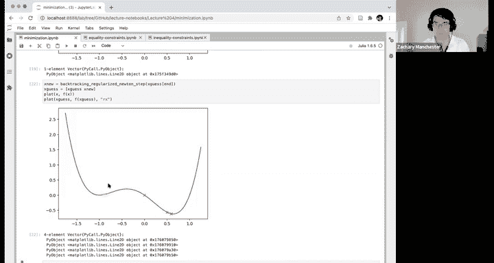
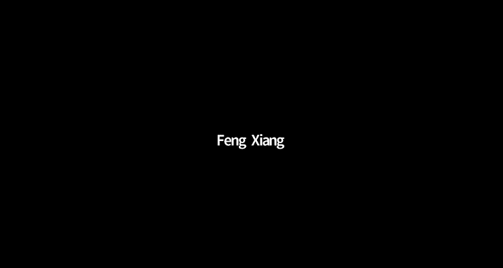
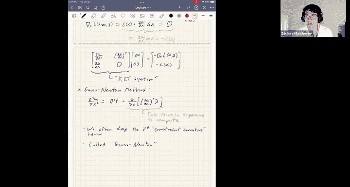
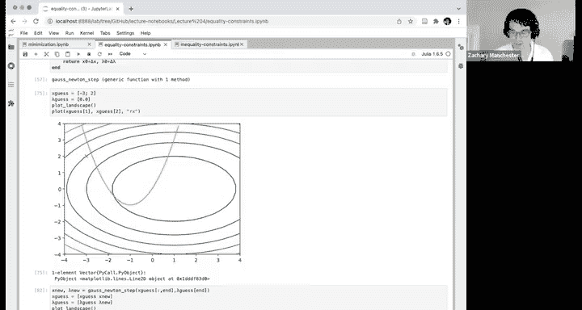
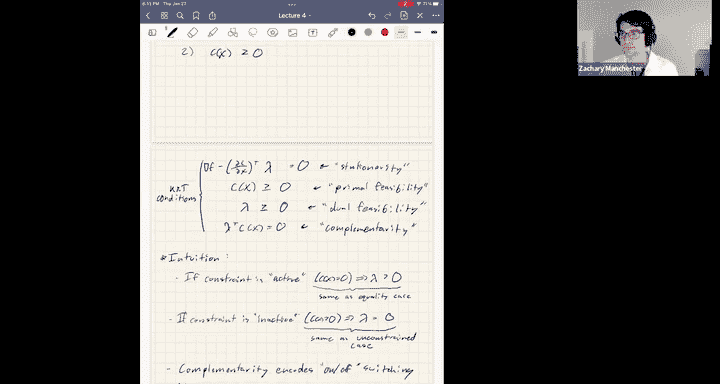

# CMU《最优控制和强化学习｜16-745： Optimal Control and Reinforcement Learning》中英字幕deepseek - P5：[05]Lecture 4_ Optimization Pt. 2.zh_en - GPT中英字幕课程资源 - BV1qHwke1EBX

So。Well has time。What do we talk about so last time we sort of started with root finding。

And we talked about Newton's method。As sort of the gold standard kind of numerical method for solving root finding problems。

And then we talked about minimization。Ha sort of the。

And how specifically how we like more or less transform minimization problems into root finding problems by writing down their first order necessary conditions Aka set the gradient in equal to zero and now you can solve that gradient and equals zero root finding problem with's method right and we did a bunch of stuff with that we did a couple examples and we talked about some of the hacks you need to add to Newton's method to do what's called globalization to basically make it work when it's far away from the answer on a nonlinearar problem specifically we talked about regularization and then we still had one more little thing to talk about which we're going to do right now。

Which is a line search。And then today we're going to talk about constrained minimization。

 constrained optimization， so we'll do the line search thing real quick。

And then we're going to get into constraints。All right， any questions about anything？Okay。

 so just to refresh our memory from last time， I'm going to go ahead and switch back to that Jupyter notebook。

So if you guys remember this is from last time this was with regularization right so we we started kind of over here remember and then you know without regularization it went found this local maximum which we didn't like so we talked about adding regularization to make it make sure things go downhill so we did that and then after we added regularization we found that it went the right general direction but it overshot the minimum right it won't way too far and we didn't like that either so we talked about how we should do something about this overshooting problem and the something we're going to do is called a line search specifically a backtracking line search we're gonna kind of go through the simplest version of this so let's do that right now。

是。是。嗯。

Okay， so。Basically。嗯。In a lot of cases， if function is highly nonlinear and kind of very curvy。

 you can have your Delta X step from Newton's method。Be too big。Yes。Okay， so the's sort of a， again。

 kind of a simple modification to Newton kind of a little bit of a hack to fix this。

And what we do is basically。Check。Check our function evaluated at the new point。And then backtrack。

And what I mean exactly by that will' do。And a sec。Basically chop those length of the step down。

Until we get。A sort of。And quotes， good。Reduction。In in our function F。

 so that's like the the general idea， the general intuition for this， there's a lot of specific。

Implementations of this， there's a lot of kind of strategies you can use to do this。

We're going to talk about one that's sort of the simplest one that works， basically。

So this one in particular。That we're going to do。Is called。The Armiho rule。Okay。

 so here's what this looks like， so when we evaluate our Newton step， we get our delta X。

Then we're going to start out with a step length。That we're going to call alpha。

 we're going to start this out at one。So this would correspond to taking a full Newton step。

And then we're going to check。This following thing。 So Fx plus。

Alpha times delta x or just shrinking the alpha is a positive scalar， right？嗯。

We're going to check this and while this is bigger than remember we want this to be small。

 but we're going to check it against you you might imagine just checking it against F of X so the previous value turns out that's not quite good enough to avoid zigzagging overshoot issues what you want to actually do is check it against。

The first order Taylor expansion of F， so you want to check it against F plus this term that will' write down real quick。

I don'll explain the sec。Okay， so what this term actually is a couple things in here， so this B。

Is it tolerance？And then this term is just the expected reduction in F。

Given a first order Taylor expansion， right， it's basically taking the dot product between Grdf and alpha times Dlta X。

 right？嗯。嗯。So this is like the naive expected reduction that you would get in f of x just if it were a linear function just have the gradient。

 so what we're going to basically say here is right we want F of x plus alpha delta x like this。

 our new Newton step with this sort of backtrack parameter alpha。

 we want this thing to be smaller than F of x plus we basically we wanted to agree with the reduction we expected from a first order tailored expansion within some tolerance B。

And while that's not true， we're going to chop alpha down by some geometric factor， C。

And this is some scalar。Between zero and one。Okay， and sort of end。So okay， intuition for this。

And if anyone has questions on this， feel free to speak of。So the intuition is again。

Make sure our step。Agegrees with the linearization。7。Within some tolerance。And you know that kind of。

 that's a reasonable thing to do， remember， because we're using this linearization to compute and instead。

 right？So we basically don't， if these disagree by a lot。

 it means that the Taylor expansion we used to compute the step wasn't very accurate at that point right so it's maybe bogus。

Okay， so that's kind of the intuition。And then typical values for the like hyperparameters in here。

Would be。So usually we've got sort of。See this this。

Factor by which we choppped down the step length usually set that to about to half。

So basically just chop the step in half each run through this and then typically the tolerance B is actually really small。

 like somewhere between 10 to the minus 4 and like 0。1。Okay。

 so let's go ahead and try this out and again， feel free to speak up with any questions。

All switching back and forth and stuff。

Okay， so this remember was what we saw last time we got this big overshoot now we're going to go and do this with the the。

The backtracking line search。So here's this implemented we've got the regularization in there just like last time we already did that last time and then here's the line search this is exactly kind of what we just wrote down you start with a step length of one ie full Newton step so alpha'll equals one and then we check the function at。

At the new step and we make sure it's smaller than。

This first order Taylor expansion within this B tolerance and here I've said B to 0。

1 C to a half and yeah the rest is the same as last time so this is exactly what we just did with the particular parameters of b equals 0。

1 and c equals 0。5 so let's take a look at that so we're going to start at the same spot。

And now what happens with this backtrack line search， rather than overshoot them in。

 we get a really nice step almost to the minimum right， so that's one step。

Two steps three steps were there so this gives us nice robust convergence so adding the regularization make sure we go in the descent direction and then adding the line search make sure we don't overshoot the minimum and in general you want to add both of these things when you when you implement like a real kind of a real version of Newton's method to solve nonlinear problems you kind of in general need both of these ass other way yeah。

What it makes sense to so I liked the in tuition for this one but what if you wanted to have said do like a binary search and said would that make sense as well So binary search is really slow and in general this Newton stuff is dramatically faster it's actually like not uncommon like another so we call these like regularization line search think globalization strategies because Newton's a local search method right and so if we want to if we're really close to the answer Newton works straight but if we're far away it kind of can break in various ways。

 so these are two different globalization strategies that work really well in general。

Binary search is another globalization strategy you can use to globalize Newton's method and in that context what you might do is you start with binary search and then once you've gotten close enough。

 you would use Newton at the end inside your last sort of bracket， does that make sense？Yeah， yeah。

 I think I guess the thing I was suggesting was that like instead of just strictly decreasing alpha。

 you could like maybe like half it and then find that one side of the interval is actually better like if that would converge faster So in general not actually yeah so so the idea with this again is that you need these things when you're far away from the answer once you get close to the answer you pretty much don't need either of the like basically it just works when you're sufficiently close you're really only doing these things for the first few iterations once you're in the ballpark it's super fast and all this stuff kind of drops out。

Yeah right so yeah usually spending a lot of effort finding the exact right alpha is totally not worth it in general there's like an optimal alpha right and you could solve a subopization problem over alpha right to like find the best alpha but it turns out it's just usually not worth it and usually you just kind of chop it you know chop it down by some factor till it's good enough and then go because again once you're close it doesn't matter anymore that you don't need it。

That that makes sense y yeah， so you can do more complicated things for sure sometimes it might be worth it。

 but usually it's just not worth it。

And this sort of strategy works on。Okay cool so that's the line search story sort of final takeaway sort of notes on that exactly yeah does the alpha get reset to unit length at the next time interval Yes so at each Newton step at each outer newton iteration you would it starts back at one that's right。

O。Yeah， for every Newton step， you start at the full Newton step and then backtrack only as much as you have to。

 right？Okay， so。Final sort of takeaway messages， Newton。Its local search。

 but with these kind of simple cheap。Modifications。嗯。Okay。Economy called。Globalization。Strategies。嗯。

It's really， really effective at finding local minima functions。It's very， very fast。

 it's kind of the main thing。是。So in fact with regularization and backtracking L search。

 you can prove that for sufficiently smooth functions from any initial starting point。

 you can guarantee that Newton with these globalization strategies is guaranteed to find a local minimum。

 which is about as best you can do on a non convex function so super effective。

 super fast in particular this is way way faster than gradient descent like a handful of iterations will get you there。

Okay cool so good on that if has any questions feel free we're going to now kind of switch gears and kind of do the next major topic。

 which is going to be handling equality constraints we're going to get into constrained optimization。

嗯。So how how is this related to like the。Quasi New methods like BFGS， etca。

So which thing in particular？So like the idea of using line search first and then。

Going from there and then doing a newton step Well line so to be clear right you take a Newton step and then if it's too big you backtrack with a line search so they're sort of you can do a line search with any any optimization strategy basically anything that gets you a step you would then potentially backtrack on that step right so however do you get the step whether it's from a full Newton or from a quasi Newton method or even gradient descent or accelerated gradient descent any of these methods right they all give you a step。

Also called a search direction， any of those you can apply a line search to。Does that make sense？

Yeah， cool， cool， right。S。Okay， so here's what we're going to do now so before we had write this sort of thing min of some function F of x where F of x is from。

R N to R。And now we're going to add something new to the mix。

 we're going to do this problem subject to some other function， C of x。

Eals zero and this is a we're going to call constraint right and c of x is a function from Rn to Rm and what that really means is we have M constraints right so so c of x is a vector function it eats the vector x and it spits out a different size vector and all that different size vector as the output of this guy is just take all the constraints you want write them down and stack them into a big vector function C right so we have M individual constraints。

Okay so now we're going to talk about first order necessary conditions for this problem and first I you know intuitively we'll talk about what they are and we'll kind of try to write them down mathematically so。

First order necessary。Conditions。So the first one。Is a you know simple sort of modification of what we had before we want the gradient to be equal to zero right we want a flat spot。

 but in this case the extra little wrinkle is that gradient has to equal zero。In the free directions。

So what that means right is if I have a constraint I can't move in that direction so I can't do anything about it right so I only want to require the gradient equals zero in the directions I can actually move the unconstrained of directions right that makes sense to everybody so gradient has to be equal to zero in the free directions that I could actually move。

It doesn't have to be in general won't be non it'll be non zero。

 it'll you'll have some non zero gradient in the directions。

That you're in the constrained directions right so like normal to the constrained service where you can't move and then in addition to that。

 we need the constraint to be zero which is kind of obvious。Okay。

 so let's draw a little picture to sort of like。Moiv us。Well bit。So let's say I have 2D function F。

So F of x is from our2。To R and I'm going to draw like level curves of this function right so it's some kind of bowl shape So here's sort of the level curves of my bowl and let's say it's got a minimum of the origin or whatever and then similarly C of x。

Is also going to be from。It's going to be one dimensional constraint so I can't really do anything else here and have any free directions left right so。

These guys are level curves at this。And then let's draw the constrain surface c of x equals zero。

 let me draw that like over here。Okay， so。What？Yeah。What we're kind of saying right this。

 so another way of saying like grad F equals zero in the free directions。

Sort of the opposite way of saying that or sort of a very a totally equivalent statement， right。

 is that any nonzero component of GrF has to be normal to the constraints。

 has to be basically in the constrained directions， right？啊。Yes。

And I'm going to use the words sort of surface and manifold。

Interchangeable here manifold is kind of like the higher dimensional version of the surface right Okay。

 so here let's let's draw some little arrows for guys so you know here's gradient of F here right。

Here's another gradient of F。And then for seed。Its gradients。

 right the gradient of C are these normal vectors to the constraint surface。

Ash probably a different color for that。LetsDo that with K and say。 So here's grad C， for example。

Yeah。And then。If I write so intuitively if this ball has a minimum with the origin。

 the solution to this constraint problem is going to be the closest point on the c of x equals zero surface to that minimum right so intuitively that's somewhere around here。

And in particular here， what's going to have to be the case， right at that point？

My gradf looks like this。And so it's non zero right obviously。

 and what's true at that point though is that grad F has no component parallel to the surface c of x equals0 right that's totally perpendicular to it。

Right so this sort of being zero in the free direction is equivalent to being non zero only in the perpendicular direction to the constraint surface and so if we write that down in math。

It looks like this。Grad F。Plus， we're going to add this scalar thing called hol Grrange multiplier lambmbda times grad C。

Equals 0。This has to be true for some lambmbda。Yeah just pushes a scale it。

And we call this Lida thing。So this is really just a mathematical way of writing down。

Graf is parallel to Grd C right they have to be parallel they don't have to be the same length。

 So this is saying Grf Grd C they can have different lengths。

 but you know that's what the lambda takes care of right the lambda is just matching up the lengths between these things so that it be equals zero So that's how we eat right down。

Parallel， basically。And then this lambmbda thing we call lag grrange multiplier。

Or sometimes dual variable is the other name for this thing you'll hear。Okay。

 any questions about that？Okay， what's that。Okay， so this we kind of did the scalar version in general and sort of higher dimensions。

We write sort of you write this sort of thing， partial F partial x plus lambda transpose partial C partial x equals zero。

 where everything can be， you know whatever dimension and lambda。

 what's the dimension of lambda here？So Lambda， remember， if we have C from R and RM。

 we have M constraints。What's the dimension of Wer？Someone help me out。Yeah。

 it's M dimensional lambda has the same number of dimensions as we have constraints。

 because that partial C， partial X， Jacobbian is going to be M byM。

 so that multiplication has to work out。Okay， cool。All right， so moving on then。

 so based on this kind of。Gemetric picture， this parallel gradient kind of idea。

We're going to write down a new function。Have for convenience。L of x and lambda。

 this thing we call the lagronangian， which just combines the objective with that lagrrange multiplier。

And that constraint function。And so this guy's called the laggrangian。

And the reason we define this thing is that it very conveniently works out that。

This thing's gradient is the root finding problem we want to solve in the constrained case。So。

Particular， if I look at this litangian function， if I take its gradient with respect to x。I yet。

Grad F plus。Porial C， partial X。Transpose lambda。Equals zero。Set that equal to0。

 and then if I take it。Grareient with respect to Lambda。I just get back the constraint function。

Which remember， I also need to be put to zero。So conveniently by sing this altogether into one function。

 I just can't。Gradient of L with respect to all its arguments equals 0。

 and we call this set of conditions。KKT conditions。

These are sort of the first order necessary conditions for a constrained optimization problem。

 although this is for it gets more complicated for the inequality case。

 which we're going to talk about next but。Technically， the KKT conditions are the inequality version。

 the equality version， which is simpler if people still call it that。

 so we might as well call it that I guess。Okay， cool so then here we go we got these these first order necessary conditions these gradientding equals zero plus constraint equals zero sort of conditions now we have a root finding problem again right and what do you know we're going to solve that with Neva head right？

Okay， so。Let's look at that。So in particular， right these are nonlinear functions in general。

 so we have to take a first order Taylor expansion like before we're going to do first the grant dis respect to x1。

 we're going to plug in x plus delta x lambda plus delta lambda。

 so we're going to take a first order Tayloror expansion in both variables， right？

So this is approximately。The original sort of。Function。Plus。Partial with respect to x of this guy。

 which is the now second partial derivative with respect to x a the hessian， right？

So this is going to be。Partial squared L partial x squared times deelta x。Plus。

 now this mixed partial， right？Partialial squared L。Partial X， partial lender。Times Delta Lada。

It turns out if you go and take this mixed partial。

 if you go look back up at the laggrangian and take this mixed partial。

 this is just the constraint Jacobbian right because partial L respect to lamb just gives to be back c of x and I take that thing partial respect to X I get partial partial C partial x so it turns out in particular here this is partial C partial X transpose。

Okay， and then we do the other one。啊。Rather respect to lambda of l of x plus delta x。

Comama lambda turns out this one right doesn't depend we know what this one is right it's just C so。

When I take this guy's derivative， it doesn't have a derivative in respect to lambda。

 it only has an extra， so this is a C of x。Plus partial C， partial x， delta x。Cool。

 so these are our first order Taylor expansions。Now we're going to sort of sush all this together into a big matrix linear system that looks like this。

So we get from the first row， we're going to get partial。D squared lambda D L df squared。

 so the hessian of e lagrian， then we're going to get partial C， partial x transpose。啊。

ThatThose guys multiply。Delta x， Delta lambda， right？And then on the other side， we're going to get。

Minus。Grad X of L X lambda。 So this is literally just me writing this this first line， right。

 I'm just moving turns around and writing it out as a matrix factor equation， right。

 And then the second one is just partial C partial X times deelta X There's nothing here。

 right equals。Minus。C an X。Okay。Ply。Why then。Radant here of the next derivative is equal to。

D C O D X。The second line in the matrix。Equation。Yeah， so literally that's just this equation here。

So all I did right was I moved I moved things over， so I moved the。So this equation says partial C。

 partial x times delta x。Equals。Minus c of x。是。So it's this equation， set equal to zero。

 sorry both of these should be set equal to zero does that make it clearer。

So literally it's just this。Sort of moved around。This says partial C， partial X， Delta x。

Equals minus c of x， right？Is that clear？And not really。

 but I was asking about the gradient of L with respect to x。嗯。In the last term。

We have second derivative of L。With respect to X n or lambda n x， And we said that it's equal to。

The first derivative of C with respect to X trans。And how did we get that。We get that from。

Looking at this。This equation， right， this is the definition。Okay。

 so what's the derivative of this with respect to Lada？诶。

Cx and then you take that thing derivative with respect to x， okay， partial C， partial x cool。Yeah。

 thank you。 Okay， great。All right， so this thing， this linear system we just wrote out。

 this shows up all over the place in optimization， it's kind of super。

 super standard and so it's so common that it has a name， this is called a KKT system。

So it's in particular， it is the linear system that shows up when you do Newton's method on a constrained optimization problem so when you write down Newton's method on the Lagrangian and sort of first order necessary conditions with respect to both x and lambda you get this particular linear system and it's so common that it has a mean and lots of sort of specialized numerical methods for solving exactly this equation so in particular some things about it right the hessian shows up in the top left and then you have the constrained Jacobbian sort of on the top right bottom left blocks sort transpoosis the whole matrix is symmetric and has a nice properties so that's sort of worth knowing about one more thing to say about this so this is Newton's method apply to this constrained optimization problem there's one more little sort of thing to point out about before we go do it there's a little bit of an approximation of this little tweak that's really common。

And especially in optimal control。Called the Gauss。五月五。Method。And the idea there is。If I。

Expand out the hessian of the Laangian so this guy partial squared L partial x squared if I sort of like。

You know， dig into that and channel it out or whatever get。The hessian of the objective。

And then I get a term involving the constraints and in particular that next term looks like this I respect to x of。

嗯。Partial C， partial X transpose lambda。Okay， so this it's literally just I took the。I took this guy。

 this gradient of x term and I differentiated with respect to x again right so I get dell squared now。

And then I get this derivative respect to x of this second constraint term， right？Okay。

 so let's look at that second constraint term a little bit closer。Partial C， partial X。

 that's a Jacobbian matrix， right？And if I then try to like apply the product rule or whatever and carry out this next partial respect to X derivative on that thing。

 you'll end up with second derivatives of that constraint。

 which end up being in general for vector things。A third rank tensor and turns out this term is typically the most expensive thing to compute in a constrained sort of Newton step。

And we don't like it， it's sort of annoying also for another reason that that we'll talk about a sec。

So。Often， we will just。We'll leave this one out。And only put in the hesian of the objective instead of the hessian of the lagronian with this extra constraint curvature term。

And it turns out， so when you do that， when you leave out that second term。

 it's called the Gaus Newton method。And yeah， it's cheaper。And it turns out often in practice。

 it gives you slightly worse convergence behavior。But it usually wins in terms of wall clock time。

 usually because the iterations are so much cheaper。

 even if you have to take a couple more iterations， it's usually still a win。Okay。

 so now we're going to go do this stuff and feel free again to ask questions on switch。

I have a question about that simplification Does it depend on the constraint though to if it's actually simple versus more expensive Yeah yeah。

 so for sure so like they're definitely situations where that term could be super cheap and you don't care and it's fine but often in optimal control in particular。

 these constraints are dynamics of our robot and so if you're talking about a humanoid robot and this being your're like manipulator dynamics of some really complicated robot computing like the second derivative your dynamics is often really expensive and so in that context in particular it's usually not worth it so it' it's basically the standard thing in optimal control to leave out that term and gas Newton。

That would that would make sense Yeah， all right cool so let's go do some of this so here's。

Here's our Julia stuff， so here's what we're going to do this time we're going to write down a nice little quadratic objective function。

So my F of x is like， I don't know， this guy here with this Q matrix sished in between。

Here so this is my hesian right nice and it's a nice little you know made up function so I can write down the gradient and hessian and closed form like before so I write all that down by hand right there。

And now i'm also going to make up a constraint function and here I also made up a quadratic constraint just to make it non nonlinear so it's more fun and it's pretty simple so I wrote down the。

The Jacobbian matrix of the constraint as well。All in 2D， right？

quadratic objective quadratic constraint and now here we're going to plot this this kind of landscape so it's like the picture I drew a second ago so I have plotted a bunch of level curves of the objective and it's like a quadratic pole right we have a positive definite heh in here so the whole thing looks like a big bowl and then this is my quadratic equality constraint this。

Yellow parabola right it's quadratic function and what I'm saying here is I have to be on the parabola right it's an equality constraint so I want to minimize it subjective to being on this on this。

Parabolic surface。Okay， so let's go ahead and do that， so here's Newton's method。

I'm evaluating the hessian and this is full Newton so I've got the hessian of the objective plus the hessian it's the full hessian of Ogrgen so this is that hessian of the objective term and then this is that second term that I said we often drop in Gaus Newton but here it is right so I compute。

Partial C partial X transpose times lambmbda， and then I'm using automatic differentiation this Julia forward di package to compute the Jacobian of that thing right so I get that。

That kind of weird term so that's my full hessian here's my constraint Jacobbian here's my KkT system so hessian constraint transpose Jacobucbian transpose into the bottom row constraint Jacobbian zero here's my right hand side vector right so it's minus the gradient of the laggrian up top and minus the constraint on the bottom stack everything up and then this is just this is me solving that you know mutant system or that KkT system and then just pulling out the x and lambda from that vector and then I'm doing my update right so that's exactly what we wrote down。

Now let's kind of go do some stuff here so I'm going to start it out first let's say here at one one kind of the bottom just kind of random starting point。

 not super important。And we're going to see what happens when I do new right。

 so let's go ahead and do that。Okay， cool。Remember i'm linearizing the constraint so here that linearization produces like a tangent plane that looks like this and I'm going to minimize the function along that tangent plane basically is what's Newton's doing so this makes total sense right so I take this linearized surface and I take and I minimize along that linearization that kind of puts me out here right near the minimum of this objective function。

So let's take it another step and see what happens。

So now it's pulling me back up towards the constraint surface because here you know if I linearize here the tangent plane looks like this so kind of pushing me back。

 that seems good， a couple iterations， third iteration now I'm back on the constraint。

Let's see so kind of three four iterations on there and so intuitively right I want the point the point on the constraint surface closest to the the actual you know unconstrained minimum so that looks about right and you kind of see what Newton's doing like intuitively the behavior kind of makes sense you're successively linearizing the constraint surface and minimizing along that。

Linearized approximation of the constrain surface。Does that make sense to everybody？Cool。

Now we're going to go ahead and do it with Gaus Scten。And it's all the same。

 the only difference is here I've taken out that constraint curvature term from the hesians。

 it's just theian of the objective， everything else is exactly the same right。

 and we'll start at the same spot。And we'll go ahead and take take some new steps and see what happens Okay。

 so this looks exactly the same。啊。Another step back up towards the constrain surface pretty much the same。

Three cool like four steps it looks exactly the same essentially if you really look carefully。

 this second step is a little different between the two。

You kind of tell right but they basically converge in the same number of iterations they produce almost exactly the same behavior so the message is they behave very。

 very similarly and the convergence behavior is almost as good in particular if you want to get like very technical Newton's method has like quadratic asympprootic convergence。

 but Gaus Newton has super linear which is a little worse but it's still very good so might take another iteration or two but。

You're going to get more or less the same behavior out of these things and it's a lot cheaper so that's kind of the message there so that's both of them compared。

We're going to now let's go try something else a little weirder。

Any questions feel free what i'm going to do now is pick a different starting point that's a little farther away so let's try this guy。

Okay， so I'm going to start up here。So farther away from the minimum right a remember we said there's all these kind of weird issues with Newton when you're far away and we have to do this globalization stuff so let's kind of。

Look at what happens when I try this。So let's run Newton on the guy。Okay， one step cool。

 I'm minimizing along the tangent that sort of makes sense like before。Next step。

 cool I'm kind of going in the right direction seems like next step。What's going on？Okay。

 so it looks like I kind of like went down here and then I'm moving back。The wrong direction。

 and I'm like converging to some point sort of like。Around here。Which。

Is neither fully satisfying the constraints so it looks like it's probably going to satisfy the constraints in the limit but it's definitely not going towards what we we kind of know is the minimum right over here so that's kind of weird let's see what Gaus Newton does in this same situation so。

Minus3。2。So same starting point， let's run this a few times and see what happens， so same first step。

Pretty much the same kind of behavior it looks like， but as I run this one。

 it's kind of doing the right thing， it's kind of inching along the constraint。

Surface towards this minimum。Kind of overshot there。

 but now look it popped up into kind of exactly where we expect and it landed at the right solution after like I don't know five or six iterations。

Okay， so can anyone tell me what's going on here so we said you know all this stuff about Gas Newton's。

More approximate and should be worse in this particular situation it's doing better it's converging to the right answer where the full mutant actually gets stuck and gives us a bad solution right anyone have any thoughts on what might be going on here。

Someone give me a guess。Are we preventing it from overshooting when we take out that last term。

 is that what's going on No， but so obviously the only difference is that hesing term， right？

So think about our conversation last time about regularization and like positive definiteness of the hesian and all this stuff right so the objective here is a nice quadratic that's positive definite and all that stuff so the objective is good。

But this constrained curvature term that I'm adding to the Hessian in the full Newton。

Is obviously doing something weird， right？And in particular， if I check here， I'm going to check the。

LetSee next room。Okay， we got to restart this guy。So let me run this a few times again and get to kind of where we were。

Okay， so if I checked the Hessian where I landed over here where Newton got stuck。

It's got a negative this is again the hessian of the lagroian right so it has the objective term and this constraint curvature term and sure enough it has a negative eigenvalue in it。

So what this is saying is that even if your objective is nice and convex and positive definite everywhere。

 if you have nonlinear constraints， which we always will basically in like the stuff we're doing or most of the time right dynamics are usually nonlinear at least for interesting things。

 that constraint curvature term that you're sticking in the hess in there for a full Newton can actually make your your。

Hessian of your KVT system become indefinite and have negative ideavalue and do weird things so that's sort of annoying and that' is yet another reason actually why it's super common and optimal control to just leave it out it's kind of more trouble than it's worth a lot of the time so in particular here the other kind of takeaway message here is that on these problems you very much still have to play the same games we talked about previously with regularization and line search in the constraint setting rate。

Okay。Any more questions about this， anyone want me to try anything else weird before we switch back？

Are there so are there similar situations you could show where。

The full Newton outperforms Gauss Newton like I assume there are Yeah so what'll happen right so full Newton has theoretically faster asymptotic convergence meaning like when you're really close to the answer it will it'll zoom to the solution faster once you're close when you're far away though is when these problems happen right all these problems are sort of far away problems and when you're far away that extra curvature term is really not helping you is basically the message so there's definitely situations you can cook up where full Newton will converge in fewer iterations。

But I think in general， there's not really situations where like Gasuss Newton will get stuck where Newton won't get stuck。

 I mean， generally speaking， Gauss Newtons tends to be in these kind of situations more robust。

If it's a little bit slower， that's kind of my hand wavy， you know。

 sort of intuitive sort of explanation for what's going on。

Thanks。Sure， okay。Back to the notebook。A professorssor。

 so basically it looks like Goss Newton does all the good things that Newton's supposed to do。

And so。Like， what are the what are the pros and cons of using Goss Newton？Yeah， so I mean。

 it always is a it varies based on your specific problem， but basically Gaus Newton is cheaper。啊。

And might be more robust on very nonlinear constraints。But it has slower convergence。

 so it might take a few more iterations。That's basically the summary， does that make sense。Okay。

 yeah， thank you。とい？And yeah， so we can write that down here。Okay。What does people generally do with。

 like initialization。It seems like it's pretty important for the solver。It is yeah。

 so this is sort of。One of the this is sort of where you get into vooy you know dark art sort of sort of vibes so when you're doing this stuff on non convex nonlinear problems like they usually end up with in these robotic like optimal control problems。

The initial I call it the initial guest problem is is huge and generally speaking this is where you have to use all of your intuition and like sort of engineering insight to sort of。

Give it a good initial guess。And yeah， the better you can do with the initial guessing。

 the better these techniques all work because they're all local search techniques， right？So yeah。

 you you will get experience with this， but yeah， for now。

 let's just say it is a bit of a dark art and you have to sort of like。U，You know。

 do the best you can engineering a guess you before you kind of plug it into these methods。Thank you。

Yeah。😊，Okay， so just to summarize then the example which you'll have the code for we sort of。

Started at a couple different points， I think like minus1 minus1 and then minus3。

Two and then this one。You cant get stuck。And。嗯。Cassiming doesn't。Okay。So yeah。

 and then just take away sort of notes。Yes。You in general still have to regularize。嗯。Even if。

I have assing of the objectives。Is strictly positive， definite。And yeah。

 Gas Newton is often used in practice and especially in optical control。Okay， cool。

 so next up we are going to talk about。So we did equality constraints and typically in our context that's going to mean the dynamics right so the dynamics are typically dealt with as equality constraints have to obey physics sometimes you might have an equality constraint for like a goal constraint a goal state you want to get at the end of your horizon or something like that that's another kind of thing that might show up as an equality now we're going to talk about inequalities。

And these typically show up， yeah ahead。Yeah， so the equality dynamics constraints you're basically saying then like at each time step the dynamics equal you know the next iteration。

 Yeah something like if you're if you've got your discretized dynamics like we talked about a couple of classes ago Xk plus one equals F ofx K UK that's it that's your dynamics constraint right so you'll have like your whole X trajectory and your whole U trajectory will be your decision variables and your optimization problem and youll have a whole bunch of equality constraints at each time step saying x K plus one has to equal out of xk UK that makes sense。

So then do you always need like some sort of time horizon that we're talking about in an optimization problem generally yeah I mean there are so called infinite horizon problems that you can write down but you can't really solve those。

Nummerically， super nicely。Most of the time right， say if for finite horizon problems。

 which is usually what we're going to deal with，'s that's exactly like in the setup。Okay。

 so here similar to before we're going to be minimizing an f of x。

 but now we're going to be talking about c of x greater than equal to zero instead of equal zero。

 right？And we're just going to right now focus on inequality only。

 you can obviously combine the two in general， we will。

 and in our context this kind of inequality thing， there's kind of two main places these show up and control problems。

 one is like torque limits on your actuators or thrust limits right this kind of stuff。

So actual error limits， and then the other one is like safety constraints like keep out regions or obstacle constraints。

 right？So those would be like state inequality constraints so those are kind of the that's what you should have in your head when we talk about these again we'll just do the inequalities for now。

And in general， you're going to combine these。With the stuff we just talked about before。Okay。Okay。

So now we're going to talk about similar we first order necessary conditions for these guys。

That's really similar， but the intuition is super similar， but the math looks quite a bit different。

Okay， so。SaSame deal as last time we have。Grab F equals zero in the free directions。

So in any direction you can feasibly move the gradient has to be zero。

 but if you're up against a constraint where you can't move in that direction anymore。

 then you can have a non zero gradient in that direction and then to C of x has to be greater than equal to zero instead of equal like before right。

 so almost the same sort of like。You know set up， same intuition now I'm going to write down what these look like in math and then we'll talk about them a little bit。

Because they are kind of different so a quick question yeah so for the first condition because in this case the constraints is not like equality doest that mean you can technically like kind of move in the constraint direction to like when you're inside does that not matter so when I say free direction I mean any direction you're allowed to move legally according to the constraints。

That makes sense。Okay got it， so it could include like the constraint directions。

 but like inside the set basically， yeah if it means if you're in the interior of the set。

 cool you're good if you're at the boundary of the set。

hen you can't push anymore in that direction right but you could go the other way right yeah so' it's it's a little subtle but yeah it' it just means what I mean by this is any direction that's legal with respect to the constraints the gradient has to be。

Has to be zero and any direction that is illegal with respect to the constraints。

 you're allowed to have a non zero gradient in that direction， right？

So that's the intuition it's like you're going to do the best you can subject to the constraints so like any direction you can feasibly move the gradient's got to be zero in those directions right。

Okay， cool， so let's try to write that down now mathematically and。

I'll just start doing it and then so the first one looks really similar to what we had before。

 the sort of gradient condition。So this is exactly what we had before this is called。Stationity。

And that's sort of again like fixed point that stationary fixed point flat spot create an equals zero that surface all mean the same thing The next one is just like before。

 but an inequality now instead of inequality so C of x greater than equal to zero。And this is called。

Prial feasibility。So feasibility。Sort of we know what that means right it's feasible with respect to the constraints is not violating the constraints primal refers to the X variable in contrast to dual。

 which refers to the lagrange multiplier lambda variables so that's where that comes from the next one we're going to have is in this context in addition to primal feasibility in addition to the equality inequality on on the constraint we also have an inequality on the lagrrange multipliers so lambda has to be greater than equal to0 and this one as you might expect is called dual feasibility。

And this is coming from the fact that if youre if you're an inequality constraint。

 it's sort of one sided right， and you can intuitively think of the lagrrange multiplier as like。

The force pushing you away from the constraint right that's keeping you from violating the constraints so in the inequality case because the constraints one sided。

That that Larangee multiplier force is only allowed to push you in one direction away from the constraint it's not allowed to pull you closer to the constraint right and if you like flip sides and you're on the other side then that lander with flip directions so in the equality constraint case this force you know can be in either direction it can push or pull because it's trying to keep you on that surface it's one side and it's only allowed to push you away from the surface and kind of one direction so that's why。

ItIt's got that greater than zero flavor and then the last one。Looks like this。

This is called complementarity。And this is basically encoding。

Switching behavior So this is saying if the constraint is active。

 meaning it's you're on the constraint surface， then c of x is equal to zero and I'm allowed to have a nonzero lagrrange multiplier so if c of x equals zero i'm on the constraint surface。

 then lambda is active is non-zero if I'm off the constraint surface if c of x is nonze。

 then lambda has to equal zero I'm not allowed to have any lage multiplier I'm not on the active constraint So that's what that last one encodes So this whole set of conditions here this whole set of first order necessary conditions are called the Kkt conditions these are the real Kkt conditions should the first equation be plus So yeah that's a good question Why do you think that。

Because you just take the derivative of like F plus like how we did before yeah so。This was。

 I didn't write down the lagry in， right？So last time it was plus and that was sort of with respect to like me writing。

 so I guess the first question is could it have been minus last time？そ。

I guess that one wouldn't matter because it was supposed to be equal to zero Yeah exactly so it doesn't matter actually like if I put it before I could have put it as a minus sign and then it would have just flipped the sign of lambda right？

So because the sign of lambda doesn't matter in the equality constrained case。

 it doesn't matter you can make it either sign here the sign of lambda actually matters so we have to be careful with this it turns out you can actually do it either way but it changes the signs on the inequality constraints so in this particulars let's feibility right yeah exactly so if I made that a plus sign then I would have to make lambda negative in in the dual feasibility condition that's exactly right so yeah basically hear the signs matter so like it's just an arbitrary choice but you have to be consistent with it so I've decided to make everything positive like C of x positive lambda positive and therefore that has to be a minus sign it turns out if you flip one of those then you can flip them around right kind of arbitrarybitrarily did you just have to sort of follow through。

Professor another quick question you mentioned that we can have Lada nonzero only when like it is on the active region on CX but when we're considering CX greater than zero can't we have Lada like push us even if we're not on CX no that's sort of not what you want right so like then it's affecting the answer to the optimization problem right it's sort of like messing with your answer and you don't want that right if I'm not on the constraints or the constraintsst is shouldn't be affecting my solution。

Does that kind of make sense？So let me i'll write down some more of this and we'll get more into it。

 but yeah feel free so okay， so if the constraint。嗯。It is active。So c of x equals zero。

Then I can have Lambda positive。And the way to think about this is when the constraintstrain is active。

 I'm in the。Exactly the same as the。This is exactly the same as the equality case， right？

That we did before。嗯。Then if I have the constraint inactive。So this would be。C of x， you know。

 positive， strictly positive。 So I'm not on the the constraint surface， then lambda has to equals 0。

 not allowed to have。Anything in here and this is making it the same as the unconstrained case。

Does that make sense on that last question so basically if I'm not on the constrained surface if I'm in the interior then it's exactly the same as if it were an unconstrained problem so that a grand multiplier term should drop out does that make sense？

So then now were just like directly moving towards Deth being zero rather than。Okay。

 y y if the optimum is in the interior of this constraint set。

 then the constraint' is not doing anything so that whole constraint term doesn't matter anymore right Okay okay makes senses good so yeah。

 so basically if're if you're in the interior of the constraints you're inactive。

 it should look just like the unconstrained case and then if you're on the constraint it looks just like the equality constrained case。

And that complementarity condition。Basically enforces that switching back and forth。

What happens if the constraint is violated in this case？So。Then it's active， right？

Or it should be and there's more to say about that， I guess。That so。Let's see。

If it's violated what exactly happens in a solver when it's violated depends on the details of the solver implementation we're going to talk about this kind of right now so it depends exactly what you do these conditions all these conditions are telling you are the necessary conditions for a solution so they're just telling you what's true at the solution point so they're not necessarily telling you what to do far away from a solution point that makes sense。

I see here。so what we're going to kind of get into now is sort of algorithms for solving this stuff。

 which are unfortunately a lot more complicated。Then the last case。Much harder here。

And the equality case。And in particular in the equality case。

 I could basically just do newton on the KVT conditions right now I can't do that it turns out。

If anyone has any insights into why that would be fun anyone don't have any thoughts on why。

Because of the sharp discontinuities in the complementarity conditions， yeah。

 thats sort of bad things buried in that complementarity condition。Which we can talk about。

And there's lots of options here。And we're going to talk go through a few about。

Okay so here's a whirlwind survey of a bajillion ways of solving these kind of inequality constraint problems the first one is called an active set method。

And the idea did here is if I magically have some like oracle that can tell me which constraints are active and inactive。

Then I can just。Solve an equality constrained problem right and not have to worry about all this stuff。

That sounds kind of kind of weird and stupid， but it turns out that there are situations where you can make very good guesses at which are the active constraints and then you know maybe you guess wrong a couple times but you have like good heuristics for figuring out the active set and then you just have to solve a handful of equality constraint problems。

 that can work really well， it turns out and depending on how good your're guessing is basically。嗯。

And they're a good instance of this in control。So yeah。

 the advantage here is this is super fast if you have a good heuristic for guessing。

And then if you don't have a good way of guessing， it's very bad。

So good example of this in robotics is the。MIT DRC team that sort of did atlas back in like 2014。

 2015 or so when they were sort of。Competing to that DARPA challenge they they developed a custom active set QP solver in fruit for their robot and they had a bunch of like really good heuristics for guessing the active set and they guessed it right like 95% of the time and in the other 5% of the time they could get it right in like one additional guess and they as a result were able to like control that robot at like they could run that solver at kilohertz rates so big win so in particular problems you can sometimes do this really well and that's a huge win。

Okay， so other ways to do this。Our barrier。Or interior point methods。

And these are basically the same thing and the idea here is you're going to replace。

Inequality constraints。With a so called barrier function。That blows up to infinity。

You put this in the objective。That's going to kind of blow up to infinity at the constraint boundary。

Okay， so this looks like I have my min。V， subject to。C of x greater than equals0。

 I'm going to take this and I'm going to replace it with min over x。F of x。

Plus or minus I should say a term that so that the standard barrier function is called the log barrierll'll draw picture of it。

 so I equals one to M for M constraints。I'll write this down and we'll talk about it。Okay。

 so that's what that looks like so the idea here is if I plot this sort of。啊。

So if the x axis here is like c of x， and then this is。Minus， I guess I can just plug this as x。So。

What if the argument of the log is so x here， so minus log of x is going to kind of be more or less zero。

And then near。X equals01 to blow up to infinity and like kind of asymptotically go to infinity as x gets to zero。

 right？So the idea is it's pretty much flat far away from zero when x is positive。

 so it has minimal impact on the objective function when you're not near the active constraint because you yet get close。

 it's going to blow it up to infinity such that that objective is just huge right its basically a gigantic penalty infinite penalty of being sort of too close to the constraint and then that one over row in front is like basically lets you dial in how steep it blows up。

Okay， so that kind of makes sense， everybody。So these are kind of the gold standard。

They work really well。For sort of small to medium size。Convex。Problems。

So they're the thing to do if you have like a convex QP or LP or something like this。

 and it's not too huge， these are the way to go， but for nonconvex problems which are kind of most of the ones that we're going to deal with。

 these are really you can make them work， but it's really hard and it needs a lot of extra tricks and hacks to make them work。

On non problems。Question on this barrier method。 So does this mean that it will probably never touch the boundary if it's loggged like greater and equal to0 base it means greater than0 in this case。

Yeah， so it's a strict kind of greater than， but what happens you kind of end up cranking on that row term as the solver converges and you can basically push it all the way over to like pretty tight tolerances to like almost machine precision。

So definitely like eight 10 decimal places， so you can you can basically get the answer to be as close as you want to as many decimal places as you want by playing around with the row。

Okay， does that make sense？Yeah okay cool okay so barrier functions interior point methods same same general idea great for convex problems let's talk about another one。

So penalty methods， similar idea and spirit， but little different flavors。 so here we're going to。

Replace the inequality。With an objective term that penalizes constraint violations。Okay。

 so kind of here what this might look like is you know。

 min f of x subject to c of x greater and equal to0 will get turned into。Something like min。Of。Plus。

 so that the standard one is a quadratic penalty， so that looks like this。

And this is like element wise men right kind of idea in there。And if I plot this。

Whatch you're going to get， right is something that's。This is x， and then this is sort of。

Min zero kind of x。Squared， it's going to be zero all on the inside here。

 and then you're going to get basically a quadratic penalty。When it's infeasible， right？Okay。

 so what to say about this， super easy to implement。嗯。But has lots of numerical issues。Sure。

And as we say， it's sort of as a result you know， of that。

 it's difficult to get sort of good high accuracy constraint satisfaction。Yes。Okay。

 so we are right of time there， so I'm going to， this is like not a terrible place to。

To take a break so anyone has questions happy to chat about those otherwise we'll pick it up on Tuesday and also we should be getting out so hopefully everyone tried the homework zero not。

Do it please and the real homework one is going to go out tomorrow probably and you' have two weeks to do it and we'll have kind of full set of office hours and stuff next week。

So I'll stick around for a little if anyone has questions， otherwise we'll catch you guys on Tuesday。

I have a quick question。 you mentioned that the barrier method is good for small to medium problems。

 What， what the small to medium problems like， Yeah， that's like kind of ambiguous。

 It turns out like it really depends on it depends in particular on problem structure in a big way。

 So， I mean， practically speaking， like anything up to a few thousand variables is probably fine and not a big deal with those methods。

 if you get to stuff with like。Millions of variables that's definitely large and too big for for like an interior point method in the middle there like more than a few thousand and less than a million。

That's sort of inmbiguous and it depends on the particular problem， but yeah。

 I would say like safely anything less than a couple thousand variables is fine。Okay， thanks。

 multi to medium yeah。The honest answer there is it depends on your computer and as computers have gotten better and better。

 the definition of large scale optimization keeps shifting。Okay， yeah。

 so there's some more stuff to say about this， which we're going to get to next time so you kind of ran out of time today。

really quick yeah I'm having some trouble kind of visualizing the the diagram that you had initially so when you were talking about the level curves and the curve with those level curves I guess I follow everything numerically I just don't understand how visually that curve is supposed to follow those level curves so the way i'm thinking of it right now is that so we're talking about this picture here okay yeah yeah so you the idea here is those level curves are like telling you I mean that's the shape of the bowl right？

And then the constraint is some line。That's that you're you have to be on right you have to satisfy that equality constraint so like intuitively what you want there is you want to be as close to the real minimum as you can get while being on that line okay so in this case。

 if I had a bowl and if I drew like if I were to say like draw a line on that bowl at any point in that bowl the goal would be defined the point that was closest to the bottom of the bowl to that line that's drawn on the bowl。

Yeah， yeah， that's pretty much it okay so the function that we have that we try to minimize or like the constraint that function has to lie on those level curves it can't lie away from the level curves。

I mean I can draw these level curve I can draw as many level curves as I want right this is just like the idea there is it's just giving you like this picture is me looking down at the bowl from above whos trying to give you a picture of like you know the shape of the bowl right okay so what this is saying really is that。

At another way of thinking about there's a bunch of sort of equivalent ways to think about this idea of like what the free directions are right on this so the intuitive idea is that I need the gradient to be zero in any free direction that I'm allowed to move right so that means here in this picture grad F can't have any component that's parallel to that line right so that makes sense Okay so another way of saying that if I can't have any component parallel to the line then it has to be totally perpendicular to the line right okay。

Okay okay yeah to make sense so that's that's kind of the idea another way of saying that so if graiff it has to be totally perpendicular to the constraint line。

That is also equivalent to saying the line at a solution point， the line has to be perfectly tangent。

To the level curve Oh okay， okay， okay， yeah， yeah， yeah， yeah， that makes Yeah okay。

 so there's yeah， there's like I just there's like a half dozen completely equivalent ways of saying that thing and I think I just said them all over the course of this So hopefully one of those kind of clicks are Okay a few of them now Yeah Okay。

 awesome yeah you and then yeah， literally this Larange multiplier idea here it's literally just a mathematical way of writing now。

That idea right so it's saying like you know Gr F and grant C have to be parallel is what that equation lit says and the lambda is just saying there have to be parallel but they don't have to be the same length so lambda is there to sort of make the length match Okay okay yeah yeah Okay that yeah that makes sense awesome cool cool all right thank you Yeah you got it。

All right， anybody else？We just got one more question。Yeah。

 so you mentioned about the three methods of solving this spin qua AKT。

 I it makes sense to use the second and third method as an in for the gas for the first method。Sorry。

 so we're talking about these guys。I think it's down there like。So。

I'm just trying to I wonder if it makes sense to use a barrier method or the penalty method as an initialization and we can guess for what the activities are and then we can use the activities method yeah so this is a great idea this is actually very commonly done in practice so a lot of the times which you'll see is one of these other methods will be used。

Until you get pretty close to the answer and you can then know with high confidence what the active set is and then you'll switch over for the final sort of couple iterations to an active set method that's often called solution polishing and it's a super common trick。

in fact， yeah， have you ever used OSsQP？ready okay so yeah this is a common thing in many of the like you know industrial strength solvers so like in particular I was going to say alwaysqP which is one of the like best QP solvers out there that if you ever have to solve a QP it's one of the main ones you would use does this it uses some some penalty is things for a while and then it basically switches to an active set at the end once it's really close。

So yeah， thanks， good idea。Yeah。So I have a quick question about。

The K K T conditions for the inequality case。 So you， you mentioned there's like， I just wanted to。

 to ask if you could like repeat connecting intuition behind like the four constraints。

 I think I understand the complementarity。But yeah， it just like， you know。

 you could go over like the inition behind the other ones。Yeah， okay。

 so the first one is just gradientating equals zero。Like we had before， right？

So that first aity condition， it's the exact same thing we've had in the equality case up here。

 right？Okay， so that one hopefully is clear。Yes， okay yeah so the first one is literally the same thing we had before with the equality case with the lagange multiplier the next one is just saying that you have to respect the constraints。

Right。Yeah。😊，Okay all right so the last two are the tricky ones so what's going on with the last two so you said you kind of get the complement that's sort of encoding the switching thing yeah yeah thanks so so so the the combination is kind of all what makes it work。

 but basically。In the inequality case right the constraints kind of one sided you can think about it like i've got you know so if like in this picture up here where I have this line instead of having to be on the line I'd have to be on one side of line right right that's kind of the idea okay so because of this like one sided situation。

In the equality case， that lage multiplier can point can point either way can have either sign and the idea there is like。

Grad， so， so like。What's the right way to say this so remember this whole idea about like the gradient having to be zero in the three directions right？

Okay， so in the in the inequality in the equality case like grad F can have grad C can be like pointing either way right it doesn't matter with respect to this surface in the so like in particular in this picture right you see the little green grad C and the little red grad F right yeah they can point opposite ways whatever it doesn't matter right in the。

Inequality case remember this whole concept of free direction well I can move in one of those directions。

 one of those normal directions to the construction in the inequality case I can't move Im like free to move any way I want this way but not this way right right and so that like signed lambda thing there is kind of getting at that it's saying like those things have to be parallel and they have to be pointed the same direction they're not allowed to point an opposite directions because that would mean I could still make progress going the other way right right yeah does that make sense okay so that's getting across the one sidedness of the inequality case。

That inequality on the lambda， and then the last one is getting at the switching active versus inactive。

Right。Okay， thank you。 that's sort of cool so yeah， this is like。

I mean you can get some intuition for this it's not so terrible。

 there's actually like a really nice intuitive way to understand this from mechanics that's going to be on the first homework which is like dealing with like a falling brick so it's like in that case the constraints are like the c of x is the ground and you're throwing a brick it's flying through the air then it's going to hit like think about it like a brick hitting ice and sliding so in that case the inequality constraint is the ice the surface of the ice you're not allowed to go through the surface。

And the lagre multiplier is the normal force that's holding you up。

 that's pushing you up and preventing you from falling through the ice。

So in this case it's like super， super clear like where it all comes run basically like you have to be above the ground。

 you're not allowed to be under the ground so that's c of x greaterd equals zero then the lambda positive thing is saying the ground is only allowed to push up on you not pull down on you right right and then the complementarity is saying that you can only have a force if you're actually touching the ground you're not allowed to have any force if the bricks in the air。

I see and it's like super， super intuitive when you think about it as like simple physics， right。

 but it's exactly mathematically describes that scenario。Cool， thank you。 cool。Anybody else？

