# CMU《最优控制和强化学习｜16-745： Optimal Control and Reinforcement Learning》中英字幕deepseek - P6：[06]Lecture 5_ Optimization Pt. 3.zh_en - GPT中英字幕课程资源 - BV1qHwke1EBX

Okay， so what did we talk about last time？

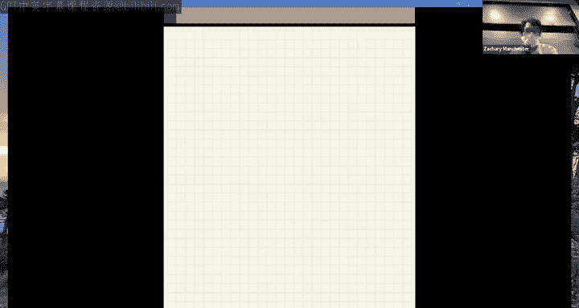

So last time we did。Bun of stuff about basically a bunch of stuff about constrained optimization。

 right， So we talked about。嗯。We talk about KkT conditions。

We talked about line searches last time a little bit， right？对。m and like you know。

 inequality inequality con that type of stuff right。

 so we're going to pretty much continue in that vein today。So we're going to do today。

 we're going to kind of。Go back to some of the algorithms for handling inequalities that we started talking about last time in particular today we're going to talk about kind of our my labs sort of like Workhorse algorithm class for solving these kind of problems it is called the augmented litology method。

Then we're going to look at a particular class of constrained optimization problem that is basically the bread and butter of modern model predictivetive control so super applicable all over robotics and aerospace problems this kind of stuff called a quadratic program so who's heard of a quadratic program in here a good number of you right so this is stuff so today we're going to show you how to make a solver for AQP which is cool and that's on the homework。

We're going to do that we'll check one out today then we're going to talk a little bit about。

Some more， so this is like kind of。Today should be the last day about like kind of basic optimization algorithms and then like next time we should really dig into optimal control so there's a few like cleanup details on sort of numerical optimization tips and tricks kind of stuff so we're going to talk a little bit more about line searches and regularization but some details on how to apply those methods to the inequality constrained case basically so。

I'll say like moreron。Regularization。あ。Okay， cool， so let's dig in。So first。

 I just wanted to kind of recap。What we left off with last time we talked about KkT conditions for inequalities。

 and then we talked a little bit about。Different methods for solving those problems。

 And so we kind of left it off with。The penalty method。

We're going to pick up there again because that sort of directly leads into the augment of Lagr gene idea。

 so the basic idea we said last time is to replace。Inequalities。

With an objective term that penalizes violations in particular last time we talked about a quadratic penalty。

 you can really make up other other penalties right you can have any kind of penalty you want。

 but the quadratic penalty method is kind of the standard one。对。And so here we go。

 So we got to do this。 We go from min F of x。Subject to say， C of x。Greater than equal to zero。

We take this and we turn it into。Nin。Over x F of x plus this penalty function。

 and we're going to define it like this。 There's other flavors of this that you can make up。

 but this is kind of a pretty standard one。So this min is in here to clip the constraint function rights so we're only penalizing the violations i。

e。 we're only penalizing negative values right that are violating the inequality constraint and we just take those violations we scm multiplying by some tuning parameter row addom to the objective and we minimize that function right so it makes sense everybody。

Do we talk about the fact that this is non smooth last time。

 does this seem weird to anybody for Newton's method？

Does anyone think there might be a problem here doing Newton on this？Dos。Anyone have any thoughts？No。

 no thoughts。So。It looks a little sketchy， this is not C2 smooth because that it looks like we kind of this last time。

 right， So if I have。Sort of。X， and then this penalty function。

Assuming that you know we're penalizing you know positive orn here just x gradientd a wassor。

 this looks like this right so it looks like a one sided quadratic parabola is that function smooth。

Question， anyone have any thoughts？Be。没。I heard somebody whispering， yeah。TheYeah。

So it's C1 right the values match and the first derivatives match so it's C1 which is good it it's only got to jump in the second derivative right so turns out that's allowed with Newton's method and Newton's method will still work on this which is fun so that's cool。

So we talked about how basically this is easy to code up right like this is really， really simple。

 but that it has some issues。Namely， it gets ill conditioned。

 does anyone know what I mean by ill conditioned？Any done mean yeah。

 the ratio of the the Yeah exactly so I'm adding this term to the hessian， right and that term。

 let's say that you know it's just x positive。Basically any terms that have an active constraint in the hessian of your like that shows up in Newton's method。

 you're going to get if row' is really big you're going to eigenvalues that basically go like row and those are going to dominate and make the matrix sort of really kind of ugly and hard to invert and as a result you're going to get lots of floating point error and stuff like that so big penalties in here cause problems is basically the problem。

So what that tells you also is you need large penalties to get accurate constraint satisfaction so that that combined with this fact。

 field conditioning is you get large penalties tells you you can't really get accurate constraint satisfaction with a penalty method as you crank up row。

 you'll get tighter constraint satisfaction but you reach a limit where you can't crank it up anymore and still solve the Newton linear system that shows up the KFP system。

In particular， if you look at the theory for these guys to get perfect constraint satisfaction exactly c of x you know equals zero with this guy turns out theoretically you actually have to crank that row up to infinity so obviously we can't do that in a computer with photo point math right so this is basically the story these things have this issue where you basically just can't get past a certain constraint tolerance so what we're going to do now is fix that issue with some a trick called the augmented lagangian。

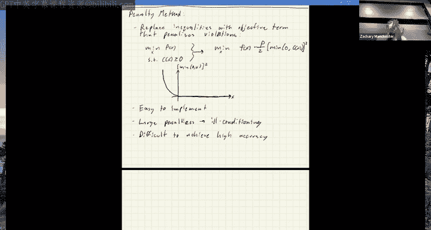

对。

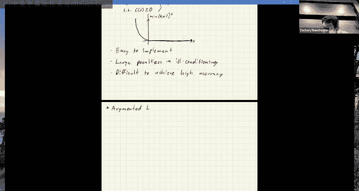

So basically the trick is we take the penalty method， which just has that quadratic penalty in it。

 and then we add a lagron multiplier term to it， which we all know about now right and we're going to so let's see。

 I'll write this down we'll talk about it。Okay。

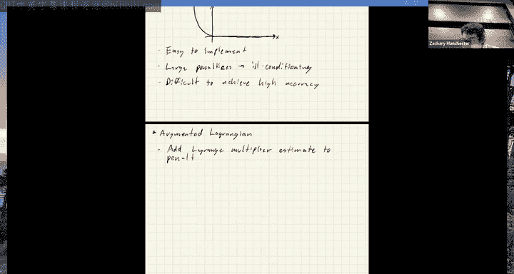

Okay， so what we're going to end up doing is something like this。

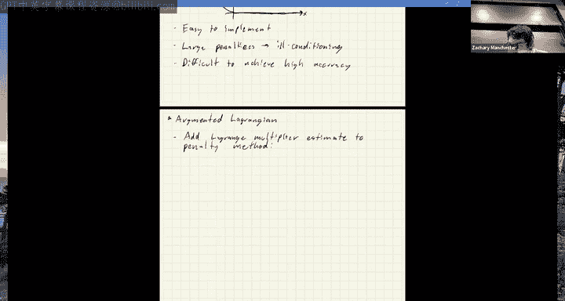

And I'm going to write a little tilde on this Lada to indicate that it's not。

The exact lagre multiplier。Okay， and then this thing looks pretty much exactly like the Laangian we' had before plus the penalty term。

 right？So we call this whole thing now。We write it like this L subro。

 which is kind of the penalty thing， X and then lambmbda Tilde here。

 this is called the augmented Lagrangian。Is that。Can you explain why the penalty constant is adding and not subtracting？

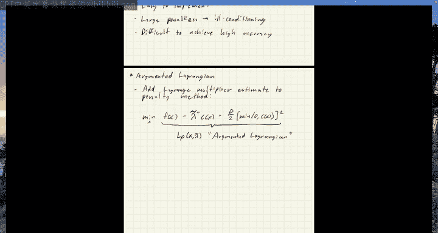

The idea is well the thing in front there is squared， right， so it's always positive。And the penalty。

 the idea with the pen is I want to make the objective worse， right？

That's always the idea so when when I'm violating the objective value should get higher should get strictly worse。

 does that make sense？

Yeah， yeah right yeah so the same with the Larrange multiplier term right so if c of x is negative that's bad and lambda redefined to be positive right so that's why that term has a negative in front it's so that when you're violating that term's making the objective higher making it worse right does that make sense。

Yeah， so。Com。No not right here right this is mean over x only so we're going to talk about that x so basically what you're doing here is that term sort of part of the penalty。

😡，And we're going to do some outer loop tricks to update this lambmbda estimate that's sort of what the augmentgr method is so this is not a primal dual method're while we're doing Newton over both x and lambda。

 that's sort of the main difference between what we talked about before you。Okay。

 so so we do pull up to the first pitch。

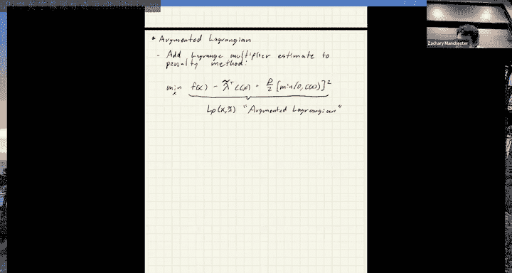

Yeah。So here was that a FFx plus P Rover two yeah that's a plus Okay。

 I thought that was a minus that's what I was a big yeah so if you're maximizing it would be a minus sign right that's the whole idea was to make things worse for you。

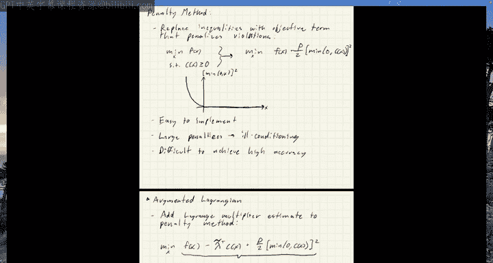

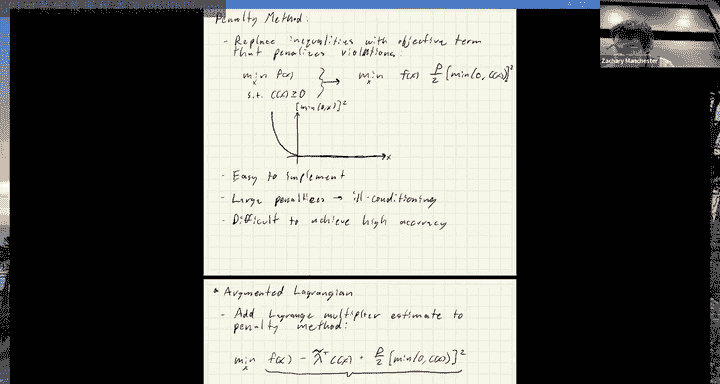

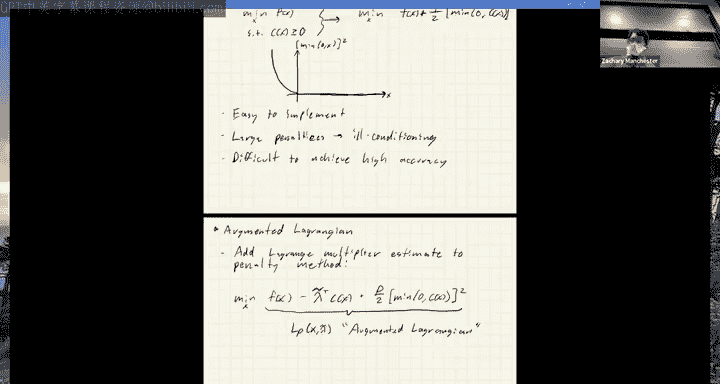

Okay， apologies for bad Hannah right here。Okay， so the idea is we do this。

 we solve this minimization problem and then we update。😊，Our Lambda estimate is Lambda Tilda。

By sort of you want to think about this as like offloading the penalty term into the LaGrange multiplier term。

 I'll show you exactly what I mean。

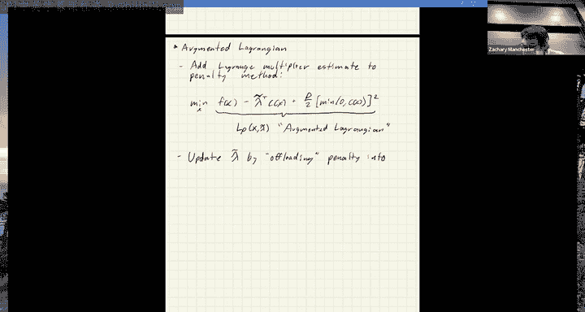

Okay so this is what this looks like， so when I write down the first order necessary conditions for this minimization problem grade n equals0 here's what I get I get partial F partial x minus lambda tilde times partial C partial x plus the penalty looks like rh C of x。

Transposed。Partial C partial x right and I'm ignoring the the min sort of switchy guy in there for right now assuming this constraintsstraints active okay so this I can reallywrite this slightly as partial F partial x and then I can group these terms the lambda end constraint term together to look like this。

Okay， so the takeaway here is。This row time C is acting exactly like a lagrons multiplier here does that everyone see that they're basically doing the same thing so what I do is I solve this problem with the penalty in there once I've solved it I'm going to take the row time C penalty term and stuff it into the lambda。

😡，In this outer loop and update Lambda now the next time I plug now I plug that new lambmbda tilde estimate in and then solve the first problem again right that's my iteration that makes sense everybody。

So this sort of says。嗯。What I want to do is lambmbda Tilde gets。Lada tilde minus rh c of x。

Roughly speaking， if that makes sense， so I push the penalty term into the Laron multiplier term。

In parentheses。F active constraints。So that's sort of the hand w so here's the full detail version。嗯。

So I want to do first。

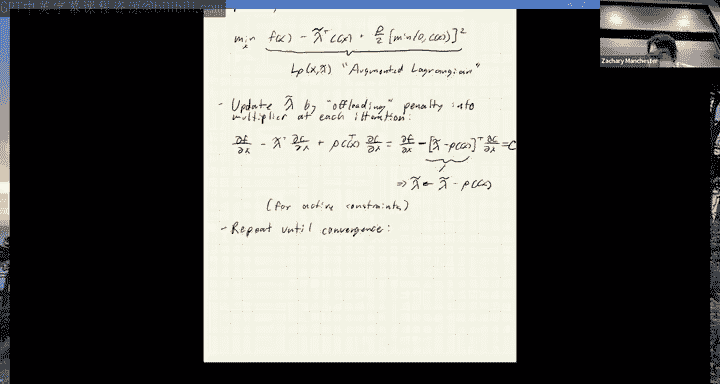

Min over just x are just the primal variables， right of this augment laggrangian。

So lambda tilde is a constant as far as this step one is concerned right only min over x。

 then the next step is。Update the Lada estimate that looks like this。So here's sort of the trick for。

Active constraints， specifically。So this is basically just clamping stuff to keep lambda non negative right as that extent everybody we you know we want the lagron multipliers to always be positive in the inequality case right so that's making sure that happens。

And then the last step is we crank the penalty weight， so usually we do something like row。

Gets alpha times rh and this alpha is usually something like 10。

So something like we current the penalty up by a factor of 10 each time around the loop。

 there's lots of details in here you can tune this a bunch of ways you can skip the row update entirely sometimes so there's there's a bunch of stuff in here but the idea is compared to the penalty method with this one。

The last steps are actually optional I can leave that row alone and I can just do these Lambda updates and I will converge to the correct answer I'll converge to the correct multiplier and the correct solution without necessarily having to cran that penalty up super high and get a condition so that's the trick does everyone good with this any questions yeah do you start lambda zero usually yeah so in the beginning the first round of this is just the penalty method and then as you go you start updating this lambda with this outer loop。

And it'll eventually converge to a good primal dual solution， both X and lambmbda。Cool， yeah。

 is this require that you。The point is feasible no no I mean in fact it's almost certainly not going to be constrained feasible here right this one of the really nice things about this is that it's sort of softly penalizes and it's really good at dealing with infeasible initial guesses yeah。

Okay the other comment on this is it works really well for nonconvex problems these are basically like the most forgiving methods for constrained optimization out there they're super good and feasible starts super good for non convexity they even work well for reason for like slightly non-smooth problems。

 stuff like this they're super robust which is why we tend to like them the downside is they're not quite as fast as something like a primal dual point method in terms of conversionver rate but they're pretty good。

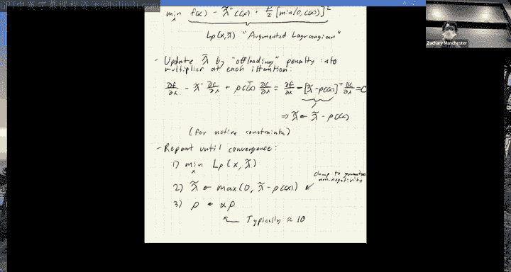

So I think of these as sort of the sweet spot。Okay， so take away。

Fixes ill conditioning I have another quick question。

Could you scroll up to the updating window ahead？Yeah。

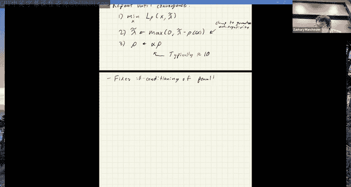

So here you go。Yeah， so I'm a little confused how the right hand side of the equation where it says equals zero implies that lambmbda hat should be updated。

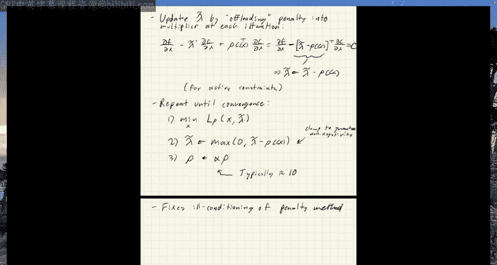

By the minus p C of x term so that whole thing's equal to zero that's just the first order necessary condition what that's the idea here is the fact that that lambda tilde minus row c of x term that whole term looks like a lage multiplier term right？

And so therefore， like that whole term， including the penalty is what my Lare multiplier should be。

Does that make sense。Yeah， okay， I guess from Ohio makes sense， yes。

 so if I start with lambmbda equals zero and I only have the penalty。

Basically the only thing holding me on the constraint is the penalty term right and by writing it this way group together that spot in the KKT conditions is where the lagre multiplier shows up normally right so what this is telling you is that like minus row C thing it's acting like a lagrrange multiplier so if I want to estimate my lagange multiplier from this thing the right estimate is that term in the bracket right？

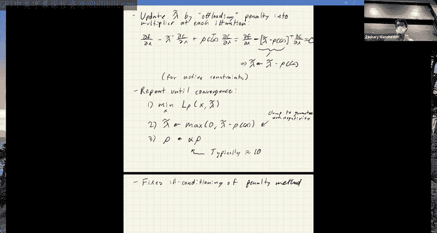

Yeah， okay， thank you Google。Anybody else？Yeah， so the way it fixes the old conditioning is I don't have to keep cranking row。

So maybe I'll write optional。So that what this does is lets you converge to the true solution with a finite value of rh because I'm estimating lambda with pure penalty。

 there's no lambda and if I want to get c of x exactly equal to zero I actually have to crank row up to infinity here I can leave row at a fixed finite value and this outer loop lambda update will converge to lambda the true lambda at which point I don't need the penalty anymore right that makes sense。

There's some subtlety in this， it turns out theoretically you need a you basically need to hit some threshold row for that to work on a given problem and the threshold depends on the specifics of the problem。

And it's super hard to calculate what that threshold value is in general。

 like it's harder than solving the original optimization problem so practically what we do is start low and crank it up to some max value that we're happy dealing with and then stop and then let the Lambda updates take care of the rest。

 if that makes sense。Cool， all right anybody else？Cool， all right， here we go。

This converges pretty fast。In particular。It converges super linearly。

Which is not quite as good as like primal dual， interior point methods or whatever。

 but still pretty good。嗯。And it works well for non convex problems。Where are the prim dual methods？

Are tricky to using that context。And in particular。

 like almost everything we're going to do in here is going to be non convex or a lot of it will be right for anytime you have a nonlinear system。

 your tragic drop problems or whatever like this are going to be non convex okay。

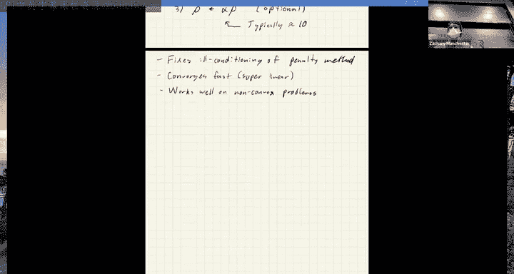

Cool， so now we're going to look at quadratic programs。And these are super super useful。

 so these are like kind of currently how MPC is done on most legged robots they how most NPC is done on autonomous cars。

 they're used all over the place and one of the reasons is you can solve these super fast。

 you can write solvers for these things that can achieve kilohertz or faster rates so you can run these really fast online in a loop。

And sort of get a stabilizing controller out of it， so what this looks like。

Is minimizing a quadratic function specifically。A convex quadratic function。

So when I say comevex quadratic。Can anyone tell me what this function any any caveats to what I just wrote down that make it convex or not yeah so you generally want to for standard QPs like this we actually enforce strict positive definiteness for it to be a QP so that guarantees that has a unique solution right okay so。

We say Qs strictly positive definite。And then。We're allowed to have linear constraints so that's what the definition of a QP so here we'll say AX less than equal to B and C of x equals D。

 so we're allowed to have a convex quadratic cost function， objective function。

 and then linear inequalities and linear equalalities。

And those can be whatever you want， right？Okay， so。Very useful in control。Okay。

And can be solved very fast。嗯。Okay。So let's go do this。Thank。Where is the。没有了。You guys see okay。😊，No。

 yeah。

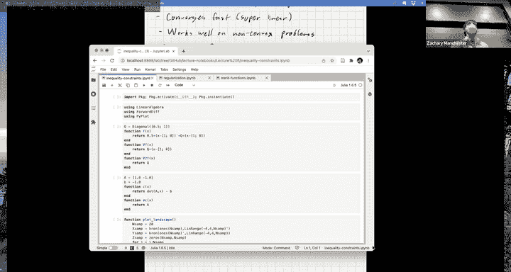

You guys can but this is not not the best is this okay for you guys I'll try okay so here we go so let's see this is our QP situation with inequalities here's a quadratic cost function I just made this up right pretty straightforward。

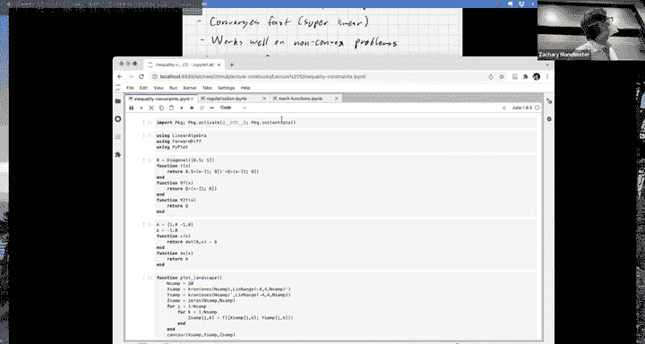

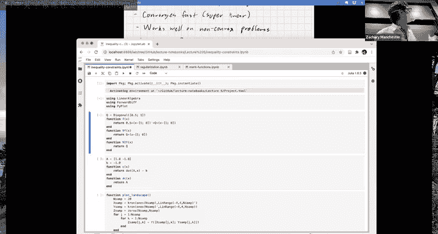

So here's we've so this is going to be in 2D， so we've got a two dimensional quadratic objective。

And then we've got a linear inequality with the A's and B's there。

 and I wrote down both the C of x and the derivative， the Jacobgan matrix， which is just the A。

In this case， because it's linear。So this is this kind of landscape picture that we did before。

So level sets of the cost function and then that line is the linear inequality and in this picture the inequality is satisfied when we're sort of up into the left。

 so right the unconstrained minimum would be sort of in the middle of those level sets。

 but the linear constraints going to hold us up until the left so we can't actually get there right？

Okay， so here's the augmented lagangian like we just wrote down。

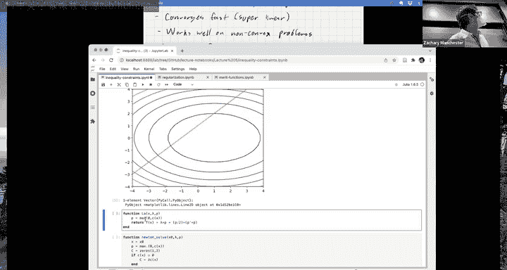

Yeah， we've got the lambmbda， we've got the penalty term。

All that good stuff and then here's Newton's method on this guy it's exactly the same kind of Newton thing we did before in particular the Hessian here has the hessian of the objective plus this penalty term now。

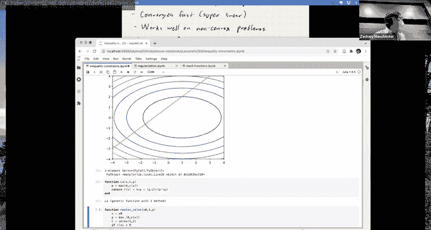

What else does there say about this， I don't think there's anything else to say about this。

 So this is only doing Newton on X， right， as far as this guy's concerned。

 Lambda a constant that it's passed in， right。Okay， and now we've got。Some initial guess point。

So guessing up here and the true solution is going to be somewhere around here， probably， right？Okay。

 so the first thing I want to do actually is let's try just doing a pure penalty method and play around with that a little bit。

 so I'm going to turn off the the Lambda updates。So we'll keep Lambda fixed and I'm also going to turn off the penalty updates and let's just see what happens if I run pure penalty。

So the first internet。Is going to end up you know over here so it's basically it's going to violate obviously but it's sort of in the right spot if I keep darning Newton's iteration it's not going to do anything right fixed penalty if I'm not changing the penalty。

 it's not changing anything， it doesn't move if I now jack the penalty up。I like a factor of 10。

I'll get a little bit closer。So there right I get a little closer now if I jack it up by like another you know factor so now a factor of 100 a little bit closer factor of 100 a little bit closer。

 but I'm never actually going to get there with this method right and pretty soon this row's going to be get gigantic and I get a little conditioning and all of that that stuff Okay so now let's look at with the lambda update。

I'll show you a couple of fun things， but maybe we'll just let it rip sort of the full augment of agre method so we'll restart ourselves ourselves up here。

Now we're doing everything so we're doing this Lada update here like we wrote down and we're going to jack up the row like we wrote down so here we go that's one iteration which remembers exactly the same as the penalty method because Lada to zero now let's see second iteration now I'm updating Lambda and cranking row。

Second iteration， I basically nailed it so and now if I do like one more of these， you know。

Moving right So two three iterations perfect。 So one thing we can do here too。

 that's kind of fun is I'll restart this just to show you kind of the whole penalty versus around。

 I'm going turn off the penalty update So we do this with a just a set fixed penalty and don't crank the penalty let's see what happens there。

 So first round same as the penalty again now remember with the penalty method if I leave row fixed it doesn't do anything right here I'm updating lambmbda So it turns out now I keep making progress even with a fixed row and I converge now basically right So even without updating row because of the outer loop lambda updates。

 I can still converge to the true solution and you know finite iterations and this particularly easy problem but hold true in general cool Any questions about this。

Yeah yeah， so it's you crank it up geometrically， meaning by some fact multiply by some factor greater than one。

You know， something between like two and 10 is usually reasonable。

 usually like 10 next is like kind of a standard thing。

 but it's kind of problem specific hyperparameter tuning game to to some extent， but yeah。

 like don't go too crazy something between two and 10 is probably the right number。

Yeah， can we add an additional constraint to the community as well。

 So can the factor be learned using some。

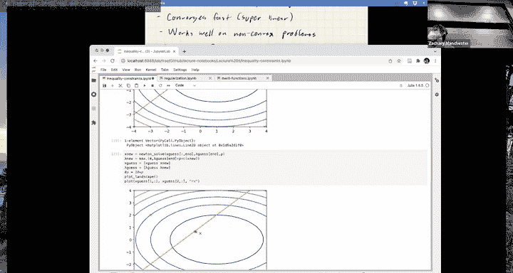

Yeah you can like adapt it in various ways that depend on how bad the constraint violation is you can also adapt it on a per constraint basis so if some constraints are easy and already satisfied you can leave it alone if some constraints are being really tough and like hard to sort of crank down then you crank it up on that constraint so there's a lot of extension a lot of additional tweaks and games you can play a fine tune this but the basic idea is this right you can yeah you can play a lot of tuning games for for performance yeah cool yeah。

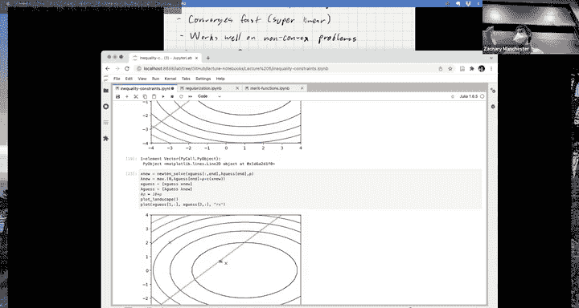

Sure， there seems to be one light switch。Unfortunately。啊这。

So I'll like dial it down a little bit to see how that does step better。We do one more not。

 but it's all on one switch like this cap。Okay， so let's sort of go back to。

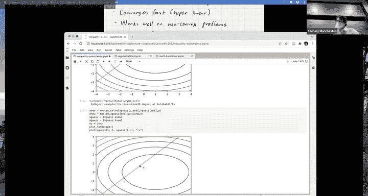

Two notes。Okay， so next up。We're going to talk a bit more so this was a QP， this is nice Comvex。

 right these are great。嗯。What we're now going to talk about is sort of back to sort of the nonconvex non nonlinear case when we'll kind of do some examples of that。

 but this is specifically because this is the homework this homework question three so now you have pseudoco for a QP solver you just have to fix this up for the homework right so now we're going to talk about sort of some of these cleanup issues that you have to worry about for like the general nonconvex nonlinear case。

Specifically regularization when there are constraints and line searches when there are constraints right so we talk about both these things in sort of the unconstrained case before and they carry over to the constrained case obviously。

 but there's some extra little sort of things to know about when you're doing it in the constrained case。

 so let's first talk about regularization。And this shows up on question two on the homework so this is you know。

Worth knowing about。Okay， so let's sort of， we're going to go back now to sort of the equality case。

And talk about the like primal dual full Newton KKT system situation that we had before。

And I should mention also you can mix and match all these things right so you can do augmented laggrangion on some inequalities。

 you could do primal dual on the equalalities right you can kind of。

Use these in various combinations。So let's look at the following problem。

Okay so what we did before right equality this is going to seem a little weird。

 but hopefully we're going to get to something you know that matters and is practical so on the topic of like penalty methods right like I can replace this equality constraint with some sort of penalty quadratic penalty whatever we're going to invent the sort of。

Theoretical best penalty you could have， but like the worst one from a numerical practical perspective。

So。

We might like to。

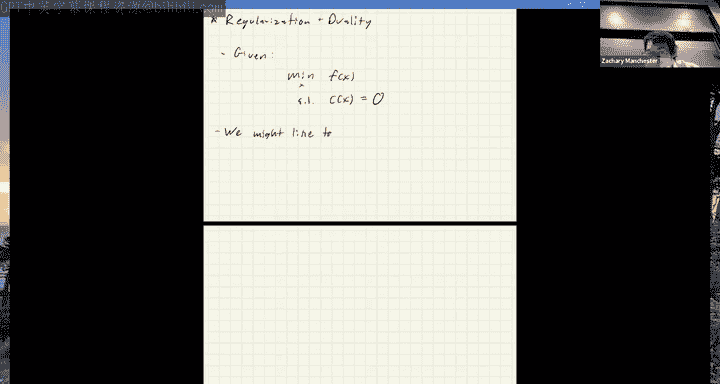

Turn this into say the following thing。M over x， F of x。Plus this sort of。Exact penalty。

 which would be the following thing， so we're going to call this P infinity。Of C of x。

We this P infinity thing。Yes。😔，Zero when。The argument is zero， I。

e when the constraints satisfied and then plus infinity otherwise。

So does this make sense everybody basically if I satisfy the constraint， it does nothing it' zero。

 if I violate the constraint， it's infinity。So， you know。

 basically like the best penalty you could have in theory。

 but numerically the worst penalty you could have for doing this in a computer right okay。

 so we might like this like if we could figure out a way to do this numerically though。

 that might be nice， right？Okay， so here's how you get at this p numericalmaticly in a way that kind of works。

So。Practically， this is terrible。But。We can get the same effect。By solving。This kind of weird。

Nested problem， so min over x。Of Max over Lambda。F of x plus lambda transpose C of x。

So this looks like our Larangian right， and what is going on here well， if c of x is not zero。

 if it's violated， if I take that max over lambda， the value is always infinity， right？

Someone see that， so for any non zero C， if I take a max over lambmbda。

I can always blow it up to infinity and then the outer problem is the is the one we actually cared about before right does everyone see this makes sense so this is exactly mathematically equivalent to that infinite penalty cool。

Okay， so next move is。嗯。Turk that down。嗯。Okay， so we can do the same thing for inequalities。

 that's the next move。So if I have like min。F of x。Subject to。C of x greater than equals 0。

 I can turn this into。M over x。I'll define a， you know， sort of F of x。

 we'll call this one P in infinity plus。Of C ofX， and this is defined know similarly to before。

Except it's one side of now， So P infinity of x equals。

You zero if x is positive and then plus infinity， if x is violating the constraint， right？

So I can turn this into。

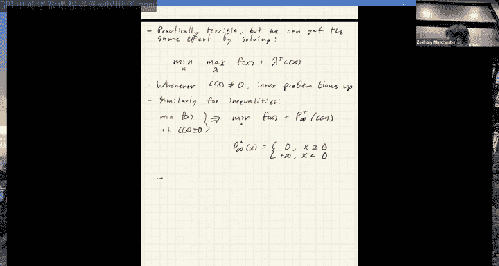

Somebody you have some。我公司都关。Did I do something wrong？Oh okay， so yeah。

 here's what this was going to look like， so in terms of what we did before。

 it's going to look like almost the same except we're going to have max over positive Lambda。

And then we'll similarly to before， we'll have this negative sign here。Because it actually matters。

So the idea is if I define lambda be positive。Here this lambda transpose C term if C is negative i。

e violating the constraint， if I take a max over positive lambda now I can blow that up to infinity right and it's going to give me an infinite penalty if C is negative or sorry if C is positive satisfies the constraint。

 then if I take max over lambda non-zero then the answer to thats zero and it drops out right so if do this does the same thing right？

Cool。And then this term here is our Lagrian that we know and love， right？In don to0 when you see。

Yeah， so if I'm trying to maximize that whole thing。Make it as big as possible if C of x is positive。

And Lambda is positive。The whole terms positive。It's got a negative sign in front of it。

 though Well if I that maximization。What's the largest value I can possibly achieve on that term if C is positive and lamb is positive？

😡，SoIphone8。What's you point to the penalty。Well， so like you're right。

 I'm trying to make the maximization problem， I'm trying to blow that thing up as big as possible。

 the largest value I can achieve on that if both lambda has to be positive and C is positive。

Because of the minus sign in front right the largest value I can possibly have is zero otherwise can be negative right if it's negative it's making my cost lower which is what I want right so I want to strictly make it worse by this penalty thing and the worst I can do is to make it zero in that maximization problem does everyone get that。

Cool， so it's basically a trick for replacing this infinite penalty thing with an inner maximization。

 right？Okay。So。This is interesting， as just a quick aside for convex problems。

Which we'll talk more about comeveity later， but you guys are kind of vaguely maybe aware of this。

For convex problems， I can switch the order of that maxim in and I can do it either way。

 which is kind of interesting。对。Doesn't change the answer。But for non convex problems。

 I can't do that。This idea of switching the ordering is called duality and so has anyone heard of duality and optimization and the dual problem？

Yeah， so the dual problem is when I flip those guys and you'll hear about this in like the theory of convex optimization a lot。

Okay， so not true in general， though。But the idea is still interesting and useful。Okay， so。

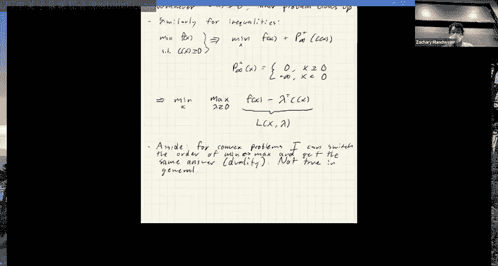

Now the next sort of like where this is going。

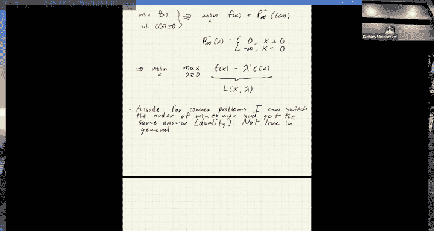

Okay， so if I look at this。When I do the like let's just think about the equality case for now。

 right I'm doing this mini max thing right when I solve Kkt conditions with Newton's method in both x and lambda simultaneously like we did before。

What sort of fixed point am I finding there？😡，In both x and lambda， if I do full Newton on that。

Am I finding a minimum？It's a minimum in x。But what is it in Lambda？The maximum in lambda。

 so in both x and lambda， that whole joint Newton solve， what kind of point am I finding？Yeah。

 exactly it's a saddle in x and lambda， it's a very particular saddle where it's a min x and a maxs in lambda okay。

 so that's cool nice。😊。

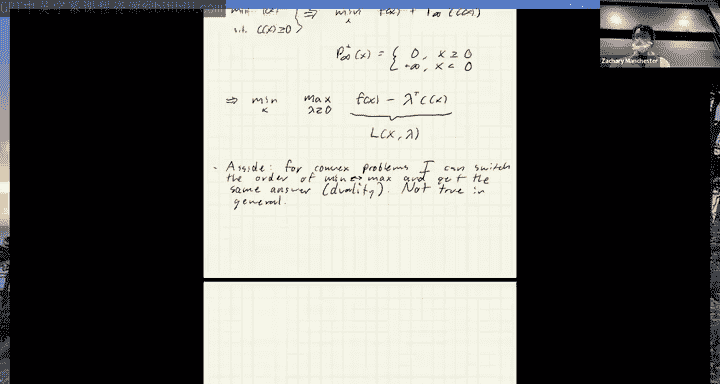

Okay， cool， so now next question is when I do Newton on the KKT system like we wrote down that KKT system it's got the Hessian block and the two constraints Jacob copian blocks。

 can you say anything about the eigenvalues of that KKT system based on this fact？No。

 we don't want to be zero because that notible。No。So what do eigenvalues mean in terms of like curvature？

So we and we talk about the QP right we make for the QP we make that Q matrix。

 the hesian matrix strictly positive definite， so positive definite means it curves up and that means we're getting a minimum。

 right？😡，So same opposite thing， if I'm getting a maximum， that means it's curving down。

 means I have negative eigenvalues， right？😡，Okay， so thinking about the KKT system。

For the Newton method， primal dual thing。So I need。

Dimenssion of x positive eigenvalues to have a min over the x variables， and I need dimension lambda。

 aka number of constraints， negative eigenvalues to get a max over lambda does that make sense to everybody？

Cool so the KKT we said these have special properties bla blah bh。

 this is one of the main properties of KKT systems。

 they need to have dimension x positive eigenvalues and dimension lambda negative eigenvalues。嗯。

This specifically holds at an optimum right away from an optimum， all bets are off。

Although for convex problems this holds globally， frame same kind of deal as before， right？U。这。Check。

So this property of is called a quasi definite linear system we talked about positive definite means they're all positive negative definite means they're all negative this is a special flavor we call this quasi definite。

Okay， all right， so that was a lot of you know， optimization stuff to basically get to the following fact。

So。I mean this is good to know about in general okay so we talk about regularizing right and in the case where we want to minimize all the eigenvalues are supposed to be positive。

 so when I regularize the hssian or in Newton's method we talked about before you add some multiple of the identity to try to push all the eigenvalues positive。

What do you think we do in this constrained case on a KKT system？Yeah， yeah。

 so what we're going to end up doing is regularizing the top left block。

 the block that's associated with the hessian of the objectives。We're going to regular that positive。

The bottom right block that's associated with the lagrange multipliers。

We're going to regularize that with a minus with a negative regularizer， so here we go。Yeah。嗯。Okay。

 so。You have something like that yep。Can you explain what you mean by upper right and lower right block like I'm writing it right now okay？

So this was our Kitee system。You know， kind of a deal X lambda。And then over here。

 we've got gradients， minus gradient of the laggrangian， and then minus the constraints。Right。

And here this alpha is the regularizer here right and this is for some alpha greater than zero。

So yeah， top left block， I mean this Hessian block right here。And then bottom right block。

 I mean this block right here， which is usually all zeros right in a KKT system it's we talked about before it's zeros by default。

 if you need to regularize though， this is kind of the recipe。Okay。

 any questions about this this you have to do this on question two on the homework to get it to work there's why i'm specifically telling you about this now this is the only trick you really need to do on that problem you don't need a line search or anything else as long as you do this with a reasonable alpha it'll converge so。

Homework kids today， okay， any questions about this？There's a fun bonus question here。

 when do I have to regularize the lambda Why do I need that bottom right regular anyone having any thoughts on that like a interpretation of that。

 why would I need to do that。I'll let you think about that while I switch back to。To the code。

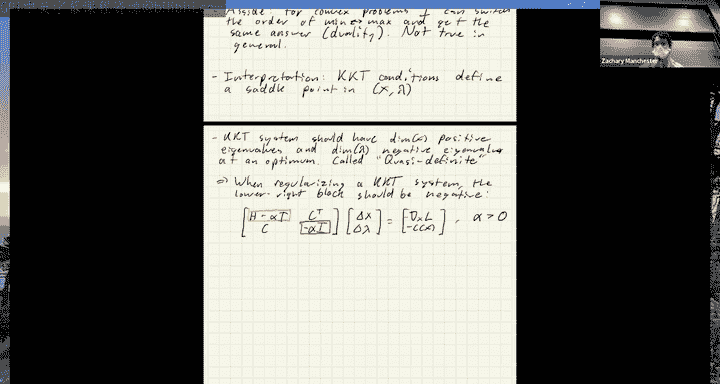

Anyone have any thoughts？

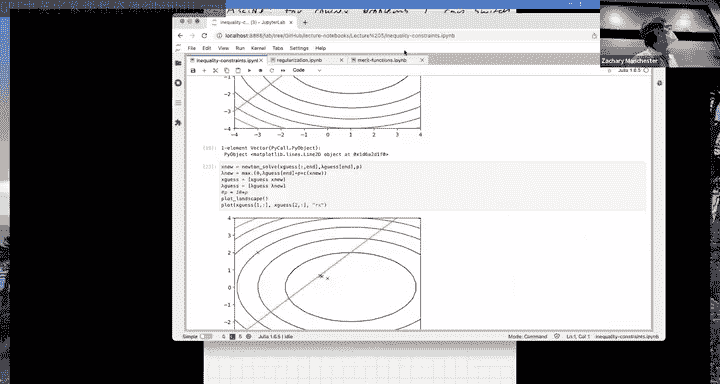

Is that when you're in an infeasible setup and you have to have pullinging and you currently have polling forces instead of pushing？

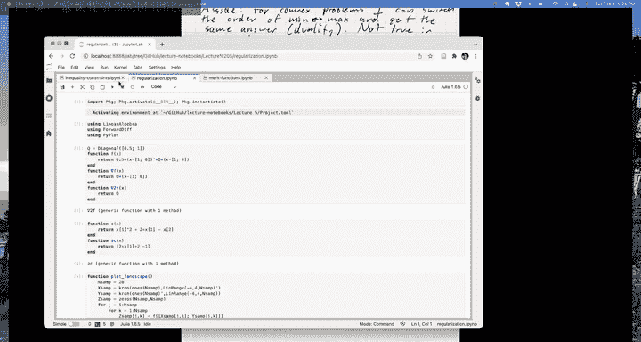

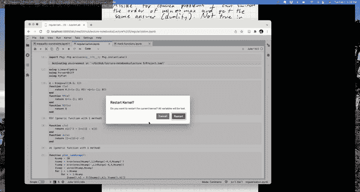

So no， but yeah， maybe in the ballpark there so maybe I'll let you guys chew on this for bonus yeah。

Now so that would you just have zeros right for Lambdas。

 so it's a very particular thing that can happen with your constraints trivially actually it's easy to write this down such that you'll end up needing to do this。

If youI'll leave this as a bonus question， so if anyone like really wants to wrestle with this。

 I mean you could probably Google this and find it。

 but let's if anyone can come in and tell me next time you get like and bonus points on something。

Okay。Better yet， come in with a problem where you need it。And doesn't work without it。

Okay cool so here we're going to try this regularization and stuff we're going to now go to the problem we had last time where it was a quadratic objective and quadratic constraint that we had to be on so i'll plot this guy again as exact same as last time so hopefully this looks familiar。

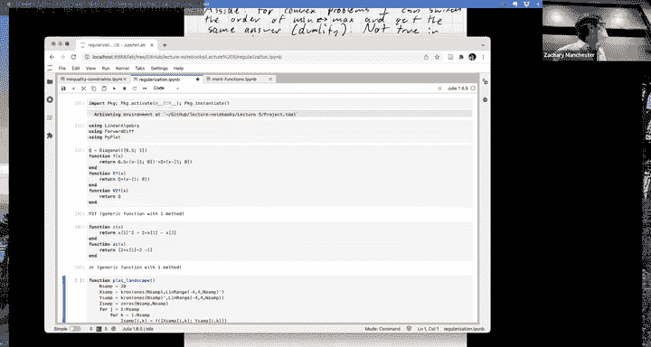

So you guys remember this right level sets of the quadratic objective and then this quadratic equality constraint where we need to be on the parapola。

 right？

And here's Van Newton like we did before。So this is full Newton， remember last time we did this。

 full Newton failed on this guy and Gaus Newton worked and we kind of talked about how you can have weirdo negative eigenvalues in the Hessian。

Because of the constraints and stuff Okay， so this is kind of digging into that a little more So here's the constraint so okay。

 here's here's our starting point right and we'd like to kind of end up somewhere over here is probably the optimum right so we're going to do full Newton on this guy。

Like we did before， and if you guys remember， we took， so this first step looks pretty good。

 take a couple more steps。

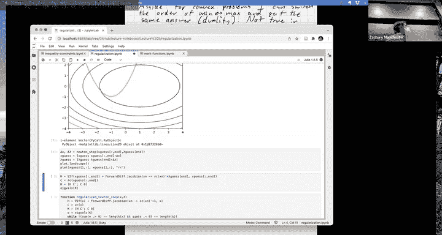

Seems reasonable， right？But now after like a few steps， we end up， so that's still good。

 but now this step we end up like moving backwards right and like this thing kind of gets stuck in this weird spot。

 right？Okay， so let's go look at the eigenvalues。

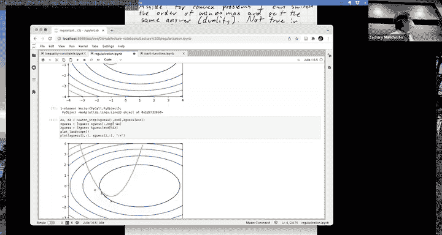

Of the KT system。What do we think going to happen？So this is the whole Kkt system， eigenvalue。

 so what should the eigenvalues look like for this guy？

So x is two dimensional， constraint is one dimensional。

KKT systems three by three， three eigenvalues， how many positives， how many negatives。

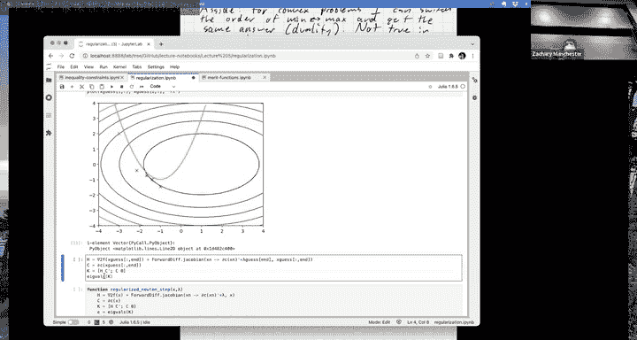

ま是的。Let's see what happens。

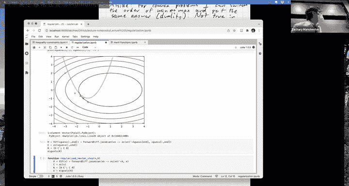

So we got two negative， one positive， so that's wrong， right？Okay。

 and remember last time we did the Gauss Newton thing so this time we're going to do full Newton but we're going to regularize to fix this。

 this is why we didn't talk about the regularization on this guy last time。And so regularize Newton。

Same deal， it's very similar to what we did last time。

 but here I'm taking this Kkt matrix and I'm going to add positive regularization to the x dimensions。

 negative regularization to the lambda dimensions。Just as a sort of I'm going to do this right as long as the eigenvalues are kind of wrong and this I should mention also you should never do it like this in real life this is like I'm actually computing the eigenvalues and whatever as I do this super expensive super dumb in a real you know large scale of implementation there's tricks for detecting bad eigenvalues。

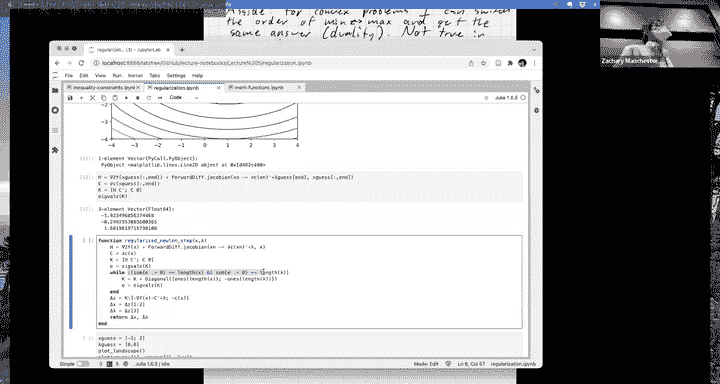

As part of a matrix factorization so last time we mentioned Chileski you'll fail in the middle of the Chileski and you go back there's very similar tricks for KKT systems the standard one's called an LDL factorization which is closely related to Chileski but for indefinite systems for KKT systems basically and same same deal with Chilaki that will fail if there's the wrong eigen spectrum and you just try it if it fails then you go try this trick okay so everyone good on this we're doing the exact regularization trick we just talked about。

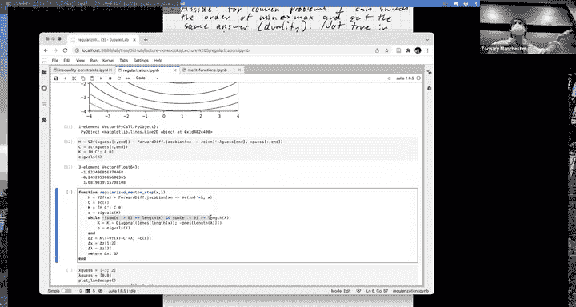

Now we're going to start over again and do it with the regularization and see what happens。

So here goes。So first step looks basically the same， here's where we got into trouble last time。

 right？Somewhere around here。Now with the regularization。

We should keep trucking so now we kept going around the bottom one thing I want to still point out though so this I mean so now it should be clear this is going to work we'll run a couple more times now it's sort of。

There you go， so we got to the answer， right？Cool converged so like five or six iterations Okay so so regularization good make sure we always go in the right direction basically make sure we don't get stuck in weird spots and like saddles and stuff like that like we talked about last time here's how to do it in the constrained case the last thing we're going to talk about now is kind of how to fix this behavior down here so similar to the situation we saw before with just。

With just minimization with no constraints we kind of overshot down here right we went pretty far off the constraint manifold and we would really like to sort of stay closer and track the constraint better so what we're going to talk about now is how to do line searches when you have constraints sounds good。

Yeah。Start doing should we then。Yeah you I mean you don't need to on the homework。

 you can for sure for debugging purposes and that's a small enough problem that you can get away with it。

I'm saying is if you really want' do this for real if you write a real deal solver。

 you don't want to do an en decocomposition like this it's super naive and like super expensive and super slow on the homework it's fine yeah like you can you can do it for debugging purposes on your homework you don't need it for the answer it's like yeah just pick a number pick a number as long as it's big enough it'll work。

That来看。

Yeah， I mean， if you're debugging to find a big enough alpha， go ahead。

 you can crank it and do an eigencomposition until you find an alpha big enough。😡。

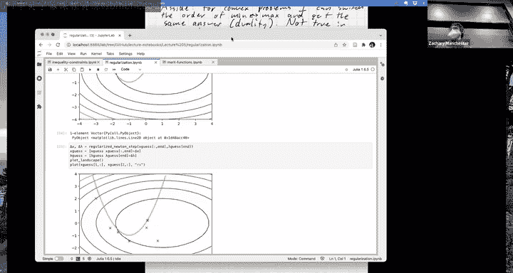

For that problem and then just run over with the fixed alpha and it's fine。

Does makes sense cool yeah， I mean this is bad don't do this you know whatever for debugging it's fine。

 but like if you're doing this in the loop and a real thing， this is super super slow and dumb。

Okay， cool， so takeaway from that is。Regularization good。

 but we still have overshoot issues to deal with。And。U bad， okay， cool。嗯。Okay。Line search time。So。

How do we do a line search on a let's start with what we're going to start off by to like motivate this is how do we do a line search on a generic root finding problem so then we talked about line searches before it was specifically in the context of a minimization problem where we did this like Armijo thing right the backtracking thing and to know if we went too far we just checked the value of the objective。

And if it went up or didn't go down as much as we expected we backtracked right so what do we do on a root finding problem so if I have a refin problem I have a big function that i'm just trying to like drive to zero and the outputs of vector right not a scalar how do I decide if I've gone too far？

On that context， I don't have a nice objective function that I'm reducing to check。

yeah yeah so this is a super reasonable choice this in general that idea is called a merit function so you make up some scalar function like the norm of the residual。

Or something like this， that's a scalar that you treat as an objective function and you check to see that that is decreasing so it makes sense。

 okay， so we want to define a merit function。Okay， so basically this situation， might find x star。

Such that。C of x star equals0。We want to define。A scalar。Marriit function。And we'll call this P of x。

That basically measures distance。From a solution。Okay， so there's a bunch of standard choices。

That you can do。So one reasonable one。Is that quadratic？You could do something like。

One half C transpose C。Equals you know， two norm squared。Another one you can do。

 which which just suggested is a norm and it can be any norm it turns out will work so a very popular one is actually the one norm。

It turns out for reasons that will become clear， hopefully in a sec。So one norm but any norm really。

Willll work。It literally just has to be some scalar function that tells you how far you are from。😡。

From the solution， right？Okay， so now that we have this merit function。

We just do ourmiho like before。😡，On the merit function so last time you know we have the objective that just acted like a merit function automatically for us now we have to make one up。

 but now we just do our Hill again。I Zach， yep， one quick question。

 what's that value next to the two norm？

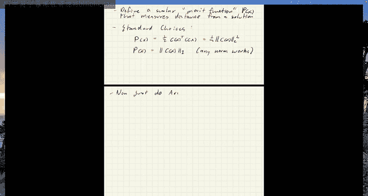

This is two norms squared， sorry， this is just saying。

Is it the same thing Oh my men on the left side， is that a one half？

Oh that's a so that's not a two norm right that's a quadralic and that's a one half yeah and that's just my convention because it makes the the gradient nicer。

I see because the factor of two drops out when you take the gradient， right？Okay。

 so now we do our me on this guy what that looks like right just like before。

 we have this backtracking alpha thing and we do sort of while。P of x plus delta x。

 which is our Newton step， is greater than。The old value of P plus a first order tailor approximation of what we think the decrease should be with these sort of tolerances on it right so here's the gradient of P。

And。This sky is the step sized。And then this guy's our tolerance， right， just like last time。我等下。

Com嘛。呃。Sorry for。Stupid technology。Why do you have to suck so much？What。嗯。Sorry， asked stress again。

😔，Had the worst luck this time。Literally the other week my laptop completely died and bricked itself in the middle of Zoomlasher I mean I don't know what is going on with all my electronic dueds this time now this thing's refusing to connect to my Mac。

Like， what the hell， come on。啊。Okay， is it working now？It did something， hey， it's back。啊。

I hate all of this Okay， excellent we're back， sorry I guess。

Okay cool so like last time Armijo this this whole term over here right this guy is just the first order tail expansion of the merit function and it's saying you know we expect this must decrease this according to the first order tail expansion and then I want it to actually do that you know up to some tolerance so if it's not within some tolerance of the first order tail expansion then i'm going to backtrack so i'm going to do。

Alpha。Get。C times alpha。Until you know that condition holds and then I'm going to do my my update。

And remember C is some factor less than one， right？So。过。That same as last time， right。

 Army he now we just do it on this merit function guy instead of the。

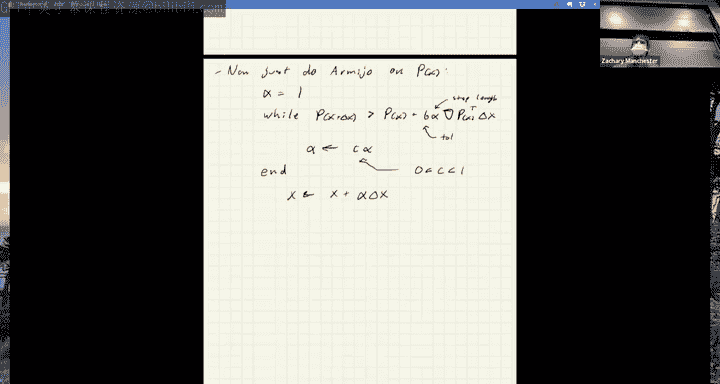

Of the objective function， Okay， so should be kind of obvious now we're going to say how do we do this for constrained optimization？

And constrained optimization is kind of a special case of root finding right we're doing root finding on the KKT conditions so we can basically do these same tricks。

 but it turns out there's some new ones you can do for constrained optimization。嗯。Okay。

 so we're now doing say mean over x。F of x subject to， we'll do both。Inequalities and equalities。

Here。We're now going to sort of write down the laggrangian for this guy。

 just mostly for notation purposes。So we're going to have。F of x。

 and then we're going to have a lagrange multiplier for the inequalities is going to be a lambda。

And then our lagGe multiplier for the E is going to be new。Thiss it just bookkeeping。

 there's nothing special about any of this。And remember。

 the negative sign matters on the inequalities for the equalities， it doesn't matter。

 plus or minus whatever。Okay， so。Now there's lots of options。Okay。

 so here's some options we can do the same stuff we just said for root finding where we can do it on the KkT residual。

So we can just treat it like a refining problem on the KKT conditions。

And we can do something like that。好。This guy， right。Which to be super specific。What we need here is。

Following thing。So this would be sort of。Graadient of the laggrangian with respect to X。And then the。

Inequality violations。And then the equality violations。So that's what that is。嗯。

So this is fine we can do this， there's actually this seems obvious based on what we just said about root finding。

 turns out this is basically never used in practice for a very specific reason that might not be obvious。

 but we will make it obvious in a second。I'm going go to the code， Okay， so that's。

 you know what we would do naively based on the previous conversation， another one we can do。

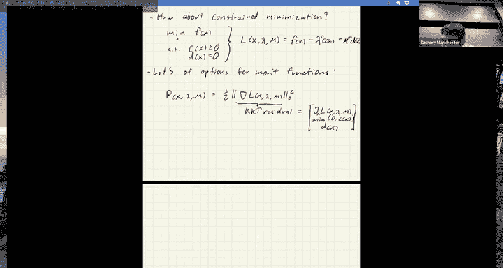

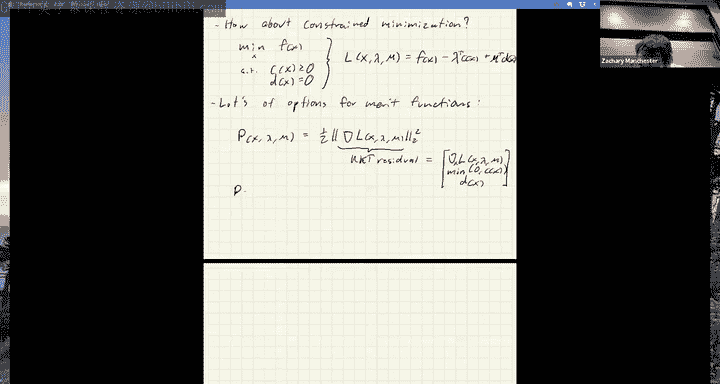

Is。Objective plus。Some norm on the constraint violations。So this is pretty intuitive also， right？

And again， the most common norm is the one norm for these things。But any norm works。

And we've got some hyperparameter row up here to like trade off how much we care about constraint violation versus how much we care about minimizing the objective and again you have to tune this。

嗯。And。Any norm。Works。So it turns out this is one of the most common ones。

Then there's one more that's。Super common that is very related to something we talked about earlier today。

 which is the augmented Lagrangian。So it turns out augmented Larangians make great merit functions。

 so if you're doing an augmented Larian solver， it comes with a merit function for free basically。

 which is also another nice thing about augmented Laangian methods but people also use the augmented Larangian as a merit function and other solver techniques as well so phone fact。

And these two are the common ones， so this one up here。

 which has like just a norm penalty on the constraints is super common and the augment of lagrian is super common。

And so this looks like F of x。A ground multiplier， E。

Or both sets of constraints and then violation sort of penalties for both sets of constraints。

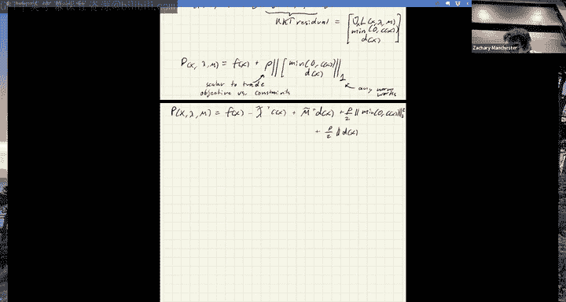

嗯。Okay。Questions about this。I don't know， menu of options we'll do it now and check it out a little bit。

Okay， so merit functions， let's go look at some merit functions。

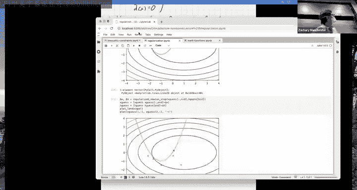

Okay， so what we're going to do is same problem as before， so quadratic objective。

 quadratic equality constraints， same picture as last time。

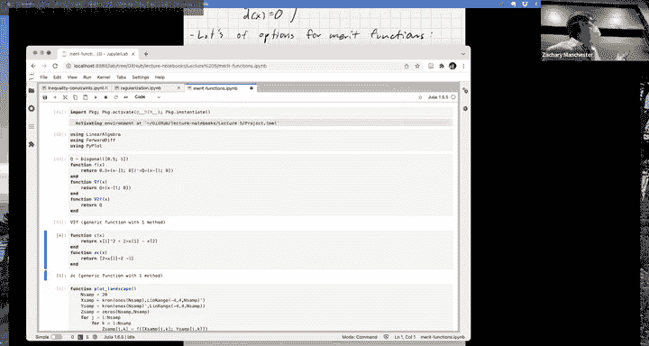

We're going to do Gauss Newton just because。And we're going to start specifically at this point here where you get really bad overshoot so we'll to a vanilla step。

Without a land search。And so you just go super overshoot way far from the constraint。

 not what we want right， so let's go fix this with a line search。

So the first one we'll try is the KKT residual。So here it is right this is a gradient of the laggrangian constrain stacks so those are our kKT conditions that we're trying to drive to zero and that's so that's kKT residual and we're just going to。

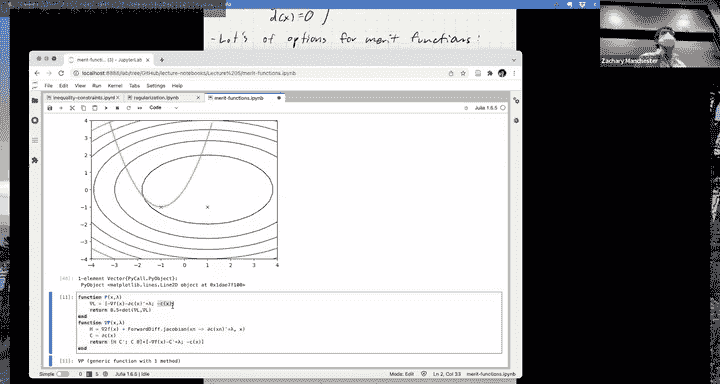

Take like that thing squared or whatever， right？Okay。

 so let's turn this on and start doing line surgery things。

啊。And let me reset this guy。

So now we'll do Newton with line search and see what happens。

So notice we took a much shorter step now， didn't overshoot so much。And。Next， you know。

 we stay much closer to the constraint we constrain and we end up you know。

 getting the answer quicker in the end， fewer fewer iterations。Okay。

 so question now is why don't I like this one， why don't I like the KK3 residual？Flavored lines。

 merit functions。So let's go look at it real quick。So this seems fine。

 I'm already computing this guy。But remember to do our meho。

 I need the first order Taylor expansion of the merit function to compute that expected decrease。

Look at the first derivative of this merit function。

It's basically as expensive to compute as the Newton step was。

So it's super expensive to compute that gradient of the merit function in this case because it's the full Kkt system basically so to do the armmijo thing super expensive so I don't like it for that reason this one's super expensive so any of the ones that basically pen merit functions that look at。

KKT residual， the gradients are really expensive， we don't like that。Okay。

 so let's go do one of the other ones now so here's yeah because we we weren to doing this we weren derivative Yeah so and you already have that derivative。

So maybe so so essentially like this works perfectly reasonably if you have a cheap way of computing that gradient and that's basically why the other ones are popular if you in your particular problem your particular setup you have a cheap method for computing that gradient cool go ahead。

Yeah okay， so the reason these ones are popular so here's the other one right so this is objective plus one norm of the constraint violation。

And we're going to set row to one for now so here note the gradient of this guy's dirt cheap it's like just sign of the constraintsants or whatever so this gradient' is easy to write down super cheap a compute that's why this is popular basically so let's switch it out for this guy。

And reset up here。And run this one a few times see what happens。So。It's very similar behavior。

We kind of track the constraint pretty closely。And land on the answer this looks almost exactly the same as the last one right but generally this will be cheaper let's check something out though okay so this row up here is sort of a tuning parameter right that you sort of tell how much you care about minimizing the objective versus how much you care about satisfying the constraint let's sort of jack that up to 10 so it says I really care about the constraint violation a lot。

You knowAnd let's see what happens when I do that， so let you said again。

Let's run this guy again。

So check this out， it's taking super tiny steps now。

 basically backtracking a ton so that it doesn't leave the constraint manifold。

This is because right the constraints curving and the step is computed based on a linearization so in these kind of situations you end up like backtracking a ton and not making a lot of progress so you have to be really careful in tuning that role with some of these guys to make sure you don't suffer from this sort of uber slow convergence super tiny step situation this actually has a name does anyone know what this is called。

None of my suit yeah， sure。You can， yeah， you can play games but this is a specific problem that you will end up with sort of regardless of tuning on sufficiently nonlinear constraints strength。

 basically if the constrain's super curervy。This is always going to be a problem with because Newton's relying on a linearized constraint so this specific problem of like super slow convergence when you have large constraint curvature actually has a name it's called the Morracose effect I don't know fun fact it shows up in nonlinear optimization and it specifically has to do with backtracking line searches where you have like this sort of situation where you make super slow progress。

I mean there's tricks for dealing with it that we won't necessarily get into okay so important to tune row properly for your problem so that it doesn't sort of bog you down too much now let's look at the augment of theangian。

So standard augmental lag grand June deal， like we've talked about a bunch， row equals one。

We said this guy。Let's go run it， so one。Took a bigger first step and then like sort of nails it in like two iterations。

 which is I mean I've been hypping up augmented the ground gene methods a lot。

 this is not necessarily representative of anything。

 it just so happened with the you know row value and tuning parameters on this particular problem this worked the best。

Probably not true in general I don't know the takeaway message though is that basically this one with the one norm constraint penalty and the augment of lagangian here these two guys they're both relatively cheap to compute the gradients of for the Armiho rule and are both like the standard popular choices so like all the large scale kind of off the shelf solvers will do pretty much one of those two options。

Cool， okay， any questions about vest？Fine searches， cool constraints，应该是你做大的做很多东西。名字。Yeah。

 absolutely， y。For very non it specifically has to do with this fact that it's kind of intuitive geometricly if you have a nonlinear constraint。

 that means the constraint surface is curved right versus a linear contraint。

 which is a straight line When you do the Newton step。

 you're linearizing the constraint inside there so the Newton step is computed based on a linear effectively tangent。

Plane or hyperplane to the curved constraint so if you take a big step along that linearized constraint you're always stepping off the curved constraint surface and so if you have a big sort of constraint penalty in your line search you're going to backtrack like crazy because the bigger step you take on this tangent thing if your constraints's curved。

The bigger step here， the farther you are off the constraint so like the only thing you can do in a backtracking line search in that situation is backtrack a ton to get closer to the constraint right and so this is like a classic sort of like classic issue with。

Nominer constrained out optimization。That its famous enough that it has a name and there's a bunch of tricks for trying to deal with it。

Okay， cool everybody get here so let's see what are we did I have anything else nice to stay here。

 I think this is just。

I don't think this was anything interesting Okay cool， I think that's it for that。😊。

So to sum up。My pad is still working， Ray？

。Okay， so。P of x。Based on。KKT residual。Is often inexpensive to compute。

So not super common in practice。Excessive。Excessively large penalties on the constraints。

Can cause problems。Ie will lead to super slow convergence because you'll backtrack a ton and to stay super close to the constraint manifold and then just not make any progress so we don't like that。

And in particular， the ways to fix that are fancier line searches in a lot of cases。

And extra tricks in your new solve。And then finally。

 these augmental laggrian methods sort of come with align a merit function for free。

We can use the augmentalr as a mirror function。So that's kind of nice Okay。

 we have four minutes left this is the end of our。Dcussion on optimization sort of generic numerical optimization topics they should cover everything you need on the first homework the next thing to talk about is。

Srajectory optimization slash optimal deterministic optimal control we'll call it to be fancy。

 but that's what we're going to talk about next I think it's probably a good place to stop instead of biting off the whole new topic with three minutes to go。

