# CMU《最优控制和强化学习｜16-745： Optimal Control and Reinforcement Learning》中英字幕deepseek - P7：[07]Lecture 6_ Deterministic Optimal Control.zh_en - GPT中英字幕课程资源 - BV1qHwke1EBX

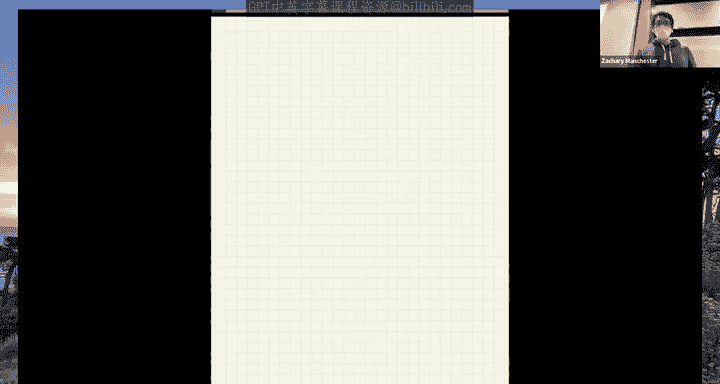

All right， I think it's about that time we got another minute or so。So yeah。

 so we're going to start off today。Someone asked last time for like a little bit of kind of like。

 I don't know， like overview of。You know control so i'm going to try to do that today and sort of give you like a little bit of historical view and。

I don着 know。Survey， let's say of topics in this kind of。In the whole field。I don't know。 You know。

 Hopefully that's interesting and。

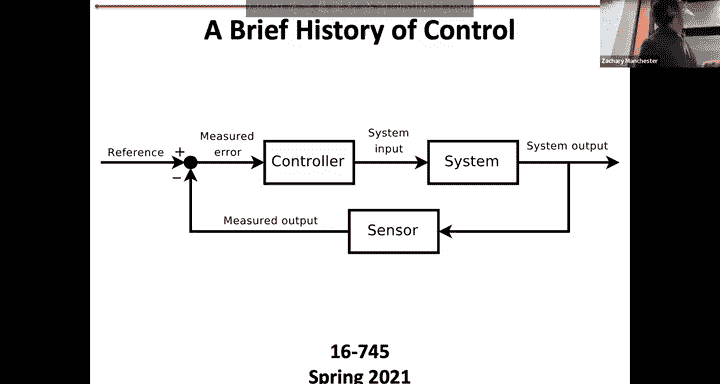

See， can I make this go away， I don't know。I think we have to live with that too， unfortunately。

Does anyone have any suggestions？Ma this bar disappear。Out of there。 Okay。

 we're going to live at the bar。 I don't want to figure that out right now。 Okay， so。

 so a brief history of control。 so like。嗯。In the beginning。

There was the brocurstochone for all loans， has anyone heard of this before？

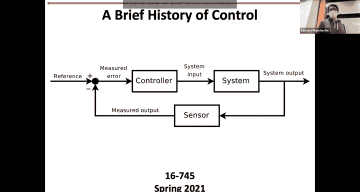

You guys refer heard to this okay cool so this is like really kind of the birthplace of many of the ideas that sort of made their way into modern control theory and for those who don't know what this is。

 this is this question was posed by I think like the Bernoulles and then solved by them and Newton and Liveness and every famous you know mathematician of like the 1700s that you've ever heard of and the question is what is the shape of a ramp？

Such that a ball rolling down the lamp ramp under gravity will get to the finish line the fastest。

 so you have like some starting point and some end point lower down and to the right say and you want to design a shape of a ramp。

Suchuch that the ball will get to the finish line fastest and I don't know yeah。

 it's not an obvious answer and turns out the answers is a little bit subtle does anyone know what the answer for this is。

第二。It didn't like you put a point on the edge of the circle， yeah。

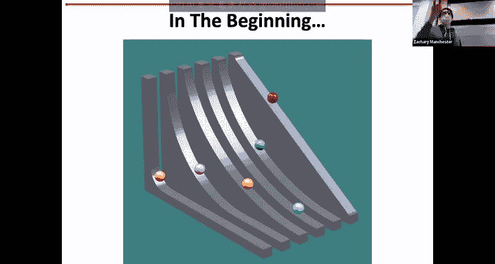

Exactly so so this is the answer the curve is called a cycloid and it's exactly what you said you take a point on the rim of a circle and roll the circle around and that that's the curve it turns out that's the optimal shape and like it's not an obvious thing at all so。

So several of those you know those famous guys came up with the solution， the red answer。

 but Newton's solution in particular kind of like anticipated and kicked off a bunch of the mathematical ideas that led to modern control in particular he as part of his solution this thing he kind of invented this idea called the calculus of variations so you guys who's heard of that。

Show of hands Yeah so I'm going to steer clear of that in this class for the most part we're gonna to sort of take a little the different tack。

 but basically calculus of variations is this idea of optimizing over functions So in this case the function is the shape of the ramp right and like you're minimizing some cost function where the argument there is a function itself right so this is kind of the classic solution of this guy Oh yeah that's what the next slide right So it turns out this isn't just useful in control it shows up in a lot of places it shows up in statics it gives you the shape of a chain a hanging chainss another classic problem shows up in optics from principle which is like the path of light race through materials it shows up in classical mechanics this is actually how you get like Hamilton's principle oil lagrange equations like lagic mechanics it's how you get that stuff shows up in finite element methods general relativity。

 quantum mechanics like all this stuff it's actually quite ubiquitous and sort of all over the place。

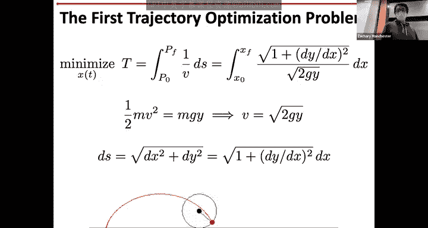

And that's sort of the canonical form right there so you're like minimizing some cost function J with respect to some function of time a trajectory x of T and like the ideas here like generalizing kind of the standard optimization ideas that we've talked about so far where you like say would want to take the gradient of that and set it equal to zero kind of idea how do you take the gradient of j with respect to x of T right so you're taking the gradient of a function with respect to another function and that gets weird and that's kind of c of variation in a nutshell okay so。

This is sort of old old， you know， 1700 stuff where some of these ideas originally started。

 then moving forward in time， does anyone know what this thing is。

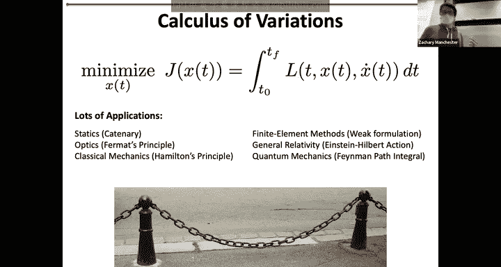

It's more fun control history。So this is called a centrifugal governor。And it was invented。

 I think by James James Watt， like the steam engine guy。

 and this thing what it does is it spins around and those two masses sort of get pulled out under centrifugal force。

And this thing controls the throttle valve on a steam engine to regulate it at a constant RPM under different loads。

 so basically the rate at which that thing spins makes those those balls go up and down on those arms and that like opens and closes the throttle valve and regulates it at a constant RPM kind of cool so this was invented in like the late 1700s as part of know steam engine industrial revolution but no one really mathematically analyzed how it worked until the late 1800s and the guy who did that was James Cl Maxwell of Maxwell equations from electricity and magnetism from your of physics sources he also could be considered like the father of feedback control theory so he analyzed this in terms of like kind of linearizing an eigenvalues and stability and all the stuff you know from like kind of classic sort of cio control he did that on this problem and was kind of first got to do that stuff incidentdentally the original paper from 186。

8 is on the internet and surprisingly readable and like it's kind of worth a Google at some point if you're into that sort of thing so this is kind of。

This kicked off like。Feedback， what's called classical feedback control like these kind of frequency domain ideas and that kind of continued up through the first half of the 20th century and got used in all kinds of things you know sort of early 20th century who had the first autopilot for an airplane which was like 1914 which was that picture over there by guy named Spry who went on to found a company that's super famous that I think the remnants of it are still around also automatic steering for ships was done around this time and like the teen years there was no theory people are just kind of like doing stuff and trying it out but it was mostly like PB control essentially but there was no general theory of how to do it the general theory started to come in the  1920s to try to analyze the stuff and come up with stability analysis and prove things weren't going blow up and stuff like that seems nice and that really came from the electrical engineering communities so the feedback amplifiers in EEL and vacuum tube amplifiers and for radio and stuff like that。

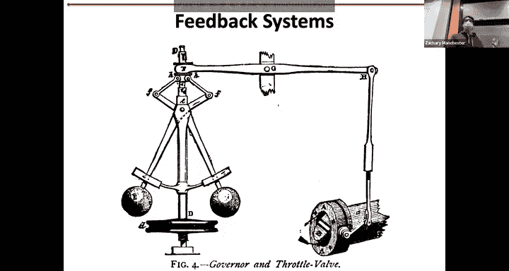

And in the 1920s there when the theory kind of formed around this stuff this was when you got all the classic frequency domain tools you guys might have seen in like an undergrad feedback control class so like Laplace transforms Bodie plots。

 locus all that stuff was done in the like sort of late 20s。

 early 30s and NCqui stability right so that was 2030s and then World War I came and it sort of exploded again there was like a lot of use of this stuff in guidance systems for torpedoes and missiles and all this kind of military stuff in World War II so that's sort of first half of the 20th century what you would call classical control then postword War I sort of 1950s。

 1960s you started to see what is now called modern control and this is really what this refers to statebased methods where we use sort of matrices and a lot of linear algebra and few things in the time domain which is like what we're all about in this class for sure。

 the real sort of father of that whole line of work was Rudolph。

man of theman filter in the 60s and really like， yeah， he kind of brought。

Lar algebra I would say into control theory and kind of really the impetus for this was that this is when computers could start doing linear algebra for you it's like pre this period like all that classical control first half of the 20th century stuff was all done by hand with like log paper and graphs and stuff and now in the 60s he started to actually have computers that people could use to do this kind of stuff so hence linearar algebra kind of becoming important in fact does anyone know the story of like the original Colman F paper it got rejected like multiple times and he couldn't publish it anyway for like a long time was kind of funny and then the real kind of breakthrough to this stuff becoming used and popular and all that was in the late 60s in the Apollo program essentially they needed it to do Apollo and the extended coleman filter was actually invented by a guy named Stanley Schmidt who was working at NASA Ames who it basically tasked him with figuring out how to navigate to the moon and like he read Coleman's paper somehow and like went up for the weekend。

and came back with the answer and it was like an extended columnman filter and they in fact he invented the eKF and the sort of square root columnman filter which you may have heard of to get it to work on the really crap computerpoo guidance computer so that's kind of that the 60 story sort of in parallel with this which we're going to talk about hopefully later today。

There was a lot going on in the Soviet Union right the Russian space program at that time as well。

 a guy named Lev Ponttrygan did a lot of work on trajectory optimization kind of laid the mathematical foundations for a lot of trajectory optimization specifically he developed is called Pontreagon's minimum or maximum principle which we're going to talk about which you may have heard of which really just the first order necessary conditions for trajectory optimization problem theyre like the KKT conditions of trajectory optimization we might do this later today and then in the US you had also another big name was Richard Bellllman around the same time late 50s60s doing dynamic programming a lot of you probably heard of it right Co so that sort of was 60s and then let's see what else happened yeah so and really all that stuff was the application motivation was largely the space program both here with Collman and and Bellllman and then in Russia with Pontre a lot of it was trying to figure out how to fly rockets and go to the moon and that kind of stuff which's kind of cool okay so。

And also deeply tied to the existence of computers at that point was what let people do fancier things。

 right， Okay， so next kind of interesting set of ideas and。

That sort of kind of came around in this time too in the starting the '50s。

 I don't know if this is going to play now， which is annoying adaptive control who's here this？

Okay so this is kind of interesting it started in the 50s and the idea was like you had unknown parameters in your model or you had parameters that were hard to measure or estimate and might be time vary might be changing on the system and originally where this came from or advanced aircraft and there are some famous examples in the late 50s。

 early 60s on highper aircraft this is the X15 if anyone's heard of that where they famously kind of tried some things that didn't go so well and crashed a few of these not great and basically the idea here is essentially what they were doing back then was online gradient descent on the control parameters while you were flying the airplane and they didn't have good theory at the time and they just tried a lot of stuff and unfortunately some people died。

Not great， but yeah， so this actually the line of work there kind of can trace right through to the modern era of like kind of online learning in RL like the ideas are really similar and so adaptive control and like these kind of current state of the art results on like online learning for say like of locomotion are sort of historically very related and kind of interestingly intertwined。

Yeah， I would say really the the difference between these two pictures is really computing has gotten better right and we can do bigger things with more more parameters deaf now cool okay。

 so that's adaptive control then the sort of like next thing to talk about is robust control sort of this。

😊。

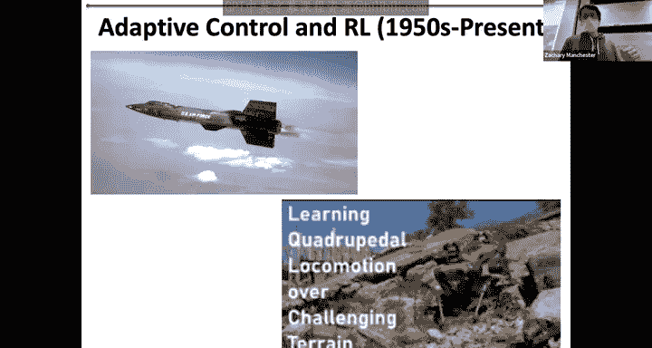

Okay， so this is maybe the most badass title and abstract of a control theory paper ever who he's seen this before。

This is the famous John Doyle paper so this came out in 1978 and essentially before this people thought that sort of LQR controllers and these nice optimal control ideas were kind of naturally robust to errors in your system model and things like this and there was some proofs that led people to kind of believe that should be the case but then。

Doyle， I think this was like his first paper as like a first year grad student or something insane like that。

 he found a couple of like really nice simple counter examples where for like infinitesimal perturbations in the A and B matrices of your linear dynamics model。

 the system would go unstable。And then blow up and so that's what this paper was so the title is guaranteed margins for LQG regulatorulators or LQG for those who don't know is a callman filter hooked up to an LQR feedback controller and we're going to be out later in the course and the abstract is there are none。

😊，And and then the paper is actually super short it's like a note and he just lays out a simple little like two by two linear system with like a little epsilon in it and shows that when you compute you know the controller for this。

 you know for like basically infinitesime small epsilon perturbations on the elements of the matrix that blows up on you which is kind of cool so that's spawned an entire research area of robust control starting right around them that kind of blew up and got really big in the 80s and into the you know early to mid-90s and the whole game there when we say robust control。

 this kind of stuff it's all still linear control what they were specifically doing was kind of trying to find extensions of LQR ideas。

Where you could guarantee closed loop stability under like bounds on the on the A and B matrices in your linear system so you would say something like okay here's my a matrix nominal a matrix here's my nominal B matrix I'm going to bound the elements or I'm going to bound the matrix you know and I want to find a controller that will be guaranteed to be stable for any actual instantiation of A and B within those bounds so that's robust control the kind of you know there's this interesting tradeoff between robust and adaptive where adaptives trying to figure out what the exact parameters are online whereas robust is ahead of time trying to guarantee things won't go south on you online the kind of interesting thing is that you know when you do robustness stuff you're kind of intrinsically always giving up some performance in exchange for the robustness rate okay so 80s up through the 90s this was really big still some people work on this stuff。

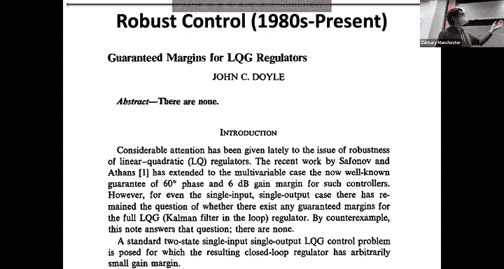

More fun stuff so this is getting more modern and more kind of state of the art now and I don't know why the videos aren't playing this thing sorry what you should see in that video is a quadritor doing crazy things from like 10 years ago and this is called model so who' sort of model predictive control most of you guys this is currently kind of where we're at in robotics largely this is like super popular and super widespread now so idea you here is you're basically solving the optimal control problem numerically online。

You're using an optimizer， you're solving this problem， and if you can solve it fast enough， i。e。

 at like tens or hundreds or even kilohertz。Online on the robot then you can just do that and use that as your feedback law and you just kind of keep resolving the whole optimization problem online this only became。

Possible you know kind of semi recently it started in like the late 70s in chemical engineering where they were doing this stuff on chemical plants and the reason it started there was because chemical plants have really slow dynamics so like you can run the controller at like once per minute update rates so you have tons of time to solve your optimization problem so as soon as like desktop PCs became a thing in like the late 70s they basically started doing this in chemical process engineering and then it started to kind of move into more and more fields as computers got better and faster and now it's used everywhere and it kind of one of the standard standard things to do and we're going to do a bunch of this。

嗯。That's that sort of parallel things that are relevant to us that you know one is kind of what's what happened in robotic manipulation。

 specifically like industrial robots there's a bunch of classical stuff in here is that not control theory or feedback control per se but essentially what goes on in these things is you write down the dynamics like the manipulator equation like there and it turns out even though this is like a weird crazy No nonlinear system you can do some really simple math and basically invert the dynamics and so if you have a given cu of T that you want the end defector that you want the robot to track you can literally just invert the dynamics and figure out what the U of t is that should give you the Q of T open loop and then you kind of like wrap a tight PD loop around this or something and this was kind of how people figured out how to do industrial robots back in like the 70s and 80s then kind of similar like robotics E developments legged robots started in the 80s with two like really interesting really different approaches。

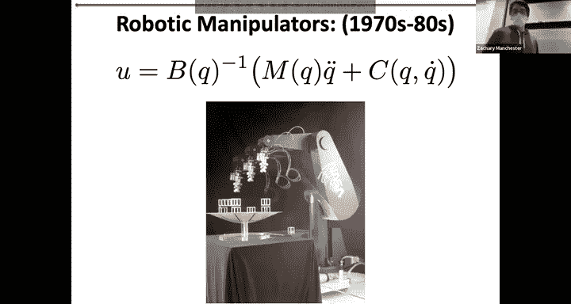

One approach was kind of the Honda approach in Japan which is kind of the bottom right picture and this used really these ideas。

 they tried to treat the legged robot like an industrial arm and used these kind of dynamic inversion techniques and because of that you get sort of the very classic stereotypical walk like a robot vibe at the same time you had the leg lab which started here at CMU with Mark Raybert and then moved to MIT and then became Boston dynamicsy。

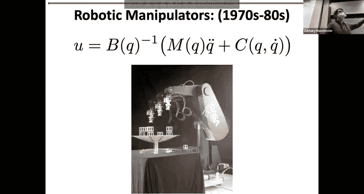

starting this period in the 80s and they kind of used very different techniques that were based on a lot of like intuition about the dynamics。

 but we' basically really reasoning about the kind of full floating based dynamics of this legged thing and doing like really crazy dynamic things this video from the 80s is them doing a backflip on this like Hopper robot which is kind of awesome and yeah that's sort of that let's see what else is in here。

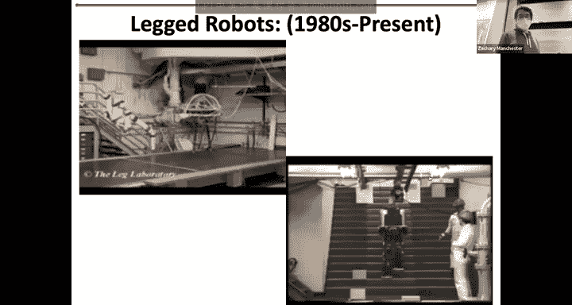

And okay so yeah Boston dynamicsynamics you think so this is like more recent right like kind of legged robot stuff and what's changed basically the whole field has kind of moved more towards the Mark Raybert use lots of dynamics kind of ideas and kind of abandoned that like manipulator sort of industrial robot style control and basically merged those original Mark Raybert ideas withmpC it's kind of what's happened more recently and that you can see that like literally in all these robots in MIT Chetah which is the lower right one and sort of obviously the Boston Dy stuff has that heritage but there's literally sort of anmpC controller in Cheeetah and underneath it a bunch of things borrowed straight from that 1980s Mark Raybert Hopper stuff that there's a bunch of sort of things there's this thing for footstep placement called the Raybert heuristic that's in there and so it's really kind of this coming together those early 80s ideas。

With a lot of intuition about dynamics and NPC is kind of where we're at now I would say and then kind of to finish this stuff like where are interesting challenges now if you want to like get into this field one big one is dealing with contact and like legged locomotion and manipulation we still don't have a good sort of like general rigorous theory for this and there's a lot of hacks to get things to work Another one is kind of like bridging the gap between model based control like we're mostly going to talk about here and kind of data drivenve Rl approaches still kind of a wide。

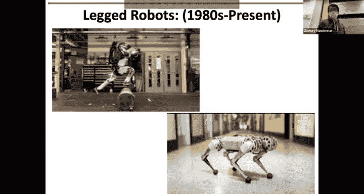

Gullf between these communities。 and I think there's good things on both sides and and you know。

 being fluent in both is。Probably what you want to do moving forward。Yeah。

 and so so along those ideas， can we make the RL stuff more data efficient by incorporating you know models and ideas from classical control。

 maybe can we give safety guarantees for those RL systems with ideas from you know control theory。

And then finally like an interesting one that we've kind of gotten into that has a lot of applications and driving among other things is gained theoreticalore control which just like pretty wide open interesting area。

 which is like how do you reason about other possibly adversarial noncooperative at least agents which could be other cars when you're driving a bunch of other you know less benign scenarios you can imagine for this but essentially like you know coupled when your control decisions are influencing some other agents control decisions there's coupling it gets weird and interesting and that's sort of a pretty interesting area as well Okay cool so this is hopefully a little like whirlwind tour of。

You know， the field of modern control and like where it came from， questions， comments， thoughts。

 anyone have anything before we do math。

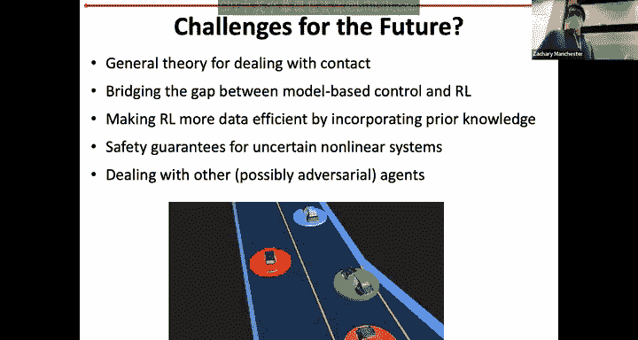

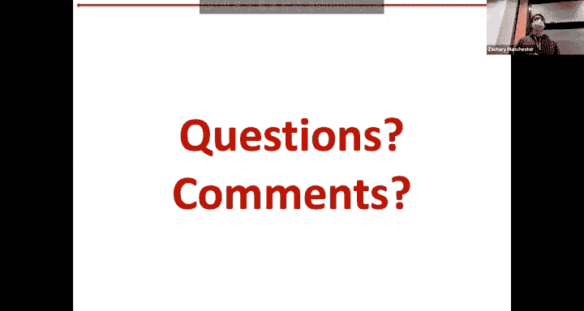

Okay， cool， we'll do math now。呃。Yeah， that was that was by request， by the way， so like， you know。

 speak up if you want to hear about anything particularly and we'll try to do it。Okay。

 so what are we going to do today today we're going to actually that was sort of timely and appropriate because we're kind of like switching gears so we've been doing all of this kind of background overview about you know optimization in general and dynamics trying to get get everyone on the same page and now we're actually going to do control so let's see。

Do my do our。So for the standard staff， what did we do last time？We did we had a bunch of。

Stuff about merit functions and regularization and all that good stuff， right？

So more like kind of constrained。Optimization stuff。We did specifically。

This whole like regularization thing。With constraints。We did merit functions。

We did like line searches with constraints。Yes。Dnis， anything？

They more or less cover it and then today we're going to now get into。

We did sort of this control history。Discussion。And then we're going to now sort of dig into。First。

 we're going to talk about sort of generic deterministic optimal control。

And then we're going to talk about the Pontregen minimum principle。

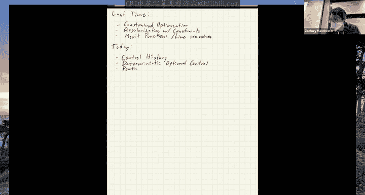

嗯。And we may get into linear quadratic regulators。TBD there on time。Okay， cool， let's do it。So。

First off。Let's write down what we mean by。Deterministic optimal control。

 So we're going to spend a lot of time in this general vein。嗯。Okay。

 so this is sort of the like canonical setup。First， we're going to do it in continuous time。

And so roughly， this is the optimal control problem or the deterministic optimal control problem。

 it looks like this， so we're minimizing。Some cost function。

That's a function i'll be a little sort of pedantic about this notation for just a minute here。

 so we're minimizing this cost function with respect to X and U trajectories so these are actual functions of time right。

And there's cost function。Has a specific form that's kind of standard。

So it's the integral along the trajectory from some starting time TO to some final time T final。

Of this。What we call stage cost。And then you also get this thing we call the terminal cost at the end that's only a function of the time are that the state not the control right because at the end。

You don't have any more control moves， so there's no you there。

And then there's so that's that that's the thing we're minimizing and we're minimizing it subject to some constraints the big one that's always there is we always have dynamics so you have a dynamics constraint that looks like x dot you know equals。

F of x。You like we're used to。And then possibly other constraints。

Which can be like thrust or torque limits on your actuators can be obstacle constraints。

Keep out zones， safety constraints， any of this kind of stuff can be joint limits。

 like a lot of possible things there， right？Okay， so let's kind of label these things real quick so this stuff is。

These are the state and input trajectories。This is our cost function。

And then inside our cost function integral， this guy is called the stage cost or sometimes in discrete time。

 you'll hear this called the one step cost or step cost。

And then this thing is called the terminal cost over here。Okay。

 this thing is called the dynamics constraint。咩。Yeah I think that's about it okay so this is this seems straightforward enough compared to the optimization problems we've been solving there's like one kind of key difference that you know is related to all that calcus variations nonsense we mentioned in that like overview the big difference is that this is a so-called infinite dimensional optimization problem it's kind of like know what I mean by infinite dimensional。

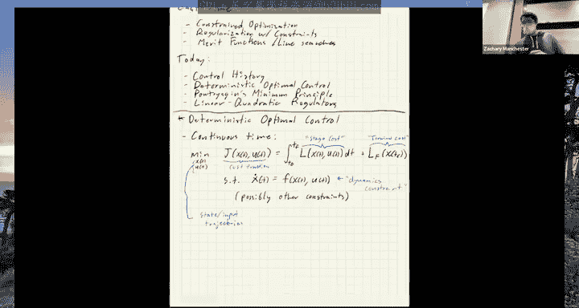

have any thoughts on that？What does that mean？Yeah， like what do you go on yeah？

What do you mean by parameters or that？对。被好。Well， so let's say I have I don't know。

 a quadrutor and it has 12 states。And then I write this problem down for my 12 states quad rotor has 12 states and four inputs。

 right for rot motors。So that's so what do you like， yeah， does anyone have any thoughts on this yet？

Just we can have like anyone thatSo here let's I have a fixed T final。Right and so I plug in。

 say I want to optimize my quadator's trajectory from know t0 to like t equals 10 seconds。

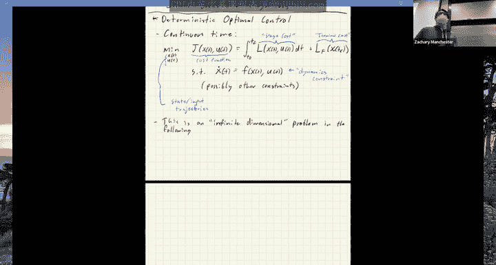

And I have a start state and a goal state and I have 12 states， four controls。

 I write down a cost functionnc and I write this whole thing down。

 so what is infinite dimensional about that？放放贝他。Yeah so that's getting into it yeah so this what is meant by this infinite dimensional thing is the following thing so we're optimizing over continuous functions of time that's really what this is talking about and here's where this is quote infinite dimensional so let's say I have some U of T。

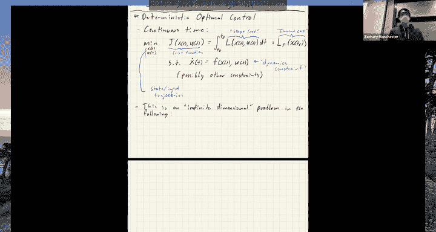

It looks like an inconinuous todd right so this is like this is a this is U of T。

 this is T and I like you know write my U trajectory at some curve like this， right？Okay。

 so when I put this in a computer， I'm going to do my you know zero order hold， first order hold。

 whatever， and I'm going to have a bunch of sample points。On this curve， right？

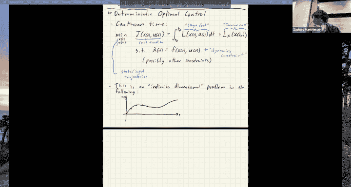

And I'm going to， you know sort of discretize this like so。

 and I'm going to stack these up into some big， so we'll call it capital U vector that's going to look like this。

Under to end say， and I've got all these samples in it， right， So I' have like U1， U2， dot dot， dot。

 U N。Right。Okay， so。So as soon as I discretize it and I choose a time step and I sample at that rate so what did I do here。

 1， two，3， four， I don't know， say I have 10 samples at 1 hertz or something for my quadtor trajectory now use say 10 dimensional or if it's four inputs it's 40 dimensional right and my problem but when I go to like continuous time u of t。

 what that's really talking about is u of t is really the limit of this big U vector of stack sample points as n goes to infinity。

Does that make sense， it's like the limit of infinite infinitely dense sampling in time。

To get that continuous trajectory， and that's the sense in which this is infinite dimensional。

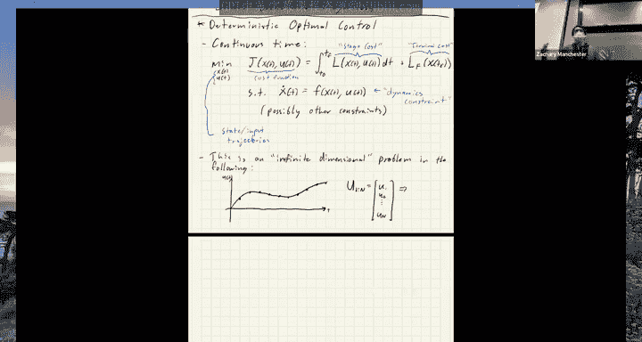

There's some interesting stuff。So yeah， U of T is really kind of like limit。

As N goes to infinity of this like you one to end guy。

So limit of tiny time steps and infinite sample points yeah optimize dynamics than just dynamics you can absolutely do that that is called a so there's names for that that's calleds that's what you do in a socal shooting method single shooting in particular and there's sort of。

Very specific numerical reasons why you don't want to do it。

 which we're going to get into actually super soon。

 so the short answer is that works horribly from like a numerical conditioning perspective。

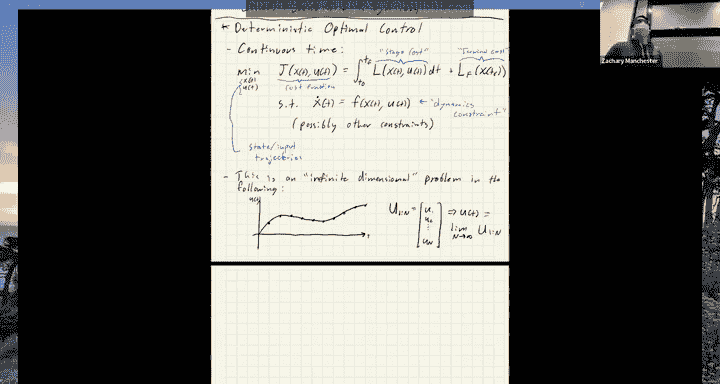

It is the source of in machine learning what is called the like vanishing or exploding gradient problem and in optimal control is called the tail wagging the dog problem Basically when you do that you have to do a rollout right you start with that's not and you just have use you have to simulate that whole thing forward what if your system is and you don't know what you is right when you're doing this what if your system's open loop unstable。

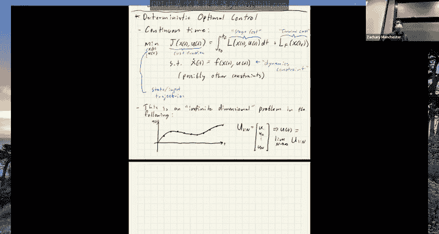

What if my system is， you know， like a humanoid like me。

 where if I don't have active feedback control， I fall over？

So if I don't know what you is and I'm trying to optimize and I have to do this long forward rollout say I want to walk from here to there Dr Ford simulate that whole thing with like bad use。

 it just flils all over the place and is garbage right and this by the way this is very common in a lot of RL because this is how a lot of the RL algorithms actually do this kind of forward shooting forward rollout sort of thing that's the big reason if you do it this way。

The optimizer basically can independently twiddle X and U。

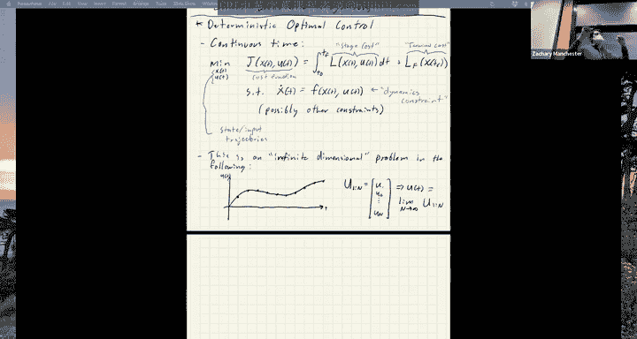

And let's say I have no clue what the U should be like joint torques for my humanoid。

 but let's say I have mocap data for an actual human。

 I can take the mocap data for the real human and put that in as my initial guess for X and get a really nice walking gate as my initial guess with garbage use。

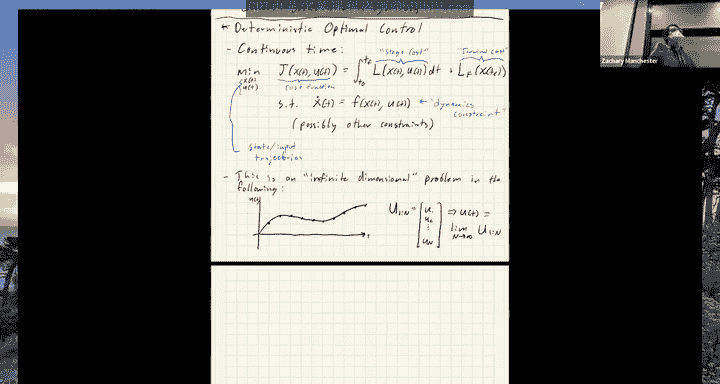

But then the solver like can can sort of is already in the right sort of part of the state space in the x's and it's much easier to then just dial in the U's that sort of makes sense so having all those variables in there and then constraining them。

Gives the gives you many， many more degrees of freedom it makes your gradients a lot nicer and it makes the numerical conditioning better and it makes the problem easier as well that a long winded we'll get more into this but hopefully that was at least day。

Yeah， cool all right， so this is what we mean by infinite dimensional。嗯。

What else is there to say about this Okay so what is the solution to a deterministic optimal control problem as the next sort of。

Smi obvious question。打上那。

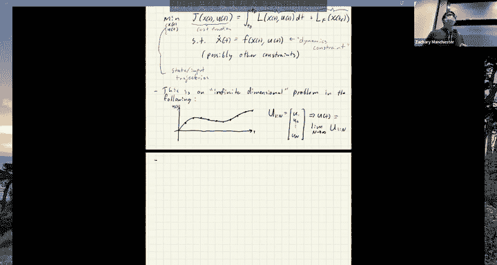

If I know everything about everything and I write it down like this and I solve this。

 what's the answer？

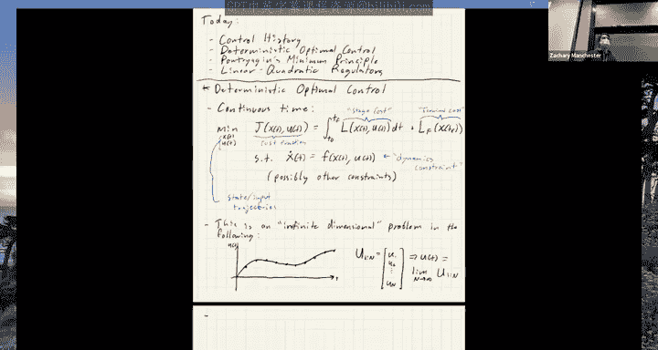

。So what if yeah well it's a trajectory so if I started at some some initial state and I have a goal state and I know all the physics and I know everything there is to know about the universe and the answer to that is just some open loop trajectory that gets me there right because if I know everything that open loop trajectory will work perfectly right so the main point here is that if you have a deterministic problem with like no one knows the optimal solution is just some open loop trajectory。

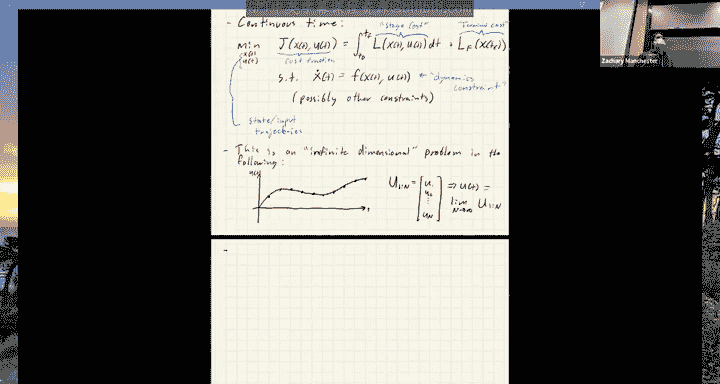

Yeah。

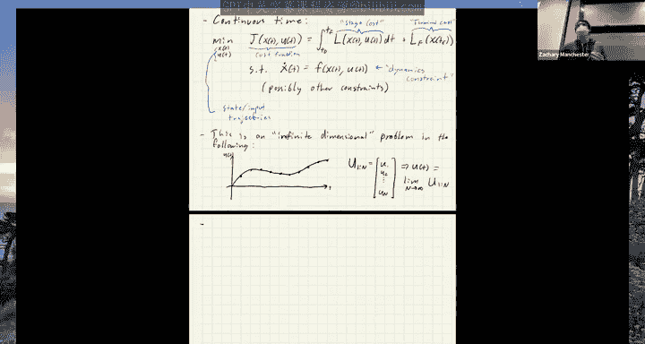

Yeah， it means it's just U of T， it means specifically that if I know everything perfectly。

 I can solve this problem and I'll get some U of T some control inputs that will drive the system from that initial state to that goal state I just run it like you know as a function of time on the motors and it gets me there right？

And as we all know， real life is not that nice and there's always uncertainty in the models and noise and disturbances。

 so if I try that in real life， it just face plants it just falls over and breaks。

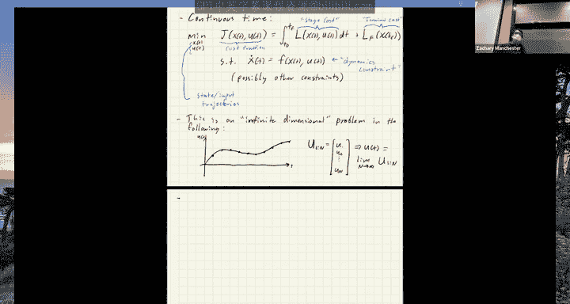

And this is where we get to feedback， right， but the kind of interesting thing is mathematically in this perfect world of deterministic everything。

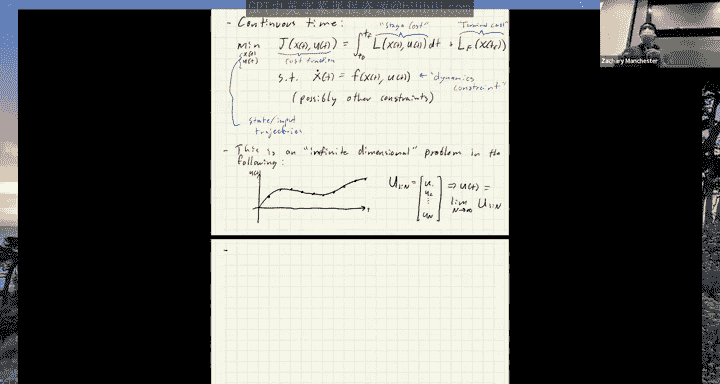

You don't get feedback policies you actually just get。

Open loop trajectories that tell you like if you plug this into the motors。

 this is where you go that makes sense to everybody it's like kind of a bit of a subtle point。

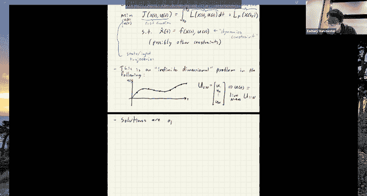

This is in particular in contrast to RL where a lot of where everything's stochastic right in the stochastic setting the solutions to optimal control problems are always feedback policies because they have to be because if you have noise everywhere。

 running this thing open loop will not get you where you want to go right they'll just kind of randomly wiggle around。

Azaach。Zach can you， Yeah， yeah， sorry。Is it okay if you repeat the students questions in the audience it's hard for us to hear that yeah。

 I will do that moving forward。

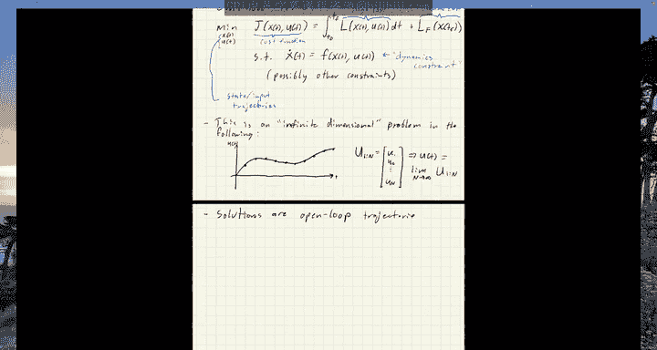

Okay， so what else is there to say about this okay。

 so unsurprisingly there are a handful of problems where you can find analytic solutions to this optimal control problem。

Namely the linear ones。And then for like anything nonlinear basically you know。

 you need a computer and there's no closed form solution it's just a。

 which is why in this class we're going to spend a lot of time on numerical methods and algorithms and not a lot of time on analytic。

Theory， closed form solution stuff。嗯。And then the last comment。

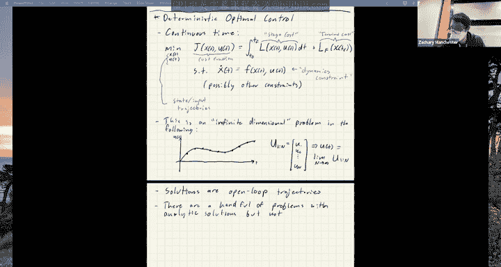

Is that I wrote this in continuous time， but we're going to basically do everything in this class in discrete time because that's what you need to get it on a computer and you know that kind of makes more sense for us。

 I think。

嗯。不。Yeah， so basically。

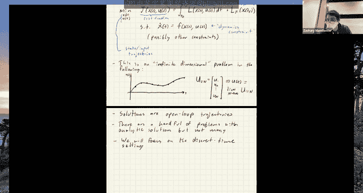

All right， any questions about this， I think that's kind of the。Okay， cool。

 so let's do this in discrete time now。So it looks。

 more or less the same and it's not surprising at all based on previous conversations we've had。

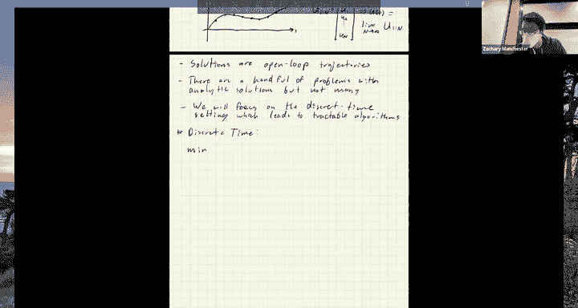

We have some X trajectory where we've sampled it and we have some U trajectory。

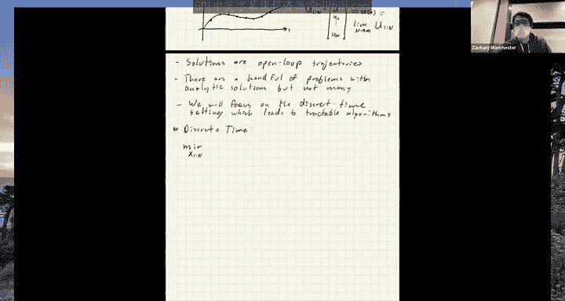

Where we've similarly sampled。And then we get a cost function that's a function of these trajectories。

Sample trajectories now。And we get our integral turns into a sum。So like equals  one to n minus1。

 we have our stage co。Time for questions， Zach。

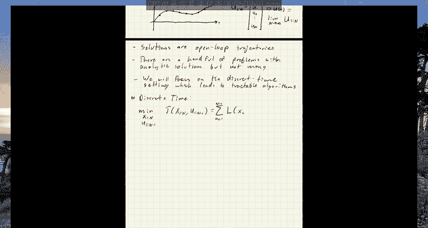

If you are。If these are open loop trajectories， then if you get an open loop trajectory。

 can you like track it with another。

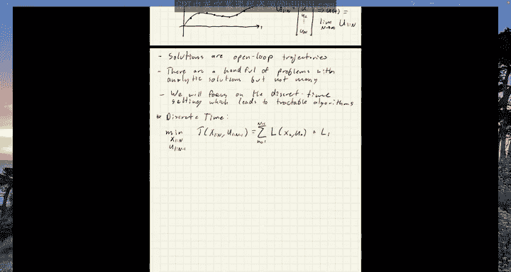

Type of controller or something， but that actually makes use of a feedback law Y yeah。

 so we're going talk about this， but yeah， that's exactly what you do use these different kind of offline you either do this offline and then track with some other controller online or you do this online really really fast and turn it into an NPC controller that model predictive controller thing So if you can do this really fast then you can just do it online all the time and this is kind of it。

And that that is kind of actually。But and that still doesn't give you a control law。

 but it's fast enough that if you do this like at 100 hertz on your robot and you just plug in your current X as the X1 every time and then run the U that comes out of it that gives you a feedback policy ands that's what anmpC controller is basically but it's just solving this problem super fast online。

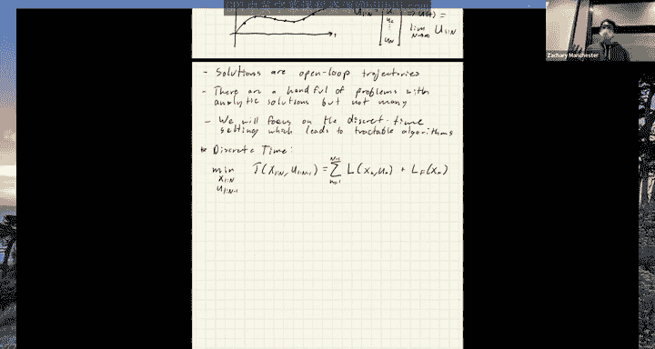

系嘅加。Cool， okay， so yeah， we will do all of these things Okay。

 cool so we have our discrete time dynamics。As a constraint。

And we've got some of these other constraints might be， for example， torque limits。不。呃。

And we might have some， say， obstacle constraints we can write like this。So as just examples。

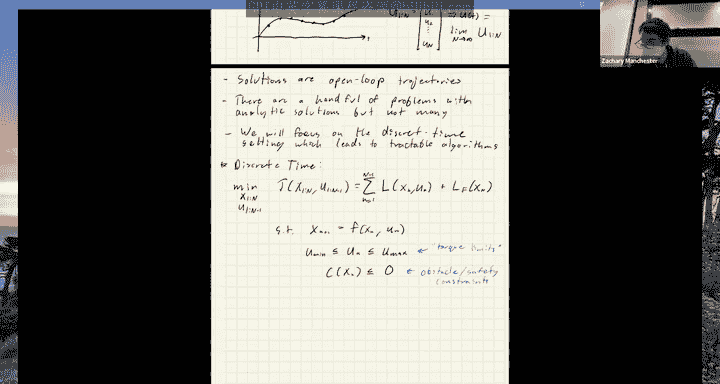

Cool okay so what to say about this version so this looks almost the same right it's just me plugging in my sort of like rununga cutta method or whatever to discretize the dynamics and then using some kind of quadrture rule to integrate the integral so I get it into this little discrete guy and now this is a finite dimensional problem right because I have end time steps and now I have I can stack those into big vectors and。

ならな。And now this you can almost just stick this in a computer with a good commercial solver just and just go。

 which we'll do some of that later， some other sort of notes the samples。XK UK。

 these sample points in like control lingo， these are often called not points for weird historical reasons that I'm not 100% clear on。

 but if you hear me say that that is what I mean sample point， not point it's you know。

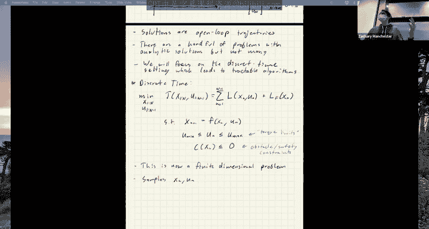

Just the lingo。And let's see some just kind of like you know basic stuff。

 so when we convert from continuous time to discrete time。

We use an integrator or some form of integration right to go from the ODE to the discrete time dynamics and to go from that continuous integral to the sum right we're using integration。

And this is sort of， you know。Youangak cutta。Stuff。And then to go the other way。

 so let's say we have our nice continuous problem， we disretize it， we solve it in a computer。

 we get this discrete solution out of the computer a lot of times we want to convert that back to a continuous thing we want to maybe ups sampleample it or whatever and so going the other way。

嗯。We do interpolation。It's often commonly use like cubic sps for this stuff and do cubic interpolation of the U of T and X of T to get stuff in between the sample points and that kind of thing。

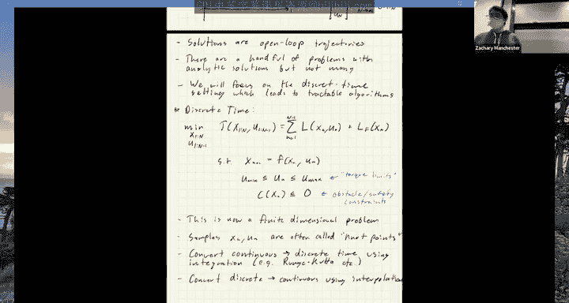

Okay， questions about any of this。Okay。Moving on then。

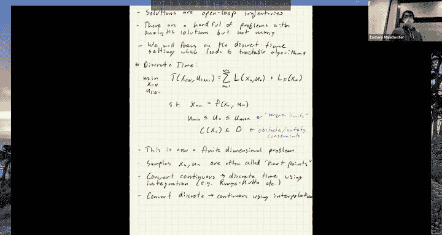

We're now going to sort of dig into。Solving these things and we're going to sort of。

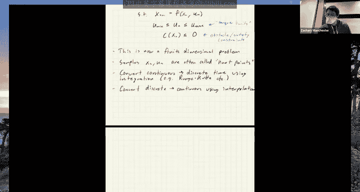

This is called Pontregan's minimum principle， it's a thing you should know about it's part of control theory historically。

I would argue it's not a super big deal。But。It's not something to be scared of it's really it's just really in discreteet time at least it's totally just a restatement of the KKT conditions for this problem so all we're going to do is kind of take this guy take its gradients and set them equal to zero and get KKT conditions and the particular form flavor of those KKT conditions for this specific optimal control problem are called pontregon's minimum principle。

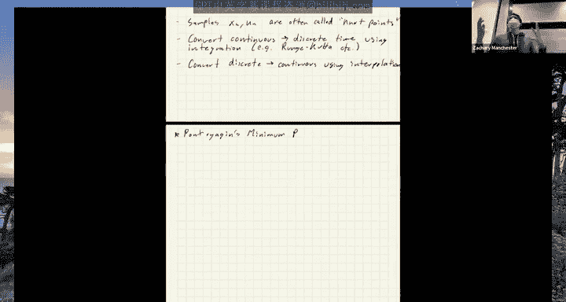

So。Here we go notes on this it's also called the maximum principle if you maximize a reward which is what you do in ourL right instead of minimizing a cost。

 this is one of the great divides between our two fields。

 whether you maximize rewards or minimize costs。

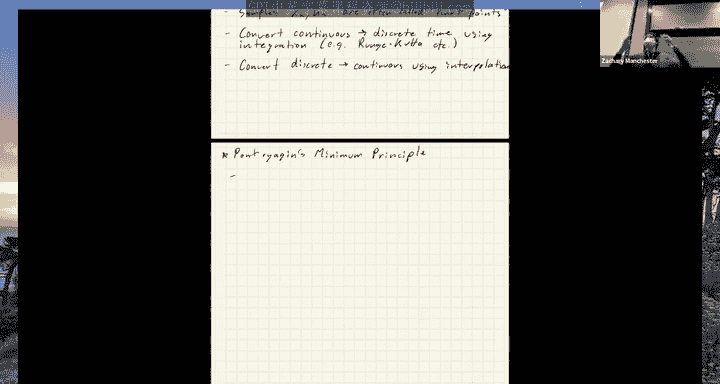

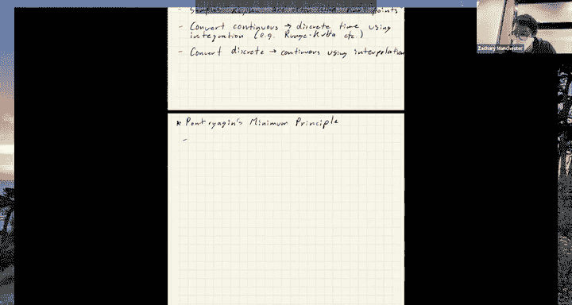

Incidentally， the original Ponreagon work from the 50s was maximizing reward。

 and so it's often historically been called the maximum principle。

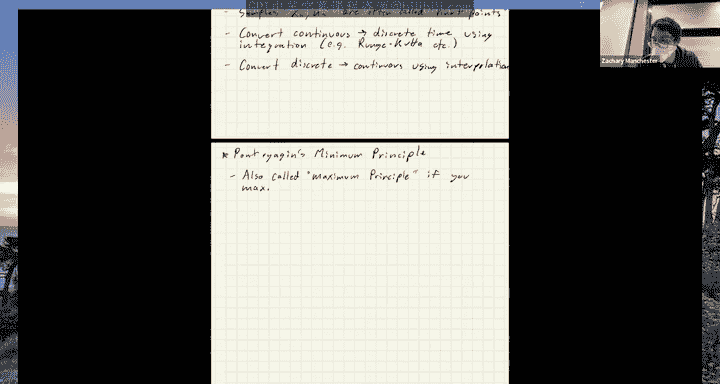

I feel like we should really just stick with Pontregan's principle instead of。Specifying。

What kind of opt it is that would simplify life。 Okay， so what this is。

 it's just first order necessary conditions。

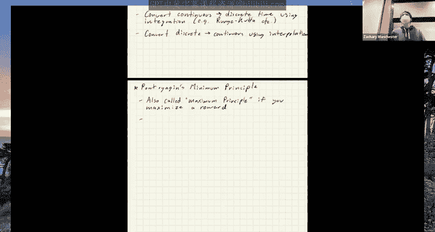

不。For the problem we just wrote down。

嗯。And。Like in discrete time， you can do it in both discrete time and continuous time。

 we're going to do it in discrete time and then I'll write down the continuous time version at the end。

 which looks exactly the same， but deriving in discrete time it's literally just KK key conditions。

You have to go through a lot of gymnastics to do in continuous time with calculus of variations in fancy math but。

We won't do that you can also get that result by just taking it a limit the of the discrete time version so。

Here we go。 So given the problem we had before and we're going to sort of like simplify this down a tiny bit for this discussion。

 we're going to look specifically at。

呃。This version of the problem with like no other constraints。Stage cost。Terminal cost。

And then discrete time dynamics。Like this。

So no other constraints， right just that。We're going to now and I switch notice， yeah。

 I should have been a little bit more careful about this before I'm going to use little Ls for the stage cost。

Because I'm now going to use big L for the Lagrangian。Of。You know， previous。

Optimization。Sorry about that。😔，Don't confuse the Ls。

Okay， little little Ls are stage costs， big Ls or lagronians， okay。

Conform。The Lagrangian。Which is just like before， we're just going to take the cost function and tack on the constraints for a lagro multiplier。

So here that is。So we got our stage cost。And we get now this lagrange multiplier。

And I'm going to do the indexing a particular way it's not super important you just have to you know pick one convention and stick with it。

 so I'm going to make it lambmbda K plus one here。Yeah。

To go with the future X K plus one doesn't really matter as long as you're consistent。

And then we got our terminal cost。

K。Everyone cool with that？Pretty straightforward。Okay， this is where it's starts to get weird。

So this is， you stuff we did already。The next move。

 we're going to define this new thing called the Hamiltonian。

We're just doing this because this is historical how this was done。

 it's sort of with some kind of weird analogy to classical mechanics like Hamiltonian mechanics。

I kind of don't like this because it's not really the right thing for the Hamiltonian from classical mechanics。

 but know this happened 70 years ago and I wasn't alive so。

I can't really argue so just so you're like kind of， you know， you can read the papers and stuff。

This is what you will see if you go look this up。So yeah， this。Okay。Hamiltonian。

 and's here's what that is。H of x U lambda。Equals。The stage cost。Plus therange multiplier term。

So it's sort of the thing inside the stop right， we're going to call that that Hamiltonian。

Now we're just going to plug this into the Liagian。

And now we're going to get。The following thing。嗯。I'll write this down and then I'll kind of talk you through it real quick。

嗯。this in brackets to make sure it's clear what we're summing over。And then， we've got our。

Sort of terminal stuff。And annoyingly。Okay， so what did I just do。I plug the Hamiltonian in。

Number one， and then the second thing I did to get this was I played a little index gymnastics trick where I pulled out the first H from the sum。

 so H you know of x1 u1 lambda 2， I pulled that out of the sum and then I like rewrite the sum。

So it starts at k equals 2。Yeah。And I sort of like。

Pull out also the lambda end term at the other end。So quick question， how many lambdas are there？

We' talked about this before。So there's N states。There's n minus one controls right so I start at x1 and I need the controls are sort of connecting the states right there's n minus1 controls。

 how many lambdas are there？N minus one right because there's a dynamics constraint connecting every pair of knot points right so there's n minus one just like the controls Okay so that's sort of yeah that's why we started lambda two there and the lambda n yeah that's not。

不不。这个是。Yeah so okay this is based okay so the question is the indexing of the lambda inside the sum and the minus sign thing so what's going on there is I did this very deliberately this indexing trick was is the whole reason I did it was so that I got a lambda K Xk inside the sum I did it on purpose to like sort of expose that in the sum because that's what I want the sum to look like for what we're gonna to do next we the derivatives Fun fact this indexing game I just played where I reindexed the sum I pulled the ends out if you do this in continuous time and the continuous time derivation this ends up being integration by parts。

So I don't know if someone wants to like derive that and show that that'd be kind of fun bonus points which is yeah it's a lot easier when you do it in discrete time this is why we're not doing any continuous time but yeah I don't know fun fact so okay there's two things right I plug in the Hamiltonian and then I do this indexing trick where I pull one term out reinex inside the sum so I get the basically so I get the lambda times the lambda K Xk in there to line up with each other all'll good with that everyone cool with that。

Okay， so here we go。Next， what we're going to do is the obvious thing we're now just going to start taking derivatives。

And setting them equal to zero to get first order and necessary conditions。

We're going to do the x and Lada ones first。Okay， so here we go， so we'll do partial L。

Partial lamb decay if I kind of， you know， look inside there in the sum I'm just going to get。

Partciial H。Partial lambda k。Minus x。K plus1。Which just gives me back。The dynamics cantrain。

 which is what it should be right， but take the derivatives respect to a lambda should get dynamics。

Okay， so that's。So of nice or easy Now we'll do the X ones so we get。Partial L， partial Xk equals。

Partial H， partial x K minus。Lambda transfose and if I kind of dig into the definition of H and sort of chain rule through I get that this is partial stage cost partial xk so the gradient in the stage cost respect the state plus this lagrangrange multiplier times the dynamics Jacobbian。

Minus lambda K。Equals zero Okay， so that's the the stuff in the sum and then remember we have this terminal n term outside the sum that we actually end up having a like special case。

And that looks like the following thing。

Okay， so we'll talk more about these， I'm just writing them out for now。是。我觉得 x玩。So。The x1 ends up。

It turns out the x1 term like is sort of covered by that middle line。Does that sorry can you？Yeah。

 the x1 is the term right in front of that。So H of x1， U1， lambmbda 2。

Is outside the sum and then inside the sum I started to。

Does that makes sense cool yeah so this is this is just a trick I pull out the first term and then I reindex inside the reason is I want to get lambda K Xk inside and to do that I do this little trick。

Sound'm good， okay， so yeah， literally that line is the same as this line here。

 this L line right I'm just doing like substuting an H and then like reworking the sum slightly。

Because it makes the following results sort of cleaner。Okay。

 so that's those derivatives and then the last thing is for the use， which we haven't done yet。

The standard way of writing this stuff is that we don't actually write the gradient equals zero condition for you。

 we explicitly write out the min。Does anyone know why we might do that？

A professor yeah before that really quickly。 So for the first for the first partial derivative of the deal over。

The lambda N why is it a minus x of n plus1？X K plus one， the first line， so that I mean。

 you can go back to just here if it's if it's unclear at all like this this guy。

 if I take the derivative spec to like lambda。It's multiplying that dynamics constraint， right？

So here， if I take partial lambda K plus 1， I get F ofxk， UK minus x K plus1， right？Is that clear？

This bottom line。Could you could you say that one more time please yeah so here's the term with the the Larange multiplier and the dynamics constraint。

 right？So take partial L with respect to a lambda。That's what I get back is the dynamics constraint。

Oh oh， okay， okay， that's all it is I'm just taking derivatives of this this Laangian thing。

I rewrote it down here in terms of Hamiltonian nonsense， but like， you know。

 don't don't worry about that， all it really， it's still the same， you know， L up top。

I'm just going to write some of these results in terms of the Hamilton because that's the standard thing in the literature。

Okay， cool， thank you。Yeah sure okay， so I'm going to write the U part of this kind of explicitly。

 the reason is that this lets us put constraints on the U minimization to handle torque limits。

 which are a super common thing。

So this looks like UK equals。Ard men。I'm going to write it as like utilda inside the argument of。H X。

 K， UK。Oh sorry， youtilda。Lambda K plus1。Subject to。I'm going to write this you know。

 kind of a funky way， which I will explain in a sec。So this is shorthand for so basically， yeah。

 subject to the torque limits what this。

Says。

Who's not seen notation like this before？And everyone seens for set notations。

 this is that utilda has to be in sort of the feasible set， which you know can be anything。

 but in our case it can basically mean between human and max。Zach yep， just for clarity。

 so is that a is that an arrow is that an is that an E God is a set membership。Okay。So in lateEx。

 it's backslash in。So its said as you utilda in big U or in the feasible set big U or something like this。

Okay， and this， you know， this can be anything， but in our case， it's going to be， you know。

This kind of thing。You'll see that a bunch， I'll probably use it a bunch so you know。

We might as well get into it now， okay， so this is the whole thing。

I'm now going to sort of just clean this up and summarize it a bit and rewrite it in terms of like the Hamiltonian pretty stuff。

So we have and you know， so like I'm going to just slightly rewrite this， so here we go。

Xk plus1 equals。Grad of the Hamiltonian respectta Lambda。Which is just F of X。Okay。

 and we have Lambda。Equals。Cradating of the Hamiltonian with respect to X。

X， K， UK。Lambda K plus1。This， if I kind of like chain rule into H is just。Creating of the stage cost。

Plus， this dynamics。Derivative thing， so partial dynamics， partial X。K transpose lambda K plus1。

 this is sort of bad， sorry。Let me scoooch this over。Okay。ok 啊。And then we have the use stuff。

She said this is just， we're going to just actually keep it in terms of this argument thing。

Which is the standard result。Assuming like I care about torque limits。

If I don't have any torque limits， I can just write the derivative equals to zero there also。

And we're going to do that in a sec， actually。That's the case on the LQR problem that we're going to again in a sec。

嗯。And then the last one is that terminal condition lambda n equals。Partial L final。Partial X M。Okay。

 that's the whole thing。

嗯。Let me write it， I'm going to write the continuous time version and then we'll talk through it a little bit。

The continuous time version is almost identical， so in no surprises。Almost identical， not surprising。

 but way more work to derive in continuous time。

We will just do it this way， here's what it looks like。Basically replace ks with dots and stuff。

 right？And these are the continuous dynamics now instead of the。Discrete dynamics。

Iza， is that a negative lambda do Yeah， we'll talk about that in just a sec okay。

And so yeah， all this basically was the same。And then。Lamb of。T final。Equals partial terminal cost。

好手。X。Okay。Let's see。Now， what do we talk about， okay， cool。What do we say about these things？

So notes on these things。And we'll I kind of stare at these and talk about them a little bit。

 So first thing to say is。嗯。Historically people used these the continuous time versions actually so in the dawn of optimal control and like the early space program here is that kind of stuff people used these continuous time equations like you see here to figure out like rocket trajectories and stuff like that and they would basically write the problem down write those things down those are ODEs now right they're ODEs for x you know x dot and lambda of T x of t lambda T and U of T and you can write these things down and then like basically integrate them with a runga cutta method here's a fun question。

If I have some initial start state， x0 and I have some goal state of x final。

 I want to fly my rocket two。So that's， you know， I started XOD。

 I integrate forward with the dynamics that's clear， what about LaMda？

Do I know lambda not at t equals0？No。😔，What do I know？I just write down my cost function。

Like what do I know about Lambda， how do I get an initial condition to integrate Lambda？

Do I have an initial condition for lambda？I have something else。

Look at the last line of these things。What's the last line tell me？发个。Yeah。

 so from the last line tells me I actually know Lambda at the final time just from the cost function。

 from the terminal cost， right？Okay， so the kind of funny thing about this is I have an initial state for XO at TO and I have a final lambda at T final and I have ODEs for both but it turns out I end up having to integrate the dynamics for the states forward and then I have to integrate the ODEs for lambmbda backwards in time from the final lambda that's why the lambda dot has a minus sign in front of it it's going backwards in time。

Okay， so。

This is very， very closely related in fact to backproagation in neural networks like this is basically the continuous time version of backpro and that backwards integration of the lambdas is really basically equivalent to like backproing through back proping through time through the trajectory in continuous time which is kind of fun and kind of interesting by the way yeah like a lot of the neural net stuff has roots and optimal control going back to like the 50s to this stuff which is kind of interesting okay so okay so that's that's kind of weird yeah yeah exactly so so the question was you have to integrate lambda backwards absolutely so and this is what we're going to write this down right now so methods that do this basically start with a guess for XO and like the goal state whatever and you have to sort of integrate one forward and then one backward and they obviously don't match and then you basically have to iteratively refine them and kind of keep making these forward and backward passes this is very analogous by the way it like in modern Rl methods you have forward rollout and then you do some backpro。

Of your gradients like that's essentially what's happening here。Yeah。😊，I there for2 for or。

I don't know how to solve too many nonlinear first order ODEs to you？嗯。was。

Sold them in some way that does not involve intelligence intelligence or not。

Only in like one or two really benign so for linear everything， yes。

For anything nonlinear pretty much no like I don't know how to solve really any nonlinear ODEs you know so so yeah you can for like some extremely simple cases solve these ODEs in closed form namely the famous LQR problem which is linear but pretty much as soon as things are nonlinear you can't solve those things right you have to numerically integrate them。

And cross your fingers。Okay， so yeah， let's write this down。

。So yeah， basically。Historically， many algorithms would essentially start with a guess and integrate these things forward and backward。

Yeah。嗯。嗯。To essentially if you do this you essentially end up end up doing gradient descent right so these remember these things are the first derivatives these are all the gradients right of everything so essentially if you keep iterating these things forward and backward with an ODE integrator you end up doing gradient descent。

On U of T。So these methods， these kind of old school methods are called some combination of indirect。

嗯。Which refers to an optimal control lingo， if you hear anyone say indirect。

 what they mean is it's based on Pontrega's principle。

As opposed to direct methods which are straight up just kind of the original problem formulation that we wrote down in discrete time so if you just kind of solve that original formulation discrete time that's called direct if you solve it via Pontregon's minimum principle it's called it indirect。

Indirect and or。Shooting methods。And the shooting refers to。

This idea like starting at XO and integrating forward and starting at Lambda final and integrating backwards along the whole trajectory。

 that's called shooting in kind of the old school， we would call it a rollout probably now right。

 but I don't know this is kind of an old word for that idea。

Cool also other fun facts in continuous time you have a lambda of t trajectory right it's a continuous function infinite dimensional vector。

And that's called in the sort of parlance， it's called the coast state trajectory。

 anyone heard that before。是。And it's sort of it is the same dimension as the state factor right kind of。

And there's a sort of。Rich interpretation of this guy that we will talk about more。

we kind of need some more mathematical machinery to like sort of really rock what that thing is。Okay。

 so。You can do it like this。People used to do it like this I would say essentially no one uses this kind of like gradient descent E you know shooting indirect style method anymore back in the 70s when computers really kind of bad this is like the best you could do kind of now we have way way better ways of doing this with modern optimization tools so we'll like actually I'll show you this in a bit just so you can like see what it looks like and then I will sort of like mercilessly destroy it and show you how terrible it is compared to more modern techniques。

嗯。Okay。By what metrics is it？Worse yeah， so in terms of convergence rates， numerical conditioning。

 you know， sort of robustness to， you know， like convergence， you know， sort of like I don't know。

 performance on highly nonlinear things， you know， just as a general kind of like optimization technique。

 they're really bad。I mean， these methods are basically doing like just kind of。

Graaddient descent on you is what they really are doing right and so naive gradient descent doesn't do so great and's there's way better ways to optimize things right。

In particular， we're going to start looking at how to do Newton things。

 quasi Newton things like we we spent a whole bunch of time talking about Newton's method right。

 sort of the obvious move is we don't really want to gradient to and we want to do Newton's method when we can because it works way。

 way better。不是。Okay， so that's that we have like five minutes left so in those five minutes I think we'll keep trucking for a little bit。

We may end up having to repeat this next time to some degree， but yeah， we'll live a bit okay so。

Next thing we're going to talk about and we'll spend a lot of time on this。So is the famous linear？

Qudratic regulator。Also known as LQR。Who's done this before in some form in some class like a handful。

 Okay， so this has like。

So a lot to say about this well let me write it down and then I don't think we'll get too far on this today。

 but we'll pick it up next time， so this problem is just a special case of what we've been talking about。

Where。The cost。Is a quadratic and it's usually written like this。

 although you'll see like kind of some variations on the theme。

嗯。So that's our stage cost， it's like x transpose Q x， you transpose R U so quadratic。

 and then we have a terminal cost。That will kind of standard way would be like this QN XN。

Subject to linear dynamics。And in general， these can be time varying linear。

 so the A's and B's can be different at each time step K。

Okay。Then there's some things to say about this cost function， so people who've done this before。

 what are the requirements on the。Qs and Rs。You have to have for this got work out and have a solution。

Yeah are the。Sorry， no， no they can be general dense matrices。

Allmost yeah okay so for this thing to be convec sorry we talked about with QPs we want it to be kind of strictly positive definite usually to have a unique solution and then someone else I think Tim you mentioned that it can be quasi definite sometimes or。

What do you call it a semi definite， and that's sort of okay too。 So it turns out in the LQR problem。

 we need Q to be。

Positive semi definite。And we need R to be strictly。Positive definite。嗯。

So we can talk a little bit more about this， that's to guarantee that the problem has a solution。

 if that's not true then the problem might not have a unique solution might not have you know a sort of feasible solution at all。

 let's see。Okay， so just to be clear， right the cost function here。So so remember。

 we've kind of talked about the whole beginning of this。

 We have our dynamics and we have a cost function。 The cost function is our way of。

Shaping the behavior of the system and sort of describing what we'd like the system to do right so what does this cost function tell tell the system to do。

Yeah。对。Yeah， exactly， so what this has to do is to drive the state to the origin。

And then stop right like the minimum of this cost function is at x equals zero and and u equals0 so the goal here would be to drive the system from whatever starting state you're at to the to the origin and then stop and like have no control anymore right so that's what this is like ideally asking for。

And let's see in particular right here like by choosing Q&R what you're basically doing is waiting off how much you care about control effort versus how much you care about getting to the origin really fast right so if I have Q like smaller and R really big that's penalizing control effort a lot so I'll probably get I'll take my time getting to the origin right if I make Q really big and R really small it's saying I really care about getting the origin really fast and I don't care if I use a ton of control effort to do it right so I'll get really large use and I'll get you know the state driving to the origin really quick this kind of tells you why R has to be strictly positive definite right so if I had R is zero say。

And I have a big Q in there that says get to the origin as fast as possible。

 what's the optimal thing to do？There's no cost associated with the controls。Yeah。

 the optimal thing would be to basically jack you up to infinity and get there you know in zero time right so it sort of like becomes ill posed so that's why r has to be strictly positive definite。

What else is I say about this okay， some other notes？The problem is called。

Time invariance。LQR。If。A K equals some constant a。BK equals some constant B。

QK equals some constant Q， you know， RK equals some， I should put ks on these guys。

Some constant R for all k， so if those things are constant matrices。

 they don't change at all in time， that's time andvariant。And unsurprisingly， if it does vary。

 it's called time variant。Otherwise。So。On that again。

 so time invariance LQR is usually what we want when we're talking about stabilizing an equilibrium point。

 so if you're saying you know like keep the inverted pendulum upright。

And reject disturbances fixed equilibrium point。 that's going to be the time invariance LQR。

 If I want to instead track a trajectory， that's a function of time。

 So I want to track some swing up trajectory to get to the upper equilibrium。

 something like that on the penlum that would end up being time variant So like kind of the standard way of understanding this I would say is time invariant is。

Keeping staying at a fixed point， staying at an equilibrium point or something。

 and time variance is for tracking trajectories。嗯。Yeah I think that's about time to stop。

So I'll hang out for a bit， if any has questions， we will do lots more LQR。Next time。嗯。对吧。一看。

Okay。

4。