# CMU《最优控制和强化学习｜16-745： Optimal Control and Reinforcement Learning》中英字幕deepseek - P8：[08]Lecture 7_ The Linear-Quadratic Regulator 3 Ways.zh_en - GPT中英字幕课程资源 - BV1qHwke1EBX

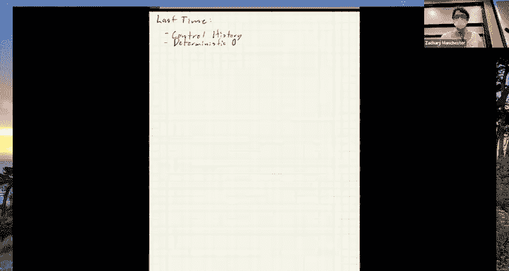

Okay， so last time control history， then we did kind of the deterministic optimal control problem。

And then we talked about。

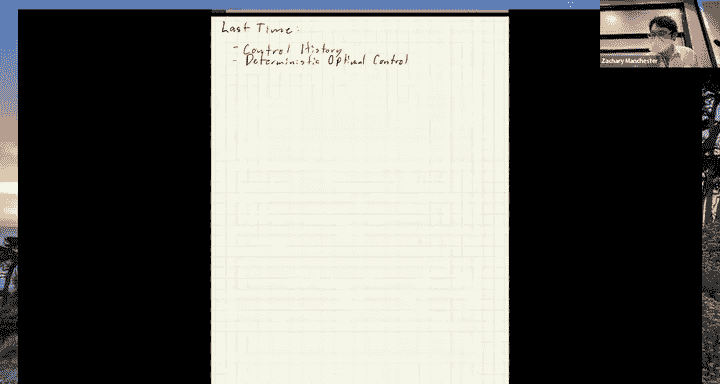

Pontregan's principle， we'll call it because minimum maximum is a matter of interpretation there。

And then we started talking about the LQR problem， right the linear quadratic regulator problem。

 which。We will。We will be talking about for like all of today for sure。

 and then probably most of next time as well， because it's it's just that awesome is really。

Really pretty great。嗯。So let's see today we're going to talk about。

Really lots of LQR basically in particular， we're going to do。Um。

 we're going to use the shooting indirect shooting stuff that we talked about last time to solve the LQR problem first。

嗯。Then we're going to sort of take a closer look at LQR at the LQR problem。

 and we're going to look at it as a QP quadratic program like you've got on your homework， right？

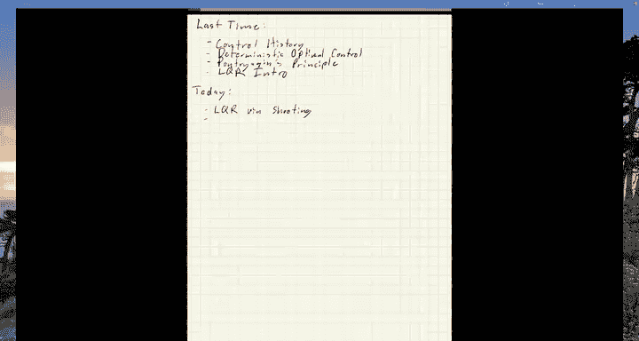

And then hopefully we'll have time we're going to then kind of dig into the structure of that QP when I say structure I mean specifically sparsity pattern structure in the matrices that make up the QP and sparse matrices are kind of there's a lot you can get out of looking at stuff like this so turns out if you kind of like look inside those matrices and look at the bands in the matrices you can do some cool things。

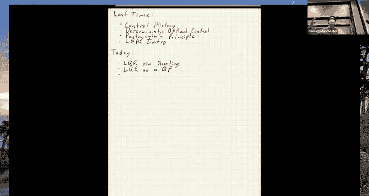

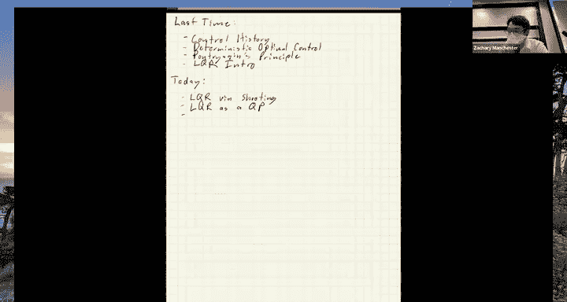

And you can pull out this thing called。Therickaddi recursion。

So we're going to start talking about that today and probably。

Follow up next time with some more on that。嗯。And we're basically going to do we're going to like get to the LQR problem like three different ways there's sort of several ways of interpreting it and deriving it and it's a super deep result that like shows up all over control and it's super super practically useful as well so we will spend a good amount of time on it so first off just as a review。

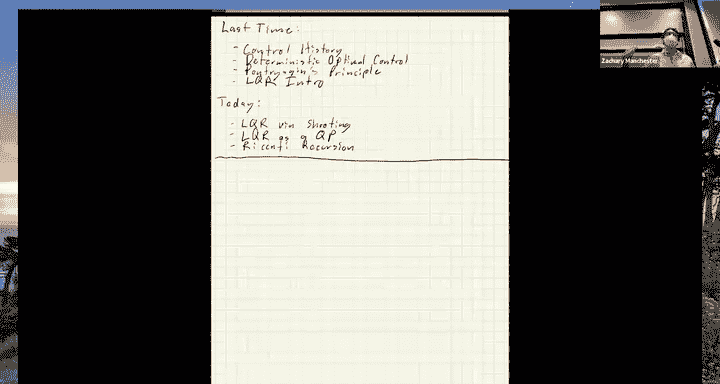

To kind of like pick up where we left off， let's kind of write down the LQR。Problem again。

So we've got in discrete time， which we're going to pretty much stick to now。We good。

 we've got our state trajectory and our。Input trajectory sampled， youve got our cost function。

And in the LQR case， it has a quadratic cost。So that's the Q and LQR and that looks like this。And。

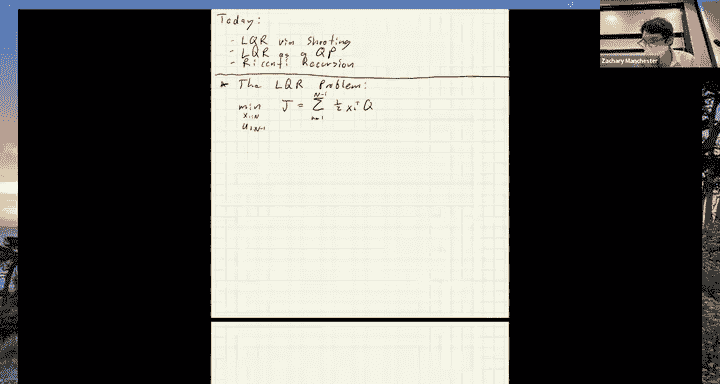

You can have time varying。Cost weights or not， like we talked about time variant versus time invariant LQR。

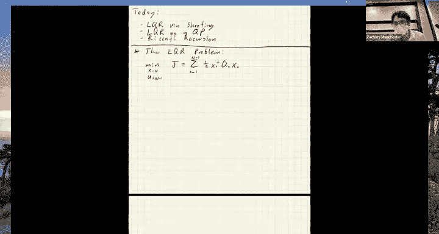

So if I write it down with the little ks on the Q and R here。

That's potentially time vary and they have a terminal cost term。

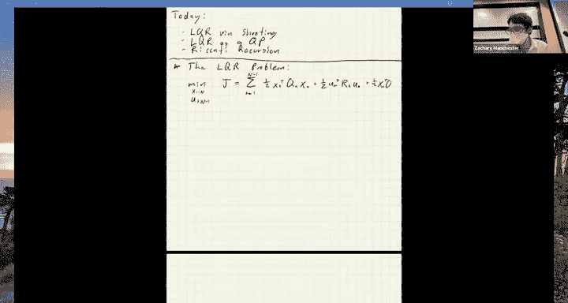

And then we've got linear dynamics constraints。

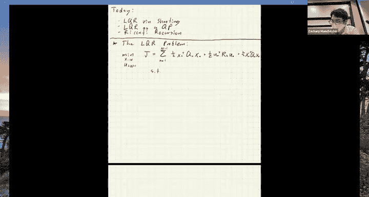

So xk plus1 equals ak， Xk plus Bk。U。And again， yeah the A's and B's they can be time bearing。

 that's what you would get in， for example， a trajectory tracking problem。

 or they could bety in bearing， they'd be constant for all time。

 which is what you would get if you're trying to like stabilize an equilibrium point like a balancing problem or something like that。

 right？

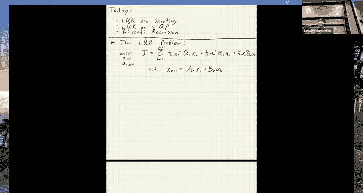

And then the last thing is。That。The matrices in here， the cues have to be positive semi definite。

And the Rs have to be strictly positive definite we kind of talked about intuitively last time that's coming from in the cost function right if for example you had r equals zero then the optimal thing to do would be to just jack the U' up to infinity to minimize the X cost as quickly as you can right so this cost function from last time remember it's saying to drive the x's and the use to zero so it's trying to drive the state of the system to the origin as basically as fast as possible while minimizing the overall control effort and so which the goal here is to get the state to the origin and then stop right and so if r is zero。

Then the optimal thing is to just jack up the controls to infinity to get to the origin in zero time and therefore it becomes like an ill posed problem yeah that's kind of the idea so that's why those things are there intuitively and we'll see later on mathematically it shows up where you essentially have to invert R in some places so therefore it has to be inverible full ankle like it stuff。

Okay。Any questions about that that's the set up from last time some notes， some more notes on this。

 just like as I think we were kind of like。I was saying random things about this and how it's awesome。

There's a couple other things that so we talked about timebeing versus not the big idea here。

 the reason we spend so much time on this and it's super super useful is that this is obviously linear and simplified in a bunch of ways right。

 but this is a really good local approximation for a ton ofline control problems so it turns out very often we can have a super- nonlinear robotic system。

 turns out that like if you linearize it locally either about a fixed point like for a balancing problem or about a trajectory that you found you can apply LQR and it works super super well in practice。

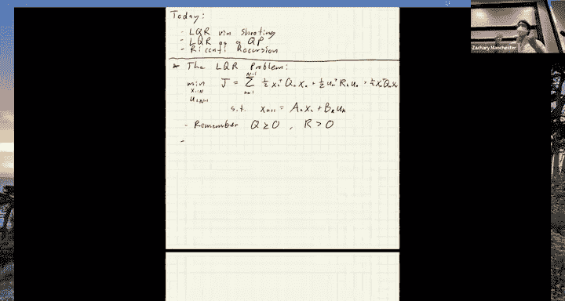

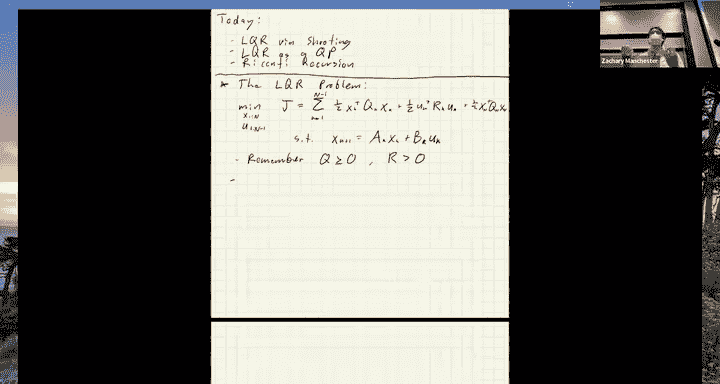

So it is actually super practically useful。

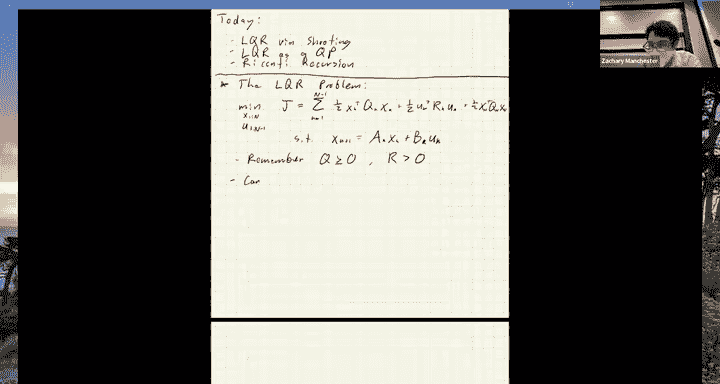

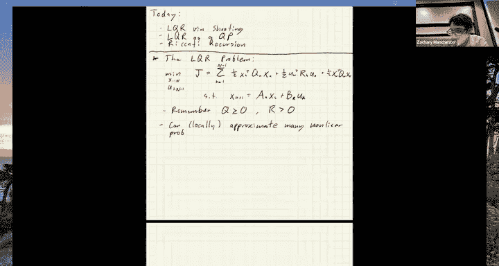

有。Is useful in nonlinear systems， it also， as we'll see has basically has a closed form solution。

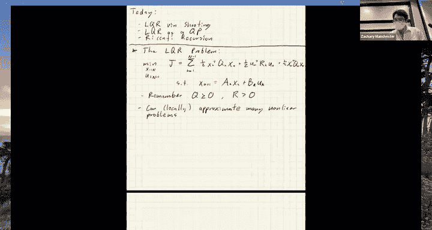

So it's a thing we can actually solve， that's supertractable computationally。

It also has a bunch of interesting extensions， so this version that we wrote down here is discrete time and finite horizon meaning that it has a finite number of time steps there's a bunch of other extensions of this that we'll get into so that are useful sometimes。

So for example， there's， which we'll talk about a little bit today。

 there's an infinite horizon version。We take a limit as n goes to infinity。

 there's also a stochastic generalization of this where you have noise and uncertainty。

On your state and things like that。And there's many。

 many other kind of tweaks to the setup here you can do game theoretic versions of this with adversarial agents。

 you can do communication limited versions of this there's it goes really deep there's sort of a lot of。

Tricks you can play and it's it's really kind of this is the playground of control theory because it is tractable you can do analytic stuff you can get close to answers and stuff and yeah on that note this has been it has sort of like been called the crown jewelule of control theory it's super practically useful you can get nice theoretical results。

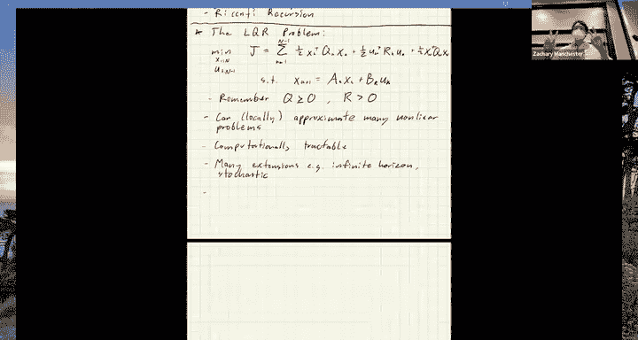

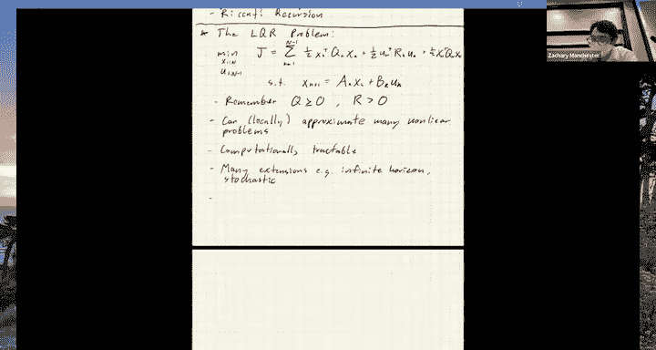

It is it is a good thing so worth worth our time Okay。

 so the first thing I want to do here is last time we talked about country， I like it stuff and。

you know you can actually use that as essentially gradient descent。

 so we're going to do that on the LQR problem。So I'm going to kind of write down what it looks like on this particular problem。

And then we'll do it real quick and I mentioned last time that this doesn't really work so well。

 so we'll try it this way first and then we'll try it another couple ways later in the lecture。

And kind of compare。So if you remember last time， let's see I should write down like the。

These guys first， so we had。From the indirect shooting stuff。

I'll just write it down and you kind if we can go back。

And plug in and like derive these from the definitions， we had this kind of， you know。

 Hamiltonian business。

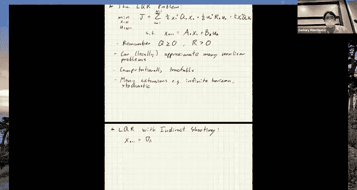

And in general， it looks like this for the LQR problem。 If we plug all this in。

 it's just the dynamics， right， So this is just。

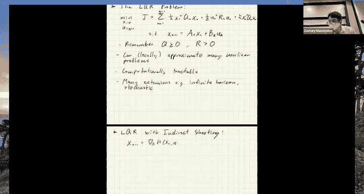

AX plus B U。Then we had the Larange multipliers。

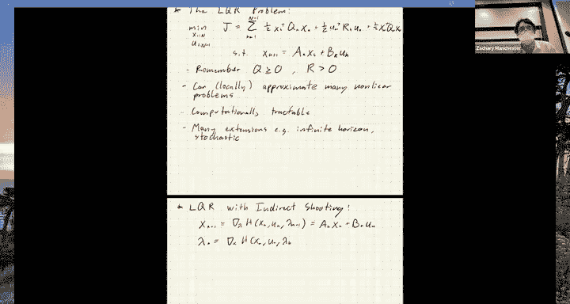

And in this case， if we plug everything in and it turns out in the LQR problem。

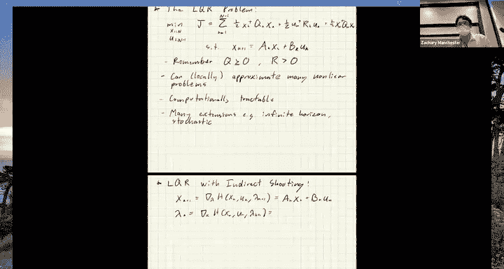

Q X K plus a transpose lambda。Okay， plus one， I guess here I'm going to do the time andvariant case for this just to make life easier and have less bookkeeping for this particular example。

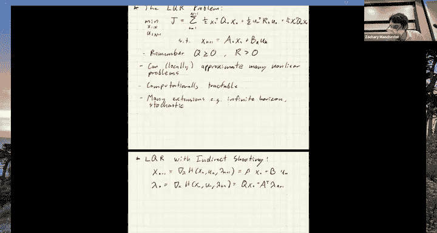

And then for the use， also we have Lambda N here。

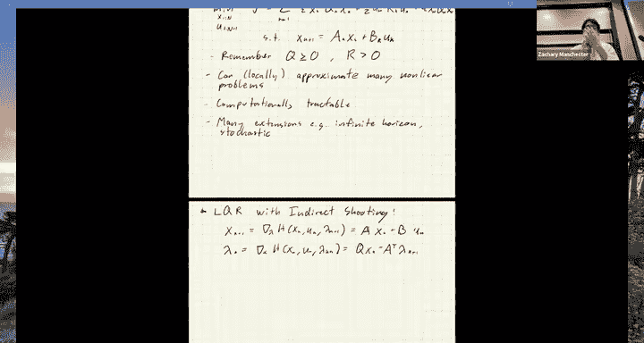

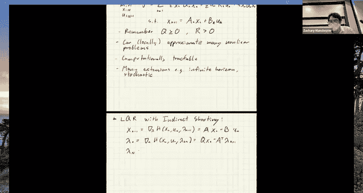

Turns out is Q N X N。And then the use before， remember we had this。

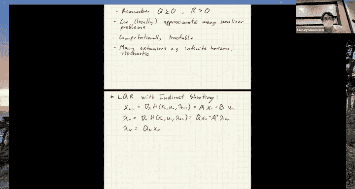

Sort of minimization from last time to finally use。 So this was like UK equals。

Arrg in over some utda thing of。The Hamiltonian。This。Subject to control limits。

 it turns out in the LQR case there are no control limits right we just have quadratic costs so it turns out in the LQR case we can actually solve that min in closed form。

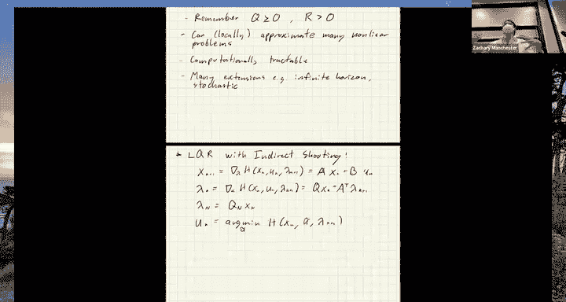

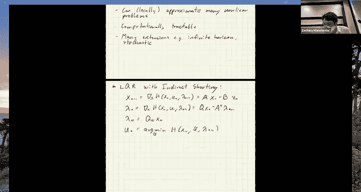

And if you plug in sort of the matrices and work it out， it's pretty easy。

 it turns out it's minus R inverse B transpose lambda k plus one。Okay。Questions about this。

 and it turns out actually we're doing gradienting to send here this。

 this in the algorithm this is actually dellta you。

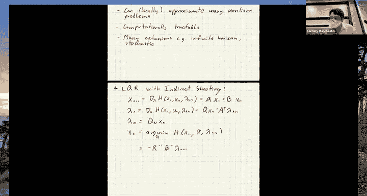

I should say。Sort of the the incremental delta you this is like really the gradient with respect to you that we're going to use as our method for improving things Okay so that's sort of the plugging everything in for the direct shooting stuff。

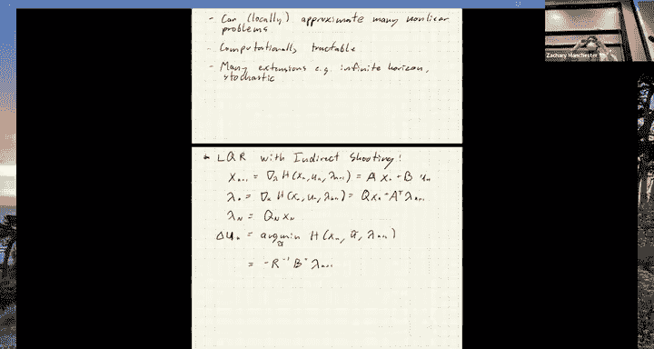

The sort of overall procedure for actually。Minimizing here。Is to number one。

Start with an initial guess trajectory， so an initial guess for well you' got the initial state and then you have a guess for the use right the controls that we're solving for。

Yeah。Okay， so then we're going to simulate or roll out that trajectory with those controls to get an x of T。

So simulate the RL word is rollout， right？Okay， then we're going to do the backward pass。

That's right there to solve for the lambdas and the Delta used。

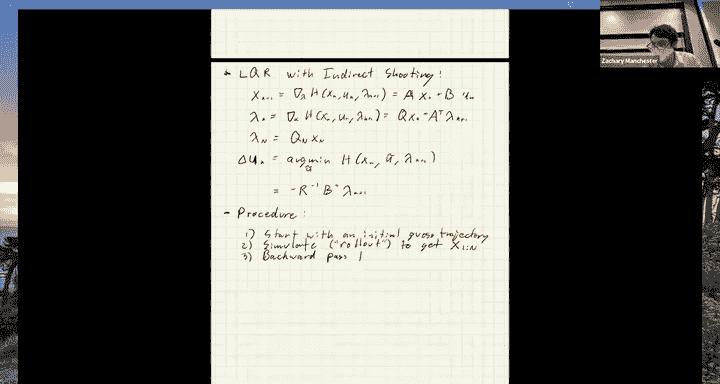

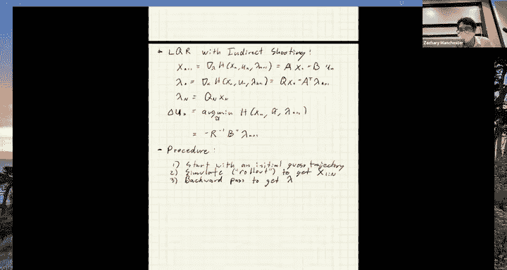

Then we're going to do。A new rollout with a line search on Delta U to find our updated views。

If you're doing RL， you would probably not do a line search， you would probably do some。

JKing step length learning rates thing， but we're going to do line searches in here because they work。

And then you have， so once you've done that line search on DtaU。

 you found your new use and now you're back where you started and you're going to repeat until convergence。

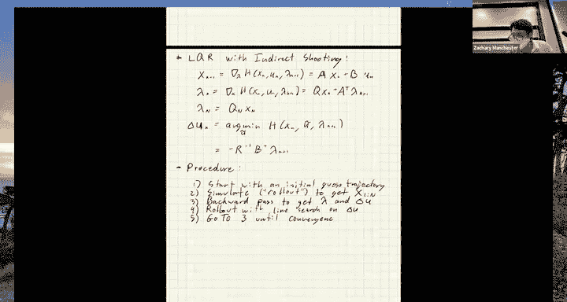

Okay， any questions about this basic setup of its it's literally gradient descent on the use it's just using this fancy forward backward propagation trick to compute the gradients efficiently that's basically what's going on here is that cool with everybody。

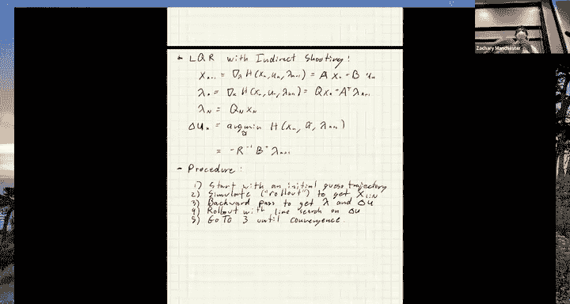

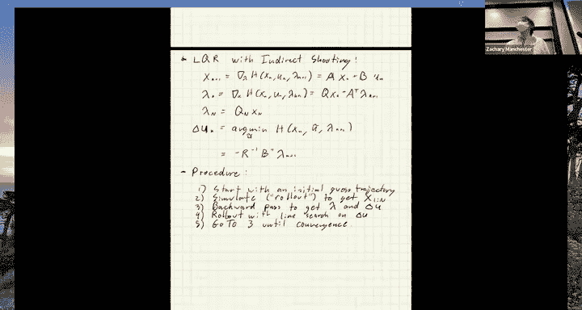

Okay， so one more thing we're going to talk about before we actually go do the code。

 the system we're going to use。

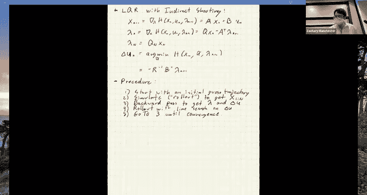

And pretty much all the examples today。Is called a double integrator。

 it's basically the simplest linear system you can write down。

Who's heard of a double in before hands？Not that many people， Okay。

 so then we should definitely spend the time to do this。Okay， so here's what a double integrator is。

 it's sort of what it sounds like。It is in continuous time it's x dot。

 which the state here is going to be so if I imagine I have a position and a velocity。

 that's my state we're going to call the position Q， the velocity Q dot and here。

The state derivative is Q doq double up it's literally f equals ma for a particle where the F is your control input So it's a particle in 1 d the easiest way to think about this。

 I think the intuitive way is think about a brick sliding on ice in one dimension frictionless So it's got a mass and then your control input is just a force applied to the brick that's it So if you think about f equals MA in one dimension with no other forces except your control input that's what this is that makes sense everybody。

So I think brick sliding on ice， if I write that down。

It's a linear system and it just looks like this。So your state here， Q Q dot。

So this just says Q dot equals  Q dot so far and then our input is applied directly on the Q double dot right so this just says Q double dot equals u。

We're close with that， so it's just f equal's MA where M is one。And F is U。

And let's see I label some of this stuff。This is position。This is。Eocity， this is acceleration。

And this would be like you're forced。And yeah， the intuitive thing is sliding brick on ice。

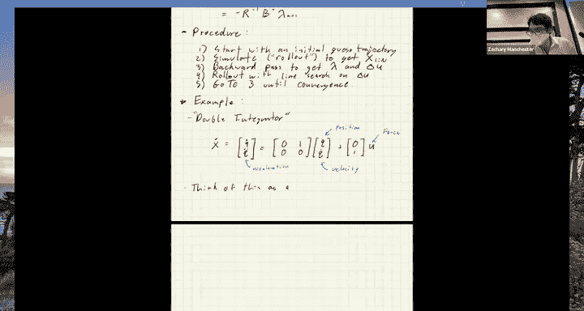

Okay。Could that， Yeah。

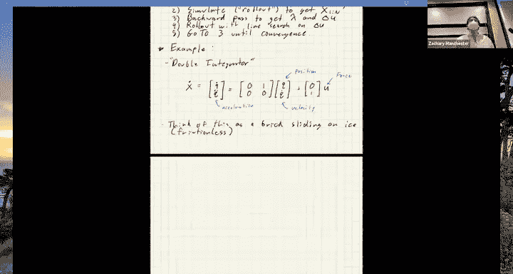

好。Yeah' update。We're going to do so we start with some u initial u。

 we do forward simulation backward。

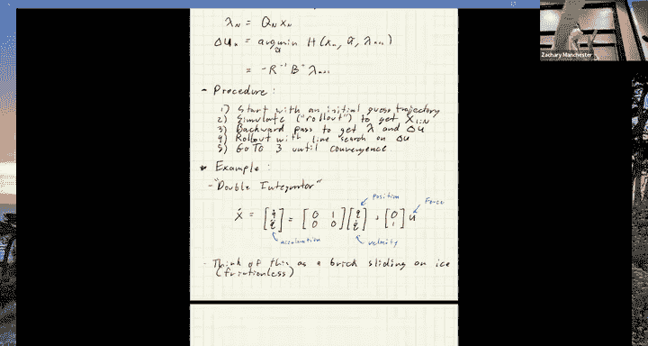

Pass to compute Delta U and then we go forward again。

 we're going to do u plus some alpha like line search parameter Delta u so basically doing u plus Delta U。

 but we're backtracking on the Delta U just like before we did line search that's that makes sense。

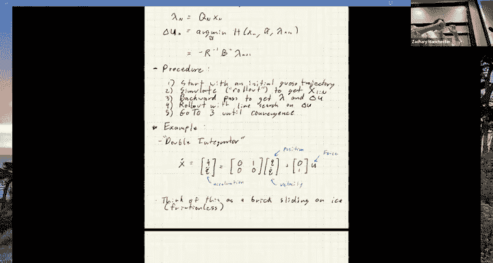

CoAnd yeah， we'll do the code in a sec so it should be super clear。And that okay。

 so the last thing here is we're going to do this in discrete time。

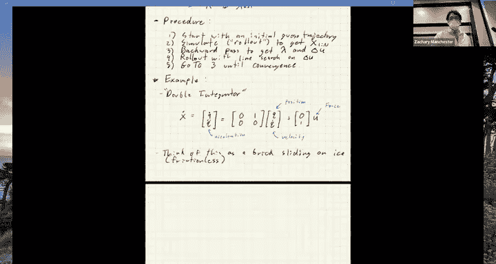

So if I just kind of it turns out this is super simple in your system。

 I can integrate this exactly so we don't need to use run a cuta method or anything and it's going to look like this。

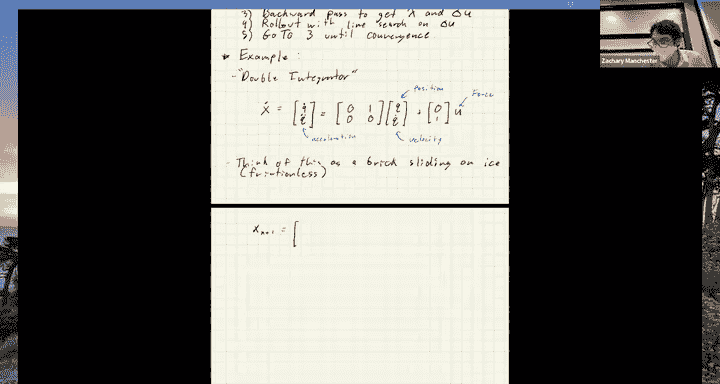

Sttemic sense everybody it's like1 half8 squared on the in the B matrix basically and then you know like qk plus one equals qK plus time step times the velocity。

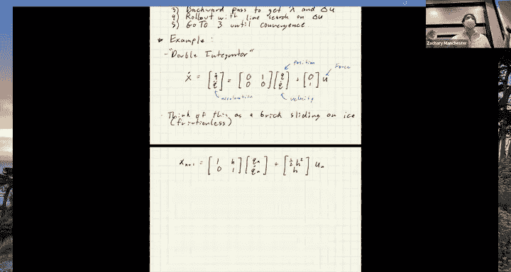

Okay。Pretty easy and then so these matrices， this is going to be our discrete time a。

And this is going to be our discrete time B。As we talked about before cool so super simple it's one degree freedom two dimensional state space it's just writing down f equals MA for a particle in 1 v in this kind of linear state space form right so it's just a little bit of massaging of some very simple stuff and then converting to discrete time here at the end。

Okay， should we go do it now， we good， Okay， so let's do let's do some code things up。Yeahep。

 good question， what is the age here is that the time step？The H yeah， that's the time step I。

Thank you note。

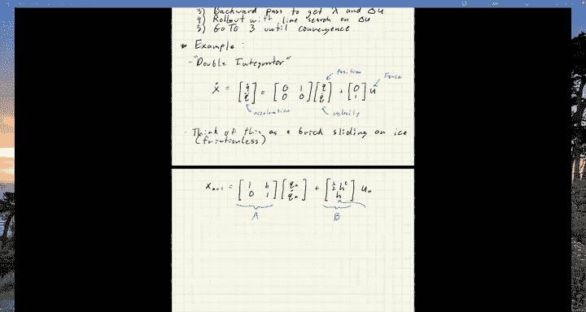

Thanks。You got， okay， code。

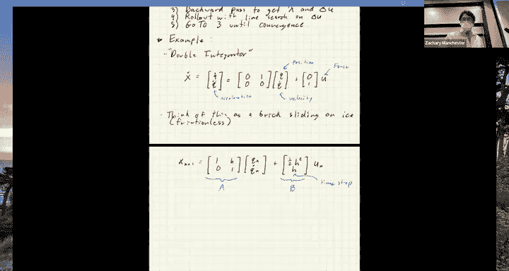

Let's do this。

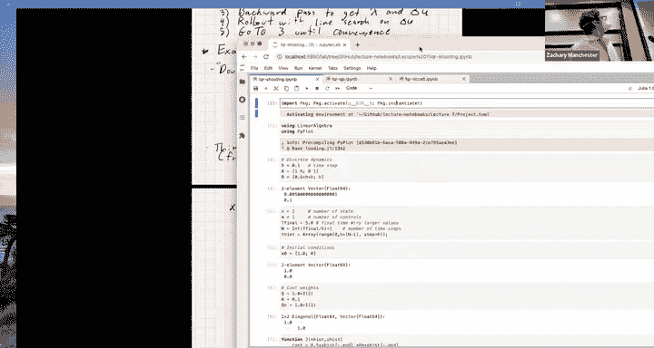

Okay。I' see that okay。So here we go。Here's the discrete time dynamic。

 so we just wrote down Nb matrix。And I'm making the time step 0。1 seconds。

Nothing crazy this is just some bookkeeping stuff so we have two states one control input for now I'm going to make the final time five seconds。

So five seconds at 10 hertz， like 50 time steps， 51 technically， I guess。

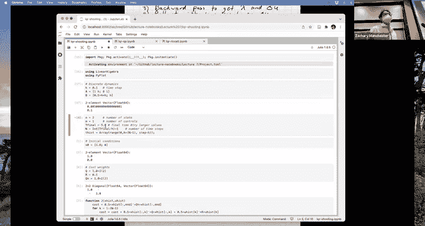

Initial conditions we're going to start at one meter away from the origin。

 zero velocity and remember the goal here with the cost function we've written it down is to drive the system of the origin。

 so we're going to start at rest a meter away。And try to push the slid and brick to the origin and stop at the origin。

Okay costst functions we're just going to start here for now make this up identity for Q 0。

1 for R identity for QN nothing nothing crazy cost function so this is just me adding up the cost function aka integrating it along the trajectory。

And discrete time， such as a sum of the time steps of that LQR cost function that we wrote down。

This is my rollout， so this is just for simulating the dynamics so A plus B， right？

So I give this thing a。A state initial state and a control trajectory and it simulates everything。

Here's my initial guess， so I'm going to just you know assume it's at rest like x not forever。

 zeros for the controls。Yeah， nothing interesting。And we'll go ahead and run this so this is just sitting still not doing anything get some initial cost here's the meat of the algorithm so let's see what's in here So this is that backward pass so this is the backward。

Um， like punchregan thing right where we're going backwards and computing the Delta use and the lambdas backward in time exactly like I just wrote down。

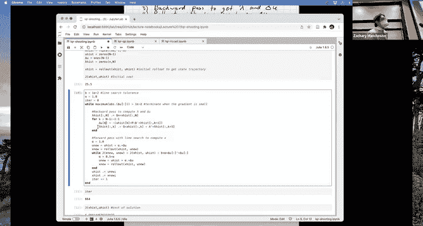

So these are really that like you can think of this as the Hamiltonian gradient things from Hunt Dragon or you know plugging the LQR stuff into that。

 and this is what I get。

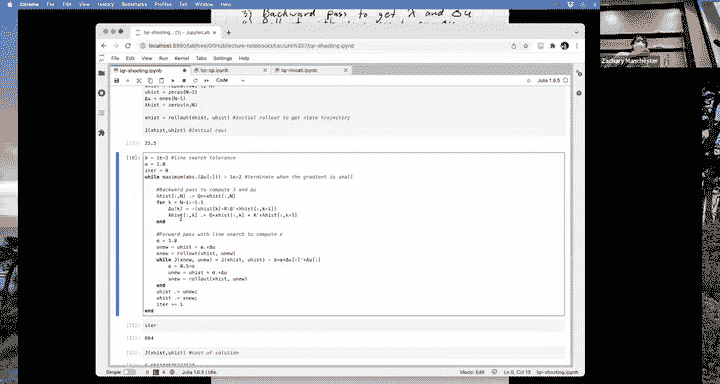

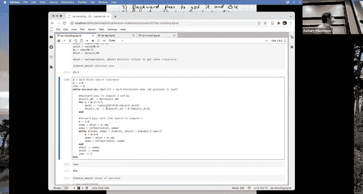

So this is going backwards and then I go forward again with a rollout with a line search so I start with alpha equals1。

 I roll it out， I check the cost and I do the Armiho role thing on the cost to make sure I get a good cost decrease but one thing that's kind of interesting here is it turns out this is what that like gradient condition looks like in in this particular case if anyone has any I to know like where that comes from why。

Why is that the ourmiho like first order， you know。

 sort of tailored expansion approximation for the cost decrease here？It's like Delta U squared。

 right， kind of weird。打上单。Think about it。Okay， so we go ahead and roll it out with U plus alpha deelta U。

 we check the Armyho stuff and we just chop alpha in half until we get a good good decrease just like before cool any questions about that？

All right， so we go ahead and do it see how it does。 So about 600 iterations。

700 iterations and obviously the cost went down and we think this is about minimum。

 So I should also mention yeah， my tolerance is here。 I'm going to do this until I my sort of。

Tolerance is like pretty loose I think what maybe like1 yeah 10 of minus two tolerances and everything so this' is not tight tolerances it's like two digits of accuracy accuracy basically so my cost now is about six and a half I can plot the trajectory that I get and you can see I start at one zero velocity then I you know obviously push the velocity negative to get back to the origin and I kind of like asymptically approach you know zero position here I can plot the controls two。

唔是。I basically get this you know it starts out very negative I'm pushing you know to the to the left toward the origin and then I basically hit the brakes here right pushing the other way to stop the slide just stop so this looks pretty reasonable let's what should we do with this I have any request change cost functions change change anything you want I that could you repeat where this formula for WU and the Lada came from Yeah so I just put it out in the？

It's coming from the pontregan minimum principle so that like okay what we did last time when we talked about the Hamiltonian and like the gradient it's yeah。

 it is it is the Kkt stuff the poreagon stuff from last time， which is。Essentially computing the。

 remember the KkT conditions are just gradient and equals zero， right yeah？

So it turns out right the U terms in there are unsurprisingly the gradient of the cost with respect to you。

 right？Doess that doesnt made sense？Okay， so yeah， so then the U turns from Pontregon are giving us the gradient of the cost with respect to you and we can just go backward along that recursion and get gra respect to you and then we just do gradient descent on that by like going in that gradient as direction right。

With respect to the use。Okay so that's what's going on so a couple things to try out one thing I can I can play with the costs and stuff so we can try let's see so let me try some so let's do first I'm going to crank the horizon length out a little bit so let go with like 10 seconds and see what that does remember it took about 660 something iterations。

Before let's see what it takes with 10 seconds。

Ting a long time is the takeaway message。So it' was like 2000， it turns out if I crank this up again。

 if I go to like 20， we'll be sitting here for like 10 minutes。

 it gets really bad as you crank the horizon length up。

Let's look at the solution so yeah super reasonable that kind of what you to expect some other things I can do so this is getting to the origin around I don't know four seconds or so I can crank up the cost so if I for example what should happen if I tank R up here。

Should it get to the origin faster， slower， slower right， okay， let's try that。

It should have a less sort of spiky behavior here right so like the control should should the peak control effort should be lower right so like two and a half than new one it's like 0。

8 right so less control effort get their slower goals so that makes sense to everybody that's pretty straightforward。

I think that's about the only other thing to mention here is these kind of shooting methods。

 as I mentioned last time， numerically they're not great and they're not widely used anymore and this kind of works because it's an easy linear problem but on nonlinear problems these things are nightmareish actually hard to get to work。

And one of the big issues with them is if anyone here has done machine learning you've heard of like the vanishing gradient or exploding gradient problem。

 which is really saying when you have when you backpro really far you end up with ill conditioning in in your gradients right so the same thing is happening here so here I'm backping along that time horizon so if I make a lot more time steps I get really bad ill conditioning in control this is called the tail wagging the dog problem it's the same thing but like if I jack this up to say like even just 15 seconds maybe because I don't want to sit here too long you'll see that this ends up taking forever to converge。

probablybably longer than we want to sit here so that's the takeaway message like there's some issues here it kind of works for really easy stuff。

 but there are much better sort of methods and that wasn't so bad okay。

I think that's better for this， so onward。

All right， so we've seen now LQR via Ponregon via this kind of shooting staff。

Yeah， it's called indirect because like we talked about last time in control。

 if you're solving it via the pontreagon minimum principle， it's called indirect。

Whereas if you sort of the next thing we're going to do is direct so you'll see the difference so if it uses puntry and it's called indirect shooting refers to doing a forward rollout from the initial conditions it's called shooting for historical reasons so that's indirect pun drag shooting forward rollout。

Good question yeah， but we have done like a Newton thing here like how we did earlier with we're going to do that right now Oh okay。

 I got it。

The youth from the previous。

It is if you have quadratic costs， so if you have smooth dynamics， smooth costs， yes。

You can get non smooth things quite easily by for two ways。

 if you put in like a non smooth cost function， like if you put in like an L1 norm cost。

 say you'll get some non smooth things probably also if you put in constraints。

So have you heard of bang bang solutions for optimal control problems？

By many of you heard of this that comes from solving a minimum time problem with control limits so if you take away the R。

And instead say I have upper and lower bounds on my control effort。

 and then you say get there as fast as you can， the solution to that is unsurprisingly full gas and then full brakes。

So that's that's bang bang so that comes from a different setup right where you have hard constraints rather than soft costs on the controls。

꼭诶一。

But this week I from earlier。

嗯啊。Increasing R longer to get the organ penalizing so increasing R the question was yeah like kind of about the costuming stuff if you increase R you're penalizing large control effort right？

So that means it's it's going to use less control so it's going to take longer to get there similarly like and so the thing that matters is the relative sizes of Q&R right so if they make are really big I'm saying like don't use a lot of effort control effort so my  Q really big I'm saying get there really fast and I basically I can trade those off so if I crank both of them up by like the same factors so if I crank Q andR both up by 10 you get the same answer right it's kind of the ratio that matters。

cool。Okay， anybody else on Zoom at anything？我 get。

Okay， yeah possible like consider the time horizon also。

It is as soon as you do that the problems become non convex you can still solve them usually and in some cases there are analytic solutions but yeah it's a harder problem it doesn't sort of fall in this nice LQR category of。

Quleanly solvable things。But yeah， happy to talk more about that1， anybody else？

Okay cool so here we go the next thing is going to be we're going to look at setting up and solving this LQR problem as a QP as a quadratic program like you're seeing on the homework and like we talked about a little bit before。

So here goes。All right， so。Let's first off assume the initial state。

 which we'll call x1 here as given。嗯。Which makes sense we did that here right so in particular what we mean by that is it's not a decision variable。

 so it's not one of the variables we're optimizing over right it's given。

。So LQR is the type of trajectory optimization it's a type of it's a control problem。

 it's not an algorithm， it's not a solution method' it's a problem definition where you have a quadratic cost function and a linear dynamics function。

Okay， so thats that now we're going to define the following vector。

Where we're going to stack all of the controls and states for all time just we're going to stack everything up into one giant vector we're going to call it Z So here we're talking about this has。

Like u1 x2， u2， dot dot， dot all the way to Xn。So we just take everything for every time step and kind of stack Ux UX all the way till XN。

Then， we're going to define。

A big。Like hessian matrix， we're going to call H， that's kind of the same idea we're just going to block diagonally concatenate all of the Q&R matrices for all the time steps。

So the idea here is H， we're going to say is sort of the like R1， Q2， R2， dot dot dot。QN。

And then zero is everywhere else。So we define this such that the。

The cost for the whole LQR problem is just。嗯。

So the whole cost is just remember we define this in terms of a big sum before a roll of time step。

 so now we define this Z and this H such that that whole cost is just。

Z transpose H Z does that makes sense everybodyre just stacking up all the time steps in in a big vector and then defining the single big matrix H such that the total cost over all the whole trajectory is just this big quadratic form instead of writing it out as a sum of time steps cool。

Yeah。😊，So when we're， so it goes to we1 x2 instead of the we1 x1 because we assume x1。Exactly。

 so x1 we're not optimizing over x1 right that's given as the initial condition so that's why it's just we don't want to we are not minimizing it。

 right。Yeah， it's a given that makes sense yeah。There is no UN that's the other thing right so if you remember before we have initial state we're given and then like。

With in discrete time at least you have you know initial state initial control blah， blah。

 blah when you get to the final state， there's no more control move that you get to make there right so un minus1 gets you to XN and that's it you're done right so there's always in discrete time like this。

 you always end up with like n states and n minus1 controls although here right you actually if we take x1 out then it's n minus1 states that are actually decision variables。

And call that。嗯。So the role before you end R at-1。Yes， yeah。Yeah。

 so it's just alternating Qs and R's such that it lines up with that vector Z， right？

So all the time steps are stacked。

Okay。So that's cool now we're going to define。Some more matrices。

This matrix C and this vector D。

Such that the dynamics are a linear one big linear constraint function。

 that's going to look like this。So I essentially I just want to write the dynamics down for the whole trajectory three kind of as one big matrix equation。

 so that looks like。The following。And this is so you。This is minus identity just to be clear。

And then we're going to have zero。

诶。第。😔。

Minus I。嗯。The idea here， and then the rest of this is zeros。

And then you're going to kind of keep doing this stuff and then for the last time step you're going to end up with like a and minus one。

B and minus1 and then minus identity again。

And this whole thing is going to。Multiply your。Your giant Z vector。

Such that you get。So like this would be times， you know。You won。X to。U to blah， blah， blah， X n。

And then this is going to equal， me move this over a tiny bit。

嗯。

I'm not a fan of you right now。

This thing is going to equal。The initial state。Like so。And then all zeros。

So this is just me writing down。啊。A Xk。Plus B UK minus xk plus one equals zero for all the time steps and just kind of stacking that up into a big matrix equation Does that make sense to everybody？

Cool， so this is just how I write down the dynamics for all the time steps sort of in this like giant stack matrix setup。

Cool， so we're going to define this guy as。We'll call this one C。And this one， D。

 and this one obviously is our Z from before。Okay， so now we have the entire LQR problem as a standard form。

Q P。嗯。So in particular， right， we're doing。Min over z of our cost function。

Which now is just this。

Nice quadratic thing， subject to a linear constraint。Which we could just write as Cz equals D。

And that's it。That's the whole thing now right， looks like a QP， nice， really simple QP。

We just have to set the matrices。So if we kind of。

Start by thinking about solving the QP。What it what would be my next move like maybe I want to write down the lagrangian of the QP and'm then to write down some KPT conditions right so let's go ahead and do that。

Is that？Yep， in the C matrix is everything below the second row on the left side of AN minus one just0 as well。

So it's basically like it's almost block diagonal so you're basically going to have there's some weird stuff for the first time step。

 but then after that it's a B minus I AB minus I AB minus I kind of down the diagonal does that make sense okay yeah yeah。

Okay， so we got this guy。So I'm going to just have my original cost function。Plus a lage multiplier。

Times my dynamics constraint， which is going to look like。For clarity here。

 I'll use a square brackets so it doesn't look like a C。

C z minus d equals0， right， so that goes right there。

Cool， now we take some derivatives and write down some KKt conditions。

So we got gradient of the lagangian with respect to Z is going to be Hz and the cost term plus C transpose lambda。

Right。Cool everybody， and then take the gradient with respect to Lambda。

This is going to be just the dynamics constraint。Okay， on these right these off to equals zero。Okay。

So。

What so how do we solve these KkT conditions now based some that like everything we've done so far with optimization stuff。

Okay， yeah， so Newton's method。How many Newton iterations do I need to solve this thing？

Can anyone tell me that？Yeah， why。Could youYeah so this is a linear system right you could do that or you could just use a direct like it's just backflash right so let's write this down So this thing these Kkt could you repeat what was said we didn't hear anything Yeah yeah。

 so just the fact that this is a linear system of equations and you can solve it know just like any matrix equation So if I write this down in sort of like kind of your standard basically if I stack this up into a matrix right and write down the Kkt system that we're used to seeing for。

For these problems， the matrix system， it just looks like。

HC transpose right the top line is H transpose times Z lambda。

Equals zero。And the bottom line is CZ。Zero here at times equals d， right？

So that's it this turns out here right the KKT system we're used to seeing in Newton's method here it's exact right so I just have to solve that matrix equation one time I get the answer。

Pretty cool。

Okay， so questions about this。So。LQR is equivalent to a QP。

It's an equality constrained QP there's no inequalities the way we read it here right so if I write down the KKT conditions for that thing the KKT conditions are a linear set of equations they're a linear system it's just a standard matrix equation I can just solve it with backflash you know the way I like solving any ax equals B type problem get the answer done closeform solution so that's one of the reasons it's so useful and powerful let's go look at that real quick。

And sort of compare that to some of the stuff we saw before so here's the QP version of is it guaranteed for the system to be invertible？

It is as long as you follow the， so this this goes back to the Q semi definite R positive definite stuff。

Okay， I see so if those conditions hold， then if both conditions hold。

 then this thing is guaranteed to be inver。That's why those conditions are there。

 they make they guarantee that this matrix is full rank and invertible。It's not super obvious yet。

 but it will be pretty soon when we dig into this little deeper。

That good sounds good， yep， okay， so here we go。Same dynamics as before。10 hertz。

Whatever。This is all the same， 10 seconds， whatever， same initial conditions starting at one meter。

Same Q&R matrices。啊。Same cost function here all this is the same So now is where i'm building these giant matrices So this is that big H matrix where I just have a block diagonal R Qs and Rs I'm playing some tricks here This is like one of my favorite little tricks this is using chronicroner products all over the place to build far as matrices you haven't seen this before I'm happy to talk about in office hours or like you can Wikipedia it。

Big fan of Chron products Okay so this is， but this is basically that block diagonal RQ thing。诶。

What else we got okay so here's that big constraint matrix again it's just like you know it start to the first row is weird because x1 isn't a decision variable so it's just b minus I so that's what this is right。

But then after that it's just 80 minus I80 minus I all the way down the matrix rate to sort of glue together all the time steps and then that D vector is just minus a times x n I guess I should have kept that consistent x0 x1 and then all zero so this is exactly what we wrote down before。

And then here we're going to just solve that linear system so here's。The big KKT matrix。

 so HC transpose C bunch of zeros。And then here's the right hand side vector。

 so zeros and then D on the bottom， just like it wrote down， I sell it with a single backlash， right？

Just like x equals B I'm going to call that big solution vector y here and then i'm just going to pull out the pieces from inside y so remember y is is the z and then the lambda stacked right so here i'm pulling out the z's then I'm going to reshape it to pull out the individual x's and U' this is just index tricks to pull out the individual x's and's at all the time steps and then the bottom of that y is the lambdas the lag voltage which I'm not even bothering with here。

But that's pretty much it， so one linear solve。

And then here we go， I got the same answers as I did before。

But this does need any iterations the one shot and done situation and it gives me the exact answer to machine precision which is like way more reliable and robust than all like stuff what else is in here and then if we go look。

At the last one， we can kind of compare。Make sure I do it the same way so it was like 10 seconds。

And these guys should be。Back what they were before。Let's see how we did here。

I go kind of compare the answers。

This obviously takes a lot longer。That's sort of not what you want to do。

In general， so a couple thousand innovation， but yeah， like 6。5。

658 or something like that 6。658 so they match up to life three or four decimal places that's pretty good。

 but obviously here we had like kind of loose tolerances and whatever so this is not exact it's good to。

😊。

Four or five decimal places is pretty good， but this is the exact answer int me to try anything。

Suggestions。识边。Questions， comments， yeah I see compute much faster at like concepts。Yep。

 so we can try that you want to try taking big steps here。I'll to try like eight equals。

 I don't know。was saying compared to for longer time yeah I mean basically always the QP is the way to go like basically never do the shooting thing there's not really a good reason to do it yeah so is it to costs。

Yeah， so you have total flexibility there， I would say it's fairly common to yeah。

 to pretty much have constant cues in ours。There I mean it's a tuning game you can play if you want to shape the behavior。

 it's pretty common to have a different QN a different terminal cost for the end and then a different cu for the stage cost。

 but otherwise yeah like，Generally speaking， when we kind of like pick these things。

It's pretty forgiving。Most of the time we use diagonal matrices。And just， you know。

 you can play some play around， we'll talk a little bit about the cost shaping。

 cost tu stuff and like kind of some rules of thumb for that yeah。The matrix， see what you explain。

So are there any properties which。不是要这对对。So到 real we comment。ya so for思 are there any specific。

I don't think so here no。There's probably some rank conditions that it should have but they're I don't think those they're super interesting the full KkT system here has to satisfy kind of this quasi definite property and full rank and all that good stuff。

 which get satisfied as long as Q andR are。Appropriate。诶。But yeah， I think that's about it for that。

 Okay， I mean， yeah， Yes， this is a good question to ask。 there is a longer。

 much longer story about the lag multipliers that it's going to take a like at least another day to get to it's coming The Larange multipliers are very interesting and have lots of interpretive。

😊，Stuff。To talk about。Okay， anybody else。Yeah， isum。

 so if you have like a system like the quadruped from the homework with 72 states。

and if you're simulating that for a height time horizon ims and these matrices are going to get really large。

 they do， yeah， these can get huge， it's not uncommon to have like 10，000 variables in these things。

So we you just like break up the problem into smaller and smaller multiplications we're going to talk about that next so basically like what we right now we just set up this giant matrix。

 but if you notice when we set it up it's super sparse right it's like pretty much like almost block diagonal inside the blocks so we're going to do next is actually dig into that block structure and show how to solve this super efficiently。

So it turns out there's magic structure in there that lets you actually solve this really fast。

 even for really long time horizons。Sweet。All right。So yeah。So if there more than one in much more。

我对。Any more than one program， how can we sort them in the C matrix？So you're just it's the Z vector。

 it's just x1 U1 x2 U2 whatever you just stack it all up and then you just the C matrix is just built you know with those A's and b's stacked like so that it works out with how re stack up this is an arbitrary right you could have stacked that up a different orders you wanted you could have put like you could put could have put all the x's first than all the U' or something like that in which case that C would have looked different Yeah so it doesn't really it's pretty arbitrary we stacked it this way per time step because of what we're gonna to do next it's a little nicer Yeah。

あはい。Very。They have some。And time。As long as the Qs and R's all satisfy those definiteness properties。

Uh it it will there's sort of one other condition on the dynamics。

 there's some like rank conditions on those A's and D's too。

But basically as long as like as long as a is full rank。

Actually， we'll get into that next so there's a couple of other conditions but essentially the big one is Q&R our Q's got to be semi definite and R's got to be strictly positive definite and then there's one other condition like sort of rank condition on the dynamics that we'll talk about in the sec。

Okay。嗯。Let's see。I think that's a it for that， everyone good now。

Okay， so moving on。

Where have we gotten that this thing by the way。

So okay， let's talk next。You on time， forget're good on time。Okay， so we sort of just as a note。

 so if you go back and look at this stuff in the code。

We sort of did。It can kind of compare。

Shooting and the QP solution。Okay， so now。嗯。We're going to dig into the structure of that QP a little bit。

And pull out kind of a cool result。

Okay， so。So what I'm going to do now is I'm going to write down like the actual guts of that KfeT system for really short trajectory trajectory so for like three or four time steps。

 we'll just kind of write the whole thing out。

So as we kind of said that。That KKT system。Is very sparse。And specifically。

 this means it has lots of zeros。

With a lot of structure。So has anyone here like studied like algorithms or sparse matrices for solving sparse linear systems？

Okay cool a couple of you has anyone done back substitution before like solving triangular systems okay so this is like that flavor of trick basically it looks it's essentially a back substitution trick so you've seen that before it's like maybe that makes some sense。

For those who haven't seen it before， you can look at them if you want。

 but yeah we'll do it real quick。So let's write this out explicitly for like a few time steps。Okay。

 and I'm going to kind of like。Caroon these block。Sort of that's the H block right。

 and then the the sort of C down here has like a B。

Minus I。And then a bunch of zeros and the next row has an A。B minus I， the next row， A， B minus I。

Okay。Tme that up a little bit。Okay， so that's the C block and wherever I don't put anything at a zero assumedoo here。

 right？Okay， then the ski transpose， you know， B transpose minus I。A transpose， B transpose minus I。

A transpose， B transpose minus I。And then this last block is zero， right， this is our KKT system。

And then I've got my giant Z vector of decision variables so this is going to look like。U1， x2， U2。

 x3。U 3 x4。And then I've got my lagre multiplier so that's going to be lambda 2， Lada3， Lada4。

 And like we kind of talked about when we we did the pon stuff。

 the indexing here is kind of arbitrary I'm just picking， you know。

How to index this things as just an ambiguity and choose you could choose to start at Lambda1 and go to Lambda3 or whatever。

 but that's just how we're doing it。

And then the right hand side vector here。In our case， it's going to be all zeros。Over for this part。

So I can like partition these guys as well。And then minus ax1。

Zeros done here for the dynamics constraints right。 Okay。

 so that's the whole thing for like a pretty short trajectory。

 What we're going to do now is we're going to kind of like。

Look at the look inside the matrix and we're going to look we're going to start by looking at the bottommost row。

So if I kind of like pull out just this row。This this last equation says。Sorry。

 when I say last row I met last row of that like last time step， you know。

You get the idea so if I pull this guy out and write this one out explicitly， this says。

QN x4 minus lambda4 equals0。So this lets me remember our rank conditions， QN's got to be well。

 we don't need that yet actually I shouldn't say that so this guy I can just turn this around and solve it for lambda4。

ok。So let me now go up to the next row。So you can see we're going with us。

 we're going to solve this one for Lambda4。The next equation has a lambda four in it。

 so we're going to substitute this end。And like eliminate that and then we're going to kind of keep working our way up and doing this back substitution kind of stuff so that next one。

Yes。are。You 3 plus。B transpose lambda4 equals。 So now again， I'm just， that's it。

I'm going to now go plug in the line I just found for Lambda  four into this guy。

So this is R u3 plus。B transpose Q N X4。This thing has equal zero。Okay。😊，Next move。

 I'm going to plug in the dynamics。4 x4。So by I do that， I'll write down first， I guess。

So this is now going to be R U3 plus。Be transpose。QN。Plug in the D constraint。A X3 plus B U3。

Equals zero， so this move from here to here is。再见。Dynamics for x4。So far so good。

So that thing has to equal zero now from that row。All that's in that equation now is x3 and U3。

so I can massage that equation round and solve for U3 as a function of x3。So I do that。

 I get the following thing。Cool。And we're going to call this giant matrix thing in front of。X3， K。

I call this。Here K3 is we're at P index3。So now we keep trucking and we keep working our way up the matrix。

IfWe go to。Like the next。The next row， if I take this one。All this guy down。I get。嗯。Q X 3 minus。

Lambda 3 plus a transpose Lambda 4 equals 0。I know lambda4 already， right so I can plug that back in。

嗯。So if I do that。So， this is。嗯。Now I'm going to plug in the dynamics again。Now I'm going to plug in。

This guy， okay， so actually we should talk about this so this line here。

Ive solved for U3 as a function of x3 right so thinking putting our control hats on now。

 what is that thing？嗯。😊，Yeah it's a feedback law right so we now have a feedback policy that for a given x3 I can tell you for any given x3 I can tell you what the U3 should be and it's a linear function right so that is the optimal feedback policy it's just this K matrix so I'm going to kind of hold on to that and down here now now that i've gotten to here I can plug in the feedback law for for the for the U here right to eliminate the U。

And yeah， this thing to be sorry， this is a little bit in the weeds， but。

The answer will clean up really nice in a sec。So now we've got a transpose QN。A minus B K。X3 equals0。

Okay， and now I've got an equation for Lambda in terms of。

A。So let's do that。Okay， so now in this thing， we're going to call。

This we're going to call the matrix in front of the x here and the lambda equation so remember in the in the U equation the matrix multiplying the state we call K we said this is a feedback policy here in the equation for lambda。

 the matrix multiplying the state， we're going to call P。P3， okay， and the message here is。

Now that I've got this thing this says lambmbda3 equals P3 x3 This looks exactly like where I started this whole thing I said lambmbda 4 equals Qn x4 so I'm back to where I started it looks exactly the same right so if I called Q and P4 that's where I am now so now I've got this like recursion in terms of K and P I did like like kind of one time step worth I can now bootstrap this and go up the whole matrix like this by going back to substitution and solving for K and solving for P。

So let's write that down and is this part cleans up。So。K and P， so。

This looks like we say at PN equal to QN。Then we do k sub K equals that equation we derived up there。

R plus B transpose P。K plus one。B。

Inverse B transpose PK plus 1 a。Then we've got。The next， the P is。Q plus a transpose。P K plus1。

A minus B K。Okay。😔，And we could just do this and go the whole way back so we started time step in。

 and then we can find Ks and P's all the way to time step one， right we go backwards。

Does even know this thing's called？This set of equations that I just this recursive solution to that QP has a name。

's kind of famous。Yeah， this is called the Rikaati equation of the Ripaati recursion。

Does this still work for time varying dynamics too Yeah exactly so I did this just for know avoid so much bookkeeping but yeah you can put k's on everything on the ABs and Q's and R's in there and it's and it's time vary yep cool。

Okay， so let's talk about this for a sec， so what we did here right is we kind of stared at the QP and found this nice sort of blockwise recursive factorization trick for solving the QP one block at a time while not even having to like form the whole giant matrix and deal with all the zeros and all that other stuff so that's cool。

Um。There's two really big deal takeaways from this， the first one is that by solving the QP this way。

 so what I can do here to say to solve the QP like we just did with the giant matrix version。

 I can do this matrix trick， I can go backwards and solve for K's and Ps and then I can start at x1 and roll out forward to get the X's and U's for the whole trajectory right？

So let's write that down。So we do basically a really a backward rikaati recursion。

 which you can think of as a backward pass， backward substitution， right goes backward in time。

And that'll get you all the states of controls， right？So first question is。

 when I solved the giant QP like we did before， does don to know what the complexity of that is？

Like what's the complexity of solving a linear system remember this？

How many flops does it take or whatever， depending on the size of like x？It's not un cued。Cubic yeah。

 so it's like if we have so in this case right we have n big end time steps and then little end states and little M controls can tell me what it is。

诶。For that。So it would be just order。Big N number of times steps right times little n plus little M。

Cubed's oh sorry， it's everything cubed。Okay， so it's just the whole thing。We this right， yeah。Okay。

 so cubic complexity in the time states controls everything right for solving that big QP。

 what about this ri Kati thing what do we think？I know like the best star resolvers are like order like one to the X。

So this， so it depends。Turns out you can do slightly better than cubic for general dense maties with really crazy stuff。

 but it's like order it turns out for general denseense it's like 2。

67 or something crazy like this little less than three the trick with all of this stuff is taking advantage of the sparsity structure so just thinking about the thing we wrote down there。

Think about what it looks like in time we have this thing we do this set of operations matrix operations don't forget about what the complexity of that is for now just think about it in time we do the same thing at every time step and we have this kind of like subroutine that runs at each time step once per time step right so what does the time complexity of that rikati thing have to be then。

😡，嗯不说完了。Sorry。我们不说们就些。So just thinking about the time for a sec。呢睇嘅。

It's linear in the number of time steps right because we just do that single block like this block up here。

😡，We just do that once per time step， right？

So whatever that costs。Cool， I just have to do that n times， so it's linear in that。嗯。😊。

So it turns out that if you kind of look inside there。

 we're doing like matrix inversion and matrix multiplication that's like kind of little n and little M。

 so it's still cubic in the states and controls， but it's linear in time now， which is a huge。

 huge deal。And it turns out that result carries over to like the more general nonlinear case when we do Newton's method。

So there's something special going on with the sparsity structure of the optimal control problem that the rakati thing is exploiting basically by being super clever about how you factorize how you solve that linear system and kind of walking up the blocks in kind of the way we just did if you can think about this right is it just a clever sparse matrix factorization there's more to it that we're going to get into but it kind of like。

Get you this order big end instead of order Big N tube。

Ting which is a huge huge win if you're talking about long trajectories so okay so that's one big takeaway is it's linear time instead of cubic now the other major takeaway is when we did this。

We went backwards and we saw for these ks and P's and whatever we talked about kind of very briefly there these ks。

They're a feedback policy now。So in particular， when I do the backward pass。Here。

 there's no actual particular state in there。At any point in that backward pass。

 there's no state in there until I get to time step1 at which point we said you know if you want the trajectory like you had in the QP。

 you plug in x1 and then roll it out with the Ks in there so it turns out here we've gone from having this like open loop solution to the QP which is just for a particular X1 and I solve this big linear system I get out a single trajectory answer now I've got a feedback policy where I have these K matrices that are good for any state that I want to try it on so if I do this factorization backward once and get these ks I now have the optimal feedback policy the answer for any state I can now go roll it out with any X1 I want and I'll have the optimal solution for any state as if I resolved that whole QP right but now I just have to do a matrix multiplication and like I have this feedback policy which is also a really cool interesting thing。

Arguably more important。

嗯。

Yes。Okay。And now we're going to go do this， any questions while I kind of switch it up。

Yeah。feedbackeedback policy， it's。

Stabilizing， like it's a policy stabilize the yeah。

So it turns out in you know this is kind of magic right now。

 I can give you the answer to that QP for any XO。In the form of these K matrices that like you just plug it in do matrix multiplication and that's the optimal answer to that control problem that trajectory optimization problem as if you went back and solved that optimization problem every time but now I have this like closed form answer to it right which is really special and really cool and it's basically like no other problem in control that has this kind of like super clean closed form feedback policy solution。

Which is one of the reasons this thing's so awesome， okay， so let's go do this。啊。Okay。

 so same dynamics。Same exact setup， 10 hertz， 10 seconds， start at 10， same cost matrices。

Cost function。Okay here's my ricottti thing， so P's and ks， all zeros。Started at the end Q N。

 and then I'm going to go backwards from time in。To time1。And this is just what we wrote down， right？

And the notes。And so I solve for all the Ks and P's backward。

 and then I do a four rollout where I start at XO。

And then simulate u equals minus kx right， and then plug that into the dynamics Ax plus B and go forward。

So that's the whole thing， and now I can go plot this stuff。

Nver and you'll find and I evaluate the cost and this， if I look here。

 it looks like we had before and like we actually look at this number。

As long as I didn't mess up with anything over here。

 these should match exactly like two machine precision。I there's some dump in here。

诶 think they match yeah。Yeah， so they match all the way to double precision floating point。

 which pretty awesome so we could get the exact solution to the QP。

And now we have this like cool feedback quality thing。

 so let's try some some interesting stuff with this so the first thing I want to try is。Like we said。

 we have this feedback policy now I can cache those k matricacies and now I can do the roll that with any X I want and I don't have to resolve the problem so here let's do like a random X not。

诶。So yeah， random thing here， we'll roll it out。And look at the answer。

totally different initial state， whatever optimal solution does the right thing。

 like if I had resolvedd the QP。Differentffer costs， whatever。

 the other interesting thing I can do here is if I kind of go back to my original X not。Here。

UI can add noise to the dynamics like if i'm like because if I'm you know disturbing the system online in。

In real time， so like I can do that here， I can add on some like random noise。

In the rollout right and this thing will provide stabilizing feedback so you'll see here right it wiggles around a bunch。

 but this thing is now going regulate this thing near the origin and reject all the disturbances right says is a really nice feedback policy did someone have question okay you can see what the controls are doing here that's kind of cool what else is seriously about this okay any any questions any request let me try something yeah going。

The case don work if we have the same work。好。Yeah， so we're going to talk about that next actually it's coming up。

Yeah是。100 seconds。No problem。So this is， you know。So it goes to the origin， you know。

 it was already there right so it's just zeros， I can have the noise back in there。

And that'll now regulate it super nicely right to the origin with the noise。

Should should be kind of cool， we a look at that。Pretty good， right？

So what'll happen here is if I add more noise， it'll wheelel around more。

 but it' will always keep it nicely sort of regulated it stabilized to the origin right you get this initial transient and that's just you know fighting the noise basically right。

Other requests？Let me try something yeah。So here it is Gaston。Because I called。

 so this random end is normal distribution。So I'm adding Ga you knows here I can add whatever I want to this right I can whack it any way I want。

 this feedback controller will always kind of push me back and stabilize the origin。嗯。Any other。

Questions， yeah。Control errors what you mean by a control errors I mean here it's it doesn't really matter。

 so here i'm adding it to the exodus you want me to add it in in here。Get。

Yeah so this was be totally equivalent to me just putting a be here right because it's linear here so I mean I can do that if you want yeah it doesn't change anything。

😡，Yeah， so there's that okay。

We're almost out of time， so I want to show you one more cool thing。

 which is what you were getting out about changing the horizon。

 so check this out if I plot so the K matrix here。

Remember， we start at time and we go to time one。I'm going to end this system and it's two dimensional state one dimensional control。

 so the K matrix is one by two multiplies 2 d x its that one to U。

 so I'm just going to plot the two elements of the K matrix and let's look what happens。So remember。

 we're starting at time N out here， but check this out as I go backwards towards the initial time。

 these things asymptad out to constant values。That's interesting。

 so it turns out for time invariant LQR， so the A and B constant。

Turns out this thing asymptotically converges to a steady state solution this is called the infinite horizon LQR solution。

 meaning if you had infinite time right so we did finite time with with some fixed n final time turns out if you just take n and make it kind of big and do this you'll converge to some answer with some fixed feedback game K so most of the time when we do stabilization like regulation problems where we're just trying to track a fixed point and not trying to track a trajectory we just use the fixed infinite horizon solution and you can solve that separately there's actually a function in the control toolbox or Matlab whatever you like this is DLQR for discrete time LQR and continuous time it would be just LQR you give it AB Q andR and it will spit out the asymptotic answer and we can kind of。

Compare this to our solution。And for yeah you can see it agrees like pretty much exactly because we went out so far so we basically were at the asymptotic value we can do this we can repeat the rollout thing with the constant value and you'll see it basically gives the same answers。

😊，We can do with noise whatever so in general， if you're just doing fixed point stabilizing。

 you can get away with just using the fixed constant infinite horizon K。啊。

And I think we're out of time guys， so I'm happy to hang out though and answer more questions。

by puttingIt is yeah it's exactly PD feedback right you've got a if you look at that X vector it's got a position and in velocity so it's literally a PD controller y。

 but it is in some sense the optimal PD controller right and in general it's time variant so it's a little bit more complicated than your like vanilla PD controller but yeah the end game here is a。

😊，At least if you define your state of the position velocity， it's going to be a PDP back。

