# CMU《最优控制和强化学习｜16-745： Optimal Control and Reinforcement Learning》中英字幕deepseek - P9：[09]Lecture 8_ Controllability and Dynamic Programming.zh_en - GPT中英字幕课程资源 - BV1qHwke1EBX

Okay， here we go， so what do we do last time？We talked a bunch about LQR things right so we did kind of the。

LQR is a QP story。We did。And then we kind of we did this rikati recursion thing where we looked inside the QP at the sparsity structure and kind of figured out this back substitution trick where you could kind of start at the bottom of the matrix and solve some things and plug them in and work your way up to get a solution and we saw that。

That ends up。Not only being a super efficient way to solve the QP but also giving you gives you a feedback controller right in the form of these K matrices which is pretty cool then we played around with that a little bit right and did some simulations but most of it。

Okay， so today we got。A whole bunch of things on the to do list。

 So the first thing I want to do is sort of some。Little loose ends on the LQR story we're going to talk a little bit about。

so first thing I want to talk about is that we talked briefly last time about the In Horizon case。嗯。

Say a few things about that。And then。There were a bunch of questions also last time about kind of how do you know if that QP has a solution right。

 how do you know if LQR is going to work so we're going to talk about the last little piece of that today。

 which is called。嗯。Controllability which is kind of a fun result。Um。

 and then we're going to get into dynamic programming and sort of another yet another way to look at LQR。

 but also a way that kind of generalizes in a bunch of interesting directions。嗯。

And we'll see how far that takes us that might be the end of today， but if we have some time。

 we might get into starting to talk about。Convexity and。Convex MPC and things like that。Okay。

 any questions about anything from last time or？All good， all right。

 so let's let's do some stuff so the first thing I want to talk about is。Briefly。

 at the end of last time， we talked about this infinite horizon idea。

And we kind of saw empirically that at least for the time andvari case when you run that backward recursion the game matrices converge pretty rapidly to some asymptotic values right and we said you know in the limit as you go to infinity there's this kind of steady state and a lot of times we just use that right so。

For time andvari。How you are。嗯。Same matrices converge。To constant。

And we said for stabilization problems where you just want to keep the system at a fixed point。

 we usually just use those constant ca matrices。Yeah。Okay。

 so couple of interesting little things about this first one is。

So we already saw you can kind of run the ricottti equation backwards for a while and it'll converge does anyone have any thoughts on how we might solve that like in a more direct way for the sort of just to get that infinite horizon value。

Based on some things we maybe talked about earlier around like。Fixed point iteration。

 solving for fixed points， et cetera， et cetera， what does that sound like？Okay。

 so let me be a little more explicit then so the let's write down the backward recursion。

For P that we had before。We had PK equals q plus blah， blah， it transpose PK plus1。A minus B。Okay。

 right。And just think about this for a sec， we had this， I guess we had we have the two things right。

 so when this thing converges what's going to be true about these P's and ks。

They're not changing anymore right， so I can basically set PK equal to PK plus one。

And get a fixed point right that whole thing will equal zero and I can solve that directly to get the infinite horizon gains let me write these slow down。

Okay， so。And you can plug the K equation into the P equation and get like a single equation in P。

 that's sort of the the if you want trick。嗯。So。We can kind of just solve that directly as like a refining problem there's so the obvious way to do that would be so we have this fixed point iteration thing what other methods do we know how to do this with？

Sor of obviously Newton's mathite so we could just stack this up solve it as a refining problem with Newton that would get us the answer really fast so that's a perfectly reasonable way to go turns out there's some special secret sauce fancy linear algebra tricks for solving this equation as well and you can do that too and that's kind of maybe more efficient and numerically better and that's what the functions in matlab and Julia do for you so in particular。

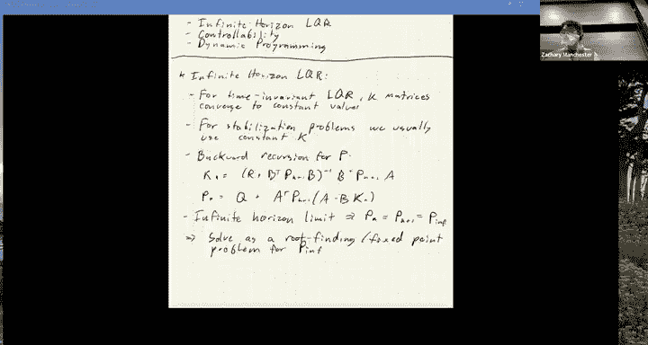

In Matlab。We have this function called。Dare。Yeah。Dare will give you the P matrix， the P infinmity。

And then DLqR which you already to saw will give you the In horizonizon K and those are in both Julia and Matlab so they're doing fancir things but you can absolutely use fixed point iteration or Newton's method just solve these as a refining problem Okay any questions about that we kind of saw that last time cool。

All right， so the last little like LQR thing we're going to talk about is。Controllability。

And this is really getting at the heart of like when will this work， when will it converge。

 when it will it stabilize the system， like when can you apply LQR has anyone heard of this before or seen this before？

Handful of you guys， okay cool。Basically。Yeah。So we already know you know this condition on the definiteness of the cost matrices right we have to pick Qs and R's that are essentially positive semidefinite in the Q case positive definite in the R case so that's stuff we make up though right that's just telling us we have to pick nices cost functions there's some conditions on the system itself as well on the dynamics right on the physics that tell us whether or not we can actually do this feasibly。

So let's look at that。嗯。啊。嗯。So in particularly we're going to look at the time invariant case again just because the math's easier。

 there's a very similar super closely related result for the time variant case。

 but this one has a really nice clean you know intuitive flavor， so look at this。What the hell？Yes。

什事。对。Okay， we're back。3吧。Okay， so blah， blah， blah， time invari case。

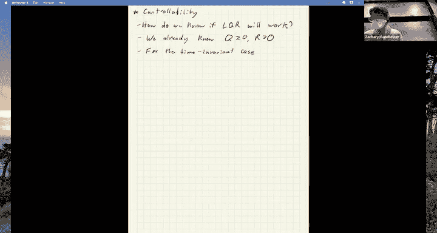

There's a nice， simple answer。Okay， so here's how we're going to think about this。

 So if I I'm going to look at sort of the QP flavored thing， but we're going to look at it。

As a like basically is a shooting problem where we're just optimizing over the use and think about。嗯。

What the kind of the setup of the problem looks like。 So think about the dynamics here for any。

Initial state。X not。If I look forward in the future to XN。I can write that down as。

So like obviously XN equals you know a X n minus1 plus B X n minus1 equals so I can kind of recursively keep plugging in the linear dynamics here right so I can write this as。

You know x n minus1 is a xn minus 2 plus B， U n minus2， right？

And I can keep plugging in the dynamics for all the x's recursively and sort of obviously。

 if I keep doing that， you're going to get something that looks like a to the N。X， not。

This should be capital N， right？Plus。A to the n minus one B u not plus blah， blah blah blah， blah。

 like a to the lower powers， y。Oh yeah， yeah， wait a second。No， that's be you not。So。

That's sort of like the very tale of the recursion， right？Is it D x。

 like I think the first line said multiply the x would be useful？我做 k vB。Oh yeah， that's sorry， yeah。

 you guys read， my bad。This should be a you， obviously。That's just the top line again。 Okay。

 sorry about that。 So yeah， essentially what you're going to do is start at the end and just keep like recursively plugging the dynamics so you get to the first time step if I kind of keep doing that and expand it out I'm going to get this。

Situation where I have like， you know x no is multiplied by a to the n to get to time step n and successively sort of like each each successive power of a right times like B times the u from that time step right sort of。

You get the idea。IsThat clear for everybody？Cool so if I do this now I can like look at this and I've essentially just got the x no in there and then everything else is just the use right so I've kind of written this in like kind of shooting form if you like or sometimes it's called condensed form where I've illuminated all the states and written it is just in terms of the initial statement and then all the use right。

We said this isn't generally the way to go pne numericalmatically because it gets ill conditioned。

 Does anyone know why this gets ill conditioned， it's sort of obvious from here。Sohuh。

Yeah so whatever the condition number of a is a to the n is going to be that condition number to the n so the condition number gets worse and worse as you take more time steps so this is why it's a bad idea numerical so don't do this for real in the computer but here's some nice math so if I take this thing I just wrote down I can then I can kind of write this in matrix form as the following thing。

B a b。A squared B dot dot dot。A to the n minus1 B。Times all the use。So like you。N minus1， U n minus2。

ただただいうな。Plus the initial state term， so a to the N xn。Is that cool？Okay， so。

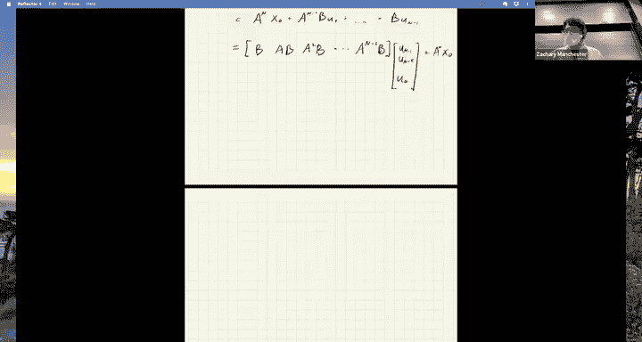

We're going to this is。嗯。We're going to call this thing out front。We。Control of deal with the matrix。

And the idea here is in order for me to drive， so remember the goal of the LQR problem is to drive the states to the origin。

 right？From any initial condition， right， so what has to be true about the controllability matrix for me to solve this problem for any x not？

😡，So yeah， exactly so yeah， as anyone， this problem looks familiar to anyone。

 like what kind of problem is this？As like a linear algebra problem。What happens when you have like。

 I don't know， a big tall skinny matrix， you know， kind of linear system problem or a big fat matrix。

 you know， non square linear system to solve what you do。Yeah。

 but what's what's that called the solution to that problem when you can't find the exact solution。

 you find out what yeah， the pseudoin versus how you compute it but what is that called？

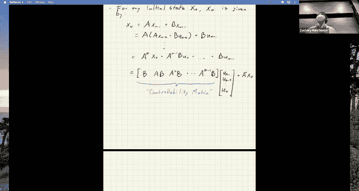

It's called a least squares problem right， so theses a least squares problem。Okay， cool。

So let's write this down。

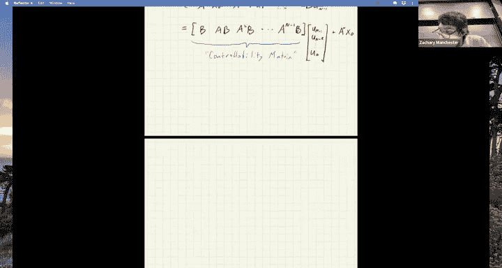

。Where we want to solve for the controls， right for you。What is it？

Not to n minus one so what we would do right we we'd stack we get our use that we want to solve for。

And we can write this as。Like everyone said， right。

 we end up with a pseudo inverse thing that sounds like everyone's seen before。

 so I'll just write this down。

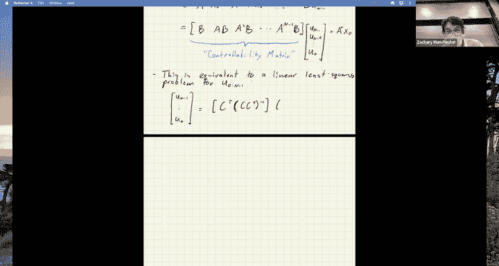

Okay， so this thing。Is called a pseudo inverse right up here。

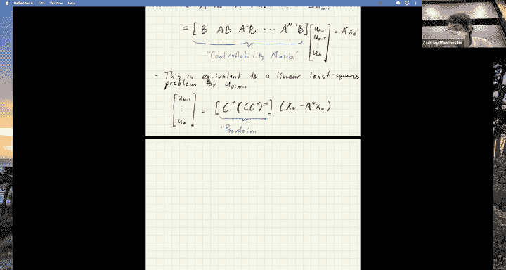

Who has not seen this like pseudoinverse v squares trick before？

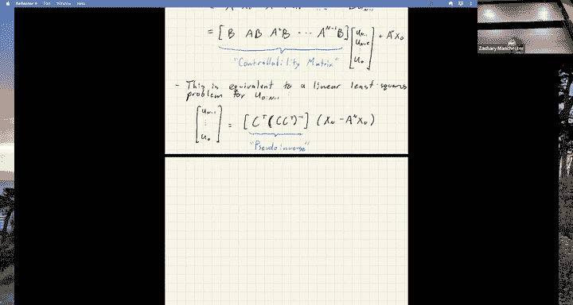

Okay， u come talk to me after you can also Wikipedia it's pretty straightforward essentially the idea is I have a non square thing。

 if I multiply both sides by like C transpose and I get a square matrix that's invertible， right？😊。

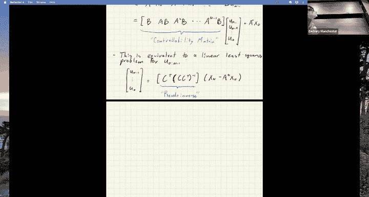

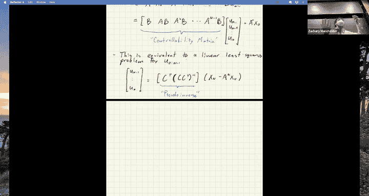

That's kind of the trick that makes it work， but there's sort of there's some other stuff going on there so we can talk about that Okay so that's the pseudoinverse thing the condition on this being solvable right is this C transpose CC transpo thing over here。

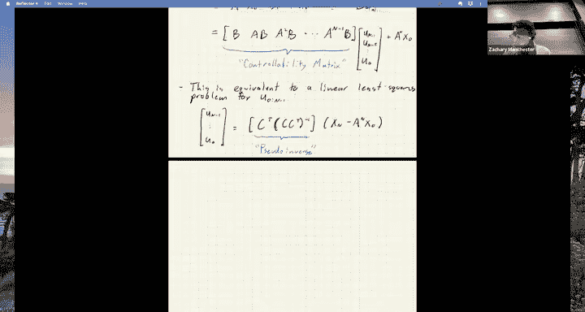

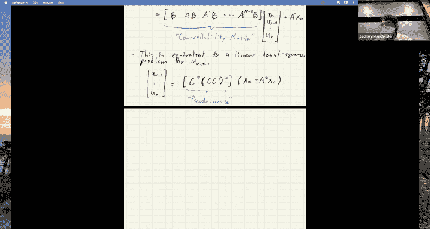

Must be invertible， right？

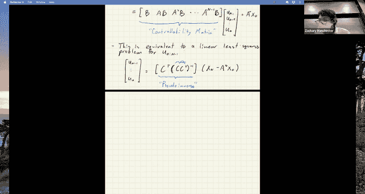

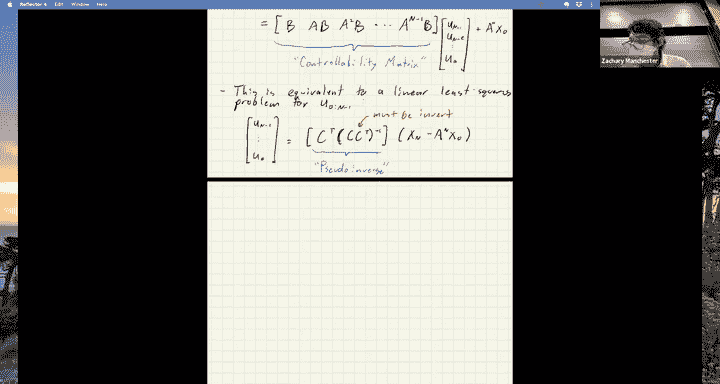

Okay， and for that to be true， it comes back to like the rank of that C matrix has to be。

And where N is the state dimension， so it has to have like full column rank。Cat。

We have to right for this thing to be invertible， we have to have。嗯。Rannk of C equal to N。

Where this is little in， not the big end number of time steps and this is。N equals。

Dimenssion of the state。That makes sense everybody when I like square the C matrix。

 it's going of turn into a square matrix that's little n by little n and that thing needs to be。

Fuer rank to be invertible for that to be true， that the C itself。

 the big fat sea has to be rank in cool。Okay so that's kind of the basic is that clear everybody so yeah in order for this problem to have a solution you have to have this controllability matrix thing before full rank there's a one more little interesting trick here so I wrote this out for arbitrary horizon right like a big end time steps it turns out you don't have to do that you get to stop at little end does anyone know why。

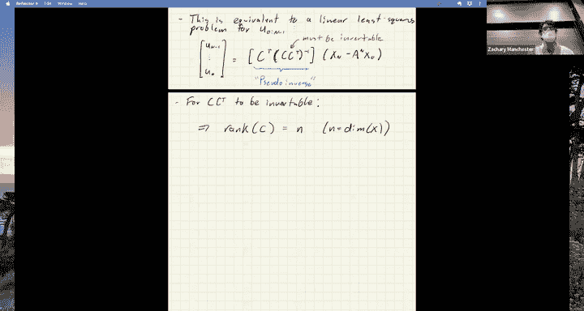

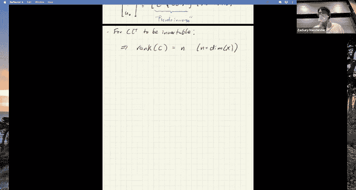

Yeah。

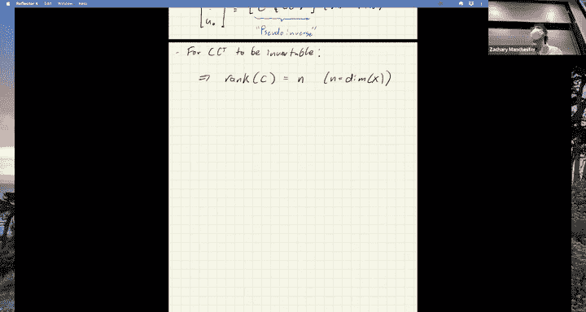

Because the rank is always the lesser of the。Well， so even if arbitrary time steps as capital and the rank。

 the number of independent columns is still be equal to small。

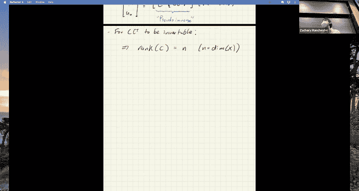

So like you can't make the rank any bigger， that's true。

 but the information you need is in the first small end。

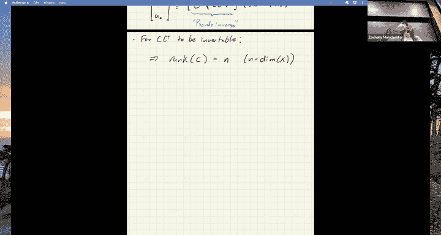

So it doesn't have to be that。You got it Okay yeah so you're kind of I mean what you're saying is true but that's not at the end of the day like the controllability matrix is still you know it doesn't have to be the first end columns right it's still wide I mean there could be the first end columns might still be ranked efficient so you may still need to go further but the answer is this thing called the Kaylee Hamilton theorem which who's heard of this。

Okay， does anyone want to say what it is？Okay， so that is a that's sort of a corollary and absolutely true。

 there's sort of an important sort of like corollary thing to that that is why we can do this then we know what that is。

好都跟没 do。Part of the matrix is part of the arguments。Well。

 you can always do that by by computing an eigen decomposition and blah blah， blah。

 but there's sort of like a specific result that I'm going oh if anyone knows where I'm going with a say。

 but otherwise i'll write it out Wait can you hear me yep this is where you can just say that any matrix or any power of a matrix beyond its dimension can be written as a linear combination of its lower powers you got it that's why。

Okay， so I'm going to say that louder for everyone else。

Okay so the Kayleley Hamilton theorem thing says a matrix satisfies that's absolutely true。

 this is sort of the main reason that we care， it says that for any matrix any higher power than n for n by a matrix you can always express as a linear combination of the lower powers so basically after you get past little n。

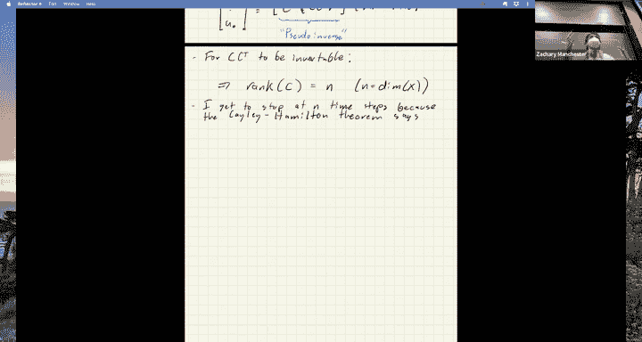

You're not getting anything new， but you can always write that as a linear combination of powers up to end。

Does that makes sense？So let me write this down and we can talk about it。

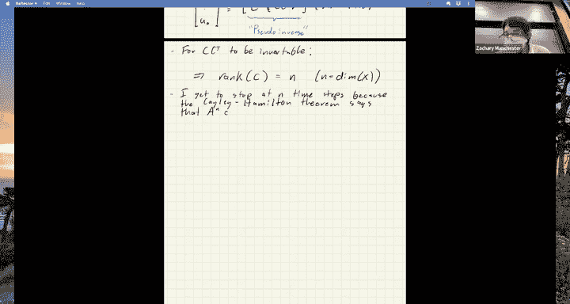

。So in particular， it says a to the n equals。Some from K equals0 to n minus1。

Of like alpha K a to the K。啊。For some。Alpha Ks。Where those are scalrs， right。

 so those are polynomial coefficients， right？Okay so this is saying basically for any power you know n and bigger I can write it in terms of lower powers so I'm not getting anything new so in this controllability matrix it's saying we're checking rank which is like linear independence of the columns right so this is telling us is if I take higher powers past n minus one it's not getting me any new linearly independent stuff right？

Okay， awesome。对。

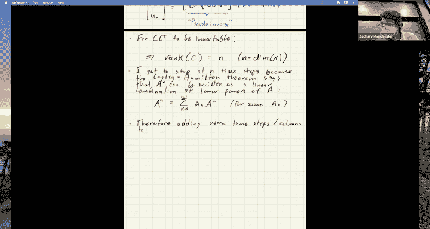

ok。That's so that's the controllability make so at the end。

 the end story here is we're going to define this as。

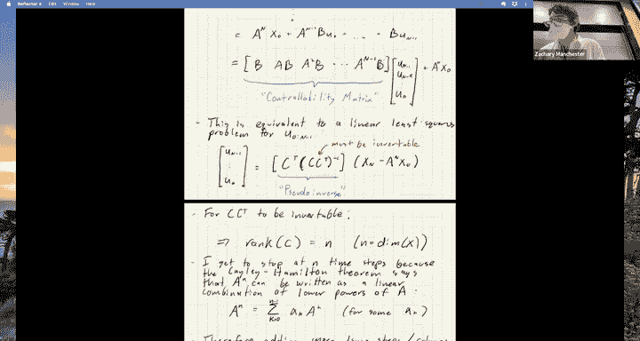

嗯。This this controllability thing for us is always going to be basically be。

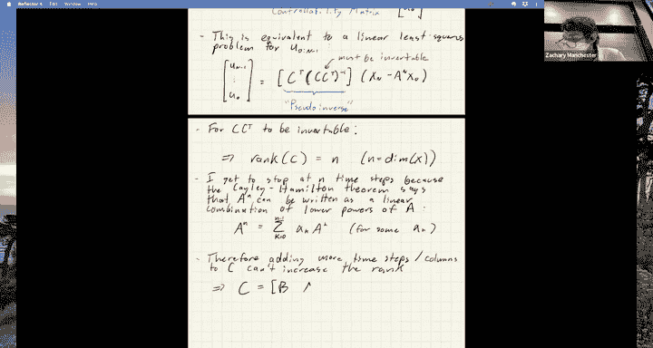

A， B dot dot dot A to the n minus1 B and you have to stop there and then check that thing rank if it's full rank。

 then that says LQR will be able to stabilize the system and like Ricottti will converge and all that other good stuff。

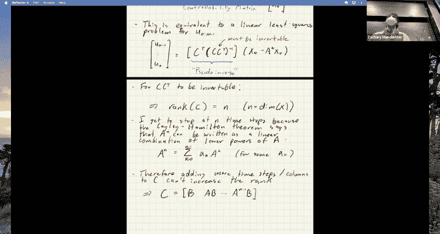

All right。

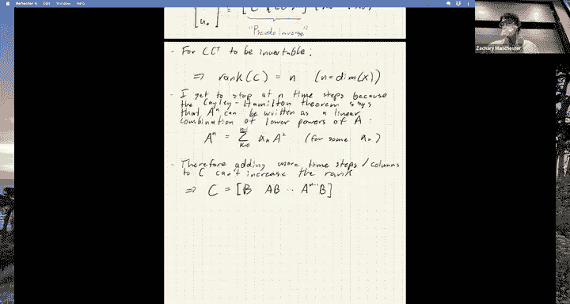

Yes。Cool。Any questions about anything there we're going to take a hard pivot now towards some new stuff yeah yeah I got a question about LQR in general sorry there's someone in the we'll do the room first and then the zoom。

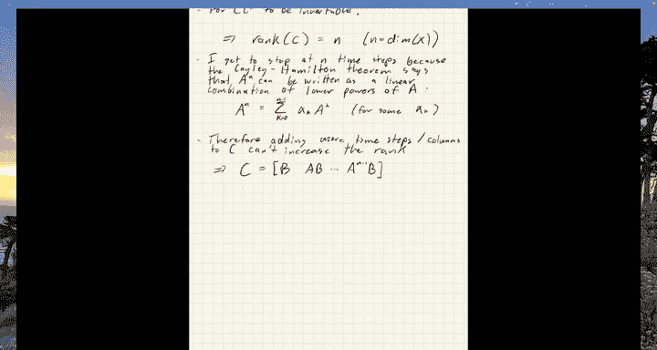

Go ahead to say that， like don only need to。啊，说那个。And steps into the optimization to the it's saying that what this says is yeah。

 if you with end time steps， you can drive any point to the origin。

 assuming you have like infinite control effort available and whatever else， yeah。

 this is also saying that。Yeah。Cool， okay， yeah， on Zoom， someone had a question。嗯。Yeah。

I know back when we were first going over LQR we had the dynamics matrices sort of function as a constraint but you also mentioned that there are you know sometimes like torque constraints Yeah I mean where do those fit in in the sort of LQR problem formulation they do not so so LQR is explicitly this one little like result where you have linear dynamics quadratic costs and nothing else if you any kind of constraints to the states or the controls it breaks if you add any nonlinearity it breaks if you have different cost terms it breaks so this is like this very special little result and really if you change anything else about the problem setup it breaks this close form solution。

Turns out in the case of linear dynamics quadratic costs but you just add in torque limits say like you bounds on you that's still pretty tractable but the way to solve that is with model predictive control which we're going to get into in a little bit actually so hold on to that it turns out you can do a lot of similar analysis but it gets a lot more complicated but yeah those problems are also tractable and that the answer is NPC is what you want in that case okay。

Cool， all right， moving on then anybody have anything else？All right， so next up。

We're going to talk about start talking about dynamic programming， so who's seen this step before？

Probably a lot of you guys， okay， cool。So we're going to start out by talking about。

This idea called Bellllman's principle。Okay so。The big idea here is that we've talked a whole bunch about like optimal control problems having a lot of structure we saw that already in the in the matrix right in the QP it's got this really nice like band structure all this sparsity and that was like one way of getting to the rikai equation that matrix band structure is a direct result of this sort of like underlying structure you call it Markov structure if you like whatever but it's really this idea that the problem is sequential in time and here。

We're going to sort of see that in another way。有。And sort of the intuitive like way of thinking about this just that。

Past it's like the you know just like causality right so like past control inputs can affect future control future states but future control inputs cannot affect past states right it's just that simple that is really the at the root of it that's where all this comes from。

So this is like a seemingly very obvious fact， but it has like a fancy name attached to it and a whole bunch of theory attached to it。

嗯。Okay， so。The， the thing we're going to。Formalize that idea with is this thing called Bellllman's principle or the principal optimality。

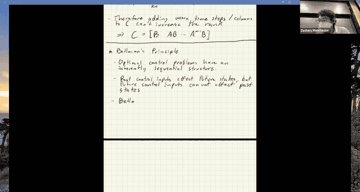

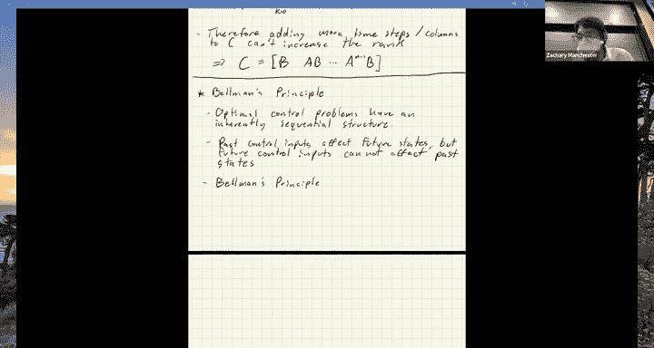

呃。This is all called Oh yeah， Belman's principle principal or the。Principle of optimality。嗯。

AndShe's like a very fancy founding man， it's like very grandstanding， right。

 the principle of optimality。嗯。Okay， so。

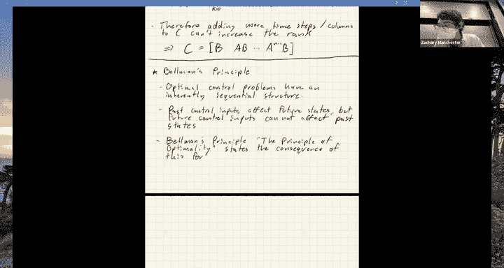

Here's the idea。

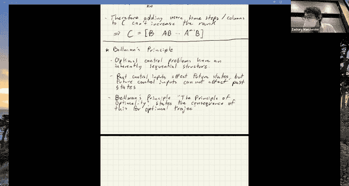

So a like obvious kind of。Crollary to that fact of like kind of the causality thing with time is if I have some trajectory。

 you know Tx， whatever draw something doesn't matter squiggly line this is like x no over here've got some knot points in our trajectory where we're making control decisions say。

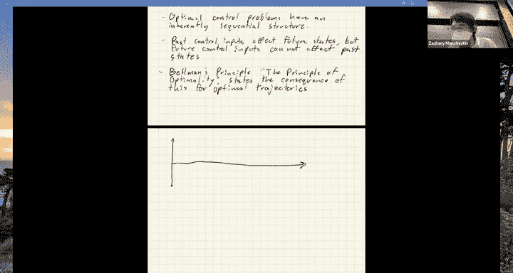

And we end up at like X goal over here。But the thing is。

So if let's assume this thing's optimal with respect to whatever cost function I wrote down or whatever。

 if I were to write down a new optimal control problem that started somewhere else along this trajectory。

 like say， I gave you a new point。Right here。And like this Xk， if I started at that spot。

 which is on this optimal trajectory and gave you a new optimal control problem with the same cost。

 same goal， but starting from that other point。

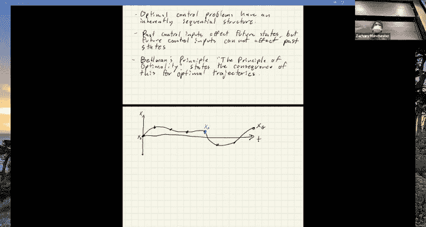

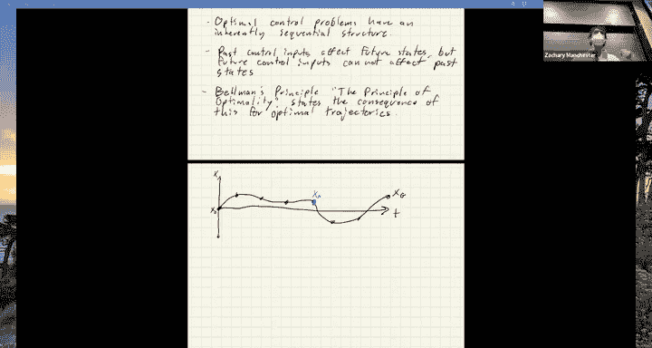

It says that that sub trajectoryjectory has to be the same as this one as from the bigger trajectory。

 he said another way， it says that like any sub trajectoryjecty of an optimal trajectory must also be optimal for the simple and obvious reason that if it wasn't。

 like if let's say if I resolve this problem starting from this Xk。

Like if I say found some other path that was optimal， you know， that went this way。

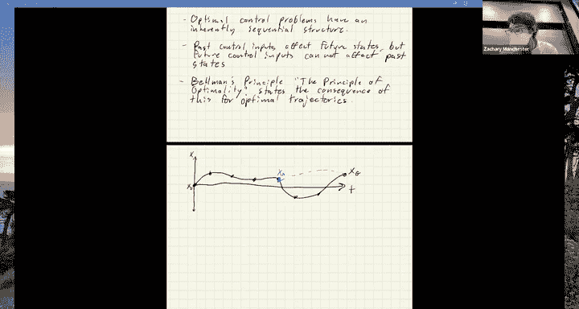

I would have taken that on the bigger trajectory right so if we're saying like let's's think about it as time layer shortest path or something。

 there was a shorter path starting from that midpoint Xk to the goal。

That would have been the optimal thing to do starting from XO right on the bigger trajectory that makes sense to everybody it's sort of obvious。

 but you know， I don't know， it has deep implications， yep。So if you have a problem with。

 so suppose now you have six points in between the chat and the goal。

So suppose the problem was that you had to pass through the three of them。

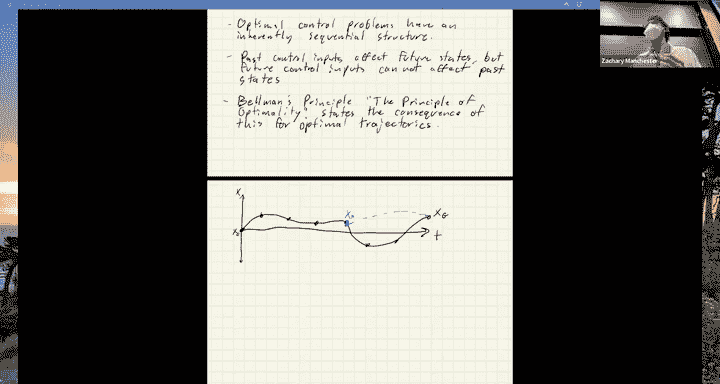

Then this would sort of break if you started at a little。Yeah。

 but that's sort of not a that sort of doesn't fit into the standard trajectory optimization like optimal control setup like I don't think I could state that in like the standard form that we wrote down before。

That's kind of a weird integer flavored constraint right so like I don't think you could write that down in the standard form that we sort of started with at the beginning of this discussion of deterministic optimal control problems if you can squeeze it into that form I would be surprised so if you want to take that as a challenge and come come talk to in office hours like i'd be interested。

So yeah， I don't think you can do it at least in not like sort of standard smooth right if we had all that like smoothness assumptions about all those functions。

 I don't think you can write that like integer thing down that way。Yeah。

 think we else have yeah this is a dynamic like what the saw at that stage was in the longer part might be。

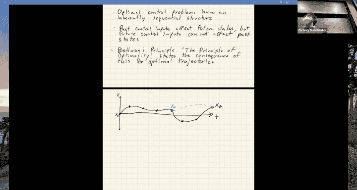

对对以。So what this is saying is like if I started over and I made XK， my initial conditions。

Where Xk is some point on the longer trajectory and I resolvedd it with that as x not as the initial condition the answer has to be this sub trajectoryjecty from the bigger trajectory that's it right think about it as like shortest path or shortest time you know these are intuitive things if there was some shortcut that you could have taken you would have taken it the first time right on the bigger trajectory。

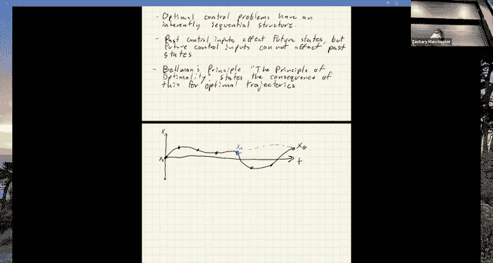

Okay， does this hold if your dynamics are kind of stochastic？Yes。

 although this is like a much more subtle kind of situation so so the shortest path thing is like this is specifically the cartoon version of this is like for deterministic optimal control problems there's sort of you can't quite think about it this way in the stochastic case but。

😊。

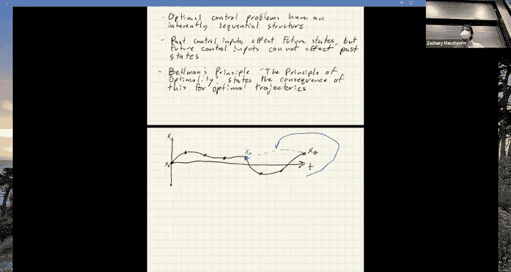

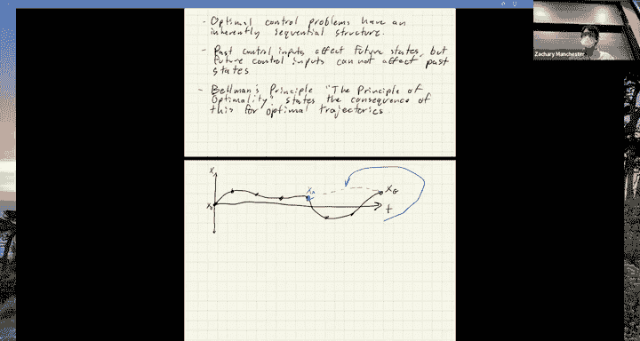

Yeah， that's probably all there is to say about it in the stochastic case you end up with policies。

 right， but if you have a time bearing policy， think the policy would have to be the same。

In like a similar sense。Okay， that makes sense。Okay。So let's write this down。

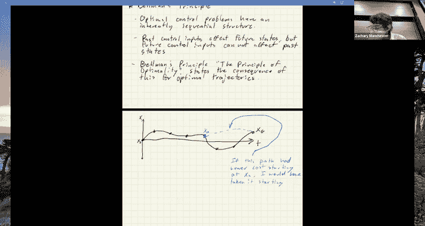

Yeah， this seems obvious when when you say it， but somehow， you know。

 Richard Bellman made an entire career out of this and got lots of， you know。

 it's got super famous off of this and you know， I don't know。

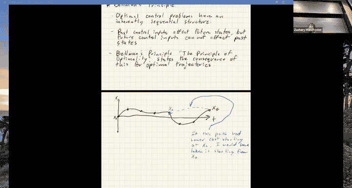

It's it's like really interesting to think about this like this seems obvious and like not that deep。

 but then like if you actually like really dig into all the implications of it it goes really really deep I don't know you know like I don't know there's some lesson for life in there somewhere like。

😊。

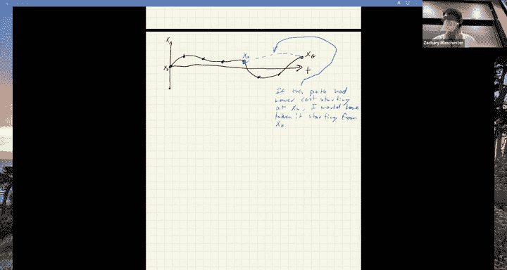

Okay， cool。

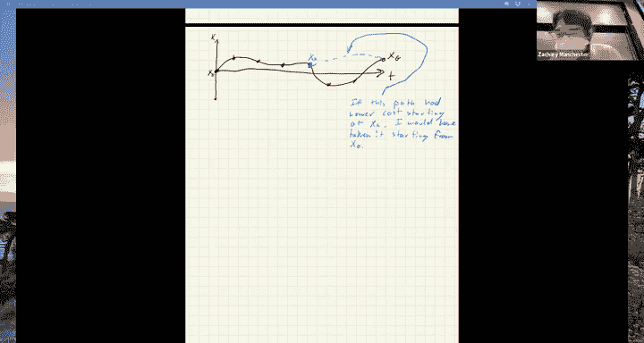

So like said yet another way， we can say sub trajectories。Of。Optimal trajectories。Must be。鸭怎么。

For like kind of the appropriately defined。

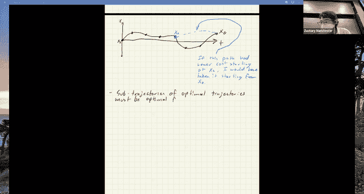

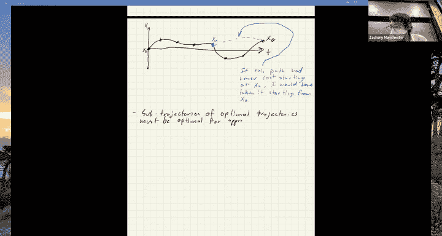

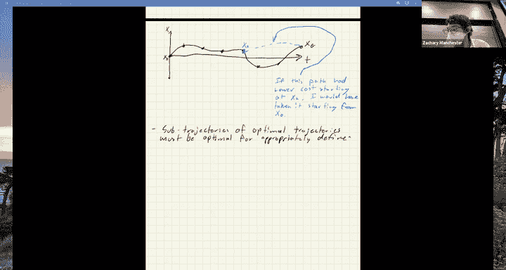

Sub problemble。I was like the original optimal control problem， right？Okay。

Cool so hopefully i'd belaor that enough and that is now like sunk in your brain so now we're going to talk about how you actually use this fact to solve control problems and that is called dynamic programming。

So coined by Belelman himself。So basically kind of like。

You can kind of see where this is going to go if I kind of take this picture again right so this whole optimal sub trajectoryjectories is having to be optimal thing kind of suggests starting from the end and working your way backwards right it saying like if I start at the goal state。

Where I know I want to up if I go like some tiny amount backwards from the goal it's kind of obvious what the answer should be and I can kind of bootstrap from there and kind of work out from the goal because of this optimal subdjectory idea right so this is kind of at the heart of why all of these control things that we've done so far Pontregon with the La ground multipliers and ricottti with the P'as and ks they all go backwards in time right it's kind of coming from this。

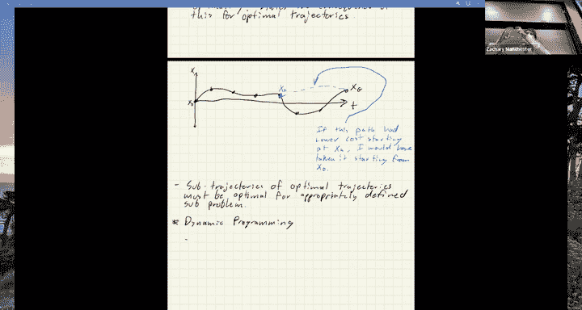

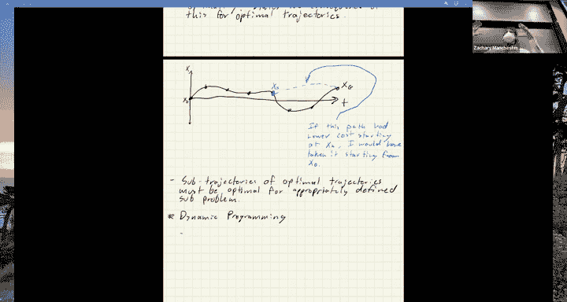

Okay。嗯。So。Yeah， hints were' in。Right， okay。This is kind of those results kind of just fell out of doing a bunch of math right and in the particular case of well really they fell out of kind of boundary conditions right where you know kind of the goal and that sort of sets you up for having like a boundary condition for the multiplier at the end it turns out but there wasn't much more insight than that right so this is kind of where the insight into why that should be true comes from so let's。

So。This will， this is going to sound like I'm just making stuff up。

 I kind of am we will it'll kind of make sense once we've done some more stuff。

 so I'm just going to dig in so we're going to define。A function now called the。Opttiimmal。

Cost to go。A k a。嗯。Value function。And if anyone's done any RL stuff， right or any of this。

 you've probably heard of this stuff。Okay， and we're going to call this thing V。

V of x yeah so in control it's usually called cost to go or optimal cost to go in Rl context often called value function I like cost to go because it makes sense value function doesn't mean anything it's just a random word。

That carries no intuition or meaning， so whatever， so the idea behind this function。

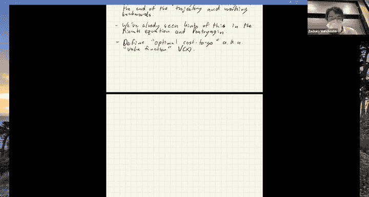

Is that it's going to encode the cost to get from wherever I am to the goal。If I act optimally。

 does that make sense everybody， so it's like if I plug in x not。It's going to you know。

 it's going to tell me what the cost would be to get to the goal from XO。

Starting from XO if I act optimally if I do the optimal thing。

 similarly I can plug in any point I want right like xk somewhere in the middle of the trajectory。

 this function should return the cost from then to the gold， assuming if I do the optimal thing。

 that makes sense。Cool。Hence， optimal cost to go， cost to go to the end from where I am， right？啊。不。嗯。

Yeah。Oh yeah， this should have a little K on it。

Okay， so that's what it is。And because we've talked about so many times LQR being nice and whatever and kind of this playground for getting nice analytic results。

 we're going to look at this thing specifically for LQR。Right now， and then we'll kind of generalize。

So for LQR， this， we can easily once again bootstrap this at the end， so we know what the n of x is。

 it's just the terminal cost， right？

So VN。Of x equals。One half x transpoposedse Q and X， and we're going to call this。

Just like we will hint hint from last time when we did Rikati， we're going to call QNPN。Remember。

 last time we made up these P's and ks out of nowhere。

 now it will become obvious what the P's actually are。

Okay， so we start at the end。Now we're going to back up one time step。And calculate Vn minus1。

Okay， so here's what that looks like， so I'm going to write down。So I'm acting optimally。

 so I'm going to write down an optimization problem over the controls。 So min over you of。

We're going to get the one step cost for this time step so that'll be like x n minus1。Q。X n minus1。

 and then the controls。So that's the one step cost at time n minus1。

 and then I have the cost to go for the rest of the trajectory， which in this case is just VM。

And I want to plug in my dynamics into VN so that I can write it in terms of just stuff at time step n minus1。

Is the idea？Okay， cool， so now I have a little optimization problem。

A time step M minus1 that is only in terms of x at time N S1 and U at time n minus1 that will tell me the like sort of the optimal thing to do for the rest of the trajectory here it's only like one more time step so we can kind of expand this out。

嗯。A little bit， and we'll just kind of solve this real quick。 So this ends up being。And over you。

 same stuff， same stuff， I'm going to expand that VN term。

m actually， yeah， this will will be explicit about this since it's so if I'm minimizing over you。

 the first term doesn't depend on you so it drops out， doesn't matter。

And then this VN term ends up looking like I plug in the dynamics。And it's just QN or PN in here。

 right？

Okay， and now thoughts on how I solve this。

What do I do。What kind of function is this？Qudratic。

 so take the derivative set of equal to0 Life is good， so i'm going to。

Take the gradient of this thing， which will be。呃。A。You plus。第一。😔。

Transpose。呃PN。And then a X N minus-1。mus be you。Equals zero and again， what I did here was。This is。

Grad you。Of this thing equals zero to get to that line。 And now this equation。

 I can just massage around and for you in terms of。呃，X。So I get u and minus1 equals。Minus R。

And minus1 plus。I've been a little bit lazy about the subscripts。Does this look familiar？

This is exactly the equation for K that we got last time。By looking at the QP。Okay。And。

What do we do now so like we have the K and if we want to kind of keep going backwards in time。

 what I want to do now is plug this you。Back into。This original equation up here。So we'll call this。

Like star。And now I want to。Plug U equals minus k。X。Back into。The star equation。

 the original equation I had， right？And this says。V n minus1 of x equals。1 half x transpose。

2 plus k and minus1 transpose are。K n minus1。Plus。AI'm going to like be lazy about subscripts because I don't have enough room。

 sorry。But this works with subscripts。Hopefully this is obvious what I'm doing。ok。This thing。And。

If you kind of look at this for a second it becomes clear that this is a quadratic form in x for the optimal cost to go。

 the thing in the middle there is the new P at time step n minus1 so basically it says is right the cost to go if I started out as quadratic and I do this kind of thing right so I move back the cost to go stays quadratic and I can always write it in that standard form as like x transpose px and this is our Pn minus1。

And so now we have， you know， sort of。

V n minus1 of x equals12。X transsose P and minus1 x。

 and we have the recipe now for a backward recursion in K and P just like before。

And unsurprisingly， this is just the ricottti equation again。

 but like kind of derived in a new way from a new perspective。

 the equation for K is exactly the same as what we had yesterday。

 the equation for P is a little bit different。 It turns out you can write the P equation in a handful of different ways and massage it to look a little bit different the version yesterday was a little different flavor in particular the version yesterday was not symmetric the way it was written and this version is symmetric the way it's written it turns out this one is better numerically because it's explicitly written symmetrically like this and P is supposed to be a symmetric matrix So it turns out if you're doing this on a computer this way behaves better with respect to like numerical roundoff and stuff like that so do this one but they're mathematically equivalent in like you know infinite precision arithmetic or whatever。

嗯。Cool。对。Okay， so any questions about this yeah can you go over again does it into into Okay yeah。

 so I have up here。

This is the definition I should write this maybe a little bit clear， so this guy up here。Is。

The first line of this is like me backing up a step and writing down what like the cost the optimal cost should be from time step n minus1 right I'm basically solving a one step optimal control problem so that's this thing is Vn minus one up here right？

It's sort of the definition and what I did then as I just went through and solved that optimization problem and like what I get out of is I get u equals minus kx and then once I have u equals minus KX。

 I can plug it into this star equation to eliminate u and get it to adjust be a function of x。

And now that it's just a function of x， I have vn minus1 of x， right。

 I want to write it as just a function of the state， does that make sense？

So the game is I write down the optimal control problem for one step。

 which depends on x and and U I solve it for you as a function of x to get the feedback law then I plug the feedback law back in to get rid of the U's and now I have just a function of X and I just recursively go backward in time doing that and I get this cost to go and I get the feedback law So the VN when I just made up right that's just the terminal cost So I always know VN it's just the given terminal cost from the problem definition。

In the case of LQR it's this last term where we have x transpose Q and X so in LQR the terminal cost is just that so you know you start there and if you're back up one step you plug in the one step cost at time n minus-1 and then the dynamics and then you know the terminal whatever and you get this thing solve it for one step and that's the recipe now I've bootstrapped it so this you know now I have Vn minus1 as x transpose Pm it looks exactly the same right so now I have a recursion I can keep doing it backwards and it keeps looking the same and I can cache all that sub on the way back and get the gains and the whole thing it's just if we did yesterday yesterday we looked at it is like this sparse matrix trick Here is a little more insight into like why that should happen and like there's structure there because of the time you know arrow of time causality kind of thing and really like this is really the deep reason why the matrix structure that we had last time is a result of this like deeper facts about know what's going。

What on。Cool， all right。So let's do like。The general case now。Okay， so generally speaking。

For like arbitrary optimal control problems。What you can do is you can always start with VN of x。

Equals or we're going to sort of use this， this is your terminal cost。

 so Ln of x like we wrote down when we first defined this optimal control problem。嗯。

And then we're going to do。Um。Sort of like。For。Little K time step。From like。呃。

And to one or whatever in Julia notation。呃。Or maybe I'll write this differently way。

 let's write this like a clear way we'll write little K。Getts。N， and then。While its。

While K is greater than one， we're going to do V。K minus1 of x equals。

Men over you of the one step cost L。Of x U。Plus， the optimal cost to go。For the next time step。

 which carries the cost all the way out to the rest of the trajectory， right？

So VK of。And we plug the dynamics in there， so it's all at the current time step。

And then we do you okay。Its k minus1， and we just do that。

So we start at the end with the terminal cost， we go back a time step。

 solve the one step problem where we plug in you know the dynamics。

 dispute dynamics into that cost function， and then we can work our way backwards computing this optimal cost to go thing all the way to the beginning once we've done that。

 we've got the cost to go for the whole thing。

Then we can get the feedback policy from that optimal cost to go。

 which we kind of did all together before for LQR， but。

嗯。

We can say if we know。

You know this Cosa go thing。That's basically just as good as having the feedback policy。

 it turns out that like basically has everything you need。嗯。二。Optimmal policy。Is。UK of X。Is。

Arrgmen over you。All of X U plus。Each' one。Next basicallys， if you give me the optimal cost to go。

 then。Online， I can actually just solve this little optimization problem。

For u so I plug in the x there now it's just a function of u and I just minimize that with respect to u and I get the optimal u right so this is a feedback policy now right？

Does that make sense to everybody？So optimal cost to go basically encodes the entire solution to the control problem and is essentially just as good as having the feedback policy。

Okay， so。What else is there to say about this？I think we should maybe go do some stuff code wise at this point。

Is this basically what RL people call like the value iteration algorithm。

 you just swap like the max and then its so value iteration is is basically this， but it's。

Valueration is sort of a technique for solving the min inside this backward ritaati equation where you're solving for a value function that's like parameterized some way。

 either you grid right or you use a function appximator for V and it's so yeah valuation is specifically optimizing the function V over like the parameters you know the neural net weights or whatever right so it's doing like essentially like gradient descent on the V's in this setup that makes sense specific algorithm for computing this yeah。

Yep， this is making assumption too that you can apply to get whatever to not so in the AQR case， yes。

 but not in general actually because when I do this min， I can actually put constraints on that。

So I mean， another， I can write this as min for like。To handle that。

 I can do this like min over you in the feasible， you know you。

Set right so I can constrain the use when I solve that problemastic Yeah so in the stochastic case things get a little weirder we're going to talk about that later in the class but yeah so this generalizes to the stochastic setting essentially you put expectation operators around everything in here and it still works but yeah a bunch of weirder things happen and it gets a lot more complicated so we're going to punt on that for like another know month and a half。

Okay， anybody else？

Okay， so let's see。Or are we here okay so let's talk about this a little bit before we go do code things actually there's some more things to say so the next kind of like very obvious thing so a bunch of you've seen Rl stuff before it sounds like so what do we typically do in RL land when we do this stuff we don't typically well a lot of the times you don't deal with the value function directly or the cost to go you define this other thing that's typically called the Q function for the action value function so let's write that real quick。

So this， we're going to not use the letter Q because that's in LQR already。

 so I'm going to call it F。I don't know just because so the action value function is just。

The one step cost plus the cost to go thing。L， X U。Plus， V， K plus1。

F of x u so it's literally the thing inside the mean in in the Belman backward dynamic programming equation thing right so why would I want to do this？

Is anyone well so and then this thing right just means the Belman recursion now is just。This guy。啊。

Okay， so why would I do this instead of why would I do everything in terms of this Q function a and value function S here instead of the value function。

In RL， why do you think we want to do this？Yeah。Nope， it doesn't make。

 in fact Q has a bigger dimension right， Q has both the x's and the U' as arguments。

 it's actually over a larger space， right？So the answer is what's inside the argument of V inside this thing？

In the standard recursion。Like when I do the standard thing， when I go backwards。

 I have to plug the dynamics into V， right？

So I need to know the dynamics， I need a dynamics model to do it in terms of value functions。

If I'm doing like model free stuff where I don't know the model。

This thing lets me get the same behavior and like kind of solve the problem never needing to know F explicitly so essentially like this thing like implicitly buries the dynamics inside the action value function right they're kind of stuffed into the value function there so this thing gets you kind of like effectively both the dynamics and the value function kind of all together in a single function so you don't need a dynamics model that is why。

Isn't there a second reason also， which is that you can use this as an off policy update like you don't need to kind of have the full trajectory？

You can I think you can kind of still do off policy is things with value functions though yeah。

 but I think it's usually like a lot harder like what's only that you just need the really it's just you need the dynamics right like if I have the dynamics then then like the value functions is just as good right as as the Q function。

Like they're the same thing right so I think it's really just this。嗯。Yeah， I guess that's fair。Okay。

 so some notes。This is usually called this。

嗯。Okay， and。嗯。Okay。So that's cool okay questions yeah， yeah， I've not quite seen this。

他这是。So。Yeah， so what I'm saying is right now I'm doing that right when I have the value function。

 I need the dynamics to plug n to go backwards if I define this function s to be equal to that and I rewrite this backward thing in terms of s。

I'm just doing min over U of F。Instead of now， right， so there's no F in there。

 I can do the whole backward recursion in terms of this。

S without ever needing the F， does that make sense？

You start with a terminal cost。And then you like， this is if you're doing like。Experiments。

 so you can do this in an purely experimental like data driven you know way where I just run a bunch of experiments on something and like get a bunch of data and then try to fit this function from data and I can do that directly on the S without meeting the dynamics。

嗯。There's lots more to say about this， I guess， but you know， that's the idea， at least in practice。

 it doesn't work out that way super well a lot of the time。 Okay， so last before we kind of like。

Finish this discussion up， I guess。

Let's talk about the curse。Also coined by Belelman himself。

Let's see there's a bunch of nice things about this right so DP， there's dynamic programming thing。

Is a sufficient condition for a global optimum so even on like horrible nonlinear problems。

 if I can do the DP thing if I can do this dynamic programming thing and get the solution。

 that is the optimal solution， whereas with the trajectory optimization stuff we talked about that's only going to find as a local minimum right。

So that's pretty awesome。Let's see what else， okay， so why wouldn't we just do this all the time？

thoughtss。Why is this hard， why didn't we just talk about this if this is the amazing like solves everything globally answer？

What's wrong that here like you need to kind of well at least though you've set it up it's like kind of tabular like in a continuous case you wouldn't really be do this nicely like it would just blow up Yeah what's going blow up like your memory basically yeah so the problem comes down to how do I write down the value function itself or the action value function that function in general this is a horrible you know gross。

Noong nonlinear。High-dial function right it's in the state space if I have a humanoid robot that could be like 80 dimensional state space and it's some random function defined in 80 dimensions if it's not like linear quadratic I don't know how to write that thing down like what is it it's some huge thing the like sort of brute force thing to do would be to like grid the 80 dimensional state space and try to like solve this over a grid and come up with values in all the little grid boxes but in general that's like that scales horribly with the state dimension right and in general there's no good way of writing this V down once you get past LQR where it's a nice quadratic if it's some general arbitrary function I just can't write it down in any nice closed form way and therefore I can't do this backward recursion thing in any nice way。

Okay， so let's sort of like。Comments are welcome， thoughts are welcome on this why right。

So really like true dynamic programming like this exact dynamic programming is really only tractable for super simple。

Problems。LQR， we can do it in arbitrary dimensions really like you can scale LQR up to like 100 plus dimensions if you want to。

Or kind of like nonlinear low dimensional problems where you can actually somehow write down the V in a way。

 you know that's like close to exact。

Okay， so that's sort of。Only things we can do exactly， right， so in the LQR case。

V of x stays quadratic。But if you have even if you have a nice quadratic cost。

 if the dynamics are nonlinear， when I like compose the nonlinear dynamics with V like I have to do in this backward pass。

 it becomes super gross。

And you can imagine as I do that recursively as I go back， it gets worse and worse and worse。

 and there's basically no hope。

Okay。So do so one other thing okay， so let's say I had a magic way of representing this gross high dimensionional nonlinear function and I had like the V or the S there's one other problem with this if I have that thing in general right in the general case it's some horrible really complicated nonlinear function nonconvex function and solving the min over you of that thing in the to get the feedback policy is now a big nasty nonconvex optimization problem right so even that's not nice anymore。

So mean over U of like S X U。Okay， yeah， and basically as many of you probably heard about the curse thing here is called the curse of dimensionality is the original like Bellman thing and basically what it says is the cost of doing dynamic programming blows up with the state dimension due to the difficulty of representing V of writing V down in any same way。

诶。嗯。Okay。So。

So we just spent all this time on this and I just told you it's like basically practically useless。

 so why do we care？

Why do we care about this？So you've obviously you've all heard of this right so like where where have you heard about this and like where like what is the。

I don't know， there's a happier side of this story than I just told you right so what is the happier side of this for those who know some stuff about this？

Yeah， so we can do approximate dynamic programming where you basically use any function approximator you want for the V or the S。

And that's basically all of reinforcement learning。嗯。て that。

And the other reason we care about this is as was alluded to before。

 this generalizes to the stochastic optimal control problem。

 stochastic setting whereas the ponntregan stuff does not。

And we're going to talk about this more later in the class。But essentially the recipe is you just。

Wrap everything and expectations。And then， yeah， that kind of punre a。Does not generalize。Okay。

Let's see， okay， one last little thing before we look at code and my call today。

Finally。What are the Larrange multipliers from the QP and from like the original Potregen thing？

This was like the。This was asked， I think multiple times。Any ideas？

This is why I to wait till how to talk about this， anyone know anyone any thoughts？

Okay， we'll write down then okay。

So from the Ricottati。Derrivation from the QP。We had， remember， lambda K equals PK Xk。

And then we also had this the recursion P from that。嗯。So this we have from before。And from to day。

We have this cost to go definition。So looking at this。What do the lamb does？

They're the gradient of the cost to go。

So it's sort of obvious in this LQR case， turns out this is true in general for arbitraryaries or nonlinear problems。

So the lagrrange multipliers of the dynamics constraints turn out to be the gradient of the cost to go function。

。

This is not at all obvious， you know， you have to think about this one for a while。

 it's kind of interesting and then this turns out this carries over。

Not just。No QR。Okay， any questions about that？D， you might have to chew on a little bit。

 but it's kind of cool and kind of a deep result。So like kind of implicitly right like this is saying you can think about the like we talked about Larange multiplier as kind of the force holding you on the constraint right another way to think about them is like the marginal like cost you know benefit you could have if you were allowed to violate the constraints so this is kind of saying like if I were allowed to violate the dynamics like violate physics at some point on the trajectory a little bit the Larange multiplier tells you how much lower the cost could get for a small you know violation of the physics there whatever kind of interestings there's sort of like some interesting depth to that Okay so now it's time to do code example things。

So you guys have questions about stuffh， Okay， so this is back to our super tiny little LQR problem。

We've talked about a whole bunch now， the De integrator。

Same stuff as before。Oh， this is the controllability matrix thing， this is two by two。

 so the controlability matrix here is just。B then A B right and I can check the rank of that thing and it's two and that matches the state dimension。

 So I know that i'm controllable So that's cool I'm going to go ahead and sort of like write down the same problem we've been doing all along So same cost stuff10 second time horizon 10 Hertz start at10 same cost matrices。

😊，Same cost function。This will use later， so these are cost to go functions that I'm defining based on our discussion rate。

嗯。So I'm going to go ahead and find the QP solution like we did before。

 so we build the giant H andC matrices and solve this big QP thing by solving that giant linear system like last time。

And now I'm going to do it using dynamic programming so here's。You。

 we start at the end with the terminal。Costa go Hessian guy there。

And then we go ahead and run these rikati things backwards this is exactly what we just wrote down so I'm going to do the backwards thing and then the For rollout thing like last time but now you know we derive this a different way the P equation is a little different but it turns out it's mathematically equivalentent I'm going to plot everything so the QP solution against the sort of dynamic programming solution they're the same no surprise is there。

😊，What else so the controls controls are all the same blah blah blah that's not super interesting Okay let's look at some interesting things So last time we looked at the k matrices converging backward in time right so unsurprisingly for that to work out the P matrix also has to converge backward in time so P here is N by n in the state dimension so it's two by two for this problem right and it's symmetric and positive definite it's a hessian right and all this other good stuff so here i'm just plotting the three unique elements because the off diagonal ones are the same。

So you can see these converge pretty fast as I go backward。And like we said， or here's the cost。

 whatever。Okay， so I'm going to compute the infinite horizon K matrix like we did last time I'll show you those match what I got here kind of at this end and then similarly so that's DLQR we talked about that last time I can compute the infinite horizon P matrix also using this dare that stands for discrete algebraic ricottati equation this will give me the P I can compare that to my P here。

And you know it agrees to like nine decimal places whatever if I took this out even further it would get get better and basically get the machine precision you shouldn't probably compute the rikaati super far out it's like inefficient to do it that way instead you should use these guys which do the super efficient you know kind of smart things to solve that for the infant horizon thing so this is fun let's go do the we're going now do that like beman principle optimal subterjecty thing so I'm going to do a forward rollout with the feedback loss starting from some random Xk in the middle of the trajectory。

So we'll start a tee like k equals 50 and roll it out from there just to show you that like these things match。

So like I take that chunk out of the original trajectory and show you what obviously kind of matches。

 right？Cool use match to， that shouldn't be a surprise。

Okay now let's do some fun stuff so we're going to take the Lagrange multipliers out of the QP and we're going to compare them to theustic Caustic go gradients。

 so this is what we get from the QP from actually pulling the lambdas out of that giant QP。

At this time step I guess， and now what I'm going to do is I'm going to write down。

 I wrote down that cost to go function。Up above。I'm going to actually use auto diing to get the gradient of the cost to go function and as you can see these things match pretty far out。

Almost the same thing， almost exact another thing I do I can compute the finite the infinite horizon value。

Using that discrete algebraic rikaati equation guy and that also matches pretty well。Okay。Oh yeah。

 this is kind of fun。 We could find di this。 So what I'm going to do here is finite if the cost。

Function with respect to the state。At like a given time step and as you can see this yet again does does kind of the thing you expect so that's some random state right I'm computing this if I tweak the cost the the initial state a little bit at the and then like do a rollout and compute the total cost right that cost to go。

 this shows you kind of that's what that lambda is right？It's。

The sort of small sensitivity in the state of the total cost by act optimally right Okay cool so this is I don't know。

 hopefully this is interesting Anyone have anything that want me to try any questions about this。

Thoughts， comments。Nothing。Okay， yeah no no， no， no。

 this applies in general trying to optimize you can do lots of cool things with that so we'll talk some more about this so in particular local approximations to the cost to go are valuable in lots and lots of ways。

 Yeah， so for example， right if you want to like。Train a function approximator to like you know approximate the value function if I have lots of if I have a trajectory optimizer I can go solve lots of trajectory optimization problems and from that I get the cost to go right along the whole trajectory I also get the cost to go gradients for free basically and I can use all of that to train a function approxiator right I can train on not only the values but also the gradients。

There's there's many other use cases we will get into next time there's there's like one particular really good use case for like this sort of like gradient hessian information about the cost to go like a lot of these methods you can get a local tailor approximation for the cost to go and that turns out to be super useful for a lot of things so we'll talk more next time right now。

Because people don't know how。We're doing stuff like this in DbarL。

 so there are a few reasons one is that like training on the gradients is a little subtle。

And the other is。People in RL don't know how to do this stuff。

I is honestly my honest answer to that like most of them don't know how to do wget like trajectory optimization stuff and like Newton's method is not a thing in RL right so people just often don't know about this stuff yeah we're doing it。

Some people do it。So unsurprisingly， if you actually leverage these gradients。

 you can train a lot faster。Right so yeah， there are people who've done things like this。

 but it's not the norm。Another reason is this requires some model information right now and stuff a lot of people learned to model free stuff and that's a whole other story。

Yeah， more to say about this， happy to talk about this， you know。

 happy to vent about the current state of deep reinforcement learning in time yeah。对。Yeah。我。Very。我说。

认为对。Re。So what you just said， the second part of that that's called receding horizon or model predictive control which we're going to talk about start talking about next lecture so people do both things people do whatever essentially like it all depends on how much compute you have right and like how big the problem is and how fast you can solve if you can solve the problem super fast online then you can kind of do some really interesting things if you can't then you end up trying to like make approximations shorter horizons。

 all these things right to be able to solve the problems fast enough so there's a huge range there we're gonna get into this a bunch yeah next time。

All right， anybody else， you guys are welcome to leave obviously it's it's time。

 but yeah if you want to hang out and chat more about。Controls。Whatever I'm happy to。二百有。

