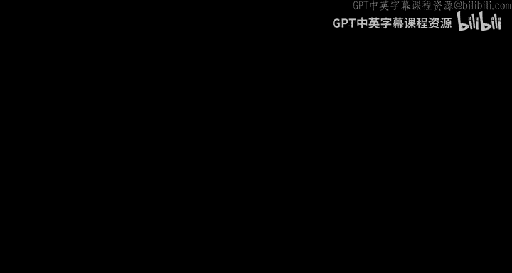
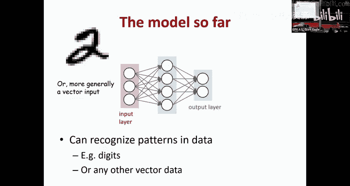
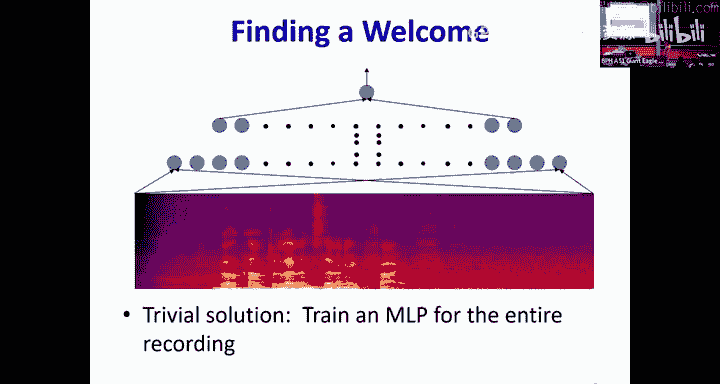
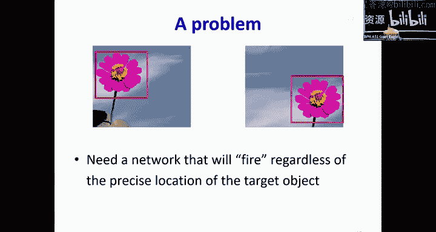
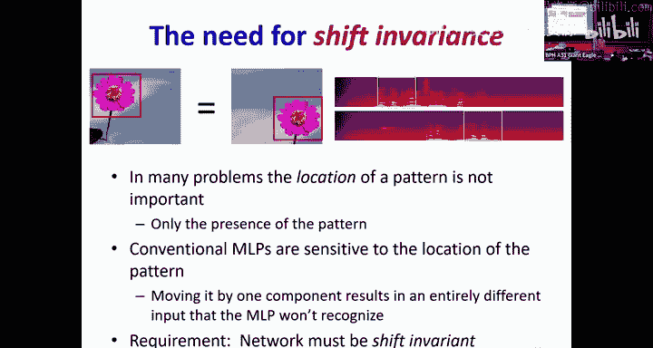
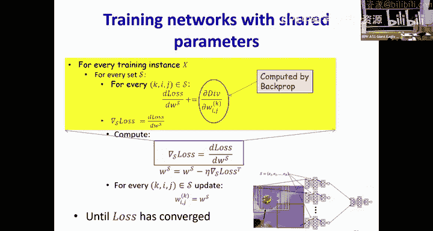
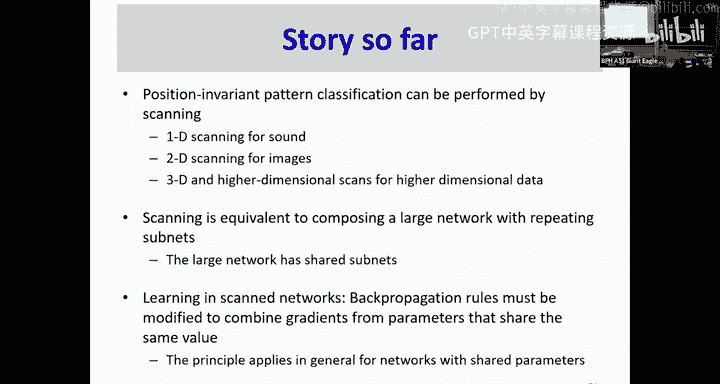
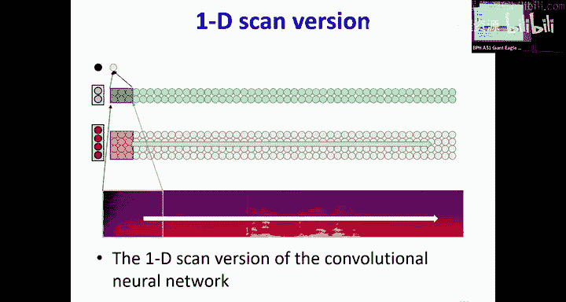
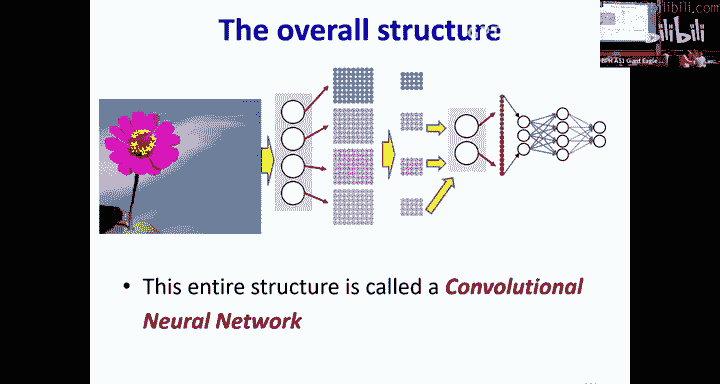

# CMU《深度学习导论｜11-785 Introduction to Deep Learning Spring 2025》中英字幕(deepseek - P10：[10]S2025 Lecture 9 - Convolutional Neural Networks (CNNs) Part I.zh_en - GPT中英字幕课程资源 - BV1xbZNYrEbs

There's some pens going on。 Make us some tank。There's an attendance poll， poll 4，4，2，2 on Kazza。

 Please sign up。And。For those of you who are not aware of this。

 my classess are always dumb classrooms。 Your laptops and phones must all be shut。And。

The only time I'm going to allow you to open your laptops of phones is when you are。

Responding to poles and piazza。I， some of you like to take notes on your laptop。

I would like to permit it， but then I have no idea of whether you're actually taking notes or poking around on Facebook and trust me。

 this happens a whole lot。 And each time one of you decides that you really。

 really want to be laughing at the latest post that someone made on Facebook。

 everybody around you is disturbed。😊，So no laptops， no phones， except for the piazza， Piazza。看多。Yes。

Attendance poll with 42，2。 can you release it。It should be there。 Maybe you haven't released it yet。

 We typically release it a couple of minutes before class。

 because otherwise you could just respond to it。Before the class begins and never turn up。

It's live422。你们这。great thanks。It's good to see you， Mark。四下。我要干么？No。研入じな。Okay。

 so that in is going to be live in a minute。And yeah。Make yourself name tag guys， yeah。三四。嗯。没。Okay。

 all of you， once you're done at the attendance poll， please shut your laptops。All of here。

May I have your laptop check， please。They're not seeing the4 tu and piazza。 Michael is a4 tu2。

 It should be li。It is life。W a minute。 This is probably the longest class you're going to have。

 We have 280 slides。 so every second that I wait there's going to be a second that you're going to miss from the end of the class or a little bit faster that I will speak。

 which means that you are going to have to struggle to keep up with me。😊，So， let's speak out。十リ？嗯。

Okay， let me begin。 You guys， if you're done with your poll， please share your laptops， right。

You the back。If you're done with your polls， please shut your laptops。Okay。

 I will give you another minute to respond to the attendance poll。

 And if your laptop is still open at the end of that。I will wait for you to shut， Allright， okay。

You done。Please， shut your laptops。to up。You万四等于。Okay， let's try。Alright， okay， guys， let's begin。

So the story so far， we have seen that。Multti layerer perceptrons are universal function appators。

 They can model Boolean functions。 They can be classifiers。 They can be reggressors。

They can be trained through variant of gradient descent。But then。

 and all the models that we've seen are of this kind where you have one layer of neurons feeding to the next layer of neurons。

 and that feeds to the next layer of neurons。

有。Here's a new problem。I give you a speech recording。 It's always a half second long。

Now or maybe a second long。 So you know the exact length every single time。

And now I'm asking you if this signal contains the word welcome。Now。

 the obvious thing for you to do is to just convert it to a spectroographic representation like you did for homework one。

😊，And then， just。Stick a multi perceptron on it。 It can read all of it。

 and it should be able to tell you whether the word welcome is present in it or not， right。😊。

But then。

Suppose I have two recordings。The first one is one second。 Both of them are one second long。

 But in the first recording， the word welcome occurs in the early portion of the recording。😊。

And in the second one， the same word occurs in the latter portion of the recording。Will。

 the same network fire for both inputs。Yes or no。Why not。是我是全是。it's entirely different， right。

 if youre to to simplify the problem that entire input can be thought of as a vector。

And in the first case， it's like having a bunch of ones over here or some numbers over here and zeros out here。

 In the other case， it's like having a bunch of ones out here。😊，And zeros out here。

 These two are entirely different vectors。 They live in different subspaces。

 The network that fires in the first case will not fire in the second case。

 And so we need what we want。 There's a simple network that will fire regardless of the location of the word welcome。

 And if the word is not present， it must not fire。Now， same problem， in know with images。

We can build a image detector， to detect flowers。But then if I have。

 let's say an MLP that can detect that has been trained to detect flowers and pictures。Then那。

An MP that detects the flowers in in the top left corner。

Is not necessarily going to detect the same flower when it occurs in the bottom right。

 because these two data points are in completely different subspaces。

And we need a network that will fire， regardless of the precise location of the target object。

 So in many problems here， the location of the pattern is not important。

Only the presence of the pattern is important。And conventional MLlPs are sensitive to the location of the pattern。

So。You know， if I just move the entire pattern by one， just one position。

 It means I live in a different subspace。 It's not going to fire。

 We want a network that will be shift invariant。 Now， if I asked you to this problem。

 the answer to this problem， what would be the simplest solution you could think of。系。

So how do you know what it is， right， you don't。 So， yeah， you can roughly the same network frames。

You can scan， right， The trivial solution is to say。

 I'm going to throw it all into the training data so I can have pictures with flowers in the top left corner Shi by a pixel。

 shifted by a second pixel。 Every single possible variant of a position of a flower。

 And then I can throw it into my training data。😊，But what would the problem with that solution be。

 It's very simple。 It should work。 What would the problem with that be。

The amount of data is going to increase tremendously， and。

The complexity of the network that can learn all of this is going to be immense。

 You would need a very large network。 So the alternate solution， as who was a trisha， Who is it。

 who mentioned， would be to scan。 So I can build a network that looks for something about the size of the word welcome。

😊。

And then run it at the initial location。And then， the scan。

And at each position is going to look for the word ver。Now， what will this network do。

 It's going to output。A value which tells you whether it has seen the word welcome at any one of these locations。

What I want is to know if the entire recording has the word welcome in it or not。

So how can I combine these to determine if the recording has the word welcome in it。Anyone。Yes。我有。

What kind of layer would that be。A multireporon。 What anybody else layer。 What is a metal layer。

You guys are thinking too hard。 What's a simple solution。嗯哼，For who was that said。It's just an a。

 right。I can use a max。 A max is an all。If it has found a flower or or the word welcome at any one location。

 then at least one of those must give you a large output。 So the max is going to be a large value。

Otherwise， it's going to be a small value。 And so that's it。

 Or I can replace the my max with a soft Max if I'm allowing for some wor， right， or indeed。

 I can replace it with a multiicron。 But the basic idea remains what we are really doing is scanning the input。

😊，That create everybody。Okay。So how would I， what would the pseudo code for this look like。

It's simple enough。How does this work。Thank you。 So， you know。

 I'm scanning from left to right at each position。 I'm pulling out a segment of the input that's roughly the width of the word welcome。

 and I'm putting it through an MP。 at each position。 I get an output。

 I pass all of these outputs through a soft。😊，散步。But then if you look at it closely。

This looks like this， right？ I have all of these networks scanning the input。

 and then their combined output is going to a single soft Max。 What does this look like。😊。

It's just one large network， right。 What's the specialty of this network。

The lower layers are subnets， which， which are all identical。That's about it， right。

 So this is just the final layer that we all MP。 I can just call it a giant MP。Same thing with 2D。

 I could have a flower detector。Which is， which detects flowers in a little rectangular area。

 I I can scan the input。And eventually， when I've scanned every location of the input。

 I can pass the entire collection of outputs through a max or a soft Max or an entire MLP。😊。

And this should still solve the same problem。 It will tell me， if the。

Image has a flower in it or not， right， so。Lady at the back， can you shut your laptop？

You the his laptops are shut in this class， okay。So。Here again is the pseudocode for it。

 I'm scanning left to right。Top to bottom at each position Im pulling out a little segment of the image。

 roughly the size of a flower。 I pass it through an MLP。 I get a collection of outputs。

1 per location。 It's double indexed because you're scanning left。😊，Left to right and top to bottom。

And pass it through a softmax。 But then once again， this is just one giant。Network。

And so the key component is that it has many subnets at the lower layer。Which are all identical。

 That's the only difference。And so this network now is shift invariant。

 Both this network and the one that we saw earlier is invariant to a shift in the pattern。

So I could just replace this entire thing。 you know， the softm is the final layer of the overall MLP。

 just call it a giant MLP。 But what we have done by scanning and combining the outputs is to construct one single network。

W is啊。Invariant to the position of the pattern that you're looking for。Right。Questions。Okay。So。

 there's the first part。ます吧。Okay， I'm gonna give you 10 more seconds， guys。All right。

What's the answer for the first one。Second。Both of them are true right， Okay， let's continue。

 Please shut your laptops again。啊， yeah。Sorry about this。

 supposeuppose that we are doing multiple frames and the second。

Its just part of a doesn that's like having something that's off frame， right， so。

Something that detects a flower is not going to detect just the left hand corner of the flower。好。

So now I'm just going to introduce a little change of pictorial representation。

 So do you mind shuting your laptop， Larry。Yes， all of you。 Okay。What is your name。

 Can you get your name tag up。Oh， right。 Yes， I get。发s了系。

So I need to have something more lady to address you with。 So this is the kind of M LP that。

We were drawing。 Now， when I scan with an M LP of the sky， the picture I get looks like this。

 There's something wrong about this picture。What is wrong about this picture is that it seems that this guy occurs later in time than this one。

 It seems to be a temporal ordering within the layer itself， which we know is not true。

And so I'm going to redraw this picture。Like， you know。

 instead of having a picture of this kind where the layers themselves seem to have a temporal ordering within them。

 I will redraw them vertically like so。 So it gives you the idea that this entire computation happens at one time。

😊，This is the first layer。 The one above it is the second layer。 The one above it is the third layer。

 And every neuron in the first layer connects to every neuron in the second layer。

 this illustration that can sense to you guys。Right I'm going to use this。 and so to simplify it。

 I'm just going to readaw the picture like so when I have an arrow between two blocks。

 it means that there's an entire collection of neurons which connects completely。😊。

To a second set of neurons in the next layer and all the collection computations are happening in one column。

At one time。 And so a computation of this kind， which is scanning。

With with a network which is looking at two inputs at a time and striding by two inputs at a time will be redrawn in this manner。

So this is the picture I'm going to be using okay。And if I'm scanning with a stride of one。

 this is what the picture will look like。So let's go back and see how this network can be trained。

 This network is solving a problem。 It's just telling me， is there a flower in this picture or not。

 or does this recording have the word welcome or not。 Now， when I go back and。Give you this solution。

 right。This， this solution assumes that when I build the flower detector。

 I have data pictures of a flower， roughly the size of that box。

 and I have positive instances and negative instances。

 and that's how I can train this flower detector and combine the output， right。😊。

But this but is this really necessary。It is not why。

 because we recognize that the whole thing is just one giant network， right。

 And because it's one giant network， I can do this。I can train the network all at once。

 except I will give it。Collections of data where I have some recordings。

Which have the word welcome in it， somewhere in it， other recordings， which do not or some images。

 which have the flowers somewhere in it and other images， which do not。

 I will not be telling the model exactly where the flower is。

 It must nonetheless be able to learn the detector's lower level detectors through gradient descent。

 And that's because it's just one giant network。 And we know a giant network of this kind。 can learn。

😊，From data。The key distinction is that these are shared parameter networks。

 So all of these subnets have identical sets of parameters。 Similarlyly。

 all of these subnets have identical parameters。 So we're going to have to modify our training paradigm to account for the fact that the parameters are identical。

Now， so these are all。All the lower level submits are identical。

 They're all searching for the same pattern。What this means is that when I'm training the network。

But I perform back propagation。And I update the parameters for say， this copy of the。This。

 this instance of the subnet， that update must reflect on all copies above。

And every one of them must copy over whatever update was made to the lowest sumit。

That's how you make sure that all of these submits are identical， right。So how does this work。

 this business with shared parameters to see how the business with shared parameters works。

 Let's consider this。 It's a generic concept。 You can always decide completely arbitrarily that that connection there and this connection here are going to have the same value。

There's nothing special about the specific structure that we just saw。

 So let's say you decided that in this network， this connection and this connection are going to have the same value。

What does this mean， It means that there's a common value， W， S。Which is being applied to both W， I。

 J K and WLM M。And so if I were to train。Anytime I want to update this parameter。

That means this guy must also be updated by the same amount。 or more generally。

 this common value must be updated， and that must be distributed across all the elements。

 which copy that value。 So now， if I actually draw the influence diagram， now。

 you guys are already familiar with the notion of influence diagrams， right。

 Here's what it looks like。This common value， W S。Influences W， I， J K。It also influences WLN。

And both of them are going to influence the dives。What are we trying to estimate。

 We are trying to estimate this common value W S， which means we need the derivative of the divergence with respect to W S。

Right， there are two paths to it。So what is the formula for the derivative。

 It's going to be down one path， the derivative of the divergence with respect to。

W I J K times the derivative derivative of W I JK with respect to WS。

Times plus the derivative of the divergence with respect to this weight。

Times the derivative of this weight respect to W S， right， That's what we have here。

 What is the derivative of this guy with respect to W S， anybody。Can you say that about， why。他没。

They are the same。 It's just copying it， right， So which means that this derivative。

And this derivative are both the same， which means that the derivative of the divergence with respect to this common shared value is simply the sum。

Of the derivatives or the divergence with respect to the individual parameters which share that value。

Makes sense。 And so when I'm training the model。What I would do is to perform back propagation to compute the derivative here。

I would perform back propagategreg to compute the derivative here as well。

 And then I just sum them up。 And that's going to give me the derivative with respect to the common shared value。

O。And so here， when I'm training this network with。All of these identical subnets。

 All I really need to do is to provide the data the model with data， positives and negatives。

 P with flowers in them， pictures without flowers in them。😊，And I would compute my divergence here。

 And now， if I want to upgrade this。Edge。Of the scanning network。

 it means I must also update the other edges， which are all red because they' are all the same network。

 right， And so I would compute the derivative of the divergence with respect to every one of those red guys。

And sum them up。 And that is the derivative that I'm going to be using。To update this。The， the。

 the value of the weight associated with the red edge。So also with any set of shared parameters。

That makes sense to everybody。You guys at the back， that makes sense， right。Okay。

 just because we are off Zoom doesn't mean that the the paradigm changes。

 I'm going to be expecting some pretty enthusiastic nods of your head。

 even if you're at the back of the room， just so that I know I can go ahead and that I haven't blocked。

 Okay， and guys on Zoom。 Sam goes for you， Please say yes or no， I don't mind if it's loud。😊。

And so here is what the training paradigm is going to look like。

 You have this set of edges is a common shares a common value。

 This set of edges here shares a common value。 and so on we have sets of weights。

 which have the same value。 And so when we want to perform updates。

 we want to update the common value for the set。 So for every element in this。

 So which means we want to compute。The derivative of the loss with respect to that common value。

 which we would then use to。Update this common value using gradient descent。

 and this common value is going to be distributed across all of the copies of the spa。

We need this derivative here。And this derivative is simply going to be the sum over all copies of that value。

Of the derivative of the divergence with respect to that copy of the value。

And that can be computed using back propagation。 So here in this case。

 if I want to compute the derivative of the loss with respect to the value that applies to all of these guys。

 I'd be using back prop to compute the derivative here。Here and here。Sum them all up。

 and that's going to give me the derivative with respect to the shared WS。

 which I would then use to update the parameter value right。

Do you mind sharing if closing your laptop there？Please shut your laptop。Thank you。I电。

So you wouldn' each of the there is nothing。 There's no normal normalization。

 You just raw performing raw back propagation。 You have just decided a prior that those three guys are the same parameter that'set。

 right。There's nothing else going on。 This is just straight up back propagation and accumulating of acc of derivatives。

Okay， and that term， these derivatives are going to be computed using backdrop， yes。

 I just had a question related to the heads。 Are all the deadlines the same Yes。

 because this is a subnet， This is the scanning network， right？ So as it scans。

 it's looking at each position。So this network is the same as this network is the same as this network。

It should mean that this weight and this weight and this weight are the same。 That's it， right。

But since it is taking a different part of the image。Remember， we have scanning for a flower。

 So it does it does the network change depending on which image it looks at。Right。

 so basically from our point。Perspective。What we have is。An image of this kind。

There's one copy which looked at this， this was looked at by the network。

This was looked at by the network as well。 But these two are the same network， right。

So， nothing changes。Any other questions？Okay， so position invariant pattern classification can be performed by scanning one dimensional scanning for sound。

 two dimensional scanning for images， but you can also do the same scanning for higher dimensional data。

 three dimensions four dimensions there nothing going to higher dimensions doesn't change the basic idea。

Scanning is equivalent into composing a large network with identical subnets。

And when you want to learn in these networks the back propagation rules must be modified to aggregate the derivatives for all the elements that have the same shared value as。

So since you're using a max to combine all of the like all of your layers。

 werent the layer with the highest value。 we don't necessarily use a max。 Max is one of them。

 But I said you can also use soft Mac， which is more likely。

 And sometimes you just pass it through an inter thing。 Yes。Okay。

 so the question was since we are using a max wouldn't it be just the largest entry that gets the gradient and that would be true if we use the max。

 but for a soft Mac or if you used an MLLP， then there would be other copies of it getting derivatives to。

So， now。Let's take a closer look at how the whole scanning works。This is my network again。

 this is my M people。 I've just drawn it using the vertical notation just for to it to。

I emphasize the point that the entire computation is being done at one time， right？So now。

 if this network were to analyze this image， this portion of the input， remember， it's scanning。

 right。Then what would happen is that。The first layer is first going to generate outputs。

 Each neuron and the first layer is going to generate outputs shown by those four gray circles。

 Then those four outputs are going to be fed to the second layer。

 and each neuron in the second layer is going to generate its outputs shown by the two green circles。

And then the second layer neurons would feed the。睇你啊。And that is going to generate its own output。So。

 then。This computation is going to be done at the first position。

 And then the second position and the third position and so on。 all the weight the end of the。

Input and the final layer outputs are then combined using your max or softmax or MLP or whatever to take a decision for the entire input。

So all the little circles are identifying all the local variables that are computed when you're analyzing this input。

 So this here， for example， are the outputs of the first。

The four first layer neurons in the first window， right？

And the corresponding one up there are the outputs of the two second layer neurons in the first window and so on。

Now。Let's say that when I'm doing the computation， the first layer is in a hurry。

 It's not willing to wait for the second layer。So it does its computation。

And before the subsequent layers perform their operation， the second first layer goes off。

And computes its outputs for the entire input。And then， the second layer kicks in。

And the second layer and， and the rest of the network kicks in。

And the rest of the network meets the outputs of the first layer。

In the first window and generates its output。Will the output at the top one position now be different than in the previous case where the entire network analyzed that window before progressing？

一是。So， yes or no。But they are hard to be different。It should not be different， right。

 you're using the same four values， regardless of whether the entire network analyzed it there or the first layer often did the whole thing。

 right， Pardon me， It's just a layer。 The layer is basically， you know， as we define the perceptor。

 It computes an half and then applies an activation。 right， It doesn't matter。

 The point is the first layer does its computation。If the first layer runs away。

 the second layer can still operate on the first layer as outputs。

 And it's going to get the same value as it did if it waited。

 if the first layer waited for it to performance computation， right？ And so now the second layer。

 too， the output here does not change。Due to the reordered computation。

That making sense to all of you guys。Right， okay， and so now the second layer2 can do the same thing。

The second layer can。Now， go off and scan。 What is it scanning。

 Is it scanning the input or is it scanning the first layer outputs， And now。

 if I take the output of the second layer。And pass it through the third layer。

 Will that output be different。It's still going to be the same， right。

 And now the third layer can go off and do its scan， right， And so all we did was reordered the scan。

 and the final output should still be the same。 Now， if。

 this is much more obvious when you look at it in terms of code。😊。

When you look at it in terms of code， what did we do， We were scanning left to right。

 We were pulling out a segment。And then we are analyzing the segment。

 generating an output and passing it through the final softmax when all the segments were analyzed。😊。

But within any segment， what did we actually do。This little bit， this M LP segment。

Was the patch in blue at that location， you went through all the layers of the MLP。

And then you compute an aine term and put it through an activation。

And so if you look at where all of the fun stuff is happening now， observe that there's an if clause。

 that's because。Only the first layer is looking at a window。

The second layer is looking at just one column， right。

 So the if clause is basically stating that if you're in the first layer。

 you want to look at a section of the input。But if you're in the second layer， looking。

 looking at just one column of numbers。From the previous layers second and for the layers， right。

 But all of the fun stuff is happening inside the gray box。😊。

So the two outer loops are interchangeable。 If I flip the two outer loops before outermost loop is over time。

 the second loop is over layers， right。If I flipped the order of these two loops。

 would this change the final output？Because all of the computation is inside the innermost loop。

 right， So changing the loop indices is not going to change the output。

 And so this is basically what we did。We just changed the loopendice。 Same thing。

 If I was doing this with pictures。Then I'm scanning for the picture at each location。

 the entire region is being passed through an MLT， right， So the input layer is just the input。😊。

And then you have hidden layers， and you have subsequent。La for here。Now。

What happened in our first case was that we had the entire network look at the entire window。

And then it scanned and the network was producing an output at each position right and so now and eventually you got one output from each position arranged all of the outputs in the same manner as the input itself just to show you that this is basically a map of the input each dot to the right is representing the output of the network for one specific location in the input and that then that entire collection is being put through the softm。

 right。Now， I can change this。Let's consider just the first neuron in the network。

 the top left neuron。Let's say the neuro， that neuron by itself， just goes on。

And performs all of its analyses without waiting for the rest of the network。Or indeed。

 we can say that every one of the neurons in the first layer goes off and just scans the input without waiting for the rest of the network。

 right， now， if I want to find out if there's a flower in this location or not。

What must the rest of the network do。Anybody。What must what must it look at。Which one。

First first aid output where， right。 So take a look。Here。

 this first neuron is generating its outputs at each of these positions， right。

Which was the was the output it generated。When8。Was analyzing this bottom right box。

The bottomom right， the bottom right， right， So this guy here is what this neuron generated when it was looking here。

This guy here is what it the second neuro generated when it was looking here。

 So if the overall networks must decide if there is a flower in the bottom right。

Which of these values must it look at。Just the bottom right， right， so more generally。

 if it wants to decide whether there's a flower in this box or not。

It must pick up the values that the first layer neurons generated。When it was。

When they were analyzing that region of the image。 So basically。

 because Ive arranged the pixels in the same shape as the input itself。

 I just had to pick up the activation value corresponding to that location and the image and pass them through the rest of the network。

And that's going to tell me there's a flower in that location or not， right？And so。

We've sort of let the first layer do its thing before the subsequent layers did their operations。

 But then now the second layer can also go ahead and scan in the same manner。 The second layer。

 neurons can just go off and observe now that the second layer neurons are looking at all of the outputs of all of the first layer neurons。

 So the second layer neurons are now reading one value。

From the maps produced by each of the first layer neurons in。

 in order to analyze any specific location in the input， right。

 And now the second layer neurons can go off。And scan the entire input。

 and they would produce their own map。And then if I wanted to find out if there was a flower in that location。

 the next layer would just read the value that the second layer neurons produced when they were analyzing that location。

And you'd get the output， right， And now the third layer neurons can also do the same thing。

 They can scan the outputs of the second layer neurons and produce their own maps。

And then you can pass the whole thing through a softm， right。We reordered the computation。You know。

So if you look at the third layer map outputs and if you want to know if there's a flower here。

 you just need to look at。What the map value was at that particular location。

So weve reordered the computation， but the final output is still going to be the same。

And to see why this works again。This slide。 we can look at the pseudo cord。So earlier。

 I was scanning left to right。Top to bottom at each location。

 I was pulling out a segment of the image， and I was putting that segment of the image through an MLP。

I was collecting all of these outputs and putting it through a soft。

But then let's look at what this MLP is that MLP within that MLP。

 I'm going through layers within each layer。 I'm reading the outputs from the previous layer。

 computing an aine term and putting it through an activation。Only the first layer。

Is looking at a window of the input， right， Only the first layer is looking at an entire window。

 subsequentent layers were reading one value from each map。If you' remember the picture， right。

 So here。This guy was reading one the second layer neurons were looking at one value from each map。

But the first layer， neurons were looking at the entire window。So the pseudo court has this。If close。

 if you're in the first player， look at a window subsequently。

 as it just going to read a value from their maps produced by previous days。 But， you know。

 that's hold that thought for now， we'll get back to it。 But the point is。

 all of the action is inside the innermost loop， yes。有有啲色佢出翻咗俾咯，唔系。Hang on with me， right。

 Let's get to the end of class。 Nobody you want to go out and wash your face or something。

They're falling asleep。So okay。Alright， so if I change the order of the loops。

Will this change the final output。No。So which means that I can just。Pass the layers out there。

 fliplip things。And everything still works。 And the final output is still the same。

 That's basically what we just did when I reordered the computation。

So reordering the computation should not change the final output。

And that's simply because all of the action is within the inner muscle。Right。So。

The story so far position andvari pattern classification can be performed by scanning the input for a target pattern。

😊，Scanning is equivalent to composing a large network with shed。Submit。

The operations and scanning the input with the full network can be reordered as scanning the input with individual neurons in the first layer to produce maps。

Then scanning jointly scanning the maps of the outputs of all the previous layer neurons。

To produce subsequent maps and so on， right？Now， the thing is。

 when you go from the second layer onward， you jointly scanning all of the maps， right。

 because you're reading the outputs from all of the previous layer neurons。So， here's a second poll。

カ張る。好か。嗯，你同我讲。Yeah。开心。😊，呢年上。見つく。こ。ok。嗯。Oh。Give you 15 seconds， guys， This should be easy。Okay。

 can someone from Zoom answer these questions。 First question， true or false。Someone on Zoom。

I know there are people on Zoom。 Some replied， please。Truure false。True， truee， okay， Second one。

 true or false。Also true。 Okay， do you guys agree。 Let's see。

 So scanning an input with an MLP is mathematically equivalent for scanning it with the individual neurons。

😊，And then scanning the output maps are the first layer neurons for the rest of the network through。

The operation can be recursed， scanning。The output maps of the first layer。

With the rest of the network is equivalent to just scanning it layerwise， right。收。Now。

 let's get a little closer， right。What are the neurons do。

 The entire MP looks for a flower like pattern in each。Position。

So that's all you're really interested in。 The MLP must look for a flower like pattern in each position。

 right。So the first layer neurons， look at the entire window at this point。

And then the second layer neurons， each of them is just going to be looking at。

 So these guys are looking at that entire window。The second layer neurons are just looking at one element from each of the first layer maps。

 the way we just presented it， and then the rest of it is going through， right so。😊。

Subsequent layers only look at a single pixel from their input maps。

I can distribute this pattern across multiple layers。

 How the first layer can look at a smaller region of the input。

And so the first layer neurons could be looking at maybe something the size of that white box。

And scanning the input like so， and producing its map。

Then the second layer neuron can look at a small box。

A small rectangular region of elements from the outputs of the first layer maps。

 So which portion of the input is the second layer you're on looking at。

 It's looking at any portion of the input that was considered。

In computing any of these nine elements。 And so the second layer neurons are going to be effectively looking at the entire window。

And then the subsequent layers can just operate off these maps， right， and so。What you can learn。

 the second layer neurons， for example， learn patterns at the size of the windows of this guy。

 The first neuron might know， for example， to fire if。The first， you know。

 the first second layer neuron could fire if the first first layer neuron found something in the top left positions。

The second one found something in the top right， the third one found something in the middle and the fourth one found something at the bottom right。

 So the top second first， second layer a neuron is basically firing in this case。

 If there are two petals， there there's something in the middle a statement in the middle。

 a petal at the bottom right corner and each of those is detected by a different。Firstly。

 a neuro round。 So what is happening here。In the first case， the entire responsibility。

 when we were doing this， the entire responsibility for finding flower sized patterns。

Was imposed on the first layer neurons， The features that the first layer neurons were detecting were entirely flower sized。

 which are very complicated。When we distribute it in this manner。😊，We are saying。

 let the first layer neurons look for something smaller。 Maybe so the size of a petal。

 the size of a sepel， the size of a stamen。 and the second layer neurons are aggregating this information。

In position with arrangement。To take their decisions to get the larger pattern。

 So you've distributed the pattern detection over multiple layers。

And so now the second layer neurons can， of course， go ahead and scan， right。

 They can produce their own scan of the maps produced by the first layer neurons。 And now， of course。

 it has to scan， right， It has to scan all four maps。 So， for example， of the second layer neuron。

 If a neuron is going to say， I will find it there are two petals to the left。

Something in the middle and you know a pedal to the bottom right。

 it has to be scanning all of the maps of the first layer neurons because each of the first layer neurons is looking for a a different sub feature。

Right。And then it can generate its output。And now， if the next layer neuron wants to decide if there's a flower in the top left corner。

 it just has to look at the elements produced by the first second layer neurons when。

They were analyzing this region。Of the first layer maps， did this make sense。

 It might sound confusing。 So I want to make sure it made sense。Yes， no。 You guys on Zoom。

 Can I hear a few yeses。With the types of uses， at least， Okay， thank you。 Allright。

 And now the whole thing can go through soft map， right。😊，Now， this is still scanning。

 That's a point。 We haven't done anything magical。It's still scanning。

 and it's still scanning with a shared parameter network。

 except there's a lot more sharing of parameters。 So to look at this。

 let's say the second layer a neuron is looking at。😊，These9 elements。

From the maps of the first layer neurons， what does this mean Now。

 each of these9 elements were computed by scanning with the first layer neuron， right？

 So it's like having 9 copies。Of the same neuron differ， looking at different locations。

So also this guy here。These nine elements is like having nine copies。Of the red neuron。

 each looking at a different region of the image。 And so the second layer neuron is actually leading all of these 27 values。

But although there are 27 inputs going into the second layer neurons。

 there are only three unique sets of parameters， because all of the black neurons have the black entries。

 They are using the same neuron。 They have the same parameters。 They red values。

 they are they're all being analyzed by the same neuron。 They have the same parameters。

 These blue guys， these are 9 copies of the same neuro。 So they all have the same parameters。

 So although you have 27 entries going in。You have only three sets of parameters being used to compute those27 values。

 And so the overall network is still a shared parameter network。Except that the sharing is not only。

Across subnets that analyze different regions of the input。 But within each window itself。

 you have additional sharing。Right。So I can do the same thing by building this over three layers。

 The first layer neurons could be looking at an even smaller region of the input and scanning it。

The second layer electrons。Could now be looking at little windows of the outputs of the first layer neurons。

And so what the second layer neuron is analyzing is any lesion that was considered in computing any of these four values。

 So that second layer neuron is looking at maybe that red box。😊。

Then the third layer neurons could be looking at little windows。

In the maps of the second layer neurons， which means they are effectively looking at any region over here that was considered in computing these four guys。

Which would be this patch。Which in turn represents any represents any region in the input。

That was used in computing any of these guys。Which is the big window， right。

 And so I'm distributing the pattern over。Multiple layers。And now the entire process can be recursed。

 So instead of just having only the entire， the first layer be responsible。

Forgetting flower sized features。You can compose the features of many layers by looking at little windows。

In the maps produced by the previous layers。 Now， there's something special going on over here。😊。

If the first layer neurons were entirely responsible for looking at flower sized windows。

Then you don't really have to arrange their outputs as a map。

Because the position doesn't really matter after that is just a bunch of individual values， right。

 But when I distribute the pattern over many layers。

 then what is critical is that the output of this neuron is actually arranged in the same shape as the input itself。

 That's the only time I can actually look at a window， right。Similarly。

 the output of this neuron must be arranged in the same shape as as the input itself。

 That's when I can look at a window。So the arrangement now becomes important。And once again。

 if you actually look at it closely enough， it just ends up being a gigantic shared parameter network。

It's just that you're still scanning the entire input with an MLP。 But within the ML LP itself。

 you have many levels of shared parameters。They're making sense to everybody。嗯。

Can I see a wave of hands if it made。Okay， thank you。 Appci it， right。😊。

So here's what happened from the pseudocode point of view。Earlier， he was scanning left to right。

 pulling out a segment and analyzing it with an MLP。But then， you know， when we rearranged it。

We were going through the layers within each layer， we were scanning left to right。

 top to bottom and at each position， if you were in the first layer you are pulling out a window。

 if you were in subsequent layers you were reading only one element。

From the maps of the previous layer outputs。 And so for this first layer alone。

 there was a window of the input being pulled out。For subsequently， as。

 you are just looking at one value。 It turns out that when you distribute the。

Scanning in this manner， the pseudo code actually becomes simpler。

It just says that at each position within each layer， just pull out a little window off。

The maps produced by all of the previous layer neurons。

 and then compute an aine term with those and put them through an activation。Okay， so here。

I'm scanning。At Pe point， I'm pulling out a little window。

From each of the maps of the previous layer neurons。

 And then I'm I'm combining computing an aine term from all of those and then putting them through an activation。

So I'm just sort of rushing through the pseudo curve to get the idea， right。So。

 this operation of scanning。The maps。From the previously neurons with a window of weights。

 this is what is called a convolution。 And so this entire network is called a convolutional neural network。

 right。So。Wait， does it really 8，4 now。Yeah。Anyway。

And so this is just the same thing in vector notation， right， So here's what happens。

You are going through the layers。Then within each layer， scanning left to right， top to bottom。

 Then at each position， you're pulling out a segment， this little。

Rectangular segment from each of these maps。 So here I have a little two dimensional rectangle pulled out from each of those maps。

 If I stack them together， it's going to give me two dimensional cube。 It's a tensor。

And so if I were to use vector notation， then what the this neuron is computing is。

I weighted some of all of these 16 elements。 That's like saying that I'm taking this， you know。

 two cross， two cross。 What is this。4。Cubbo。 I have a corresponding two crust。

2 crust 4 set of weights。 Im doing an element wise multiplication with all of those。

 adding a bias and then putting it through an activation。

'll see this in more detail in the next class。 Okay， so just giving you an idea。😊。

Same thing with if you're doing this with 1 D in 1 D。

 let's say I was analyzing this input for the word welcome using this network here。

4 neurons in the first layer，3。Two in the second one and the third。Then at each location。

 so the first layer neurons are going to compute。All of these values。

 but the first layer neurons might just be looking at a small window of the input。Now。

 the second layer neurons are going to be looking at。A window。

Or the outputs of the first layer neurons。And so by looking at a window of the output of the first layer neurons。

 they are looking at。Anything that was used from the input and computing each of these three columns。

 which is a larger window of the overall input。And then the third layer neurons over here。You know。

 if they want to analyze a larger region of the input， they are going to be looking at a window。

Of the outputs of the second layer neurons， which corresponds to a much larger window of the input itself。

 So as you go through the layers， because each layer is looking at a window of the outputs from previous layers。

 you're looking at more and more of the original input itself。

 And so the final layer is going to be looking at a wide region of the entire input。Okay。Questions。

And so you can just continue this， right。 And then the final perceptioncept on to aggregate them does。

Is aggregating the evidence。 Does this recording have the word welcome in it。This structure。

When you're doing this， when you're scanning in one dimension， it has a name。

 It's often called a 1 D convolutional network， But the more traditional name is a time delay neural network。

 If youve ever encountered a TD N N， this is what it is， okay。Here's a book。

Massachus suggest have a format message。This on least。嗯。Okay，15 seconds， guys。All right。

The first statement， true or false。Second one， third， fourth。 Okay， let's see。Thank you。 right。

 Non distributed scanning does not require the output to be arranged in the same shape as the input。

But once you begin distributing it， you want the shape to be maintained。

 You want these outputs to be maps of the input。 Otherwise。

 the whole notion of a window makes no sense。Right， so why distribute。

 Why do we bother with distribution。There are multiple reasons。

 distributiontri forces hierarchical representations with localized patterns。

 So it's more generalizable。 It requires fewer computations and requests far fewer parameters。

 Let's go through these one at a time。Now。Let's look at this business of hierarchical representations with localized patterns。

Remember， when way back when， when we wanted to build a classifier for this double Pentagon。

Did we just throw the double Pentagon and did every neuron， try to con compute a double Pentagon。 No。

 what happened？ The first layer neurons computed individual edges。

 The second layer neurons computed individual Pentagons。 The final layer combined the Pentagons。

 You wanted to distribute the structure across many layers。 And why did we do that。Mture 2。Yes。

 number of neurons。 this gives you a much more expressive power。

 If you want to do this with a less a lower number of layers。

 you're going to need an enormous number of neurons， right。

 So by distributing things in this manner where each layer looks at simple patterns。😊。

From the outputs of the previous layer， you actually simplify the entire problem and make the network simple。

 So distribution is a great thing to be doing in terms of network parameters in efficiency in learning and modeling。

 So ideally， we must encourage such hierarchical learning。 It's more data efficient。

 It's also more parameter efficient。What about fewer computations and fewer parameters。Let's see how。

 So I'm going to use this。Example here， Im trying to scan， let's say each of these vector。

 If you had a speed signal， it's going to become a sequence of spectral vectors， right。

 So let's say each of those little black vertical bars represents one vector of some D dimensions。

And now， if I want to analyze a window of the input that's8 vectors wide。

 if we were doing a non distributed scan。The first layer is going to be looking at 8 inputs。

The second layer is going to be looking at just the outputs of the first layer。The third。

 third layer is just going to be looking at the outputs of the second layer。 right。

 So how many parameters So if you were just。Striiding by two。

 this is the entire set of computations that you'd be performing， right？At each position。

 that entire column of values is being computed。And I'm not going to draw the individual circles。

 I'll just draw vertical bathts。 this is just to make the pictures less ugly okay。😊，No。If this。

Layer had N1 neurons。And if this layer had N2 neurons and if that third layer had N3 neurons。

 how many parameters does the entire network have， Keep in mind that each of these bars is d wide and the and the first layer is considering eight bars。

 So how many parameters would it have anyone。How many parameters would the first layer have。

There are N1 neurons。Each of them is looking at8 inputs of depth B， right？ So it's 8， D。

 N 1 neurons in the first layer。 How many parameters would the second layer have。

Can you say that loud N1 times N2。 There are N2 neurons in the second layer。

 Each of them is reading inputs from each of the N1 neurons in the first layer。

 So there are N1 N2 neurons parameters。 And the third layer is going to be N 2 N3 in the same same manner。

 right？ So this is the。Number of parameters that you'd have。 This is。More generally。

 if you're looking at a width of L， it's going to be L D N1， blah， blah， okay。

So I'm ignoring the biast because the biast is just a very small fraction of the entire computation。

And so this is the compute that you'd be doing。 if you are stepping forward by two vectors at a time。

 this entire set of parameters B is being pulled into action。For every two vectors of the input。

 So the entire set of computations will be performing is shown in this picture。Now， let's say。

 instead of having this one guy be responsible for the entire set of。8 inputs。

I want to distribute it。How would I distribute it？ So instead of having one。没er。Look at8 inputs。

What I would do is to have something which is maybe this。😀呵呵。😊，So maybe this small， right， look at。

Two inputs at a time。And then all of them could be combined， right， if I did this。

I'm still looking at inputs， eight inputs at a time。Except that the firstly， thank you。舍得。

Turns out that it doesn't always run away， right？This guy is being。Reused four times。Right。

 and so here I could just have my first layer scan the input。With a window of size 2。

And then the second day is looking at four of these inputs。

The network is still looking at8 inputs at a time， right， But what about the the。

 except that the eight times step wide input is now being distributed over two layers。

 It's not just one layer。 The first layer is only looking at two inputs。

 subsequentent ones are aggregating stuff， right。How many parameters would I need， say。

 let's say this guy has N1 neurons and this guy has N2 neurons。

How many parameters does this one need？Is just 2 D and one in the first， right。

4 N1 and 2 in the second。And then N 2 N3 in the third， right， So this is the。

 these are all the parameters。 It's going to be 2 D N1。Then these four all have different weights。

So four and1 and2。Plus， N 2， N 3。 This making sense to everybody。Okay， now。

 if I had a second network， which was performing using the same number of neurons to perform this computation。

 how many neurons would I have in the first layer of the second network。To be equivalent。

 like I said here， it's like saying， I'm going to take a small portion of it and scan， right。

 I have four of these。 So this one is like having。4 blocks。 This is one。 This is one。

This is one and this is one， except the four blocks are all identical。

 we made them shared parameter networks correct， and so the corresponding equivalent for the non distributeded scan is going to be 4 and1 in the first layer N2 in the second layer and N3 in this third layer。

How many parameters does this guy need？This is8 times4 32 and 1 D， right， The second one is。

4 and1 n 2。 And the third one is N 2 and 3。 So if you actually compare the number of parameters over here。

 this is 2 D and1 plus 4 and1 n 2。That one is 32， and1。Plus 4 n1 n2。

 there's a factor of8 compression。In the very first layer， just by sharing the parameters。

 And this is obvious， right， It is obvious because earlier。

 every one of these copies had individual parameters。 Now。

 we are saying all four of them have the same parameters。Right， similarly， if I。And then， of course。

 this is a softmax， right。 So this is how the scanning is happening。

 observe that it's still scanning with a shared parameter network。

 except that within the network itself， there's additional sharing of parameters， right。😊，So。Now。

 it also saves in compute。 Let's see how this saves in compute。

 So let's say I perform this analysis in the first computation in the first window， right。

 first window of 8。Then if I step forward by two， do I need to recompute the entire network？有什么。

Which portions do I need to recompute？ So these guys。Have already been computed。

When I analyze the first input， first window， right， Similarlyly， when I go to the next one。

 these guys guys have already been computed。 So as you keep going forward。

 you are reusing computation from previous scans。 So here those three guys are being reused in the second location。

 So you get this large additional benefit from the fact that scans at neighboring positions。

 share the computation of lower level blocks。😊，So you can see that first。

 theres a huge reduction in the number of parameters。

Because you're sharing parameters within each layer。 So again。

 go back if you if you had a non distributed scan。You'd have these four。

Maybe you have four neurons over here， each of them would have its own individual setup parameters。

Here you are saying that these four neurons。All have the same parameters。

 So you reduce the number of parameters by the sharing。 And second。

 because of the manner in which this the scanning happens， you actually end up saving。Computation。

 right。So I can do this by distributing this over more layers。

 I can say that instead of having this first guy。可。我才朋友。Let's see。You know， look at four of them。

 I can say that this run another of battery， yeah。I can distribute the scanning over two layers and say that the second layer is only going to look at two windows from the two outputs from the first layer and the third layer is going to look at two outputs from the second layer。

 The overall network is still analyzing an input of what width8 right so the overall network is still analyzing an input of size 8。

But then how many parameters do I need over here？ Can someone tell me。Its just2 n1 and 20，2 d and1。

 right。Plus 2 and1 and 2。Plus。2， and 2 and3， right。

And if I want to compare this with what would happen over here， that's going to be 8，32 and1。

32 d n 1 plus 8 and1 n2 plus2 n2 and 3。 So again， you can see that even in the second layer。 Now。

 you know， if I distribute this over three layers， I begin share saving parameters in the second layer。

 and once again， you can see what this happens， you know， if this guy。Goes up and says。

 you have a bunch of neurons。 If I decide that these guys are the same neuron。

 then they have the same parameters。And so， I'm saving。That diameter over there， right。

And so you get massive reduction in parameters。 And then you can once again see that you can now save computation even in the second layer。

😊，By reusing parameter， reusing computations from earlier positions。

 So if you were scanning this input to analyze and analyze a wind window of with 8。

 So these are all the computations that youd be performing in the first position， the colored ones。

When you go to the second third position， you're going to be re reusing these three， right。

 And so you're going to be reusing computations from the second layer as well。

 So the more you distribute。And here's a little more complex model， but then。

Shows you the same thing that you can reuse a whole lot of computation。

 So if this is the model that I'm actually analyzing the input length。

When I go over here to the next position， second to the second location。

Which are all the compare elements that I'm using in terms of compute， can you point out。

So if this was my basic network， right， if I stride forward by2。Then that is this network。

 It's hard once I draw the whole thing， it's hard for you to identify which the scanning MLP is because the picture looks complex right。

 but can you see the scanning MLP in this picture。Right， it's the guy that starts from here。

And does this， right， And it's reusing this entire portion of the computation from the previous location。

And so this is a convolutional network， standard convolutional network。

 But then the idea behind showing all of these pictures is to explain to you that although we think of it in terms of convolutions。

It's really just scanning with a shared parameter MlP。You're always scanning for patterns。Okay。

 and the point of having this distribution and of the parameters over many layers is that it gives you a reduction in the parameters because within each layer you're reusing parameters and it's going to give you a great reduction in compute because you can reuse the computation that you've already performed。

 right。So。That was for 1 D， but you have the same thing with images， right。

 I have I'll skip these slides， but I actually work through some arithmetic that I'd like you to go through on the slides to see how much you can save。

😊，And so for a very trivial model with just seven neurons， if I did not distribute the parameters。

 I'd have 1034 weights。 If I distribute them， I end up with 1 hundred94 weights。

 So you can see there's almost an order of magnitude for something this small as the model gets larger and larger than the reduction can be several orders of magnitude。

 You can go down from 100 million to a million。And the number of parameters that you really need。

Questions。Yeah so when you say。So能不到 that same for。The total number of neurons Yes。

 so now the way to think about it is this in the non distributed case。You'd have one large bar。

In the distributed case， you're going to say these three bars are identical。 Sub bars are identical。

 That's it。That's the way to think about it。Okay。后来这样。

How modeling the output neurons as for the input the distributed。It doesn't matter。

 it's basically just this right you're getting scans。Where's my pointer。ok。好。

Once you have the outputs of the final layer neurons of the scanning MLP beyond that。

 there's additional computation where you could just aggregate all of those into a softm。

 That's what we do these days In earlier days， you'd actually pass the whole thing through an MLP。

 So the that maybe to。previous bullet said that we need to model the output layers of the。

丢了不 do了还 put过。Which on。I may have lost a point here。Too many slides， right。Where， which one。

This the output maps the output maps， right， Youre not speaking the neurons。

 So you want those things to be arranged in in the same shape as the input。 Otherwise。

 the window doesn't make sense。Right。O。Questions， anybody。 Yes， have question200 and。Oh my good God。

 okay， yes， I don't understand why。They are the， theyre analyzing the same width of input。

They're not the same network。So when I'm analyzing two adjacent positions。

These three values are the same。 They're not going to be changing simply because they scam the network。

 right， Mo the whole thing forward。So think about this。 These four are the same neurons， right。

 So whatever values I have computed over here。These locations， when I go to the next location。

 those same values can be reused here， yes。So， so because。As so our point here was that。

 as you slide。So this is probably the easier one。 Look at these are all the computations you're being performed that are being performed。

 right？Can I go to the next position？These three dont， do these three do not change， Do they。

 They do not change， So I can reuse them。 Oh Yes， yes， you sorry like。

And this was for more information。Sodom like you produce a lot of parameters。

 What don't we like losing it off。So the point is， yes， having shared parameters。

 it's always a trade off， right， because you're， you're sort of compressing the number of。The。

 the number of different patterns that you can actually recognize。But then。

That comes also that with the trade off that you going， you need a lot less data to train it。

H does of magnitude less， yes。So I think the there。 So there's a。

 you think there are very identical thing is it's a big block of mus。

I thinking before're using three layers for the distributed we are only scanned the8 input。

 But for that one， we are already even after we finish the the of the8 input。

 we are also adding two further layers of analysis。 No， so this， this is the entire。

 say in this case， this is the entire model right， there's no further layer of analysis。13。

non distributed。 So in the non distributed one， if you hadn it， yes， I mean， beyond entry， it's like。

Having a soft max， you could have more things， right。

 So you it's like saying I'm distributing over so many layers。 And beyond that， I'm not distributing。

You could be doing， so。We're going run out of time。But if I have a network of this kind。

I could decide to distribute just here。Meaning shared parameters over here。

 I could decide to have shared parameters here and here and so on。

 So the number of layers over which you can actually decide to share parameters is up to us， right。三。

You'll encounter those in your homework。Anyway。So the key intuition is that regardless of the distribution。

 we can view the network as scanning the input with an MLP。

 The only difference is the manner in which parameters are shared in the MLP。

 So again this this block course。Was there a question on Zoom or that somebody， somebody is talking。

 Okay， so here。Going back here， right。If I wanted to have this network， analyze。8 inputs。

Then it was easy enough for me to say that this first block is going to have three sub blockss。

 which are identical。 The second block is going to have three sub blockss。

 which are identical and so on。 And by so doing and reducing the number of parameters。

 that's the key intuition。 And when they have identical。 when they're identical。

 they're looking at lower more localized regions of the input。O。So， the story so far。

The new information we've added is that the scanning block can be distributed over multiple layers of the network。

 and this results in significant reduction in the total number of parameters and the compute。😊，Okay。

 here's a poem。giveive the shot only 45 seconds。好话这个意思是我。Now， you can let slide。It won't。

I do want to stop writing again that's okay。 I have another board behind it。Mmhm。呀你说少钱。真你。Okay。

15 seconds， guys。嗯。Okay， someone on Zoom can you answer。 I the first statement true。Zoom。

Is there anybody on Zoom left？First statement is true。 The second one。Truor falses。And the third。

 fourth。The fourth is true。You' are not reducing the number of parameter variables you're computing。

 right。The total number of variables you computing remains the same in every case。

 All that changed was the amount of computation that you needed to compute all of these variables。

So you're just computing as many neurons in this case as you are in this case。

 And each of these is an individual computation。 So the amount of stuff that you have to store。

For the next layer is exactly the same。 So the memory， there's no reduction in memory。 Okay。

 so final touches for minutes。 So we have some terminology filters and receptive fields。

 how you can shrink the maps and so on。 If I don't go over this。

 you don't lose anything will go over this again in the next class。

 But the entire operation can be redrawn as maps of the entire image。😊。

Each neuron is basically scanning the input and drawing a map of it。

 So you can think of each neuron as looking for a pattern。 And it's saying founded， founded， founded。

 didn't find' find and find， founded， founded， founded。

 It's drawing a map of the detection of the pattern that it's looking for。😊。

And so the first layer looks at small subres of the input。

 sufficient to say detect petals and sals and such right， right。

 The second layer looks at regions of the in output of the first layer to put these petals together into something that's a more of a larger substructure of a flower。

 And then the third layer is going to be looking at regions of the first layer input to get flower sized patterns。

And then the final perceptron is looking at all of these to decide if there's a flower in it or not。

Now， this scanning， the scanning is done using a bunch of weights at each location。

 you have a weight。So this pattern of weights is called a filter。You also call it a kernel。

 there's a lot of terminology flying around， but a filter is a common terminology。

 it scans for the pattern of in the map that it operates on， right？And。

The region of the input that any neuron looks at。And specifically。

 the kind of patterns that it actually fires for is called its receptive field。

 So the receptive field of the first layer neurons is going to be small for the second layer neurons it's going to be larger。

 as you go through the network is going to be larger and larger。

 And if you want to find out which patterns， the neuron actually responded to for the first layer neurons。

 is remember that neurons are effectively just correlation filters you' just looking for， you know。

 how the weights align with the inputs， So you can just look at the weights of the first layer neurons to find out which patterns it's looking for as you go deeper into the network。

 it becomes more complicated to analyze this。 right， you lady there， can you turn off your phone。😊。

Upside down， please。 Thank you。收。And we have this terminology called flattening， where we just。

The final layer neurons that I neuro outputs are finally just passed through the an additional processing。

 which could be max， softm or whatever for the final layer alone， you don't。

 you no longer need to actually。Keep it arranged in the same manner as the input because it doesn't really matter。

 right？And also， when you're scanning， you don't need to take a step。

 which is exactly one pixel wide wide。 You could be taking a step。

 which are more than one pixel wide in each direction。 So this is called a stride。

 So one of the things that happens when you take a stride that's larger than one pixel is that your maps become begin to shrink。

By the amount by which you you take a stride， right。

 This is going to result in a reduction of the size of the maps， and it can happen at any layer。

 If you take a stride of size S， the map is going to reduce by size S in each direction。

 So the net reduction is S squared。So basically， when you're scanning， you'll be striding， right。

That's taking a step with the stride。And then you have additional things like accounting for jitter。

 It doesn't really matter whether， you know， if， if， if a petal has moved by one pixel。

 does it stop being a flower， it doesn't。 And so for having to account for jitter。

 we perform an operation called pooling， where we look over。

Regentions of the input to decide if that pattern fired anywhere in it。 Again。

 this is basically doing at a small scale， what we are doing in the large scale for the entire image。

 Remember， if you wanted to see there was a pair of flower， we took a max for the entire flower。

 You could do the same thing within sub regions。 that's cool。

And so this here's the overall structure， which would have convolutions， maybe pooling。

 And the whole thing is a CNN。 We'll go into more detail in the next class。 I'll stop right here。

And obviously， scanning and convolutions as men were not， not where these things started from。

But that's really what's happening。 There's nothing new with convolutional networks。

That we haven't actually learned when we were learning about M LP。

Beyond that is just efficiency in terms of parameters through sharing。

Prameterters and efficiency in computational terms。So we'll see more in the next class。Thank you。あ。

か来です。Decided that these two are going to have the same parameter。嗯，哪个你才。

关ず。