# CMU《深度学习导论｜11-785 Introduction to Deep Learning Spring 2025》中英字幕(deepseek - P11：[11]S2025 Lecture 10 - Convolutional Neural Networks (CNNs) Part II.zh_en - GPT中英字幕课程资源 - BV1xbZNYrEbs

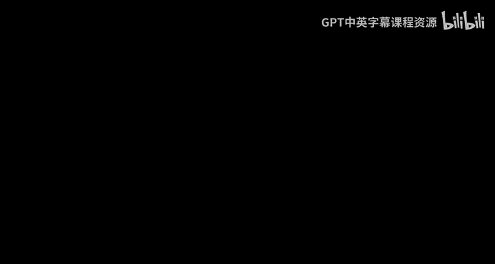

谢啦。Flexibility is possible。 So we use a bunch of different devices to try to make sure that we get here or capture your attendance。

 but sometimes we mess。So please make sure to respond to all the polls that I have up there。

The objective is to a ensure that you are in class and B ensure that you're actually paying attention in class。

Because otherwise the entire point of your being in class is lost and the entire point of my teaching is also lost。

 So please do this。There's nobody in the classroom。I think if this persists。

 then from the next class on， I'll pass a sheet out to make sure we have at least 100 people in the classroom。

嗯哼。😊，People got offended by the Pokemon。So， you know。

 some of the 50% of the class and came back with really bad stuff to say。

 and some of them were quite rude。They get stressed out。I mean， the pokekemons are always great fun。

 It was fun， what。😊，Okay， guys， here is a。啊。Question for you。And pass again。

 I want to make sure that you guys get this right。 This is this answer coming from you。

 We'll probably post a poll on Piazza。In past semesters， we used to issue each of your Pokemon name。

And then when I wanted to ask a question， I called out a Pokemon name a quite a random Pokemon name。

 and if the person who got that Pokemon name did not respond， I marked you absent for the class。

So I know it's stressful。😊，But it's also fun to hear。😊，You know。

 me calling out a yellow tiger to answer a question。 and so。We got too right yeah， so。

We'll post a note if you think it's a good idea， then we will use it from the next week。

That's next its actually。Yeah to have big。 And so this way。

 I make sure that I also engage with people on Zoom， because if it's in class。

 it's easy enough for me to just point out to somebody and say， you didn't answer the question。

 I can't do that on if if they're on Zoom。 So the Pokemon very help without than like。

s get the Pokemonons done。😊，And post a poll， asking them if they're happy with it。

 we'll repeat this poll every week to make sure that， you know。

 we have continuous feedback and they don't get stressed up。😊，Okay， guys， let's begin， right。

 please shut your laptops， your phones， the usual stuff。You know how it goes。

 We're going to continue our series on convolutional neural networks。 And today。

 we're going to begin by talking about cats。😊，闹。It's a true before when we began speaking about convolutional neural networks。

 I discussed this as scanning with MLP， which is basically what it is， right。😊，But。

Do you mind shutting your laptop there？Thank you。 All right。But。

CNNs didn't emerge as a model for scanning with MLPs。 They came from a different perspective。

 They came from investigations into how human visual perception worked。 So the question itself is。

 how do animals see， what are the neural processes that go， you know。

 go from the sensations in the eye all the way to recognition。And for the longest time。

The studies were based， were behavioral。How do we interpret things？ So this picture to the top left。

What do you see。A cube， right。Is that a cube。Right， you just filled it up。

 What about the second picture， What do you say。Is there a dog？Right， just a bunch of little patches。

 So there's a bear。 The My favorite one is to the one to the right。😊。

It looks like what does it look like。The one to the extreme right。

Doesn't it look like a spear with spikes in it？Right， iss there a sphere at all。

 Is there anything indicative of a sphere。 Is there any line， any curve。

 anything that actually shows you there's a sphere。 Nope， you just imagine the whole thing。

 So this is just start and the longest start time。😊。

The way we tried to understand vision was through it was through a study of geestile and similar phenomenon。

 The brain has attain innate tendency to organize disconnected bits into whole objects。

 And that's basically how you see。 If you think of you're seeing me right now。

 the factors you're really not seeing me， you're imagining me most of the time。 Now， you。

 what you really see is a really small region right in the middle of your。Field of vision。

And so you see maybe 5，10， 15% of what you really think you're seeing。

 the rest of it is continuously just being built up by your brain。Buthi is why， you know。

It's so easy to fool people， right， But then all of that is fine。

 But how does the brain actually process images， That's where cats come in。

And the study was done by these guys， Hubi and Wasel in 1959。

 It was a study on neural correlates of vision。 It was a study of the receptive views of the cat stide cortex。

 Now， if you ever imagine there was an intelligent designer who designed us。

 the visual system is the first indicator that this person was not intelligent。 Now。

 if you build a robot of your own。😊，And you have a series of。Are layers of processing。

And then you have a sensor。 How would you organize it。Firstly， you would have the sensor。

 You'd have the neurons that connect to the sensor behind the sensor。

And then the signals would immediately go to the closest processing entity。

 and then from there to the next processing entity， you would sort of arrange it sequentially， right。

😊，How do you think our eye is built， It's completely the converse。 So do I have a chalk over here。

 I think so。We have this crazy retina。And then you would expect the nerves would be behind the retina Noop。

 Our nerves are in front of the retina。 The retinina connects outward to the nerve。 First stupidity。

 right， And so now these nerves have to go to the brain。 How do they actually go to the brain。

 They punch a little hole in your retina and go into the brain through the nerve through the hole。

 You have a blind spot。Doesn't sound very intelligent， at least not to me， right， In fact。

 Oupy have better eye eyes。 They have the nerves behind。

 And then you have this entire brain over here。 This doesn't connect here。

 It goes and connects out here。 way out at the back。And then the signal keeps traveling forward。

As you make more and more sense of what you see。So in our brain。

 this is the V1 portion of the brain in the cat。 that's the strat cortex。

 And so they began stirring the strat cortex of cats。😊，They caught 24 of these cuties。

 and immobilized them， gave them put them on artificial respirators。

 they anesthetize them with truth serum， and then they stuck electrodes into the brain。

 They never report in the paper what they did to the cat afterwards。

 but then they do say that they studied slices of the brain。

 So leave the rest of your imagination and what did they do。😊，The start put hang。In front of。

A light emit。 they kept the eye open， the iris， and they beamed little a little dot of light in different patterns。

And then they studied the response of individual neurons in this tri cortex。

 And this re defines the immediate 20 millisecond response of the retinal cells。Now， the way did。

 they did this。 Do you found a few things。 Now， you have， let's say one particular neuron。

 have your entire retina。 This neuro is going to respond。

To light emitted on a small region of the retina。Not all of it。

 And so this region was what was called the。Receptive field。Of the neuron， the portion of the retina。

 where any incident light caused the neurons a neuron to respond within the receptive field。

 They again， found two kinds of neurons。To there were some regions where if light fell in this region。

 this guy definitely did not respond， regardless of what else happened。Now。

 if there were no light out here。Then there were some regions where if light fell on it。

 the thing definitely did respond。 And then you have all of these things where whatever you do here has no effect on the influence of the on the response of the neuron itself。

 And so what do we find， Here are some typical responses for receptive fields for some neurons。

 So this guy over here。😊，The red regions are the inhibitory regions anytime light falls on it。

 the neuron doesn't respond。 The blue is the excagatory region。So this one out here again。

Similar thing， right， This one。 What do these look like in general。What are these。

 do you see some patterns？Over here。Theres some region where there is no response and then the right region in between。

 there is response。 and what is the general characteristic of these regions。Come on， guys。

 Graham Is it circular。 it's not really。 It turns out that it， the response。As oriented lines。

 In't that what it looks like looks like。 So here is one of their examples。 They beam the light。

 and they just keep moving the light in different directions。

 and then they study the the rate of firing of the neuron。

 And so here's a neuron for which when the light moves as horizontally， absolutely nothing happens。

 as the angle changes， when it becomes vertical， that's when you get the maximum firing。

 And then if it continues， it no longer stops firing。

 It doesn't matter whether theyre moving it a whole lot are just a part part way。

 and different neurons had different orientation。 So the。😊。

They found that neurons responded to oriented slits of light。

 these were the most effective stimuli for activating the strat cortex neurons。😊，And later。

 they showed that within the stride cortex， there are two levels of processing。

 what they call the simple cells and what they call the complex cells， S cells and C cells。

 and S cells captured some patterns Now within the within the retina itself。If you take any neuron。

 it doesn't respond to just one point， right， any retinal cell。 it doesn't just respond to one point。

 It respond。 It has a somewhat circular。Receptive field on the retina itself。

 So how do the S cells get。These oriented patterns。 So to get the oriented patterns。

The S cell over here would have to respond。To an arrangement of these guys along the line。

But then on the retina， these things are very noise。 There's a lot of noise。

 Their cells tend to be sensitive to noise。 And so any noise word。😊，Make their cell respond。

 So the C cell did something like a cleanup。 They captured a bunch of S cells and they picked up the excitation of the most excited S S cell。

 So in some sense， it made it more robust。 if you just had some random firing。

 then the cells that had random firing didn't influence the final final stimulus as much as something that had a really strong excitation。

😊，And so， the complex C cells。Buildup from similarly oriented simple cells or S cells。

 If fine tune the response of the S cell。 and you have a complex buildup。

 So it turns out that you had you had layers of these things。 You had S cells。

Then the S cell response was screened up by C cells。 But then you had a next layer。

 We had more S cells， which looked at this as C cells of the previous layer。

 And then they had their own。Those S cells had their own C cells and so on。

 they showed that as you go through layers of these neural activations。

 there are patterns that to which these neurons neurons respond become more and more complex。

 And later on， they actually conducted experiments on waking meco monkeys。

 which I don't even want to get into。 it's horrible。 But anyway。

 that was the biological study back in 1959。 So fast forward to the 80s。😊，啊， yeah。

Adding insult to injury， however this model cannot accommodate color， spatial frequency。

 and many other features。Let's not make it too hard on us。 But here's your first part。对。你不是。后。Okay。

15 seconds， guys。嗯。Alright， someone on Zoom。What's the answer。Anybody on Zoom。Yeah。

Is there someone on Zoom who's actuallyed fantastic。 Is there anybody on Zoom who's answering。

 What about you guys， What do you think。😊，Option one， right。

 S cells find patterns and C cells clean them up。 That was in 1959。 So fast forward to 1980。

 this guy， Kihiko Fukushima。 This was when he was older。

 He actually began constructing computational models of the whole thing。 First。

 he found out that there were some deficiencies in the Huber visa model。😊。

And one of the chief problems was position in variance of then。

 But how many of you have heard of the Jennifer Anniiston neuron。Seriously。😊。

There was a nature paper on it。Now it turns out that you know people who have epilepsy。

 they are great subjects， they typically often have lesions on the brain。

 and so they go in for treatment and the doctors will open their skull up and they expose the brain and yes these guys just line there right then a long time these cognitive scientists this is perfect。

 Here's a guy with their brain exposed。 Let's use them and so they stick a little sheetath of sensors on the brain and begin using these guys as guinea pigs。

😊，And they show them various pictures and see how their brains respond and so on。

 And they found on one particular patient。😊，There was a specific neuron that only ever fired if this guy saw pictures of Jennifer Anistister。

😊，And so this is the famous Jennifer Aniston neuro on。 Now。

 there's nothing magical about Jennifer Aniston。 It turns out that you have one such run for Arab。😊。

Heey character that you actually recognize one of them being your grandmother。

 So their famous grandmother said。😊，And now this grandmother cell has a characteristic。 It fires。

 regardless of whether grandma's there， there or there， its position invari。😊。

And the model that Hubel and Viasel came up with doesn't actually capture this positional invariance。

 I mean， their explanation just said， okay， fires。 It captures， captures patterns。 You know。

 oriented slits of light and their compositions。 But then how do you get position invariance。

 So this computational model that Fukushima came up with called the neocogniron actually comes up with a model for it。

 Now， the fact that this is called the neocogniron tells me that there must have been a previous model that he called the cognitiveogniron。

😊，But I can't voouuch for this。 Okay， so his model was this。

 He said that the visual system consisted of a hierarchy of modules。And within each module。

 he just sort of emulated what Hu will and result saw。

 There is a layer of S cells or simple cells which captures stimuli from the previous module。

 and then you have C cells， which are complex cells， which clean up these stimuli。😊。

And so S cells respond to the signals from the previous layer。 C cells confirm the responses。

 and only S cells have learnable。😊，Structure。C cells have a fixed job。 There's nothing they can do。

 So here is what the model look like。 The model said that within each simple， complex module。

 there's a layer of S cells and a layer of C cells。And in the layer of S cells itself。

 you got two group， several groups of S cells。 Now， each group of S cells was arranged。

In a somewhat rectangular pattern。 and every S cell within this pattern had exactly the same response。

 It's just that what the， the region of the input it responded to was different， so。😊。

Do I have a cha right now。那算。So within the S L layer。You'd have several assets。

 this are all the essence。And then you have the previous。

 So let's say you had the very first layer of S S first， very first S module。

 The first module is looking directly at the retina。 So this would be the retina。

 and this S looks at maybe this region。 This S looks at this region。

 This S looks at this region and so on。 but all of them have exactly the same response。😊。

So then you would have another layer of another such arrangement of S cells。

 And this guy would look here。 This would look here and so on。 This is different from this。

 But all the S cells within this。Rectangle have exactly the same response。

 All the cells cells within this rectangle have exactly the same response。Now。

 once you had the S cells。The next layer。Consisted of C cells。 And so。You would have。This is。

 this was a plane of essence。And then you'd have a plane of sea cells。

 and one sea cell would look at a small region。In the S plane and respond to it。

 So this was the very first module。 Then the same from the second module on things got a little more complex in the second module。

You have。The second module is looking at the C cells of the previous module， right。

 And so the second module is going to have several C cell planes。

Where each C cellll plane has looked at its own。A cell plane。And then in the next module。

 if you consider this。A serplan。This guy would be looking at some region here。

And also the same reach same region and the every other C cell plane of the previous module。And then。

 of course， this guy would have its own。 So this would be S。 It would have its own C cell plane。

 which is going to look at some region over here。 So this was a simple computational model that they had。

 This makes sense to all of you guys。😊，Right， and。So here's the whole structure， right。

 U 0 is the retina。And then you have all of these S planes looking at the retina。

 you have these C planes looking at their own s plane。 then subsequent layers。

 each Splan is looking at all of the C planes simultaneously and the corresponding and each s plane has a corresponding C plane。

 which is looking at regions of the S plane to clean up the response。

 You also came up with a mathematical model for how these things respond。

 These are very ugly equations。 I never understood them。😊，But basically， it says that this guy here。

Has some response to all of the cells in all of these ellipses。

 The field itself that I was looking at， the reive field was always elliptical。😊。

But then if you look really closely at it， both of them look like res。Pracecttified linear units。

 And in fact， the C cell response， if you look pure at it even more closely， it looks like a max。

 So you could just replace this S and C with a rail element。😊，Then he also， So， again。

The way he arranged it。Each S cell was looking at some region of the input。 Now。

 when the C cell cleaned this up， if this C cell looked at this region。

 this region doesn't need to be seen again because it's already been accounted for。

 So the C planes were smaller than the S planes， they were sort of shrinking the response。

 But then as you went deeper， if you had 10 S planes over here。

 you'd have 10 C planes in the first module。 But then the next module would have more than 10 S planes in C planes。

 yes。question on Zoom do the planes represent the receptive field of a part neurons。

 The plane is a set of neurons。 Each neuron has its own receptor field。 right， Okay。

 so this plane would have a bunch of neurons， which all have the same response。

 They're all going to be looking at that region。 that region beats receptor field， right。

They're all going to look， be looking at。Each of these is going to be looking at an elliptical region here。

 So the receptive fields of all the cells over here would be elliptical。

 but they would be in different positions。😊，Right， and so as you went through the layers。

 the number of。S cells increased， but the size of these images kept decreasing。

And he also came up with an idea for how this whole thing could learn。

So now we have a computational model。You have first the retina。 Then you have your eplans。

You have your retina， then you have your s planees where each eplan has each cylinder eplan is looking at some region on the retina。

 and it has a formula for how it responds。 Then you have a C plane。😊。

Where each cell in the sea plane is looking over a region region here。

 it has a formula for hub response。 Then in the next module， you have。

As planes where each each cell is looking at all of these regions。

 And there's a formula for how response。 So the whole thing is mathematicalized， right。

 and the formula depends on weights。 So when a cell over here looks at some point over here。

 there's a weight associated with this connection。 So to learn the response of the network you have to learn these weights to learn the response of the model He have to learn these weights。

 And he came up with a very nice mechanism for how this could be learned。😊。

So the point was that he just used heavier learning。Now， where's my。嗯。系该 so。Here。

So let's say I have a bunch of。C planes over here。 And I have the S plane of the next layer。

This guy is going to be looking at。All of these。And so if this fired and this fired。

 you just increase the weight。 Simple heavyian learning， just as we are always knew， right。

 But then here is the problem。 So that this over here also connects to a corresponding reach or the subsequent the remaining as planes。

 So if this fires。😊，Then which of these do I actually， do I actually associate it with。

So he came up with a simple rule。 if you look at， if you look at these products。

 whichever is highest， that's the one you're going to associate。 But then you're going to say， okay。

 in this case， this is associated with this particular S cell。 I'm going to ignore the rest of it。

 But then when you update this weight， you'd be updating the corresponding weight for all of the neurons。

😊，In that plane， because they all have identical response。 So a bit of a， it's somewhat heuristic。

 but it works。 And what they found， what he found is that。When you actually just。

 there's no supervision over here， right， you're just using heavy and learning。 If both of them far。

 you the the weight gets updated。 and then he presented it with lots of pictures of characters。😊。

And he eventually found that the earliest layers learn to respond。

 The cells and neurons in the earliest layer learn to respond to things like oriented lines。

 But then as you went deeper into the layers， they began composing these things into more and more complex patterns。

 And eventually you find that after a sufficient number of layers。

 it actually ends up if you presented with lots and lots of examples of digits。😊，It now ends up。

That the farthest layer， the deepest layer， actually each of the S planes ends up responding to a different digit。

And this is completely unsupervised yes。你一定你你出嚟你。If both of them respond together。

 what would you do in He learning？That's a。Right。You just add you how many C sea planes you add or how many S planes you add is up to you。

 right。So what do you mean by the layers keep shrink？So the， the planes， So you might have。

Why do I keep losing my chalk here。In this first layer， you might have four big guys or two big guys。

Right， the next one， you would have， say。3 somewhat smaller guys。 But then it's a map of this one。

And then the next layer might have。Or even smaller guys。 That's all。That's about it， right？

But what they found is that in the end， it actually successfully learns learns to identify concepts like digits and so on。

😊，And so this is completely unsupervised。 It actually here is a model for mammalian vision。

Where you show that present， you know， provided you present a sufficient number of stimuli。

 the model totally independently learns all of the learns to recognize cogent semantic concepts。So。

So far， so good here's another the book。かし。嗯。Professor mentioned that if a neuron in the seaplan fire。

 switch neuron in the e way is increased。 So the sea plane is not learned。Okay， which Sir if。

 if a neuron in the sea plane fires。Which New York is theplan Okay， for sea plane fires。

Then you have an S plane in the next layer。 And so here you would have many S planes。

 and all of them are going to be looking at that particular C plane neuron， right。

 And so you would be looking at。😊，When you process it， there's a complex function。

 And so each of these。Neurons may or may not fire。But then you would look at， you know。

 how strongly each of these guys is actually triggered。

 You find the one that's triggered most strongly。And this weight and the corresponding weight for all of these guys is increased。

ok 啊。First question， true or false， guys。 Second one。Facebookkushiba is model supervised。Okay。

 so can you add supervision。How would you add supervision？A label， right。

 This whole thing has no labels。 so we can just add labels。

 The neocogni run is a fully unsupervised model。😊，We can add external supervision。

 There were several proposals， Ho Atlas and Marx in CMU。 we had Lang in Bible。

And convolutional neural networks was one such example。 Yeah。 Yeah。

 Im kind confused with how youre increasing the rates when。唔。So if this guy has some value V。

You know， because it's going through activations and such like， right？

When you actually process something， every one of these is also going to end up at some value。

You find the one that has the largest value。Or， and then。

The corresponding weight is increased using heavier learning。 that's fine it。Okay。

 and so this is basically what Yaan Lecon did。 He took this model and he started stuck a supervision supervised。

Supervision on it。He took the final C layer and passed all of those neurons into into a simple classification layer。

 can you shut your laptops， please just mind So and to a classification layer with a softm or a logistic function and this is going to output probabilities。

 Now you can provide labeled data andvoila， you can just use back propagation to actually update the weights instead of using heavy and learning。

😊，Now for this， so now we have a fully feed forward MLP which shared parameters。

 all the S planes within this now when you have an S plane。

 we know that all the neurons within the S plane have a same， the same response。😊。

And each neuron is looking at a different region of the input。

So he made a few minor changes for computational convenience in Fukushima's model。

 each neuron was looking at an elliptical region over here。 These are hard to characterize。

 So what would be a simple way， a simple way of fixing it。Just replace them。

 but squares are rectangles， right， And so now each of these， these regions became square。 now。

 second。Is it simpler to have many copies of the neuron or is it simpler to have one copy of the neuron scan。

What would be simpler。One copy of the neuron scan， right， is it is it effectively different？

NoIt's the same computation， right， And so he made some changes。 You have。

And the original neocogniron has as many identical has many identical copies of the neuron。

 which within each S and C plane， he replaced it with one copy which just scanned the input and the response is exactly the same。

 right。And secondly， the receptive fields， she changed them from being elliptical too。To square， yes。

someone at Zoom is asking， what does it mean for all neurons and S claim to have the same response。

 So basically， that means they have the same set of weights there。They're identical， right？

If two neurons are identical， they have the same celebates。

 they don't have the same firing they're looking at different regions of the input。

And so they would fire differently， right？And then as we saw， he want the C cells to be cleaning up。

 But if the C cell is considered some region of the input， there's no need to consider it again。

 And so the C cells strode by a step that was greater than one effectively shrinking all of the maps。

 So this was an additional additional design choice that he made。

 which causes results in a down sampling of the map。 You start off with a large map。

 But if you're scanning it with a stride， the new map is going to be smaller， it's downs。

 So he also called them down sampling。😊，And then finally。

 he replays these ugly activation functions that Fukushima had with something much simpler。😊，First。

 you computed a weighted sum。Of all of the values that you were looking at。

 and then you computed an activation on this weighted sum and I find function and the activation function that he used originally was the sigmoid。

😊，And this was in the C cells in the S cells， observed the S cells have weights in the C cells。

 he just used just as they said。😊，Whatever region it was looking at it is picked of the largest value heap of computed a max yeah。

😊，At this point， are we still talking about how cognition is kind of working in a model of cognition or we move to like how CNNs be more。

 So this was actually we we've slid。 We started with cognition。

And Fukushima's model is a model of cognition。 This is an engineering approximation to Fukushima's model。

 with one additional difference。😊，And that is。Supervision。

 now we encountered something very similar with the very first lecture。 What was that。We spoke of啊。

Which model did we talk about originally， The meone pits neuron， right。

 The mecalone pits neuron showed how things worked。 But we didn't have a learning model。

 The first learning model that we added was heavyian learning。

 but heavyan learning had no notion of supervision。

 And the next stage of progress was when we went from Hebeian learning and the mecalone pits neuron to rosenblts perceptron。

 And what did Rosenblt's perceptron add。😊，The notion of a target supervision， right。

 So this is the same progression that happened。You know， a couple of decades later。

 but in models of mammalian vision， and they are all converging to the same solution。Okay。And so。

 and secondly， in sort of having many copies， you just can。And use backdrop。

 so this was Jann Lehon's famous convolutional neural network for and he first read it on AmN Now back in the day when you know the earth was still young。

 we actually used to write letters by hand， stick them into little envelopes and drop them in these boxes that you found in street corners that you call post boxes。

 you guys won't be familiar with it。And then several times a day。

 a guy in a uniform would go to this box and he'd pick up all of these things and take them to a place called the post office。

 where there were people who would read these things and figure out where this thing was supposed to go to。

 Now， this was really hard。 Reading addresses was was challenging。

 And the post office wanted to automate the process。 And so。

Reading the digits for the address is challenging。And the MNIS database is actually a collection of handwritten digits meant for this purpose to train models for this purpose。

😊，This was Jan Leco'ss model for AT&T back in 1989。

 this is what eventually won him his tuuring award， and you can see how well it works， right？😊。

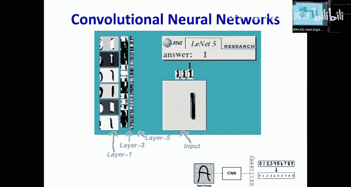

So elequence model itself had several layers。 We'll see that again。And so the story so far。

 the mammalian cortex consists of S cells which capture oriented patterns of。😊，Visual patterns。

 the neocogniron emulates this behavior with plear banks of S and C cells with identical response to enable position and variance。

Only the S cells are learned。 S cells capture patterns。 C cells clean up these patterns。

Unsupervised learning results in learning of useful patterns。

 but Lakeoon's Lanet added external supervision to the new cognitivegogniron。😊。

Where the S planes of identical cells was replaced by scanning with a single neuron and the C cells。

 C planes were emulated by cells that performed a max over a group of groups of neurons。

 this gave us a convolutional neuro network。And so this is what a convolutional neural network looks like。

It didn't come off as scanning with an MLP as we introduced it in the last class。

 it started off as as a computational model from ammalian vision。

And so CNN comprises convolutional and pooling layers。

 convolutional layers comprise neurons that scan their inputs for patterns。

 they correspond to as planes， pooling layers perform max operations over groups of outputs。😊。

And these can occur in any sequence。 You can have It doesn't make sense to have multiple groups of map pooling。

 but you can have several convolution layers before you have a have a pooling layer。

 And then finally， after the final pooling layer， these outputs can be passed to an MP for your final classification。

😊，So。The convolutional layers and the final MLP are learnable。 The pooling layers are not。

Theyre generally fixed and not learnable。 So let's look at what these individual components look like。

 A convolutional layer consists of a series of maps。 Each of these maps correspond to the S planes。

 Sometimes they call them channels， right。And which means that you have many neurons。Well。

 with identical response scanning the previous layer。

 or you can think of a single neuron that scanning it and producing many outputs， right？😊。

And so these things can be called feature maps or activation maps or whatever else。

 but if you look at any particular layer， any one of these planes， any one of these planes。😊。

Here's what it has。 First， it computes an aine function。Of the outputs of the previous layer。

And then where it combines all of the outputs that it's looking at。And then point twice。

 each one of these is put through an activation function to compute an activation map。

 So this is a two step process。😊，This first step is looking at all of the planes of the previous layer and computing an aine function at each location。

😊，And then each at each location， you apply an activation to compute the final activation map。

 So let's see how this， this thing。😊，Is actually performed。

 Let's look at the first step where you're computing an Aline function。And again， within any layer。

 you're going to have many such planes， right。So let's look at just one plane。

This guy is looking at all of the planes from the previous layer。How is it computed？Now。

 and so of looking at how it computes。Combins all of these placess look at。

How this one plane of the previous layer。Contributes to the aine term in this in this one layer。

 So the orange circle represents the previous layer。 The allo circle represents the current layer。

 okay。And so this here， this guy here。

For a picture， I picked this off the web。 buts it's a great example。

 I'm giving an example of one of those planes。 How the values are binary。😊。

And now， corresponding to this one plane。You are when you compute each term over here。

 This guy is looking at some rectangular region over here。

So corresponding to each position and this rectangular region is going to be a weight。

 So you would have an arrangement of weights， maybe a three cross three set of weights。

 which is often called a filter。 Now， when you have an a item， there's also a bias。

 I'm going to assume that the bias is 0。 So what you would do is you would position this filter。

 this guy。 and the top left corner。 and element wise， you would take a product of the underlying map。

😊。

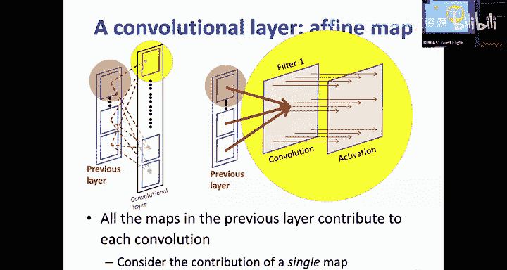

And the corresponding filter value， which is shown in red。

 And then you'd sum them all up plus the bias。 And that is going to give you the value here。

 And so you would do this step by step。Keep str forward。 And at each position。

 you're taking a position wise element wise product。Summing them up。

 And that is the value that goes into the output map， right。

 So but then this picture is still not complete。 It is making sense to all of you guys。 what we did。

This picture is still not complete。 This is basically showing how just this one guy。

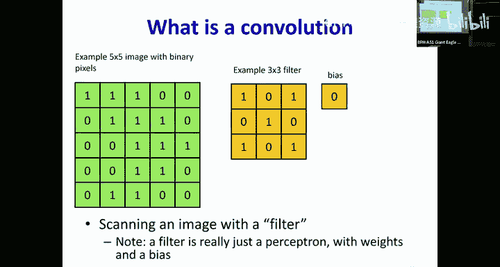

Contributes to this map。 But then you know that this map is computed from all of these guys， right。

 So just as you had a3， three cross three set of weights for this map。

 you would have a three cross three set of weights corresponding to each one of the maps in the previous layer。

 And all of those maps are going to be different。 So a more appropriate illustration is something like this。

 where in order to compute this one output maps。 So this orange one。 I read one it here。

 So you have several maps。 each of those is shown as a map out here。

 And then I'm computing the next layer。 I'm computing this map of the next layer。😊，So， for this map。

This is the same。Tectangle is here， right， to compute it， corresponding to each one of these guys。

 you are going to have a three cross 3。Arrangement of numbers。

 the color code basically shows the numbers because colors are more easy to interpret， right。

 And so here is how we would actually perform the computers。

You're going to place this filter on the top left corner。

Perform an element wise product and sum them up。 And that's going to give you the top left value of the output map。

Then you slide it forward， perform the same thing， and you get the next value and slide it forward and perform the same element wise。

 So the equation for what of the computation that's being performed is shown you。

 this M is summing over all of the maps。😊，Here， you're summing over the square region within each of the maps。

 And within each of the maps， you are multiplying the weight。The color， which is shown。

 which is the colored value by the underlying value of the map itself。

And this sum plus the bias is what is being copied over， right。

 And you keep repeating this process until the bottom right is scan yes。

How are all the input plane values compressed into a single output patch。

That's exactly the computation that I'm showing over here。 So you have in my example。

 I have a bunch of input plane values right And for that output map corresponding to each of these maps。

 I have an arrangement of weights convol happening How does that just map one that is the equation over here right。

 So。😊，I have。Corresponding to each one of these input maps。

 I have a three cross three arrangement of weights。 In my example is three cross three。

All of these weights are different。I position that in the top left corner。At each point。

 I'm going to multiply the weight value by the underlying math value。So I sum up these nine terms。

 I would also sum up these nine terms， and I'd sum up these nine terms。 So when I sum all of them up。

 I'm eventually going to end up with a single value。

And that single values is being is what is being copied out here， did that make sense。

 Ask them on Zm。Did that make sense， Yes or no。 So it's a sum of 27 terms in this exam In this case。

27 and more， because I have some three dots in the middle， right， plus a bias。 Don't forget the bias。

And so this is going to happen position by position。 Yes。

 how are all the weights for each filter being determined， is it just random or。

We will talk about how you learn them in the next class。 Okay， please。

 these are parameters of the model， okay。But they would be launched using back。

 And so once you scan the entire input， you're going to get one output map。Now。

 if you want a second output map， what do you think you would have to do？嗯。

You would have a second set of second filter。A second set of these rectangular， you know。

 collection of rectangular planes， which you would place on the input and then scan it just as you just。

 just did。 And so the second guy。Right， this second filter， which is all of these。

 is going to give you the second map。😊，That makes sense to everybody。I我道在 when你必须在做的 different分。

I dont you producing one set like one activation each。 No， so for this entire set of。Fters。

So that okay。To for for each output map， you are going to have a filter component for every one of the input maps。

Like so， right， this， there's a different way of visualizing it， which might make more sense。

 We just take a look， right， But have a cat No， this is these you started off with a cat。So。

 I remember。You started off initially with a picture。 And then in the very first layer， you had。

Your as planes， right？ So this guy scanned it and you got a bunch of these。So this is。

 these are all maps of the same input。Okay， this is from a different。 Yes， from the previous layer。

 This is from the previous layer。 That's about it。 right， yeah。Since they're not considering weights。

 Yeah， we're just adding， which since they're not considering weights。

 These are the weights at each point， you're multiplying the weight。

 which is shown by the colored value with the underlying。 All of them are gonna be same。 No。

 they're all different， right， I just as indicated by the fact that they all have different colors。

Right， so I'm trying to make it as visually。You know interpretable is possible。

 If the colors are different， the numbers are probably different， right， And for the next filter。

 they're going to be a different set of weights。 That makes sense。 Yeah， Profesor。

 why is each input map given the same weight， if each input map is not being given the weight same weight。

 So look at all of these colors， These colors are different， right， yes， but。The the the okay， fine。

 I， I get what No。 I mean， if you wan to scale them up with that， that just goes into the weights。

 right， yeah。I just under the impression that in CNNs， we have shared parameters and exactly。

 And so here is the thing。Look at this。啊。When I compute this。This element。

I'm using this set of weights， right？When I compute the next element。

 am I using a different set of weights？The same set of wastes。

 So it's like having 27 neurons with shared parameters or one neuro which scans the input。

It makes sense。9 neurons which shared parameters versus one neuron。啊。With scan input。 Make sense。

 Yeah， size as input。 if the filter was the same size as the input， there's no more scanning。Right。

 that just becomes a simple ML LP。And so a different filter for the next plane。

 Did this make sense to everybody。The visual over here。 And so I can draw this differently。

 This often makes more sense。So instead of drawing these planes， one below the other。

I can stack them up。In the form of a cuide。So they are the same representation instead of drawing the planes 1 below the other。

 I just。Collapse them and form a cube。 So each plane is called a channel。 The entire cube is， is。

 is the output， right， And now the filter is also going to be a cubo with a face。

 which in our example was three cross 3。 But you have a depth， right。And so did this make sense。

And so now we place the entire filter in the top left corner。And now the filter has， you know。

 as many， the number of elements is going to be three cross three times the number of channels。

 right？😊，And so you would first perform an element wise product of the filter value and the underlying map value within this channel。

 That's this term over here。And then sum that across all the channels。

And that is going to give you this one value out here。 You also would add a bias。 That makes sense。

Right， and so now this， yeah。 so when you that you up let's say that in the first day。

 you have 10 filters。 So you have basically channels， right， So here。

 let's say I have output 10 channels out here。So then this is going to have 10。我那个。

So so the filter is going to have。You know。103 cross trees。Okay， and those and this。

 this is gonna be this filter， right， And this would be as many as these。

 if I want to be able to place the filter like so。 this is a case of black。😊，Let's get to this。

Don't get confused yet， right， So this could be for gray scale images， you just have one plane。

In the beginning， but afterwards， you'd have more。Let's see how the whole thing comes together。 Okay。

 yes。And I don't like this is just like a diagram。 But what our planes are be getting like smaller。

 right after a pilot filter。 So， no， this is not gonna get this convolution， if I keeps。Going。

 you know， sliding by one step at a time。 Is it going to get smaller。呃。Hang on to this。 Okay。

 And so the size of the output convolution depends on factors。 Yes， you're not shrinking a 5 by 5。

 Okay， H on。 Okay， so that's exactly what we are speaking of over here。

 The output may not be the same size as the input。 What are the issues that affected。

 So let's look at this guy。😊，This， this is just one of the input maps， right， This。

 this green thing was。Just say this one guy。That we are showing。 Okay， and so when I。

But then the fact that we are using all of them。As a stack means what happens to one plane happens to all of them。

 right， So now。If the input is 3 cross 3，5 cross 5， and my filter is 3 cross 3。

 what is the output size going to be。Iク。You tell me， right。So， here is what happens。I can have5。

Over here。And then。I have my filter is 3， correct。So this is going to give me one position。

How many times can I step forward before I run out of the input？Three times， correct。

 Then I can move here。And here and then here。 and then I'm off。Right。

 so I can generate only three inputs。 So in general， if this is N wide。And your filter is K wide。

 The first K is going to give you the first position。Right。

 and the subsequent one is going to give you how many。N minus k。Correct， plus。one plus。And minus k。

 So this is K。This is going to give you one。 And then you have n minus case steps that you can take。

 And so the whole thing is going to shrink to。N minus， in my case。

 I'm writing n minus M plus one on each side。 Did that make sense。

And so that's what's going to happen as you scan after those many steps are're going to run out of the input。

Now， in some cases， you don't like this loss of size at the boundaries。

 If you don't want to have loss of size at the boundaries， what can you do， I can just。

 so this results in a reduction in the output size， sometimes not considered acceptable。

 So you can get symmetrically pair。 How many rows of and columns of zeros would you add。

In my example， too， but how many are you losing。If your filter size is k， you're losing k -1 rows。

 right， So k -1 over  two on either side。 that makes sense。O。To make sure that you don't lose。

 And so this is going to result in an aine map。 This is the aine scanning of the previous layer。

 Subequ， you want an activation map where you're applying an activation function to each element of the aine map。

 And so if you look at the look at the entire pseudo code， this is what you look like。 Yes。

 within each layer。😊，For each map right you are scanning left to right and then I'm thinking of this in terms of a of the three dimensional cubo the segment over here is my 3 dimensional cuboid is' a 3D tensor corresponding to each element of these there' is going to be a weight。

And so I do an element wise product。And some。 And then finally， apply an activation to it。And that's。

 that's what's happening within each layer。 So this makes sense to everybody。 You guys the back。Okay。

And so convolutional layers scan the input using a bank of filter。

 The filter is just a neuron and a scanning layer。 Each filter jointly scans the maps in the previous layer to produce an output map。

😊，And you can have as many output maps as filters， regardless as the number or number of input maps。

 we may have to pad the edges of the input maps to ensure that the output maps are the same size as the input。

 Otherwise you're going to lose for a filter of size K。With K。

 you're going to lose k -1 rows and k -1。Colllums， right。And now。

 convolution and activation layers are followed intermittently by these pooling layers。 Now。

 we're going where the weight was originally defined in。By Laoon。In the convolution layers。

 you always str by one。 This is not necessary。 and the pooling layers is strode by more than one。

 So the pullinging layers tended to shrink the maps。 What did the pullinging layers do。You had。

Puling layers applied map by map。 So if you had some map。

 then you'd have a pooling filter which looked at some region of the input and pooling is basically introducing jitter invari。

 Let's say you're saying that this arrangement of petals is a flower。

 It one of the petals jitters by a little bit off by one pixel。

 It doesn't immediately stop being a flower， right， And so you want to say in this region。

 did I detect a petal。 That's， that's the question you want to ask。 And this is what pullinging does。

 It looks at a small window of the input。😊，And picks the largest activation if you're performing max pooling so in this case that Windows 3。

1，4，6， the largest value is6 that's going to be copied over， then you slide forward。

 maybe you have some other set of values you pick the largest value and you keep doing this you could stride by one or you could stride by more but this is the pooling layer this make sense to everybody。

So that's basically what you're doing。 You are。Scanning the input at each location you are picking and look identifying a region of the input。

😊，Now， observe that this is actually done in two steps。 you're first finding the position。

 the index of the largest element in that window， and then you're copying that value over。

 Why do you think we are just doing this in two steps instead of just running a max。😊，Anybody。

Why would we do that？Anyone on Zoom？Why are we are we just taking No。

 Why are we just doing it in two steps where I'm finding the location of the maximum and then copying the value。

 instead of just running a max operator， we just copies the largest value。 back propagation。

 You would need this for back propagation， right？ Otherwise。

 you won't know how to propagate derivatives backwards。 We will see this in the next class， okay。Now。

 you can also have mean pooling where instead of picking the largest value， you pick the mean。

In which case， that max finding the position and picking the largest largest values replaced by me。

 or you can have other operators， which people have tried like some P norm。

PenO is a cleaner is a more differentiable version of Max。

 or you can even use a little neural network that's learned。

 this was called the network and network back in the day， right？😊，So。

Pulllling layers scan the input using a pooling operation， for example。

 selecting the maxs from a K cross K block of input。

 Each polling layer scans the individual maps in the previous layer to produce an output pool map。

 and you have as many output maps as input maps。For pooling。

 we do not generally pad the edges because if you introduce zeros on the edges。

 those things are going to max mess with your maxes and means。 So pooling is only convolutions。

Paent edges， okay。So here are the kinds of layers that we've considered so far。

 We've considered convolutions， and we've considered poolings。Now， in both of these cases。

 although Yan Leon used a stride of one。In convolution and a stride greater than one for the pooling。

 as a result of which the pooling layers were also called down samplingamp layers。

 This is not necessary。 We could do either of these operations using any kind of stride。

 So I'm going to assume that the basic operations are always performed with a stride of one。

 This is what is most conducive for mathematical interpretable load。 And we will see why。

 right when you have strides greater than one thing end up being a little more confusing。

 So then this business of shrinking the map can be pulled off into a completely separate operation。

 which is down sampling。 I can start with a large map。

 and I can try to reduce the map by a size of two。😊。

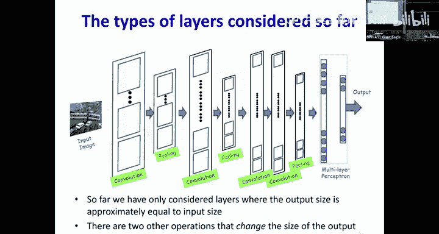

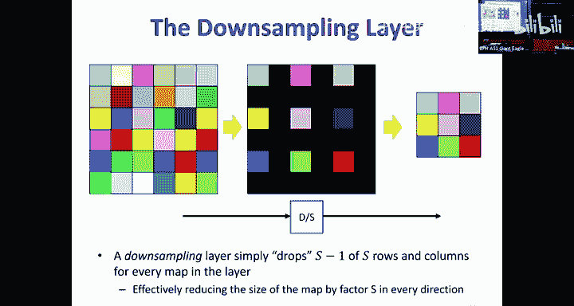

So what is the simplest way？So， let's say I have。A map of。Say size 4 cross 4， right， And I want to。

Shrinked。To a map of size 2 cross 2。How would you do it， So no。

 this is all I want to do is shrink the map。 What would I do。我。Lose data。Can you say that a lot。

 lose data。 How just。R by row column by column drop something。 You Which one would I drop。

Ially should drop the ones which have least value， but that's a pooling operation， right。

All I want to do is to compress it。 What would I do， How would I down sample just delete。S-1。

 So what I can do is just read this guy。I can just drop these rows。These columns。And these rows。

 right。And so now I have two cross2 left。 So if I want to shrink it by a size S I just take every S through an S column。

 This is the simplest operation I can perform。😊。

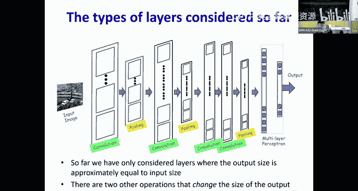

Makes sense。 Yeah， why don't you just use pooling then。If I do pooling， what am I doing with pooling？

You're going to be reading the Mac， I mean， depending upon thepolio operation。

 you'll be retaining some sort of information or the max information or the P norm or the mean and then and and then like reducing the size of my Mac。

Reducing the size。 How did the reducing the size happen， Q dropped elements， I dropping elements。

 which is basically what this is。 Yeah， but like， isn't that like a bit probably better。

 Because you have， how is it better， How is it different Because you are based upon the quote unqu based on the magnitude youre designed to drop it over here。

 you is dropping it arbitrarily based on a geometrical constraint there youre dropping based on the value constraint。

So， once again。If I'm dropping and if I'm taking a stride， what happens。这是。Right， nothing。

 there's no difference。 I could perform the pooling with a stride of one and then drop every second element。

 Is there any difference， exactly the same， right？ It's more convenient to think of doing all your operations with a stride of one。

And then dropping every second column， correct， makes sense。 Any questions on Zoom。

But what if you take in the it doesn't matter。 Does it right。If you're taking a stride of two。

 it's exactly the same as dropping these guys。 Yeah， so I didn't follow。 Why are we doing this。

If you want to reduce the size， how would you do it， Okay， but why are we。Why， okay。

 you don't need to。 You can keep the size。 right， There's no y to it。 If you want to reduce the size。

 this is what you would do， right。Okay， this makes sense to everybody。

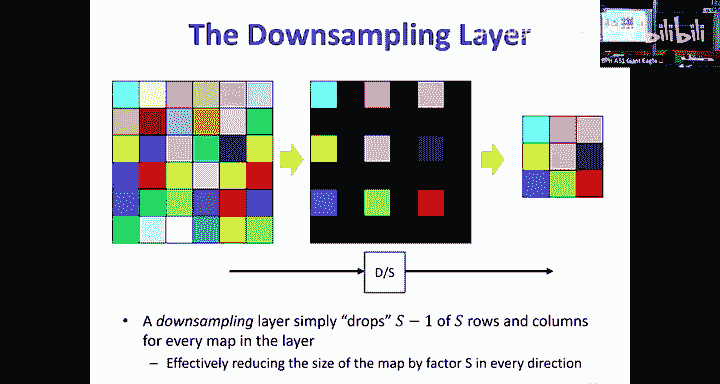

Okay。Basically， pseudo code， you just drop everything。 now， typically， when I perform convolution。

 followed by down sampling。Then instead of having a convolution with a stride of one。

 followed by a down sampling by two， it makes more sense to just convolve with a stride of  two。

 This is strictly the same operation。Right。But conceptually。

 it is important to realize that when I'm performing convolution with a stride of two。

 what you're really performing as convolution with a stride of one。😊，And downs by a factor of two。

Or if I'm performing convolution with a stride of k。

 what I'm really doing is con work involving with a stride of one， followed by down sampling with bi。

By a factor of K， that makes sense to everybody。And this is important because it's going to affect us when we perform back propagation。

😊，Unless you really are very fond of doing ugly， complicated things which mess with your brain， okay？

Similarly， if I'm performing pooling with down sampling。

Is the same as pooling with a stripe greater than one。

But it's convenient to think of it as pooling with a stride of one followed by。A down sampling gl。

That makes sense to everybody。Okay， now down sampling is great。 What is the reverse。😊，I can try。

 So here's down sampling after convolution， right， If you look at down sampling after convolution。

 you're taking a stride， the size changes。 You have to worry about the size。 Let's get this， right。好。

 now。Same thing。 down sampling and pooling layers can be merged here。 Someone's asking。

 how do we minimize the loss after pooling， as we certainly will lose some information。

 We're going to talk about this in next class， right， back propagation。

 also can professorfess the sampling and pooling belt。Mening。😊。

Its so a little confusion that there is sampling。 Pooling is a completely different operation。

 Pooling is an operation where you're taking the max or the mean or some combination of these values。

 And then you can do this with a stride of what。Down sampling is where you're dropping layers。

 I think she wants to ask the previous slide link where you were explaining what's the like the previous one。

Like个话 I think she wants to ask。Holy。Down sampling pooling with ascribe down。 So down sampling is。

Dropping layers， right， now in the good old days。Pouling was always performed with a stride。

 So it just called down sampling。 But strictly see speaking， pooling is a pooling operation。

You're going to take a group of values and compute a single variable from it。

 And then you can take a step of one， right， So if any time you're thinking of scanning。

 it's always useful to think of it as striding by one。 You're sliding across the picture。

 And then when you want to shrink the map， you drop a K of K -1 of K elements。😊。

You can combine the two into a single operation by performing a pulling and then taking a stride of K。

 and the two are exactly the same。😊，Makes sense。Okay。And so， yeah， hi， I have a question。呀怪。Yeah。

 I'm really trying to understand what the sampling pool part and I really really didn't get what you were saying。

Can you please repeat that So I'm not sure which you didn't get Delphamine。Y， they stride。

 you sing they stride。 Then you go K-1， then they stride。 And then you， and I just lost that。Okay。

 so here。If you're performing pooling。Then here is what you would be doing。 You have an input。

You're going to do some pooling operation over here。 You get some value。 Then you step by one。

And then you consider this next window and you get the next output。

 So that's what your pooling operation is doing。 You， you're always。

 your pooling is the act of pooling is grouping these elements and computing some value from it。

Without learned parameters。 And then you scan the input it， you scan it for a stride of one。

 Did that make sense de。Does that make sense。Okay， down sampling is this business off。

Taking some image。And shrinking the size by dropping a bunch of things。Did that make sense。Yeah。

 that makes sense。So but then if I combine these two。

 if I have a pooling operation followed by a down sampling operation。

 it ends up being the same as pooling and then if say I'm down sampling by two。

 instead of stepping by one， I had now step by two， that was it。that makes sense。Yeah。

 that makes sense things。 So， so scanning with a stride is the same as scanning full or followed by down sampling。

 okay。So。

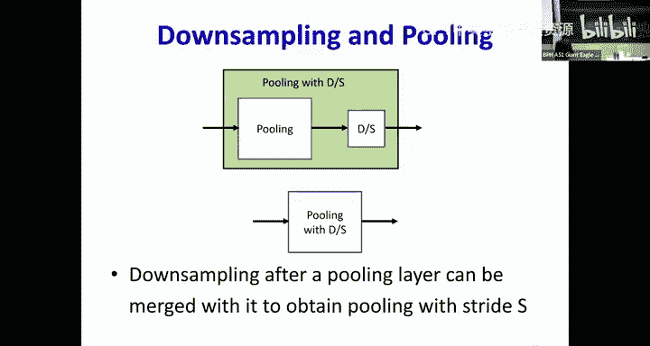

And there's a converse， right？The converse is。

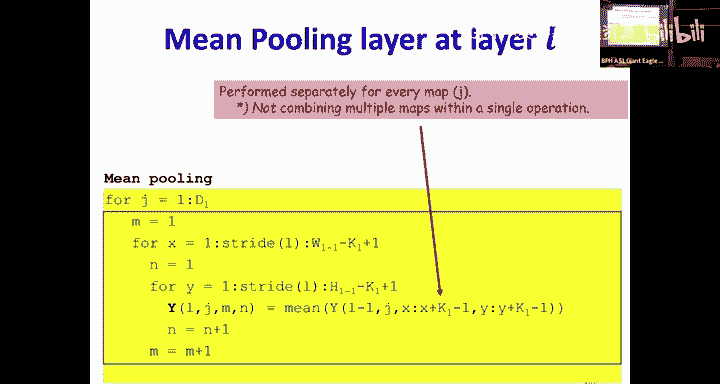

You can do the same thing with me input input。The converse is increasing the size of a map。

How do you increase the size of a map。You can just introduce a bunch of zeros。

So if I want to go increase something by a factor of two， after every row。

 I'm going to introduce two zeros。😊，I introduce a0 right to into a scalar by factor of k after every column I introduce k k minus1 columns of zeros after every row I introduce k minus1 rows of zeros。

😊，It's a trivial operation。 This makes sense to all of you guys。 Yeah， right。And typically。

 now does it make sense， this is an up sampling operation。😊。

Does it make sense to perform pooling after up sampling？No， why not。Because it's。对对。

oling is not pooling is not down sampling， Right， Poing is just pulling。

 So why would it not make sense， Because you're up samplingling with zeros。

All the zeros are going end up messing up with your max pooling， right。

 You're gonna get an if all of those colored values were negative， for instance。

 and then you did a max pooling， you're just going end up with a bunch of zeros。😊。

You completely lost everything， correct， So it does not make sense to follow。Up sampling by pooling。

 This has nothing。 poololing is not down sampling。 Poing is pooling。

Pooling followed by down sampling is down sampling。

 You often combine the tool into pooling with a stride。Okay。

 but if I app sample by introducing zeros and then perform pooling。

 I'm just going to lose information。Makes sense， okay。So typically。

 up sampling is followed by convolution。Because convolving is basically smearing the information。

 And so if you introduce zeros and perform a convolution。

 the zero regions are going to get filled in with some values that are the outcome of the convolution。

 That makes sense to all of you guys， okay。😊，And so this thing。Up sampling pseudoor。

 You just introduced the。 I'll skip the pseudoor， okay。Now， when you ups the sample by a factor of k。

 a terminology that's often used is convolution。Upampling and up sampling is followed by convolution。

 So they just call it convolution with a fractional stride。

 There's nothing magical about convolution with a fractional stride convolving with a stride of 0。

5 is the same as up sampling by a factor of2 followed by convolution。😊。

That makes sense to all of you guys。Right， it just says that the size is going to increase。 Now。

 why would you want to do this now typically。😊，When you perform as you train your neural network。

Your maps are going to keep getting smaller and smaller because we try to make them compact information。

 We'll discuss this more than next class。Or if I have some time。 And so if you want to go back in。

 in your standard CNN model， you could go save from an image of  thousand by thousand。

And when you're done， you're going to end up with maps that have like four cross 4。

 You want to go back to， if you want to reconstruct the image。

 you want to go back from4 cross 4 to thousand0 by thousand0 that you're going to do using up sampling。

 yes。How to converge with a stride of 0。5 or is basically less than a whole number。

That's exactly what I said。 Convolution by a fractional stride is basically the same as up sampling。

 followed by regular convolution。 So if I convolve with a stride of 0。5。

 it seems it means that I'm up sampling by a factor of 2。😊，And then， performing convolution。

That makes sense to you on Zm。公告。O。😊，So map sizes can be changed by down sampling or up sampling。

 down sampling drops s minus1 of s rows， up sampling inserts zeros between every two rows and columns。

Down sampling typically follows convolution or pooling and reduces the size of the maps up sampling occurs before convolution and increases the size of the map。

 It doesn't occur before pooling layers。 Okay now there's some business about。

 So here's the story of so far。 convolutional neural networks are supervised versions of computational models of mammalian vision。

 they include convolutional layers comprising learned filters that can scan the outputs of the previous layer and pooling layers that vote over groups of outputs from the convolution layer。

😊，Convolution can change the size of the output， this can be controlled by padding。

Pooling may perform max P norms are be learned。 Then you can have reamp layers。

 which include down sampling layers， which reduce the size of the map and up sampling layers。

 which increase the size of the map。😊，Everybody good with all of this so far。 Okay， so that's。

 here's a poll。😊，Yeah。世京でかし水经な。あ是ら三。Why would it。ThisConvolution is performing this with a side of one。

 So you're going to keep keep the size， right， Why would you want to upsize and downsize You were dropping came came。

 you were drawing， dropping uniformly， right， K minus as one of K。Yes。Any fighting to。Yeah。Yeah。And。

Okay， so I'm gonna to give you。10 seconds more。Because we're running out of time。

Anybody on Zoom want to answer the first question， which the which are the statements that are true of the up sampling layers。

 guys。Zoom。我星佢。First and third， so up sa by S introduces s minus1 zeros between adjacent rows and columns true or falses。

Can everybody say true。 I need it louder true true Okay， right。

 up sampling layers are followed by pooling layers to or falses。 Okay， I need codes guys。

 They are generally followed by convolutional layers to or falses。 Okay。

 they can be combined with a convolution or pullinging layers before them into a single operation with a fractional stride true or falses。

😊，Why is it false。Typically not done with pooling， right， That's about it。 Okay。

 marked all that are true of down sampling layers。Anyone want to answer this one I the same in the room。

 which ones。Down sampling by S replaces every S through and column zero2 or falses。Okay。

 it deletes S -1 consecutive rows in columns， true or false。 Okay。

 down sampling layers are usually merged with the convolution of putting layers after them true or false。

 They are merged with those before that。 Okay， right， so beautiful。

 only the first and third and second fourth。😊，So here's a typical image classification task。

 I'm just going to fly through this。 Let's say you want to analyze this image。

 and RGB image is going to actually have a color image is actually has three images， a red image。

 a green image and a blue image right If it were gray scale， it will just be a single image。

 Ill assume RGB。 So these the input is three pictures。

 I can just stack them up and now I have a three channel input， right。

 The very first layer is going to have a bunch of filters。 let's say K1 filters。

 The filter size is say L cross L。 So the number of parameters is L cross L cross3 right for each one of these K1 filters。

😊，And the filter cap are typically in your convolution layer， you have 5 cross 5。

3 cross 3 or even one cross 1。 What is a one cross  one filter， anybody。😊，嗯。It's。

 it's a non distributed scan， right， when you were doing when you were non not distributing the scan。

 you were looking at only one pixel from each map。 So one cross one is a non distributed scan。

 That's just looking at one pixel okay。

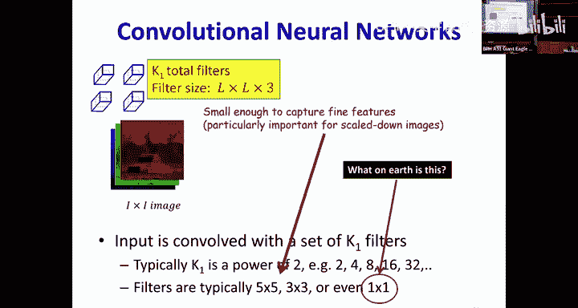

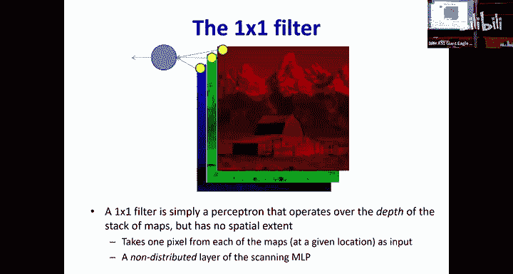

And so you'd have these。 Now， each one of these parameters to choose are the number of filters and the size of the filter。

And if you scan the input。Typically， we like to have the number of filters via power of two。

And if I have a few minutes at the end of the class， I will go over， you know。

 how the number of filters and pooling changes matters。 Okay， typical stride is one or two。So。

 and if you don't want the size to change， you would pad this with zeros just to make sure that the output size is the same as the input。

And then for each of the filters， you're going to be first computing the aine map。

 which is simply the weighted sum。 you know， the exact operation that we just performed。

 the weighted sum of。All of the elements in the input covered by the filter at the current position plus a bias and then that value is going to be put through an activation and so you're going to get one of these maps for every one of these filters which can be stacked。

😊，Right。And then so the first convolution layer may have K1 filters We have some L cross L size。

 So the total number of parameters is going to be。😊，K1 times in this case，3 L squared plus one。

 because every filter has its own bias。 Never forget。 It's an aine term。 There's a bias， right。

And these must be learned。Subsequently， on each of these guys， you're going to perform。

 let's say a max pullinging。So the max pooling typically is done with a strip。

 And so the max pooling is going to reduce the number of。The size of the map so that it goes down。

 right。And then here， the way you would do it， max pooling。

 you're going to be youd have a little window and you want to pick the largest element in the window for each。

😊，As you scan， but the manner， the choices here are， you know， what kind of pulling。

 max or mean pulling。How much are you going to strive by？But there are no other parameters to choose。

 You only have hyper parameters。 And the actual operation is performing in a two step way。 First。

 you find the index， if you're performing max pullinging。

 you find the index of the largest value and then copy the value over。 and then you strike it， right。

 And so the outcome is going to be a bunch of。😊，Mps  one part。You know。

 you're going to have one max pooled map per each convolutional map。And now。

 the next layer is going to have。O， jargon。Filters are often called kernels。

 and these individual maps are often called channels。

 So these are the terms that you're likely to encounter in your homework。

 or anytime you encounter convolutional neural networks， right， These are channels and kernels。

 filters are kernels。 Then the next layer is going to have a whole bunch of filters。

 If you have K2 of these filters， You're going to end up with。Actually。

 if you have K3 of these filters it're going to have K3 maps。

 but each filter size is going to be L1 L cross L times k。😊。

Because the filter has a face of L cross L and the depth of the filter is the same as the number of channels。

Right， so， and then each filter is going to produce one map。 So if you have K3 of these filters。

 the total number of parameters is K3 filters。😊，Times L3 cross L3 is the face of the filter。

Times K2 is this step。But makes sense。In terms of the number of parameters， right。

And so those are going to produce a bunch of maps。So it's K3 times K2 L3 squared。

 this plus1 again is for the bias。 Don't forget the bias。This， it's our fine。

 So there's always a biaser。And then from those， you'd have some pool pooling。

 So you'd have a bunch of pool layers， you know， pool maps。And again， what is the size of the window。

 How much are you going to stride by。And you keep doing this and eventually have the final pooled or convolution layer。

Those outputs are going to be strung out into a single vector and pass through MLP。

 And here the output is going to be the choice。You know how many layers， How wide are these layers。

 right？ So each convolution layer， stride one typically maintains the size of the image within boundary effects。

 Each convolution layer will generally increase the number of maps from the previous layer。

And each pooling layer with stride D decreases the size of the maps with a factor of D right so if you guys are willing to wait a couple of minutes。

 this is an important topic so I'll get to go over this。😊，Let's say。I have。An RGB image， okay。

And so if I have an R jar RGB image width where each image is say thousand cross thousand0。

How many values do I have over here in the image。A million。3 million RGB， right。

 So I'm going to have 3 million here。So。Three times standard raised to 6。Now。

 if I perform convolution with。Some filter， okay。I'm going to have what is the size。

 rough size of the output after convolution。 if I have K filters。What is the how many。

 What is the size of the output over here。Assuming a convolution of the stride of one。

 what's it going to be？Can3 I'm going to have a million cross1000。

I'm going to have 1 thousand cross thousand0。And I'm going to have。K of these， right。

Have I lost information。Okay， now。I。But from a pooling operation。

And let's say I perform a pool operation creation with a stride of k。What is this resulting size？对。

嗯哼。😊，It's going to be。 So let's say I have a stride of L， okay。If I have a stride of L。

Then this is going to result in。Thousand over1。Thousand over L， correct。

And so what is the total number of values I have over here when I'm done。ok嗯哼。How many。

 how many times？ how many values will I have。Okay， I have 1 million，3 million out here， correct。

So here I have。How many do I have K times。10 raised to 6。 Each of these is 1 million。 Yes or no。

 Can I have a to combined S， Okay， So if I pull these with L on each side。A stride of L。

 How many do I have， How do I have left，0 to8 times 10 race to 6 divided by。L squared。

What is the condition under which this loses information？If elsewhere is greater than now。

If K over L squared is smaller than 3， I have lost information。 Yes or no。 Okay。

 so now I have K over L squared where the maps are smaller， correct。

 So I have to make sure that the number of maps I have。😊，Is sufficient that after down sampling。

 I have not lost information。Which is why as you go through the layers as the maps keep getting smaller and smaller。

 the number of maps have to keep increasing if I don't want to lose information， did that make sense。

All of you right， and which is why as you go through a convolution layer。

 you may start up with two filters。😊，But then you're down sampling by 2。

 You've already lost by a factor of 2，2 over 4， right， So then the next time。

 So  two is not a great number。 You probably want to start with 4 if you're down sampling by 2。

 just so that you don't lose information。are four times the number of input channels。

Will make sure if you're down sampling by two。 make sure that you don't lose information。 And so you。

 if you're not interested in not losing information。

 you have to keep increasing the number of channels。 And then what will happen after a great。

 many such。Down sampling operations is that the eventual maps that you're going to get are going to be very small。

 Maybe， you know， four cross 4。 if you don't want to lose information。

 you're going to a you're going to need a million of those guys。

Just to make sure you have not lost information。 And then subsequently。

 you' have up sampling operations to make sure that things are not lost， okay so。

You have all of these parameters to choose， I'll skip the pole。😊，Okay， guys， actually。

 I have a bunch of slides after this。 Please take a look。It's just one slide。

Why don't you do this poll， we'll be gone in 30 seconds。换筒。不行。Oh， here's where the chocolate was。

shop。No。いや、あで。Okay， guys， what is the answer。Same， right。

 The number of channels is the same as the number of。

Newron in the corresponding layer of the scan scanning MLP。 Okay， yeah。such an outstanding。

We get information。感觉这个是。Fantastic， thank you guys。 All right， In the next class。

 we're going to talk about training。 Sam thing。 You have the whole thing that has gone through the network。

 How do you back propagate。😊，I'll see you in the next class。 Thank you， everybody。最こ。

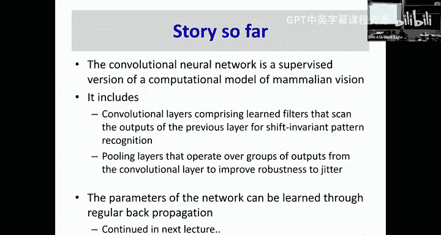