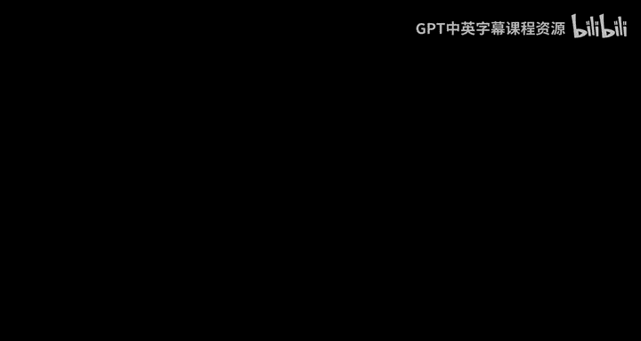
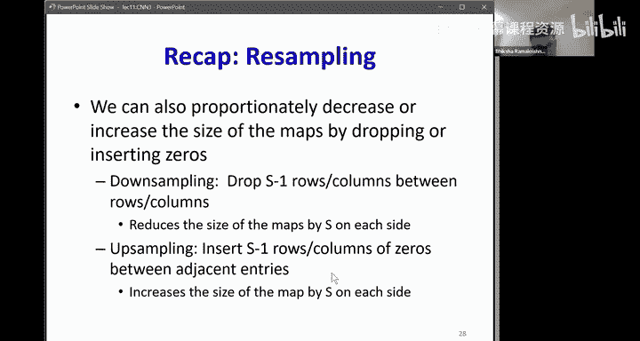
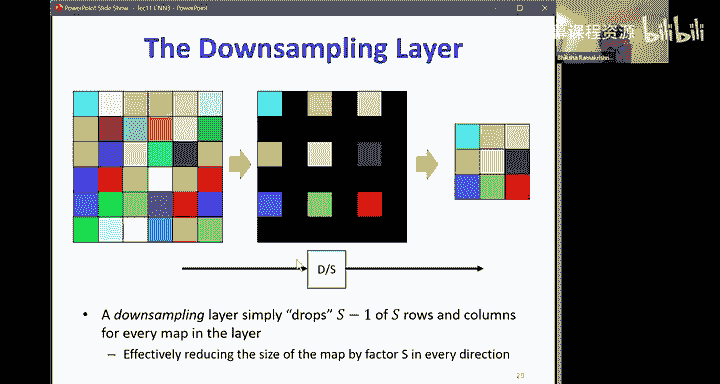
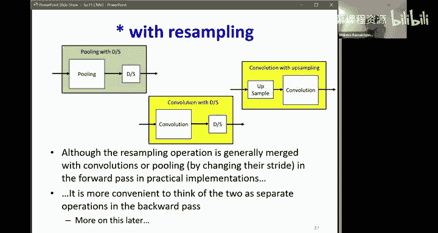
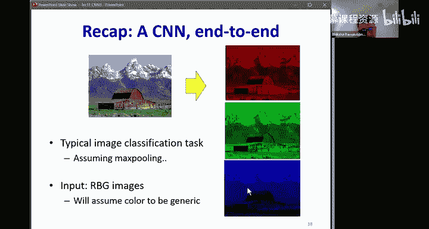
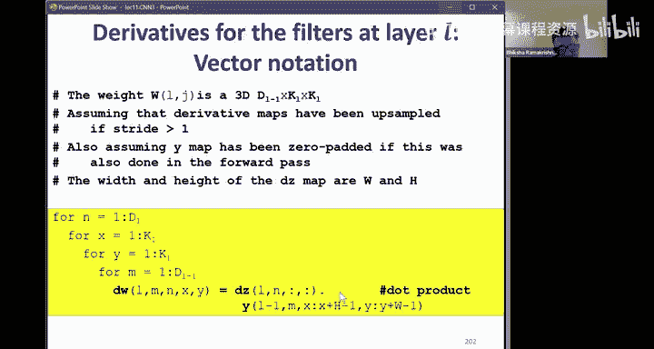
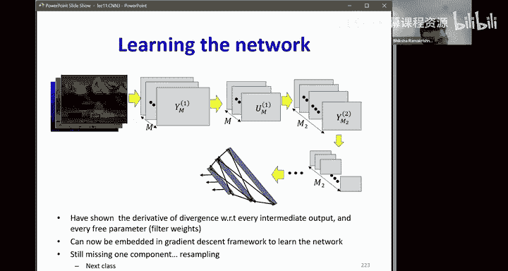

# CMU《深度学习导论｜11-785 Introduction to Deep Learning Spring 2025》中英字幕(deepseek - P12：[12]S2025 Lecture 11 - Convolutional Neural Networks (CNNs) Part III.zh_en - GPT中英字幕课程资源 - BV1xbZNYrEbs

Hello， everybody， can you hear me？As professor。Okay， let's wait a couple of minutes before we begin。

All right， I'll just wait another 30 seconds， so we have 100 students on。All right， so let me begin。

We're going to continue our series of lectures on convolutional neural networks。

I'll begin with a quick recap， and then I'll go through the business of back propagation through convolutional neural networks。

So here's the story we had so far。We found that pattern classification tasks such as does this picture contain a cat or does this recording contain the wordhelo。

 are best performed by scanning for the target pattern and scanning an input with the network and combining the outcomes is equivalent to scanning with the individual neurons hierarchically so you know the first level neurons scan the input。

 higher level neurons scan the maps produced by lower level neurons and a final decisionion unit or layer makes the final decision。

Deformations can in the input can be handled by pooling the kind of network which does all this。

This is just a straight up MLP， a large MLP with shared。Subnets。

 but this network is also called a convolutional neural network。For 2D or high dimensional scans。

 it's a CNN for one dimensional scan a long time， you can call it a 1D convolutional network。

 but it's also called it time delay neural network。So here is the general architecture of a CNN。

 CNN comprises convolutional and optional pooling layers。Followed by an MLP with one or more layers。

And within a convolutional layer there are two operations happening first we compute an aine map which is by obtained by convolving the outputs of the previous layer with a filter。

And then each element in the Aine map is put through an activation to compute an activation map。

So and this business of computing an aine map here is what we did。For everyone。Of the output maps。

 which are also called channels in our terminology。Corresponding to each one of those。

 we had a filter。And the filter in turn had as many channels as the number of input channels or input maps。

 and when we wanted to compute a specific output aine map。

 we basically place the filter corresponding to the。The output map。

On the input and at each location we computed an inner product an inner product basically would perform a component wise multiplication of every filter element。

With the corresponding element of the map beneath it。

 and then you'd summ over all of the filter elements that gives you a scalar term。

And so this inner product gives you one element at each position we scan through this filter to compute the I find map。

Now， once the I map is computed。We just apply an activation pointwise， so what happened here？

So the activation at every Xy position is the activation map value at every Xy position is simply obtained by applying the activation function F。

On the corresponding Aine map at that Xy position， so this is a pointwise operation。

So here's a more explicit notation， every one of the input channels。

Is used in the computation of every one of the Aline maps。

 but then the aine maps themselves only directly influence the corresponding activation map。

Through a pointwise activation operation。So here is the first poll before we proceed with the rest of the lecture。

And I will。How do I launch this？な。15 seconds， guys。No Hannah。

 we're going to use Zoom for our in next poll， so we'll just check if you answered。The poles。

 All right， let me stop this。In a few seconds。All right， here's what you guys thought。And。

Let me check this。Can you tell me true or false the number of channels in any filter equals the number of input？

Channels2 or false。Okay， the number of channels in any filter includes the number of。

Output maps true or false。False right， each filter producer is exactly one output map。

 the number of output maps equals the number of filters。

So the number of filters equals the number of input maps through or false。False。

 the number of filters equals the number of output maps。

So the results of the poll are kind of disappointing that there was complete confusion as to what was going on。

 but the situation here is this。Each of these filters has as many channels as the number of input channels。

One filter produces one output map。Each output map uses a different filter that should be clear to everybody if that's not clear。

 then I can I can explain again so。Can you tell me if that is clear or not to all of you， yes or no？

Maybe I'd like to see 50 Ss because that was there was a lot of confusion。

 so please respond before I proceed。I only see five on the。Guys， give me a thumbs up and maintain it。

 okay， so I can actually count。Ill give you 10 seconds。So， it looks like。Well。

 the quarter of the class got it， I later there。Okay。

 so the answer is the number of channels in any filter equals the number of input maps。

And the number of filters equals the number of output maps， right？

So now let's go on the pooling layer here's what we did in pooling。

 you could have max pooling or mean pooling Max pooling selects the largest element from a pool of elements and so then pooling is performed by scanning the input here was a little bit of pseudocode for it。

You would scan left to right， top to bottom， but when you perform max pooling the way you do it is that at each within each window。

 you store the location of the largest value。And then copy the value at that location into the output map。

Alnately， we could have mean pulling。Where we simply compute the mean of all the elements computed within the window and we scan with the window。

 so here the sort code is much simply a scanning and at each location you're just computing the mean of all the elements within the window and copying it over。

We also saw resampling。We can proportionately decrease or increase the size of the maps by dropping or inserting zeros。

So for down sampling， you would be dropping s minus1 rows or columns between rows and columns。

For up sampling would be inserting S minus1。Rows are columns of zeros between adjacent entries。

So down sampling in this case would reduce the size of the map by S by factor s on each side。

Up sampling would increase the size by a factor fashion inside。

So here's the down sampling operation。 The way to think about it is a two step operation first。

 we erase。啊。You know， if you want a down sampleamp by a factor phase。

We arrays s minus1 rows and s minus1 columns between adjacent columns。

 and then just retain the rest of the elements。

In the up sampling layer， in the case of up sampling。

 we insert s minus1 rows and columns of zeros between adjacent rows and columns。

And we also saw that in practice。If a convolution layer is followed by down sampling or if a pulling layer is followed by down sampling。

 instead of having two distinct operations。We just do it by performing convolution with a stride not pooling with a stride。

So with in the last part for every filter when applying each filter to every input where all the elements in the filter permuted。

 there is no permutation right， so all we did over here was here is the。Cter the baby。

Visualized it this corresponding to this channel。Here is a filter this filter has in this case。

 this is a three cross 3 filter， so there's a set of three cross three elements corresponding to every channel of the input。

We just place those filters directly at that location。The color of the filter doesn't change。

 Just look each color is a different number， but as I slide， the colors stay the same。

That makes sense。So over here， okay。Maybe just the animation made it look like the colors would change it。

 okay？And so， we also saw that。Typically， when we ups sampleample。

Up samplingampling is always followed by a convolutional layer not a CNN layer。

 convolutional layer because it's not useful to follow it by a pooling layer。

 so up sampling is also not useful as the final layer of a CNN。

And typically when you have up sampling by factor S followed by convolution。

 the combined operation is often just colored convolution with this fractional stride。

 where the fraction is one over the ups factor Now again you must remember that convolution with a fractional stride is basically up sampling followed by convolution。

So。Still， here is a thing when it comes to back propagation。

 it' is always useful to think of down sampling and up sampling as a distinct operation。

 so when you have pooling with a stride。The correct way to think about it is pooling with a stride of1 followed by down sampling if you have convolution with a stride greater than one which reduces the size of the map。

 the appropriate way to think about it is convolution with a stride of1 followed by down sampling。

Similarly， if you have convolution of a fractional stride there。

Most useful way to think about it is as a first upsling operation followed by a convolution operation when you think of it this way。

 then the back propagation rules become much simpler。Right。

 you cannot up sampleample by zero because if you're up sampling by0。

 there's no your you are basically。Generating no output at all， you can upsample by one。

 which is like saying I'm not changing the size up samplingling by two is to you're doubling the size on each side。

Okay， and so the complete recap CNNnn N to end， you a typical image classification task assuming max pooling。

 you would have RG andb images。

You'll stack them into three input channels。Then you would have a whole bunch of filters and each filter would scan this input and produce one。

Output activation map。Puling layers， which are typically performed with a stride greater than one。

 would shrink each of these to a smaller size， then you'd have a second collection of filters。

Which would operate on this。Stack of mats。To produce a collection set of output maps。

 one filter per map， then you'd have more pooling， these would alternate till eventually at the end of the final convolutional layer。

 you'd flatten it out and you'd pass the rest through a multilayer perceptron。

So the parameters we want to learn are all of these filter values for the convolution。

And also the parameters of the final MLP。And so when you think of training a CNN。

 training is just like an ir regular MLP， the only difference is in the structure of the network。

You provide examples of training examples like image and class。And then you define a loss。

 which is the divergence between the desired output and the true output。

Their loss aggregates the divergence over the training set。

And then the network parameters are trained to minimize this loss through variant of gradient descent。

 where gradients are computed using back propagation。

 nothing changes with respect to standard training。So here again， given given an input。

 you pass the input through the network。There would be a desire to get an output。

 there would be a desired output。You compute the divergence between the two。

 and so this is the loss for a single instance。We would aggregate this loss over all of the training instances。

 so it would be given a set of training input output pairs。For each。Instance。

 you would get a divergence。And。Then the average divergence is your loss。

 which is what you're going to minimize， so the filter bes are what we are going to be learning through backdrop。

And now。So。The blue layers at the last are going to be the final MLP and the final the final convolution layer is just output of the final convolution layers extended or flattened into a single vector and then you can have additional and then you can just run an MLP on it in our the last class we said we can either put it through a softm。

Or have a full MLP， remember， so that's what this would be。Okay。So。

This means that if I want to minimize this loss， here's the loss。

 the loss is the average divergence over the training set。

So the derivative of the loss with respect to any filter parameter。

Is the average of the derivatives of the divergences for the individual training instances with respect to that parameter。

So this term has to be minimized。And this head this term has to be computed。

Now how do we compute it we've already seen how to perform back propag， so if I have a full CNN。

 I could give it an input， I compute outputs all the way till the end of the network。

Then here I would have it。Des output so I can compute a divergence。

And then I can back propagate the derivatives or the divergence using exactly the same rules that we used for MLlP so we don't have to go over those again。

 we are familiar with those until we get come to the first。Layer of this MLlP。Now， here。

 once you've done the back propagation， you're going to have a derivative for。

The divergence with respect to every element。That is being every input element that's going into this layerlay。

Now， those input elements were obtained by simply flattening out。

All the outputs of the final convolution layer。 So we could， in principle， you all this， this one。

 we basically took each of these values and copied them into and this。Unwrap them into a vector。

And we did this for every one of these guys。 and so eventually you got a long。Viectctor。

This is what this is the set of numbers that went into the MLP。

 Now when you perform back propagation， you are going to get the derivative of the divergence with respect to all of these elements。

These divergences can now be wrapped back into the same shape as the final convolution layer。

 so at this point we can assume quite safely that we have actually got the derivatives of the divergence with respect to。

All of the elements at the output of the final convolution layer。That makes sense to all of you guys。

Yes or no。Right。O。So。All right。So we really have to only worry about how to perform。Okay。

 can I see a few more yeses， please， I'm just seeing very few。Okay。

 so now we only have to figure out how to perform back propagation from here。

 which is to say at this point we have the derivatives of the divergence with respect to all of these elements。

How do we propagate them backwards？Through the convolution layers and through the pullinging layers。

 So basically。The divergence is we can assume that we have the derivative of the divergence with respect to all the elements of all of the activation maps in some layer。

And so the question is how do we propagate these derivatives back to this aine maps。

 which is to say how do we compute the derivatives or the divergences with respect to all the elements of all of these aine maps and then how do we propagate these derivatives further back？

Do the。Elements of the previous layer， so how do I compute the derivatives of the divergence with respect to all of the elements？

Of all of the channels。Of the previous layer from which these aine maps were computed and also how do I compute the derivatives of this divergence with respect to all of these filter elements。

 this is what we must figure out。In the case， so basically the assumption。

 this is for the convolutional layer， right？So the assumption here is we already have derivatives with respect to the elements of the。

Maps output by the final convolution layer， so for convolution layers。

 given the derivatives with respect to these activation maps。

We have to figure out how to compute the derivatives with respect to the aine maps。And from there。

 the derivatives with respect to the channels of the previous layer and also the derivatives for the。

Filters。Now， in the case of the pooling layers。Again。

 we will assume that we have the derivatives with respect to the output of the pooling。

We have to figure out how to propagate those derivatives backwards to compute the derivatives for the input of the pooling。

 so these are all the terms that we have to be able to compute for convolution layers。

 how to compute the derivatives with respect to the aine maps。

From the derivatives for the activation maps。And how to compute the derivatives for the。

Previous layer channels and also the filters from these guys for the pooling layers how to compute the derivatives for the input of the pooling。

From the derivatives at the output of the polling。So is this making sense to all of you guys so far？

So we calculated the derivatives for the flat layers right pardon me yes。

 we are assumingsum that you just use standard back propagation rules to compute the derivatives for the flat flat layers。

But we can do it right， what are we assuming here？So meaning， what do we mean？

I mean they are learnable right the derivatives for the flat layers。

 the derivatives are not learnable， the parameters are learnable。

 so I'm assuming that you pass the derivatives back。And you know。

 you use standard gradient decent rules to learn the parameters here。

But then eventually you can also in any back propagation pass。

 you can compute the derivative or the divergence with respect to the inputs。

To this first flat layer， correct。对。Those can be folded up into these guys， right？All right。

Now you need to propagate those derivatives all the way backwards so that you can learn the rest of the network parameters。

 right？Got it right that's what we're speaking of okay。Any questions？So。

So how why don't we back propagate in order flat layers， FN maps， filters。

 that's exactly what we are going to see right and we'll see how this happens okay。So first。

 let's compute how to figure out how we are going to compute derivatives or the convolutional layers。

This is what we're going to do， right？Now off this first。

Given the derivatives for the activation maps， how do I compute the derivatives for the aine maps meaning？

Let's say I have passed the derivatives backwards and now I have the derivatives or the divergence with respect to every element of every one of these activation maps。

These must be propagated backwards。To compute the derivatives with respect to every element of every one of these aine maps。

Now， how with these guys computed from these， we know that the activation value at any Xy position。

 so L is the layer m is the channel。So the activation at any Xy position for the em channel of the earth layer。

Is simply computed by applying an activation function F。On the aine map value。

Of the emmat channel of the L layer at the XY position。

So this is a simple element wise operation Now if I have the derivative of the divergence with respect to y。

 how can I propagate this back and compute the derivative with respect to Z anybody？

If I already have the derivative with respect to y。

 how do I translate it back to for the derivative with respect to Z anybody？This is easy guys。

Chaandle， So can you give me the function， So the actual rule， right exactly。

 So this is simply going to be。I have this one here， I have the derivative with respect to y。

So D dive over Dz is simply going to be D dive over dy。Times dy over Dz， which is simply the。

Divative of the activation function at that position right this is already obtained we know the z value from from our forward pass so we can compute this term and so now we have the derivatives with respect to。

All of the elements of these aine maps。This clear to everybody。What about the rest of you。

 maybe I can get 10 yes so I can continue， all right， its so easy。So this term has been done。

Now here's the more challenging thing， I have the derivatives with respect to the aine maps。

How do I pass these derivatives backwards to the previous layer channels and also to the filters？So。

This is what we're going to see in the next few slides。Now in the forward， I find computation。

We computed the Z values from the previous layer channels。And the filters。So in the back propagation。

 given the derivative with respect to these aine terms。

 how do I compute the derivatives with respect to the previous layer channels？

Every element of the previous layer channels。And how do I compute the derivatives with respect to every element of the filters？

This is the challenge。 so first let's see how we can compute the derivative with respect to。

The previous layer channels。So in other words， I already have the derivative with respect to all of the elements of all of these aine maps。

I want to。Pass this derivative backwards and compute the derivative with respect to all of the elements of all of these channels。

Is the operation we are trying to perform clear to you guys， yes no。Okay， so let me continue。

 right now。Observe。That every one of these channels。

Every one of the input channels was used in the computation of every one of the output channels。

 the way we did it。This channel。For the nth output channel， we use the nth filter。

And so the first input channel convoled with the first channel of the nth filter。

 the second input channel convoled with the second channel of the nth filter and so on。

 and then all of this convolutions were summed up to compute the Z which means all of these input channels influence the Z right so I can draw the influence diagram in this manner where。

For the Anthpo channel。Each input channel was influenced it。Throughdy。

Corresponding channel of the nth filter， so the second subscript represents the。

Channel output channel number， the first subscript of w represents the input channel number。

 so this is the dependence right and so if I draw the entire dependence。

Every one of these input channels influenced every one of these output channels。

And so now if I want to compute the derivative of the divergence with respect to any specific input channel。

Here is the set of dependencies that I have to consider。

Each input channel influenced every single output a find channel right and then all of these in turn。

Influence the divergence。So if I want to compute the derivative of the divergence with respect to this guy。

 I have to sum over all of the output channels。So the actual derivative of the divergence with respect to。

This input channel here is going to be the sum over all of the output channels。

 some over all the output channels off。The product of the derivative of the divergence with respect to the output channel。

And the derivative of the output channel with respect to。Then the corresponding vi。

So is this making sense to you guys？This equation here and what we just did。

You like to see 10 or 15 guesses， at least。 so please。Okay。

 so this is what we're going to have to compute right now again。

When I'm speaking of the derivative of the divergence with respect to this channel。

 Im really speaking of the derivative of this divergence with respect to every element of this channel。

 that's what we need to compute。😊，And so now。The key term over here。

Since we are assuming that you are going back propagating。

 we assume that we already have this one here， we have the derivative or the divergence with respect to all of the elements of all of these Cs。

So the term we want to compute is the derivative of the Z with respect to y， right？

What is the derivative of the Z with respect to Well， let's focus on one particular output channel。

 So this output channel， what is the derivative of。

Any of any element of this input channel here with respect to all of the elements of this output channel。

 that's what we really need to compute。We so。Let's see how I can compute the derivative of， say。

 some IGth element of this y with respect to each of the elements of the Z。Now。

 consider specifically this element here， this is the 11 element of the input channel。

 so this green patch represents this guy here。The orange patch represents the filter and so when I place the filter on the top left corner and compute an inner product。

 it's going to compute this element of Z， right？Now， let's look at what are all the elements of Z。

That for which this element of y is actually used。When you compute this Z value， look at this。

If I perform the convolution。Observe that。This boxed element of y is used in。

Which are the elements of Z that it actually influenced， can you point out？

Which elements of Z did it influence， guys？Top left four right these two these four values were what it influenced in fact。

 so this is for one channel right one output channel it influenced the corresponding four elements of every output channel。

So in principle， each element of y can influence all of the elements of the。

Of all of the output channels。 So if I want to compute the derivative of the divergence with respect to any。

Element of an input channel， the channel elemented and the X Y position。

 I'm going to have a sum over all of the output maps。Within the output maps。

 I'm going to have to sum over all of the elements of the output maps， right？And then in that sum。

 I'm going to be the terms I will be adding is the derivative of the divergence with respect to that element of the output map。

Times the derivative of that element with respect to this gap。

 So is this equation over here making sense and summing over all of the output maps over all of the output maps and summing over all the positions at each position。

The term I'm summing is the product of the derivative or the divergence with respect to this element of Z。

Times the derivative of the element of z with respect to this guy that making sense to all of you guys。

Yes， no。对。Can I see a few more yeses， right， Okay， like have six。A I the。L is the layer number。

I'm just so the z of the earth layer depends on the okay， so you're here。

 if I want to compute the derivative of the so look at this x y position。Of。

This input of the em channel of the L minus1 to layer okay？This element。

Is used in the computation effectively of all of these elements of the Aline maps of the next layer。

Rightrite myor。Yes no。Okay， so which means if I want to compute the derivative of the divergence with respect to this guy。

 I have to sum over all of these elements， meaning I sum over all the channels。

Within each all the output channels， within each output each output channel I sum over all the elements。

And at each element。The term m summing is the product of the derivative or the divergence with respect to that element of z。

Times the derivative of that element of z with respect to the element of y for which we are trying to compute the derivative。

 That makes sense， my word。This entire sun。Okay， so I'm assumingming this made sense， right？

This is already there， we already know it， so this is the term that we need to compute。

What is this term？So I'm going to do this with an example and we're going to do it visually okay。

So this is a filter。This is an input channel and I'm specifically looking at the22 element of an input channel okay now the filter I'm using two different indiceice indexing mechanisms。

 one is the color each color represents a different value I'm also showing you the index number right the position number through these indices we're going to use both。

And this is the output channel， okay？So when I'm computing this filter， this output channel。

 this filter would be placed at this position， starting at the00 position of the channel。

And then that is used to compute the 00 element of the output channel， is this making sense？

This illustration。Yes， no， okay。And so observe that the 22 element of the input channel multiplies this red element。

The 22 element of the filter。So the element of the filter that was used。

That color is actually being copied over here， the color over here basically says which element of the filter was used？

啊。In combination with the22 element of y。To give you the Z element。Is that illustration making sense？

Yeah。Yes， no guys。Okay， so they up here。Consider this22 element of this input channel， right？

Which element of the filter was used was multipied the stuttu element。

When you were computing the zero，0 element of z， ratio。Which element was used？

The two to the red element， correct？And so。I'm just showing that this red over here shows which element of Z the filter was used。

Along with the22 element of wider compute Z。Okay。Okay， so now that means Z0， ignore the subs。

 We know what they are。 So Z0，0。Is y22 times W22。Correct。Now when I slide one forward。

Then the y22 element is actually multiplying the 12 element of the filter。To compute z10。

 this making sense to you guys。Y 22， I justplace the filter here is multiplying the 12 element of the filter to compute010。

 right？Similarly。The y22 element is multiplying the02 element of the filter to compute z20 right so I can I'm just writing all of these done now observe something very interesting。

At every position。The index y22， right？Equals the sum of the indices of z and the index of w。

 Just go back and check right， you can see this。 we can match this with the visualization Y 22 z 0。

0 is obtained by multiplying y22 and w22， so 22 plus 0，0 is 22。10 plus 1，2 is 22， right，2。

0 plus 02 is 22。01 plus 21 is 22。 Do you see the pattern over here？

Do you guys see the pattern over here？Yes no， just gave me a yes or no， right， because okay。

And so in general， I can write。This is not specific for 22。 This is for any x for any position in Z。

 right？ So for any x prime any。X prime y prime position of z。

 the corresponding element of the filter that was used was 2 minus x prime 2 minus y prime。

 Is this equation making sense。Over here。Okay， and do you think this is going to be specific only to22 or it will it work for any Xy position？

What do you guys think any XY writes or generalizing？I can say that。

If you consider the contribution of any X y to these z values。

 the index of z and the index of the filter will sum。To the index of y， right？So。

this making sense to everybody。Yes or no。It'sOkay， so then what is the derivative of？

Z x prime y prime with respect to y x y， what is that derivative going to be anybody？

What is the derivative of zx prime1 it's just going to be w watt， which W element。

What is the derivative of z x prime y prime with respect to yxy， what is this？

It's staring you in the face， right which w element。X minus right， this is it。

 So the derivative of z x prime y prime with respect to y xy is the weight at x minus x prime y minus y prime。

 right？This making sense， it's obvious， right？Okay。

 and so I can just plug this in this term here when I'm computing the derivative for y xy。

The term that was missing was the derivative was z at x prime y prime with respect to y xy。

 which is simply the filter value at x minus y x prime y minus y prime。

 and so now I have this formula which I can just use to compute the derivatives for all of the y maps so given that let me actually release the second form。

There are two questions here， I hope you guys can see the poll。嗯。Okay， 10 seconds guys。Okay。

All right， I'm going to end the poll here。And yeah the results， here what you thought。Okay。

 first question， true or false。What do you guys think？T fast。Second one。

Also true some of you thought it response I'm not sure why So We how what is the question you're saying we are only using grades x prime y prime so this is all we are saying is what all we are saying here is that we need the derivative with us since we are summing over all of the elements。

We also need the derivative of。Each of these elements with respect to this guy in this chain rule。

 And that's what we were trying to compute。 That makes sense when how。And so。That's where。

 and so we can just plug it in。X prime y prime， just plug it in。

And this is how youd compute the derivative easy， but it turns out there's a simpler way to do it。

 this is actually a convolution。 How is this a convolution， let's see right？😊，So consider this。

This when I'm considering this element22， when I'm computing z00。

 I use this red element of the filter。At z11 Z10， I use the pink element， right。

 and so you can see which element of the filter used in are used。In computing each element of Z。

 do you see this pattern？When I was the contribution of the 22 element。

When I was used when it was used to compute the0，0 element of z。I used this element of the filter。

Whenever I try used it to compute the 10 element of z， I used this element of the filter and so on。

 so is this color color pattern making sense to you guys over here。

I'm strictly speaking of the 22 element， right？Yes， no。I like to see a dozen yes， right？

Any questions， any doubt over here？Okay， so what does this mean if I want to compute the derivative of。

Their divergence with respect to the22 element of y。

That means I have to sum over all of these Z elements。

 but what I will be summing is the derivative or the divergence with respect to the0，0 element of z。

Is going to be multiplied by the 22 element of the filter。

The derivative of the divergence with respect to the 10 element of z is going to be multiplied by the 12 element of the filter and so on。

 and then all of those are going to be summed up， right？Yes， no。Okay。

 so this is an inner product between the derivative of the divergence with respect to the Z elements。

And at transformation of the filter， what is the transformation of the filter？How does this。

A turn of。Filter weights relate this fact to this pattern of filter weights， anybody。

How does it relate to it？It's just a vertical and horizontal flip correct， I just took this filter。

 I flipped it and I flipped it vertically I flipped it horizontally and then I placed it with the 00 element on top of the 22 element。

And then I computed it in a product， and that gave me the derivative of the divergence with respect to22 that makes sense。

To all of you guys。Right， and so here's what we did。We flip this filter left to right， top to bottom。

And then we place the0，0 element。Right on top of the 22 element of the derivative map for Z and computed an inner product and that gave us the derivative for y22。

 so this means in general， if I want to compute the derivative with respect to y Xy。

 I have to flip the filter and position it such that this element lies on top of the Xy element and then compute an inner product。

So what does this look like guys， if I want to compute the derivative for every Z element。

 what does it look like， every y element， what does it look like？Anyone？What does it look like？Okay。

 let me help you right， here's what I'm going to do。I want to say I have the Z。

I want to compute the derivative for this y element， what I will do。

First I'm going to pad the Z's if the filter is k cross k。

 I'm going to pad it with k minus1 zeros and came on every side and k rows of zeros and k minus1 columns of zeros in every side。

Then I I flipped the filter， right？And then I place the flipped filter with the0，0 element at 00。

And I perform an inner product。 and then I can just scan。And this is just a convolution right。

 and when I do this eventually I'm going to compute the derivative for every element of one that makes sense。

Yes， no， right？Okay。Except there's something missing and what is that missing。

 this is considering only one output channel。In reality。

 every element of Z influenced every output channel。

 and each output channel was computed using a different filter。So what' does this mean。

 I have all of these output channels corresponding to each one of them as in。

Is a filter so to compute the derivative or the divergence with respect to themp input channel。

I'm going to select the8 channel of all of the filters。

And then so these are the emped channel of all of the filters。I'm going to flip them。

 meaning horizontally flip them horizontally and vertically。

And then I have the derivative maps for all of the output channels。

 I'm going to zero pair all of them。And then this flip filter is what I'm going to be。

Convolving with a zero paded guy in this manner。To compute my derivative map for the。

And in good channel。This makes sense？To all of you guys。Can I see like a dozen yeses。

It's very simple， isn't it， okay？Why do we flip again， again， Why do we flip is look。

We went through the whole process here， right so。This。I showed a to you visually when I went。

 when I showed you what happened over here。 My God， I have to go back to100 slides。But。So。

 look at how。Oh gosh， too far， right。I'm sorry。This is very painful。So， look at。This guy。

To compute the derivative for the 22 element， I have to come multiply the derivative of the00 element of z with a red filter。

Eleement， right？So whoever asked you why the flip again， right。

 And so if I go through which filter elements were multiplied with each element of。

The derivative map was Z。You see the pattern is。Correct， okay and。

So we need to we will be zero padding not the filter， but we will be zero padding the。

derivative map for Z。Okay， in order to。Before we convolve。And so。I have too many。

 This animation is very annoying if someone asked me a question from 50 slides ago， but yeah。

Let's see。So this is what happens okay， now。The zero map， okay， I I want you to remember something。

 If I convoled something with a width of M。With a size of with a filter， the size of k。

 when I went forward， what was the output size？So in the forward。

 if this was a size M right on each side and if this was k。What was this size， What was this size？

Anybody， what is the size？It was M。Minus k plus1， correct？

So then if I if I0 pad it with K plus1 rows and K plus1 columns。

 what is the size of the zero padded entry anybody？What is the size of this it's going to be is it M？

I have k minus1 over here and k minus1 over here， correct， so what does it become？

That's going to be M。Plus。K minus1， right？Correct。😊，Because this one。S k minus-1。

 so that cancels out this guy。And then I get an extra k -1， so I end up with m plus K -1。Yes or no。O。

Now， if I convol something。That is size m plus k -1 with a filter of size k -1。

What is the result going to be， what is the size of the result？

What is the size of the result it's going to be？M plus k minus1 minus k -1 is's just going to be M。

So this is what you're going to end up with right which is why the zero padding in ensures that when you come back。

 the derivative is actually you get a derivative for every element of the input and in general if you should always get a derivative with respect to every element of the input。

Because every element of the input has influenced the divergence。Right。😊，If when you go back。

 if you don't get a derivative with respect to every element of these guys。

 there has been some buger computation and so you can see that this heres a general rule。

If I have some number of elements key。Going into any operation。 Okay， I'm sorry for the scroll。

It doesn't matter what the size of this guy is。It does not matter what the size here is if this eventually computes the divergence D。

When I compute the derivative going backward。When I come back here。

 this derivative must have k elements because every one of these guys influence D when you come back if you don't get K derivatives。

 there's something wrong with your arithmetic。Right， yes， no， what do you think？

You cannot get K plus1 elements， you cannot get K minus1 elements， you must get K elements。

And so we can see that that rule is actually。Satisfied， right？So， so far， so good。And so again。

 if the y was0 paded in the forward pass， the derivative map that you compute backwards is also going to be zero padded and the zero padded regions must be deleted before further backdrop。

So here is your next poll。啊。Let me see。Okay， 15 seconds guys。All right。

 let me end the poll right here。Here's what you guys thought。And。

Can you tell me to compute the derivative with respect to the mth activation map of the Lt convolution layer？

We must select the emped planes or channels。Of all the L plus one layer filter through or falses。ok。

The selected channels must be flipped left， right up down through or false。

It must convolve the derivative maps for the L plus1 layer of find values to or false。Right。

The output of the convolution must be flipped back true or false， No right， so you got it。And so。

I'm having trouble with my。Only the first three statements are true。And so。

We know how to compute the derivatives with respect to the input channels。I have some。So the court。

 let's skip that right now。So the thing that remains is how to compute the derivatives with respect to the filter values。

 right， how do we compute these guys。So， again。We want to find the derivative of the divergence with respect to every one of these filter values now this is a really bad animation because Matlap messed up。

 but I'm scanning an input with a filter and look at the central element of the filter。

 this blue element。How many of the output values does this filter element actually influence？

Can you tell me？It influences all of the output values right so which means that when I want to compute the derivative of the divergence with respect to any element of the filter。

 I must sum over all of these guys。But then there's something interesting over here。

each filter element。Basically influences every element of the of an output channel。

 but does a filter element influence every output channel？

Or does it influence only one output channel？What do you think？

Only one because a filter is used only in the computation of one output channel， right also。

Does a filter。Consider all input channels or only the corresponding filter channel of the。Input。So。

On the input side。Does this filter channel convove all of these guys or does it only convolve this guy？

Come on， what do you think， only the corresponding one， right？

So this filter channel convolves this guy to produce this output channel， that's it。

 you don't have to consider the remaining input channels。

 you don't have to consider the remaining output channels， Did that make sense to all of you。Yes， no。

Can I see a few guesses okay， so let's see how this particular filter element。

Influences the corresponding output elements， elements of the output channel。This one。

This is the 0212 element。One，2 element of the filter。

Is multiplying the12 element of the input to compute the0，0，0 element of the output。

Then it's multiplying the 22 element of the input to compute the 10 element of the output。Right。

 so do you see a pattern over here again， anybody， what is the pattern？We alluded to this before。

 what is the pattern？Come on， guys， it can help me here。Basically， we said。

That the Z index and the W index sum to the y index， correct？So basically。

 what this means is that the Z index X y。Plus， the filter index x prime y prime gives you the y index x plus x prime white plus y prime。

Do you remember this？Over here。Right so。In general， if I consider any。IJ index of the filter。

The Ij index is added to the Xy index of the output to give you the corresponding index of y x plusi viistic。

Right。😊，So。If I want the derivative again， now， so before I even get here。Actually， yeah。

 let me go and proceed。Considering how slow this animation is。So if I want that， please。

 this is very， very annoying。Okay， the derivative of。The X， Y element of z。

With respect to the Ij element of the filter is simply y x plus I y plus J this making sense to you guys over here。

Right， very straightforward， right？Can I see a few more guesses， okay？开。So now。

This is what I have the derivative of z Xy with respect to WIj is。You know。

 y L minus1 the L minus1 layer。The nth channel， so if I want to compute the derivative of the nth output channel。

With respect to the nth channel IG8th element of the emth channel of the nth filter for anything else。

 it's going to be zero， right？Then this is going to be。The8 channel of the L minus1 layer。

 the index is x plus I white J。Now， the derivative of the divergence with respect to any filter element must sum over all of the elements of the output channel。

And so what it sums is the derivative of the divergence with respect to the corresponding to each element of the output channel。

Times the derivative of that element with respect to。Dly Oi， this making sense over here。

Because each filter element influences every output value in their channel。

Is this equation making sense？And I see a few assets， right？Okay。

 and this term is already computed going backwards。 What is the second term。

What is the second demo over there， this guy？What is Dz X Y over DWIJ？Which way what is this？

Which why。Just right here， you know， when I ask you a question。

 the answer is often usually on the slide， right right here。So I can just plug this in。

And so that is the equation that you'd use to compute the filter derivatives that makes sense。我了啊。

What does this look like？This equation， what does it look like？Anyone。What does this look like？

Look kind of familiar as an operation， what does it look like？That's a convolution， right？Look。😡。

So here's what we did if I wanted to compute the derivative of w12。

Then here are all the elements of the input that multiply W12 to compute these elements of the Z of Z。

To compute the derivative for W12， I took the derivative map for Z。Pled it on this。

Portion of the input and computed an inner product。 and the derivative map itself was positioned at。

With the top left corner at element 12， Similarlyly， if I want to compute w0 the n。

 the influence of w 00， So w0，0， the 00 element of the filter multiplied all of these elements of the input。

To compute these elements of the output， so when you compute the derivative of the divergence with respect to w00。

The derivative map here， which is to say the map of the derivatives are the divergence with respect to all of these Z elements。

You compute we computed an inner product of that with respect to。

The corresponding elements of the input。So end on。So this is basically what it。

What the influence told us so。This is a convolution。

The derivative is for all components of all filters。You can compute them directly from this formula。

But then it's really just a。You know， to compute the derivative for WIj， place the derivative map。

On the YM positioned at sorry positioned at IJ and Comp in a product。

That's what the equation tells us。But this is a convolution how。

 so let's say this is the forward computation right。

 each filter convol all of these guys to give you the corresponding output。So in computing， say the。

First， output channel。If you consider the second chair， you use the first filter。

And let's say the second channel of the first filter that convolves the second channel of the input。

Right。So now when I'm going backwards， I want to compute the derivative of the divergence with respect to this guide。

How。I can ignore all the black do regions because they have no they are。

They have no bearing on the problem， is this making sense that the black black do guys don't really matter？

When I want to compute the derivative for this particular channel。For the。In know。

 second channel of the first filter in this example。Is this making sense to all of you guys。

 Can I see a few more yeses。I see like five， right？And so what do I do。

 All I do is take this guy right here， this derivative map。And convolve this input like so。

And that magically just gives me the derivative of the divergence with respect to the filter。

That's it。That makes sense。一三六。Pro if I have a question so Im a little bit。

Lastastic when you said the you say what I understood you， you said the the filter。

 the number of filters should match the number of input channels number of filters filters is that the number of filters is the number of output channels。

Yes， not so I thought yes， so I thought you can have like as many filters as you want to capture several features。

 even if you have few input channels can have more filters than that and then each filter each filter go through。

All the channels to generate one feature up， I thought that each filter has as as each filter has as many channels there a number of input channels。

Each filter has as an oh， okay， okay， single filter。 Yes， okay， yeah， okay， I've got it now。 Yeah。

 yeah， that。 Yeah makes sense。 Yeah， so did this operation make sense to all of you guys。

I to see a few more yeses now。Now we can check the sizes right。

 So let's say this thing has a size of M。Right and lets so let's say y has a size M on each side。

 right？Why is the Spencer disagree？ButY has the size M on each side？Right， and。Let's say。

Z has a side so。And the filter has。The size key。Right。Then what is the size of Z again。

What is the size of Z on each side over here？What will this size be？It's going to be m minus k plus1。

 correct？So。If I convolve something that is。Size M minus k plus1。With something that's a size M。

What is the result。What is the result of convolving these two？

I'm going to lose M minus-1 elements the result of size cake on each side。

And you can see that this actually matches the filter， correct？😊，That makes sense？Do all of you guys。

And so the whole thing just makes sense， size wise it all fits。Very pretty， right？And so。

This means first。Again， the derivative of anthine map。Convs with every output map。

Toge the corresponding derivative。 So the derivative of the nth aine map。

 So you have many output maps right， So when you go back you're going to get the derivative of the nth output aine map。

 this guy would convolve。With every channel of the input。

To give you the derivatives for every channel of the n filter。This makes sense。嗰个强。

The derivative of the nth， I find map。Convolves with every input channel。

To give you the derivative for every channel of the nth filter。Yes， no， does make sense。

Can I see more okay？And of course。If this y was0 padded in the forward pass。

 it must be zero padded per back propag。Everybody good with us so far？Any questions？

If there are no questions， here is your final call。So said every input channel。

Influences every output channel， right？So the nth input channel is going to influence the derivative for the nth channel of every filter。

Right it。15 seconds， guys。Okay。So here's what you guys thought。And let me。Ask you。For a statement。

 the derivative for the Ath channel of the nth filter is computed by conlving the emth。

Input map with the end a find derivative map2 false。

The output map must be flipped before convolution true or false， false， right， nothing。

send the case of filter that is no。 everything just works。Very pretty。And so basically。

 if I write it on vector notation， you just basically。Convol。

The derivative for the Z map with y and you get the derivative for Wubling。Now。

The thing is you look at it through these pictures and math and such like。And it all makes sense。

 But sometimes code is even easier to， you know， So the whole thing just is much simpler if you look at it through the lens of code。

If you look at it through the reapplication of two simple ruless， if I have any y equals sigma z。

Then if L is the loss， Dl over Dz is Dl over dy times sigma prime z， right。

 I don't know why this became a superscript it should be alongside。This is one rule， right。

 The second is if I have z equals wy。And if z is contributing to the loss。

 then the derivative of the loss with respect to y has a contribution which is w times dl over Dz and the derivative of the loss with respect to w is has a contribution y times plus equals y times Dl over Dz are the terms on the slide making sense to you guys。

Yes， no。This one， this is a straightforward， right， I'm not adding anything new。

We are all familiar with this， give me a few yeses so I can proceed。Okay。And so we can just use this。

 it turns out that， you know， when you're performing your C and forward computation。

You're scanning left to right。 you're going through all of the output channels at each output channel first。

You compute a weighted sum the sum of the product of w and y right each position。

 this is just the scanning code， right， this is how this is what your code would look like you go over the filter face and over the filter face you multiply the filter value the corresponding y value underneath it and sum it all up and shoot what happened。

And then put it run activation。This is back propagation。

 Back propagation is just going to do the whole thing in rivers。

 So what you would do is this look at these indices。

You' are going to go through the same thing indices。

 but now in reverse sortda from the end to the beginning because it's back propagation Now here y was computed at the end from the activation。

 so you compute activation which is applied to z。 So the first thing you would do is say Dz equals the derivative for y with respect to。

At times f prime again， because when you're doing the back propagation over here， why is the output？

 So you assume that going backwards， you already have the derivative。With respect to y， okay。

And then， subsequently。I can just say the derivative for。The， you know， look in the forward things。

 Z X， Y equals w X prime y per plus equals w x prime y prime。Plus y times x plus x prime minus1。

 y of x plus x prime minus1 y plus y prime 1， right， So going back the derivative for this term。

I is going to be implemented by the derivative for z。

Times this w and the derivative for this term is going to be incremented by the derivative for this z。

Times this y we are using the same indices。D y plus equals w times Dz， Dw plus equals。Y times dz。

 so we just use the same code， we flip the arrangement of the indices， the the order of the indices。

And。Anytime you had。Z equals w Y going back， youve got Dy equals w times Dz and Dw equals Dz times D Dz times y。

 That's all。 You just flip the code using the simple rule and the whole thing should just work。

 right， So this is the complete backward pass。I just took the forward pass and flipped the compute。

 right？So。Is this making sense？I didn't。If I didn't worry about you know things that are being flipped or not。

 I just use a simple this simple rule， these two simple rules are all I used and the fact and the fact that all the computations must be done in rivers。

And just doing this will give you the derivatives。 It's amazing。

 you don't even need to know the math。Makes sense to everybody。ThatBeauful， right？

And can there are multiple ways of precasting this as ten or vector operations。

And so we figured out how to compute the derivatives for these guys。

 how to compute the derivatives for these guys， how to compute the derivatives for all of the filters as web。

 so convolution layers are done， we need to deal with pooling layers。

Now pooling layers group pools of values to reduce data sensitivity right at each element。

 you just pick the max so if you were performing a pool。And this region first。

 you'd pick the largest value， find the index of the largest value。

And then copy the largest value out。The value of that index out over here。

Now when you're coming backwards。I'm assuming that you have the derivatives for all of these elements。

 So this one。Is the outcome of the pooling right so when you come back you will have the so this is the operation you'll be passing performing going forward。

 right？Now， when you come back。You're going to have the derivative for。This。

This6 was copied over here by the max pooling When you come back you're going to have the derivative for this element right so do any of the remaining elements influence this output？

嗰个晓。No， right， so does this derivative so what are the derivatives for the remaining elements？

Since they do not influence the art。0ero。Right。😊，So all I need to do is to copy this derivative over。

To the position。From where the value was copied， that's it going backwards。That makes sense？Right。

Very simple。 The derivative for max pullinging is simple。 so here's the pseudoor。

 This was the forward pass and the forward pass you found a position of the largest value and then copied it over。

In the backward pass。You just copied the derivative at each position。

 you added the derivative at each position。To the derivative at the position at the index of the maximum value。

So going forward。You got the PIx， which is the position of the largest value and then copied the value at PIX over right going backward。

 this Dy is being added to the derivative at PIX， is this making sense。Yes， no。

I see some complete silence， iss this making sense， guys？Okay。

 can you tell me why I'm using plus equals over here rather than just equals？Why is it plus equals？

Anyone。Why is the plus equals？Because one element could be the max for multiple outputs。

 so it could be influencing multiple outputs。 that's why you must use plus equals you know。

 as I scan forward over here。The6 could be the largest value here， you know。But if the six were here。

 for instance。Then it could be the output here and it could be the output here as well。

 so an element might be multily used， so you have to use the plus equals。In the case of mean pooling。

Each element is the average of all of the elements in the window， right， so this guy。

So let's say going backward I compute derivative with respect to this one。

How do I pass the derivative back to all of these elements， anybody？How would I pass it back？Anyone。

What is that going to be？This has got to be easy so。嗯。Help me。 Come on。 I'm running out of time。

So this。Going forward， 3。75 is1 over 4 plus1 times 1 over4 plus 3 times 1 over 4 plus6 times 1 over 4 plus5。

 correct？So going back， let's say I have the derivative over here。Every one of these guys。

 every one of these guys influence this compute， this value， yes or no。Yes。

 so how much of the derivative would go back？Right。How would。

Take the basically I'm going to distribute this derivative uniformly across all four of these values because all of them contributed equally to the output right That's it and so if I look at the pseudo code here was the thing going forward Why was the mean of this thing。

Going backward， the derivative at each y。So that E the derivative at each X Y。Is going to be。

Divided by K squared because you're spreading it across all the elements that contributed to it。

And it's going to be contributing to the derivatives at all of the elements。That contributed to X1。

So this is just。The forward and backward are。Almost identical computations， right。

 but then this also looks like something interesting。 What is this。What is this operation。

 can anyone tell me？This is basically a convolution I convolving the output map with a window which is 14141414。

It's just a convolution，And so basically what we've seen is we've seen how now we can use compute。

 we can compute the derivative。We knew how to compute the derivatives here。

We've seen how to compute the derivatives for all the elements going backwards。

 and this can be embedded in gradient descent to learn the network parameters。

We skipped one term reampling， we'll see that in the next class。 so the story so far。

 the CNN is a supervised version of computational models of mammalian vision we saw this that includes convolutional layers。

 comprising learned filters that scan the outputs of the previous layer followed by an activation。

Pullling layers that operate over groups of outputs from the convolution layer for Jitter and variance。

And optional resizing operations typically perform through strides greater than one。

Or through interpolation of zeros swapb sampling。The parameters can be learned through regular backdrop。

Computing derivatives for convolution layers is simply also convolution operation。

 you can transposed filters with derivative maps of the output for derivatives of input maps and you can the input maps with the derivative maps of the output for derivatives of filters and backdrop of pooling operations redistributes derivatives at the output over all the inputs that contributed to it。

 that's it。End of today's lecture first， if the lecture made sense to you。

 I'd like to see a bunch of thumbs up so I know I'm not losing you guys and then I'll take questions。

