# CMU《深度学习导论｜11-785 Introduction to Deep Learning Spring 2025》中英字幕(deepseek - P13：[13]S2025 Lecture 12 - Convolutional Neural Networks (CNNs) Part IV.zh_en - GPT中英字幕课程资源 - BV1xbZNYrEbs

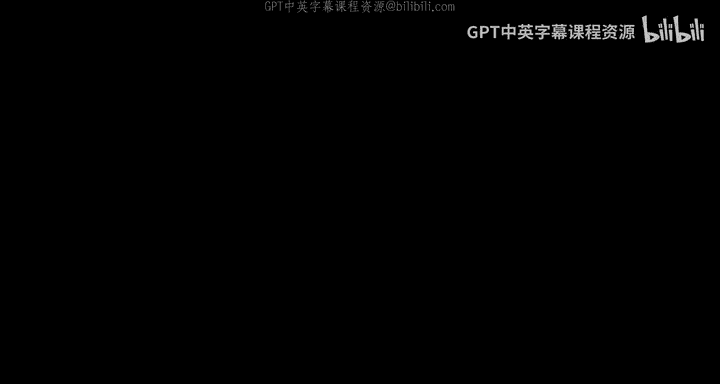

佢。All right， let's begin， so this is the last in our series of lectures on convolutional neural networks。

Anybody remember what the last topic that we were discussing was？

What was the last thing we were discussing？Anybody。So。Come on， guys。Back prop。

Weho were specifically discussing。T back Pro。What was it we were discussing？Convolutional backdrop。

 we were discussing how backdrop can be applied through convolutional layers and also through pooling layers。

 So here is a quick recap。This is what we're going to do today we're going to go complete the business on backdrop。

 I'll do a quick recap first and talk about some additional final topics。

 So what we've seen so far is that shift invari pattern classification。

Such as does this picture contain a cat or does this recording contain the world hellello。

 are best best perform by scanning for the target pattern using CNNns or TDNns？

But these are actually shared parameter models and so you have to account for this sharing of parameters when you use back propagation to train them。

And so here's the entire setup as in your standard training。When you want to train the model。

 you're going to use gradient descent， gradient descent needs computation of gradients。

Which means that for each training instance， we need to know how much perturbing any parameter will change the divergence。

Between between the output， actual and desired outputs of the network。So for each training instance。

 there's first a forward pass where you pass the instance through the network。You compute an output。

 you compute the divergence between the output and the desired output。

And past the dead of it was backward。Now you would have regular back propagation like MLPs until the first layer of this MLP and then the derivatives at the input this flat to this final MLP will be folded back into the shape of channels。

And then subsequently we'd have modified back propagation rules from here to compute the derivatives going backwards and when we modify these derivative rules。

 we have to deal with the shared computation and convolution layers。

 and we have to deal with the pooling layers。So the two key components of backdrop where。

That for convolution layers， given the derivatives for the output activation map。

We had to figure out how to compute the derivatives with respect to the aine map。

And then given the derivatives for the Aine map， we had to figure out how to compute the derivatives for both the filters that were used to compute the Haine map and the previous layer channels。

For the pulling theres。Given。The derivatives of the output of the pooling。

 we had to figure out how to compute the derivatives at the input of the pooling。

Now for the convolution layers。啊。Transferring derivatives from the activation to the aine terms was fairly straightforward。

The activation map was obtained by applying an activation function pointwise to all of the elements of the Aine map。

 so each y was basically obtained by applying an activation F。

To the corresponding z where z represents the affine terms。

And y represents the output of the activations。 So when youre。Performing back propagation。

We will assume that we have the derivative of the divergence with respect to the elements of the vice。

Then the derivatives with respect to the vice must be transferred back to obtain derivatives with respect to the Cs。

And just applying the chain rule over here， just set。Told us that we could do this element wise。

 the derivative for each element of z。Was obtained simply by multiplying the derivative for each the corresponding element of y。

By the derivative of the activation function。That was applied to Z to compute the value。

 So this was how we computed。The derivatives for these from the derivatives sub Wa Now。

 this is straightforward。The more complex operation was， have you transferred these derivatives back？

To compute the derivatives for the filters。And the elevators for the previously， are channels。

And here again， we saw that when we went through the math and we boiled the whole thing down。

 the operation was very straightforward。If you want to compute the derivatives for the emth channel。

Of any layer。Then you would pick up the emptymp channel of all of the filters。And。

These two would be used， I mean， this a channel of the filters would be used in conjunction with the derivatives for the aine maps that resulted from the filtering。

To compute the derivative for。The AMmp channel of the input now。

 why we needed to pick the AMth channel of the filters was this clear to you guys？

Can somebody tell me why we pick the em channel of the filters， anyone？Any new responses？2。Wit。

So why do we pick the a channel of the filters。Can you guys hear me at all？

because that's the only channel that interacts with the a channel of the input。

 So the a channel of the filters is the only channel of the filters that interacts with the a channel of the input。

And so these are the only ones that we would need to consider， right？

What did we do with these things， Can somebody tell me what did we do with the M channel of the filters？

Anyone。Some， is the what we did？What did we do？Anybody else？Im assuming you are paying attention。

 will be computing the derivatives of the M channel of the filters？What did we do。Anybody else？

Someone want to give me a correct answer。Flip them， then convol them with the derivatives right。

 so you flip these guys and you convolve them with what what did we con the flipped filters with。

Anyone。Input。Inport， this is the input。Did we con the flip filters with this guy。

We convol the flip filters with the derivative for the Zs， right， so here's what we did。

 we took that now see something interesting。The filters if I arrange them look like so right it's actually a three dimensional tensor because each filter is it's actually interestingly enough if you look at the entire bank of filters。

 the bank of filters is a four dimensional tensor。Why is the Bank of Fs collectively a four dimensional tensor anybody？

You want to tell me that I have not told you this， I'm asking you to guess。

Why is the Bank of filter as a four dimensional filter tensor， anyone？Somebody want to guess。

 can I just pick a random name and ask you？Bat size。Anything else？Okay， so look， each filter。

 what is the shape of a single filter， anyone， what is the shape of a single filter？Ass a2y？

It's 3D a filter has the filter phase has two dimensions， but it has many channels right。

 so each filter is a three dimensional tube， a three dimensional rectangle in a hypercbe right？

But then you have D of you know several of these filters so collectively。

If you think of these cubo stacked together， it actually ends up being a four dimensional tensor。

Now what is the so if I flip the four dimensional tansor， if I transpose the four dimensional tansor。

 what would happen？Now， this within this arrangement。Ros and columns would get transposed。

 but within each of these guys also the rows and columns would get transposed。

 so transposing the entire operation and this entire four dimensional filter。And picking one。

Eleement from it would mean that first， instead of picking this column and picking the row。And then。

 within the row。And flipping each channel。Across the diagonal。

 So it's transposed in every possible way。 Did that make sense to you guys。

However when I think of this。As a four dimensional object。

 then picking the M row and then transposing the M throw， you know。

 flipping it left to right top to bottom is like trans。

Transposing the entire four dimensional cubooid。And then picking 13D cubebo from it that makes sense。

Yes， no。So， okay。I just see like three s's， so I seem to have lost the rest of you guys， okay？And so。

That means that basically what we are doing is that we are transposing the entire filter。And then。

Convollving the zero padded derivative maps。With the trans post filter to get the derivatives for thee。

Collection of input channels。 That's why this derivative computation is often also called a transpose convolution。

 That makes sense。Yes， no。Okay， so， but mechanically speaking。

 what we did was we picked up the the Mtro。Made a filter of it， flipped each channel of it。

And you're going to have as many channels as output channels。

 So you're convolving that with the collection of derivative maps， right。

 So this was how we computed derivatives for the y。

How did we compute the derivatives for the filters？Now。

 if I want to compute the derivative for the8th channel。Of any for for the end channel of the filter。

Then the filter or you know， for n， say the first channel of the filter and filter。

Now the anth filter only computed the nth output map。So we picked up the nth output。

Map the derivative map for the n output。And we convolt that with the first input channel。

To get the derivatives for the first channel of the nth filter so if you convolve this guy。

 the derivative map for the nth output channel with every input channel。

 you're going to end up computing the derivatives for every channel of the anth filter。

So for the nth filter， you pick up the nth output map because that's all the filter computes。

And then conv its derivatives with all of the inputs and you get the derivatives or all of the filter terms。

So I guys with me so far， yes no。嗯。Okay this is all this old hat right so we've gone through how to compute derivatives for the convolution and how to compute the derivatives for the activations and how to compute derivatives for the convolution so this is done the next thing that we went over is derivatives for pooling layers。

And again， in the pooling layer， if you were performing max pooling。

We just saw pools groups of values to reduce data sensitivity。

 and the most common pooling is max pooling。So when you perform max pooling。

 you just find out the index of the largest element and copy the value over right and you keep doing this going left to right top to bottom and so when we computed the derivatives going backwards。

 we realized that it was only the largest value that influenced the output。

So we just copied the derivative at each point over。

To the element that was that actually that that had actually been copied over at that location so here。

6 came from the bottom left。Cner of the window， so the derivative at the location of6 is copied over to the bottom left corner of the window the rest have zero derivative because they don't influence the output。

Now， so。When we perform this saw this in terms of code。

Here's what we sell when we are performing the forward operation。You have。As you scan the inputs。

 you do this channel by channel。At each location， you found the index。

Of the largest element and copied the value of that index over to the output。

So when you go backwards， you just， you know， you just copy this y X， y。

 the derivative at y X y over to the derivative at the location from which the y itself is obtained。

 so the。Back propagation rules for max pooling were very simple。

The other operation we saw was mean pool so for mean pool you were given a window of inputs。

 you computed the average， so when you go backwards basically what this means is that this one is each element the sum of all four elements divided by the number of elements in the window one overK squared。

Times the sum of all the elements。So this derivative basically is going to be distributed over all K squared elements。

In proportion。 So you just。Copy this derivative， divide it by k squared in this case K squared is4。

 and so one over k squared of this derivatives gets distributed。To all four。

All the elements within the。Analysis within the window that contributed to the mean pulling。

 so once again， if we were looking at this in terms of code。

You you do this channel wise mean pooling， you would scan and at each location you computed the mean of the elements within a vendor。

So going backwards。All you did was you come you distributed redistributed the derivative。

Divided by the size of the window itself。Over all of the elements that contributed to that particular element。

So this was just a very simple mean。Back propagation operation for me in Poland。But then。

What what does it mean if we actually look at it as a plus equal to right so it turns out that in the case of mean pullinging mean pullinging is just a convolution operation right mean pooling is like saying I'm doing this channel wise and within each channel Im convolving the input。

WithWith a filter where all the values of the filter are 1 over k squared。

So going backwards is going to give you the same kind of back propagation operation that we had for convolution except it's channel by。

 so you would be zero padding。Your derivative map for the output of the mean polling。

To make sure that， you know， where the number of。Rs and columns of zeros that you pad is going to be the number or the size of this pooling window minus-1。

And then this。0ero padded， derivative map。Is going to be convolveed with a uniform filter。

To get you the derivatives of the input to the mean point。

Did this make sense how the backdrop for mean pulling is also convolution？Yes， I no guys。

I see like two yeses。So this is straightforward， right？And so we've dealt with mean pulling layers。

 There's one more kind of operation that we spoke of。

For which we have not discussed the back propagation draws， what was that operation， anyone？

We spoke of a different operation also。Reampling， right？in our up sampling and down sampling。

 we have not discussed this， but before that， let me actually give you the release the first poll。

There are two questions here。I'm assuming you guys can see the point。Say， okay， five seconds， guys。

And the。Okay。Stop sharinging and go back。Okay， what is the answer to the first one， true or false？

Second one。Also true， right。When back propagating from max pooling layer derivatives from the pooled output。

 back propagate only to the position of the largest input within the input pooling window。

When you back propagate through a mean pool layer， derivatives are distributed uniformly over the input pool window for that output。

 right？And so we've gone through the key components， but then we left out resampling layers。

 up samplingling and down sampling layers can increase or decrease the size of the map so ups followed and we saw that ups followed by convolution can be viewed as convolution with a fractional stride。

And convolution followed by down sampling。can be viewed as convolution with a stride greater than one。

 again， the key thing is we followed ups。 we combined up sampling with the convolution that came after it。

When we called it convolution with a fractional stride。On the other hand。

 we can combined down sa with the operation that came before it。

By calling it convolution or pooling with a stride greater than one right。

So how do we back propagate through up sampling and down sampling layers？

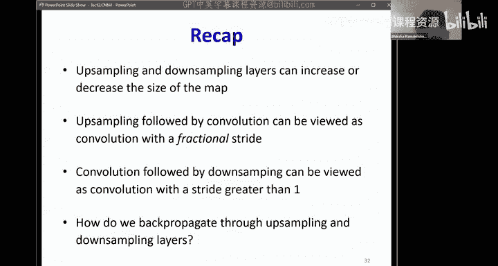

Now， here's what a down sampling layer was。If I had some input。

And I wanted to say down sample it by a factor of2。

 I would first zero out every second column and every second row。

And then just copy over the remaining elements。So now these elements which have been zeroed out。

Do they have any influence？On the。Final output of the network。The elements that had been blacked out。

RightSo what is the derivative？Of the loss with respect to these elements。

They don't influence the output at all， right， You can change， and they have been the constant。

 They've then they're been ignored。 It doesn't matter what the value was over here。

Changing this value by massive amount will have absolutely zero effect on the output。

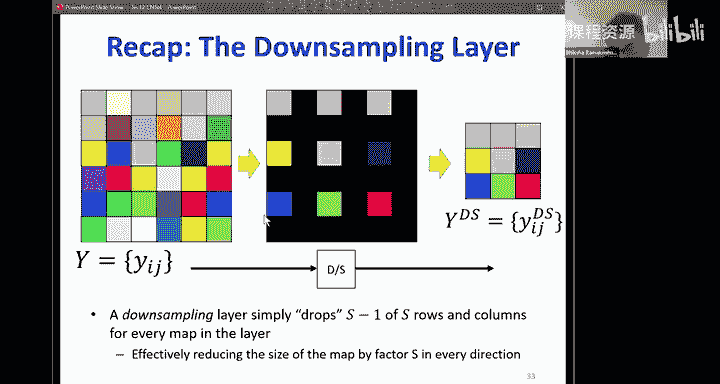

So。Now we mentioned something very important with respect to the size of derivatives right was the what was that we mentioned about the size of derivatives if I have say an n squared operation going in n squared input going into some operation and the output is some size and then I compute the loss from that output。

When I go back， what is the size of the derivative going to be？Anybody。

 what did we mention about the size of the derivative？We mentioned this。 This was very important。

 right， it didn't matter what the size of the derivative was。 it can be small， it can be large。

 I don't care。This input goes into some。Oation， whatever this operation might be， it doesn't matter。

 right？And then out comes a value in our case， the values the final values is a scalar。

 which is a loss。 So then when you compute the derivative of the loss with respect to this input。

The principle says that every one of these elements。

Effectively influences the loss then the influence may be 0， but the point is。

There are for every one of the elements and the input， there is a derivative。

There is a derivative of the loss with respect to that element。

Which means that when you compute the derivatives going backward through any operation。

For the derivative for the loss， the size of the derivative is going to be the same as the size of the input itself in reality is asco actually going to be the same as the size of the input transposed。

For the gradient， you transpose the derivative back， right， So the size of the gradient。

Which again is the transpose of the derivative right is always going to be the same as the size of the input itself。

That makes sense to all of you guys。Yes， no。对。Okay， so now I took this input。And I downsampled it。

 and I made it smaller。Then when I compute the derivative going backwards。

 what is the size of the gradient over here？What will the size of the gradient be。Anyone。

What was the size of gradient P， right？So。What is w over k， not clear what you mean by w over k。

So let's say this is and cross hand， right。If I can get my pencil。So咧。So。

Let's say this n what does N cross hand。And then I down sample by a factor K。

So this is going to be size n over K。Cross N over k， right？Then。When I go back here。

 what is the size of this derivative， when I compute the derivative at the input to the down sampling。

 what will it be？Anybody？It's going to be in cross n。 It's going to be the same as the input， right。

 you that that's what I'm saying， not the gradient， not the derivative， but still。嗯。啊。

The point is the size of the gradient is going to be the same as the size of the input to the net operation。

But then over here， we had only n over k cross n over K k elements， right？What happens？

Suppose I'm computing the derivative going backwards。 I know the size of the gradient over here。

 It it's going to be n cross n。 So the very first thing I would do。

As what I'm really computing is the derivative of the loss with respect to every element over here。

And so I'm going to allocate a map the size of the input itself that was down sampled。

This is how much the size of the derivative is going to be， right now。Over here。

What can you tell me about the derivatives for if I'm down sampling by a factor of two。

 What can you tell me about the derivatives of。啊 for。Every second column and every second row。

What can you tell me about their derivatives， They are0。 these guys。

 all of these elements had no influence on the output， right。

So their derivatives are going to be zero。Right。😊，Now。

 the down sampleamp output was simply copyied these nine elements。

So what do you think the derivative here is going to be？Anybody。

 what is the derivative of the top left corner， what is that going to be？完。What is it going to be？

This derivative is going to be the same as this guy。

 this value and this value with the same value right so I can just copy this derivative right over here。

 I can copy this one right over here because the downsamp copy values it didn't transform them at all right。

😊，一三六。That makes sense to you guys。Right， the remaining values are identical in the original。

 in the original and down sample map and the forward maps pass。 So the diet the derivatives。

 too are going to be identical。 So you just copy the derivatives for the output。

Over to the appropriate location of the input。 That's it。 So this is the backward pass through the。

Down sampling layer。What does this operation look like？Anyone。

 what does this operation look like going back？What have I done？Have just up sample。

 let'm introduce rows and columns of zeros between the derivatives。

 And so the back the backward pass for down sampling is。Up sampling， okay？So here's a pseudo code。

 I just be allocating zeros the size of the input， and then I just copy elements over。

 that's it when I'm performing back propagation through down sampling。Now， for the up sampling。

What did we do in the case of the up sampling， so we know how to perform back pro down sampling。

 let's consider up sampling。For the up sampling， I took my original mat。

And I just inserted a bunch of zeros。Rose rows of zeros and columns of zeros， correct？

So once I insert it， I have a larger map。But is there any element over here that actually had a real influence on these guyss？

Is there any element on the input？That had any influence on the shaded guys， right。

 So when I'm going back， will these will the derivatives in these shaded locations have any influence on the derivatives over here。

No， because there's nothing in the input that actually influence those guys。

 those were just arbitrarily set to zero in the forward pass。And so。For the up sampling layer。

 given the derivative of the divergence with respect to the elements of the output of the up sampling。

You want to compute the gray derivatives with respect to every element of the input now again。

What will the size of the gradient of the loss with respect to the input to the up samplingling be。

 what will the size be？Anyone。What will the size be？It's going to be the same as the input right。

 and so here's what we are going to do。We know that these zero elements were introduced in the forward pass。

 they are not functions of the input。They just always introduced us as zero regardless of the input。

 So during backdrop， you know， there's nothing over here that influences these guts， right？

On the other hand， these elements were copied over to these locations。

 so what do you think we do when we back propagate thrown up sampling layer， anybody。

 what do you think we do？We test。What do we do？We just have to copy these elements over right this element was copied directly here。

 so the derivative over here is going to be copied directly here。 this one is copied directly here。

 this element will be copied directly here and so simply copy the derivatives for the varied varied locations back over to the input。

So backdrop through up sampling is basically just。Kind of done samplingling。 Now。

 so heres here's a thing。Convolution is。When you want to downs sampleample during convolution。

You actually typically perform convolution with a stride greater than one to result in a smaller output map。

 you don't perform convolution and then perform down sampling。

But then if you tried to figure out the derivative rules for convolution with a stride。

 you will quickly find that this becomes quite ugly。

Because you have to deal with different elements differently， right， In this case， it's much， much。

 much more convenient。To think of convolution with a stride greater than one as a conventional convolution with a stride of one。

 followed by down sampling。And once you think of it in this manner。

 we know exactly how to back propagate through downsamp。 It is trivial， right。

 We also know how exactly to back back propagate through a regular convolution that is also a very trivial operation。

 And so this one now actually becomes very simple whereas having to deal with this can be quite annoying that makes sense。

 and the two are identical。😊，Did that make sense？Yes or no。Right。

So you don't need to worry about how does how do back propagation rules change when the stride is greater than one？

So what will happen here is back propagation will first propagate derivatives through the down samplingling layer。

And then through the convolution layer， right， simpler than modifying back props to account for stride in convolution。

Now this is for down sampling， right， when you have convolution with a fractional stride。This is。

 what is convolution with a fractional stride anybody？

What is a convolution of the fraction side of 0。5？UI it just upsling and then convolution you upsample by a factor of two。

 then you perform convolution with a stride of one and so trying to figure out the derivative rules。

 the back rules for this one can be very annoying。You can waste an entire day and eventually write buggy code。

Whereas if I just decomposed it into this operation up sample by two convolution what's right1。

 it's trivial。We know how to back propagate through this。

 we also know how to back propagate through sampling all as well， In fact。

 if you go off on the web and begin looking at web pages and such like blogs for convolution with strides greater than one of fractional strides are going to give you some lots of very ugly pictures and algorithms and such like there's absolutely no reason to understand or learn any of this once you know how to back or back drop sampling or down sampling both of which are simple and how you know how to backrup your convolution。

There's nothing more about， right？And so for purposes of back prop。

 it's easiest to view this as up sampling， followed by convolution。

 backrop will first propagate derivatives through the convolution layer and then through the up sampling layer。

Same thing pulling and down sampling， right， pooling is typically performed with a stride greater than one。

 you don't。Pouloling reduces the size of the map， so pooling was often just called a down sampling layer in the in the past and often in the literature。

 they'll just call pooling a down sampling layer， which is kind of a misnomer， it really isn't。

It's really a combination of two operations， right。

 when you're pulling with a stride greater than one。

And it's a combination of two operations pool with a stride w followed by down sampling。

And so once again， it's easiest to view this as this combination of two operations and you can back propagate through each of the operations。

And each of those back propagations is very simple to perform。

So did this make sense to all of you guys。Okay， and as always。

So Richsha thinking of that for back propagation it's actually easier to implement it this way if you want to go back and actually figure out the arithmetic to perform the write the code so that you get the back propagation for this upper picture directly。

 you will find it to be much more。Compfusesing。So simplification is the name of the game。

 we know how to understand it and we know how to implement it。But then code is always simpler， right。

 remember。What we said in the last class。If you were performing an aine computing an aine map。

 you just'd be going through the layers and then you'd be doing Z plus equals w times y， right？

And then you'll be once the Z values were computed， you put it through an activation function。

And so we saw that if we wanted to perform back propagation。

 we just first went through all the indices in river orderda。

Then replace this operation by Dy times F prime f y activation of times of z。

Then Dz was dy times the derivative of the activation。So also of Z X， Y。

Was incremented by W X prime y prime times y x plus x prime 1 y plus y prime -1。Not the indicess。

 then going back。The derivative for y at x plus x prime -1 y plus y prime -1 was simply incremented by。

W x prime y prime times Dzx y。And the derivative for W x prime y prime was incremented by Dz x y times y of x plus x prime 1。

 y plus y prime 1。 so this was just a very simple modification of the code。

 you didn't need to understand the match， you didn't need to understand any concepts you understood two simple rules when you have you know z equals w times x when you go to take the derivative back。

Then dy is Dz times W。DW is Dz times 1， right？So this was when he had a stride of one。

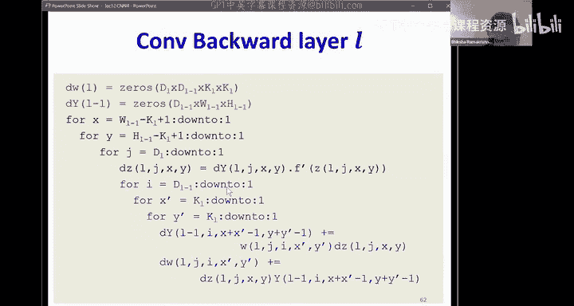

But then if you have a stride greater than one in the forward pass you。

 you'd be skipping with a stride。So guess what in the cord。

You're going to use the same trick as here， except that when you are going back。

 you're going to be striding， going backwards， that's about it。

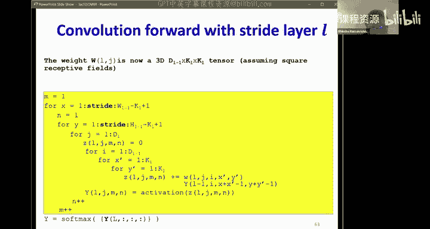

So the stride going forward is going to give you this stride going backward。

 The code here is a little more complex because I'm showing you how we have to account for the striding。

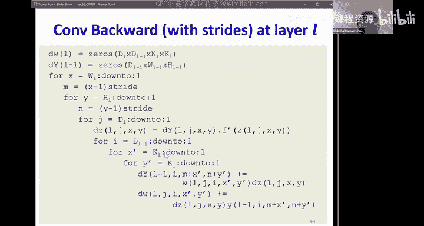

But， that's about it。Right so code is always simpler。So also， if I'm max pooling。With a stride。

In the forward pass， I'll be loop with a stride。If I just change the。Thing going backwards。

I'm keeping track of indices， so it turns out that in the max pooling case。

You don't even have to worry about the fact that you had a stride when you were going backwards because this index。

Retas information about where the derivative came from。And so for me pulling again。

When you look backwards instead of loop back in a any， loop forward， you look forward with a stride。

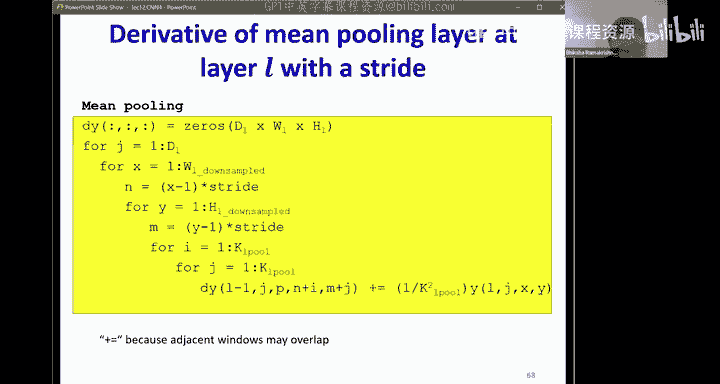

When you loop backwards， you'd be loop backwards with a stride。 That's about it。

 So always looking at things through the eyes of code。

Can be much simpler than trying to figure out the math。

 but then you don't get a complete feel of what's going on。 Here's your second poll。Okay。

 five seconds， guys。All right。 mad me end thepa。ok。Here's what you thought。

And now here's my question for you。The backward pass of an up sampling layer is down sampling true or false。

The backward path of down sampling is up sampling through our faults。

Can you just use the ups layer as the backward path of down sampling？

And so how many of you think this is true and how many think it's false？

Anybody who thinks it's false？Okay。That last one is false。 Can somebody tell me why？Anybody。

One guess。So it has to do with the edges， right when I am doing a down sampling。If this will here。

 if I'm down sampling by two， I'm going to be picking the first， the third and the fifth layer。

 right？Looking at this guy doesn't tell me if there was a sixth layer here or not， does it。

Does it tell me if there was a sixth layer here or not。

So simply up sampling backwards by a factor of two。Can give me the wrong size， correct？

If you are up sampling by a factor of two， you'd just be getting only five。

Whereas there could have been6 on the input， its just that the sixth layer got dropped， right。

 yes or no。So here's a thinglish up。If I had another layer over here。Another column over here。

Would this column show up here？Fishient。Okay， now if I were to ups sampleample this thing backwards。

What would the output size be？Here's the thing， regardless of whether the input was with5 or with 6。

The outputers are still three， right， So you have to store extra information about whether there was a sixth column here or not。

So you can't just directly use the upsling layer going backwards because of the what happens at the edges。

Conceptually， the backwardag back for down sampling is up sampling。

And the backdrop up sampling is down sampling， but because of what happens at the boundaries we have to be a。

We have to be a little more careful。

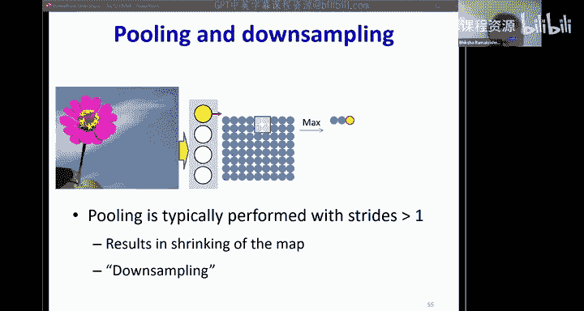

No。You cant just use one layer for the other。

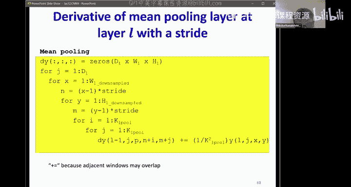

All right。Now we have seen how to compute the derivatives of the divergence with respect to every。

Intermediate output and every parameter of every kind of operation this can be embedded within gradient descent to learn the network and so here is the story so far。

The CNN is a supervised version of a computational model of Mammalian vision it includes convolutional layers。

Comprising learned filters that scan the outputs of the previous layer。

And this should have been pool layers that operate on groups of outputs from the convolutional layer and this is a hangover hangover I should fix this。

 but this is how it's traditionally been considered we again pooling is distinct from down sampling。

 so I have a mistake on my slide。The parameters of the network can be learned through regular back propagation。

Max pooling layers must propagate derivatives only over the maximum element。

Divevators must sum over appropriate elements to account for the fact that。

The network is in fact a shared parameter network， so all of this is fine Okay except for this one bug in my slides。

But then let's look at other things that you guys have questioned me about， right？

Convolutional neural networks as position or shift invariant。

Regardless of whether the flower is here or whether the flower is here。

 the network will detect a flower。But then。If my flower rotated by say 20 degrees。

 will the network still detect a flower。Is it also rotation invariant。Yes， no。What do you guys think。

RightWhat if I scaled up the flower to this size is its scaling invariant？Or if I reflected it。

It's only rotated only。Invariant to translation， right。

 what if I also wanted to make it invariant to say rotation by 45 degrees。What would I have to do？

Anyone。Augment， I can augment the data， but computationally what's the more。

Did we just augment the data to capture the flower in both positions。Or what did we do？

Over about here。We applied the same filter at this location and this location， right。

 So we made two copies of the filter filter and we。

Which is the same as scanning and applied them in different locations and so Los is correct。

You know shift so here's what shift invari really meant。

 if you look at it from a different perspective。We shifted the filter to different locations。

To identify patterns the same pattern at different locations， that's how we got shift in variance。

If you want to have rotation in variance instead of shifting the filter。

 you would rotate the filter right， So if you want to also find find patterns that are。

Fing patterns with an invariance to 45 degree rotations。

Then the filters would have to be rotated by 45 degrees。

 so you have one copy of the filter for your the standard format。

 another copy of the filter for the rotated version。

And each of these would be applied on your inputs。 So each transformation of the filter is going to generate its own on。

Output channel。That makes sense。Did this make sense， guys？The transformation invariance， right？Okay。

 so。If I rotate the filter by 45 degrees， it's now the pattern detection is invariant to 45 degree rotations。

But will this also be invariant to say a 60 degree rotation？

So if I also want to have 60 degree rotation in variance， what would I need to do？

What do I need to do for 60 degree rotation and variance？Anyone。Rotate this thing by 60 degrees。

 right， so basically。I would have to enumerate all of the transformations that I am。

 I would like invaris too。And so I want invaris to rotations by 45 degrees。

 I want invaris to say reflections。 I want invaris to say rotations by 60 degrees。

 So for each filter， I'm going to make one copy of the filter with each one of the transformations。

There it can potentially that I want ingredients to and then use all of those copies of the filter to generate the output。

 right。And what would。What is the limitation of this approach？That's right of it， so。

So what is the limitation of this approach？Any。😔，Po gentle like note， it says that。It has to do。

 you have to explicitly transform the filter for every one of the transformations that you want invariance to。

 If you want invariance to 45 degree rotation， there's a copy of the filter for 45 degrees。

 If you want invariance to 60 degree rotation， there's a copy of filter for 60 degrees。

 If you want invariance to all 360 degree rotations， you will have 360 copies of the filter。

 If I want invariance to scaling by a factor of 1。2。 I'm going to have a copy of the filter at 1。

2 scaling。 right， if I want to have， if I want invariance to scaling by 1。

2 and rotation by 45 degrees， there'd be a copy of it for that。 too。 This is just not going to scale。

 because the set of transformations， you can handle as discrete。

 and every one of them must be included。 So here is your standard。😊，Condvolution。

You scanned at each location， you pulled out a segment of the input。

And you computed it in a product with a filter and applied an activation to it。

If you want transform invari。At each location， you would go through all of the inform enumerated transforms。

 which could be rotation scalings， reflections， what have you。

Transform the derivative the filter and then apply the transformed filter。

 which means that you are going to get as many channels over here output put channels。

Which as there are。呃。Transformation， so the index indexing shows that you know。

 if I have three filters and each filter is allowed to generally have five different transformations that yet 15 output channels。

So this scales up very very poorly and still doesn't generalize newer transformations。

 but in any case， if you want if you strictly want transformation in variance for any kind of transformation。

 this is how you would do it。And then again， this will also influence back propagation。

 so any filter is going to be transformed through all the various transformations in your list。

When you compute derivatives， you're going to get derivatives for each of these transformations and then you sum them all up。

To compute the derivative of the filter itself。We never do this right， So Hannah。

 the answer is we don't do this because this just doesn't scale。 So what do you think we actually do。

Anybody？What do you think we actually do。We just augment the training data。

We think of all of the different ways in which you can modify the training data and still have it recognized and apply the transformations to the training data and just train a bigger model and hope it learns the generalization。

And that actually works， whereas although this is mathematically the correct thing to do。

 this is not a scalable or an implementable solution。So everybody with me so far。Yes Sir。Okay。And so。

Adding。啊， to里。Lessons the models can be easily modified to include invaris to other transformations。

But this can be computationally painful， right， Here's another thing。😊。

All the model does is to tell you if there is a flower in the picture。

 Does it tell you where the model is。The flower is in the picture。No， right。

 because we scanned and then we pass the entire collection of outputs。Through effectively an awe。

 right， And so。You can detect theres a flower and the input， but you can't detect the。

Location of the flower。 Where is the information about the location of the flower， anyone。

Where is the information about the location of the flower， Remember， So what we did was scant， right。

 And so when you scanned it， you got this map of outputs。This guy was flattentered。And became a long。

 flat lac。And this was put through a softm or an MLP， basically some decision， right？

And because we combined the decision， all of these guys， you know。

 maybe you put them through an a by the time you got to the output over here。

 you only had information about whether there was a flower or not。

But you didn't have information about where the flower was， right。

Where is the element about where the flower was。Anybody want to answer me， I have one answer。

 what about the rest of you guys？This map here。That has information about where the flower is。

 correct， Yes or no。It says that we orderedwe all of them。That makes sense， right。

 which means this flattened vector here。This has information about where the flower is。Right， yes no。

That makes sense to you guys。And so if I want to find the location of the flower。

I have to use the final。Flatten vector before it went into the decision layer。

And so that's basically what we do when we want to find the locations of objects。喂。

This final flattened layer。You can just put it through a standard decision layer to decide if the class is present or not。

But then you can pass it through a second。A。Network。Which will tell you the。

Coordinates of your object typically represented in the nature of a bounding box。

So when you train the network， you're actually going to be using。

The network will have to be trained to actually extract this information and so your training data are going to have two kinds of labels。

 one is the class output itself， the second is the position information and that position information is used along with either an intersection of union loss or an L2 loss。

And to train the parameters off the network that derives。咦。😊。

Bounding box from the final representation So you'd have two losses and you're going to be training the training training the network using a combination of two losses does make sense。

Yes no。Okay， and same thing， right， you've seen you must have seen images examples of this kind of stick diagram。

Where。It can actually draw a skeleton for you。It's kind of scary， right？

It turns out you can use the same mechanism。Except that instead of using this representation to find a bounding box for the person's person and the image。

 you can find the location of the various joints。The Xy coordinates of all4 joints。

 and then if you connect them up， you're going to get a skeleton like picture。

This is his proposed estimation and such like if those of you who had。

If any of you had visited CMU say six years ago just before COVID。

There used to be a big screen at the end of the corridor that connected Helman to gates to the newval Simon Building。

And on that corridor， as you walk down the corridor， it would draw your skeleton for you live。

 was very spooky。But did a fantastic job。 And we had there for for a few years。 How did that work。

 Basically， this is the idea。 And， you know， this kind of mechanism for drawing the the joints and the stick diagram for the people and the N image is used in many applications。

😊，What it really does is to identify the locations of these joints。

And that's done using this mechanism over here。 Of course。

 you will need training data in which these joint positions are tagged so that you can train the model properly。

The span sets。Yes。Okay。I have two yeses。え。Let me。This one has three questions in it， guys。Okay。

 15 seconds。是。All right， let me stop this。Okay， first statement， true or false。

Second one true or false。T玩车 faults。Right， all the。That's enough， right？

So basic ideas we got through all of the basic ideas for convolutional neural networks。

 we go through some model variations， things like very deep networks。

 how can I make the network00 or more layersD， this is aNe and think something called depthwise convolutions。

 let's see what they are。Now， for this one。It turns out that for very deep networks。

 it turns out that if you keep adding more and more convolutional layers as you go back and perform back for propag through the network。

 your derivatives will become unstable and vanish and so it's hard to train the network。

So we use a formulaism called ResNe， which I'll briefly allude to。

The one that's more interesting is depthwise convolutions。

 where we test take the whole concept of parameter sharing one step further。

And so for that reason alone， it's interesting because it shows how parameter sharing。

Can be used to increase efficiency by extending it now。Here is a standard convolution。

Youd have an input with many channels。You have a filter and the filter has a phase。

 but the filter has as many channels as the number of input channels。Then。

When you convolve the filter with the inputs， One way to think about it is that each face of the filter。

Convulves the corresponding face of the input。 each channel of the filter。

Convolves the corresponding channel of the input。 And so in the first step， you're going to get。

As many channels as the input itself， where each of these is basically the convolution of one channel of the input with a corresponding channel of the filter。

And then subsequently， all of these guys are just flattentered summed up to give you the final sum of the con output of the convolution。

 So is this making sense， this is also just is the same standard convolution operation and presenting the the way we presented it typically initially was that at each point。

 I did an instant sum。 and you got a single output。

But then I can break it up into two steps where each channel of the filter。

Convvolves the corresponding input channel to give you the。Convolution outputs channel wise。

 and then you sum them up to get the final output I this making sense？Here。Yes， no。

 so I'd like to see a few elsees。This four， five， maybe 10。

 I'd like it's nice to know that at least 10% of the class got okay。So this is easy， right。

 And so if I had many different filters。What would happen is that。For each filter。

The each channel of the filter word。Convol the corresponding channel of the input。

 and so computation wise， what is happening is that you'd compute all of these guts for filter 1。

 every channel of the filter would convol the input the corresponding input channel。

 and you'd get a bunch of。Chhaninas。For filter2 again same thing。

 every channel of the filter would convolve。The corresponding channel of the input and you'll get a bunch of convoled channels。

Filter 3 would get a bunch of convolveed channels and all of these guys would be different because the filters are different。

And then you sum all of these up to get the。Final output of the first filter is sum these guys up to get the final output of the second filter。

You sum these guys up to get the final output of the third filter， right。

 the key here is the collection of convoluled channels that we get。Is different for each filter。

And those are water summed up。Now， I can。Take the concept of。啊。

But I made sharingdding one step further。By saying that I have。One single multichan kind of filter。

Where each channel of the filter convulults the corresponding channel of the input。

And so now I get as many convvoled channels as the input。 But now now。

 instead of just directly summing them up， I will do a weighted sum。

And different weighted summs will give me different articles。

So instead of having three filters over here， I have。3 filters each with its own convolution。

 I have one set of convolutions。And the differences between the filters is simply the weight suit which these things are combined。

Do you see how this works？Yes or no。I see one。 Yes。 what about the rest of you guys。

 Did this make sense。Two yess，3，4 can I get at least0？

It capture yesterday D it will capture less information than the normal one。

 but you get a lot of computational benefits right。

 and so here is what would happen in terms of parameters。😊，If I had N filters。

And or if I had M filters， there were n filters and there were M input channels。

And each filter was k cross k， then each filter is going to have K cross k times m。

 so Mk squared parameters。There are n filters， so the total number of filters parameters is going to be N M K squared。

Whereas here。I just have since this one is common to all of those so the the operation。

 the the filter components that go from the input channels to this collection of convol channels is just going to be one set of M。

ケクラスケ。Prameters。And subsequently， these guys are combined using different weightings to generate the output channels。

So in the stage one。M independent K cross K2D filters。In stage two。I have an independent。M cross 1。

 cross 1，10 filters。And so the total number of opera parameters is going to be Mk squared。

Plus n times M。 So as you can see， the number of parameters can be orders of magnitudes fewer in this second case。

 also in terms of computation。Here。In this， in this case。And in this case。

 every one of those these is going to be performing a convolution。

 so you would have n times M convolutions。Whereas here you perform the convolutions only once。

 so you have only m convolutions， So you get a massive reduction in the number of parameters and a massive reduction in the number of。

Computs as well。So this is the。呃。So these guys。They're all going to be weights， right。

 it's just that。This is done once， so here you have K squared times M。

That's the number of parameters that you would have at this stage。And then over here。

 you have M of these guys。The weights， you have M weights for each output channel。

 So you have n times m。Waiits for the second stage。To that class， clarifier her。doubtub。

For conventional， here's what you'd have， right， for conventional。

You have K squared times M for every one of the photoss。And so each of these is independent。

 and each of these is going to perform a different convolution。可以。

So you get a massive reduction in parameters。Here's a final poll for the day。

This is called depth twice。Convolutions。是。Okay。10 seconds。Allright。This is what you guys thought。

ItSo Daisy for depth wise。He would have。Each of these guys。

This set of convolved outputs is the same for all the outputs channels。

The weights with which you'd be summing them up。Is going to be different for each output channel。はい。

And so the answer is filters and Dewise convolutions convol all the input channels simultaneously and sub the results they don't。

 right？They actually some convve each channel independently and keep them as separate。

 and the manner in which they are combined is what is different from output channel to output channel。

But they require far fewer parameters， and they require far， far lesser computation and so。

Adding to our list of lessons。We can make predictions related to position and arrangement of the target object through multitask learning。

And variations of the basic model exist to obtain greater parameter efficiency。

 greater ability to compute derivatives， etc。Now， what are the filters learned， right？

If when you have a distributed scan， the first level filters look at a small region of the input。

The second level filters look at regions of these guyses。

 and so they end up looking at a larger region of the input。

Third level filters look at regions of these guys， and so they look end up looking at a still larger region of the input。

 So what kind of patterns do each of these guys capture， right？So。

In the case of the first level filters to see what pattern a filter captures you just need to look at the weights because you're looking at we are basically performing an inner product between the weights and the corresponding region of the input。

 so the weights will directly tell you what the filter captures。But for the second level filters。

 it's never， you know， you can have all kinds of combinations of these guys。

 so it's never immediately apparent what triggered。This particular neuron， this pta。

 and so you'd have to when it's triggered， you'd have to actually perform back propagation。

To and perturb the input to find out which which regions of the input。Actually， cost this。Ftter to5。

But you can do this analysis， right， and here's the kind of an here's what they found。

In this example， it's a network which has been trained for recognizing different classes。

And observe something。 these are the activations of the first level。First layer h us。

What do these look like These are the patterns they respond to what do they look like。

The first layer filters。Any one。Oriented lines， right， What is this reminders of？

Did we encounter this earlier。of course。S cells basically turns out that when you train a convolutional neural network。

 it ends up capturing the kinds of patterns that your mammalian vision actually captures itself。

 just like your human brain or the mammalian brain response primarily at the first level to oriented patterns。

 so does your convolutional network so thats。You know。

 the fact that this computational model ends up mimicking the brain so well is pretty shocking。

 at least to me， right？Now。When the input presented as faces， they find out the next。Laar。

Neurons actually end up responding to things like eyes， portions of noses， and so on。

 and deeper in the network， the different neurons respond to actual phase like patterns。

On the other hand， when you have cars at the input， they immediately ask respond to。

Components of cars。The deeper layers actually respond to entire car like images。

 Here is the same thing for elephants。Intermediate layers kept respond to parts of elephants。

 the deeperapple layers capture entire elephants， So you can see that just like in the mammalian vision。

 even convolutional networks build up the patterns that they are responding to。

Through the layers of the network， I don't know about you。

I find that this computational model basically learned something very similar to them million vision to be quite fascinating。

Now when you train it， you have standard convergence issues so you need to you know addom or other momentum style algorithms。

 you need batchnob。The number of parameters can become very large。

 so you will often run into insufficient training data to train well， so。

We tend to use a lot of data augmentation。Where we modify our input？By rotation。

 say uniformly chosen random angle between0 and 360 degrees in the case of images。

You can take the same image， and shift it around， translate it a bit。 you can scale them。

 You can flip them。 You can perform other operations that don't actually change the class。

And use those as augmentations， and this has done a whole lot when you train these models。Anyway。

 just come to the end， CNNNs are one of the most frequently used formalisms today they used everywhere not just for images but used in speech。

 audio， on spectrograms they are also used in text processing。Now， before I continue。Actually。

 Carpath has a very nice。Viualization for how these things work layer by layer on this web page。

 if it's still still up， you guys should check it out。So just a little bit of history。

 So where did all of this come from， the very first convolutional La neural network was by yan Laon。

 that's basically what he one is steer1 for。So here's what his model looked like。 It had。

He was analyzing digits。At the very first layer， he had。6，5 cross five filters。

Then he followed it by a bunch of pool layers with a stride of two。 Then he had 165 cross 5 filters。

 which operated on this， followed by pooling。 and then finally an ML LP。 Now。

 do you remember why we have to increase the number of layers number of channels as we go through the network。

 Any remember that。Why do we have to increase the number of channels？To not lose info。

 because each channel becomes smaller。 When the channel becomes smaller， you need more of them。

Otherwise， the information is going to be lost and so this was our first big success for conence。

But the real， you know， where neural networks really took off。

This was 2012 was when it was shown that they could take us。

Sot a task and outperformed everything on the planet by a huge margin。

 and the task was imate classification。Where you have millions of images and thousands of categories。

And so the original work was using 1。2 million images in 1000 categories。

And these guys as Hinton and Eliliaasatkaver and Alex Kevsky。

 they showed in this Newup's 2012 paper that they could get really。

 really good performance on this data。 and this was the first time that we were using huge models to analyze what seemed like a limited amount of data。

 They had a neural network with 60 million parameters。They had 650，000 neurons。

 they had to distribute it over two GPUs back in the day and the network was so big。

That they couldn't even actually draw the entire picture in their paper。

This figure here is how it appeared in the paper。 The upper portion of the figure got trimmed off。

Some details of their model， very， very co complex。 But then here's what they got，6。

50 neurons k neurons，60 million parameters。And 630 million connections。 Now。

 this is greater than this because parameters are shared。During testing。

 they didn't just present a single image。 they cropped it in many different ways。

 shifted it and presented the same image many different times and then voted over the lot。

They introduced a few important things that we still use prior to their work。

 convolutional neural networks still used sigoidal activations going back to Jan Leone。

They showed that， you know， you're much better off using rail looses。

They introduced dropout in the neural network they used and a bunch of other factors。

 other techniques。This is the key piece。Prior to their paper。

 the best top five performance on ENe was about 25% error。

Their network jumped all the way from 25% to 18。2% if they used a single network。

If they trained seven different networks and and voted over them。

 the error went from 25 per cent all the way down to 15。5 per cent。 So in a single step。

 they reduced the error on this task by 40 per cent。 That's when the world woke up and said， hey。

 here's something that looks really， really promising。 let's go with it。

And so imagine convolutional networks and more generally neural networks took off。

So here again are the receptive fields of their first layer neurons。

 And you can see once again that it seems to capture the kinds of patterns that。Mmmalian vision does。

 right。You also showed that it learns very useful representations。 it learns features。 Now， first。

 here are some classification results。These are successful ones might container ship， motor scooter。

 leopard。 But even when it made mistakes， often the mistakes were very understandable。

 This is classified as a。Grill in the database。But the model recognise it as a convertible。

 and I don't blame it， right。 So according to the database， this is a cherry。

But the model recognize that Dalmatian， again， I don't blame it， right？

And here's the more interesting thing。They would take the final representation just before the classification layer。

They would compute it for bentA database， and then you'd take a test example。

 compute the representation， and pull out other instances from the database that was similar to it。

And they found that when you query using the image of a flower。

 the other things that pulled up were flowers。For an elephant， it pulled up elephants。

 Basically the representations it learned。 Theyre all useful for retrieval。

 This was another huge first。 We use it all the time。

 This was the first time we realized that these models when properly learned。

Derriive representations that actually capture the semantics。Of the underlying data。

 And that's central to everything we do today。 Then， of course， there was a lot of advance。

 There were lots of engineering advances immediately after that。

 Zyler and Fergus changed some parameters reduced data from 15。4 to 14。8。These guys， we didnt net。

They trained a network with 140 million parameters on just 1 million images。And Iranran。

Thousands of experiments， thousands of experiments and eventually managed to bring the error down from。

14%， about 7%。Goo will then had to be want to be left behind。

 so they came up with a very ugly hideius。Architecture called inception。Which brought it down to 6。7。

And then Resnet came by。Where resnet was this model where。Which allowed you to have。

Hundreds or even thousands of layers。And the way they did it。

Was instead of transforming the input completely。They computed corrections to the input。

 so the network would compute some output and add it back to the input。

 So now this every layer effectively corrects the input。And。Once you do that。

 you can string hundreds of layers together， so with 150 layers。They brought the error out about 3。

5% cent。Again， this is all within a year。 The error has gone down from 25% to 3。5， right？

Some examples for resnet。Dance net guys， they say， you know， why does this have to be sequential。

 why can't this layer connect directly to this？And so they created a network where every layer fed to every subsequent layer。

And there went on further。 And at some point， the changes were coming in so fast that if you blinked。

Well， you know， you went away for coffee and came back。

 there would be an improvement in the error rate on ImNet。So imageNe。

 the convolutional the neural networks are important not merely for what they do。

 but also what they stand for historically。CN Ns， were the first time back in 1989。

 when the world SAT up and took notice that you can do shift invari pattern recognition and that most problems in the world are shifting variantant。

But then things went quiet for， you know， three decades。And。You know， or two and a half decades。

And then they came right back， and they showed that the same thing can now be used to obtain huge improvements on state of the art tasks。

And then the improvements that Hinton and Co came up with introduced many new principles that we still use today。

So CNNs are actually a key step in the。In the progression to what we currently have for AI。

And you can still find daily updates on archive。It used to for everything from speech rack to language processing to what have you。

 So I'll stop right here。 You know， here's a CNN from speech rack。

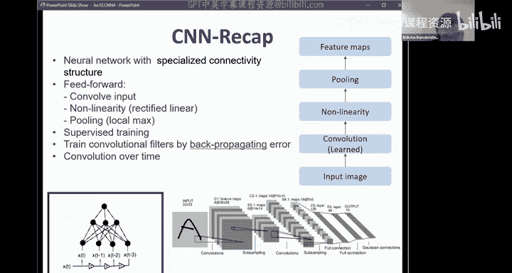

And this is the last of our lectures， a series of lectures and convolutional networks。

From the next week on we will be talking about recurt neural networks。I will。

Pause or take any questions。 Do you have any questions。

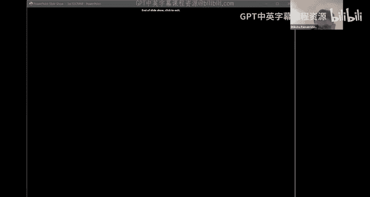