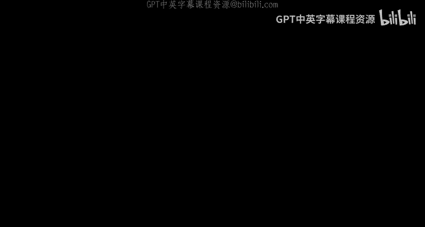
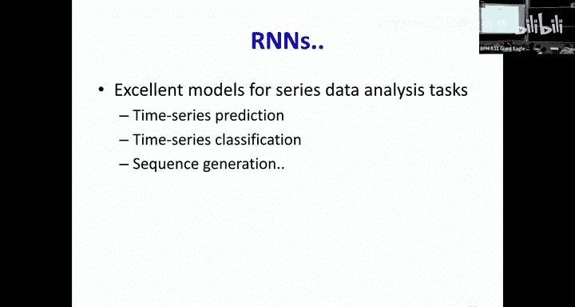

# CMU《深度学习导论｜11-785 Introduction to Deep Learning Spring 2025》中英字幕(deepseek - P14：[14]S2025 Lecture 13 - Recurrent Neural Networks (RRNs) Part I.zh_en - GPT中英字幕课程资源 - BV1xbZNYrEbs

No。

Okay。嗯。Okay。やってきの。来给你们。我け。Okay。So， please fill in your。Attendance poll。And today， we actually begin。

 begin on。Begin with record neural networks。 And this is probably the most。

Fon portion of the course because pretty much everything that you see in the AI field today have built on。

 built largely on everything that will be covered in the rest of the course。So M LPs， CNNNs。

 these were kind of the basics。 And then we built recordcur neural networks and recordcur neural networks actually LED on to transformer models and all everything else in AI。

 We were also going to be looking at geneative models。Including GNs， variational auto encoders。

 diffusion models and so on。 That's for the rest of the course。For today。

 we are going to start with rec neural networks。The problem is this I mean。

 we've seen how MP can analyze static inputs or even scan for patterns。

 But then you have situations where with situations where you have to consider a series of inputs。

To produce an output and the output too may be a series， for example。

 in the speech recognition problem。Now， one way we saw this was that， you know。

 you could look at this as a convolution network。 Can you show to your laptop。要。Right。

So where we could just scan for something。 Do you mind shutting the up， if you not。How are you there。

Hello， do you mind shutting your laptop。 You Thank you。So， so， you know。

 we saw how in speech recognition， you'd be scanning for an input because you want position independent。

Pattern recognition。 But there's another way of looking at it。

 You want to analyze the entire sequence of inputs。 And at the end。

 you have to determine if the output， if it contained a particular pattern or not。 or for。

 for instance， you might want to analyze the entire sequence of spectral vectors to decide whether this included the word。

 Yes or to be or not to be， right， or here's another。 here's a more classic one for Pittsburghs。

 the Steelers， meanwhile continue to struggle to make stops and defense。

 they have allowed on average 30 points a game and have shown no signs of improving any time soon。😊。

Is this a positive statement or a negative statement。Okay， which game is it meant talking about。这ど。

Is there anything over here that tells you what the game is， Is it basketball， I it baseball。

Its cricket。 What is it。Exactly， but how did you find out Steelers。

There can be many teams called Steelers， right， The evidence builds up over the entire sentence。

 I mean， this is this is unfortunately incredibly common in Pittsburgh。

 Our team has been doing this for the past 15 years， as far as I know。 But you know，30 points a game。

 sounds like football。 No signs， you know， struggle to make stops and defense。 Sounds like football。

 But the evidence builds up over the entire sentence You'd have to see the entire thing to decide what they're talking about。

 and you have other similar things。 You'd want to analyze a document to identify a topic you'd want to read English in output French。

 In each case， you're analyzing an entire sequence of inputs to produce in output or star the stock market。

You'd have a， you'd have a stock index every day。 and you can think of this as a vector of stock values which changes from day to day。

 You want to analyze this entire pattern。 And then on each day。

 based on the pattern that you've analyzed， you want to determine whether you must invest today or not。

 And if you must what you must invest in again， you're analyzing series to make determinations。

 So in all of these are classification and prediction problems where you consider a sequence of inputs。

 input vectors and produce one or more outputs。 and obviously， like all such problems。

 this is a problem of。😊，Function computation and functions can be modeled using neural networks。

 So this can be done with neural networks。 Now， before I continue。

 I'm just going to explain the pictures that I will be showing。 Now。

 in all of the pictures that we've seen so far， we I showed Mlpss using rows of neurons connected to rows of neurons。

 If I took to that picture and began rotating its sideways。

 at some point is's going to look like this。 Eventually。

 when I rotate it so that it's facing into the page If you looked at its side on。

 it's going to look like this figure to the right。 So the picture to the right is what I'm going to be using for illustration。

 but you really must be thinking of it each square as a complete layer of neurons and each arrow representing a complete connection。

 So this figure to the right is the same as the figure to the left。 or， for example。

 if I had a network like the one to the left。 the way I will illustrate it is。😊。

Is given on the right， or this one here to the left would be shown as as is shown on the right。

 just to clarify。 So again。Each of these boxes actually represents a layer with many units that's connected to a layer with many units。

 and the arrow represents in the absence of any other information given to you。

 the arrow represents a complete connection， every neuron in the source connects to every neuron at the destination。

So let's go back to our stock market prediction problem。

We had to consider the series of stock values to determine if you must make a prediction。

 you must invest today or not。 Now， would you be looking at just the stock values today to determine if you must invest。

What would you look at？The past， right， How much in the past。

So you're going to look for at least several days， right。

 So if I want to look at the past several days to determine if I must make an investment。

 what kind of architecture can you think of。Anybody。

What kind of architecture architecture would you think of。The TDN N， right。

 I can just have a network which looks at the current input and the past several inputs。

 And then based on this pattern， it's going to decide。

 And so this is just a convolutional neural network。 It's a time delay learn neural network。

 And on each day， I would just be looking at。The current stock values and the stock values for the past several days to decide now。

The issue over here is that this。Ass a finite response system。

 something that happens today will only influence。The output of the system for a finite amount of time into the future。

 So， for example， if the network is looking at the current input in the past N inputs。

That's n is the width of the system， then。It's something that happens on any day is going to only influence outputs for the next end days。

 So， for instance， consider something that happened on this day， marked in red。😊，Now。

 this doesn't influence the prediction at T-1。He does influence the prediction of T。

It influences the prediction at T plus1， T plus 2， T plus 3。And then the next day。

 it no longer influences the predictions， right， So this is a finite response system。

 meaning something that happens now only influences the outputs for a finite amount of time。

 The window of time over which the outputs are influenced is finite。Now。

 is this good enough for the stock market。Just looking over the past week。

 would that be good enough for the stock market。No， right。 The stock market has all kinds of trends。

 right， So here are something that this is a now you can have。Longer trendss。

If you want to have longer transport is the simplest thing to do。 You can just say。

 I'm going to look at。Even more of the past， it's not just the past four days that tells me what I must do today。

 I have to look at the past 20 days。 so I can just look at the past 20 days。

 but is 20 days sufficient。There's a history of 20 days sufficient， not really， right。

 because if you look at how the market works， you have weekly trends。

People purchase more on weekends。 You have fortnightly trends。

 Some people get their paychecks every fortnight。 You have monthly trends。

 But the end of every month is when a lot of books are adjusted and people get paychecks。

 You have seasonal trends。 Things change in the season。

 Youre you're not you're not going to get the same clothes at in the store in June as you would in December。

 And then you have annual trends。Every Thanksgiving， you're going to see some upsurgeon。😊。

Purchases now， what， what predicted is the fact that this happened every single Thanksgiving。

 So you're going to have to go back several times 3。

65 days to know that on the in the last week of November， things happen， right so。

How would you capture all of these trends which can go way back into the past？

The simple solution is to say， I'm just going to have。

Considered more and more and more inputs like so。 But what would the problem be with an architecture of this kind。

What is this， anybody？Come on， guys。 Yes we there。Too many parameters， right， This is。

 if I want to look back。10 years worth of inputs。 I'm looking at 36150 inputs each of them as a long way。

 So that's how many parameters I'm going to require。 This doesn't even begin to make sense。

 I'd have to learn those parameters， as well。So we want infinite memory， but we don't want to have。

An infinite set of parameters to go with it， right。So， here is your first book。对。Okay。10 seconds。

 guys， this was easy。Alright， so what is the answer to the first question。The second one。Okay。

 right easy。 A convolutional networks are。Finite response systems。

 something that happens at any position or at any time only influences the outputs for a small window around them。

 right。And if you're thinking of a time， time delineal network。

 an input at time T does not affect the output of the network for all time。

 just a finite amount of time。What we want is something that's infinite response。

 something that happens today must influence the output forever。 Now。

 here's one very simple way of doing it。 I can say that the output at any time。

 T is a function not just of the current input， but also the last output that came out。

So Y T is a function of X T， but also Y T -1。Now， for this， of course， for this to work， of course。

 I need to define y of -1。 so that I can compute y 0。 But once I do that， then。

 this is an infinite response system because suppose I gave you an input at time 0。

 You're going to get an output at time 0。 There are no subsequent inputs。

 The output at time 0 is going to generate an output at time 1。

 The output at time 1 is going to generate an output at time 2， right。

 So something that happens now is going to influence the output forever。

 This is what is called a nax network。 a non nonlinear auto regressive network with exogenous。Inputs。

 so why do you think we are calling it auto regressive anybody。It depends on itself。 So it's auto。

Meaning it's working on itself。 It's a regression， you're computing regressions。

 you're regressiongressing on the inputs， which happen to be its own output。 So it's autoregressive。

 It's taking its own values and working on them to generate more outputs。

 Anything that that does that is called an autoregressive model。

 It's non nonlinearar because it's a neural network。 The inputs have from the outside。

 and so the exogenous Anyways。 So here's what a onetap Nx network would look like。😊。

You'd have a time T， some input coming in that generates the next output。

And that output is going to be going into the network。

 along with the next input to generate the next output and so on。

 So this would be the actual computation and observe that the recursion is happening through the output。

 It's the output that's feeding back。 There's nothing within the network itself。

 that that carries any information about how long the network has been working。

 There's no information in the network that tells me， okay。

 I have been operating on inputs for two hours， you know。2 hours or have worked on a sequence of 20。

000 inputs。All that information is in the output。And so you can see how over here an input at time t equals 0 will。

Compute continue to influence the outputs forever。 even if you have no subsequent inputs。

Because each yellow box feeds into the next column。Right， now okay， again。

 keep in mind that all the columns are identical。 I'm using the same network to make predictions at each time。

 All that changed was the inputs to the network， which is the current X and the previous body。Now。

 I'm just simplifying this picture instead of showing an explicit yellow box to hold the output Im just simplifying the network to say there's an out the picture to show that there's an。

Output going out and the final layer also feeds back into the network。 That's it， right。

So the brown boxes show output layers and all outgoing errors are the same output output later， okay。

Now， this concept can also be generalized， even if I'm feeding things back from the output。

It doesn't mean that I cannot look at a window of the input。

 So this is a more generic Nx network where at any time I'm looking at a past bunch of inputs and a past bunch of outputs。

 And so if I were looking at the K past outputs and thell past inputs。

 then it's an order KL Nx network。Nonetheless， the key here is that。

What happened in the past and how long the network has been。Operating。

Is not indicated in any manner within the network itself。

All that information lies entirely in the output that it operates on。

 So history and memory are stored in the output。Now。

 Nx networks were very popular for time series prediction for the longest time。

 They were used extensively for weather prediction。 Yeah theyre very good at it for stock markets。

In tracking systems， they were also used to a model language and we still use it for language。

 in fact， a lot of what we do looks a lot like Nx networks。😊。

And any phenomenon with distinct innovations which drive an output。

 what we mean is you have an input and you have an output and these combine to produce the next output that can be modeled here using NX networks。

The key is that the memory of the past is in the artwork and not the network。So。

What's the obvious next step。If I'm actually going to be analyzing time series。

 I want the network variables themselves to somehow hold awareness of the fact that they have been working on a time series。

 If I worked on， if， if I've looked at an input series 200 long。

 then I want something in the network， which says。Ive worked on 200 inputs。 If it's 400。

 I want the network to hold something that's different。 That tells me that I worked on 400 inputs。

 and this clearly doesn't do it。 So how can we introduce this notion of memory into the network itself。

For that。We are going to use an introduce an explicit memory variable whose job。

 only job it is to remember。😊，So the time， the memory variable at any time T is going to be a function of the output of the previous time。

The hidden state value of the previous time and the memory are the previous time。 But or the input。

 it can。 the memory can also depend on a bunch of other variables。

 And so the hidden state at any time is now dependent on what was stored in memory and the current input。

So what we have done is we've introduced this memory variable。

 which somehow which you can now inspect to figure out how long the network has been working and the memory variable is what goes back into the network to generate the hidden values and the hidden values are going to generate the output。

Now， this was the first step towards what we currently call Recurt networks and the earliest instance of it was by this guy called Michael Jordan。

 who not the basketballer。 Michael Jordan is actually a pretty famous professor in Berkeley。

 used to be at MIT before he went to Berkeley and his thesis。😊，He once he became a pro。

 he never worked on neural networks again as far as I know until recent times。

 but then his thesis was on introducing memory into networks and the way he did it。

 he introduced a memory variable。Which simply retains a running average of all of the past outputs。

 Now， the distinction between this and the basic K Nx network is that the basic K Nx network only looks at the latest output。

So the latest output again。 remember， the output is a single value。

 So you could have got the same output with different input patterns。

 just inspecting the latest output may not carry all the information about the history。

 So his idea was， let me store the memory。 My memory doesn't should not just be the last output。

 It shouldn't be just the last n outputs， it put it should be all outputs over all time。

 And what is the simplest way of storing all outputs in one variable。

 You just maintain a running average。 And so he introduced this memory variable。

 which just computer running average of the outputs。

 it's the latest output plus some new times whatever was already in memory。

 That's just running average。 and。😊，Hidden state。Gets this memory value along with the late with the current input。

 Now， this is not truly a recurrent network。 So the it comes under the notion of partial recurrence。

 Why so when they train the model， There's nothing over here， which。

So neither this mu nor this one are learnable。So when they train the model。

 derivatives would go down here。Go down this here， this， this line and stop right here。

 So what this means is that you're treating each input column independently。

 You're treating each input column as a separate training instance。 we just happen to get。

M as an extra input。 And then you are aggregating derivatives。 Now， this is not a great thing。

 because。Again， what we know about recurrent phenomena。 Any。

 how many of you are familiar with the Butfly effect。 I mean。

 you must all all have watched the movie， right， Something that happens today can be completely hidden and invisible。

 And then suddenly something happens 10 you know，10000 instance down the line and you need to be able to。

 account for this， which means that you want。The derivatives to keep going backwards all the way until they find whatever event triggered the current output。

 And this doesn't。 The derivative stops right at the memory block。 But this was the Jordan network。

 So this guy Elman， again， the Jordan network is not really storing anything inside the network itself。

 The memory variable， you might as well think of it as just a running average of the of outputs， yes。

我6岁你的。Theities don't because his design decision。 It's a design decision。 It just doesn't。

 That's how it was done， right， And so， And then again。

 there's also the fact that there is nothing inside the network。

The memory variable can just be thought of as a running average of the。Outputs itself， right。

 So you still haven't solved the problem that the network itself doesn't tell you how long it's been operating。

 So this guy Elman came up with the next version where he said。I'm of having the output。

 I'm going to use the hidden state。 I'll clone the hidden state from the previous time。

And pass it into there。And networks。 So at each time， the network was receiving as inputs。

 the hidden state at the previous time and the current input to produce its outputs。

 So this looks a little more like having the network states store the value。

 because now you could actually inspect what's in the green box and see how long， you know。

 and get some indication of how long the network's been operating。

 But this was still a partially recurrent network in that when they actually perform back propagation。

😊，The derivatives would go down here。And stop right here。 The derivatives were not passed past。

 you know， It because he was explicitly cloning the hidden state。

 with no derivative being propagated backwards。 So each column was being treated as an independent instance。

So啊。Here's the story so far in time series analysis， models must look at past inputs。

Along with the current input。Looking at a finite at hurried horizon of past inputs gives us a convolutional network。

Looking at for the infinite past requires recursion。

Ns networks recur by feeding back the output to the input。

They may feed also finite horizon of outputs。Simple recurrent networks try to actually store the memory in variables。

 Jordan networks maintain a running average of outputs in a memory unit。😊。

Alman networks store hidden unit values。For one time instant， in a context unit。

And they are simple or partially recurrent， because during learning。

The current error does not actually propagate backwards。

 which means you have no way of ensuring that you can actually track the triggering of events way out into the future right so the derivatives are blocked at the memory unit and Jordan networks and the context unit and element networks。

Now， here's a second poll。 I know several of several of you are falling asleep。Do you want to。

5 minute break to go wash your faces。I will give you one after 20 minutes。Yeah。家佢个好东。嗯。

What is the use of like actually。そのこに関璧。不高。I like， is there any specific know and how are they affected。

So the output block is just using explicitly storing a running average of output。

 So that's you are effectively storing infinite outputs。

Here you are depending on the just the local recordscur。 So design wise。

The dimensionality is going to be different。 What your computer is going to be different。 Again。

 the network variable itself。Doesn't carry information about the past。 That's about it。对就这个。

they wouldn't be go because the number of parameters and it's gonna be different， right， So time。

 okay， time's up， guys， what's someone on Zoom。 Can you tell me the answer to the first question。Zom。

我吃。唱后。Throughru or false。Oh。For second one。Well the answer to the second one on Zoom。T， okay。

 you guys agree。 So you there， do you mind shutting your phone off。That's you。

 The one is looking around yeah。The blue jacket， please turn the phone off。

And put the phone on the table， please。Thank you。And set your laptops。Alright。

 does everybody agree with these answers。Memory units don't have true records。And。

They dedicate neurons specifically to store past history。 So there's nothing the network itself。啊。

Doesn't hold all the history。 They specific units designated for it。

 whether dont they don't propagate information backwards。

 So the alternate model are these state space models。

 That's what we call record neural networks These， these days Here。

 the hidden neuron in the network is a state variable that。

Whose value at any time is a function of the current input and the hidden state output。

 hidden state value at a previous time， and the output depends on the hidden state value at this time。

 So H T is the state of the network， which summarizes information about and past。And， of course。

 we need to define H of -1 for this to work。Now， this is a fully record network because。

 as you will see， derivatives keep getting propagated backwards。

 So here's what the computation is gonna look like。

 This is what a single column of the network looks like。 At any time。

 the hidden state is a function of the current input and the hidden state at the previous time。😊。

The output is a function only of the hidden state at that time。

 This is a classic state space model and the weight would operate H of -1 is defined at the first input。

 you're going to compute h1 H0 and and y 0， then you'd use x1 and H0 to compute h1 and y1 and so on。

😊，So here you can see how an input at time 0。 if you just have a single input at time  zero and no further inputs。

By following the chain of。Computation， you can see that an input at time 0 is going to influence the output for all time。

Right， so。Now， I've just call it a hidden state， and I drawn a single box。

 but the hidden state can be arbitrarily complex。 It can have many layers in it like this one。

 and the connectivity within the box， can be arbitrarily complex。 As far as we are concerned。

 all we are interested in is that there's this hidden state and it is recurrent。

 So when I now if I have a hidden state， which is just a single hidden layer。

As seems to be implicit in this figure， that's a recordcroinian network but then the hidden state can have two layers and now of course it have to define the initial value at time minus1 for each of these layers yesterday。

😊，We' kind of struggling to see how this is different than just explicitly copying the layer and then passing into the network。

Where is the difference there， So So here， okay， when I'm computing the derivatives out here。

The derivative here goes past here and then keeps continues to go back。Down the line over here。

 whereas in the previous model， you just computed to the derivative because this was just copied。

 these derivatives were not passed backwards。Makes a big difference because the information。

 you are not telling me how triggering perturbing this one is going to perturb the next one right。So。

 now。It's， it's basically looking at slicing every column instead of passing and treating them as a stack of inputs。

 instead of passing the derivatives backwards。Now。The record network can also have skips of this guide。

 but it's still the same record network， right， You can have more complex networks。

 This is also just the record network。In every case， basically the hand。

 you can have records over multiple time inputs。 This is another thing that I can actually do。

 So where I say that instead of looking at the hidden value at just the past time。

 I can be looking at the hidden value of the past two times。 of course。

 for this to for me to for this to work， I would have to define H of -1 as well as h of -2， right。😊。

And the key thing， in most cases， we just use simple structures。

 We don't like to have records over multiple instance instances of time。

 And the key thing is that every that all they have drawn a large network iss basically the same network being used repeatedly。

 So every column is identical to every other column。And in the good old days。

 we used to have simplified pictures of this kind where you say recurrent network with this structure。

😊，This loop over here doesn't mean that this output of the hidden values is feeding back to itself。

 All it means is that it's feeding。Into the same layer at the next instant of time So so the loop the loops represent recursion over time。

 and so a picture of this kind would really represent a computation of this manner of the type shown below right this picture is going to be this one here。

 This guys got to be。This network here。Now， how does the actual computation work in this case？

So if I have a recurrent network with a hidden state which is just one layer。

 then the arithmetic is fairly straightforward， the hidden layer at any time T which is represented by H superscript 1 is computed by applying an activation F1 on an aine function of the current input and the hidden hidden layer at the previous state。

 so now we know that an aine function is a weighted sum plus a bias。

 so there are two sets of weights， the first is this w superscript 1 which applies to the input at the current time。

 the second is the W superscript 11 which it represents to the same hidden state at the previous star。

And， of course， it's a bias。 And the output is simply computed by applying some output activation。😊。

On an a and function of the hidden state。So we will observe that there are two distinct sets of weights。

 One is the set of weights associated with the vertical lines。

The other is a set of weights associated with the horizontal lines， the vertical lines。

 the weights for the vertical lines are what I will call the current weights。

The weights for the horizontal lines are what I will call the recurrent weights。

 because that's where information is being passed over from one time step to the next time step。

Right。And so if I have a more complex network of this kind once again is the same thing。

 the first hidden state is computed by applying an activation function F1 on an a function of the input。

And the hidden state at the previous time， the second hidden state is。Computed from the hidden state。

 first hidden state at the same time and the second hidden state of the previous time。 right。

 So again， the recurrent weights are all the weights associated with these horizontal edges。

 which is w W1，1 and W 22。And all the vertical lines。

Whose weights are represented using a single sub superscript， those are the current weights。

Where you're just considering the whatever is coming up from the same network at the same time at lower layers or at the input。

So here's a more complex network， right？So you get the idea。 Any questions so far on how this works。

Any questions？Yeah， I think previous slide for the activation。 Yes， I just have。 This is a throwaway。

Somewhere on the slide， you know， the F1 activation is typically10 H。

And why we will go over this in the next class。But there's a reason。

 It turns out that for the recurrent players， you can't use just just any odd activation because bad things can happen。

And so things can get forgotten， things can blow up， and so we choose1Hs at activation。

 and we will see in the next class why that is the case。Now， here are the various variants on record。

 These are from these images are from And Carpathy。

 This is just a straight up MP input feeds to the hidden layer feeds to the output。😊。

Here is one where I have a single input。And there's no more， there are no more inputs。

 And then you have a sequence of outputs。 Can you think of an example of the sky of where something of the sky might be used。

Anybody。Like if I， I fell captioning an image。I just gave you an image。That's going to get analyzed。

 And then I'm going to generate a sequence of words as the output， right。

 So or here's one where I analyze an entire sequence of inputs and then produce a single output。

 Any examples of。Where that's that kind of thing might work Yeah， sentiment analysis。

 You want to read the entire sentence to decide whether the steeler is won or lost， right。

 then or here's one。 many too many。 You see an entire sequence of inputs。

And then you and then after the entire sequence has been analyzed。

 you generate the entire sequence of outputs。Any examples for this？T generation。

 I can see a read a question and then generate the answer， machine translation。

 I can read the English and generate the French you'd have to see the entire input before you generated the entire output。

 right。OrAnd， of course，This one， where at each time you read an input and produce an output。

 an example for that the stock market prediction， for instance， right， same thing。 So again。

 this last instance is the simplest in a conceptual sense。

 So what we will often do is look at all of these other examples。

 other other architectures and somehow map it on to this last architecture。

 because that is the one that's easiest to analyze lies and interpret。

 And so and so the rest of the lecture I'm just going to use this。😊，This last format。

And in subsequent lectures， we will see how either the model can be con converted to something of this kind or how we will deal with other cases。

So the story so far， just to continue state space models， the first two points we've seen。

 the new additions are that state space models retain information about the past through recurrent hidden states。

 These are fully recordcurt networks。😊，The initial values of the hidden states are generally learnable parameters as well。

State space state space models enable current error to update parameters in the past。

Right now this is because you have the derivatives going all the way backwards I again to answer Jake。

 you know， if I were not doing that， there's no way for me to know how much perturbing this is going to perturb the output three times steps down the line because you're not computing the chain of derivatives three times steps out only one time step out。

And this actually computes the entireation of derivatives。So how do we train such an any questions。

Any questions。On Zoom， do we have any questions。Okay， if there are none， let me continue。

 So how do we train such a network。Although we are performing on the face of it， a more complex task。

 there is absolutely nothing different or magical about record networks。 These are just M LPs。

 Can you tell me what kind of an MLP this is。😊，Whereas I claim this is a single multi layerer perceptron。

Can you tell me why so。Anybody。If I just readre， here's how we normally draw an MLP， right。

I'm just going to use this simple box notation。Yes standard MLP。 this is your input。You have Levan。

Later2。Hardput， this is your standard MLP， right。If I just did this， where。What does this look like？

Just like a standard MLP， right where each layer is getting inputs from the lower layer。But also。

 an external input。This is the same thing。 Is it not All I need to do now is to have。An extra。奥特的。

That's it。 If I just draw it sideways， you will see why it's an MLP。Right， so once you do this。

 then there's nothing magical about this anymore。Its making sense to everybody， right， And so。Here。

The what changes is the manner in which you present the inputs and you present the outputs。

 So you're going to giveia， you will be given。Input output pairs， input and target output pairs。

 the input will be a sequence。The target output is also going to be a sequence y。

 because as I mentioned， I'm going to be using this last this last version of the model as my template for explaining everything so。

😊，At each time， you have。A single input is a sequence of T vectors。

 A single output is actually a sequence of T outputs， T desired outputs。😊。

And so the T inputs and the net， and now the network at each time is going to also generate a sequence of outputs。

 Y 1 through Y T。And what we will do is to try to minimize the error between the desired outputs and the actual outputs。

 the desired output sequence and the actual output sequence。 And this herein lies the， right。

 So again， the unroll computation， as I just said， is just one giant。😊，Network。

 but then this is a shared parameter network。 Why is this a shared parameter network。

When I write it like so， anybody。Why is this a shared parameter network？你水都。好了 me。

When I unroll it like so， these weights are the same as these weights， right， at each time。

 every column。Is identical to every other column in terms of parameters。

Which means if I perform any training and update the。Prameter here。

 I update the parameters everywhere else。 Every other column。

 which means this is a shared parameter network is is just a standard MLP with the。

 with the exception that it's got shared parameters， right。

And so the training is going to be much like in a standard MLP。 You're given an input sequence。

 you're going to pass it through the network。And forward pass。

 you pass the entire data sequence through the network。

 and you're going to generate a sequence of outputs。 So if I were to write pseudo code。

 I'd be going for each input。 I I have T。 It's a sequence of T inputs。 So for each training input。

 each training input is actually a sequence。😊，I'd be stepping through time。At each time。

I'd be stepping through the layers。 and at each layer， I first compute my aine term Z。

This Z value is computed at time T at layer L， and then I put it through an activation to compute the hidden state value H。

In layer the L at time T。 And then the final once I'm done through all the hidden layers now observe something interesting here。

 The a fine term at for at any layer L at time T。😊，It is a combination of two terms， One is。

It's computing a weighted sum of the hidden state at time t -1。Plus。The sorry， the hit。

 its computing awaited sum of。The lower layer， layer L -1 at the same time， T。Plus。

A weighted sum of the same layer at time T -1。 So basically， the two terms over there are this。

 this first guy。Here， actually， let me draw a different figure。If I have something of this kind。

So this first term。Represents。This connection going up。

And the second term represents this connection going sideways。 So at each layer， you have two。

 you're combining two terms，1 coming from underneath and one coming from the side。

To compute the Fine term。 And then you apply an activation to it。 And， of course。

 when youre finally through down through all the with all the layers at the final output layer。

 there's just one。😊，The hidden value to be read from underneath。

From which a compute a finite term and a final output。So the forward task， is this making sense。

 It's very straightforward。 There's nothing particularly complicated about this， right。

The real magic lies in backdrop in computing derivatives。 So， again， look at this figure。😊。

If I were to start， if I were to compute derivatives over here， this is the same figure， right。

 I just drew it side base， where would you begin。When we perform back propagation。

At which point does the are the does the computation of derivatives begin at the output layer。

 right the final output。 So you're going to start off computing derivatives here。

And then pass them backwards， likes it。Now， if I go back to laying the network horizontally。

 that's the same as passing， computing the derivatives at the final time。

And passing the derivatives backwards through time。So for this reason。

 it's called back propagation through time BPPTT because。Although it's just straight up backdrop。

 the fact that。The layers are out rolled through time means that when you perform backward propag。

 you're going backwards through time。And so it's B，P T T， right。

 now I'm going to draw the same picture slightly differently， just to。Point out that there's not。

 there's nothing magical happening to the side it's。

Showing that the inputs are coming in from the bottom， right， just for illstr purposes。

 And now let's see how the derivatives are actually computed。 I'm going to。

 I'm focusing on one training instance。Now。Here's the thing。

 The key thing is that the output of the network as a sequence of is is a sequence。

 The desired output is also a sequence。And so the divergence that you compute is between an output sequence and a desired output sequence。

And this is the divergence whose derivatives we are going to compute And and this is the divergence。

 If we're going to try to minimize the divergence between the actual sequence and the desired output sequence。

 Now， this is not necessarily the sum of the divergences at individual times。So why would that be。

 right？ now， consider this if I'm performing speech recognition or if I'm performing machine translation or something of this kind。

 then if I were performing speech recognition， maybe the are。Actual word sequences。

 once upon a time in America。And the recognizer， which is started off。

 starts off being trained with initialized in a really bad manner， just says good morning。

How do you compare what's upon a time in America with good morning。

 There's no one to one correspondence between anything and anything， right。

 and that is the actual divergence we want to compute。😊。

So which and that is the divergence we want to minimize。

 So one must not confuse this divergence over here as the sum with the sum of the divergences at individual times。

 No， that is not the case。The divergence is the divergence between two sequences。 Now。

 the problem with this is that when I think of it as a divergence between two sequences。

 that's very unstructured。And so what we will try to do is try to actually decompose it somehow into the sum of divergences at individual times and then work with them。

 So I'll see how。But for now， let's look at backdrop。I've just got some， yes。

Usually in a a model like this， the output is a fixed length， or I can have a variable length output。

It can have variable and output right， so we'll see this again in the next class in the week after the break。

But if you're again， speech recognition， right， if I give you a sequence。

 if I give you a5 second recording。How many words are in it？And you have no way of knowing。

 so you can't fix the length。Right， that's why。So， let's look at。

Here's how I've represented the variables。The superscript is layer number。

 if it's a double subscript， it's a recurrent layer。

 So w superscript 2 is the are the weights going to the second layer W superscript 1 and the weights going to the first layer。

 And I've also got。 So here's the entire compute， right。Now， I'm going to assume that first。

We have a divergence。The divergence is between two sequences。

Regardless of the fact that the divergence is between two sequences， we must assume that they that。

The divergence can be differentiated with respect to every one of the outputs by team。Otherwise。

 we will not be able to perform back propagation。 So the divergence itself must be defined in a manner where we can compute this derivative。

 the derivative of the divergence with respect to every single。Output vector Y T。

 including the derivative of the divergence with respect to the final output。O。So in general。

 we will need to be able to compute it。 I'm going to assume that we have it。

 that we have magically defined the divergence so that I can compute the derivative of the divergence with respect to everyone otherwise。

😊，Now， were going to use two simple rules。 Now， we are familiar with these rules way from way back when we did trading for M LP。

 right， So let's say I have Y I-1。Which influences Z I， which is the aine term， which influences Y I。

 which is the activation at。The I layer， right， which finally influences the dives， the， the loss L。

So I would initially compute the derivative of the loss with respect to ViAC， which is。You know。

 thela why I， right。Now， if I take all of you guys。If I pass this derivative。

 if I pass this derivative back to this point。How do I get the derivative of L with respect to Z？

From the derivative of L with respect to why， anybody。Do you remember this。嗯h。都は今は。In this case。

 what was the rule， Come on， guys， This should be very straightforward。 chain rule。

 But what was the exact formula。Come on。 This is easy。Yeah。

 tell you Yeah you're thinking about it in terms of scalers， right， What did we do。Come on， someone。

 someone on Zoom。 Can you answer me， This is so simple。絶たなんで。We said something about。

Chaade multiplication， did we not。 So any time I had。W I y I-1。Going to the I。Gand goodbyebye ae。

Let's went to N。So the derivative of L with respect to Z。

Was the derivative of hell with respect to why and what happened， what followed。

What did we do there with。W did we multiply this bike chain rule。 Come on， guys。Can someone tell me。

Or do I have to pick a name？定为地址。What is D Y D Z。Divide D Z only works for scalers， right。

So what did we multiplied by。Aevtable life with respect to。 This was your。Just right multiplied it。

 Do everybody remember this？是。Come on。 You've done the homework。 You've done the quiz。 Santiago。

 Do you remember this。Yes， Jack。Okay。Now， can you help me with the next step。

 If I want to pass the derivative back from here。Y N z is。Say w times y， right？

So how do I compute the derivative of。L with respect to y， Y， I -1。

From the derivative of L with respect to Z R。This， we already have。How do， how do I compute this。

Anybody。没有。自有。So you want to multiply this by the derivative of Z with respect to y I minus-1。

 And what was that。嗯。你。Weight matrix。 Everybody remember this。You've done this， right。

 This should be burnedt into your head。 This is just straight up back propagation。

 Every time you take a step back， you write multiplied by the latest derivative。

 You took a step back， you write multiplied by the latest derivative。

 You kept doing that all the time。 That was the very simple back propagation rule。

 Can do you remember。Can I see raise hands， So least， you know， I know some of you Okay。

 So from this， we also computed the derivative for。😊，The loss of the loss with respect to W， right。

And the derivative of the loss with respect to W in this case， if this was W， we saw was。

Anybody remember this。That was just by I -1。 We went through all the pain of making sure that the sizes worked out times。

 times what。Someone zoom。It's taking a lot of time， yeah。Go ahead。 You had your hand raised。

those attractive。They whatever have respect to the。Remember this， guys。Right。It's not hard。

 It's so simple that you cannot afford to forget this。You don't need to derive it as this chain rule。

 just keep right multiplying。 We even should have you obtained this。

 And so we're going to use this again and again， right And also now if I have a y which is influencing2 Z's like Z I and Z I plus1。

😊，And I want to compute the derivative of the loss with respect to I。

 I'm going to have to sum over these guys， right， sum over twota sum over both paths。

 So that's going to be the derivative of the loss with respect to Z I times 41。Plus， the derivative。

 they loss with respect to Z I plus1 times W2。系。Everybody with me over here。

Nothing particularly complicated。 We are not doing any complex math。Right。

 you should not forget this， because this is。You could do this with。You know， in high school right。

 one of those HS sketch things， you should be able to write these things down every single time。

 It's that simple。 And so let's see how this works， right。😊。

I'm going to assume that I have the derivative of the of the divergence with respect to the final output。

So now I'm going backwards， right？ So I'm going to start from you and I'm going to work my way up。

 and you're going to tell me the next derivative。 So from here。

 what is the next derivative at Comp Santiago。😊，TheAgain the the derivative against this input。

 right， and what will that be。So if I want to move the derivative from the green arrow down to the input of the orange line。

 what would it be。Outs box。Okay， let me help you， right， That's simply going to be。

My slides have not updated。 So just focus on this purple thing。 I clean them up。 Okay， so this。

 the derivative with respect to the Z over here is simply the with the derivative with respect to the y。

Times the derivative of y with respect to Z， which is the。What is that。The Jacobian。

 that's an activation function， right？Okay， so now Jack， if I have the derivative here。

 what is the next derivative at compute？ I'm gonna compute the derivative of the divergence with respect to this guy。

 this output here。Right， and that is going to be the derivative。

 I have the derivative with respect to Z。 I take a step back。

 compute the derivative with respect to y。 All I'm doing is right multiplying by。The weights， right。

 actually that， what is the derivative for the weights。😊，嗯。

What is the derivative of the la loss with respect to W2。But we're here。 this one again。

I wrote some formula here， right。So that's going to be just this one here。

That is this age term here times the derivative up there， right。I mean， the symbols。

 you might be getting confused with the symbols， but you get the idea of how that worked， right？

 So Nora， what is the next term I'd be computing the derivative for as I go down。

I have the derivative here at the output of this green box， what is the next derivative at compute。😊。

你方。I want to compute the derivative for the input to the green box， right？Everybody with me。

 So what would that be？嗯。こ the。So actually here， I just it's just a single time。

 If I want to compute the derivative for the Z， I compute the derivative for the H。

And multiplied by the Jacobian for that activation， yeah。Yeses。😊，Right。

 and then I can take a step back。And then I can compute the derivatives。 So。

 somebody brave enough to give me the next one。We're not writing anything particularly complex。

 right， Al that yeah， you want to give me a take。 Tell me what you compute next。 and respect-1。

 you can do this。 this is， no， but we have we are still only here， right。

 We need the derivative for this green arrow。So that's simply going to be this x times the derivative 4。

Z， right。But then we also need one more derivative。 So maybe you guys through。

 what is the X1 derivative with respect to X T。X T， we don't need this， right？

 So if I didn't want that， what do， what do I need。I need the derivative pass this line， right。

 So that's going to be first， the derivative for this weight is going to be H T -1 times the derivative here。

 right。And so now for one entire column， I've computed all the derivatives That makes sense to everybody。

Right now， if I take the next step。First， I'm going to start off by assuming that I have the derivative of the divergence with respect to y t minus1。

I take a test step back， then I'm going to come back and resumema have the derivative with respect to Z。

Out here， the Z here， right， which is simply the derivative with respect to Y t minus1 times this Jacob。

And then。There are two things that change， first。I want to compute the derivative with respect to the output of this green box。

 but how many are how many different ways。Does the output of that green box influence the divergence。

 Is there only one path or two。2 paths， right， And so if I want to compute the derivative。

For this guy。The derivative of the divergence with respect to H over here。

 that's going to be the derivative for this Z。Times this weight。Plus。

 the derivative for this z times this weight。You can see how you actually use two different terms。

 right？That makes sense to everybody。 right， But then so this is one change。 The second one is this。

 If I want to compute the derivative for the weights of this blue arrow。

 that's simply going to be H T -1 times the derivative for the Z bar。

But then I actually did a plus equals y， because that blue arrow is the same as the blue arrow one time step ahead。

And so their derivatives， because it's a shared parameter network， they must be summed up。

 So note that I've actually done a plus equals over here。😊，They're making sense to you guys， right。

 and so。Again。I can take the derivative go one step down。

 compute the derivative for the input to the green box in the second to last column。

 which is simply the derivative at the output times the Jacobbian。

And then I need to compute the derivative for。This green arrow， right。That's simply going to be。

The input here times the derivative here。 but again。Observe that I've done a plus equals。

 Why is that， Because I computed a derivative for the green arrow at the next time instant as well。

 So I have to keep accumulating those。 All the green arrows are the same set of weights， right。

And then if I went back from here。I would be computing the derivatives for the weights here， right。

And myu， can you help me with this one？啊，喂。Yeah， for the red here。

So it will be with respect to the state or the So will be minus1 H T minus2 here。 Yeah， yeah。

 minus So be dive with respect。The derivative for this weight is going to be this。

H T minus-2 times the derivative for the C， right， That's the rule again。

 But then notice that there's a plus equals because this is the second copy of the red arrow that' going past。

And so you can see how this works。 The derivative rules are pretty simple。

 as just repeated use of the two rules that we just saw。

 except that any time you encounter an arrow of a particular color。

 youre incrementing the derivative rather than。Learning something independent because they are all the same shared parameters。

 and then they can just compute continue computing the derivatives going backwards all the way until you get the derivative for h minus one。

Which can either be a fixed term or it can be a learnable parameter， right。

So did the back propagation rules make sense over here to all of you guys， Very straightforward。

 right， Nothing complicated。 And again， there wasn't anything so complex that you guys couldn't have derived it yourself after you have your morning coffee。

Right， again。The nice thing about this entire business with neural networks is that and why everybody in the world is taking them up is because the math is trivial。

😊，It just looks complicated， right， You can derive all of these equations yourself。

 and you can write your own toolkit from scratch。 There's no complicated math。

And so here's a complete set of derivative rules。Again。

 I'm assuming that you'd have the derivative of the divergence with respect to each of the vis。😊。

And then at each time， you are going to be computing the the derivative for the Z the second layer。

Then the derivative for the H is going to sum over the two outgoing paths。

The derivative for the Z for the first layer again， the stride multiplies with the Jacobian。

 And then when you're updating the parameters。The derivatives to the parameters they keep accumulating across all time。

 The key point is that they keep accumulating across all time， right。I have some pseudooid for it。

 I'll skip this here pseudoco。So， this basic。ForForism can be generalized to pretty much any architecture。

It works for all of them。 Any questions。Any questions。I went through it pretty quickly。

 So if you have any。Zoom， do we have any questions。And听下钟 no。O。Alright， so here's a third ball。屁。

Yeah。Alright。Some on Zoom， do you want to answer the first question to a false？Zoom。Expose。Okay。

 over here。The first statement true or false。不好。And what about the second statement。

 Anybody from the back want to answer this， Han， are you true。So there GD trains neural networks。

 one input at a time rather than over batches of inputs this。

Would be to update the network after each input vector。 No。

 you have to still consider the entire sequence， even for SGD。

 you'll be looking at it one sequence at a time， right Second。

 the divergence as we minimize is not necessarily the sum of the divergences of the individual time。

 although we like to map things down to that thing right is the divergence between the actual sequence of outputs and the desired sequence of outputs。

好 right。😊，O。So。Now， in all of this， we have assumed that the。

So can you shut your phone or laptop over there you there and turn your phone upside down。Please。

 can you turn it upside down？I don't want to see the phones out。

 And you certainly she may not be reading things if you want。

 you're welcome to do it in this time slot， just go outside。Right。啊，O。So。Now。In all of this。

 we have made an assumption that we have we are analyzing things left to right。

But there are many problems where you have the entire input。And you。

 and you have to make analysis at each time。 So to give you an example。

 if I'm doing part of speech tagging。Then。I can have something like。The red card。Robot now。

 if I want to do something of this kind， right， and if I want to find out。This is a determiner。

 This is an adjective。 This is a noun and so on， right， This is a ver。

So if I want to determine the part of speech for each word。

Then it's not enough for me to look at what came before it。

 although what came before it gives me the information。I also have to look at it， you know。

 I look at how it influenced。What comes after it， right。So was this guy。

 was this the name of a person or was this a color。

The fact that it's I'm I'm referring to a car afterwards means that it was a color。

 and it's not the name of a guy called Red。 right， So this's information both in the future and in the past。

 So the simple recurrence， which only looks at left to right correspondences。 that is going to lose。

Some of the information。And so in problems where the entire input is provided to you。

And then you have to make the。 And now you're allowed to make analysis using the entire input。

 It's valid to be to assume that you can use。Future。Inputs to analyze the current input。 Now。

 would this work in in if you're analyzing the stock market。Right， no， because tomorrow is not seen。

 but part of speech tagging definitely right， So the simple model that we have used so far that is just performing strict left to right recursion。

 It is not considering the future。What we would like is a variant of the model that not only considers the past。

 but also considers the future。 Now， if I want to do something simple of this kind， right。

 I have my inputs， X 1， x 2， x 3， x 4 now。The naive way to say that。

The output at any time must consider both the past and the present would be to say， I have this。

And I have this。That looks like considering both the past and the present， right， Would this work。

Would this work。Does anybody want to tell me if this would work？Remember。

 the actual set of connections is going to look like this， right？Would you be able to work， So Kay。

 would this work。Somebody else want to tell me。Hm with this work。If I told you that it wouldn't。

 then Jocelyn， can you tell me why it would not work？哦。You're not sure which direction。 That's， yeah。

 I say no， because like you have like inputs that depend on other outputs also like。 Yeah。

 if I begin computing this， right， I'm going to be computing this output based on this guy。

 But then that's going to go in and modify this。 I'm just stuck in an infinite loop。

I'm never going to stop computing at any time， right？

So when you're having loops of this kind is not a great thing。 It's not going。

 you're not going to you're not going to actually be able to stop computing even at a single time。

 because at each time you're dependent on what happened in the future and and in the past。

 So how do you break this， How can I actually come up with a model that allows me to account for the future。

While also， you know， not getting into this crazy loopy situation。

 So that inside came up from these guys Shatra and Paiwar in 1997， where they said。

 we must do the left to right recursion and the right to left recursion independently。

 So here's how they do it。Within each layer， you actually have two sublay，1 is。Left to right。

 the others right to left。And so you have two boxes。 This pink box is your left to right recursion。

 which starts off from the first input。And analyzes all the way to the end。

The other one starts off at the end and analyzes all the way back to the beginning。

I have two different independent layers， and their independent outputs。There are final you know。

 the first one just processes the data from 0 to t。You're only computing the hidden state values。

The second one can process that this processes the data from。T back to 0。

 observe that this is not the back propagation thing。

 This is just that the network is operating on the input and reverse style。Right， and at each time。

 both the forward network and the backward network are computing some outputs and so you can just concatenate the two of them for the final output of the layer。

This compute making sense to everybody， right， very straightforward。 And so once you do that， then。

 of course， within each layer， you both have forward and backward dependence。

And then you can stack these layers up。 And， of course， within each layer。

 the forward and backward dependence itself can be arbitrarily complex， right。

 But this is the basic idea。 This making sense to everybody。so。

This is how you do bidirectional records。 These are bidirectional record neural networks。

 and they used all over the place。In in many situations where in all situations where you also have access to the future because it makes sense to capture both dependencies。

And so， he's a poem。This was easy。 True or false， guys， right， You cannot。

Because he doesn't have access to the future。Now， the question here is， how do you perform backdrop。

Because now you have this bi direction， I think there's a notion。

 the notion of back seems to be kind of funny over here， very messed up。So， how。

I just have some code I' skip the pseudo code。But let's look at how back propagation can work， okay？

So。啊。If I'm computing derivative is going back。Then I'm going to assume that as I go backwards within any layer within any network。

I'm eventually going to have the derivatives。So， you know， the forward computations are， of course。

 going to compute all of these guys， right When I go backward wayss。

 I'm going to have the derivatives with respect to all of these H's before I come to the layer。

And so again， the key difference here is that now you're gonna have to perform back through time layer by layer。

 You can't just go down the layers and then go backwards， okay。But once you do that。

 I have the derivative with respect to all the ages。 Now observe that within any time。Okay。

 I'm just going to draw here。I have this。Backward layer。I have this forward layer。

 And let's say at each time， this output some。D dimensionsal variable。

 And this outputs some D dimensional variable。 I'm going to concatenate the two。

For the output of the， for the final output， so。What is the dimensionality of this guy going to be？

2D， right？ So when I come back， come back down here， what is the size of the derivative。

 How many components will the derivative have when I go back there。So here I have H forward。

I have H back have H backward。 I have H forward。 So H is a concatenation of H forward and H backward。

 right。So the derivative is going to be with respect to H。So how many components will it have2 D。

 right？ And off those 2D components， the first D belonging belong to forward。

And the second set of decocomps belong to backwards。

So I already have the derivatives of the loss with respect to the outputs of both the forward and the backward layer by the time I get there。

 right， And so then I can just separate the upper and lower the upper and lower halves of this derivative out。

To get the derivatives。Of the divergence with respect to the output of the forward layer at each time and also the derivatives of the divergence with respect to the backward layer at each time those are already available。

And so once I have this， I can separately perform back replication on the forward and backward nets。

I already have those。Red terms。 Nala dive， H。For the forward network。So starting from the end。

 I can compute the derivatives going back。All the way to the beginning， right？Similarly。

 I have the Nala dive。Age for all of at every time instant， for the backward network。

I'm performing back propagation， but back propagation must travel in the reverse direction of computation。

So here for the backward network， strangely enough， back propagation is going forward through time。

It goes from 0 to t because I'm going against the。Computer。Right， and then once that is done。

 here's what happened。I have X。X influence the forward network。

 X also influence the backward network， right。And so then I have the derivative of the divergence with respect to H forward。

I have the derivative of the divergence with respect to H backward。

What is the derivative of the divergence with respect to x？

If I have the derivative or the divergence with respect to this guy。And with respect of this guy。

 what is the derivative to the divergence with respect to x。It's just going to sum the two， right。

 because x was copied as the input to the forward。X was copied as the input to the backward network。

 So when I go back here， I just compute sum the two guys up。That makes sense to everybody， right。

 And so。This is very simple。 And so that's how we actually perform the complete back propagation through the。

啊。Backward there。You get the derivatives with respect to the output of the layer。

 you separate it out to the forward and backward components for the forward network you compute from backpro using the forward component of the derivative。

For the backward network， you compute back， it is actually going forwards。

Through the backward component of the derivatives。 So now we will get derivatives for all the weights。

Within the forward and backward networks， but then you continue to propagate the derivatives further。

 and so you're going to get the derivative with respect to the input to the forward network and the derivative with respect to the input to the backward network。

And then you sum those up and those are the derivatives going out of the layer。Okay， now again。

 I have code for this and。Skip the code。 But the key thing is this that in terms of code。

 this is just very simple。 The forward and backward network code is codes are going to be identical。

 We will basically flip the input and pass it through the forward network code with its own set of parameters。

 right， So， and then you flip the result back。 So there's nothing particularly complicated code wise。

 there's nothing the entire operation。 Every single thing that we've looked at。😊。

If you actually begin coding it up， it's very straightforward and very simple。

And so we have student code for it， okay。So sum up。Time series analysis must consider past inputs。

 along with the current input。 Recurrent networks look into the infinite past through a state space framework。

Hidden states that recurs on themselves， training these recurrent networks requires divide defining a divergence between the actual and desired output sequences and back propagate ingredients over the entire chain of recursion。

 This is backrup through time and then pool ingredients with respect to individual parameters over time。

Bydirectional networks analyze data both ways begin to end and end to to make predictions。

 and these networks back up must spot the chain of recursion and gradient cooling separately in the forward and backward networks right。

So， that's。Just是。That啊。Clses today's lecture。On Wednesday。

 we will look at how well these things perform， Can they be stable， Can they blow up。

 How do we deal with these。Of course， they can be used for time series prediction。

 classification and generation。 And we'll go over all of these zone in the next upcoming classes。

Okayは。严。Yeah。201年。

你来。こま。有息前。は入。