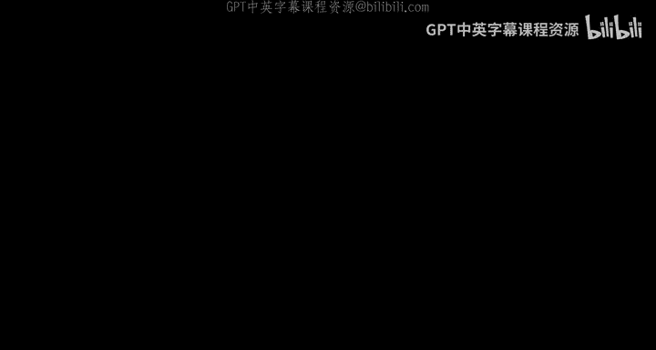
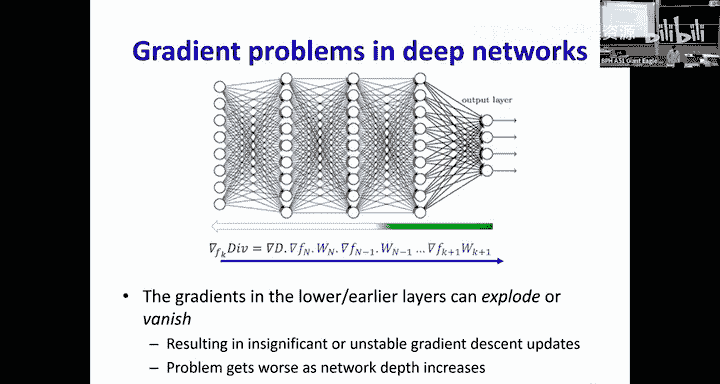
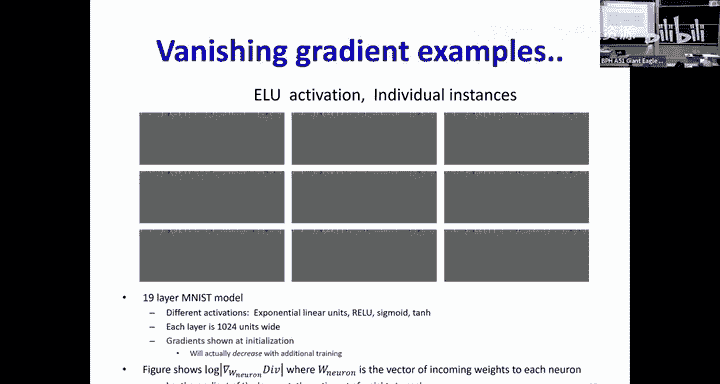
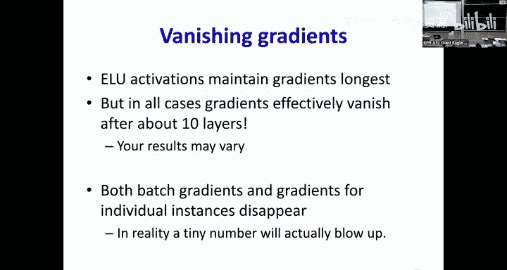
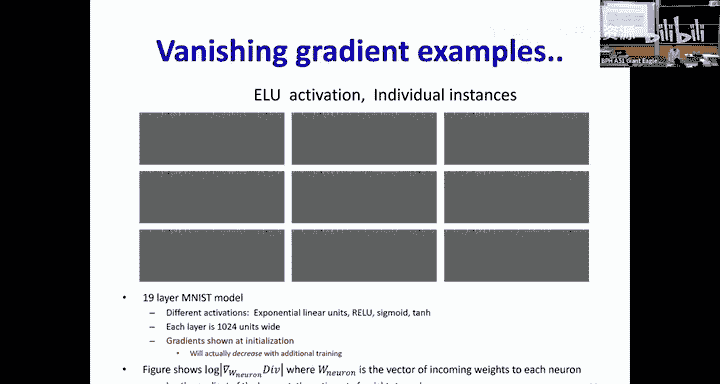
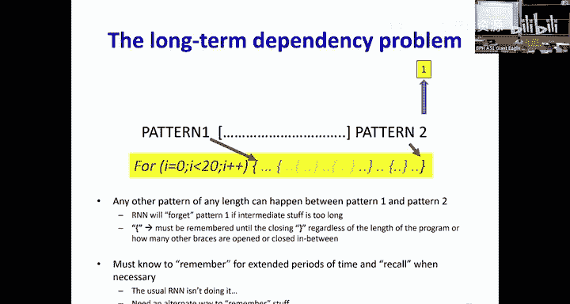
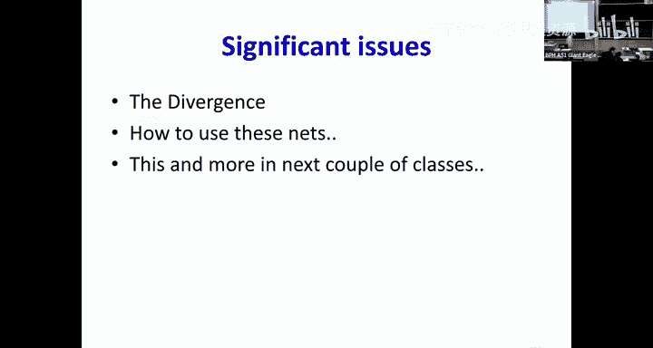

# CMU《深度学习导论｜11-785 Introduction to Deep Learning Spring 2025》中英字幕(deepseek - P15：[15]S2025 Lecture 14 - Recurrent Neural Networks (RRNs) Part II.zh_en - GPT中英字幕课程资源 - BV1xbZNYrEbs

。Yes。My tears are absent。You might that what cancel this class you know。

I go to my office and this have a coier place。Where is everybody？Good morning， Alex。

Considering that this lecture is going to be the basis of your entire homework。

I would have expected better attendance today， so。You know what。

Ive been a bit lax in reporting your attendance。 Maybe I will start doing so。And typically， we don't。

 if you're not very serious about your attendance before they。Cose sad deadline。

 because people keep coming and going。 But afterwards， we like to be。

 So I'll just put up all those numbers。Maybe this will motivate people to come anyway， Let me begin。

 right to all four of you，5。We're going to continue with our story， so far。Which is。

Recur neural networks。And we've seen that iterated structures are good for analyzing time series data with short time dependence on the past。

 These are time delay or convolution neural networks。And we saw that if we want to。

 if we want to analyze time series with long term dependence。

Going all the way back to the beginning of time， then you want。

Recurrent structures where the processing at each time feeds forward to the processing at the next time。

But then it's not just time series data that recordcur neural networks are good for。

 So let's start with this。 Suppose I ask you to write me an MLP。That can add two binary numbers。

 to n binary numbers。How large is the MLP going to be？Anybody， are there people on Zoom at all。Yes。

 Prof we are。So。How long would， how big would this model be， Does anyone want to take a guess， Jake。

这利比。B。2 N。 just to end。And着。不责。If I had only one。Kidden layer。

 you're going to have to account for every possible combination of。Input patterns， right？

 So there are two rate two times two ray to2 N。22 ray to2 end neurons in that one hidden layer。

 even if I allow myself to have many hidden layers， you're still going to have maybe it's order to n。

 it's going be a pretty big network。 But then if I want to train this network。

 I just compose the network。 and then I begin training the network to perform addition。

How much data would I need to train the network。Yeah。

You're going to have to see every possible combination。

 So you're going to need two race to2 n combinations just to be able to train the network right now。

 on the other hand， if I allow myself recurrent structures。So by the way。

 that attendance poll is 669。If I allow myself record instructors， here's how I could do this。

How about the。Just have one unit， right， and it's going to take in one bit in each from each of the two inputs and a carry bit。

So there are only three bits going in， one2 bits coming out。

And how much training data would I need to train this network？呃等 numbers。Basically，s the total is。

 you have 32 possible combinations， right，3 input bits，2 output bits。 So two race 2， two raised to 5。

 And so with 32 possible with just 32 inputs， you should be able to train this network just fine。😊。

And furthermore， this network will generalize to any number of inputs of any number of bits。

 whereas here， after I've done training the network， If I want to add one more bit to my input。

 I'm done， I can't do it， right， So you can see oh， here's another problem。 the parity problem。😊。

I just thought。IHly the input and determine if the number of bits is even or odd。

How many bits would I need， how many， how big would the network be。他紧。

if I have only one hidden layer to2 then， this is the X or problem， correct。

 And so if I let it be deep， it's going to be ordered。 And nevertheless。

 if I want to train this model to learn this pattern， how much data would I need。

Every possible combination again right， which is going to be two raised whereas if I do this with record structures here I am。

 I'm just going to take the latest bit and the last output。

 how many inputs would how many inputs would I need to train this network。谢谢。

There are three are three beds， right， So two race to three is 8。 with just8 input patterns。

 I can train this network completely。So as you can see。

 something that takes an exponentially sized network。

 if I'm just being naive and needs an exponential amount of training data， if I'm being naive。

 can be done trivially with very small amounts of training data if I use inbuilt recurrence in the day in the problem。

 And so recurrent networks are good， not just for you know， time series analysis problems。

 there are other kinds of problems to where you can use inbuilt recurrences and get great reductions in size end。

😊，The amount of training data required。 Anyway， here's the first part。ぱ。Allright。So easy one。

Can somebody on Zoom answer the first question。Rude。The second。was that。Second is also true。

 So let's see some prediction and classification problems that require very large MLP and a large amount of training data can be solved using small recurrent networks that require only small amounts of training data。

 And this is a revelation right you wouldn't have thought about it when I was talking about ret networks in the last class。

 And so similarly， some problems that require large。

 complicated convolutional neural networks and large amounts of training data can also be solved using RNs。

 So regardless of the kind of problem if there's any kind of recurrent pattern in the built into the problem。

 you can use recurt neural networks to really， really compress both the model size and the amount of data required。

So going back， recurrent structures can be trained by minimizing we also saw how to train the recurrent models you want to minimize the divergence between the sequence of outputs and the sequence of desired outputs through gradient descent and back propagation。

😊，So so far so good。 Now， how exactly do recurrent networks behave Now， consider this network。 is。

 is this a recurt network。第二。This is just a。What kind of a network is this。This is an art network。

 What is this。天地嗯。It's a TDN， It's a convolution network， right， And so now in this network。

 assuming my inputs are all bounded。 What I mean by bounded is they don't become very large。

 They're not infinite。Will the output of the network explode。

 Will the output of the network remain small if the remain bounded if the input is bounded or can the output blow up。

 even when the input is bounded。What do you think。It cannot blow up because you're computing linear combinations of inputs input and the linear combinations are of bounded inputs are going to be bounded or as well unless the weights are unbounded which we won't have and then you apply an activation to it and our activations are generally not the kind which are going to go to infinity so the activations won't blow up and so no matter how many times you do it the output is going to be bounded so these time delay structures have bounded output if the function f which is the activation function is bounded。

For bounded input， and the inputs are bound in this yeah。Was there a question answer。Okay。

 so this is what is called bounded input， bounded output。 If the input is finite。

 the output is also finite。 This is the kind of behavior we like。

 We don't want our models to go off and give you explode when the inputs and inputs are nice and reasonable。

 right， So how about a network of this kind， a recurrent network Is a recurrent network necessarily Bible Boed input bounded output。

 What would you think。关系。So because if it take too much input the。The output can be the。

 If it takes too much input， well， first。If the activations never exploded。

 the output is never going to explode， right， So if all of my activation functions are， for example。

 sigmoids。😊，The output is gonna lie between 0 and 1。 So the real question we are asking is。

 does this network perform useful operations if， no matter if。

After some time the output always lies out here and it's just saturated at one。

 the network is not doing anything useful， right。So now， if we don't have nonlinear activations。

That's when strange things can happen。 So in that case。You know。

 how can we understand how what's going on。 Now， for this。

 its it's sufficient for us to just look at the recurrent layer。

 because that's where things build up。 We know that for an MLP is just， you know， feed forward。

 things are going to be stable。 So the real buildup is going to happen over the recurrent layer。

 So let's look at what happens in the recurt layer。

 And I'm going to assume just a single hidden layer for simplicity。 And furthermore。

 I'm going to use the famous streetlight effect that we alluded to several classes ago。

 We will analyze something that we know how to analyze。😊，When the problem gets too complex。

 you know what we do。 we just discard the problem our problem。 We analyze something else。

And become happy， right。 No， we actually try to map what we learned onto a real problem， so。😊。

Here's what we know how to analyze。 We know how to analyze linear models。

 So I'm going to assume that in my activation recurrent layer。

 the activation is an identity activation， meaning it's a linear activation。

 whatever comes in goes out just as this right So in that case。

 you're going to have an operation of the kind。 The aine。😊，Output at time T is going to be。Whatever。

The。Recurrent。A weighted combination of the recurrent outputs at time T -1。Plus， don't go away。啊。

 plus。A weighted combination of the inputs at time T， right， And then furthermore。

 because the activation is an identity activation。😊，I'm going to say Y T。Is simply Z T。

 There is no further activation。 Okay， that's going to go up。 We'll use the next word。

 So now this is the model that I'm going to analyze， okay。That's I think to it。Oh。

It's a very important statement。So that's why it's so high up。 Okay， no。

A this making sense to you guys。That I'm just assuming no activation or rather a linear activation。

 right， So let's see what happens。 Now， I can write。😊，Looking at that Zt。Equals W， H。H T， actually。

 I can just write H T， right， because H equals Z。 the way we wrote it wrote it。 So H T equals W， H。

 H T means 1。Plus W X。X T， but then consider H T -1。 What is H T-1。In terms of the hidden states。

beforeSo H T-1 is going to be。Wuble H。Times H， T -2。Plus double X。X T -1， right。

The same operation are the previous step。 So if I plug that in here。If I plug this value over here。

 what will I get。上天钮。交微语原。然我预约。So it's going to be W H。Squared。I'm just plugging that in here。

 Ht minus2。Plus。W  H。W X。X T -1。Plus W X。X0。Right。But then what is H T -2。

I can again write H T minus-2 as。W eight。H T -3。Plus， double x。X T minus-2， right。

 So if I plug this in here， what will I get。Just plug it in。 What is deposit going to be。Some on。

 someone on on Zoom。 Maybe you can tell me。What happens if I plug this WHt minus2 this Ht minus2 over here？

What is H？Is there anybody on Zoom who can answer me， someone in class。 Okay， you're coming。哦，这。

This is H T-2， right， We just agreed。I just stop that part that be on double powerful。times 80-3。

pl哦唔十。えし？あした。パ。Plus， W，H， W X。X， T -1 plus。W X， X， T， right， So do you see a pattern over here。

 What is the pattern。The sum of this， actually， the sum of this。And this index is always。T。Right。

So this is 8 squared X T -2， H X T -1 W H H to 0 X T， as you can see， right。

 And so when I expand the whole thing out， I can keep expanding it。 And eventually。

 if I go all the way back to the beginning of time。 That's what is' going to be。 Eventually。

 the output at time T have have written a K in my on the slides is going to be just a function of the。

😊，Entire。Time series， right， But focus on what's happening here。So let's assume that h of -1 is 0。

 just for convenience sake， okay。So what is the response if I just had an input at time 0。

And no further input。 So F Y x 1 through x。T were all 0。

 All I had was an initial response at input at time 0。

Then what is the output of the system at time T， The hidden output of the test system at time T。

Over here， x0 is non0。 The rest of them are 0。 What would this be。0。 Yeah， So only x0 is non0， right。

 So I'm going to get H T。Its simply going to be， come on， guys， help me。

W H T A times W H raised to T times W X times x0， right。So that's about it。 There's nothing more。

 right， now， looking at this。So this here is a response at time K to an input at time 0。

 and there are no further inputs and zero in the initial condition。😊，Yeah。

Was making sense to everybody。 right， What can you tell me about this。

Will this blow up or will this die or will this just will this just remember x 0。What happens here？

嗯有。嗯。What happens to this。Hby， can you tell me。 Okay， not be sure。 cover justline。

You won't follow up if WH is if the Brazil is greater than one。So if the weight is greater than 1。

 this is going to blow up， right if the weight is less than 1， what will happen？😊。

What happens if the WH is less than one na。It will die。 It will die， right， And so basically。

 this is what is。If this blows up。So you just have to look at what happens to the input at time 0。

 If the input at time 0 blows up， then nothing is going to blow up。 If the input at time 0 dies。

 basically it means it's forgotten things， right， you don't so if it's it's sufficient to analyze a response to in a single input at time  zero because of the principle of superposition and linear systems and basically what we find is that。

This is what happens， right， if the input at， if the it only depends on the weight。

 If the weight is greater than one， it's going to blow up。 If the weight is less than one。

 it's going to die off。After a few time steps， will you have anything remaining about the input x 0 itself。

Will you remember anything about x0 or is it just going to be you know hair blew up or died？

It's just to go to remember all you will have left is whether it blew up or died， right。

 The input is forgotten。Now here， I've just assumed that this is a simple scalar system， right。

 where x is a scalar and h is a scalar and and w is a scalar。 But in the real system。

 is x going to be a scalar， will it be a vector。あ。Everything's got to be vectors， right。

 The hidden state is going to be vector。 So I still have the same。Okay， maybe this can go up。Oh。

 magic。 I have another book， right， I to have the same tank。I'm going to have H T。Equals W 8。H T-1。

Plus， w x。X T， but now this is a matrix。 This is a matrix。 And these are vectors， right。

 in this case。If all I have is an initial vector at time  zero， what is the response going to be。

So h of -1 is 0 and and all and all other inputs are 0。 All I have is x 0， right。

 if all I have is x0。😊，What is this。Respon going to be anybody。Nothing changed， right。

 It's going to be exactly the same as before。Right， and so we are going to get。H of T。Equals W， H。

Race to T times。Let's assume this is an identity matrix for noun， the x of 0。That's about it。

 correct。And so all you need to do is to figure out how this is going to behave is to be looking at。

This matrix。The weight matrix， right， And what can you tell me about the weight matrix。Now。

 the weight matrix， how many of you are familiar with a decomposition， everybody must be， right。

 And so I can write the weight matrix W， H。😊，As whatever， I think I use use the term。You， right。有。

Lambda U inverse， right？ So W H。Square equals U lambda， U inverse， U lambda U inverse。

 These will cancel out， which is simply。有。Lambda squared U inverse， right， And generalizing this。

 I can write this as W H raised to T is simply you。Lambda P plays to Time universe。

So where lambda is the matrix of hiigenvalues。And this lambda。

 the eigenvalue matrix is going to be a diagonal matrix。

 So I can generally write W raised to T as U raised to T times。😊，Now， what is lambmbda race。Nmda is。

The eigenvalue matrix。 if I raise it to treat it's the same as raising every one of the eigenvalues to the power team。

😊，And if I've organized the eigenvalues in decreasing order。😊。

Then I can just pull out the largest eigenvalue， this one lambda 1 raised to t outside and the rest I can write is  one lambda 2 over lambda 1 raised to t and so on。

Thiss making sense to everybody， right？ And what can you tell me about these e these terms。

 What is Lada 2 over Lada 1， Is it greater than one or less than one。😊。

That's always going to be less than or equal to one because lambda 1 by definition was my largest eigenvalue right So what would happen to these guys as T went to infinity。

😊，They're all going to go to 0， right， which is the honeyar term that remains。This first one。

So what can you tell me about the overall response of the system as time goes to infinity。

Pretty much all youre going to get。Is。Lambda1。Pse to T。Times U times this matrix， which is。

Just one in the top left corner， times。Unverse， right。

That's all that remains because all the rest of them men to infinity。 Now。

 what can you tell me about this behavior。Will this blow up， How will this die。

It depends on the value of the largest eigenvalue， right， for any input for large T。

 the length of the hidden vector will expand or contract to the according to the Teth power of the largest eigenvalue。

 That's the only thing that remains。 And so。If lambda1， the largest eigenvalue is greater than one。

 then the hidden value is going to blow up。 If it's less than 1， it's going to go to 0。😊，Right。

 very simple。 There's nothing fancy。 And so here's a simple example here attitude four dimensional system。

And I just gave it some arbitrary input。The single input at 1111 at times 0。

 the rest of the inputs are all 0。 and you can see what happens if the largest eigenvalue up are 0。

9 two different examples where the largest eigenvalue is 09。

 you can see the length just goes down right here I have two examples。

 the largest eigenvalue is magnitude 1 here it's 1。1 If the magnitude 1， it's kind of stay stable。

 Why is it oscillating。Anyone。You've done， I can。Decomposition， right。Why is it， Why would it。

 Why would this be oscillating。But I'm one。Anel。Higenvalue can be complex。

And they can they will come in complex conjugate pairs， right。

 So I can have two of them which have the magnitude 1， but one， the complex conjugate pairs。

 So over time， it's just got to oscillate a bit like a cuside。

But if the magnitude is greater than one， so it' is going to blow up。

 but the magnitude is less than one， it's going to die。😊，So what this is telling me。 And so here。

 if in this case， the eigenvalues are all part non are real here， they are complex。

 but the behavior is the same， right， And so what this tells me tells me is that the behavior of the system depends on the largest eigenvalue of the。

Weight matrix， if it's greater than one， is going to blow up。 If it's less than one。

 it's going to die。 it's not really going to remember what was in the input in the first place。

 And so in linear systems， long term behavior depends entirely on the eigenvalues of the recurrent weight matrix。

 If the largest eigenvalue is greater than one， the system blows up。 If it's less than one。

 the output vanishes very quickly。Complex eigenvalues can cause oscillatory response。 Nevertheless。

 if the magnitude of the largest eigenvalue is greater than one， the system is going to blow up。

 If it's less than one， it's going to die。And so the rate at which things blow up or vanish depends only on the magnitude of the largest eigenvalue of the recurrent weight matrix。

 Nothing else matters。 And so now this was assuming that I had no activations。 H T， you know。

 H T was simply Zt But then I can actually stick in activations。

 What happens if I stick in activations。 Let me stick in a sigmoid activation over here。

 So here I'm going to say Ht is sigmoid of w times H T-1 plus a bias because again。

 it's an fine term。 And so I cloted a few responses。 Now in each case。

 I have a single input at time 0 and no further inputs。 So three columns here。

 the input at times 0 is -。5 here at 0 here that's plus 。5。😊，Within each plot， I have five curves。

 So I have three rows。 and in the three rows， the weight is 0。9 weights of 0。91 and 1。1。

 respectively。 And within each plot， I have five curves representing five different values of the bias B。

Okay， and the curve itself shows how the system response changes with time。

So what can you tell me about the system response at time 20 in the nine plots？At time 20。

 are they different。Do they look the same or are they different guys， Come on。

Can everybody say different together， No， but you guys say it， please。1，2，3， go。 You are the back。

 You can say， too。 Can I hear that different。 You have to come on engage， Come on up front。

 Do you mind coming up front。 There's nobody in class。Okay， so what is this。

 what is this really telling us， I the system remembering the input。Yes or no。 No， right。

 Is it even retaining anything about the weight of the。A recurrence， no。

 the only thing that is remembered after 20 times steps is the bias。😊，Right。

 this is when I use a sigmoid activation。 If I use a tan H activation， things are slightly different。

 I have the same plot。😊，So these are three different inputs。These are three different weights。

5 different biases。 Okay， And if you look at each column at time 20。Is there any difference。

In the three pictures in any column。Now if you look at the scales， there really isn't， right。

 you will see differences across the rows。I'm sorry now。 if you look at time 20。

 if you look at across any row， is there any difference。If you look closely。

 you will find no difference。 You will find。You know， you will find that that。

The three that this is different from this is different from this， but within each row。

 when you look at time 20， the response is exactly the same。😊，So what so when you use T H activation。

 it is kind of sensitive to the weight。And the bias， but it does。

 it is not sensitive to the actual initial input itself。 Now。

 the tanning is slightly better than sigmoid than in the sigmoid after just about four time steps。

 the input is forgotten。In the case of the10 H， you know。

 it takes a longer time to settle down to the final value。So Tage has a better memory in some sense。

 which is why in recur neural networks， we use the Th activation。😊，And the recurrent layers。

 Nevertheless， it doesn't really matter after enough time the。

What was the original input is forgotten， All that is remembered is。

Depends only on the weight and the bias。Yeah。对你。Look at these scales， right。

 So if you look at what happens at the at at the very end。 Yeah， yeah。

 So the bio axises is a different。Axies， but basically， the point is。Things are。Things are forgotten。

Except for。That's。Except for the zero case or something。 But more， most of the time。

 if you look hang out long enough， it's going to get forgotten。

 If I use a rail activation worse things happen。Things blow up， right， Now。

 this was for a scalar recursion。 I can do the same thing for vector recursions where I have vectors as input。

 and you find the same behavior。If I use sigmoid activations。

 again the vertical scales are not identical in all the pictures I should maybe redo the redo these pictures。

 but what you will see is that regardless of the activation I use after several time steps the only thing that is remembered is what the weight the recurrent weight was。

😊，Or what the largest eigenvalue of the recurrent weight was and the bias。

 the input itself is kind of forgotten。And so what this means。

 So does this mean that these systems actually have memory。 Do they remember。What do you think。

They're not remembering anything， right， But the whole point of recurrence was for the network to remember stuff。

 And that's not really happening。And so， this is with。I have here the max eigenvalue is 1。

1 here the max eigenvalue is 09 and what you will find is that it doesn't really matter what is remembered is a function of the eigenvalues of the weight matrix and the bias but not the input itself right。

So you can actually do this formal stability analysis and consider convergence of La of functions and so on。

😊，Lots of maths behind this。 Ty what you find is there' bipolar activations like10 H。

 where the output can both be positive and negative。

 They tend to remember things a little longer than uniollar activations like。😊。

Sigoidites and things like Ralu will just blow up or this die， right。 And so in every case。

 you have exponential memory memory behavior， meaning whatever is input is forgotten exponentially fast。

 it just forgets。😊，So， here's the second part。이 같은 요리서。You want mind。你か。Yes。Yes。Excuse me。

 I had a question， yeah。喂系。Are we just saying that it's forgotten just because it's blowing up or dying。

If it blows up， basically， it saturates， right， So and if it dies。

 the number basically drives down to 0。 So neither0 nor infinity carry any information about what was input。

 right。对。Okay， so hards answer the first question， guys。Somebody on Zoom。

Which are the true statements。In the first。How long。

 how many time steps in Ireland can remain some ver and some memory of the input pattern。

 Does it depend on the weights of the record layers。Yes。On the bias， yes， on the activation function。

 yes， on the input， no。Okay， so right， now this is how long it is remembered， right。

 What about what it remembers， Does that depend on the weights。 yes， does that depend on the bias。

The final value after after many time steps is that depend on the bias。We saw it does， right。

 Does it depend on the activation function。Yes， does it depend on the input？

The one thing that is that it really must depend on。

Is become is irrelevant to what is actually remembered after many time steps by the recurs。

 Now this is not what we had signed up for。When we began building up building record neural networks。

 So something is kind of broken， right， and so。The story so far is that recurt networks retain information about the from the infinite past and principle and practice。

 they tend to blow up or forget。 if the largest eigenvalue of the recurrent weight matrix is greater than one。

 the response may blow up。 if it's less than one， the response dies down very quickly。

The memory also depends on the activation of the hidden units。

Sigmoid activation saturate and the network becomes unable to retain new information。

Re low information activations blow up or vanish very quickly。

 tanage activations are slightly more effective at retaining memory。

 but even they tend to eventually forget what what it is they're supposed to remember， right。😊。

So here we are RNN， they are excellent models for time series analysis。

 all kinds of time series problems， but then the memory is not great。😊。

But then we also have a second problem。And this is a problem with training deep networks。

 any deep network， not just record networks。 The gradient of the error with respect to the weights is unstable。

What do I mean by this， right？ Consider a deep network。 So here's what。We do。

 You're going to get some input。 Then you compute an a find function of it， you apply activation。

 Comp a find function of it， apply activation。 So the network is basically a very deep nested function。

 right。😊，Now， and the error has also nested function。 It depends on the。

The error is a function of the output。And so it's many levels of nesting。All the way to the input。

I can draw the influence diagram。 We are familiar with influence diagrams。

 and I bullied you guys about this a bit in the last class。

 So if I draw the influence diagram for this thing。😊，Now， here's what it looks like， right。Oh。

 my god。This thing。Makes the board worse。 And so when I're having a few characters。

 it has a white patch。嗯。对。Okay。So now if I have a network。I have an input X。That is。

You apply a weight W to it， and then you apply an activation。Then you some F。

 then you apply some some other set of grades。 you apply another activation。

 I'm just talking using the vector notation and eventually you get an output right So if I draw the influence diagram。

😊，What does the influence diagram look like， I have X。Influencing the first I find value Z1。

And what is the， what is the term that goes on this edge。How does x influence Z1。

When we do the influence diagrams， what did we put on the right on the edges？The derivatives。

 right the derivative。 And so what is the derivative of Z with respect to x。Come on， guys。

 What is that。That's the weight， right， This is going to be a weight 1。 And then the Z influenced。

The activation output。 What was this one。What is the term on top of the edge here。

The Jacobian of the activation， right， So this， I'm just going to write this as。Y 1， so Z 1。

 then this y influenced Z 2。 What was the weight over here， What， What was a。T on top of the edge。

2W2， yeah， W2。And then this influenced y2。 And here you had the Jacobian for the second layer。

And so on。 And eventually you had y n， which influenced the loss。 And over here。

 you had the derivative of the loss with respect to the y n， right。

 this is how we drew the influence diagram。And now， if I back back propagate， if I have this guy。

What is the derivative of the loss with respect to Y N。That says this guy， right。This is。Right。

And then。What is the derivative of the loss Y N with respect to Z N。

Do you remember from the last class。How do you compute this derivative when you take a step back？

We did something with whatever was on this edge， What did we do？we write multiplied it。

 So this was Y， N， Z， N， right， And then you took a step back。 What did you write multiply that by。

Whatever was on this edge。That would be the weight， right， W M。 So as we kept kept going backwards。

 we just kept right multiplying by whatever was on the edge。 Come on， guys。

 this must be burned into your heads。 It's very trivial。 It shouldn't be。

 it shouldn't be hard to remember this， right， This is all of back。 You can watch 16 videos on back。

 but it just boils down to this thing。 that you're just drawing this chain of dependencies。

 And as you keep going back， you just keep right multiplying by the latest derivative， right， And so。

Here， I'll start off here。Initially have the derivative or the divergence with respect to the output of the network to get the derivative for Z3。

 I'm just going to multiply that by the Jacobbian here。Then to get the derivative with respect to F2。

 I'm going to multiply this by w3， then to get the derivative with respect to Z2 I multiply that by this Jacobian here then I to get the derivative with respect to F1。

 I multiply that by W2 and so on。But making sense to everybody。All of you guys。 Okay。

 so now what happens to the derivatives as we keep going backwards。This is the entire。系了。

Chain rule for derivatives。 So if I start off from the output。And I keep taking a step backwards。

 And eventually， I want a computer derivative with respect to say the output activation of this layer。

How what is that going to be， Its just going to be a sequence of right multiplies。

 alternately multiplying activations and weight matrices。 I mean， Jacobians and weight matrices。

 Jacobians and weight matrices。😊，Right。Everybody with me。 You guys are looking very sleepy。

 Can I get a more enthusiastic nod of the head。😊，Thank you。 right， guys on Zoom。 Can I see you nod。是。

Okay， I don't think they're not it。 Allright， So let's see what these Jacobians do。To the weight。

 to the matrix， right， to the vectors。 Now， what does a Jacobian look like， again， going back。

 our activations are。黑了。In any given layer， as you go through a network。

 you're going to have a bunch of independent。Activations， right， if I think of this entire layer。

In vector format。Basically， each Z I is independently operated on by the corresponding activation。

 So when you have this kind of scalar activation rule， what does the Jacobia matrix look like。😊。

Is it a full matrix or it's a diagonal matrix and what are the diagonal entries？😊。

The derivatives for the individual activations， right， So this is what it's going to look like。

 The Jacobbian matrix is going to look like this。 Now， those diagonal entries。

 those are the derivatives of activation functions。😊，Now， if I consider a sigmoid activation。Right。

 what is the largest value for the derivative of a sigmoid one。Is it one。What is it。it's 0。25， right。

 If I use a1 H activation， what is the largest value for the derivative。Come on， guys。

It turns out the largest value for the derivative for a 10 H is just one。

 The 10 H is basically just the sigmoid， but it's scaled over here I think it's 05。T H is scaled。

 So the largest value for the derivative is just one for a raillu。

 What is the largest value of the derivative。Summary， just one。

 right because the rail activation looks like this。😊，The slope is 0 and the slope is one， right？

 So what can we tell me， what can you tell me about the Jacobbian matrix。

The diagonal entries of the Jacobian matrix。Somebody， come on， wake up， guys。

Can they ever be greater than one， right that most of them are going to be smaller than one。 Okay。

 what happens if I multiply a vector by Jacob by a diagonal matrix whose diagonal entries are all one or less。

😊，The length of the vector is going to， what if Paul happened to the length。It。

 It's going get smaller。 Can everybody say smaller， Thank you。 Please wake up， right。

 And so multiplying by the Jacobian is always a shrinking operation。😊，Over here， okay。

 which means that everyone， as you take your step back and perform your back propagation of the derivatives every time you walk past a Jacobian。

The length of the derivative sh。Yes， right。So what are the remaining terms over here as you walk back。

The weight matrices， what happens when you multiply a vector by a matrix。

Do you have any idea of what happens to the length of a vector when you multiply by a matrix？Yes。

It's okay。 So here's what happens。 I can write any weight matrix using singular value decomposition as some US。

😊，Wetranspose， you must have heard about singular value decomposition， right。

 These are unitary matrices。 They don't change the length of the vector。

So the only thing that changes the length of the vector is。This guy， right。

 And so the singular values， you have a bunch of these S matrix is a diagonal matrix。诶 some。And。

It's going to have one singular value corresponding to。Each one of your singular vectors。

 So anything that that falls in this direction is going to be scaled by this much。

And so when you multiply by weight matrix。The the derivative is going to expand along directions where the singular value is greater than one。

It's going to shrink along directions where the singular value is less than one。Right， now。

 what happens in any arbitrary matrix？ Typically， if you plot the singular values。

 you're going to find that。If you order the singular values in， you know， in rank order。

 the singular values typically go off fall off very quickly。

 You have a small number of large singular values。 The rest of them are going to be vanishingly small。

So which means that in most directions， the derivative is going to。Shrink。

But if it expands in some direction for the next weight matrix。

 that direction will not be a singular vector。And so in that direction is again going to shrink。

 right？ And also， the activation functions are going to should be shrinking stuff。

 And so result the the result is that repeated multiplication by the weight matrix results in the。😊。

Deev is shrinking in most directions。Except in in a small number of directions corresponding to singular values。

 which are greater than one there it will explode。And so what happens is that。啊。

If you look at this one， if you look at each layer， each layer has a combination of two things。

 There's a weight matrix and a Jacobian matrix， right， as you go backward。 And it turns out that。

Each layer， the product of the Jacobian and the weight matrix has its own singular vectors and values。

 and more often than not， the singular vectors for the different layers will not align up as you keep going back through the layers。

Each operation is going to shrink the。Divative， and eventually。

 when you get all the way to the beginning of the network。

 most of your derivatives are going to become exceedingly small。😊，Basically， vanish。Okay。

 some small components corresponding to a few lucky directions。

 which kept get growing larger and larger as you went through the network。

 those components will explode。

The rest of them are just simply gonna vanish。 So I have some pictures over here。

 This is for a 19 layer M N model， which has 1024 neurons。😊。

And so I'm looking showing you the derivative of the loss with respect to the output of the of the neurons at each of the 19 layers。

 These are 1024 neurons。 That's the output layer。 This is the input。 And this is that initialization。

 at initialization is when the derivatives are supposed to be largest。What do we see over here。

As you go back through the network， what's happening to the derivatives？完。Eventually。

 they just becoming so small， they disappear right after about， this is for an eu activation。

This is the total derivative over a batch。 After about five layers。

 all the derivatives have vanished。This is for a relo activation。 After three layers。

 the derivatives are vanished。 This is for a sigmoid。😊，After just one layer。

 the derivatives are vanished， right， one or two layers， the derivatives are vanished。And1 inch。

 same thing。 After about three layers， the derivatives have vanished。And so this is for a batch。

 I can even look at this instance by instance。 And so I have a grid with。😊。

9ine different instances， this is for elo， this is which is again。

 if you look at the various activations， it's the elu activation that maintains the derivatives for the longest amount of time。

😊。

Going back， but regardless， so which is why I'm showing you the pictures for individual instances。

Point is regardless of the activation chosen， by the time you got back from layer 19 to layer 15。

 most of the derivatives are。Exceedingly small。Now， if all of your derivatives are very small。

 will you be able to train your network。No， because， you know。

 there's nothing there's no signal to train on。 And so training becomes impossible。

 This is one of the big problems with deep networks that as you walk back through the layers。

When you' are performing back propagation， both the weight matrices and the Jacobians will keep shrinking your derivatives and eventually your derivatives are going to vanish。

Does make sense to everybody。

Right hand。So elu activations maintain gradients longest， but in all cases。

 they effectively vanish after about 10 layers。😊，Both batch gradients and gradients for individual instances。

 In reality， you have a small number of neurons whose outputs actually include to take the responsibility for all the changes in the output。

And the rest， and those are the ones that explode。 the rest of them are going to disappear。Now， so。

Going back， adding to our lessons， we've seen that recurrent networks。

 which are supposed to retain information from the infinite past are in in reality， just。

Poor at memorization， because the hidden outputs can blow up or shrink to 0。

 depending on the eigenvalues of the recurrent weight matrix， and depending on the activation。

 this is in the forward pass。 But if you're training the network。😊。

We also saw deep networks suffer from vanishing or exploding gradient gradient problems as they go back as you go back through the layers。

 and that makes learning the network hard。And particularly record networks， as we know。

 are just very deep networks。 The depth of the network depends on the length of the input。

 which means with an absolute guarantee， the loss that you pick at any point is not going to be able to convey derivatives backwards more than a few time steps。

 Then the whole thing is just going to vanish okay。And so。Again， stuff gets forgotten going forward。

 text stuff gets forgotten going backwards。We have a problem， right， Here's a problem。嗯。

在 care afterwards。Yeah。嗯。Okay。Yes。😊，You just multi the activation functions by scalealar。Would誰と。

手几十呢。Multiplying the activation functions by a scalr is the same as multiplying the subsequent weight matrix by the scalealar。

 right， Eventually you're gonna have the same kind of behavior。You can't just。

 And if you multiply by a scalealar， how much are you going to multiply by， what is the scalar。

It depends on the direction in which the input of the derivatives are coming from， right。And。

 of course。You can cause things to blow up going forward。So Sania here， since you have begun reply。

That first statement， the derivatives for most parameters will become vanishingly small as we walk back。

 propagate them true or false。Jake， what about the second one？

The derivative is for a small number of parameters will blow up and become large and unstable true or false。

 And so what about the third one。The derivatives would be more stable if the recurrent rate matrices all had all singular values exactly equal to one。

😊，Because those are the only directions in which things neither blow up nor。Vanish， right？

 And so what about the fourth statement or false。This is for you， you don't have a name tax。

 I don't know who you are。So the derivatives would be more stable if the recurrent activations where identity transforms to our files。

😊，True， true， Why are you guessing。So what did we see about the activations， right。

 We saw different activations had different behaviors。😊。

The relu activation tended to make things blow up。 The sigoid activation tended to squish everything to the weight and the to the bias。

 The tanage activation tended to just squish everything to something that was a function of the weight in the bias。

😊，The mere act of having an activation。Caused the problem going forward。

That was the point of the lesson right And so what about the second second set of questions。

 The memory of the recurrent layer is limited because the recurrent weight matrices are not unitary with weight values are all equal to one true or false。

😊，True， right， if the eigenvalues are all one， then the things would neither blow up nor are the derivatives nor the memory are going to blow up or disappear。

啊 now。The memory is also limited by nonlinear activations， also true， right。😊。

The memory would be more stable if the recurrent weight matrix were an identity transform identity matrix。

 would you agree is true or false。😊，So right。And it would be more stable if the recurrent activations where just identity transforms。

😊，This is basically what we are saying is the mere act of having an activation function means that when you are back propagating。

 the Jacobian has has the tendency to shrink the derivative。😊。

Because the slope of the activation function is generally not lesser than one in most places。

And merely by having an activation function， it also causes things to be forgotten going forward。

So also， the weight matrices， if the weight matrices have eigenvalues which are greater than one。

 things blow up if they have eigenvalues which are less than one。😊。

Things vanish both going forward and backward。 And so by merely， merely having a weight matrix。

 which is。No non unitary。 So an identity transforms a unitary matrix， right。

This is causing both the memory to be fraudulent。And it's causing problems with derivatives， right。

So here's a situation we have。哦。Things Ive forgotten。Because we have weight matrices。

 things are forgotten because we have activations。But。Is it okay for things to be forgotten。

 Is it okay to have a finite horizon of memory。It really isn't。 Let me give you an example of， say。

 analyzing code。 If I'm parsing code， C code， If a curly brace is opened。

 then I have to remember the fact that the curly brace is opened till all the intervening code is done。

 and then the curly brace is closed。And how much code can appear between these two braces。It varies。

 You can have one character。 You can have 5 million characters。 So you can't just say， you know。

 after 20 characters， I'm going to forget that I opened a curly breeze。

 which means that we must be able to remember。😊，For the open curli brace until the closed curli brace has been encountered。

Meaning how long you remember something must depend on not on a what you are trying to remember。

And be the context。 What else， you know。When you can forget something must be triggered from the input and not be a function of the network parameters。

 right， On the other hand， we actually have a situation where。

How long things I remember depend on the weights and the activations， which is not a great thing。

 So how do we solve the problem， mystery and magic。😊，That's what it looks like。 But there's logic to。

So here's what we had。Each of those Jacob going forward， each of the weight matrices。Cost problems。

 things to be forgotten。Right， if weight matrices are a headache and are causing things to be forgotten。

 what's a simple solution。Get rid of them， right， Each of the activation functions is also a problem。

 Just having the activation functions causes derivatives to vanish going backward and things to get saturated going forward。

 So what do we do with them。😊，Get rid of them as well， right。

 let's just throw away everything that's causing problems。

 But if I get rid of activation functions and get rid of weight matrices， what remains。😊。

What's the neuron without a weight or an activation？They are saying for nothing， right。

 So here's how we are gonna change things。We are going to have a network that remembers arbitrarily long to be we called and demand。

 We allow。 we're going to allow things to be modified。

 but the manner in which we will allow things to be modified will depend on the input itself。

 So this is what we're going to have。If I have some input， then at each time step。

 instead of having this thing be what how the what is remembered be dependent on the network parameters and the activations I'm going to get rid。

Of network parameters and activations。 And I'm only going to modify it based on what else is seen in the input。

So， for example， if I see an open curly brace， I'm going to store this in memory。

 and I'm going to keep looking for closed curly braces。😊。

And only forget this when I finally encounter a closed curly dress。

So this means the weights and activations can no longer be used。 So this is our model。

 This is what is what they call the constant or acherusal。 They have something in memory。

 And at each time T， what's in memory is modified based on what is encountered in the input。

There are weight matrices， there are no weight matrices， and there are no activations。Right。

 so no weights， no online nonlinearities。 the only way the memory is modified is through scaling through a what is called a gate。

 a sigma that captures other triggers like you know。😊，I'm storing pattern one。

 this pattern one must be remembered until a pattern two like a closed curry brace is encountered。

 have I seen a closed curly brace， have I seen a called closed curly brace if I have okay sure I can forget right so this is the constant errorcharusal where what's in memory is only modified by triggers in the input。

So。Now， there's no non nonlinearity anymore。 But then we know neural networks require non nonlinearities。

 Otherwise， you know， there's no point to them， so。If we must apply a non linearity。

 the non linearities apply to what's in memory， but that non nonlinearity does not actually carry forward。

 What carries so forward is just the raw memory itself。

 So the non linearity itself is up was done by other portions of the network。

 neurons that computer workable state from the memory。

And now how the input to the memory is modified。Is control through gates。

 and these gates are going to be looking at the input。 So to give you an example。

 if I've stored that fact that I've overseen an open curly brace。Then， I can forget。

The open curly brace， if I see a closed curly brace。

 but then this forgetting operation is only relevant if there' is already an open curly brace in memory。

😊，And so this gate is going to look at the input。😊，As well as the current hidden state。

 any other factors that might influence the context， you know， I see a close colorli base。

 but it's in a， it's in a comment section。 Then clearly， I should not be closing this stuff， right。

 and what's in the wrong memory itself， right？ And so this is the entire operation that we have。

 Now we got rid of the weights。 We got rid of the activations。 They are only modifying。

 we store things in memory and modify it based on what's on。😊，What we encounter in the input。

And based on analyses of this input using additional context cues from what's already in memory and other other surrounding information right so this gives us the so famous long shortter memory neuron which explicitly latches information to prevent dey or blow up and we're going to go through that in the next 15 minutes。

For these slides have borrowed liberally from this Kola Github， it has some very nice pictures。

And so this picture my pictorial representations follow what's on those web pages。

So to give credit yes。What did you mean by hidden State？Parddon me。

What did we mean by a hidden state in the previous idea， it depends on the current hidden state。

So the current input age is is the transformed version of what's in the memory right so the memory is basically a recurrent hidden state in the neural network right。

😊，Right。That's what I mean。Are we just saying it is hidden because it is non learningable， I mean。

It's not。 It's not that it's not learnable。 That is the hidden state。 That's not the direct output。

Again， going back all the way here， what was it we analyzed？We analyze this guy， right。Remember。

 that's a hidden state。That's that's the one that's going to be replaced by this memory structure。

Because the hidden state is what was carrying， recurrently carrying inflammation forward。Allright。

 so heres your standard recurt neural network and this new representation you're going to be treating each neuron as a cell and so as in in the recurrent layer as you went forward at each time you got the recurrent value from the previous time and the current input you combine them and put them through an activation function typically typically a tanh because as we saw tanh is remember things longest。

😊，And then that output is fed forward to the next time instant。

 But then if you have many layers to the network， that output is also fired upwards to subsequent layers。

 Now， this little cell now， when our LSTM is going to become much more complex。

 It's going to look like this。😊，So if you look at the picture， you might get a little dizzy because。

 you know， where did this entire structure come from and。Let's see。

 Well we'll break this down by by bit。 The key component is a remembered cell state。

 This is the memory。 This is what we call the constant error carusal。 This is just what's in memory。

 Again， this is passed on with no activations， No weights。

 it's only modified based on patterns detected in the input。

 but there are two kinds of modifications。 So to give you an example， if I see if I。

 if I have a memory clear line， remembering curly braces。😊，Then every time I see a new curly brace。

 I must increment it。Every time I see a close curly brace， I must decrement it， right。

 we are two distinct operations。So。What is the pattern that triggers the increment。

If I'm remembering curly braces。What would it be。No。It's going to be an open curly brace， right。

 What is the pattern that triggers a decrement。A closed curli brace。

 the patterns that trigger these two are entirely different。 So we need two distinct operations。

 one for incrementing and one for decrementing， because the triggers are different。

 And you also want to make sure that these operations themselves are different because they if they are the same。

 if I use the same kind of operation for both incrementing and decrementing。

 you get it becomes kind of undefinable。 So it becomes non unique。 So we have。

A multiply operation for increments。And an addition for for decrements and an addition operation for increments。

 roughly speaking。Andil。What's in the memory， this is called a constant error carousal。

 It carries information through only affected by gates edition of history。😊。

And which is an addition of history， which is also gated。 Now， what are the gates。

 gates have simple sigmodoidal units with outputs in the range 0，1。😊。

They control how much of the information is to be let through。So you have multiple gates。

 The first is a forget gate。 the forget gate is something that's analyzing the input and also considering what was previously in the hidden state。

And based on that， it's determining whether whats in the memory must be decremented or not。 So。

 for example， if I'm storing open curly braces， the forget gate says forget gate sees， okay。

 I'm in the process of remembering open curly braces for this line。 And here's a closed curly brace。

 I must decrement it。 That's what the forget forget gates does。 Then you have the second。😊，Term。

 which looks at incrementing。 It says， okay， I'm in the process of remembering open curly braces。

 And hey， I've just encountered a new open curly brace。 So I must increment it。

 And so you have a pattern detector over here。 which finds which patterns to when things must be incremented。

 But then there's a control term。 I've found a new open curly brace， but it's in a comment section。

 Should I be incrementing。😊，You really shouldn't right。

 and so you have a gate over here which controls whether this guy actually influences the what's in memory or not。

😊，And then the combination of the two as what's influences， what influences the raw memory。 So first。

 whatevers in memory is going to get decremented。By the output of the forget gate。

 which tells you when this thing must go down and then increment it by the output of what's in the input。

Pattern combination， the input pattern detector and the input gate。And then， finally。

The memory itself has no non nonlinearities， but if you want the neural network to actually work。

 you want these to be put through non nonlinearities。

 so we're going to use a tan inch which is a non nonlinearity that operates on the hidden memory and just for completeness sake。

😊，Sometimes we all we， we had an extra gate， which determines whether this guy has to be used as this or needs to be scale。

 So this is something called an output gate。And so here's now， of course， one final bet。

Each of these gates looks not just at the input。Not not just at the hidden state value。

 it also makes sense to what is to look at what is in the raw memory itself。

 So this was added later in the design of LSTMs。 And they call this a Phole connection。

And they found that considering the raw memory rather than the non linearly transformed version of it。

 made it more effective。And so here is the complete LSTM unit with the input， the output。

 this is the input gate， this is the output gate， this is the forget gate。

 this is the input pattern detector， everything， but do all of the components of this model make sense now you guys。

Right， and so。あや么。没有。H Pro， we have some questions on the chat， I don't know if。

So can you tell me what they are。I'm not reading， and can you read it out。Hello。

 from one of the slides on the M data set it showed E L U remembering。

Almost you clarify why you're still using the10 H again。 So the E。

 L U remembers derivatives for a longer amount of time going back through the layers。

But the the10 H as， is better at remembering things going forward。

So the figure that we showed the Elu that was how we showed how the derivatives got modified going back through the layers。

We were talking about vanishing gradients， remember。上。Any other questions？

Why multiplying an adding in this。So we want two distinct operations。Otherwise。

 it becomes non identifiable。 And so we use one operation for decrements and one。

 one operation for increments。 That's all。 We will address this if I have a little bit of time going forward。

 Can somebody answer these things， somebody on Zoom， that first statement， true or false。😊，嗯。

LSTM stabilize memory by eliminating problematic recordcur weights and activations。 Second one。

 they update the memory based on patterns detected in the input。😊。

And the current context of what they already remember， true or false。True or false， guys。 Okay。

 the third one in the absence of external cues， they can remember a pattern forever。Also true。

 right And they are suited to building pattern analyzers requiring long term memory like code parcs through or false true。

 So this is why we use LSTMs。 But then the problem is， okay， great。

 we can do all of this here the complete set of operations over here。 I'll skip over skip over this。

 You can just take this out in the slide。 We're computing first the forget gate。😊。

Then you're computing the input gate。 Then you compute the pattern detector。

Then the outputs are the forget gate。The pattern detector and the input gate are used to modify the what's in the memory。

And then what's in the memory is used to compute the output gate， which。

As used to compute the hidden state，Anyway， have some。Sudo code here。

 I would have like to spend time on it。But I will because we're running out of camel skip this。

 but please go over the slides。Because the slides explain how back propagation is done。

During the using this extremely complicated operation right through this extremely complicated operation。

 and it turns out that back propagation is trivial。So to understand how we learn this， Okay。

 you can have many layers of。These cells， and so the pseudoor is also explaining how you can have many layers of these。

But let's go back and look at training the LSTM。 It's identical to training regular R NN with one difference。

You know， you're going to define sequence divergences。

But instead of back propagating gradients to an R and N cell， unit。

 we're going to be back propagating it through an LSTM cell。

 And this is where things get really ugly。 I have some divergence。

 What is the derivative of the divergence with respect to C T。To compute this derivative。

 I have to begin looking at all of the dependencies。 So let me。

 let me just sort of list out the dependency lines。C T is influenced。Yeah。

 influences the divergence through that connection。

 So there's some derivative going back through that。

Then it influences a diveverence through this connection。

 so there's a derivative that must come back through it。

Then it influences the derivative through this direct line。

 so there's a derivative that must come back through it。😊，Then must there's a derivative left。

There's an influence through this line。So they must be something that comes back through it。 right？

 If I begin listing all of them out， here's another one。 The number of ways in which Ct。

 the Wa in the memory influences the the divergence is very large and explicitly writing out the math for this and writing derivative rules is square。

😊，Rules is going to be。Challenging， to say the least。Similarly。

 if I were trying to compute the derivative with respect to the Ht。

 which is the nonlinearly transformed version of。你啊。Hidden state。 once again， here。

 here are the various。Depenencies。And clearly， if I ask you to write out the math。

You're not going to be very happy to do this， right。So is there a solution？I'm not going to do this。

And if I ask you to， you know， compute derivatives for the weights， it's even worse， right。

So how do I。Perform back propagation through such an ugly computation。

It turns out that you don't need to。That's the beauty of it。 So first。

 I'm going to show you the forward computation for an LSTM。😊，In the forward computation。

 we compute forget gate， we compute a forget gate， So for the forget gate we first compute an aine term and then put it through a sigmoid。

Then you compute an input gate where you compute an aine time and put it through a sigmoid。

Then you compute a pattern detector where you put it through an aine transform。

 everything through an aine transform， and then computer put it through a tan0h。

Then what's in memory is first modified by the Fut gate and then you add whatever came through the pattern detector。

 and then that is used to compute the output gate where you put C0 through an Alpine transform。

And then multiple， you know， operate on it with， with a sigmoid。 and then you。

 there's a sequence of operations， one step at a time。

 And so without actually going into the details of it， here is a simple mechanism that we will use。

If I have。Going forward， the you know， the reason I broke everything down in this manner。As。

To explain this， if I have going forward， you know， Z equals。W times Y T。By class。You know。

 so Y t minus1。And I see。Y， T equals F of Z， T。Pretty much every one of these operations。

Is following this format， as you can see， right。So I'm computing an aine term and applying an activation to it。

 Comp an aine term and applying an activation to it。So when I go backwards。

I can say the derivative of the loss with respect to Z T。Is going to be plus equals。

 I'm using a plus equals because there may be multiple paths through which Z can influence the loss。

 right。The derivative of the loss with respect Y T times the Jacobian。

So that's what would give me the derivative for Z T from the derivative of Y T going back here。

 And then going back here， I'm just going to say the derivative of the loss with respect to Y T -1。

Plus equals the derivative or the loss with respect to。Z T times W。

So I can just keep repeating the simple sequence of operations backwards。

 so long as I write my my entire complicated arithmetic as a sequence of Aline computations followed by。

The application of activations。 The backward code is very simple。

 So I have we have a very nice set of slides called how to compute a derivative。

 which is up on the web。 Please take a look at it。 So it just turns out that if I actually write the LST themselves backward。

 I'm computing the derivatives going backward one step at a time。😊，Through each of these operations。

I have code for it。 I's give the slides。 So one final bit。The LSTM seems unnecessarily complex。

And so some you might just wonder why。 And so there's the gated recurrent unit。

 which is basically a simplified version of the LSTN。

Which addresses some of the questions about why is it so complex。

 Why do I need a separate input gate and a separate forget gate。If an input causes the。

What's in memory to be incremented， then obviously， I'm not decrementing it。

If it causes whats in memory to be decremented， I'm obviously， I'm not incrementing it。

 So I can use a single gate， and I can just say1 minus this guy。😊。

Is what is going to be using for forgetting and。The guy itself is is what is going to be used for increment it。

 So you can combine two operations in one。 The other thing is。

 why do I need to use a separate memory line and a non nonlinearly transformed version of the memory line。

 we can just do it on demand。 So instead of having two separate outputs。

 One being the memory and one being the non non linearly transformed version of the memory。

 we just use only the memory， And when you want to use whatts in the memory。

 that's when you actually put it through a。😊，啊。Actation function， also。

Just to continue LSTM architectures， you can have what we saw was a single cell。So what we。

 what was just an aene computation followed by the application of an activation in an RnN unit now became this complicated set of operations。

 But so long as you think and remember that each of these green boxes。There's an entire LSTM cell。

We can。Construct your recurrent network in much the same manner as we did with the simpler RNN units。

And also。We can use。 We can use the same。LSTM cells for bidirectional networks。 Nothing changes。

 This is much like RNNs。The only difference is that we have this much more complicated set of operations within each unit。

Just where we replaced weights and activations with these gating operations to make sure that memory doesn't get forgotten。

 right。So just to wrap up。LSTMs are an alternative formalism to RNN。

 where memory made more directly dependent on the input rather than network parameters。

This is done through a constant error caruso memory structure with no weights or activations。

 Instead， we use direct switching and increment decreement from pattern recognizers。

 and these do not suffer the vanishing gradient problem because。

We don't have activations and weights making things vanish。

 but things can blow up because if you keep adding stuff。You can， you know。

 if you keep adding stuff going forward， you'd be adding stuff going backward as well。So that's that。

啊。You know， there are some issues left。 How do you compute the divergs， How do we use these networks。

 this and。The next week after the break。So any questions？If not， thank you， everybody。

