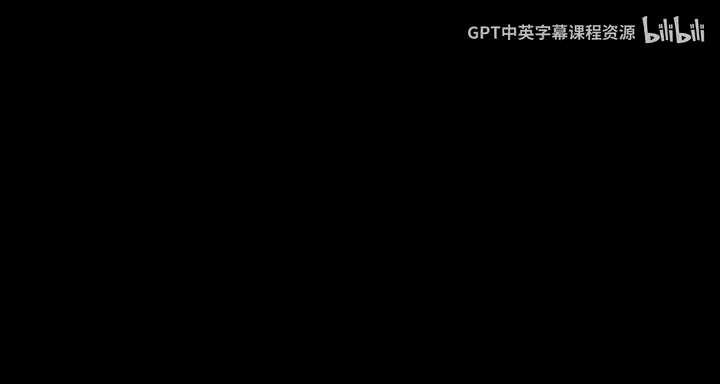
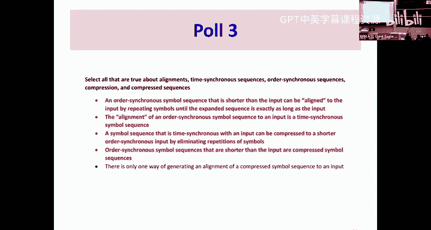
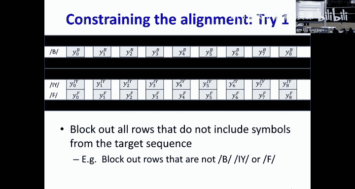
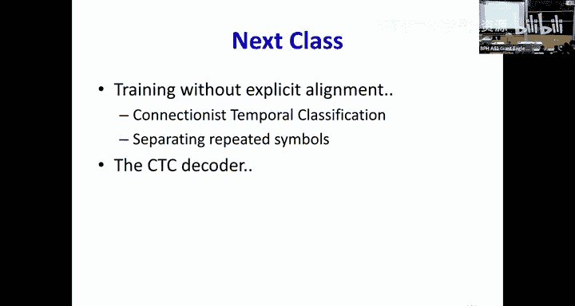

# CMU《深度学习导论｜11-785 Introduction to Deep Learning Spring 2025》中英字幕(deepseek - P16：[16]S2025 Lecture 15 - Recurrent Neural Networks (RRNs) Part III.zh_en - GPT中英字幕课程资源 - BV1xbZNYrEbs

嗯。你那什么。あだ。Okay。你们有我。这。Yeahなです。这个。Oh it was like it's start no look。我。就是。いや。还有一须。muchま。这不得搞一啥意。Okay。

那是。不是。一年以没个发出。け过。はでね。To。YeahSure。他就是。Yeah longer。But I just cycle through that。

Can't hear a thing because it damaged my ear to。 woke myself。Good morning， everybody。

I hope you had a nice， refreshing break。Even if you didn't。No。The semester started again。嗯。Okay。

 again， the usual story， please shut your laptops。And turn your phones off。

 turn your phones upside down。Except as for the poll。I wait 60 seconds， I a begin it。

Professor third is attending。7，61， is it not up？Well， if it's not up。That are my tears。呃， it is呃。

It's okay yeah， yeah。Usually pretty prompt， so。か。I mean， it is after spring break for them， too。科去。

そう。经过。我认。Okay， guys， let's begin。So we're going to continue with our series of lectures on recur neural networks。

 except that we we've actually covered the basic ideas of recurrence and。

The problems associated with them， namely stability and so on and how we dealt with this using gates。

 LSTMs， GRs and so on。 So now we're moving on， we are actually going to be applying these networks to specific problems。

 And when we do， we are going to encounter other issues and we're going to look at how to deal with it。

 So today， for instance， we are going to be looking at our classic problem that that comes up when you deal with asynchrony in the output。

 Now this happens when you are performing something like handwriting recognition or speech recognition。

 But there are also other problems where this can come up。 So。Here's the story so far。

 We've seen that recurrent structures can be trained by minimizing the divergence between the sequence of outputs and the sequence of desired outputs。

Through gradient descent and back propagation， the real challenge lies in how you define this divergence。

 Now， one of the problems that we came up with that we discussed in the last class was how you could actually apply recurrent networks to even perform addition。

 right。But then when I'm defining the divergence， if I just divide。

 define the divergence bit by bit by bit and define the divergence for each individual bit separately。

Does that， you know， does that really reflect the problem or is there more more the problem than that。

I mean， does an error in the last bit account for the same should should it account for just as much as an error in the first。

 if you just trying an addition。What do you say？If I'm adding 2。

20 digit numbers and if I make an error in the 20th bit。

Versus if I make an error in the first bit are they equally important。 Yeah， No， No， right。

 So defining a divergence itself， even when the problem is structured nicely structured as in the case of performing additions using recurrence defining divergence between sequences comes with its own challenges。

 And there are other situations where even defining the divergence itself becomes a problem。

 So here are various variances of recurt networks。All of which all of these models can be used for records。

 The simplest one is just the conventional MLP。 You know。

 an input goes into the hidden layer and the new compute and output。

 But then the the more conventional form of records that we discussed discussed in the previous classes are something like this。

 where。😊，You have a sequence of inputs going in and corresponding to each input。 There's an output。

 So this would happen for I know， things like the stock market。

 or if you were doing part of speech tagging。But we also saw there can be other kinds of situations where you can analyze an entire input before producing an output。

 So an example might be if you're performing sentiment analysis， you want to analyze the entire text。

And then determine if it's a positive sentiment or not。

And then you can have situations like these where you analyze a sequence of inputs。

 you produce a sequence of outputs。The sequence of outputs has order correspondence with the input。

Meaning this output。Corresponds to the portion of the input that came before it。

This output corresponds to the portion of the input that came before it。

 So there's a distinct order to the output。 What is missing is a one to one correspondence between the input and the output and any information about when the outputs are actually going to be generated。

So can you think of a situation problem where the situation arises。代你吧。Speech recognition， why？

Come on， guys， wake up。 Sc breaks over。Right， Jack。Prosses multiple phone to know over is it。

So youre processing a time synchronous sequence of inputs。 That's what you did in homework 1。

 remember。But then is every word equally long。We don't know what what was spoken。

 You don't know when the words have ended when you must be producing the output。

 So although the sequence of words is corresponds you know the order。

Of the sequence of output words corresponds to the order of input。

 We have no idea when the actual outputs must be generated， right。So that's one problem。

 And then you can have other problems of this kind。

 where you must analyze the entire input before you produce the output。Examples。I they there。I mean。

 it would be language translation language translation or something where you get a single input。

 and then you produce an entire output。Example of that， Jack。先輩？Just captioning an image， right。

 You just get an image in。 And then you have to produce the entire output。

 So all of these are problems of records。 Now， for us， let's look at this very simple problem here。

 How can an M LP be used to analyze sequences。 How can a simple multi layerer preceptron be a model for prep 4。

Sequence sequence analysis。 Here's what we can do。 There is no recurrence in the model。

So I could get a sequence of inputs。 I have a corresponding sequence of outputs。

 Each input can be I could be analyzed and the corresponding output could be predicted。 Nevertheless。

 if I actually define the divergence as the divergence between the sequence of outputs produced by the network and the sequence of outputs。

That you desire， you are sort of capturing the sequential nature of the problem within the model itself。

 Now， this is not a very good model for， for analyzing sequences clearly， because， again， you know。

 thinking of this problem of adding numbers。This is not going to be very good for saying， you know。

 the first bit is more important than the last bit， for instance。

 that that information doesn't really trickle through nonetheless。

You can capture the sequential nature of the problem through the divergence。

 And in the most common setting over here， because you're generating one output for for every input。

 you're going to assume that although you're defining the divergence between the actual output sequence and the target output sequence。

 we would the。commonmon assumption is that this divergence is the sum of the divergences at individual。

Times， and so this means that when you actually compute the derivative of the divergence with respect to each of the outputs。

 again， remember， we said when we want to perform gradient descent。

 we need the derivative of the overall divergence with respect to the output of the network at each time。

 Otherwise， there is no back propagation to be done。 And so。Over here。

 when you just define the overall divergence as the sum of the divergences at individual times。

 then you just get you just find that the derivative of the overall divergence。

With respect to the output at any given time is simply going to be the derivative of the local divergence at that time。

 because the rest of them don't matter， right。And a typical divergence that we use in the these situations is the K L diveence。

 Now， before I proceed， here's something important。When I define a kale divergence。

 which we also know is as well as。analog isn essentially identical to the cross entropy under some settings。

 What we actually have is。The output of the network。If this is your net network。

 the network is going to produce an output for every class。

 What are these outputs when you're performing classification。What is the network output。The class。

 is the class probability。 That's what the network outputs， right。

 And what does the what is the desired output in this setting。1 desired output is a one hot vector。

 So if the target class is  one， then you want a0 here， a1 here， a 0 here as 0 here and so on。

 right And how do we define the K divergence in this。In this problem， anybody。

How did we define the K divergence？嗯。Come on guys， we've been doing this for half a semester。

At some point， it becomes unforgivable to not give be able to give me that answer。

 So how did we define it。Somebody on Zoom。Does anyone on Zoom want to speak up？O。

 we just said the kale divergence you had the desired set of desired outputs。

 you had the set of actual outputs and the k between D and y。Was we said， summation I。D I log。

The eye over。Y I， that's why， that's how we defined it。 Remember。

 And so this becomes 0 when y equals D， because then the argument to the。ALo becomes one， except。

 you know， when D is 0。 So now in this case， when Ds for all of the classes where D is 0。

 this term becomes 0。And so this whole thing sort of those terms disappear from the summation。

For the classes for which D is one of there will be only one class， this simply becomes。one。log。

1 over y of the target class， which is。Mus log。Y C， which is a class that you're actually there。

 which is the target class。 And this makes sense。 You want to maximize the probability of the target class。

 In other words， you want to minimize the negative probability log。Negative log probability。 And。

 of course， what was the derivative of the divergence with respect to。Then had output y。Now。

 would the derivative have any components with respect to these classes。

 which are not target classes？Yes or no。 Can everybody say no， Okay。

 so I'm going to make you speak louder if you， if you， if you insist on sleeping in class。

 So the derivative is going to be。I'm speaking of the gradient here。 These。

 These are all going to be 0 so transpose。And what about the one target class。

 What is that component。Come on。 What is the target。

What is the derivative of the divergence with respect to this？

The output of the network for the target class。us1 minus minus-1 over by c， please don't go up。Right。

Which is just the derivative of the log。Do you guys remember any of this？Okay， do me a favor。

 Everybody raise your hands if you remember this。And those of you dead who and some of you are lying。

 We know this， right， still。I'm going to make you do fun funny things today because all of you are clearly still in spring break。

 anyway。😊，So that is， we're going to keep track of that， okay。Now， moving on， is a first。Fush。

That's my mother calling， sorry。そす。Okay，5 seconds， guys。Okay。

 anybody on Zoom want to answer the first question？Someone on Zoom， I there anybody on Zoom true。

Nobody on Zoom。入。Anyone so。Okay， just's check on zone。Guys on Zoom， can you even hear me？

Say yes on this。Yes， we can。不。Apparently， there's no one on Zoom， okay。

OkayI'm gonna have to mark everybody absent in this class with I get a sheet of paper hear hear。嗯。

Please write your name and and ID on this。 Okay， but then。Why can't I hear you。Okay。

 some something is off。 just to follow the chat。 Okay。

 so what is the answer to the first question on Zoom。对。Okay you guys。What about the second one。

 Someone here want to answer this。You there。No， the one before in front of you， yes。

 second question because yes。就す。Right， you should relate it。 okay， well about you。😊，Okay。

 do you mind putting out your name tags。 So when we use conventional MLP to model sequences。

 the sequence is captured through the divergence。😊。

Which is now capture a computed between the output sequence and the desired output sequence， right？

Okay， so moving on， guys， can we just wake up today， please。This is bad。 If all of you sleep。

 I will sleep。 That will not be a very interesting class。 I know it stuff。Okay。

So let's move on to the second problem and we are going to try to convert everything to this format where we have one output for every input now we mentioned a couple of different problems where this problem this model is applicable the stock market or if I were performing part of speech tagging every word has a tag but in reality this is the model that we would apply for every problem of recurnce anytime you speak of recurrent networks at the bottom of it all it lies this model where every single output generates an input generate output right and this analysis could be unidirectional going left to right it could be bidirectional left to right and right to left it doesn't matter what matters is that corresponding to every input there is an output now for the purpose of explanations I'm going to assume a left to right network but then you must remember that this whole thing also applies to bidirectional networks okay。

😊，And so here again， we said that the problem in training the model。

 we must define a divergence between the actual and desired output sequences。😊。

And in order to be able to perform back propagation， you need a derivative of this divergence。

 which is defined between sequences。For the output， for the output at every single time。

 So although the divergence itself。Ass being defined between an output sequence and a target output sequence。

 we need the derivative of the divergence with respect to each one of these guys。

In order to be able to perform back propagation。And once you define that， then， of course。

 you can perform back propagation。 Now， once again， although the the divergence is between sequences。

 one simplifying assumption we can make is that the divergence between two sequences can be the sum of the divergences at individual times。

 Again， this is not general。In general， the divergence is between two sequences。

 But then if the divergence could be defined in this manner。

As the sum of the divergence is at individual times。Then。

Computation becomes simple because the derivative of the sequence level divergence with respect to the output at each time。

Simply becomes the derivative of the local divergence。With respect to the output at that time。

That making sense to you guys right And so we will try to convert our sequence level divergence to a problem where we can recast recast it as a sum of divergences at individual times。

😊，And here's the second part。I'm going to give you only 30 seconds for this。

Once I get my stop watch app。为什么去陕西呃。知是。Okay，10 seconds， guys。Okay。啊。First statement， true or false。

Okay， second one and the third， Okay， so this is basically what we've got， right。

 the first and the third are true。 The second ones false。 So far so good。 Now， So we've looked at we。

 we were looking at many different problems。We were looking at this model here。Going back， right。 we。

 we had this model here， this model here， then this one and this one， and then the other ones。

 So we've gone through the first two models。 But then let's go to the third one in our exist。

 third one in our sequence。And that's this one here where you'd analyze an entire input sequence and then finally produce an output like if you were performing a question answering or if you were performing sentiment analysis。

 typicallyy， you have to analyze the entire input before you decide what was spoken， right。

 So the output would only be generated right when the input has terminated。 I mean。

 if we were asking you the color of the sky， you can't jump up and say blue before the word sky has been。

😊，Input because you don't know what it is I'm asking you the color off， right。

How in speech recognition。Suppose I gave you a sex slice of input and said， okay， this is a phoneme。

 Which phoneme is it。 You're going to have to go through the entire recording to decide which phone name was spoken now。

Inference over here is very straightforward。I'm going to be given an exact input sequence。

 I analyzed the entire input sequence， and then I'd finally read the output when the last input was。

😊，Had been processed。But then what about these intermediate stages。

 What happens out here at these times in the setting。Can anybody guess？

What happens at the intermediate intermediate time instance。Yes， their output goes into。The next。

As token or sequence。So remember every column， by the way。

 that lady there can you actually shut your laptop。Thank you。 right。 So remember。

 every column was identical to every other column the way we processed it， right。😊。

So considering that the same computation is happening at every time。

 what happens to the outputs at the first instance in this problem。Anybody guys。Yeah。

 we just drop them you just ignore them， right， The thing is the outputs are actually generated for every single input。

We just pretend they ont exist， you read the output of the last input。O。So when I'm training again。

 I'm going to be given a label so I have the input input sequence and I'm maybe given the target target phone name or I'm given the answer to the question。

😊，And then I'm going to read the actual output of the network at the last time。

Compare it to my target， Compute my divergence， and then propagate the derivative of the divergence backward through the network。

 But then in doing this， I'm losing something important。 And what is that。He you said， you can me。

You're assuming that all the previous inputs are the same。 I actually。

 what I'm doing is I'm ignoring these two outputs， right。

I've just thrown them away because I'm only using the output at the final input。 Now。

 the factor of the matter is that these things have， in fact， been computed。 We just threw them away。

 right， So if I were performing speech recognition。 And if I were given a section of input。

 and that said this is the phoneme R， then if it's the phoneme I at the end。

 it is probably the phoneme I even before that， right。

 And so what we could do is to say that this output that was generated here。 actually。😊。

Stays valid through the entire input sequence。 And then once I do that。

 this problem has become something more familiar， which was the one where we had time synchrony where you had one output for every input。

 And so once again now you can redefine your divergence as the sum of the divergences at the individual times。

You'd want to have some kind of a weighted sampleto to indicate the fact that maybe you're less certain of the correspondence in the beginning and more certain towards the end。

 But the more common problem situation is that you just choose the weights to be all in a problem like speech recognition。

 If it's a pho at the end， it's a phomi the beginning as well。

 So the weights would be all one whereas if it was some if it was something like question answering。

 there's no way you're going to know that the answer is blue out here。 So the weights would be0。

But regardless， the point is， we are converting this time asynchronous problem。

To a time synchronous problem by assuming the same output that there is an output at every time which can be matched to the target output and now the problem is simplified。

So let's go to this problem， which is what we're going to spend more time on today。😊。

This is an interesting problem。Again， like speech recognition， Yes，What I understand is。

 how are you setting the desired output when the entire input has not been processed yet。

How are you then computing that。 So remember， you're not free。

In order to compute the divergence first， you have to process the entire input sequence。

 So when you process the entire input sequence， you know the target output here。

 you know the output here， you know all the outputs。So there's no。

All the information available is required as available。But the desired is set。

 even before the entire thing is Youd， you'd be process the， you'd process the entire input。

 So now you get a sequence of outputs。 You compare it to the。Deizd output。

 which can be extended by repair repeating the symbol right so then entire thing is available。

Allright， so let's consider this problem。 given a sequence of inputs。

 you want to asynchronously output symbols， like in the problem of speech recognition。

 I gave you five seconds of speech。 If I analyze it 100 times a second， It's 500 vectors。

 But then there are maybe 15 words spoken in it。 So where must these 15 words be generated。

 That is not known。 So this is， in fact， just a simple concatenation of the problem here， right。

 this model just simple looks like many copies of this， this model attached one behind the other。

 but that little concatenation makes things really complicated。😊，Because during inference。

The model is actually producing an output at every time。

You have to figure out when to read the outputs。 and is that information given to you， No， right。

 So the fact that we have to go this extra step to figure out when we must read the output makes things rather more complicated。

 in fact， much more complicated。So let's can， can someone suggest a solution for this。Any ideas。

I know I'm just， you know， I haven't given you sufficient background still yes。The model that have a。

you could do something like that， right， But here's a very simple thing I can do。

 Remember that at each time， the network is actually generating。Probabilities for all the classes。

 right， And what we really have is a situation where I have， you know。Inports。And I need to know。

That。These guys， these are the ones I must read。 But then let's go back and consider what we did just a little while ago when I was trying to train the model。

 So if I was trying to train the model， I， and if this entire sequence represent corresponded to this particular output and this output。

Came after this sequence。 Then we sort of assumed that this guy。Was repeated here， right？

 And then if this guy was here， we just assumedd。That this guy was repeated here。We did this。

 So let's take advantage of this our ability to do this。

 What I can do is remember that what we really want to do given an input sequence。😊。

Is to find out now for， for any given input sequence。There are many different things I can do。

I could generate an output here and an output here。

Or I could generate an output here and an output here and an output here。

 There are many different ways of generating outputs。We want to generate。

 find out the particular output sequence that has the highest probability given the input， because。

 again， we are always trying to perform maximum。Probability class based classification， right。

 And so we want to find the nowia standard。嗯。Baesian classification， you know。

 Bayesian classification， what do you do if I were， if I were to give you an M LP。

And if I asked you to perform classification， how did you do it。

 You got an output for a probability for every class。

 and then you pick the class that had the highest probability， right。

 that was we're going use the same principle here。 So I can do something again。

 remember that what I really want to do is to generate this asynchronous。😊，Sequence。

 that's most probable。But instead。Oh， come on。Okay， so instead， what I can do is to。Generate。

 pick the most likely symbol at every time。And then that's going to give me a sequence。

With repeated symbols。 now， I can assume that the sequence with repeated symbols has actually been obtained by actually repeating the symbols。

And so then I can collapse all repetitions into one final symbol。 And then this would be。

 this would be a reasonable guess for what was spoken。 Now， if I did this， what could the problem。

 Can you think of any problem that might arise from this。Yeah， if you have repeated letters。

 if I have repeated letters， I cannot do it， right， So you cannot distinguish in this case。

 for example， between two f's。And a single laugh。For now， let's share this problem。

 This is a problem， right， And so， you know， we are there are other things。

 something like this kind can be， can be meaningless。 so we can come up with various solutions。

We can impose external constraints， saying only some sequences are allowed or we can impose。

 we can introduce special separating symbols。 as Louise E thing mentioned just just a little while ago。

 then various out the things we can do anyways。😊，We are going to refer to this process of obtaining an output from the network as decoding。

And given your input， we want to decode the output。Just terminology， also。Here's another thing。

What we are really doing is picking the output sequence。

 That is the sequence of most probable output symbols at each time。

So which means that we are actually picking。Were not picking a sequence of this kind， Are we。

 We're not picking a sequence with only two symbols， We are actually picking an output sequence with。

T symbols and then compressing it to the sequence with two symbols。

 And so the two are not the same thing。 The most likely symbol sequence， which is t long。

 is not necessarily the most likely symbol sequence， which is which has only two outputs。

 So to give you an idea， I could generate， you know， if I were generating it。

I could put I here and T here。 I can generate an it also by putting an I here and a T here。

 They're all different versions of it。And what I really want is the probability of it regardless of where I' am placing these symbols。

And then I want to pick the symbol sequence， which is most likely。

What we are doing instead is speaking their T long symbol sequence。

 which is most likely and then sort of shrinking it。 The two are not the same。

 We'll get back to this in the next class。And so for now。

 I'm going to assume that we have sort of partially addressed the problem of how to perform inference。

How to generate outputs。Given。Genrate。Asynchronous outputs。

 So these are what I will call order synchronous， but not time synchronous， so。Just to。Grainfor。

This is order synchronous。But not。Timemeynchronous。Why do I say this。

 Because if I have a sequence of inputs。I'm generating outputs and the order of the outputs has a correspondence。

With the order of the inputs。 So， you know， if I。If I generate output saying hello， world。

If I shuffled my the audio， the output is no longer going to be a hello world， right。

 So there is a strict correspondence between the input and the output。

 but you don't have an output at each time。 So it's not time synchronous。

 but there's are it's order synchronous。 And so we've sort of come up we've sort of。

Come up with some kind of a solution for how we could generate order synchronous。

 but not time synchronous outputs。The bigger challenge is how do you train these models？Now， again。

Here。You're going to be given training data， which includes an input sequence and an output sequence。

 So you could say this is the recording audio recording。

 and this represents the word but which has the three fourme bur enter。How do I train the model。

 right， now， suppose I were to give you information about where。The actual phomes must be output。

So I say here is a recording it tens have 110 vectors long。

 it represents the word but and the phome bur must be output at time2。

The phone nameer must be output at time 6 and2 occurs at 9。If this input information is given to you。

Then training the model is very straightforward， right。

 So this information is what we will call the alignment。

Which tells me exactly where each symbol must be output。 Now， again。

 going back to the pro to our problem of that this is not unique。

 If I were to tell you that this recording with 10 vectors represents the word but。

There are many different ways of outputting but。B and， all of which represent the same word， right？

 So I could be here are different alignments。 In the first case。

 B comes out at time 3 at 7 and T at 9。 In the second B comes out at1， at 6， T at 9 and so on， right。

 So there are many different ways of aligning that symbol sequence。😊，To the input。Now。

 if the precise align， So if I just told you the output sequence。

 I if I told you this is the word but you don't know the alignment。

You don't know where each of these phonemes must be output。

But if I were to assume that this information was given。 So I'm given the alignment。

 I'm informed exactly where each of these symbols must be output。Then the problem is simple。

 All I would have to do is to compute the divergences with respect to the outputs at the target times。

And then the sum of these divergences can be back propagated。 But then again。

 we say that this is kind of suboptimal。 right， If I do this， what am I throwing away。

The intermediate outputs So， and how can I solve that。But can just just repeat things， right？

 And so this is what I could do。 I can say。That the symbol bur has repeated three times has repeated four times。

T has repeated three times。 And now I have and in doing。 So what have I done。

 I've converted an order synchronous problem to a。Time synchronous problem。

 And once I convert it to a time synchronous problem， we know exactly how to deal with it。Right。

 any questions？No，So。The real problem is that when somebody gives you data。

They're not going to tell you， here's where B occurred。

Which means the alignment information is not provided。 And so we must now train the model。

But we don't have the alignments。So in this case， how do we convert compute the divergs？

If the alignment is given， the divergence is simple。

 this is the actual divergence you'd want to compute。

Our extension of it is this time synchronous time synchronous alignment where the divergence is computed over the entire input sequence。

 but being able to compute this divergence presupposes that we know exactly where each output must be generated。

In the more realistic problem， like in the problems that you will encounter in homework 3。

 that information is not given。 All you're told is that this is the word but。

And now how do you compute the divergence， So if I were to give you this problem。😊。

How would you go about solving it？I'm telling you that if I gave you the alignment。

You know how to compute the divergence and claim the model。But I'm not giving you the alignment。

 so how would you go about solving it？即开我嗯。You can guess the alignment right？ So that too。

 But and so here's what we can do。 We know how to train if the alignment is provided。

 but the alignment is not provided。 There are two possible solutions。 You can guess the alignment。😊。

Or we can consider all possible alignment。 So we' are going to look at the guessing the alignment situation first。

 right。😊，So if I were just told， this is the word。 So I'm using this example。

 Bfi for I have no idea why I made this example up many many years ago and I've never changed it。

 but' will stay with it。So suppose I give it a recording。 And I was told this was the word beefy。

Then I'm going to guess an initial alignment using whatever heuristic， saying I think bur hacks here。

 I think E occurs here。 I think P occurs here and E occurs here again。

 And then once I guess this alignment， I can use this alignment to go ahead and train my model just by repeating symbols。

 right。😊，And then， I can iterate。Once I train my model。

 I can use the train model to go back and reest my alignment and try to improve my alignment because now I have a model。

And so the model can be used to determine the alignment all over again。

 And then once I've reestd the alignment， I can go back and use the reestd alignment to update my model。

 and I can iterate this process。So how does one reest the alignment for this first。

 we have to determine formally what we mean by an alignment。Now。

 an alignment tells us which portion of the input aligns to what symbol in the output sequence。

 So if I've given for it， if I'm given， for instance， an input sequence， that is。10 vectors long。

 And if I'm told that this represents the word but， which has three phomes per at， then。As we saw。

 there are many different ways of aligning these three four names against this input。Right， so the。

 as as the picture shows。 And so estimating the alignment is the problem of determining which of these different alignments is the most。

Appropriate one。Based on whatever model we have。 And so now again。

 when I'm thinking of this alignment again， using the same trick that we saw earlier。

Where we just repeat a symbol through the air through the empty stretch behind it。

 So this is the same as determining these guys， right。

 the alignment I just repeating the symbol through the segment that correspond corresponds to the symbol gives us what I call an expansion of the alignment。

 Now， the difference between the expansion of the alignment and this guy is that the original alignment has only three outputs。

 So it's order synchronous， but it's not time synchronous。

I've converted it to a time synchronous format by repeating the symbols。

 And so this is what I will call an expansion。 because once you repeat symbols， the output is longer。

 It's as long as the input itself， right， And so this is。

An expansion of this guy obtained by repetition。 And conversely， if I gave you this one。

 if I deleted the repetitions， that's going to give you this。 This is what I will call a compression。

😊，Of the time synchronous alignment。 So again， the two terms here。

 I have an order synchronous alignment and a time synchronous alignment。

 The time synchronous alignment is an expansion of the order synchronous alignment obtained by repeating symbols。

And the order synchronous alignment is a compression。

Of the time synchronous alignment obtained by squeezing out repetitions。Calculate everybody。Okay。

 and so。The same asynchronous。Compressed sequence can be expanded in many different ways。

 So if I would tell you that this is the this is the word but。

Then there are many different alignments I can come up with。

 And so but can be expanded in hundreds of different ways to the input。So also。

 I can have many different alignments， all of which compress to the same symbol sequence。

 right So if I give you the word but。😊，I can expand it in many different ways。

 and I have many different expansions， which will all compress to the word but just to both the same statement being stated and reversed right。

 And so if I were to tell you， so given this。嗯。If I am told that the word sequence is， but。

I have input。X0 to x 9。And I'm told that this is but。Then the bird。

 the alignment of these symbols against the input can be done in many different ways。

 So I could have， you know， something like。But or maybe be。H， T and so on。 Many of these。

 And I want to find out which of these is more， most probable。But the way I will represent it。

 because I like to convert everything to time synchronous sequences is this is the。Yeah。So。

 I'm converting all of these。Compressed order synchronous sequences to their time synchronous variance。

Finding the alignment is basically all about telling me which of these is most probable that taking sense to you guys。

And so here's the alignment problem。 I'm given an input sequence X。X 1 through X T。

And a symbol sequence。S S 0 through S， to say S 0 through S N and need not be equal to T。

I want to find out from these the symbol sequences。 I'm using a lowercase S 0 through S given。

X0 through x T。As 0 through S 1。 And I want to find out the symbol sequence， which is most probable。

 again， going back， this here is this input。This here。As this input。

 Im told that this is the word but。And what I'm trying to find out is this guy。

 which of these is most probable？That're making sense to you guys。As a tip。Okay， and so。

In other words， I want to find this expanded symbol sequence。

The whichch compressive the most probable expanded symbol sequence that compresses to the given。

Tget sequence， okay。也是太多了。That's but。Yeah， the un comp symbol。Yeah。Anything on Zoom。

Any questions on Zoom。哪天O。So if you was to put the words。

 that's a probability from alignment given all the inputs and compress on alignment。Okay。

 I'm giving you 15 more seconds， guys。Okay， time's up。

Can somebody on Zoom tell me if that first statement is right。Zoom is that first statement right？

Okay， you guys is the second one， right， Third， fourth。Fifth， okay。

 so an order synchronous symbol sequence is shorter than the input and can that is shorter than the input can be aligned to the input by repeating symbols。

The alignment is a time of of an order synchronous sequence is a time synchronous sequence， right。

And the symbol sequence at times is that time synchronous with an input can be compressed。

To a shorter order synchronous sequence。 again， this is just。

 I mean the inverse of the first statement and order synchronous symbol sequences that are shorter are compress symbol sequences。

And， of course， there's a many to one correspondence， right， So you mind sharinging your laptop。

Please keep them shut， okay。So now here's the problem。

 We want to find the order synchronous sequence， the time synchronous sequence that is。Most probable。

 given the order synchronous sequence。 I'm given the input。

 I'm told that the word in this has in my example is the word Bfi， right， Now。

 what is the network actually generated， The network has actually generated vector of probabilities。

 one for every symbol in my vocabulary at each time。😊。

When you process the input and from this vector of probabilities。

 I want to find the alignment for beefy。Now， one simple thing I can do is to just go ahead and pick the most。

Probable symbol at each time。 If I did so， would this be a valid alignment for By。Why not？

 Because it has thickness are as well。 You can pick any odd random symbol， Right。

 So there's no guarantee that the symbols， the sequence that you pick is actually going to correspond to B。

 It's going to pick up rubbish symbols。So you don't want it to pick up rubbish symbols。

 So what would a solution be。Maskket， mask。 Okay， so I can just mask all of the rubbish symbols。

And now all I'm left with are the actual symbols that occur in my。Target。

 so if I'm only left with these。

So it's like the same as copying those rows over， right？And now on this one。

 if I just pick the most likely symbol at each time， right？Only align on the decoder reduced grid。

And if I just speak the most likely simple at each time， is this going to be an alignment for。

 for my target word with this B B fee in this case。Why not。嗯哼有兴趣。Yeah， it can have。

There's no the order might be broken， right， as in this case。 So what I want to make sure is that。

The order is also maintained and that every symbol must is actually occurs in the output。

 so how do I fix this。We got rid of rubbish symbols， by masking them。

But that still doesn't solve the problem。 So how can I fix this。

 I want to make sure that every symbol is that whatever I generate actually corresponds to my input。

 which， which means that every symbol in my input is generated in the right order。 How can I do this。

Any guesses？我没吃。你先信信得我嚟嘅我先要一个。That' can can any any other solutions。It's not hard。人食都生。

If there are three。嚟。If they are completely aligned， like there are three Bs。

 and then if there is an iy in the product， then we just take the iy for the next ones。

So here is what I can do。I can pull out all the rows。In my probability table。

 corresponding to the symbols in my target sequence and copy them over。

Now my target sequence is the word beefy， so I pulled out the row for B， I pulled out the row for E。

 I pulled out the row for fur， but notice how I set them up。The first row is the roer bar。

The second row is the row for E， the third is the row for4。

 the fourth is the row for E E occurs twice and the sequence。

 now there's something very special about this table。 there's reduced table on top and what is that。

嗯。What's special about it？It has repetition， but what else it has order。

 So what this means is that if I， you know， if a symbol occurs multiple times。

 we repeat the row in the appropriate location。 So E has occurred twice。

 and once I put things in this manner， then if I start walking from the top left corner now。

And make sure that any time I take a step， I take a step， either right or one step down。

Then going from the top left corner to the bottom right corner means that I have visited every symbol at least once。

In the correct order， because the rows were set in the right order， right。

 which means I am going to get B。 I'm going to get E。 I'm going to get P。 I'm going to get E again。

And because as I walk， I repeat burst certain a number of times。 So I'm going to get B， B， B， B， B。

 E E， E， E， E F， E E。 So I'm going to get something of this kind in this example。

Regardless of how I walk from the top left corner to the bottom right corner。

 I'm going to get something of the sky， right。Which will compress to the correct sequence。

Makes sense。For this， yes。How do you ensure that it completes the sequence？

I couldnt it go all the way to the right。 I am going to pick a path from the top left corner to the bottom right corner。

 and nothing else will be considered。Right， and so long as I have so I can draw this。

 I can represent this in the form of a graph。I can think of each cell in my table， as a node。Now。

 each cell has a probability associated with it， which is basically what I've read off from the output of the network。

So this table is basically a table of probabilities right。

 but I can think of each cell as a node and from each node。

 I can either take a step right or I can take a step diagonally downwards。😊。

And now the graph is a directed basically graph， it starts at the top left。

And ends at the bottom right。And now， any path through this graph。Has a characteristic。In that。

 it represents an alignment of my target sequence to the input。

It doesn't matter which path you take if you start from the source node and walk all the way down to the sync node following the edges of the graph。

 you are going to end up with a path。ThatThat represents an alignment of the input to the target sequence。

Now， every node in this graph has a probability。So if I want to pick the most likely alignment。

Given the input。And given this graph， what must I do。Anybody。

Keeping in mind that every path through the graph represents an alignment。ましまし。Can you say that word。

 you want to pick the path that has the highest probability。If you pick the hat part。

 the highest the highest probability， you are definitely finding the most probable alignment of the。

Input to the symbol sequence。That making sense right so， but in order to be able to do this。

 what do I need to do？I need to define probabilities。

 Every node has a probability that I've read off the table。Every edge has probability of one。Okay。

 once I give you this information， is anyone here， what has this problem been converted to。好，跟你清嗯哼。

Is it an optimization problem， What is yeah what。How many of you have done computer science？

What does this look like？To sorting topological sorting。 this is。Dtras algorithm。 Thank you。 right。

 This was just a finding a path through a graph。 How many of you know how to find a path through a graph。

Raise your hands， please， right， like a whole bunch of you。 I've assigned a note note。

Probability to every node。 Ive assigned an edge probability of1。

 I could make these logs in which case the whole thing becomes summations。

 And so every path through the graph has a。Score associated with it。 And I'm asking you to find the。

The longest if I make it negative log probability is the shortest path right and so this has simply become a probability of find a problem of finding a path through a graph。

 given this， what are the various techniques you're aware of for finding a path from a source node to a sync node。

Breathfat search， you mentioned something before that， ditras algorithm， anything else， A star。

If I gave you this， you can literally go to a graph library and you can find me an algorithm which finds the shot。

 finds the best path。😊，Right。Now， I'm going to specifically look at one technique。

 which is called the Whitby algorithm named after A G Whitby。

 which is a breakfast first search algorithm。 And it turns out it's very efficient now here。

What we've done is compose the graphs is that every path in the graph from sorts to sync。

represents a valid alignment， edge scores are1， node scores are the probabilities assigned to this symbol by the neural network。

😊，And the score for any path is simply going to be the product of the probabilities of the nodes in the path。

 So here， for example， the score of the path that's shown in blue that's it's a partial path going from。

 you know， this node here。Till here。 So it's just a path to。 that's four notes long。

 The score for that， for that path is。The probability assigned to B at time 0。 That's y 0， B。

 this notation that I'm using here。Do I have an eraser。This notation that I'm using here， y。第一应弄。S。

 this is the probability assigned to the symbol S at time T by the network。 So y subscript 0。

 superscript B is the probability assigned to B at time 0 by the network。 Okay。

 and so the probability of that path is y 0 B times y 1， B times y 2 E times y 3 E times。Y  for F。

 right。This making sense to everybody。 Suppose I had a different path， which went from y 0。

 B straight to y 1， E and then to y1 Y to F。 What would that probability be。

Suppose I just took a diagonal path three steps down。 What is the probability of the path。Come on。

 somebody a lot。 say it aloud。Y 0 D Y 1， I Y and Y2 F and Y 3 basically， right。

 Is this the product of the probabilities on the on the path， so。

What we want to do is find the path which has the highest probability。Now， in the worst case。

 the number of paths you'd have to consider is going to be exponential。

 so you can't explicitly list out all the paths and find the。I scoring path。 But then， of course。

 graph algorithms come to the rescue。 We can use any of these guys。 And so we're going to use。

 we could use the find， find the most probable path using any dynamic programming algorithm like。😊。

You know，Ds straws， Vi toB algorithm is a breakfast search algorithm。

You can have various depth for search algorithms by K star， you know。啊。Stag decoding， right。

 but let's take a take a look at the Whitby algorithm because it's really， really efficient。

And in this particular case， and it's based on a very simple principle。

Suppose I won't take any arbitrary node in the graph， like 3 F。What is the most probable path。

From the source node to 3 f。Now， we know that this node has only two incoming edges。

 So this node has just two parents， right， So which means that the most probable path must come through one of these two edges。

Furthermore， we know that that a path that comes through this node。

To here is basically an extension of the path to this node by this final symbol。

So the most likely path that goes to 3 F。Is either an extension of the most likely path to2 F。

Or an extension of the most likely paths to2 e。The only two choices。

 You don't even need to consider the second most likely path because the second most likely path is already lost。

 We're only interested in the most likely path。 So it's either an extension of the most likely paths to 2 F or the most likely path to2 E。

 And now， going back， asking you guys this question again， right。So let me just draw my graph here。

I have my graph is。啊， whatever来。What。This is how I had it。Yeah。

And so this is my most likely path to this node。This is my most likely path to this node。 Okay。

 and let's say my most likely path to this node has a probability of 07。

 and this one has a probability of 04。Which of these two is going to extend to the most likely path in my current node。

MCan you say that。The first one does every， how many of you think the second one can extend to become the most likely path。

How many of you think though it's got to be the more first one。Because simply。

 if I want to extend this guy。Then this score， this path score is going to be 07。Times my。

Note probability here， right， This path is going to be 04。Times my no probability here。Clearly。

 this is going to lose。So in order to determine which is the most likely path to this node。

 I just have to look at the parents。Find the parent， which has the。Highest。

 most likely path score and extended period。Now， once you realize that this is all there is to it。

 the whole process becomes very simple， right， So here's what the algorithm。

Here's what we are saying。 the best path from 0， B through to 3 F。

Is either the best path from 0 B to 2 E extended to the3 F。

Or the best path from 0 B to 2 F extended to 3 F。So all we can do is just pick the best parent and then extend it。

 That's basically what we all we want to do。 Now， if I want to state it in terms in algorithmic terms。

 here's what it's going to look like。Dynaically track the best path and the score of the best path from the source node to every node in the graph from left to right at each node。

 keep track of the best incoming parent。And the score of the best incoming age is extended to to the you know of the best path from the source node to the node through this parentage and compute the best path from source to sync now。

 let me write it in。A little a little more in terms of algorithms and show this with pictures。

Just for clarification， I'm going to use this notation。I'm going to use this upper case。

 as with parentheses to represent the symbol。 So here， for example， if I have the word。But。

This has three symbols。So this is S S of 0。 This is S of  one。 This is S of 2。

 So S simply says it's a symbol。 The index is the position。

 So S of I is the I at symbol and the sequence。Just for clarification， right， So in this case。

 S 0 is B S1 and S3 are both E， because this is B P， right。And S2 is F。Now， once I do this。

 I could represent the graph like so。So。Here's our graph， and here's the algorithm。Now。

 if you look here in the leftmost column， you cannot begin from rows 2，3 or 4。

So the best path score that starts from there is already 0。 You cannot start from those guys。

 You only need to consider the first node。 And for the first node。

 the best path node that starts this0 B out there has no parent。

 So the best path node in the first call column has a parent that's null。

And it's going to be the score for this Cahi is simply going to be the probability of。

B at time zero and these and just to， you know， make the whole code uniform。The score for nodes 2。

3 and 4 is 0 because you cannot have a best path starting from there。Subsequently。

 you can just go through time。From left to right， top to bottom。 And at each position。

 you can just find the best parent。 The best parent is the parent with the best path score。To that。

To the parent and then extend it to the and you keep track of who the best parent was at each time。

 so the best parent index identity is always retained。And then subsequently。

 you just extend the best path score to the best parent by the probability of the current node itself。

 So if I want to do this step by step for that particular example， here's my graph。

 I know that the first the blacked out nodes all have probability 0。

 So only the top left node has any probability。 So here this is going to be the best parent to 0 B is null。

And the best path score to 0 B is just， you know， y 0 B。And for the rest of them， at zero。

So I've taken care of time time1。 Then I can go forward and time by one step。

 Now if I go forward and time by one step for the top node， there's only one parent。

And so the best parent for that guy is simply going to be。Not 0， right， the the row number。

 I'm just keeping track of the row number。And then the best score to it is going to be the best score at。

For 0 b extended by the probability of the current node， which is y t。At 0。

And then I can go down through the rest of the nodes。 And for each of the rest of the nodes。

 there any node has only two parents， either either the same row。Or the previous room。

 So I just have to compare。The best fat scored at t minus1。L -1。

 which is the previous row to the best path score at t -1 L， which is the same row。 So at each node。

I'm just computing the best paths， comparing these two best paths scores。 if this is higher。

The best parent is L -1。 If this is higher， the best parent is that， that's all I'm keeping track of。

And then， you extend。The best Pat score。At the best parent by the probability of the current node。

 And so you' would be computing the so the dark blue arrows show the illustrate the identity of the best parent。

 This is what you'll be keeping track of right and of course for for the black dark nodes。

 it doesn't matter where you come from the probability is going to be 0。

Once you've done this for the second column， you can take a step forward to the next column。Again。

The top row has only one parent， so it's easy to keep track of the best parent and then extend it。

 But then the subsequent rows， there are multiple parents to consider two in each case。

 you're going to pick the best parent every time。Keep track of their identity， and。

Extend the probability by the by the current node itself， right， And then， of course。

 the last guy is gonna be easy。 So you can keep doing this column by column by column At each time。

 you are going to be finding out the identity of the best parent。

Keeping track of who the best parent is and then subsequently extending the path score to the best parent by。

The probability of the current node to get the best path score to the current node。

And you can do this for every node in every column going left to right。Sorry。This makes sense to you。

 This is not a particularly complicated algorithm。And just to make sure that it's not complicated。

 we're going to make you code it in the homework。Right。But。Questions。Any questions。Now。

 so once I do this now keep this in mind， right， we are going to reuse this in the next class quite a lot。

 this whole structure， okay。😊，Now， here。We know that the final node must be this guy。

 so I can ignore the first three rows。 I can just focus on the bottom left bottom right。

 and for every node， we have kept track of the best parent。😊，So I can walk my way back from。

 So those last three guys can be ignored。 I can start off with this one。Right， and then I can keep。

 I can track all my best parents going backwards。 And when I track my best parents going backward。

 I'm going to get the best path。Through the entire graph。

And so that's actually going to give me an alignment。And once I compute my alignment。

 things are easy。😊，I now have。And best the most likely alignment for the input。Given a model。

And now I can use this alignment as the true alignment。 I can go ahead and compute my dives。

 So here's a fourth。😊，嗯。Yes， for the last pair the selected the second road。Because these be。

If you chose the second row， you're gonna miss far。Mis F。不娘。There's no path that goes through F。

 It has to be at the bottom right corner， right， That is the whole point。Okay， so。All right， Time up。

 guys。Somebody want to tell me。If the first statement is true。T filess。Okay。

 what about the second one。是。The third。まし。Okay， so here's what we got right。

 this is viby alignment not decoding really it finds the most probable alignment of a compressed sequence to an input it's run on a table of probabilities constructed for the compressed sequence with one roof for each symbol derived from the probability generated by the output of the record network。

😊，And it doesn't select the most probable symbol at each time you have to find the most probable path through the network。

 right， okay。So all right guys， shut your laptops， the poles are done。So。You know， I have some。

pseudoudo code for this。 I'll skip this。 So here's what that gave us。 That gave us an alignment。

 which gave me a symbol for every time。😊，And the output。And so given this alignment， now。

 I can just define my。 So this was the alignment that that I got Bfi， right。

And now I can define my divergence。And because I have a symbol target symbol for each time。

 I can define my sequence divergence as the sum of the divergences at individual times。

 so it is going to be the sum of the KL divergences at each time。

But then we already know from way back early in the class that at any given time。

 the KL divergence between the output of the network and the target output。

 which is the symbol that we captured in the alignment is simply the negative log probability of the symbol itself。

😊，We already know this， right， that's what we did up there。

And so if I want to compute the probability， the derivative of the divergence。

With respect to the output at any time。All I need， that is simply going to be a vector of zeros with minus-1 over the probability assigned to the target symbol at that time。

Is this making sense Bnie？Now， just please remember this because this is going to come back and haunt us in the next class。

嗯。So keep track of this。 Okay， and so now I can use this derivative for， I can use this。

Divative to go back and retrain my model。 So here's what I would do。 I'd get some initial alignments。

For all of my inputs using any heuristic， uniformly you know spaced or whatever else， right。

 and these initial alignments can now be used to train a model。 but once I train a model。

 the model can be used to go back and refine the alignments and once I refine the alignments。

 hopefully because the model has captured consistencies in the data。

We' are going to get a better alignment。And now this improved alignment can can can then be used to go back and train the model yet again。

 And you can keep iterating this process。 Eventually。

 the alignments and the probabilities assigned to the data will converge。And then you're done。 right。

 So we took a fairly complicated looking problem and converted it to something very simple。Now。

 of course， there are some practical issues like how exactly would you implement it。 So again。

 there's this business of finding the alignment， so I could take my model and compute the alignment for every training instance in my data and then use this alignment to update my model。

That's very suboptimal。 If you are doing something like S GD every time you encounter a sequence。

 you're going to update the model and then。Use the updated model on the next sequence， right？

So when you're updating the model， you're going to be aligning and then computing derivatives in the same step。

So just two different variables， okay？Now， there's a problem with this approach。

 and the problem is this。If your model is crappy， remember， this is an iterative process， right？

 So you have this business where I'm going to initialize my alignments。😊。

And then I'm going to train models for the given alignments。

Update my alignments and go back and retrain。Now， if my in initial model is lousy。

 my initial alignments are going to be crappy。And then I'm going to be training on crappy alignments。

 Once I train on crappy alignments， I'm stuck in a bad place When I try to improve。

 I'm not really going to improve my next alignments。

 I just going to sort of confirm what I started off with。

And that keep repeating this and end up at local optimum。

 So this process works well if you have large amounts of training data。Where， you know。

 over the amounts of training data， eventually these things get。It's no doubt。

But in more realistic settings， you're going be working with live with。You know。

 relatively limited amounts of training data。And this has the tendency to run into poor local optimum。

So the solution to this is I'm not going to commit to an alignment。

Our problem here is that we chose an alignment。 we had an initial model。😊，Based on the model。

 we came up with the best alignment for every input and then use this alignment to go back and train our model。

 This is this， this is the。You know， a commitment， right， you're committing to this alignment。

 and then you're going to get married to that committed alignment because that's what that's what you're trading for。

 And this can be a bad thing so。You know， you become the algorithmic playbo you don't commit to anybody。

So。That's what well look at in the next class， training without explicit alignment。

Call the connectionist temporal classification model。We have also introduced this business of how。

 you know， a better way of dealing with competitionets。So we're starting a little early。Spring break。

 just after spring break， I'm giving you four minutes off。Do have any questions？Yes。

So we put the example。if if you just pair it up or shortened it uniformly。

 then the same alignment would compress。Uniformly right。 Nothing would change。分个。

But as if hes stretched it non uniformly， then the alignment would have to。たま。All right， folks。

 if there are no questions， thank you all very much。之前。

