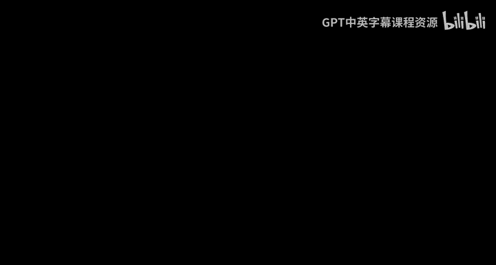
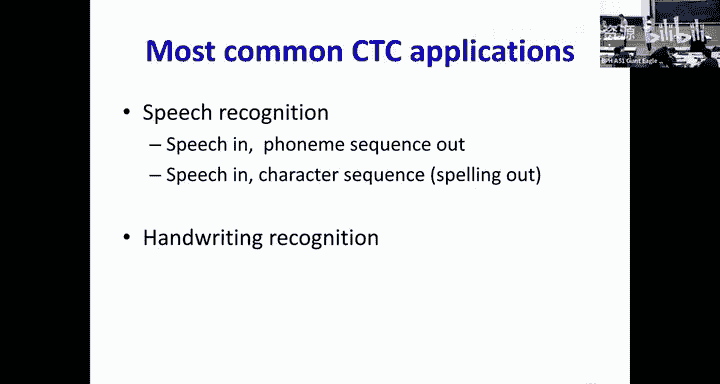

# CMU《深度学习导论｜11-785 Introduction to Deep Learning Spring 2025》中英字幕(deepseek - P17：[17]S2025 Lecture 16 - Sequence to Sequence models.zh_en - GPT中英字幕课程资源 - BV1xbZNYrEbs

Okay。Morning， everybody。Yeah。Mning check。Quably， it's good to see you。All right， let's begin。

The attendance poll。7，8，7。The class is awfully thin today。 I hope there are people on Zoom。不的。

And my T A should be here any minute。 We're gonna continue with our sequence of lectures on record neural networks。

 but we are specifically going to switch to a problem。Of using these two。

Convert one sequence to another now。As we explained。

 recurren neural networks are all about analyzing time series sequences of data and。

You'd analyze a time series， a sequence and produce an output。

 which could be either a single output or a sequence。

 The generic setting is to think of it as a sequence to sequence converter where some sequence x 1 through X N goes in。

 some other sequence Y1 through Y M comes out。😊，And there need not be any correspondence。

 any between N and M。 So the length of the sequence that goes in need not bear any direct relationship to the length of the sequence that comes out。

 So examples like speech recognition， speech goes in。 a word sequence comes out。 machine translation。

One word sequence goes in。 another word sequence comes up or dialogue systems。 You say something。

 the system responds with something else。 and there's no direct correspondence between your query and the response。

 The query could be long， and the response could be shorter or vice versa， right。Question answering。

 and so on。So there's no assumption of any kind of synchrony。

We can broadly categorize sequence to sequence conversion problems to 2。

 one in which there is some kind of an order correspondence between the input and the output。😊。

That's for speech recognition， for instance。Or the other in which we don't really。

 we we cannot even make an assumption of such a correspondence， for example。

 in machine translation or dialogue systems in M T。If I were translating。

 I ate an apple to Ihaba in an upfill Gaus， and then the order of the words that went in is very different from the order of words that came out。

 there is not even a one to one correspondence。between what went in and what came out。

 So we've been looking at our， you know， our dialogueg system。

 You say my screen is blank and the system responsive。 Please check if your computer is plugged in。

There's no correspondence， right， So the specific problem we've been looking at is this one will continue with this sport this week。

 And next week， we will talk about this the latter kind of problem。So here's what we had。

You had an output that was order aligned with the input， but not time synchronous。

 So all which which means that。The initial portion of the output corresponds to the initial portion of the input。

The latter portion of the output corresponds to the latter portion of the input。

 If you reorder the input， the output is likely to change in in a very predictable manner。好。

But this also means that in general， the number of output symbols is going to be lesser than or equal to the number of input symbols。

So the problems we saw were how do we perform influence on such a model。

 how to output time asynchronous sequences and how do we train such models。

And for performing inference， we speak sort of partially address this。

 We will return to this problem later in this lecture。 We were looking at how to train such models。😊。

And。We saw that typically， you'd be given input and output sequences。Now， if the output sequence。

 if you were given the alignment for the output sequence。

 then you would know exactly where each output symbol was produced。

And so you could just compute the divergences at those points。

 or you could make the output time synchronous by repeating each symbol through the portion of the input to which it corresponded。

 And now this became a time synchronous problem。 And we also saw that in this case。

 the divergence simply becomes the negative of the sum overall time instance。😊，Of the log likelihood。

Assigned to the target output symbol at that time。 So it just became minus of summation T log of。

The probability assigned to the specific target symbol at time T。Now， this thing is important。

 Please keep track of it。 We are going to see it a few types。And so here again， is the divergence。

 iss the negative。Of the summation over all time。Of the log of the probability assigned to the target symbol at each time。

If I were to take the derivative of this divergence with respect to the output of the network。

At any time。Then that's simply， you know， that's simply going to be zeros。

For all the symbols that are not the target symbol。 and for the target symbol alone。

 the derivative is going to be -1 over。The probability assigned to the symbol。 And you can see again。

 this is just your standard。Divative of the KL divergence， we've seen this back in lecture  three。So。

The bigger problem is， well how do we train when the alignment is not provided。

 So I I've given you the output sequence， but I'm not told you where in time each symbol occurs in this case。

We saw one。 We are solving the problem。 I could give you some initial alignments。

 I can train some models with it。Then I can use those models to obtain new alignments and cycle through。

And eventually， we can。Find out。You know， once once once you once you obtain new alignments。

 you can actually use gradient descent to update the models。

And the updated models could go back or could go back and be reused to to reestimate the alignments。

 the reestd alignments could be used to update the model again and we could keep iterating and eventually it would converge that would be our final model。

And so， here's a first spot。And， of course， we did the alignment using the Wiby algorithm。

 we saw thiser。やめだ。Okay， guys。啊。What's the answer to the first question， anybody。

Say something Englisher true。 What about the second one。

So ViB training explicitly estimates the alignment of each training instance and computes the divergence for the estimated alignment。

And so it requires reestimation of the alignments in each iteration。And we saw that this is this。

Can be problematic。 And this is problematic because it's heavily dependent on the initial alignment that you provide。

 If the initial alignment you provide is crappy， then it's going to give you poor local optima。

 which means that the models that you learn are not going to be very good。

 So lady can you shut your laptop， please。 Thank you。So。Guys。

This is the last time I'm going to tell one of you to shut your laptop。

The next time I find someone with a laptop open that should not be open。

 I'm going to ask you to leave the room。Just to let you know， okay。So。

The second approach that we considered was。Not commit to any particular alignment。

 but to actually consider all possible alignments。 So what do we mean by this。Now。

 remember that when I wanted to perform align my input。

To the symbol sequence that I was that I was given for the input。

The first thing I did was to run the input through the network。

 The network gave me a probability table， the probability for every symbol at every time。

 So from this probability table， I pulled out the rows。Corresponding to the symbols in the output。

 and I constructed a second table， which consisted only of the probabilities assigned to the target symbols in the order in which the upperer。

 So here， for example， the symbol sequence， the output is B fee。 So my table has the row for B。

 the row for E， the row for4 and then row for E again。 And when we constructed a table of the kind。

 then we found that any path from the top left corner to the bottom right corner naturally gave you an alignment for the of the input to the symbol sequence。

 And in fact， when we were trying to estimate the alignment。

 what we were doing was trying to find the most likely path through this graph。😊。

Which where the graph represents all possible ways of going from the top left to the bottom right。

 that constitute a valid alignment。So， now。Instead so of finding the most likely path。

Here's a different view to this。 Once I have a graph of this kind。This is， you know。

 let me just draw a sample graph， just a tiny one。And so let's say just three symbols。

And for time instance。Then your graph is going to look something like this， right？

This is the only portion of the graph we really need to be worried about。

 Nothing else is going to go here。 Now， on this path， on this graph。

 there are many different ways of going from。The beginning to the end。

Each one has its own probability。 So if I normalize， So there are two things you must consider。

 If I have a symbol sequence， S1。S 2， S 3。Then what do you think the total So now， there's an input。

X 1， x 2， x 3。Export， right。If I added up the probabilities of all the paths from the beginning to the end。

What would that be？What would that problem， What would that， What probability is that computing。

Anyone。So if I just added up， So if I thought of every possible way。

The total probabilities of all paths through this graph。😊。

Is the total probability of every possible way of aligning S1， S 2 S3 to x1 through x4。

So that is simply going to give me。Yeah。P of S1， S 2， S 3。Given x1 to x4。

Because you're considering every possible way of aligning the input to the symbol sequence。Now。

 given this， now， every individual part here， let me just call them P1， P2 P 34 convenience， right。

So each path through this graph has its own probability。 So if I think of this。

These paths over themselves， have a probability distribution。Every possible alignment。

 And so when I pick the most likely path， all I am doing is picking the one path that has the highest probability。

But the other way to think about it is to say I'm actually going to consider the average。😊。

Overall paths。 So what would this mean， Here's one path。If I use this path。

 that path is going to have some。Loss， sub divergence。 so I can take part1。

Times the probability of part。Then here's another path， right。So this is path two。The loss of plaa。

Times the probability of path。And so on。 So if I sum。

If I take the expected divergence over all possible paths。

Which is the same as summing over all paths。The loss corresponding to that path。

 corresponding to the alignment represented by that path。

 multiplied by the probability of the path itself。That is averaging over all paths， all alignments。

 and more specifically， it's assigning greater importance to alignments。

 which are more likely and less importance to us alignments， which are less likely。

 So this is a a lot more noncommittal way。😊，哦。Computing a loss that you can minimize。

 and it's less likely to run into local opt。But then。What exactly is the loss of any path？

The loss for any path， as we saw is the sum over all of the nodes in the paths。 So sum over all time。

Of the log likelihood of the symbol target symbol at that time in that alignment， right， and now。

This is an expectation of as。So is this making sense to you guys， right。Yes， no。Okay， yeah。

 you use mean again the mean。So。You have many， you have many different alignments。

Corresponding to each alignment is a loss。So the average of these losses is the expected loss。

The loss multiplied by the probabilityability of the alignment itself。 Okay， yes。

When you are here to me you won't get to know what the actual path is， right？

 How will you know what how many Is or how many F are coming into your sequence。

 We are we are averaging over all possible alignments。

 you're not actually considering any particular sequence， are you。

So but you need to output put the correct value rate。 How do you do that。 So this， I can， Okay。

 how would you compute this。反装。So hang on and bear with me， right？ So here's the thing。

I'm going to take advantage of something。 Its the expectation of a sum。

 What do we know about expectations of sums。We are sum of expectations。

 so I can move the expectation into the。Smation， but hang on。 Here's a port。All right。

 Jake's my clock， it's done。And so。😊，Someone on Zoom， can you answer the first question。ど。

Is there anybody on zooms。Is that true， Okay， does everybody agree with the first question。

 What about the second one， guys。F falses， okay， because when you're training without alignment。

 you're computing the average divergence over all possible alignments， which means you don't have to。

 you don't have to determine any specific alignment， they're all being considered， right。

 And now going back here， I have an expectation of a sum。

 which means I can make that the sum of an expectation。Now， but what is an expectation。

 An expectation is so this means the diveerence is a negative of the sum over all time。

Of the average divergence。At that time。So going back over here to this graph。

 what I would be summing over all time。At each time， I have several nodes in my graph。

And what does this node represent。This node represents the event that in aligning this input sequence to this input symbol S1 was aligned to X chip。

 That's what each node represents right And so this node itself has a log probability。We are taking。

 take computing the average log again。 This is the average log probability at each time。

 You're summing across all time。 And then you're and at each time。

 you're taking the average log probability of the nodes at that time， right， So this node。Has。

A log probability， which is the probability assigned to symbol S1 at time2 by the network。

 the log of that。Each of these nodes。Would have a corresponding term， right。

 So if I want to compute the average log negative log probability over here。

 I'm going to multiply the negative log probability of this node。By the posterior probability that。

The alignment。Of the input to the symbol sequence aligns S1，2， x 2。

Right times the log probability at this node。Times multiplied by the probability that the alignment aligns S 2 to x2。

Plus， again， this guy， right， the log probability of this node multiplied by the probability that the alignment aligns S3 to x to that makes sense。

 right So this term here。Is the probability of aligning a specific symbol。Brich in this case， is ST。

At。To a corresponding input。So you eventually want to multi。 So you were summing across all time。

 So what this loss really became was this。You're summing across all time。

And at each time youre summing down the column and the term that you're summing is the log probability at this node multiplied by the posterior probability that when you align this guy to this one。

 that alignment goes through this node。你啲份。Okay， so again。We are summing across all time。

 That's what we did， right， But at each time， you want the expected loss or the expected negative log probability at that time。

Which is simply going to be。The sum were all of the notes。

As the of the negative log probability assigned with the node。Multipliied by。

The probability that when you align this input to the symbol sequence。

 that alignment aligns s1 to x2， for instance。不ま。がな味まイでかし。

I'm calling it posterior because it's conditioned on。Having this one and having this input sequence。

So you're told that you're aligning。This symbol sequence to this input。

So if I tell you that I'm aligning S1 S2 S3 to the simple sequence x1 through x 4。

 So if I'm aligning， for example。Bit。2。X1 through x 4。 And I've given you the audio。

 and I've told you that this is bit。Then what is the probability that e。The be。Actually。

 aligned to two。There's the posterior probability of B allowing to do given bit and the input。Right。

 so that's basically what this symbol sequence is。 So the key problem here is this。

How do you compute these posterior probabilities now again。The post， what we really want to do is。

Compute the probability that this symbol align to this input。

Given that this was the complete sequence， and this is the complete input。

That makes sense to you guys， right， that in turn， as basees rule is proportional。

To the probability of all paths that go through this node。So， here。

And that is the probability that we really want to compute。 So go back and let me， in my example。

 I have the node E aligning to the symbol 3。😊，What is the posterior probability that when I align B P to my input。

 that alignment is going to align E to x3。That is proportional to the portion of the graph that goes through the E3 node。

 because that represents all paths。That align E to the third input。That makes sense， you guys。

 So this。Blue highlighted portion of the graph over here。

That represents all paths that go through this node。Right。So the total probability of that graph。

Is the total probability of all alignments that align P to the symbol to the input 3。Was it clear。

 Okay， so this is what I really need to compute。There's no other pad that aligns E to 3。

 So how do I compute this guy， How do I compute the total probability of this portion of the graph。

Now， to compute the total probability of this portion of the graph I， I am going to decompose this。

Enter two parts。The portion of the graph that comes into the node。

And the portion of the graph graph that goes out of the node。 Okay。

 so the total probability of the pink graph portion of the graph highlighted in pink。

Is the total probability of the portion of the graphs encircled in blue。

Times the probability of the graph encid in red conditioned on the portion of the graph encircled in blue。

 So what does this mean， It is the the probability of to the total probability of all paths。

That align。记。To the third to the third input。Is going to be the total probability of all paths。

That the total probability of all alignments of the first three inputs， first four inputs。

To the first two symbols。Times the total probability of。The subsequent five inputs。2 symbols。

2 3 and 4。Conditioned on that the initial portion aligned with E going to 3。 that makes sense。Right。

 so I can just say if I， if I wanted something over here， this guy。Just for convenience。

 let me extend this。Something of this guy。 So if I want the probability of this graph。

That is the total probability of all paths that align this input to this， this symbol to this input。

The way I can do it is to align this portion。Of the input of the input sequence to this portion of the input。

And align the remaining input。To this portion of the。Sybol sequence， right。

 And there's a conditioning。So。The second portion， the total probability of this red graph。😊。

Is conditioned on the third guy aligning to E， because that's what the rest of the graph is coming out of。

 right？ So the total probability of the highlighted portion of the graph is。

The probability of aligning。X 0 to x 3 to B。And the probability of aligning x 4 to x 8。🤧To E。

 given that x 0 to x 3 was aligned to B， That's the only way you can construct the complete alignment。

 Yeah， E4 E。嗯。并回收。I want this represents aligning E P。To export to X8。

 but that's conditioned on ending up over here， right。That's align B2。X0 x 3， Okay。

 now that's all very fine。Now， something interesting happens。 The conditioning goes away。

And why is that。Now， the way we compute probabilities in your record and neural network。

All the information is moved forward through the hidden layer。So whether， you know。

 if I were to be producing outputs， drawing outputs from this probability distribution yeah。

Which are symbol I chose。At time 1 has no influence on the probabilities I computed time2。

Why is that because the probability table over here？😊，Is derived entirely from the inputs。

 So x 0 is used to compute this guy。X 0 to x 1 is used to compute this guy。

The symbol that occurred over here has no bearing。On the probability that you're computing at time too。

Makes sense， right。So， again。Does the fact when I give you these inputs。

And I compute these probabilities。Does the fact that the actual symbol here is B have any bearing。

On the probabilities that you compute at this time。Is the network considering B over here， right。

 It's not。 So what this means is that there's no conditioning on the output。

That's only conditioned on the input。So what this layer really means is that I can。

 I don't need to actually figure out。I don't have to worry about the fact that。

The symbol at time 3 was P。The total probability of the blue portion of the graph doesn't really depend on how you compute the probability of the initial portion of the graph。

 So this sort of decomposes this。A problemble into the product of two terms。

The product of the orange or the pink portion of the graph。

 probability of the pink portion of the graph。And the probability of the。Blue portion of the graph。

Let making can sense you guys， and so I'm seeing a encrypt。Does that make sense。 Allright， Okay。

 so I'm going to call this first term， the one that' is underlined in red， the forward probability。

 because I'm gonna compute it left to right。😊，And the second term。Which is a blue。

 the backward probability， because I'm going to compute it right to left。So， this guy。

It's typically represented as alpha T R。 Al T R represents the total probability of all paths。

That align that。Align the art symbol to the input at time T。 In this case， T is 3 and r is 2， right。

So how do you compute this alpha TR？아る데 응。아르万。D on whether indexing its 0 or 1 right， that's okay。

 yeah high would be one in this case you right。But basically， the point is this。

 Al T R is the total probability of this graph， which is the total probability of all paths that under end up aligning E to 3。

 Okay， Now， how do you compute this。What， how can you end up。Add the symbol E at time T。

 There are only two ways in which you can do it。You can either align B to2 and then transition to aligning E to 3。

Or you can align E the green box to two and and then end up transitioning from。E to three。

So the total probability of all paths that end up at this node is going to be the sum of the product of the total probability that of all paths that go here and。

Transition to this one。Plus， the total probability of all paths that end up here。

And transition to this， this one here。What is the total probability of all paths that end up here？

Anybody。Using the same notation。Yeah， yeah。 So what would that be in our notation again。

 if Al for T R is the total probability of paths that end up at 3 E。

What is the total probability of all pass and 2 B。嗯对。嗯哼，这有关系。What do that mean。你唔声。

But alpha t-1 hour。 So that this is going。 This is simply going to be alpha 2 B， right。

The total probability of all paths that end up here。 What is this guy？Alpha to E。

 And so I can just replace this by。Alpha 2 B times y 3 E。 That's this one plus alpha 2 E times y 3 E。

This makes sense， the way I did it。 So in other words。

If I want to compute the total probability at of all paths that end up at symbol R at time T。

I had to sum all the parents of the sor。And all I'm doing is summing the alphas of all the parents of the node and then multiplying it by the node probability。

This make sense， you guys。Right， very simple。 And so once I have this。Heres the overall probability。

 Al T R for any node is the sum over all parents of the node。😊，Of the alphas for the parent。

Times the node probability。 This gives you a nice， recursive algorithm。I can start off there。

 So in the in our graph， any node has only two parents。Which is啥。Alpha T R has parented T -1 R。

 It also has a parented T -1 r -1 I sum the two alphas and multiply this by y 3 R Y T R。

 Let's see how this goes。😊，Here's my graph。 The great art portions of the graph are the the pots that have no probability。

 right at the zeroth time。😊，You know that the blacked out nodes have no probability because you cannot begin at those nodes in our alignment。

 So Al T 0 is simply going to be。🤧，Probability of the node itself。 That's the entire graph。

 If I start from the left corner。Then I can just， So once I've computed the alphas for the first column。

I can take a step forward and I can compute my alphas for all the terms in the second column and all I'm doing to do is go down this column and for every node I sum of the alphas of the parent。

😊，And then in this case， the parents are simply t -1 L and t -1， L minus-1。

 and then multiply this multiplied by the node probability。Once I've done this for this。

Column I can take a step forward， compute the same thing for the next column and keep going forward till I compute Als for every node in my graph。

Does make sense to everybody。So what this has man。 So this means I have managed to compute this alpha T alpha T R term for pretty much every node in the graph in one one forward sweep。

😊，And so， once I do this。By the way。Here's the other thing。 This if I if I look at the alpha。

 this bottom right node。That's the total probability of all paths。

That align my symbol sequence to my input。So that's simply going to be the probability of the symbol sequence itself。

 Yeah， it's going to do alpha 0 because it it has no at equal to 0。

Meaning0 So equal0 So for the first column alone， it's just going to be the node probability。

 The sum of all， the note parents is just one effectively， right， so。😊，So now。

 if I want to compute the probability of the pink。Portion of the graph I would have computed my perform my forward pass。

 and then I'm just going to read the alpha Tr of the output of the forward pass。

 and so that I can replace this guy here with the alpha T R that I computed going forward。😊。

So the thing that I'm left with now is the blue portion of the graph。How do I compute this。

 This is the total probability of all nodes leading out of all， all paths， leading out of T R。

Going to the end。But then just to make things a little more convenient。

 I'm also going to so this is the total probability of all of these paths。😊。

Not including the origin node， right， now， just for convenience。

 I'm also going to include the orange node。And so I'm going to actually consider the total probability of all paths starting from the orange node。

Tell here。So I'm going to call this beta hat TR beta hat TR includes the orange node。

But what I really want is the portion of the graph that doesn't include the orange node。

 which is which I'm calling beta Tr。But the relationship between the two is easy， right。

 So which is beta T R is simply beta hat T R from which I divide out the probability of the origin node itself。

 So this is straightforward。So now let's see how I can compute beta hat。

Does making sense to you guys， right， so。Now， what are all the paths that go from y3 E to the bottom？

There are only two ways in which I can go from y 3 to the bottom。 I can go from y 3 E。To y 4 E。

And then be in this portion of the graph。Or I can go from y 3 E to y 4 F and be in this portion of the graph。

 right， So the total probability of all paths that go from y 3 E to the bottom right of the graph。

Is going to be。Y3 E。Times the probability of this subgraph。Plus。

 y 3 E times the probability of this subgraph。That's beta T R。's what I'm calling beta hat T R。

 right， So and what is the probability of this portion of the sub graph。Again， anybody。几嗯。

Depends on the。 depends on parent， which is the orange。 No， but I'm just asking。

 what is the total probability of all paths that go from Y 4 E till here。

BetaThat's just going to be be hat for you， right。And what is the total probability of all paths that go from here to the end。

 We had4 F。And so that's basically what we have。 So I can just say it's y3 E times beta hat for E plus y 3 E times beta hat for F。

😊，In other words， the beta hat at any node is simply the node probability itself。

Times the sum over all the successes of the Lord off。The beta had for the sex unknown。Again。

 this is very straightforward。Right， so once you know this you know how to compute betas for every node in the graph I can start off at the bottom right。

 I know that I'm not allowed to end up at those black dot node I can black them out。😊。

The beta had for the bottom right notice simply the node probability itself。 Then I can keep thick。

 keep stepping backwards at each time。To compute the beta hats， I just sum the betas。

IOnce I have computed from here， I can take a step back。

 I can go up the column and for every node I can sum the data hats for all of the children。😊。

And then multiply the sum by the node probability。Once I've done this for this column。

 I can take a step back， compute it for this guy， take another step back， do it for this guy。

 walk my way all the way to the beginning of the graph。And now again。

 what this has given me is beta hat。Which included。The initial node。

So I want to get back to beta from it。 So I just divide it by the node probability itself。 That's。

Okay， and so I have managed。 So here's the entire algorithm， right。

I start off by just setting the beta hats for the。Final load。 Then I keep working my way back。

At each time I go up the column。And I compute the beta hat for all the nodes in the column by simply summing the beta hats for all the children。

And then multiplying by the node probability。And the beta itself is obtained by just。

Dividing the be had by the node probability。And so， at this point。When I go back to my graph。

If I've done a backward sweep， I know the beta terms for every node in the graph。

Which means the total probability for the highlighted portion of the graph that goes through a note T R。

 So Raha， do you want to go out and wash your face or something。收。啊So。

If I want to compute the total probability of all paths that go through a node T R。

 that's simply the product of alpha T R and beta T R。

Easily done once I've done the forward and backward classes。 and so this。

 this alpha is computed by using what's called the forward algorithm。

 repeat is computer using what's called a backward algorithm。😊，So this product of alpha and beta。

Is going to give me the total probability of all paths。That go through the node。

But then if I want the conditional。 So， but then so。I'm going to get one of these for everyone。

Of the nodes in any column。But then if I want the conditional probability， given this the input。😊。

Given the symbol sequence and the input， what is the probability of aligning。S 3 to say x 4。

You want it to be computed so that， you know， when you align the input to the symbol sequence。

 you're either going to align going to go through this node or through this node or through this node。

 So the sums of their probabilities must be one。So what we will do is normalize。

 you go down the column， you multiply alpha and beta。And you normalize this product term。

So that when you， when you go down the column， the sum is one。

 And this is what we call our gammas over here。 These are， again symbols。

 gamma T R is the posterior probability of aligning。The tieth input to the art symbol。

This makes sense。So far to you guys， right， And so here is my entire。Diveverence。

 it's very straightforward。 I would actually perform a forward pass going forward。

 compute the alphas for every node in the graph。 I do a backward pass going backward。

 Comp the beta for every node in the graph。😊，Then at every column。The product at every node。

 the product of the alpha and beta normalized so that these terms sum to went down the column gave me my gammas。

And then， the weighted sum。How they。Clock probabilities at the node where the weight is the gamma itself。

Smed over all time is going to give me the overall divergence。 Yeah， you could。 But then， you know。

 it's， it's a little more。 you， you'd end up with two summation terms。 So this is just。Convenience。

 that's it。 normalizedize alpha beta。Right。You're normalizing down the column。 This is the。

 This is the posterior probability of aligning the art symbol to the Teth input。 That's it。 Okay。

 And so once we do this， we have my divergence。And we can compute the derivative of the di for background。

He had a few on。You pickphone battery as well。 Do you have a。I do。Wait。Sorry。Letder me to。Okay。

 this was an easy one， guys， anybody want to。Answer the first。Is the first statement true。

 second one？对对。这个联系。Yeah。Yeah。Thank you。 Okay， so here's where we are。 They are， right。

We have managed to compute the divergence， and the divergence is the average divergence or the expected divergence over all alignments。

Now， remember that that was computed using this graph was computed that was composed by pulling rows out of the probability table output by the network。

😊，In order to train the network， what we really want is the derivative of that divergence with respect to the output of the network。

 So now this means that there's a divergence that's been computed from this graph。

 I want the derivative of the divergence， for instance， with respect to。All of these probabilities。

 Now， if any symbol doesn't occur in the in in the upper graph。

What is the derivative of the divergence with respect to the probability of that symbol is going to be 0 because it doesn't really occur the crash。

 right， So， so you only end up with。Nonze terms。For the actual symbols that occur in the。

In the target symbol sequence， numberumb one， number two。

 we want to compute the derivative of this divergence with respect to。All of these probabilities。

 we know that most of them are going to be 0。 some of them are not going to be 0。And for， for those。

In particular。We want to this is for at any given time。So if I choose my time， this outer symbol。

 outer summation goes away because you're focusing on just one time， right， So at any given time。

 you just have to compute you have to go up the column。

And compute the derivative of this guy with respect to that symbol。 So here's what that would be。

These derivative terms must be computed from here。And。

So let's say I think of the of the probability assigned to the symbol E at time 3， right。

 So if I'm considering the probability of the symbol E at time 3， I just need to consider T equals 3。

 the rest can the rest doesn't don't have to be considered。Furthermore， if you look at this。😊。

Summation， this summation includes E twice from the second row and the fourth row， right？

 And so I'm going to have to sum the。Terivative of the product of gamma and log by。

Add the second row and the fourth row。With respect value。They're making sense。Right。

 and so now that reduce us to computing this term。 So here。For E。

 I'd be summing the derivative of this term at those two nodes。 Now。

 what is the derivative of gamma log Y with respect to y。Anyone。嗯。关闭。Is that it。

So it's actually going to be， what is the derivative of this term here？敢吗乖乖。

It's going to be gamma or y times the derivative of gamma。

Times log y because gamma also depends on y， does it not。Okay， it turns out that this is very easy。

Computing this guy is really ugly。And now， when you end up with a term that's very ugly to ugly to compute。

 how do you solve it？嗯，对。You come up with a reason to not do it。And then don't do it。

 So you just throw it away。And so you just say， I'm going to ignore the second term。

I'm going to assume that this guy doesn't exist and the mathematical justification for this is that this now gives me a maximum likelier estimate。

😊，And now once you've justified it， you don't have to do it。And so the rest is easy。

 Its just gamma or gamma or what， right。And so the derivative of this divergence。With respect to。

 So it's very satisfying。 We went through a whole bunch of math。 But at the end of the day。

 it's satisfying。 What is the derivative of the divergence with respect to the output。

Probability assigned to any symbol R at any time。 T。 It's just this。

 iss -1 over the probability assigned。 This is what we normally get。 In any case。

 there's an additional weighting term， which is just the sum of the gammas。

For all the nodes that invoke that symbol， if that symbol is not invoked， it's going to be 0。

 you know， if there's only one symbol， it's going to be one if this， you know。

 so it works out very nicely。And so once you can compute this guy， you're able to compute the。😊。

Divative of the divergence with respect to the output of the network and output output of the network at each time。

 And then this can be passed back to complete backdrop。 So here's what wed have， right。

 you'd set up the network typically at many layer LSTM。Initialize all the parameters of the network。

Then in the first forward pass， youd compute the output probability table。

Then from this for each training instance， you're going to pull out the appropriate rows from this table to construct。

The reduced table and the graph from it。And from the graph， you could perform on the graph。

 you perform power and backward algorithms to compute the alphas and betas from the alphas and betas。

 you can actually compute the gammas。😊，And then once you have the gammas， you actually have the。

 you can use those to compute the derivative of the divergence with respect to the output of the network at each time。

😊，Which gives you the derivative or the dive with respect to the output probabilitybil。Better。

 and this。Can be propagated backwards to train the rest of the network。

 If all of this was very confusing。 You're going to do this in in in your homework。 So you know。

It will make lessons。 Okay。So here's what we find。 This is what we call the。

Connection is temporal classification network sequence networks。

 which irregularly output symbols can be decoded through a greedy algorithm。

 They require alignment of the output to the symbol sequence for training。

 and this alignment is generally not given。So training can be performed by iteratively estimating the alignment using Witerby alignment。

😊，And time synchronous training。Or it can be performed by optimizing the expected divergence over all possible alignments。

 in which case， the posterior probabilities for the expectation can be computed using the forward backward algorithm。

😊，So far so good， right。But in all of this， Ive ignored one key problem。

Where so consider this situation where the output， symbols are characters。

We said we can just repeat symbols when we decode， right， So let's say a deco came up with this R， R。

 R3 Es and2 Ds。 Is this the word read or is this the word read。We don't know， right。

 There isn't enough information。 It could have been either。

So we need some way of distinguishing between repetitions of symbols。

 And so here's where a little bit of clever engineering comes in。So this was again。

 the same thing that we mentioned in the last class。

 right I can't distinguish between repetitions in a single instance。😊。

So we are going to introduce a new symbol。This new symbol。Is an invisible symbol， meaning it's there。

 but you don't see it。It can be output at any time。 So here， for example， here's an alignment， R R。

 R。This invisible symbol， which typically represent using a blank。Three blanks， two E's。

 three blanks and 2Ds。Now， when I compress it， I get an R。 I get the invisible symbol。

 but it's not seen， right， Then I get the E。 Then there's the invisible symbol again。

 But it's not seen。 And then I get a D， So it becomes a red。Right， so here， for example， this is R E。

 but then in between there's an invisibleible symbol。

 so then it separates the second E and there's a D。Right， so this is going to be。R， R again， E。

 D again and D again。 So， you see how the invisible symbol works。 It's there。 You just can't see it。

 right， So if that is the case， what would this compress do。Anyone。啊拜。嗯。Triple R E D， Tri R。

 double E， triple D， right。Gest。Because， again the。

So this means that this has a nice habit of actually identifying distinguishing repetitions from just an extended sequence。

 This is done by the invisible symbol。😊，And so， he a poem。大人吗？不卡了。😔，Okay， someone on Zoom。

Can you tell me if the first one is a valid expansion of Billy？嗯。Zoom。No， okay。

 what about the second one？Zoom again is the second one valid。 Now， okay， someone in this room。

 what about the third one。咋0。The third one not valid。 Okay， fourth one。系。

So do you see how this works， right。The invisible symbol has this nice property of actually making these repetitions unambiguous。

And so， for instance， if so the way you do it is actually introduce the symbol to your vocabulary。😊。

And then at each time， the network is outputting not only the probabilities of the scene symbols。

 but also the probability of this universal symbol。And now。

 let's say I just went through this guy and picked up the most likely symbols at each time。

 this is going to be know， two Bs， two E's， F。EThis becomes B3， right？

But suppose the most likely symbols were these Then what does this become。No here。は。Any one。IfW。改车。

Youre saying something。B double， is's going to be B， S。 this is B。This is still B P， right。

 because this is B。The fact that there's an invisible symbol in the beginning didn't make any difference。

 So this is B。These guys are E than what followed us F。 And this was an E， right。

What about this one here。What is this。There's a double F because there's an invisible guy between the two F's。

And so this sort of makes things very convenient。Now， how does this modify our training？

 Remember that， okay， two things。 you can actually get an invisible symbol at the beginning of the alignment。

We can similarly also get what at the end of the alignment， this is valid， right？😊。

The other issue is that when somebody writes write when you get training data。

 does anybody actually mark the invisible symbols？They are not there。

 so you have to somehow learn the model for the invisible symbols。

 even though they are not actually tagged in the data。

And so the way you do it is in how you compose the graph， right， So let's say I had this。

Graph4 this word Eddieddy， E， D， D by， right， the。 So in this case， you。

 if I'd done it the way we've done it before。This was the graph we got。 But then this has a problem。

 It's ambiguous。 I don't know whether it's two Ds or a single D， right。And so。Here's what we do。

 which we introduce flks， these invisible symbols。 Now， consider the word beefy。Here。I can have。

B can immediately be followed by E， or it can be followed by an invisible symbol and then an E。

 right？Similarly， E can be followed direct immediately by F。

Or by an invisible symbol followed by an F。Same thing。

 F can be followed by E or an invisible symbol followed by E。

 And then you can have optional invisible symbols at the beginning and the end。On other hand。

 if I have 80。I cannot have D cannot immediately be followed by D again。

 You must go through the invisible symbol。Otherwise。

 you're going to collapse it and it becomes ambiguous whether they are saying E DY or E D DY， right。

 So that's how we use the symbol。When I represent thee。Actual sequence。

 I'm going to have the optional invisible symbols when the symbols on either side are different。

And if the symbols on either side are the same， the blank will not be optional again anymore。And so。

 going back to our graph。Here's how I'm actually going to be composing it。Earlier， I just， you know。

 this was the sequence for which I pulled out the rows from the table， right， the symbol on the left。

I'm going to modify that。 Now it's going to look like this。I have my Eddie。

But then observe what I have drawn on the vertical。啊， color了。

I've actually drawn the graph that represents。The symbol sequence， E D D， right， with all the。

Optional invisible symbols， the blanks marked in。 so you can have an initial blank。You have the E。

 E can either be followed by a blank or can directly be followed by a D。

Deak and Deak must be followed by a blank。Because you cannot skip the blank。 Otherwise。

 the two Ds would get compressed。 The second D can optionally be followed by a blank。

 or you can directly go to E。 And then after E， you can have an optional blank。

 So when I compose my and so the probability row that I pull up。😊，This problem， this。

Rose correspond to all of these symbols over here。And then when I draw my graph。

 I'm going to draw an edge。Between any node， any two nodes。

That represent such that the edge represents a valid component of an alignment。

 which means that I'm always going to have， for example， an edge going from D to blank。

 So the downward blank。 But then D can also directly skip to E， right。

 So I also have an edge going directly from D to E。But out here， D must be followed by a blank。

 so I have a mag going from D to E， but theres no skip arrow over here。

 so I don't actually have an arrow going to steps down。😊，Yes。Is this picture making sense。

So this is basically just unrolling the graph I drew to the left。😊，Over the airport。Okay。

Once I draw this graph。The rest of the problem becomes straightforward。How so。First。

 the first and last columns are also end to allowed to end。At initial and final blacks。O。

And so you have two possible start points， the blank or the initial E。

 But then if you go through this graph。Every path through this graph represents a valid alignment of E to the input。

With blanks considered， right， And there' is no path。

 which is an alignment of E to the input that's not in this graph。So， this is complete。And now。

 once I compose this graph again， the node probabilities are just drawn from the probability table that the network outputs。

 Is this picture making sense to all of you guys。😊，Right。I'm still left with the same problem。

 I want to compute the average divergence over all of the alignments， right。

 How would I compute the average divergence， I'm going to sum over time。

 I'm going to sum over the columns， and I'm going to take the expected negative lock likelihood over the column。

😊，And so in order to compute the expected log likelihood， I need to expectation。😊。

I need the posterior probability of every node in the graph within the column。

 And that's going to be computed using the forward backward algorithm， so。

The distinctions here are that skips a peror permitted across a blank。But only if there's a。

The symbols on either side are different。 otherwise they're not like that that's the only extra consideration in composing this graph yes。

😊，asking the final dollars。So it's an invisible symbol。 So by the rules of the game。

 if it's not there， you're allowed to have it is invisible things at the beginning and the end。

That's all。 It's not mandatory， but。Logically， it makes sense that if I have an invisible symbol。

 it could occur anywhere。And so long as the invisible symbol。

 the presence of the invisible symbol doesn't violate the correctness of your alignment you're still good。

That's all。O。And so， now。Here's how I do the my forward algorithm。Now， I'm。

 I can have non zero alphas， but 2。Nos in the first column， right， So Al 0，0 is the by 0 blank。

 Alpha 0，1 is the probability assigned to the first symbol。

And then alphas are going to be zeros for all the subsequent entries in the graph。

Then I can take a step forward。 And the rule I'm going to be using is very simple。 At each node。

 I'm summing the alphas of all of the parents。😊，And then multiplying it by the node probability。

Except that some nodes have two parents， and some nodes have three parents。Now。

 what is the rule for determining whether a node has two parents or whether it has three parents？

Every node definitely has two parents， T -1 R and T -1 R -1 are both parents。And。If。

This symbol is not the same as same as this symbol。 Then r -2 is also apparent。Otherwise， it's not。

Does this make sense？This considers everything， right。

 The fact that you can't skip symbols that that fasci can only allow skip a blank if the symbols on either side。

And are different。And so on。And so I can just use this rule， add。

Compute my alphas going forward all the way to the end of the graph。Similarly。

 I can now compute my betas。The beta are going to the beta hats are going to be non zero only for the bottom two nodes of the graph。

For the rest of them， the beta are going to be 0。 And then， and and these are just going to be。

 you know， the probability of blank and probability of E in this case， right。

 those are the no probabilities。Then I can take I can work my way backward using the simple rule at each node I'm going to be summing up the probability the betas for all the children off the node。

And then multiplying that term by the node probability。And I can keep working my way backward。

 If I want to specifically see how this works for this graph。Every node has at least two children。So。

 you know， and if the symbol two symbols down is different， then that thing is also a child。

 Otherwise， it's not。 So applying the rules。Every node has t plus 1 and t plus1 r plus one as children。

And if the two symbols are different， T plus1 outs 2 is also a chart。

So once you sum the multily the sum of the beta hats， you multiplly by the node probability。

 you get beta hats going back。What you really need is beta。

 So you have to divide by the node probability。And which is。This term over here。

 And once you have the alphas and betas， you can come to Gamma's just as before。Any questions？Yeah。

 S are unequal。We are considering R plus 2。 So that's the options blankly。 No。

 the R plus 2 is for this guy。So， here。These followed by E。 in this case， it's optional blank， right。

 You can de can definitely be followed by a blank。And you can skip the blank if these two symbols are different。

 That's a up。I feel right， okay。Yeah have question on the previous page you first time times the data had by Y T SR。

 And then you divided it by the Y T SR。So here is the thing。 right， If I want to。

 you can absolutely do this。All that happens is。If I wanted to write it without that。

And directly work this， work this in terms of beta R。

 Then you're going to end up with beta T R equals。Some of our children。You know。

 L belongs to children。比ta。T L。Actually， know T plus1 L。Times。hy。P plus1 L。

Because you have to account for the node probability at the next instant so。

I can either multiply by y once and divide later or multiply every child by the node the。Right。

 that's all。 This is your simplification。I'm using the same algorithm as the forward algorithm in this case。

 I can just flip the entire graph， use my forward code。And things work， right。

So posterior and derivatives are computed exactly as before， but using the extended graph with blank。

 So if you want the overall training procedure， here's what it's going to look like。😊。

We are given an input and output sequences without alignment， we want to train our models。

You set up the network， typically a multi layered L LSTM。 You initialize all the parameters。

 but now you' are going to introduce the invisible symbol， the blank in your vocabulary。

 And so the parameters for this are going to be initialized as well， right Now。

 observe that although the blank was never explicitly mentioned。😊，In your training data。

 it got implicitly included by the manner in which you compose the graph。

So you end up learning probabilities for the blank as well。 And then once you do this。

For each training instance， you perform the forward pass。

 you compute probabilities for all symbols in your vocabulary， including the blank。😊。

Then you compose the graph。 Now noted the graph actually includes blanks。

And then you can perform a forward pass through the graph and compute that compute the alphas for all the nodes in the graph。

Do the backward task， compute the betas for all the nodes in the graph。And then。

From the alphas and betas， you can compute the gammas just by multiplying alphas and betas and normalizing down the column。

And once you've done that。😊，You can compute the derivatives。Of the divergence with respect to thee。

 Why is it each time。 I mean， all the same rules apply just the same as before。

 And now now you have the derivative of the divergence with respect to the。

Set of probabilities computed by the network for all the symbols at each time。

 So basically that the gradient or the divergence with respect to the output of the network at each time。

 this can be propagated backwards。这真 model。Yeah yeah。

Wouldn't it be more efficient if we only introduce the lines when necessary look like。Now this。

 now the size the graph is is is is much bigger than it was originally。So again。

 once you begin doing that， things get a little more complicated。 how do you define those blanks。

They become very specialized。 whereas if I just say， I have an invisible symbol。 That's more generic。

 right。Orchems principle， you want to go with this simple solution。 You just say。

 have this extra symbol。 It's invisible that accounts for everything。

You can't say I have an next invisible symbol that only occurs between repetitions。

Then it becomes a lot more。You know， ugly to justify it。Yeah。

 the graph modified for differ from modified。Because have the notation to whole works。

The graph is exactly the same， Nothing changed， right？No， for one， like two slide， one slide down。Oh。

哎， that。For the this is the graph we use for the forward pass。

 we'd use the same thing for the backward too。 Okay， yeah。

 there was like one slide like two sides back where you have right here。

This is just the output table。 right， This is what the network is generating。

 You use this to compute the graph， composeose the graph， right。So， easy。

And so this overall framework that we just saw a separate refer to as connection as to temporal classification applies to models that output order aligned。

 but time asynchronous。😊，Sim simple sequences。 Okay， so now。Can you turn your phone upside down。

Please。Again， the next time I see you guys with the phone， I'll ask you to go outside。

 finish your job and come back。Anyway。There's one final thing we have to consider。You know。

 when we were speaking of performing inference， we said， I can just you know， you're just given data。

 you're given the model。 you're asked to determine what the output is。

 I said the simple way of doing it is to just pick the most likely symbol at each time。 Yeah。

 we use the same that is the invisible symbols when working with other modalities like visual modities。

 The notion of an invisible symbol is is generic。 So if you were doing handwriting recognition you'd have the same thing。

Right， that's the idea of an invisible symbol that that's a very creative， you know。

 invention that they can came up with and solve many problems。 And again。

 you don't want to make specific， specialized things for special settings。

 You just add something that you say， I can't see。😊，It's very pretty， right。

So when we spoke of inference， we said we can just pick the most likely symbol at each time。

And we said picking the most likely symbol at each time causes。You know。

 ambiguities with respect to repetitions， but once we introduce the blank symbol。

That problem goes away， right。But。Before that， right， let's consider something else。

The greedy city is just picking one possible。Time aligned output。Now。

 I can have many different time line output。 So let's say， and let me pick up these three examples。

 right， I have a model。Which assigns the probability of 07 for R， R blank E， E， D， right。

 It assigns the probability of 068 for R， R double blank， double D。And E D and and 0694 R triple E D。

And then for Ted， one alignment has a probability of 0。71， but the others have 03 and 0。29。

 So if you pick the most likely output， which one would the greed D D code pick up。不好意思。

It's going to pick up Ted。 It's the most probable sequence， right。

 But then if you look across all alignments， which is more reasonable。Red， right。

 it says even for minor jitters， I have high probability。

 So what we really want to confine is the symbol sequence that has the。

Highest overall probability across all alignments。Now， as it turns out， you know。

 greedy decoding still does a very good job for the CTC models。

 and that has to do with the manner in which they behave。😊。

It turns out that for the non blank symbols， the probabilities typically just peak at transitions when you're going from one symbol to the other and so you know when you're staying within a symbol it tends to just produce assign the highest probability to the blank symbol。

 so greedy equal does a pretty done good job。😊，But。Our point is， we want to pick。

The most likely order aligned sequence across all alignments。

Not just the simple sequence that had the most likely single alignment。And so how can we do that。

 We want to find the compressed symbol sequence that has the highest probability， given the input。

Which means I want to sum the total probabilities of all alignments。

Of the symbol sequence to the input。And then pick the symbol sequence for which this total probability was highest。

 right。And what was the total probability of all alignments？Remember。

 when I aligned a symbol sequence to an input。The alpha down here is the total probability of all alignments of。

The symbol sequence to the input。Right， and so what I want to do is to compute for every possible symbol sequence。

 output sequence in the world。I want to compute the alpha at the bottom right。

And then pick the symbol sequence for which this alpha was highest。But is that feasible。

I'm going to have to compute the alpha for every possible symbol sequence。

 How many of those are there。Come on， guys。Number 6。6。I'm giving you just。

 I I say here is this input with 10 s， you know， of 10 vectors。I have my vocabulary of 100。Sybols。

 how many possible symbol sequences can I consider。好。

Order of 100 raised to6 right or 00 it n raised to T。 its exponential is going to be huge。And so。

You can't possibly consider every possible symbol sequence。

 compute its alpha and pick the symbol sequence for which this alpha was highest。

That's that's infeasibility and an impossibility。 That makes sense。Right， so， I mean， if that。

 let's say， you know， just as an illustration。If my symbols are just ABC。

And there's an additional blank as well， right， but Is ignore blank。😊，And then if I have an input。

 which is。99 symbols long。 What are all these symbol sequences I can have。 I can have just 80。

For the entire input， I can have a B。I can have AB，C， I can have A， A， B，C， I can have B， A。

 How many of these will I get。So I can have three plus one where there's an invisible symbol over here。

 four race to nine， those are the various number of combinations I would have to consider， right？

Do you really want to explicitly compute the alphas for all of these guys， You don't want to do that。

 So is there an efficient way have doing this Yes， Would be very。In terms of the probability them。

How would you identify the one for which it's sharpy paint？Right you're going to have in principle。

 you're going to have to evaluate all of these guyss。And so again。

 there's an engineering solution to this。 You want to find the most likely asynchronous symbol sequence。

 So here's a poll first and then I。こトです。Veryly quickly。Yeah。

 is that gonna be  to the power 9 or three to the part。Or to the part 1。

It can have blanks separating things。It's upper bounded by four raised to10。

It's going to be lesser than that， but still a very large number。系行。啱唔成。O。Let's rush through this。

 What's the answer to the first one。To funds。Can everybody say true together。 Thank you。 Second one。

 Also， right， we want to find the objective of decoding is to find the compressed sequence that has the highest probability。

😊，This is the same as finding the comp sequence with the highest alpha。😊。

For aligning the final symbol on the sequence to the final input。 and this is expensive。

So you know explicit computation of this is going to require evaluation of an exponential number of symbol sequences。

 so what we will do is organize all possible symbol sequences as a symmetry I'm going to run over a couple of minutes bear with me guys right。

😊，Let's say I'm giving you a toy example。 Let's say my vocabulary has only two symbols as1 M S2。Now。

 as I showed you， I have to implicitly also include the invisible symbol of the black。😊。

So let me represent all possible symbol sequences as a tree。

I can either have a blank in the first position or S1 or S。Then。S 1 could be followed by S 2。

S1 must be followed by S1， S1 must be followed by blank and then must be followed by S 2。

But if S1 is followed black by black and then by S2， that is also an S1 S2， right？Similarly。

 at the bottom， S2 can be followed by S1。Or as to can。Go through a blank can be followed by S2。

 but then I can also have blank followed by S spa， right？So if I look at all possible。

Symbol sequences。They can。They are represented by this graph。It's not strictly a tree。

 I'm calling it a symmetryy， because you have certain。You know， convergences， right？So now。

Here's what I can do。I can draw that symmetry up here in this vertical axis。This is time。

And this is just the same kind of graph that I used to perform the forward backward algorithm。Right。

 now， here's the thing。Every node in this graph represents a unique symbol sequence。

 This node represents S 2， S2， S 2。 This node represents S 2， S 2， S 1。This node represents S2， S1。

 S2。 You can see how every node represents a unique symbol sequence， right。😊，Yeah。

 this the tree is only considering mandatory blanks。 It's not considering optional。

 There is an optional blank。So， you know， I can have S1， S2， S1， S2， black S1。Right。

 everything is considered。Right， yeah， extra。So this is just the compressed sequence。

 So here's what you got。 right， When I unroll it， this is what it's going to look like。

 Every row represents a unique symbol sequence。 and repetitions just mean you're going walking down the row。

 right。😊，And so on this note， on this graph now， if I have four inputs。

 I'm going to actually have to。Perform the forward algorithm all the way to the， to the end。

Then pick the node for which the probability was highest in the corresponding symbol sequence。

Is going to be my most likely symbol sequence。 right， now， what would the probability be with just。

The problem be， with just computing this。Directly left to right。

It's going to blow up as the number of inputs increases。

 this tree becomes this graph becomes larger and larger。 as computer scientists。

 how do we solve this。Ignore things you don't want to say。Anybody else。How would you solve this？

So this is what we do， we do beam search， right？So again。

 the forward at any the final time represents a full forward probability。

 select the symbol sequence with the largest alpha any time。But we can't compute this directly。

 It's going to blow up， right？And of course， if I want to compute the probability of any particular symbol sequences。

 I have to sum two alphas。😊，Remember， both of these are valid outputs right so I have to compute the sum alpha R T and alpha alpha R blank。

T。But that's besides the point。 The point is I need to be able to compute the forward algorithm here。

 and that's very expensive。 So we do something very simple。At the very first time。

 I can draw this graph the very first time I can go up here。😊，But then I can only retain the top。

For most likely nodeds， for instance。Then I expand only those guys。

I then retain only the top four model I most likely notes and keep doing this so this is beb sir。

And so once you actually decide on a beam and you perform a beam search。

 the computation is going to be limited。 Find it。And you can run through your entire input。 Now。

 this is you know not optimal optimal， but it's pretty close to optimal。

 And then once you run out of the input， you can actually pick the symbol sequence for which。

The alpha was highest。 You have to consider two terms as S1 and S1 blank both represent the same symbol segments。

 you'd sum their probabilities。To get the probability of S1。 So you add once you do that。

You're going to pick the simple sequence， which is most likely。Right。

 so I have some pseudo code in the slides。 I'm going to skip those。

And check them up because it's going to appear in your homework， but here's the thing。

CTC models are sequence to sequence networks， which irregularly produce outputs。

They can be trained by iteratively aligning the target output to the input in time synchronous training or optimizing the expected divergence over all possible alignments。

😊，Distinct repetitions of symbols can be disambigated through the introduction of blanks。

And decoding can be performed by greedy best path decoding or through beam search。Right。And so。啊。

There are multiple ways of dealing with a repetition problem Blaers just don' one， I'll skip that。

And we'll go on。 So that's the end of this， the most common applications are speech。

Recognition and handwriting recognition。 but there are also other problems。

Where you can have order aligned， but time asynchronous outputs。

 and anywhere you have something of this kind。You could be。 you can use the CC model。 For instance。

 if you're periodically reading stuff off the stock market， this is what would apply right。

A a periodically running stuff， running stuff， reading stuff。

How do we decide on the most likely being most likely。The one that has a highest probability。

 That's it right， The alpha is highest。How do you decide how many like beams we're doing like like the size of the beam is gonna be heuristic。

 right， So the more the， the larger the beam， the more accurate are likely to be but more the more the computation is gonna take。

Srina。自しなとでき。It like come back。Okay， thank you all。 I will see you next week。他公司。Yesし。

