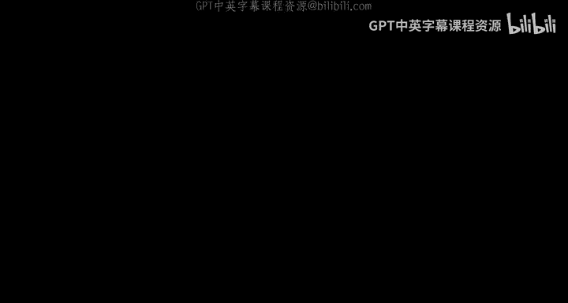
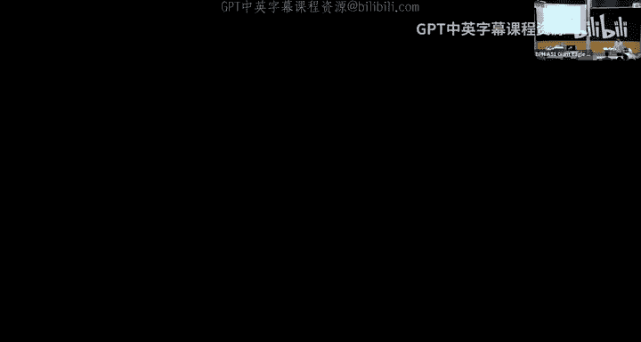
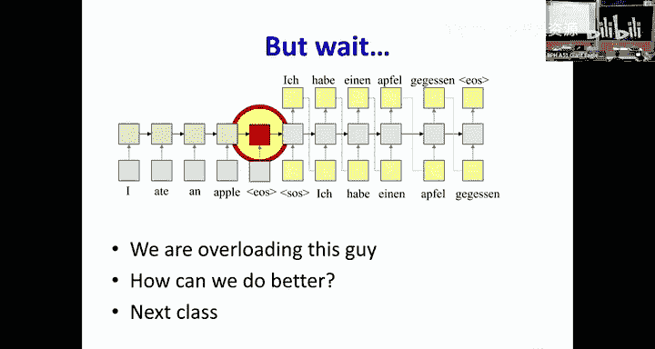

# CMU《深度学习导论｜11-785 Introduction to Deep Learning Spring 2025》中英字幕(deepseek - P18：[18]S2025 Lecture 17  - Recurrent Networks_ Modelling Language Sequence-to-Seque - GPT中英字幕课程资源 - BV1xbZNYrEbs

模力啊。是合回。そるす長。I上挂。か気に。没有。

그他该走。个しす。Yeah。Everything should be working on Zoom there's an issue with the Zoom section。

 but I have somebody like doing it remotely for me。Thank you very much。我觉得。我你食体咯。Good morning。

 everybody。 get your。Attendance poll done。 and pre at your laptops。 There are 4，8。10，12。

14 people in class。That's roughly about less than 5% of the students。

the time number of people in class becomes less than five， I will cancel the class in Britain。

 it's done because there's no point。Yeah。Now， the pulls up。That should be put number 8，80。 Oh。

 why the poor slides are not showing。Blyly3， yeah。Okay， is it up。士比尔。Alright， everybody is。

I don't have sheets today。Do we have。

Alright， let's begin。We're going continue with our series on on record neural networks。

 And this is probably the most。啊。You know， the most contempaneous topic you you'd have seen all semester。

 we are heading down the direction， which eventually takes us to large language models and such like。

 So we've been looking at sequence to sequence models。

Where the problem is that of converting one sequence to another， some sequence goes in。

X 1 through x N had different sequence。 Y 1 through y and y M comes out， right。

And we saw examples like speech recognition， machine translation， dialogue， question answering。

 all of these are problems where a sequence of inputs goes into a sequence of outputs is generated。😊。

And there doesn't have to be any apparent correspondence between the input sequence and the output sequence。

 We looked at one， one variant of this。Where there is an order synchrony between the input and the output。

 speech recognition is an example where the output。

Do not have as many symbols as the number of inputs。

 but if you can always find a correspondence between each section of the input and an output。

The more generic setting is this one where there's no notion of synchrony or correspondence between the input and the output。

For example， if you're performing machine translation， I ate an apples you。

 becomes a ha and an upfill gigs and in， you know， poorly translated German， or if you were。

Doing a dialogue system， the input might be my， my screen is blank。 I'm already talking to a tech。

 an AI tech set of support。And what comes out is scan you。

 Can you check if your computer is plugged in。 There is no correspondence with direct correspondence at the word level between the input and output。

 that correspondence is something that has been learned from experience。

 So this latter problem is what we're going to be dealing with。But to lead up to that first。

 we are going to make a brief detour into the business of modeling language。

So what do I mean by modeling language statistically， statistical modeling of language。

 Does anybody want to guess。What is a statistical model， statistical modeling of language。Yeah。

What embeddings。That's not statistical， is it。Anybody else？If I were to ask if said。

 what would he say？で。Different。First life story。Single letter， whole letter。You're getting closer。

 right， when I'm modeling language， how， you know， what do you recognize。

 How do you interpret the word language。Token is a token language。What words language。

If I just came and said to you a meta。Is that language。Well， I just came and said， Me。

 is that a language。So what is language？Like a five。T。So languageage is basically entire sentences。

 right， That's how you communicate。 So when we speak of languages， we're speaking of this。

Strings of symbols。Words， if you're speaking human language， you know programming symbols。

 if you're programming， which which convey meaning。 And so when Im speaking of modeling language。

 you're really speaking of modeling entire。You know。

 the word sentences and word sequences and such like。But even before that。

Here's a little example that I pulled up from where the Web were a long time ago。

This is a piece of code。Can anybody tell me something interesting about this piece of ch？

It's entirely hallucininated。So just to give you an idea， it looks very authentic。

 Every open parentesis is closed， every open brace is closed。 you have four loops which are proper。

 you know， the correct symbols are being incremented and so on。 It's very consistent。😊。

Or but to give you an idea of where that came from， here's another one， which is some text。

 which looks like a mathematical lemma with complete with figures。 But when you read it。

 it's complete rubbish， right。But it's so convincing。And here is。Something like。That looks like some。

 something that could come of Wikipedia。 It looks very convincing。 And all of these， if remember。

 we are talking about recurrent neural networks。😊，These are all very convincing examples of language of different kinds。

 and these convincing examples of language were generated by very simple recurrent neural networks。😊。

So even your the trivial models that you have learned about so far。

 it turns out they' are really good at capturing something essential about language。And， of course。

 these days， we get chat GP， which can do much， much better。 But we。

 But what we are talking about are recurren neural network networks。

 because language comprises sequences of words。 And that's what we are trying to model and recurrent networks Marori。

😊，Sequences， right， so going back to the problem of modeling language， what exactly is language。

 If I speak of the English language， what do you think of when you think of the English language。

 You're thinking of sentences in the English language。 You're thinking of word sequences， right。

 And so then again， what do I mean by statistically modeling language。

 English has a large vocabulary。 And so I can generate word save sequences of words。

Let each of these xs represent some kind of a sequence of words。 Good morning。 That's an example。

 right。I had， I had bagels and cream toast for breakfast。 That's， that's another sentence。You know。

 Betty Botter bought some butter， but the butter was bitter。

 so she bought some better butter to make the bitter butter better。 Okay， fine， but that's a。

 that's a sentence， right。And so every single sentence that you can think of is a sample from this language。

 Every single word sequence that you can think of is a sample from this language。

 And so when I speak of modeling language， I am speaking of。Capturing。

The probability distribution over all of these word sequences。What do I mean。

 What is the probability of given word sequence。 That's what you're capturing when you're modeling language。

 Al， youre speaking of and I'm speaking of sampling from a from a generating language and really speaking of generating samples from this distribution。

 So language models model the probability distribution of token sequences， word sequences。

 character sequences， you you choose your basic unit。

And they can be used to compute the probability of a given token sequence。 So you know， I had this。

 and this is， the entire bitty bottle。Sentence， you could read this。

And you could say this is how probable it is that a random sample draw from this language would be this particular sentence。

 On the other hand， you can think of complete gobbled diggu。 And the and， you know。

 this is going to have some reasonably high probability because compared to meaningless gobble digg。

 which is going to be very， very low probability， right？

 So it can be used to compute the probability。 But then equally。

 I can generate samples from this distribution。I can just randomly go in and draw a sentence。

 And so now here's a sentence drawn from the distribution。But there's a problem over here。

When I'm speaking of speaking of probability distributions， the support set here is discrete。

 That's not continuous a set of real numbers in zero word sequences。Now， I can， you know。

 the simplest distributions you can think of flipping a coin。

How many possible outcomes do you have in flip a coin， too， if your roller diece， how many。6。

 you're got to have a distribution of6 outcomes。 So you can draw a sample from this。

 How many pro How large is the support set for language。嗯哼。嗯。Number of words。

 is that a support set for language。Infinite， every possible sentence in the language is is is an instance。

 right， When you draw a sample from the distribution， you're drawing a。Sentence。

And so you have every possible sentence in the language is what you're going to have to compute。

 you know， model the probability distribution of。And that is going to be a。Very going to be very。

 very hard。 if you begin modeling the distribution。

 you're going to have to see pretty much every or at least a very large fraction of all the languages in the and the world and the odds that you will aim sentenced twice。

😊，Are very low。So you're going to have to break this problem down， right？

How do we break this problem down。So here's what we want。

 We want the actual target is to model the probabilities of entire word sequences。

That's the language， right， A sample from a language is a word sequence。 It can be a sentence。

 It can be a paragraph can be an entire book， but it's a sample from the language。

But what we can do is break it down。Andto。A simpler probability。Using Bayes rule。

The probability of a word sequence w1， w 2， w3， w4。

Is the probability of w1 times the probability of aha。I should not forget。Come on， please。

I can shut it up， but it。It has pretty colors。 Okay。

 so there's a probability of W1 times the probability of W2 given W1。W 3， given W1 and W 2， W 4。

 given W1， W 2， W3， and so on。So what Ive done is。Converted the problem of。Predicting the computing。

 the probability of the entire word sequence into a sequence of predictions of。

The probability of the next word。In the sequence， given all the previous words。

 And so now trying to model this probability distribution。Ass hard。 So I'm going in but instead。

 Im Im going to have to tackle this much simpler problem of。😊，Modeelling。

Or computing the probability of the next word。And the sequence given everything so far。

 And are we familiar with any kind of static network models which can compute these。

Have we encountered these。Yes， what does。嗯。can you speak up， please。RNN re neural networks。

 What do re neural networks still。Youre given a sequence of inputs。

And they're going to given the sequence of inputs you we're going to compute the probability of the output。

 right， But then have you seen any other model which does that。Convolutional networks， right。

Given its the difference between RNN and convolution networks is because CNN NNs look at a finite window of the past。

Recorcur networks look at the infinite history。And so this is something we know how to model。

 We have no idea of how to model this thing directly。

But this is something that we can model because we can model it auto regressively。😊。

TheThe next output depends on the past outputs。 And so when you， once you reduce it to that。

The problem reduces of modeling language reduces to this。 the probability of the next symbol。

Predicting the next symbol， given all the symbols so far。 So here， for example。

 if I were force code in seven years， what is the next word。A， right， This is。The Gettysburg address。

 right？Or if I told it， A B，R， H， A M， L， I， and， C， O， L， what is the next character。

And you are so certain of it， right， why。Because that history。Tells you the future。 It's not random。

 And this is something we can model， okay。So this is what we're going to be dealing with。 Of course。

 if I want to do this。Again， the two things you want to remember， what we are really modeling。Yes。

Language， which is to say the probability distribution over entire word sequences。

 We just broke it down to the problem of predicting the next symbol on the sequence。And second。

 we that prediction is going to be done using recurrent or convolutional neural networks。

 But what we are really predicting is not the next symbol。😊，But the probability。Of the next symbol。

 again， these are the two things you really have to keep in mind。 here to everybody。Okay。

And this is what we have。 So， of course， if I'm going to use the accurate neural networks or convolutional networks or any neural network。

😊，AndThe first thing I'm going to have to do is to represent everything in a manner that's。

That can be digested by the model。These are mathematical models， which means my language。

 the words in my language are going have to be converted。Do。Something pneumaticic。

And the standard way to do it is。The well known one heart representation。Where， you know。

 you can have assign a canonical order to all the words in the language。

And then the Ih word in the language is represented as a vector with a one in the Ih position and 0 elsewhere。

Now that we can work for this representation。And now， if I want to model language。

 let's look at a very simple model。 Initially， let's look at the look at the。A finite history model。

 So here， for example。If I have something like。听脑。This long sentence。And so on。 if this goes on。

 I can see that instead of。If I want to model language。

 I want to model the predicted the probability of butter given Betty butter bo up。

But then I can say that the probability of butter depends only on。The previous four words over here。

1，2，3， or previous three words， right。And that's simplifying the problem。

If I make this s simplifying assumption， then。The problem of modeling language becomes the this one。

 the probability of。Or predicting the n word。The n plus one word， given the previous n words。Right。

 and so the W N now。Is going to be a function of W 0 through W n -1。

If I were to write write it in the standard network of function format。

 W 0 through w n minus-1 go into the function it predicts W N。

 everything is represented as one hot vector because these are mathematical objects。But then。

There's a problem here。We are representing these guys as one hot reacts。

If I represent them as one hot vectors。These one hot sweat， as I increase the vocabulary。

The size of the one hot vector keeps increasing。This dimensionality keeps increasing， right？

This is very wasteful。Now， why do I use one heart vectors in the first place。Anyone。对呀，one。

It's simple。 Is there a be， But why couldn't have I have I have chosen other bit patterns。

 If I have a vocabulary of n words， I really need only log in bits。Why my N using N。Binary symbols。

 You don't want to assume that there's a connection if there were 1 to8。

 there will be some kind of order。But you want to be。So。

You want to make no assumptions about the words。Right。If I had different word。

 different vectors for different words， each vector is going to be a different length。

Having different lengths for different words means you're implicitly giving more more different weightage to different words。

 Number one， Number two， what is the relationship between words。

 Do you want to make an assumption about that。And how is the relationship encoded the distance between vectors。

 What is the distance between2 any two1 hot vectors， non identical，1 hot vectors。square root of 2。

 it's， you know。It's one， one of them is length1 along one axis。

 The others length1 along the other axis。 The distance is always。Ro of two。

 And so if I had a vocabulary of three words。Then these are the only three points that are valid vocabulary1 heart vectors。

 and the distance between any two of them is square root of2。

 which means youre not really making any assumption about the relationships between words or the relative importance of birds。

 So this is why we want to。Make use the one heart representation。 You do not want to impose。 I mean。

 in English or in or French or whatever， if you know the language。

 maybe you can think of somehow imposing what you know。 But if you went to a generic thing。

 you have no way of knowing how things are related。

 You don't want to be imposing relationships that that are made up。 And so you make no assumptions。

But then this comes at a very high cost。If the edge of the tube were some。啊。Lent， you know， X。

Then every time I add a new word， the volume of the cube is multiplied by x。

 So the density of points per unit volume is very， very， very， very sparse。 Moreover。

 think about this。😊，You add an entire dimension just to want add one symbol。

That's a phenomenally wasteful use of space。You really want to make much things much more compact。

 So the actual volume of the space， each point just takes0 volume， right。

 The actual volume of the space is 0。 The density is very low， and moreover。😊，0，0，1 is a word。

 If I wiggle it and make it 0，0，1 plus epsilon， does that represent anything。No， we are not。

 We absolutely have no。Meaning for those things。 And so as a representation。

 one heart representations are terrible。Conceptually， they are great。

 They make no assumption about their relationships。😊。

But as a basic fundamental representation itself， they're very wasteful and so what we would like to do is to zap them down from some whatever high dimensional space that they live in to a lower dimensional space and this doesn't really solve all of our problems。

 but at least it solves one of the problems that is the wasteful use of space you can increase increase the density of points per unit volume。

😊，So it's about use of the space。 And second。啊。The if。

We can find the appropriate claim on which to project all of the points。 And if we learn it properly。

Then it turns out that the relative distances between the projected projections of these one hot vectors on the plane。

Can actually carry meaning。So how would we go about learning a projection of this kind？

Where such that we project all of these wasteful one heart representations onto this lower dimensional plane。

Where the projection or the positions of the points on the plane make sense。Well。

 what does a projection look like， A projection is just a linear transform。 It's a matrix。

 So I can go back to my model。 And I just take this P against every input。 It's the same projection。

 All words are projected the same way。 same way now in a neural。😊，What is a projection。Anyone。

It's just a linear layer。 It's a matrix， right， So that's just a linear layer。

And so this is what the model becomes。This is a。Simple linear layer width。啊 which is。

And the same linear layer is used against every input。

So this becomes a network with shared parameters。 Now， you can trick model。

 And the way you can train this model is。If I had three inputs or if I were making the network depend on the predictions of any prediction of any word depend on the past three inputs。

 this one sentence。Is going to become a bunch of training instances。 Its going to be the input as。

Betty。Borer。Bt。And the output over here should be some。Right， so these would be the input。

And you want to predict this guy。 Then I can get another trip。

 The next training instance that I would get from here is water。But some。

And the next prediction I want to make is part， right。

 And so I've just got a regular sentence out of the language。

 It became a whole bunch of training instances。I can use these training instances， too。

With back propagation to train my network。 And when I train my network in the process。

 I'm also training。This linear layer， which is my projection from this n dimensional one hot vector space to the lower dimension lower m dimensional space。

And that model is actually just your。啊啊。TD and N， right， as you go through the sentence。

 each word is being predicted based on the past and words。 So here， for example。

 if you had a fifth order， fourth order model。After reading W1 through W4 is going to try to predict w5。

Then after predict， then you have W 4 through W 5，2 through W 5。 is's going to predict。

 try to predict W 6 and so on。You can train the model， and。Here you would have this projection layer。

Through which every single one hot react is feded before it's passed to the network。Now。😔。

There were other models proposed for the same thing。 If you think of learning this projection P。

As your primary task， then there were other models that were predicted proposed in the literature。

Where you say， okay， I'm going to try to predict a word based on words on either side。I'm trying to。

 I'm going to try to predict the words based on all the context words without considering their order。

 or maybe I'm going to use a word to predict all the words on either side。

 All of these were different variants of the same basic theme。

Of trying to learn this projection matrix， such that you can best predict unknown words in the language。

 And it turns out that if you do this。The projections of the one hot vectors down to a lower dimension of space。

 These are what we call our embeddings。 or word embeddings or symbol embeddings can actually carry a lot of meaning。

 And so here was this famous paper by Michelloetol in 2013， where showed that。😊。

The once you project things down。The the positioning of these projected vectors seems to carry meanings。

 So， for example， here， here are some examples for。The projections of the names of countries。

 and their。Cs。And if you see the vector that connects Portugal to Lisbon。

Is essentially the same as the vector that connects pain to Madrid。Greece to Athens， Italy。

 to Rome and so on。 So country minus capital seemed to be a constant factor。

 which means it's learned this relationship of countries to capitalists。

 They had this famous quote about how king minus queen was the same as man， minus woman。

Because it learns the gender relationship， and so on。So so far second， right， Here's a first book。

I must change the color。No。嗯。O。怎么 on z。Is that first statement true， Zoom。

Is there anybody on Zoom the statement is true。What about the second one。这房子。Card。Sure。😔，Fort。哦。So。

 here's the thing。We might have gone down to lower dimensional space。

 There's a fundamental problem with one hot embeddings。 What is that。I have to pre。

 determine my vocabulary。If I want to add a new vocabulary to the language。

 there's no way I can do it because it's now I must add an entire new dimension that I know nothing about。

So啊。The inflexibility of onehar representations is is is is a significant problem here。

 And the projections， the the approach of projections doesn't really solve it。So going back， now。

 time delay neural neural networks are all very fine。

But then we know if you want to consider the infinite past。

 which is what we wanted to do when we want to model language。Recurrence is the way to go。

 And so the more appropriate thing is to have a recurrent neural network where at each time the next word is predicted based on all the words that have occurred so far。

And once again， look over here， if I just gave you a sentence of this kind at each time。

 the word that is being predicted as the next word。

 so your training and test data are the same exhibited stepping through it one step at one word at a time。

And your target at each time is the next word。 So at time W， at time 2， the target word is W 3。

 at time 3， the target word is W 4 and so on。Once you have set this up。

 we can just train this network using back propagation through time from a lot of text。

Its making sense to everybody。Okay。And， of course， once I've learned this model。

 I can use it to generate new text。 Now， here's the crazy thing。

 The two problems that we said we wanted。😊，2。Address in modeling language are one。

 given a word sequence， how do I compute its probability。2， how do I sample from this distribution。

Now， if I have the recurrent network， how do I solve the first problem。Given a words。

 given this word sequence。Berry butter， right？How do I compute its probability， anybody。

How would I do this？但是。PaPaswalk through the network。The10 photo。Yeah。

 but how do I compute the probability from it。How do I compute the probability from it？Come on， guys。

 We've been talking about record neural networks for a while。三环。5 seconds， Okay。

 if I answer anybody on Zoom， do you want to volunteer。All right。This is a challenge。

 I'm giving you 10 seconds。If at the the end of 10 seconds， you don't answer I will。

 And you lost the challenge。We lost the challenge。 Okay。

 so what does the network actually do at any time。If I fail at this point， what is it。

 What is it computing at each time。嗯哼。It's going to compute a probability distribution at each time。

 right， And what is it computing the probability distribution of。不是。

It is going to be computing the probability of what word can follow Betty correct and so at this point it is going to be computing probability of word2 given betting。

And so， I can read out。The probability assigned to butter from this。

To get the probability of butter given Bety， right， then at this time。

What is it going to be computing？嗯哼。😊，At the next time， what would it be computing。都没有。

It's going to be computing the probability of。Wd 3。Given。Betty Bo， right。

 is going to be computing an entire probability distribution。And from this， I can compute。

 I can read out。The probability of bot。Makes sense to all of you。

 And so at each time it's actually computing the probability distribution for the next word。😊。

Given everything that has been。Yeah that has occurred in the sentence so far。

 And you can just read out the probability of the target target word from it。And so now， if I want。

 this is making sense to you guys。Right， and so if I want to compute the probability distribution of the entire word sequence。

 I just run the word sequence through the network。And at each time。

 I just read out the probability of the next word in the sequence。 I multiply the lot。

And I'm going to get the probability of the entire word sequence。😊，Makes sense so。This。

 I have solved。I know how to compute the probability of a word sequence。Magically。

 all I did was next word prediction。But this has enabled me to compute the probability of any any given word sequence in the language。

 Second， how do I generate word sequences from this。😊，Anyone。可嘢。The sampling。

 It doesn't have to be the word with the highest probability， right， So I can just give you。

For example， I could have just given you the I I can condition。 I can fix the first three words。

 I give you W1， W2 W3， right， Then it's going to compute the probability distribution for W 4。

I can just sample， I can draw from this。And that's going to give me W 4， which I can feed back in。

Now it's going to give me a probability distribution for W 5。

 which I can sample to give me W 5 you know， W 5 and so on。 And sovoila。

 I actually have a mechanism for drawing samples from this extremely complicated distribution。😊。

By just drawing the next word at a time by using this record network。So I've solved both problems。

Make sense to everybody。And so the two problems we wanted to address how to compute the probability of a word sequence and how to draw a sample from in both a solve。

And so this example that I showed you in the first some slides ago。

 this was a record neural network like a three layer LST or something trained on all the source code of Linuxs。

 and they just sampled from it。😊，Beautiful， right， And here's an example。

 I don't think this audio will play。 This guy just trained a a neural network on a bunch of Mii。😊，🎼。

🎼い？And at the end， it's very plausible。🎼He of air music， right。And so on。 And so。

Sampling the distribution is basically the task of always drawing samples from the next。From the。

 from the latest probability distribution， right。But in all of this， where did Betty come from。

 I told you how to compute the probability of water， right。

I didn't tell you how to compute the probability of Be。Where did Bety come from， right？

I keep drawing samples。How do I know that when I get the final but， the word sentences ended？

These are two problems we need to address。 I sort of hit this up and hit this。

 I just sort of hand waving， but you don't need to hand wave。

A sequence of words by itself does not indicate if it's a complete sentence or not4 score and 8。

 Can you tell me this is a complete sentence。Just by looking at it， you cannot。 You have to tag it。

 right。So to make it explicit， I'm going to add to additional symbols。A start of sequence。

 a start a start of sentence marker and an end of sequence or an end of sentence marker。And now。

Here's this。 Four code and 8。 There and no tags on either side。

 So it means that this is neither the start of a sentence nor the end of a sentence that somewhere in the middle。

But then if I say S， O S force scored and 8。There's a start of symbol sentence marker。

 And then so the first word must be for this is the beginning of the sentence。

4ourth score and 8 the US， which means after 8， the sentence has ended。 So this is this is the final。

Section of the sentence。 and then S， O， S4 score and 8 E， that's a complete sentence。

 It's begun an end。 And so out here， when I wanted to generate Betty。

There's something that you're always going to consider that a sentence will always begin with a start of sentence marker。

 This is a given。 You don't need to compute a probability for it。

 A sentence always starts with a start of sentence marker with probability 1， right。

 And so then here is where。This probability distribution is where you come get the probability of Betty off。

Right， and then when youve， you've gotten all the way to the end。If you want an E O S。

 which is how it ends， then for the last sentence in the。Sequence。You would。

You will be computing the probability of the end of sentence marker from the probability distribution computed for the last sentence in the sequence。

This makes sense to everybody， okay。And so you keep feeding the drawn word as the next word in the series and continue the process until you draw the end of sequence mark。

😊，So the study so far， language models model the probability of a word a word or symbol sequences in the language。

 This is typically performed in the form of next symbol prediction， given a symbol sequence。

 it always computes the probability of the next symbol。Given everything in the past。

 and this can be used to both compute the probability of a symbol sequence and generate draw symbol sequences from the probability distribution of the language。

 okay。好。Okay， anybody wantan to tell me the answer to this one。

The first one is only complete sentence， right， so right。Anyway， let's get back to our problem。

 We started off with send sequence to sequence mode， right。

And we saw that there are a couple of different ways of transforming one sequence to the other problems where you have order correspondence。

 This has been taken care of。 The one we are want to address is the more generic problem where there's no。

Correspondence， obvious correspondence between the input and the output。

How would we solve this problem， It turns out that for this， we need this model here。

 where the entire input has processed and then the entire output is generated。

 So this is the what I call the delayed sequence to sequence conversionive model where the input sequence is red and then the output is generated。

So。This will first process the input using the initial portion of the network。

And the initial portion of the network， once it's regularlyly processed， the entire input。

 is going to give you a。Hidden representation。For the input。And then subsequently， the。

 So here is the pseudo code for what it would look like。 You're processing the input。

One step at a time。 and each time the recurrent network reads the latest input and the previous hidden state to compute the next hidden state。

 and then when you finally get to the end of say second sentence marker。😊。

You're going to have a hidden representation， which represents the entire input。And now。

You have the second portion of the network， which is going to use that hidden representation to generate the output。

And。That， again， is just a record network where the hidden state keeps getting getting passed through and you keep drawing at each time。

You compute a probability distribution for the next word in the sequence and you draw a sample from it。

But then if I did something so naive。The iron run into an issue。 And the issue is this。 So here。

 So here's what it would look like。 The generation at each time here given the initial hidden state。

You regularlycurtly keep passing it forward。And at each time。

 it outputs a probability distribution from which youd draw the next word。

Until you draw an end of sequence marker。But then you， you run into a problem。

 And the problem is this。That。啊啊。You know。Let's say I'm generating a word sequence。Now。

 in the first time。I drew the word。A from the distribution。

Can the next word be apple if the first word is a。No， right。

 because the word a must be followed by something that that begins with a wl。

 So it cannot be an apple。Now。Does the fact that we the process of sampling through the word A change this hidden representation in any manner。

Does it。Yes or no。Doesnt， you guys。Can everybody say no。Okay。Why， why no。Why。There's no this。

The a doesn't go go back into the network， right？ There's no way for the model to know that the word that is sample was。

A。How would you fix it？You can feed the E back， right， so。Changing this output doesn't affect the。

 you know。Drawing a different word here doesn't change the hidden Sta。

 So we want to feed whatever was sampled back into the network。

 And so here's how the entire model works。 The input sequence is going to feed into a recurrent network。

And the input sequence will be terminated by an explicit end of sequence marker。

Then you get a hidden representation。This hidden activation at the end of sentence marker stores all the information about the input。

Subsequently， you have a second record network which starts from this hidden representation generated from the input and proceeds to generate outputs and the way it does it。

 you know。😊，The generation always begins， as we said， with a start of sequence marker。

 and sentence begins as start of sequence start of sequence marker。

 So that goes in along with the hidden state drawn from the encoder and then to generate the next start。

 right。And then that output。 So how do you generate this output now。

You're actually getting a probability distribution。

 You're sampling from that probability distribution。 and that's going to be fed back in。

 And then you get the next hidden state。 You get another sample probability distribution from which you sample a word and keep doing this。

Tillude eventually generate an end of sequence mark。Right。So。

Observe that because I'm feeding what was sampled back in。Drawing a different word。At time。

 iss going to change what the network sees subsequently。 and it's going to change the。

Complete output secrets。So this is the very simple model that were going use。 now， yeah。O。

So I'll get to that right， by the way。And the pictures haveve just shown a single hidden state。

 but the recurren state， as we know， can be abitly complex。

 It some cell I'm just gonna be using a record state。 a simple。

 Everything is hidden in this one line。 I'm not making any assumptions about the complexity of the hidden state itself。

 It could be a just or simple LTM。 It could be something more complex。 It could be a recurren cell。

It all comes within， it's all hidden here。 So that those are design choices。

 as well as the marvelous concept。And again。how the code changed was that。

Unlike the usual records that I first showed at each time。

You're going to start off with the zeroth output as a startup sequence marker。At each time。

 the recurrent network uses the previous hidden state and the latest output。

 which was initially the start of sequence marker to generate the new hidden state and a probability distribution。

And then you draw the next word from this probability distribution。

And this next word goes back in at the next time。 So obviously。

 if you draw a different word over here， the word that's generated the next time is also going to change。

 okay。And。啊 so。We have。 This is what I'm calling the simple translation model。

 Things will get more complex。 So the portion that generates that derives the hidden representation from the input。

 it's going to be called the encoder。And the problem， the portion that。

Gens the new output is going to be called the decoder。

 So the encoder effectively encodes the input into this hidden representation at the red box。

The decoder decodes it unravels what was in the hidden representation in the new language。

 in the new， right。And， of course。I I'm just drawing simple pictures， but then。

Words are represented as one hot representations。 They must be converted to embeddings。

If you continue staying in the same language in some tasks， for example。

 if this is a dialogue system。Then you're using words in English。

 So that projection the the projection down to embeddings is going to be the same on the encoder and decota side。

 whereas if I'm translating English to German。Then。

Maybe the embeddings for English are very different from the embeddings for German。

 because the encoder and decoder can live in two entirely different worlds。

And the whole thing still works， right。And okay， so what does the network actually produce。

At each time。The network。Actually， produces a probability distribution over words。

Meaning it has processed， say it has processed the input。

And so it's generated this hidden representation when it saw the end of sequence marker。

Now it has begun to decode so this hidden representation is gone in and you know that on the decoder side。

 you had to start a new sentence so you gone in with a starter sequence mark。

It generates a probability distribution。From this probability distribution。

 So what is this probability distribution。This is the probability distribution over the first word。

In the output sentence。Given。A， that it's the first word because the startup sequence marker has been fed in and the entire input。

This making sense， right？ And so when I draw a word from this distribution。

 I'm sampling a word from the probability distribution computed for the first word and the output。

And that now。And there so at each time a word is drawn from the output distribution。

 and then I feed that back in。😊，And so now when I feed it back in。 So what have we got here。

This is kind of。So。I've called this W1， right。Given the input。And the startup sequence marker。

So this is what you compute at the very first time， right， And from this。you sample W1。

Then at the next time， you are computing。Be off。W 2。Given I。And then， start sequence marker and。W1。

Because。As you can see， both of these have been input， right？And from this。

 you're going to be sampling W2。And now that goes in。

And then you get the probability distribution for the third word in the sequence。

 given the first two。 And from that， you。Sample the next word and feed that back in and so on。

 And this goes on till you get the get all the way to the end of the sentence。 Eventually。

 at some point， you're going to be sampling an end of sequence marker。

 When you draw an end of sequence marker， you know that you're done because the sentence is ended。

 right。那手。I have now， an output word sequence。What was the probability probability of the word sequence that I generated。

What was it。You guys know the answer。 Everybody's very quiet。 So somebody tell me。How many苹果咯。

Adon me。嗯，跟你啲 important。And called， what is the probability。What do you mean Vancouvercoda。Of the。

 of this word sequence， Anyone， yeah。ぱい。嗯。されてる。Basically the same mechanism as the same thing， right。

 that we would wed computed the same way that you compute the probability of a word sequence with the R andN。

 with the language model。Namely。That。Yeah， forget it。Each at each time。

 what you're really computing is the probability of the next word。

 given the input and all the previous words。From that， I have， I have drawn a sample， so。

At this time。What the what I can do is just read the probability of whatever was drawn from this distribution for the first word。

 Similarlyly， read the probability of the next word that have drawn from this distribution。And so。

 the probability of the。Need something nice and bright。 Okay， yes。

The probability of the output sequence is simply the product。

Of the probabilities assigned to each word。In the sequence at that time， by the network。

That's making sense。 So this is， again， being computed in exactly the same manner as。

We did in the language model。 So what is the difference between this translation model and the and the the simple language model。

 anyone。Parddon me， output the output sequence can be def no， but conceptually， they are exact。

 It is just a language model。 Is it not。 What was the difference。

 There was one difference between the j， just the simple baseia。Tslation model。

The translation model has encode codeta decoder and what is the n quota gap？What is the process。

The inputs。 So when you are looking at a regular language model， is there an input。

If I'm sampling a language produce a word sequence， is there an input。 No， here there is an input。

 right， So what is the difference between the two， your L M。AM。It computes。The probability。

Of word sequences。So it's a the L M is is a model to compute it's just a simple model to compute the probability of word sequences。

The sequence to sequence model。Is computing the。Probability of word sequences given。The input。

That's what it's doing。Right， and so the sequence to sequence model is a。Conditional。没了。

It is also a language model。 It's a conditional language model。 And what's it conditioned on。

The input， right， given this input， what is the probability distribution of all words word sequences in the language。

That's what it's computing。And given any specific word sequence。

 the way you would compute the probability conditional probability of that word sequence is to simply multiply their probabilities。

😊，Does making sense。Okay。So given so， now， let's say I'm performing a machine translation task。

The input was this English word sequence。 I ate an apple。What is the L M computing。

What is the translation model computing？Probably you give this your patience。

The probability for every given German sentence in the universe， given this input。

Its condition computing the conditional probability of every given German sentence， given the input。

 Iate an apple， right， If you want to pick a specific sentence from this distribution。

 which sentence would you pick。Can you speak up， please the highest probability you want to pick。So。

 you know， our。I can pick any random sentence you know， instead of is has on an uphell。

 I can pick a sentence H wisea says， you know， no relationship to the input。

 but I can compute a probability distribute probability for this word sequence given the input because this is just a conditional language model。

 right and all that is that is， is that I'm going to be feeding N H wise blah， blah at the input。

 And I'll be reading the corresponding。😊，Probabilities outright。And so。

The objective of drawing now is to produce the most likely output， given the input。

 The input is I ate an apple， which is the most likely German sentence that represents the sky。

So would random sampling right it？So how would we have how would we do it。就 been to。

Could do beam search， right， One simple thing is。You can do the greedy thing。

 You can draw select the most probable word at each time。 So here。It so just。

Draw from this distribution。 I can just pick the art max， right。

 The problem with art max is picking the most likely symbol at each time is。

Subopimum for a very simple reason。 So it may cause the distribution to be more confused in the future。

 So although it's locally more probable when you look at the future。

 when you consider the entire sequence， things may get to be really， really bad。

 So here's a nice little example。 So， you know， sequence to sequence conversion， maybe say。

 say I'm doing speech recognition。 And for the very first word。😊，You had a bunch of words。

 and you chose he， right。And then for the next word， you found maybe the word knows。

Which is this object on your face， and close。Which is， which is pronounced much the same way， right。

 have very similar probabilities。But but then the word knows。

 this thing has a slightly marginally higher probability。 So if you did something greedy。

 you're gonna pick no。But then he knows is not a regular sentence。 What can follow He knows。Nothing。

 nothing it'， it'， it's unclear。 So when the model goes。

 it computes the probability distribution for the next word in the sequence。

 It's going to be very confused。 And so it's going to compute some low probabilities for everything。

So when you take the comp， we call the cumulative probability of the first three words in the sentence。

It's going to be low。Whereas， if you had chosen。The clothes。At the second time。

 although it was the lower probability word。He knows that is is is a well structured sentence。

 There are going to be some words and more probable than than others for the third position。

 And so here now， maybe W2 has a probability that just stands out。 If you chose it。

 he knows W2 in the second case， the the sequence of third words has an overall higher probability than the sequence of three words in the first case。

 So what this means is that。😊，Although we are choosing a lower probability word。At the first time。

 once you begin extending it， the overall probability can be much higher。The challenge。

When I'm drawing that second word， I have no idea which one has the more。Promising future， right？

 I mean， I can go all the way back。 Maybe the conclusion here was not in the second word。

 So maybe at the very first word over here， this could have been。You know， rather than he。

 I had a choice of he and the the， and I chose he because it was higher probability。

But if I chose the， then， you know， the nose is a pretty good choice， right？

So making a different choice over here could have could have LED to an even better overall future。

 So we have this situation where。😊，Peaking the most probable word at any time is not the most reasonable thing to。

What we really want to do is to look at the entire word sequence。

To decide which word sequence has the highest probability。

You can't just do this in a simple way because when I have a word sequence。

Each word in the sequence is fed back to the network。

Which means the entire network must be recomputed for every possible word sequence。

And that's not going to be feasible。 right， you have infinite word sequences。

 So we've got to do something more efficient。A beam search， right， Now there's something else。

 You can just， there's an alternate option。 It turns out that instead sort of picking the most likely word。

 you can just pick a random word from the distribution， sampleple it。

 It turns out even this can often give you a better result and， in fact。

 frequently does give you a better result than being greedy。😊，Things that look more structured。

 They may have a slightly lower probability。 whether you look at the sentence。

 it just looks more meaningful and more structured。 So we often do this。And so when you sample。

 this is a random sample。 when you use L L Ms， very often。

 what they are actually doing is sampling randomly。 They are not picking the most。But then。

Random sampling is not guaranteed to give you the most likely output。

 although it may give you more likely or even more meaningful output than than the greedy search。

But we want to do something somewhat smarter。 And for that， plus， we have the third book。

you don want the。给录。不知道嗯。好像不对。Okay。Al right， guys， someone on Zoom。

Is that first question true or false？First statement， Zoom 2。What about the second one。出e。😔。

Someone in this class， what about the third statement reforms。Whats that true。不是。Obviously。

 not right。 It's false。 So for greedy decoding， you can choose the word that has been assigned the highest probability each time。

😊，In decoding through random sampling， we randomly choose the next word。

 according to the probability assigned by the decoder。And the procedures for random sampling is。

Not being presented。 I didn't tell you about random， how random sampling is actually done。

 But how many of you know how to sample from a category distribution。

What is can you write code for it。Come on， guys。grads， you you've done this。Everybody has done this。

No， course you got。Oh my good god。Well， let's know it's a topic for another day， but you know。

 it's easy。And so。Here's the standard process。 You really have a probability distribution。Re is。

You have。Please don't go back， okay。P1 through P， N， where summation I。BI is one。So。

You can create this array， which this is P1。 This is P1 plus P2。This is P1， so this。SP one。

P1 plus P2。 So this length is P2， This is P3。31 plus。P2 plus P3。And so on。So。

Once you create this array， each segment。Represents a section of a specific probability。Then。

 you can。Draw you there is there are there there are standard functions to draw a sample from a uniform probability distribution。

You find out which salad fell in。And that's going to be the drug。

Rememberber how many of you remember that， Come on。 You guys did this， right。You did no。

I can do a trivial。 honeys。 That's besides the point。 Okay。

 so our problem is that making a poor choice at any time commits us to a poor future。

But we cannot know at that time that the choice was poor。 So our solution， we don't choose。

What we do is we retain all choices。So， we're going to for car。Network。

With every possible word as input。So make go to make a copy of the work of the network with the as input。

 another as with V as input， another with the as input and so on。And then。

I get a probability distribution。 And then I'm going to get。

For the network with every possible word is input again。 and I can keep doing this， right？

What's the problem with this？It's gonna blow up， right。

 after getting time steps for a no vocabulary of size V。 I'm going have V raised to T branches。

Does't make a lot of sense。 So what would the solution be。Beam search， right？

 How would you perform the beam search。对啊。How do you choose the top。They doesn to know how you think。

So here's what we would do。 That's right。I。Prune， so the very first time I get a probability distribution right here。

 Maybe I just pick。Just the top K。So I only use those top k to extend the network， right？

Here I've chosen two。And then。At each of those， I'm going to get a probability distribution。

But then I now I have two K words， right，2 K outputs came from the first branch and K from the second branch。

But I'm going to use retail only two out of the 2K。How do I do this。

I have to pick the two most likely， across all2 K choices。So how do I pick the two most likely。

 I'm really not the pruning is based on the joint probability of O1 and02。

 which means that I'm going to be over here when I want to compute whether this is good or not。😊。

I'm going to be multiplying the probability of the as computed here and the probability of noses as computed here。

😊，For this guy， I'm going to be multiplying the probability of he as computed here and cans as computed there。

😊，So you are using the the total probability over the entire path。

To compute the probability of each output hand in your pay retaining the top K。And so then those can。

 again。So， note that。This is based on the product now， right， And now those two go in again。

 you're going to have two K choices。But then each of those2 k choices has a probability。

 which is the product of all the probabilities along the path。Till that word。

 And then you're going to pick the top two from it。And keep doing that， right， And eventually。

You know， you keep doing this。 And so at each point， you're always picking the top key。

Based on the product of the probabilities along the entire path to the word。And。

When the current overall most likely path ends in an end of sequence marker。

 that's when you found the most likely sentence。Now， observe that。

You can have something interesting happens， right。As I keep branching。That's my job。

As I keep branching， I'm going to start with a start sentence marker。Then maybe I got an A and an N。

Right。And I got a horse over here， an Apple here。And then。You know， I got a gate over here。

And then end of sentence marker here。Can I continue extending this guy。This is done， right。

 So this has some probability。So， at this point。一。But and goes on the end of sentence marker。

 So at this point， so let's say the joint probability of these two paths。

Actually becomes lower than the probability of this sequence still here。

Is there any chance that they will ever become higher than this one？Why not。Each time you extend it。

 you're multiplying it by a term that's。Less than one， right， So at some point。

 you're going to find that this guy here。Theres the most likely overrun path。

Merely because extending these guys。GoGo to keep lowering their probabilities。

 So this has a natural bias towards shorter sequences。

 These are things that we have we end up dealing with using a whole lot of heuristics to account for this bias towards shorter sentences。

Nevertheless， overall， the entire and the current overall most likely path ends up in an ends in an end of sentence。

 That's unwed。Say， okay， we got an output。 You can also get try to generate the N most likely outputs by continuing to extend things。

And popping out a sentence whenever something is terminated with an end of sequence mark。

And then get the tan most likely。 And then maybe use some additional heuristics to figure out how to deal with it。

 right。So I have some pseudo code for the beam search。 If there are the slides。 Please take a look。

Okay。Their first statement， true or false。Second one。Like his thumbs up and thumbs Okay。

 so the theoretically correct decoding requires you to evaluate the entire representing every possible word sequence。

😊，To select the best one。Bem search is not correct。 It's not。

 It's what is called an inadmissible heuristic。Because it's not guaranteed to give you the correct output。

So now how do you train this network， you must learn to make the the predictions appropriately。

 given Ie an apple， it must produce a shaba in upfill Geson。😊。

And now you get a little bit of a or thing， right， So the way you would do it。

 I can train this as we did when we trained a language model。 When I trained a language model。

 how did I do it。I gave it the sequence of n you know。

 words W 0 through W n and then predicted WM W n plus 1。

 Then I gave you gave it W 0 through W n plus 1 predicted W n plus 2。

 I kept giving it all the words to the current word and kept predicting my next word so I can use the same approach over here。

I can have a forward pass where I first generated a hidden state。

And then I can continue to I can train the rest of the network。Exactly as I trained a language model。

With the only additional difference being the conditioning on the red box。Does make sense？

This is fundamentally different from how you train。Standard neural networks。 How is that。

How is this different from how you train standard neural networks。哪你玩。Here呀。

Were computing the divergence exactly as you would for an L M。 So here's what happens。

I have the input。And I have the output in your standard neural network。

What goes in and what comes out。You get the input here。You get the output here。

 you compare the output to your target output， right。What's going in here。嗯哼。😊。

So in your standard neural network training。The forward pass is， is inference， regular inference。

Right， over here。We are passing the input。We are also passing the output。

So the forward pass during training is different from the forward pass and inference。

If you were to do this as you would train a regular neural network。

 then what you would actually do is to sample from these output distributions till you generated the entire sequence。

 then you would compare the entire output sequence your target output sequence and your computer dives that won't work because there's no guarantee that there's going to be any kind of correspondence between what you draw from this from the network and the target。

 at least in the initial portions of the training when it's random。So maybe， you know。

 the output is aha and enough for gigson， and it is produced dust， da， da for a million words。

 How are you going to compare these， How do you know what is wrong， right？

 cannot train these networks in in the naive manner in which you can compute divergences for standard training。

 So this。If I look at it from the perspective of standard training。

 this is a bit of a cheat in that the output be output is being fed along with the。Andput。

And and the inference that we， the forward pass is different from inference。

Whereas for standard networks， they are the same。 Okay， and then， of course。

 I can just compute my divergences between the output distribution and the target word。

Pass the diveerence back and learn my network， okay。So。In practice。

Could they train the network if you were to use SD。

 You wouldn't be computing drive agencies with the entire input， It'd be picking。

You' be choosing random words on the output。And just be passing the divergence from that。

 This has been found to be most effective， okay。So the overall training。

 given several training instances。Forward pass， you compute the output of the network for the。

Both X and D are past it。Because as I said， what the input and the output are passed in。And then。

 compute the divergence。Between the output probability distribution and the target output and and propagate update parameters。

So this kind of works very nicely。 You can use this for machine translation。

 automatic speech recognition， dialogue and so on。 even for image to text。

 because it doesn't matter what the encoder is。 the encoder could be a CNN， and could be processing。

😊，Text。images。And it turns out that it does a very nice job。 Now。

 the key thing is the representation that you derive at the end of the encoding in that little red box。

 And so in the original paper， theyve had this little example where they projected that representation down to two dimensions。

😊，And showed examples for different sentences。 Now。

 that red box is capturing the essence of the entire input sentence， right？

 And so if you look at the representations learn for different sentences here， John admiremis Mary。

 John is in love with Mary。John respects Mary， right。This is Mary admires John。

 Mary's in love with John。Very respect John。 You look at the arrangement of the two。

The arrangement is the same， right， And moreover， if you look at the this vector。

 John admires Mary versus Mary admires John John is in love with Mary versus Mary's is in love with John。

 where you just flip this subject and object。😊，That vectors。

The same across all the three different examples。 So clearly， it's capturing some semantic structure。

Or here I was given a card by her in the garden in the garden， she gave me a card。

 she gave me a card in the garden。She was， this is in a tense。 They change the tent。

She was given a card by me in the garden， in the garden， I gave it a card。

I gave it a card and they got it， right， So one is active that passive。But again。

 you see the structure is maintained， the translations are maintained。

That encoder is actually learning something about the meaning of the entire sentence。And。

They have some examples for machine translation。This is supposed to be translation from English to French。

I'm not going to read it out because I don't know French。 I can't even read it。

 So I can't tell you if this is true or not。 but here's an example from human machine conversation。

What is the machine， What is the error that you're on increase， I'm seeing an error related to VPM。

What is the error message that you're getting when connected to connecting to VPN。

Connection to or something like that。 You can see that this is a very plausible。You know。

 conversation。 And this has been achieved using a very simple。

Recurrent neural network based translation， the simple model that we just saw。

 So even this very simple model。Which is fairly easy to train。

 can do a very nice job of modeling both language and conditional response。ok。

And if you wanted to image captioning。The encode is going to be an image。

And the decoder is going to be generating sentences， right。You can do the same thing。

 So given an image， process it with a CNN to get an output for the。Classification layer。

And feed that into the decoder。To gender deco captions。 So， in fact， this original。

 the very first paper on image captioning。Which， which I showed at the beginning of this。

Of courseourse， in fact， this thing in 2016 was produced using this very simple model that we just saw。

It's very nice， right。Now， what is the problem with this？

 And they have variance to caption video and a whole lot of other things。So。The story so far。

 language models model the probability of word or symbol sequences。

 typically through next symbol prediction， the simple I'm calling this the simple model sequence to sequence model for tasks such as machine translation are performed using an encoder decoder。

 the encoder extracts a feature representation for the input sequence。

The decoder is a conditional language model that uses this representation conditional to conditionally generate the output sequence。

 Ins performed by finding the most probable output sequence。

The same mechanism can be used for other conditional generations， such as passages， image captioning。

 video captioning， etc。Now， there's one。Very big problem with this guy。With this very simple model。

 And the problem here is that the entire input is being represented by this one little1 this one little vector in the highlighted red box。

 It doesn't depend matter whether the input was four words long or 4000 words long。

 You're trying to compress the entire thing into this one vector。

 which is then being unwound by the decoder。And。That's a bit too much。And we find that this actually。

 after a certain given length， that begins begins to get really ineffective。

So how do we deal with that？That's what。They're going to do in the next class。哎。

うふふうん。😊。