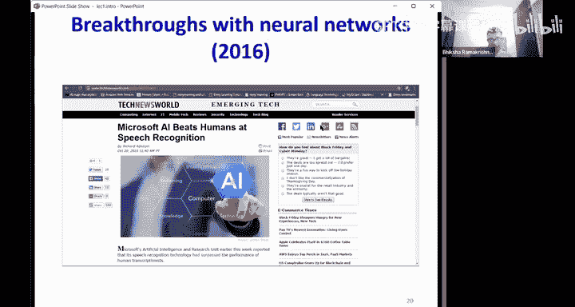
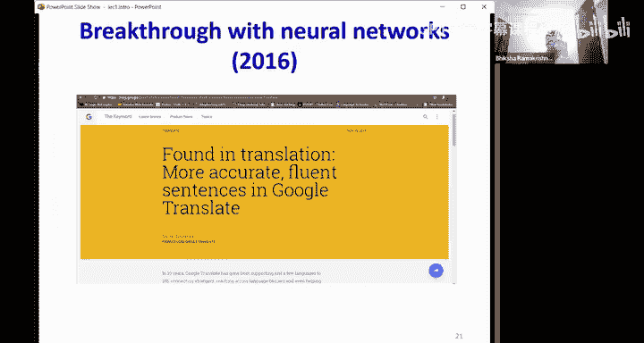
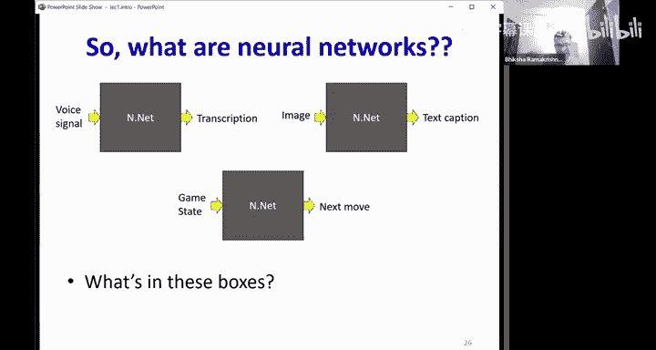
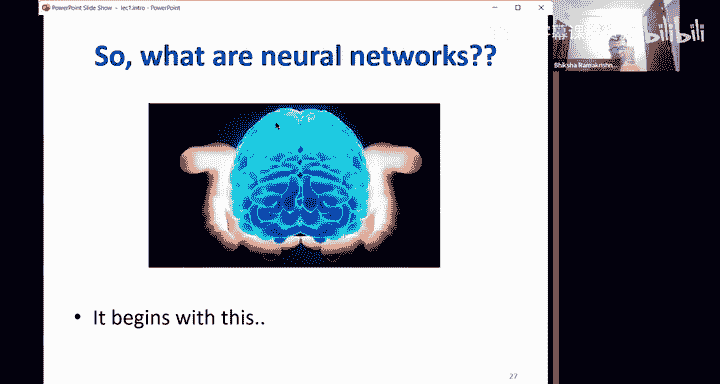
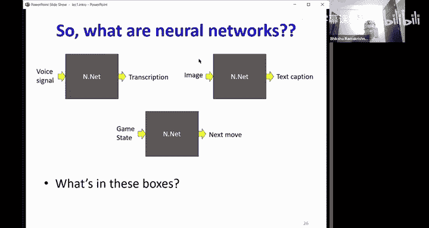
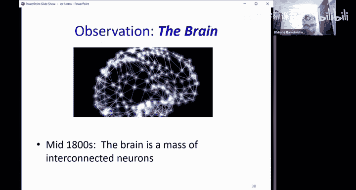
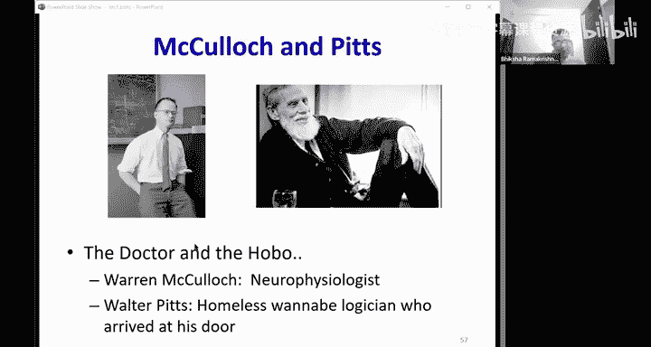
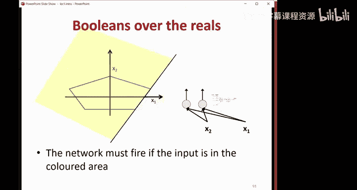

# CMU《深度学习导论｜11-785 Introduction to Deep Learning Spring 2025》中英字幕(deepseek - P1：[01]S2025 Lecture 1 - Introduction to Neural Networks.zh_en - GPT中英字幕课程资源 - BV1xbZNYrEbs

Okay， good morning everybody， can you hear me？This。No。We'll wait for a minute and then' begin。

Good afternoon to those people in Kiiggali。听都下。What evenings and， okay。prof， what is the time there？

Thank you got it。It's 259 pm，3 pm all right， and 4 p。m for the folks in Goha okay。

And it's 630 for me here， All right， still， we have a minute to go wait a bit。

We should have 350 people in class。So。Assuming that some people are in bad time zones。

 we should now nevertheless have one to 50 people on。I'll wait for a minute more。

 half a minute and we'll quick。Okay， that me begin。So before I begin first。

 I want to let you know that this class is generally very interactive。

 particularly when we do this on Zoom because you can use the chat。And so feel free to ask questions。

 feel free to。啊 you know。Just comment， have fun and you're welcome to interrupt I may ignore your interruptions。

 but feel free to speak。 Alright， so let us begin Wele to the spring 2025 edition of。Ideal。

And hopefully by now you have already seen the logistics post。On Piazza。

And we have posted a lecture zero also on logistics and other details on the website。

 so if you have not seen it already， please do so at once。

The course website for those of you who have not yet gone there is deeplearning。cs。cmtd。

 very easy to remember。Please visit it at once because almost all the latest information about the course。

 including the latest slides， deadlines， calendar， everything is on the course page。

Now the course objectives， logistics， quiz and homework policies and grading policies all have been explained in both the logistics lecture。

 lecture zero and on the course page so。Do familiarize yourself， because。

The course is going to be roughly based on these ideas on this rubric。

 although we retain the right to change these things as required if it becomes necessary to do so。

Also， you should already have signed on the Piazza。

And you should have verified that you have access to Canva and autola。

If you have not yet verified this， please do so at once。

And there should already be a note on forming study groups if you haven't seen it yet。Please check。

You will be required to fill a form， we encourage you to form study groups。

And those of you who cannot form study groups on your own， we will set you up with a study group。

Because we've found that you， the students learn much better when you work together than when you work by yourself。

 so collaboration is highly recommended in this course。Now our course philosophy。

As we want no student to be left behind in our ideal world。

 every one of you would earn an eight now again， the keys earn。

The grades in this course are not easy。Yet， typically about 70% of the students get some version of anpa。

And that's not because we give out easy grades， but because we work extremely hard to make sure that all of you。

Actually complete the CA course successfully because your success is also our success。

 that you learn what you're supposed to learn and that at the end of the course you're as close we can make you to being really good。

At practitioners have of ideal and also to some ideas to some extent that you have a fairly good handle on the theory。

We have lots of resources。We have more than 20 Ts， please use them。

We will set you up with study groups and each study group will have a mentor so again take advantage of this we have a TA in each of our campuses so we have a TA in Silicon Valley we have a TA in Doha。

 we have multiple Ts in Kiiggali so you should have local support。

Each of the Ts holds two office hours at least every week。

Take advantage of that and then of course I'm always available I'm currently we I'm in India so I'm always happy to talk to you folks over Zoom or any other medium and when I'm in the US my office door is always open you can always just walk in。

Also， speak to your friends， speak to your classmates。

The objective of the course is to learn if you come here to this course to earn a grade you're in the wrong place。

 you come to ideal to learn deep learning and so if you keep that。As your focus。

 if you keep that in mind， everything that you do will be right because。You will be trying to learn。

Now there's a lot of work in the course， you're going to find yourself dealing with stress。

 so if you're under stress or you're unable to perform or you're just generally feeling down about your performance in the course or about anything else。

 reach out to your TA mentor。And or reach out to me and we'll do the best we can to help you。

Also on this Saturday the 18th， we have a meet and greet plus a lab plus a hackathon。

 we have hackathons most on most Saturdays where we feed you pizza。

And you just come there and you can work together you will have tears monitoring it and the idea is that if you get together for a couple hours or hours youll get a lot more done in two hours of concerted effort with your friends then if you sit by yourself hold up in your dorm room or wherever and so we provide this venue where you can collaborate and you can get things done so since this will be the first hackathon this is also your opportunity to meet your colleagues make some friends form study groups if you don't already have one and so。

And in this particular hackathton， it's also our first lab。

We will teach you how to get started with deep learning code， so be sure to attend。

Because this is a proper lab where you will have hands on instruction and how to get started。Now。

 for the course objectives。By the end of the course。

 you should be able to understand some of the theory behind deep neural networks。

You should also be able to build your own neural network components and tools。

And you should be able to work on large scale problems。

 and the course has been designed and set up to achieve these objectives so when it comes to understanding the theory。

We are going to try to explain the what， the why and the how， basically the math。

And the occasional history now knowing this also helps you contextualize how you use deep neural networks。

 bullets2 and three below and understanding some of the theory is actually really good for if you are interested in research。

 if you're interested in going on to grad school。And these are also the questions that get asked at job interviews。

Second。Your homeworks come in two parts。Now the part one of your homework is designed or set up so that you will all be creating your own neural network toolkit by the end of the semester you can validly claim that you have built your own toolkit from scratch so this won't be Pyth this will be something that you have built。

So through if you solve all the Part and all the bonus problems， this will be the outcome。

And the third part of the course is where you work on large scale problems。

 these are our tools of your homework where you will be competing with your colleagues。

On some state of art problems on Kago。So hopefully when you get all of these done。

 you become expert by the end of the semester， you'll also be working on a course project which can relate to any of these three points。

And this for those of you who actually stay with a course， this is my assurance。

You would never have learned as much over 100 day period as you will in this course。

 This is going to be the maximum amount of learning you will do in such a short time in your life。

 for most of you。Now， my lecture style is very worthless。

Given the option of throwing a couple of equations at you are showing you lots and lots of pictures。

I will show pictures， so which means there are many， many slides and lots of animation。

And this also is not all， you know， given a choice between deriving an equation symbolically and explaining it with 30 slides of pictures and animation。

 I'll go with the pictures this works for most people， but not everybody。

If this is not your idea of a good lecture， then you're not going to enjoy these lectures I'm letting you know。

Now， attendance is mandatory。You have a small amount of attendance points。One point out of 100。

But then as it turns out that one point can be the difference between a b plus and an a so a minus so you probably don't want to lose it。

We're going to use the in class polls。For class participation and on Zoom。

 Zoom also tells me who is attending。But through the class we will be posting polls in each lecture。

 the polls will be either on Zoom or posted on Piazza and you must respond to all polls。

We don't score you on correctness only on whether you've responded。Now。

 not everybody can attend because of live， because of time zone issues。

 and some of you will have other exceptions， maybe you're sick， maybe you have a competing class。

Those of you who have such conflicts。Must reach out to us me and the TAs and you will be granted permission to watch the recorded videos for the lecture instead all of these videos will be recorded。

All the Q lectures， they're going to be put up on media tech and on YouTube。

And you may watch those lectures and we can gather attendance from media tech， not YouTube。

 but if you watch like the lectures on media tech， we can gather your attendance from them。Now。

Last but not least。This is an interactive class we like questions and it's my firm belief that there's no such thing as a silly wrong or embarrassing question。

So if you have a question and you feel shy to ask because you think maybe you haven't understood or maybe you think you're exposing yourself。

Trust me， you're not。There are 350 people in class if you have a question without a doubt。

 there are a whole lot of other students in class who have the same first question and who probably are feeling just as embarrassed as you and are reluctant to ask。

 so never hesitate about asking questions because that's how we are。Also you know。

 there's a natural reluctance to interacting so I'm going to try different tactics I might call out to random students by name in different semesters we' have tried other kinds of methods like giving you nicknames and calling out nicknames。

 whatever it is， please participate。And yeah， this is a dumb classroom。

 which means that when you're in class。Cllas all your ten， your phones and laptops must be shut。

And for accept to follow the lecture on Z。And when I'm having。

 when I'm conducting the class in person in the lecture hall。

Then you may keep your laptop open to answer polls and view lecture slides and maybe take notes。

 But for no other purpose， you must keep your laptop shut and your phones。

Must be turned off and upside down。Do not get distracted if you feel like getting distracted。

 especially in the classroom， leave the classroom， go outside， finish your job and come back。

 because when you are distracted in class， it's not just you who is distracted。

 All the people around you are also being disturbed by your activities。 And this has a ripple。

And something unfortunately， that I must inform you about， I'm physically handicapped。

My back and neck are bent， I can't raise my arms and some days I can't walk。

 and I have breathing problems because of my neurological disorder。

This means I have all kinds of weird mannersms and sometimes I need help from my Ts。

 like to clip on my mic， I use all kinds of strange devices to point because they are light and that's how I can point to things on the board。

If these things disturb you， I'm sorry I can't help it， this is how it is， please please be kind't。

And so with that said。I will wait for a minute for any questions， any questions。Questions， anybody？

No， okay。So the slides we have here， I have 114 slides， I won't be going through all of them。

I will be going through a subset。But so many of the slides are hidden。But。

All of the slides will be posted on the course website。

Quz questions will often refer to slides that are not presented in class。

 but are nevertheless part of the slide deck， So it is upon you to download the slides and actually go through the slides before you answer your quiz because the information on the hidden slides is often important That's why it's there The reason I'm not presenting it in class is because we won't have enough time to cover everything that we want to cover。

And so let me stop。再见。😊，I pause for a second questions。No， can you confirm that you can hear me？

Yes sir， yes。So good and Ibrahim to answer your question。

 you will get answer attendance points for watching the recording， yes。Ascept today。

We're going to go's this lecture is going to be a bit heavy on history， but it's important to okay。

 for those who are on waitlist， if you're in section B we are going to try to get all the section B students cleared。

 Section A cannot be expanded because section A depends on the size of the classroom Section B is virtually unlimited。

And if you're in section， we are not in the class。Then unless you have too many credits or you have other conflicts。

 you will make it to class。Any other question？NoOkay。

 so today we're going to go through a brief history of neural networks section C is the equivalent。

I'm not honestly， I'm not even sure why we have a section C， we have a C and a D。

 but I think C is the in person class in which case you must be on D and again anybody can come to the classroom。

The distinction between section A and Section B is merely because the classroom is limited in size。

 but as far as in person attendance is concerned if you're the first person in the classroom you stay。

嗯。So。啊。And。Yes， all the additional materials will be question and acquizzance。

Excuse me Pro yes hi I just had out this is section M as well。

 so does it mean it's section okay section M so because these are now this online sections have a problem。

That as an international student， it may not actually satisfy your requirement for in person attendance。

And so we are allowed to have one online section per semester， I think。

And and the professional master's programs all have。

 almost all of them have one mandatory online course。

 which means that they cannot actually attend take up ideas so for them and them alone。

 we've set up a section where they nominally attend lectures。

 one out of six lectures or one out of five lectures and we have agreements with their department heads。

 and that accounts for in- personson attendance as far as the immigration folks are concerned。

And so that's what Section M is there for。Okay， so should I register for class section A then because I'm an international student and if you don't have a second conflicting online class。

 then section B is just fine。Okay okay go thank you so much it's just that you know some of them have this other mandatory class。

Wch they cannot。So section A so Dean now section A is full。

 so I would recommend that you guys actually move to section B and we'll clear that definitely。

All right thank you so much let me continue with the class right so we're going to be starting with a brief history of neural networks。

😊，I did think yes， I mean， your study group can be your project group。

It can also be different it's up to you so we'll start with a brief history of neural networks。

 talk about connectionism as relation to cognition and the brain。

And early models and their limitations。And we'll be introducing modern neural networks and what they can compute that's the syllabus for today's class right and one last question so Quaku the section B showed TB but is the same time as section A that's S S3 right that's S SIio。

So here's what we are here for。We all know that neural networks have basically taken over AI， right？

We've applied them， you're seeing them all around you。

 they've been successfully applied to every kind of pattern recognition prediction and analysis problems。

 we may be at the cusp of AGI and in essence these neural networks have established the state of the art in effectively every problem from math to physics to you name it right and in every when they establish the state of the art they don't just establish the state of the art they exceed previous benchmarks by enormous margins and sometimes they've solved problems that you could not solve using previous methods。

So you know， here are some examples if you actually trace the history backrack。

We have been working on artificial neural networks for。 can anybody guess how long。

How long have you been working on artificial neural networks， anyone？40 to 60 years， 40 to 60 years。

 20 years， 50 years， 30 years， Okay， I'll get to that in a few minutes right。

 let me just say a very long time okay。And for the longest time， nothing useful was coming we are。

Had our oil system， but nothing really generally came out and then all of the big breakthroughs sort of just piled on us around 2016。

We've been working on speech recognition since the 1950s automatic speech recognition。In early 2016。

 on series automatic speech recognition was a joke。And then sometime around October 2016。

 this article came out for the first time in known history。

And AI was better than human beings at recognizing speech。A on a specific speech task switchboard。

 so here's the article Microsoft AI beats Human at speech recognition October 202016 this was the first time it happened and this happened because now they began using neural networks or here's another one。

Again， in early 2016 or even mid 2016。Google Translate。

 which was the best translation system out there arguably。Was mostly a party trick。You know。

 you get together in parties you get then you'd say something and type something in English and ask you to translate it to Spanish。

 then translate the Spanish back to English and then you'd all laugh bitter at the rubbish that came out that's all it was good for。

And then。Butber 2016 again。Suddenly it became so good this was November 15， 26， 2016。

 it became so good。That now suddenly professional translators were using Google Translate to do the first cut。

 what happened？They began using neural networks。

But again。Games now， for the longest time， our metric for what was intelligent。 Our standard was。

Art games like chess and go。So there were some early naysayers who said AI could never outperform a human in chess。

But then in 19 early in the early 90s。Eventually a chess game was automatic chess game was created that for the first time。

 beat a human grandmaster。Anybody know where that was built？IBM。The first chess game。

 chess game to beat， a human grandmaster that was right here in CMU。So it was called Deep thought。

 it was somebody's PhD thesis。And then at Beata Grandmaster。

 the person who created it then went on to IBM， and he built deep blue。

 which actually beat Gary Casperrov。So yeah， 1996， Jeess is beaten。

A human expert never beat the best chess game again。

But then we had something much more complicated go。

So it turns out that chess has something like 10 race to 128 states。Go has 10 rates to 160。

 so we figured that computers are never going to beat human and go。

 you know go really requires intelligence。And then guess when an automatic system first beat the human champion 2016。

 this was Alphago。And today， of course， you have。you have programs you can just download off the web and it can begin playing with itself and it can train itself to be so good that it will be alphago in a few hours right on your computer。

And all this is happening because we are using neural network。Amazing。

And so so on so here's one right this was the first example of someone automatically captioning images also in 2016 mannon Black share is playing a guitar。

 this is an automatically generated caption。By a system we just analyze this picture and it's right right construction room worker and orient safety investorss working on road。

Two young girls are playing with a leggo tile。 Well， maybe this is not a young girl。

 but I got it mostly right， right， Boy doing back flip on wakeboard。

Man in blue wetsuit is surfing on wave， and mean it's amazing。This was in 2016。

 this was the first time we saw that a computer program could automatically caption images with such accuracy。

 and that was because they were using neural networks。And just going on now。

 here's a little test that。Currently saying one of our TAs from a few years ago tried。

He took a picture of himself in his。Who started on Chad GPT and said Chad GPT。

 tell me about this picture。And it began telling in things he had never noticed。

 it says the ceiling in the photo appears to have several noticeable water stains。

 which could indicate potential water damage， it says there are posters on the wall while it describes the furniture describes the lighting and ventilation。

 the ceiling as a light fixture and a tandem air vent。

 this is a standard room with typical building amenities just from this much it's describing the bed and bearingdding。

And their overall condition appears somewhat cluttered with personal belongings spread out。Amazing。

 right？Again， thank you， Neuter to。So。Here's where we are that everywhere。

From astronomy to healthcare predicting stock markets。And they are doing an amazing job。

 So what are these neural networks。In each case， the neural network is some box into which some input goes in and something comes up。

Like a voice signal might go in and the transcription would come out if it were performing speech recognition。

But an image goes in and a caption comes out。Or a game state goes in and a suggestion for the next move comes out。

The box basically takes in these inputs and generates these outputs。

 but really what's in these boxes。Now to understand what's in these boxes。

We have to go back and understand that each of these tasks。

 recognizing speech captioning images plain games， these are intelligent tasks which in the natural world are powered。

By this， the humanly。So if we want to understand how to perform these tasks。

Maybe we should just begin by understanding the human brain， right？

And even before the human brain。We want to understand this business of cognition。What is cognition？

So this act of thinking。That's something we would like to understand here are all the things humans can do。

We can learn。We can solve problems， we can recognize patterns we can。Create。

And here's the best part you can just be having a shower and thinking with no additional input at all and you can come up with lovely things you can coachgiate。

 you can generate stuff spontaneously right so all of these are amazing capabilities that we would like to emulate。

Artificially， but to do this， we need to understand how humans work。And how do we work？

The problem is if the brain was simple enough to be understood， we'd be too simple to understand it。

 as Marvin Minsky said。But that has never stopped us。

 so we always tackle problems which are bigger than ourselves and we have tried。

And we have been trying for。Believe it or not， we are over 2，000 years。The first morning。

Or how the brain works was proposed by。Plaum， does anybody recognize this picture？This one here。

School of business。As a School of Athens， we can see this in the Sistine Chapel。

And every time I see this。It shows all the scientific grades as recognized by the Western world around the 15th century in one painting。

 it's a lovely painting， I think this is Socrates， I think this is Aristotle。Dgenes。And so on。收话。

Anyway， and Plato was one of these and he was the first person。To actually first recorded person。

 because almost suddenly theyre have been discussions before them beforehand。To have discussed。

What is or try to analyze。And come up with an theory for how the human brain works。

And his model was called associationism。So what is associationism， We are familiar with this right。

 We are all familiar with Ivan Pablo's experiment with dogs where he would feed a dog and ring a bell。

 And then eventually every time he rang the bell， the dog would d because the dog had formed an association between。

Food and the sound of the bell。So the idea behind associationism is that the brain operates through forming these associations and in fact this idea was persisted for almost 2。

300 years starting from Pau until Ivan Paavlo in the 20th century now again。

 how does association how do associations work？Think of likening。Every time you see a lightning。

You generally hear a thunder。After a while， you form an association。 So later。

 when you see a lightning， you begin to expect thunder。 You say， hey， here's a bolt of lightning。

 We're going to hear thunder。😊，Or alternately， you might hear the thunder。

 and then you going to think lightning just struck somewhere near your main。

 You formed an association， and it turns out that this kind of association between percepts is basically how machines work till to day。

 So the idea itself is beautiful and very powerful。 But then that doesn't explain everything。😊，Right。

 we know we form associations， but then where are these associations stored？And how are they stored？

For this。Again， clearly they are stored in the brain。

This was not something that was obvious to people for the longest time。

 The idea that art and intelligence lies in the brain is a fairly recent phenomena。

 a recent bit of knowledge。But that was kind of understood by the 18th century。

And in the mid 18 hundreds， we got very powerful microscopes。

 which actually told us what the brain was constructed of， how it was constructed。

 We knew that it was a mass of interconnected cells， and these cells were given the name neuron。

 not long afterwards。😊。

And so here's what the brain looks like， lots of neurons。Each neuron。

Is connect each neuron has incoming connections from many neurons。

Each neuron connects out to many neurons， and so the brain is a network of neurons。

But then how does this network actually allow us to store those associations and form inferences？

For that。Here's the answer to my earlier question。The first person who came up with a model for how the brain works was this guy。

 Alexander Bain。He was a philosopher， psychologist， mathematician，  logician， linguist。

 and a professor back in those days， if you were one thing you were all of them and unlike today it was not easy to be a professor。

 it was really hard and he was a professor。And he came up with the first model。

That the information is stored in the connections in the brain。 This was in his book， mind and body。

Written in 1873。And so here is。Here here's how。He tried to explain it。Believe it or not。

 the first artificial neural network model dates back to 1873。 How many years ago was that？Anyone？

What will that answer be？200152， right， 150 years， more than 150 years is how old it is。

And so here are some models。Its okay， can you just。嗯。Here are some examples of。啊。

How he tried to explain things。He said neurons excite and stimulate each other。

And so that the manner in which the brain operates and how its source per is all in how they are connected。

 These neurons are connected。 And he hypothesize that even for a fixed connection。

 different combinations of inputs can result in different outputs。

 which allows for different kinds of associations to be recalled by the same network。 So here。

 for example， heres a network of six neurons。 And let's assume that all of the inputs are 0，1， right。

 if A and B。At high， that is if they fire X fires。If and ceasefire。Then Z fires。

If B and C fire y fires， so it's the same network， but for different combinations of impulses。

 different outputs are obtained。Or here's another circuit， where there a single network。

 but depending on the strength of the input output patterns can be different， X， for instance。

 receives two copies of the input with a short delay。

 Y receives three copies with a much longer delay。And so。One second。啊。

And sorry about that just asking my family to quiet down a bit。 Okay， so here's a circuit where。

You know， a single circuit。Produces different outputs， depending on the strength of the input。Now。

 this seems like an obvious thing to us these days that you can have a single network。

 a single function that generates different outputs for different inputs。

 but in the 19th century this was somewhat of an anathema。

And Bain even proposed a learning mechanism， he said。

 when two impressions conquer or closely succeed one another。

 the nerve currents find some bridge or place of continuity。

 according to the abundance of nerve matter available for the transition is predicting heavy and learning。

So obviously， you know， very powerful ideas， but the problem was that people mocked him。

 they doubted him back in the 1870s， these ideas which seemed so obvious to us。

 were outlandish and eventually they managed to convince him that he was wrong。

So as Bertrand Russell says， the fundamental cause of the trouble is that in the modern world。

 the stupid or cockshire， while the intelligent are full of doubt。 And so in 1873。

 postulated that there must be 1 million neurons and 5 billion connections。

That are required to obtain 200，000 acquisitions。Then after a lot of thought by in 10 years。

 he realized that you don't always have complete acquisitions。

 you have to go through the process of building them up and at any given time you will have partially formed associations and so you're going to need neurons to store those too and eventually he figured by 1903 that no this is this idea doesn't work。

 the brain would need too many neurons and connections for it to work this way and so he reantted all his ideas。

 apod to all of his colleagues and then died。As it turns out， his colleagues were wrong。

 he was right。And。The human brain is。A connectionist machine， a machine war。

 which is composed of lots of simple units。And the information lies in the manner in which these units are connected。

Neurons connect to other neurons。The processing capacity of the brains is a function of theseist connections so connectionist machines emulate the structure。

And so here is what a connectionist machine looks like。It's a network of processing elements。

 very simple elements， and all world knowledge is stored in the connections between elements。

And this is fundamentally different from the kind of computers that you have today。

 so does anybody know the architecture of the modern computer processor。

 what is the architecture anyone。What's the architecture of the process on your phone？

It's a one Neemen， right， what distinguishes the Won Neyman architecture， what's special about it？

What's special about the one name in architecture， how does it work？Anybody。

You have separate processing and data you've separated the processor from the memory right there you have a variants on it called the Princeton my architecture the and the Harvard architecture but the B key idea as this that you have a processor。

 the date and you have memory， the programs and data live in the memory and the same processor can perform different things。

By learning different programs so you can use the same processor to do all kinds of different tasks simply by changing the program in the memory。

 which is what makes your phone or your laptop or your supercomputer so powerful you have the same computer which can do all kinds of things。

In a connectionist machine， this is not true。 The program lies in the connection between the units。

 so the computer is the program。 If you want to change the program。

 you have to change the computer itself， which is why we never actually build physical neural networks。

 we emulate them on a onenoyman machine。And so to recap。

Neutural network based AI has taken over most AI tasks。

These originally began as computational models of the brain or more generally as models of cognition。

The earliest model of cognition was associationism and the more recent model is connectionist。

 where neurons connect to neurons and the working of the workings of the brain are encoded in these connections。

Current neural network models are connectionist missions。And so。We have our first poll。

 you're all going to pretend that you didn't see what just popped up。And。We will release our。Let go。

Can you see the poll？Yes， yeah。There are two questions on the poll。嗯。5。Okay。10 seconds， guys。

 the poll should be showing up on your screen if you're on Zoom。This sometimes happens。Okay。

So let me stop right and end the poll。And。Share the results。Can you see the answers？Okay。

 I'll just stop sharing and let's look at this first question， what is the answer I have the？Bin。

 right， second question。 I didn't actually give you the answer to this question。

 I usually do that during the lecture。 But today， I decided to you let you guys guess roughly how many connections exist between neurons in the brain。

 Bain and brain。Hundred trillion， right？ It turns out that， you know。

 Alexander Bain's assumption that we will not。 we do not have enough connections did not hold water。

 He thought there just weren't， you know，5 billion connections and 1 million neurons were too many。

 No， we actually have 80 billion neurons in this little head of ours and 100 trillion connections。

And so that's why we are able to store all of these perceptps， not answer the Rashb。

We will get to that how do connections explain associationism associations are about need。

Are about patterns， one pattern triggers another pattern。

 and so we're going to need models to explain that right so here's where we are。

Connectionist machines。No other they don't connectionist machines are networks of processing elements。

All world knowledge is stored in the connections between。你 now。These elements。

 what are these elements？For that， we're going to go back to the brain。

So the basic elements in the brain are neurons and here's what a neuron looks like it's got a big head。

Called the soma with lots of these little tenddrils。

 which are called dendrites through which signals come in from other neurons。

If the total signal coming into the neuron exceeds some threshold， it fires roughly speaking。

 and then that signal travels down this long arm。And goes to other neurons this long over here is called axon。

 This is the most important part of the neuron because it's so long and so it's protected by this sheath called the myelin sheath。

 which is made of fat。And so because neurons at the brains capacity lies in the connections between neurons。

 neurons cannot split if they split， the connections would break down so neurons do not undergo cell division。

 the brains you have now all the brains are going to have more or less。And then。Secondly。

 it turns out that。This fat that protects the axons， this long leg。 That's the most important part。

 too。 So having， it turns out that having more neurons in your head doesn't explain intelligence。

 having more。Fat。Gial cells to protect these neurons explains more intelligent。 So。

 so somebody actually stored a bit of。Einstein's brain and they tried to study it to see how it was different and they found he had more fat in his head than most people。

 so actually being a fat head is a compliment because it means you're smarter than others。Anyway。So。

We need models， right？For the new。 So here， the first model for the neurons came from these two rats。

 Meello and pititz， Warren Macello was a neurophysicist。

 Walter Pititz was a homeless guy who knocked on Meellow's door。

And somehow Melo let him in and they worked on this crazy problem So anybody want to guess which is mecallo and which is pits。

我个 here。Anyone？First one picks。The first one is space。Yeah， so this is。Warren Mcough。Obviously。

 is's the prop of the line。

And Walter Pitz was very young， he was about 20 years or 90 years old when he ended up in Michaelallo's door。

 so they came up with this model called the mathematical model for the neuron。

And for the first time we had a model a mathematical model for parts of the brain。

 units of the brain， and they introduced this notion then that the brain can be modeled as performing propositional logic where each neuron evaluates the truth value of its inputs it evaluates propositions effectively this is boolean logic plus little more so they focused on the boolean aspect of it。

 and here's how they explained it。They say the neurons connect to other neurons through two kinds of connections。

These are the excitatory synapses， the synapses are how neurons connect to one another。

And inhibitory synapses so signals come in through the excitatory synapse if the total egg signal exceeds a threshold the neuron fires。

Unless there's a signal through the inhibitory synapse。

 if there's any signal coming down the inhibitory synapse， the neuron will no longer fire。

So here are some examples。Here in each case， you must assume that if there are two or more inputs。

 then neuron will file。Here's one， if neuron1 fires， neuron2 receives two inputs。

Which matches a threshold liquidqu fire。So this is just a delay。What is this one？

What kind of Boolean operations will this perform？Anyone？

That's an R right if either one or two file this receives two inputs my neutral file。

 what about this？That's an end， right？And what about the one on the right？This is a crazier one。

 one must fire and two must not fire， so it's one and not two。

So it's more complex it's not an XR it's one andO it specifically right and so and then they also showed that you can come up with even more complicated logic here。

 for example， if you're trying to model sensations and sensations of heat and cold。

 it's a well knownn fact that if you touch a cold object for a very short period of time。

Your first sensation is heat。 It's only extended exposure that gives you a sensation of cold。

So focus on the cold receptor。If you are touching a cold object and you just touched it very briefly。

At the very first instant， you'd get a cold response here。

But then the second input is coming through this delay。And so since you get only one response。

 you're not going to feel cold。On the other hand。You know， if if you touch cold very shortly。

 this guy will fire after one time instant that causes this guy to fire after two time instances that causes the heat sensation to fire。

 so if you touch cold very briefly you will feel heat。But if you have extended exposure。

Then by the second instant， this guy continues to fire and this inhibitory synaps pills block this neuron and you no longer feel heat。

On the other hand， down here， you're going to get one signal from here。

 You're going to get a delayed signal from here， and you will feel cold。

 So this very simple model could actually explain some pretty complicated phenomenon。😊。

So they claimed all sorts of things about their model。

 they said should their models should be able to compute a class of functions that if a tape is provided。

 it can compute a richer class of functions that they are equivalent to tuuring machines。

 all of which is true。They didn't have many strong results of their own， but most importantly。

 they didn't provide a learning mechanism。For that。You know。

 how does the brain learn its connections so that they had to wait for this cup Donald Hebb？

W wrote this book called Organization of Behavior in 1949。Like all the scientist of the day。

 he was another eccentric person who started life as a novelist and became a farmer then became a hobal。

 Then a school teacher then finally gave or gave it all up and joined Harvard and became a psychologist。

And he proposed a learning mechanism which he explained in。This very crazy text。Which people。

 you know， when an axon of cell A is near enough to excite cell B and repeatedly or persistently takes part in firing it。

 some growth process or metabolic change takes place。

 such that a's efficiency is one of the cells firing b's increased。 Now， it sounds complex。

 but roughly speaking， we like to summarize it as neurons that fire together wire together。

 How does that work。 Now， when you have two neurons connecting。

 they don't actually touch one another。The first neuron has an axonal connection， which is this bulb。

And any time the first neuron fires， some chemicals are emitted from here。

 which cause the second neuron to fire。And if the connection of the first if the excitation of the first neuron causes the second neuron to fire。

Then the resulting effect is to make this bulb slightly larger。

 which means that the connection becomes stronger， so a mathematical model for this is that the weight of the connections between two neurons。

 w X y， is always going to be incremented by x times y if both x and y5， then w increases。

This is called the heavy and rule。And it's a very powerful idea。

 it's actually the basis of many learning algorithms and machine learning。But it has a fatal problem。

 what is that？Anybody？What's the problem with this one？It doesn't decrease， right。

 It always keeps increasing， So it's fundamentally unstable。

 Strer connections will will keep enforcing themselves。 There's no notion of competition。Eventually。

 if you wait long enough， all of the weights are going to be so high that the network is not going to be doing anything useful。

And so people tried to fix this， they came up with all kinds of updates like the generalized heavy and ro and so on。

But wasn't really a solution till。Something happened right before that。Here's our second poll。

Maybe it at least the second。嗯。Any folks in the poll？Okay， 10 seconds， guys， everybody's got it。

Are these defaults that determine attendance。Yes， unless you have some issues with the polls， right？

All right， let me stop the poll。45 seconds。Chair results。Now， let me capture what is the answer guys？

Anybody？Number two， right， perfect。So yeah we are。But then so heavier learning has a problem。

And the solution to that came from this guy Frank Rosenblt。

 who was a logician and a psychologist in Yale and he invented what we now know as the perceptron。

 although his perceptron was more complex than what we are familiar with he was trying to explain human vision and so here was us model he said that sensors from the retina excite a layer of neurons and something called the A1 area。

 the projection area and these would excite neurons in the association area and then these would finally excite your responses。

 it was a pretty complicated model。And had many units。

 but the basic unit you know which can at some level， be simplified to this。

 you have the sensory units。And then you have the associative layer where each neuron receives inputs from many sensors。

And response to it。And then these associated layer neurons then trigger the response neurons。

So the individual neurons themselves over here。Had this kind of structure。

They received many inputs corresponding to each input plus a weight。

If the weighted sum of all inputs exceeded some threshold， the neuron would fire， it would output a1。

Otherwise， it would output a zero。So Zion unbounded meanings。

 it can just keep increasing until it saturates and cannot so there's no cap to it， right？Anyway。

So here it is， the weighted sum of inputs， if it exceeds a threshold。

 it will fire otherwise it will not so I can also state it like so。

If the weighted sum of inputs minus a threshold is。Positive the unit will fire。

 otherwise it will not。Is this making sense， this figure？The simple explanation。Yes no。嗯，不看。

All right。And so here's where we are right now originally this was the model that Rosenbl was pitching。

The units of the market where this got the simple passitron。

And Rosenblt's original model was pretty powerful became if it became large enough。

 so it was originally assumed that it could represent any Boolean circuit and perform any logic so it had you know glowing news articles like the embryo of an electronic computer that the Navy expects will be able to walk talk and reproduce itself and be conscious of its existence Frankenstein monster designed by Navy that thanks this was all in 1958 the overstated the capability of the this simple perceptron so much。

That Rosenlt couldn't match it and research funding dried up for a decade。But then more importantly。

啊。On the researcher end， although this is this larger model。

Is roughly is at some level infinitely capable。They began making the same assumption about the individual units in the model。

 and that's where things really feel。 Now， if you now。

Rs and blood actually didn't just introduce thee。Perceptron。

 he also introduced a learning rule for these guts。

The learning rule was very similar to the Heian learning rule with one difference。

In the heavy learning rule， there's no notion of a target。If x and y fire， the weight goes up。Here。

 he introduced the notion of supervision and a target。 So every neuron had a target。

And so anytime there was an error。Between the target of the neuron and the actual output of the neuron。

 then the weight was updated in proportion to both the error and the input。

If the neuron was doing the right thing， it would not get updated。

And this simple update rule actually proved that even the simple units can give you perfect answers but linearly separable classes。

Now， yet again， as the neuron write， you have many inputs。

You compute weighted some of the inputs if it exceeds a threshold or matches it it fires。

 you can see that even that simple unit is very powerful。

So here are examples of perceptrons where I'm assuming that a threshold。

 the value inside the circle is a threshold。The value about the arrows are the weights。

If the perceptron has a you know the total input matches the threshold， the perceptron will fire。

Can anybody tell me what this perceptron is？That's an n right。

 so both x if both x and y fire the total input is 2， this is an n， what about this guy？

What is this one？If either x or y5， the total input is 1。It's an art， right？What about this one？

So now right if x is 1， the total input is minus1， it  won5， if x is 0， the total input is 0。

 it will 5， so you know even the simple unit。Is very powerful I can moderate any Boolean operation。

 but。There's no setting for these weights that can actually create an ex。

And so once this realization struck in， then people sort of。

Got stuck on this problem and we sat in the area stalled for a while。

But then the answer was already available， you want to network there。

Individual elements are weak computational elements。

 you need to network them now go back and consider the brain， the brain is not just one neuron。

 it has many neurons which are connected to one another。And so。

Once you begin connecting neurons to each other， all kinds of things are possible。Here， for example。

 as the XR， this cannot be done by a single perceptron。But in this example。

 I've connected up three percent runss。This fund computes。X or y， this computes， not x or not y。

And this one。And these two outputs and the result is going to be an x or of x and bar。

Now observe that you're not interested in outputs of these individual neurons only on the input of the output of this guy。

 so this is called the output neuron。Although these need not necessarily be hidden。

 the fact that their individual outputs are not of particular interestspec interest to you means that even if they were hidden。

 it wouldn't matter So we called they called them the hidden layer。 So this is the hidden layer。

 and this is the output。And what we find is that by networking up neurons。

 now we can compute an exon。In fact， it can compute any Boolean function。

Once you begin networking neurons， so here is a pretty complicated boolean function of four inputs and simply by connecting up the perceptrons in this manner。

 you can compute this Boolean function。So what this means is that a network of perceptrons can compose arbitrarily complicated boolean functions in cognitive terms。

 it means that they can compute arbitrary boolean functions over。Sensory input。And so。Persceptrons。

 this is what we will now call a multilayer perceptron， you have more than one perceptron。

 they are connected up in a network and the perceptrons themselves are arranged in layers。

 what is a layer we will get a formal different definition of this in the next class。

 but you can visually observe that there are layers。

 so this is a multilayer perceptron and what we find is that multilayer perceptrons can compose any Boolean function。

And so here is the story so far， neural networks began as computational models of the brain。

They have connectionist machines， they comprise networks of neural learning。

And the first computational model for the neurons was the meello and pits model。

 the neurons act as boooleian threshold units。And this models the brain is performing for propositional logic。

The first learning rule was Hebb's learning rule， neurons that fire together， wire together。

 unstable。And Rosenbl's perceptron was a variant of the macroallo and pet neuron with a provably convergent learning rule。

But then the individual units are limited in their capacity。

 but if we connect aros and plots perceptrons into multi layer networks。

 they can model arbitrarily complex Boolean functions。Questions？Any questions？No， okay。So。

Before I continue there， is our brain Booleion。Is it， are we only performing Boolean logic， right？

Why not。😡，So are the inputs we receive bullolean？Clearly not， right， we have real valued inputs。

We also make non Boolean inferences and predictions， right， things are analog。

So how can this model work on this kind of input and output？Let's see。

 let's go back to the perceptron， but now let's consider that these inputs are real valued。

X1 through xN are real valued， the weights are also real valued。It still operates the same way。

 it obtains a weighted sum of inputs if this weighted sum exceeds a threshold it fires。

 the output is boolean， otherwise it doesn't fire。What kind of function will this be。

 anybody want to guess？What kind of function would this be？So here's what it's going to look like。

 right？What is the boundary。Between the inputs。Where the output is 1 and where the output is  zero。

The boundary is where the summation of the inputs is exactly equal to that threshold， right。

So in other words。The boundary between the when the output is 1 and where the output is 0 is given by summation W I X I equals T。

 Now， before that， I want to introduce a notion of how this model can be restated。

 I can say this differently。 I can say that。Im first computing a weighted sum of inputs。Plus。

 our bias， so this in other words。You first compute an fI function of the inputs。

And this aine value is now put through a threshold function at what is called an activation。

Where the threshold activation outputs are 1 if the input is positive and0 otherwise right now and so does anybody know the difference between aine and linear？

Anyone。The bias right so just well get back to that in the next class。

 but here's what the P per secron looks like it first computes a weighted sum plus a bias of the input。

That's the a find and let me see if I can mark this on。If I have。You know， if I consider two axes。

A function of this kind。Is a line， but it's not going through origin， right， so this is aine。

But if a line goes through origin， this is linear。That's the basic definition of the fine versus linear and so first you compute an fine value of the inputs。

And then you put it through a threshold activation， how do I erase this time？Can I raise it。Okay。So。

That's what we do， right？系。Let's see how this operates right now but once you readwr it like this you can do other kinds of things。

 you can compute an aine function and put it through all kinds of activations besides the threshold like this smooth threshold which is called a sigmoid or something like this。

 which is called a this is a rectification function。Also called a rectified linear unit。

This is the smooth version of it called the soft plus and so on。

 so just this simple modification allows us to do different things。

 but anyway for now let's continue assuming the threshold activation okay。

How does this function behave？The boundary between when the output is 1 and when the output is 0 is when the weighted sum of inputs is exactly equal to the threshold。

This is the equation of。Pipper plane， correct？We have debateed sum of input pick。

Matchches a threshold。That's the equation， that's an I equation， an equation of a plane of this kind。

 right？Yes or no。And so。What we have is this。There is this boundary where they weighted sum of inputs exactly equal as the threshold。

For all inputs on one side of this boundary， the output is  zero。On all inputs on the other side。

 the output is1， so the dispersceptron itself models this heavy side function or step function where there's a linear boundary where on output1 outside the output is 1 and the other side the output is0。

And now you can see why a perceptron can be a boole different Boolean gauge right so when you have inputs are boolean the inputs have two inputs the inputs can only be 001011 or 01。

If I have a perceptron where the boundary between 1 and0 is this line。What gate did it encode。Right。

 that's an all。 If it's this line， what gate did it encode。And hand right， and over here。

This one just ignored x2 and it's just node x1， right？So very simple。

 you can just see how by changing the weights， you can get different Booyan gates。

But then once you realize you can do something of this kind， you can do crazy things。

So let's say I want to build a network， a multilayer Poitron。

Which will output a1 when the input is inside this Pentagon。And a zero outside。How would I do it？

I can start up with one perceptron。Which captures the slower boundary。

 it outputs a zero on this side of the boundary and a one above it。

A second perceptron captures this boundary， it outputs a zero here and a one on the yellow side。

The third perceptron captures this one， right It outputs a zero above this line。And one below it。

 a fourth one captures this boundary。And a fifth one captures this boundary。

 which is the only region where all five perceptrons are put upon。Anybody。😊。

Where do all5%rons output of one？Inside the Pentagon right so what more do I need to do to construct a network that outputs a one inside the Pentagon and zero outside？

And then。I can just add them right， and so walla， I have this little network。

Whi outputs are  one inside a Pentagon and zero outside， but once I can do this。

 I can do crazier things， I can build a network which outputs are one if the input is anywhere within this double Pentagon。

And0 outside how one subnet outputs a one inside the lower Pentagon。

The second one outputs a one inside the upper Pentagon or of the two。

 And here is this network that will output a one。Within the double Pentagon and zero outside and yes sunny the lines are more generally。

What do you mean by hyperplane of three axes， this is in this case， yeah。

I just have two axiss and I have two inputs。So this one here。So I have two inputs。

The word third axis is one。So this is the line。Which separates the region between the one and the0。

 the output is zero on this side and one on the other side to that answer your question。Sure will。

Right， so here we go and now of course。Now I can construct other kinds of crazy complex decision boundaries I just have to decompose it like so I can build pretty much any decision boundary that I want。

 right？Aazing。And so when you think of classification problems。

 inputs live in some high dimensional space， for example， if you're classifying digits。😊。

This is an example from MNest， this thing has two780 it's a 784 pixel image。

 it's essentially an input in a 784 dimensional space in that space there's some region within which all the twos lie。

And so if I want to build a network that can recognize twos。

 I just have to use this simple theory to build a network that isolates the region within this。

What if region which are shown as a peanut over here。

 and that will output a 1 foot for inputs inside that region and zero outside and now I have a two classifier。

And in fact， I can model any decision boundary in this manner， therefore。Mbals。

Can classify any real valued input， you give me a decision boundary。

 I can build an MLP that approximates it to arbitrary precision。By composing it from ker planes。

 so MLlPs are universal classifiers， did this make sense？Yes no。That makes sense， guys。对。Okay。

Fantastic。And so the story so far， MLlPs are connectionist computational models。

So Luca will get to that， right， so in a minute。And MLlPs are connection as computational models。

Individual perceptrons have computational equivalent of neurons。

And the MLP is a layered composition of many such multilayered perceptron is a layered composition of many such perceptrons。

 they can model any Boolean function，  individual perceptrons can act as Boolean gates。

 networkss can be boolean functions， so any MLPs are universal Boolean functions。

 they can model any boolean function。They can model any decision boundary。

 individual percepts captured linear boundaries。Complex boundaries can be composed from the linear boundaries。

 so which means MLPs can represent arbitrary decision boundaries so they can be used classified data。

In other words， they are not universal Boolean machines。 They can compose any Boolean function。

 their universal classifiers， they can compose any classification boundary。 So here is my third poll。

And。唔ancy。Okay， I'm giving you only 40 seconds for this guys。1en seconds。I。ok。

So here's how you have replied。Does anybody want to give me the answer， what is the answer？Anyone？

At 7， you're going to need six for each of the sides of the polygon and a seventh to end them all。

 right， It's not 6。 It's 7。Perfect， thank you guys， seven is the correct answer。

But then that's only for classification。And classification over real value inputs。

 but what about continuous valued outputs classification has categorical or by or Boolean outputs even even though the input is real valued but functions can also have real valued outputs。

 how do you do that？So I'm going to explain this using a simple function of a scalar input。

 a scalar output of a scalar input， this function we want to。

Take a single X and computer function of it first I'm going to compute the circuit。This network。

This perceptron fires if x exceeds the input threshold T1。

This perceptron fires if it exceeds the threshold T2。

So what happens as x goes from minus infinity to plus infinity？So long as x below T1。

 both of them output0。The net output is zero。If x exceeds t1， assume t1 is lesser than T2， right？

Then this neuron begins output putting a one。And then this neuron continues to output a 0。

And so the total output here is going to be one。As x continues to increase。

 eventually it will exceed T2。At that point， this one will also output a1 and these two will cancel each other because their weights are 1 and minus-1 respectively。

 and the output goes back to0。 So this little network outputs are 1 between t1 and T2 and 0 everywhere else。

Was making sense， do you guys？Yes no。And anybody want to tell me how I can model an arbitrary function with this？

How would I model this an arbitrary function with this， anyone？Here's what I can do， right？

Let's say I have this crazy function。As Arab says， I can just。Have little subnets。

 one for each region I can split the axis into little regions。

 I can have one little subnet within each region， each outputting a one within that region。

 I can scale all of these to different heights and add them up。Andvoa， I have a network。

Exactly which models this net function approximates this function as a piece vice constant and I can make the approximation error arbitrarily small by making these rectangles arbitrarily narrow right so this is how I can model a function continuous value function to arbitrary precision。

And this generalizes to functions of any number of inputs we'll see how in the next class。

 but an upshot of this is。That an Mkin。Model， a continuous value regression。

 So I'm not going to expose this poll， but does anybody want to answer this question。

 How many neurons will be required。By a network of sinusoidal activation neurons。To precisely model。

 y equals co to x。Remember， I can replace the threshold activation with anything here I replaced it' sign。

Right。How many would I need？The answer is one， right。

 because I can just say that I can say that the weight is2。And the bias is pi over 2。

 so you're going to end up with sine of 2 x plus pi over2， which is cost of 2 x is going to be。嗯。

Right。So none of the above is the correctdowns。Anyway， so X and there were same functions there。

But me。For x at same functions then or they were different functions。

 I mean I just want on that for y equal sine of z right？And then。Instead， I'm。

So the activation is assign s activation you have the weight and the bias right so in any case what this means is that the MLP can also model continuous valued functions in other words MLPs can do everything they can model Boolean functions they can model classification functions they can model continuous valued functions they can do other kinds of things so far we've seen networks where information flows in one direction if I begin adding loops it turns out they can remember patterns as was proposed by Lawrence coooby in 1930 and it' very popular even today they can represent probability distributions over integen real value in complex valued domains。

They can market a posterii and a priori probabilities。

They can generate data from complicated or even unknown distributions。

 they can do pretty much everything I like to joke that you know they can rub their stomachs and pack their heads at the same time。

I thought I was joking。And then I found that there are actually competitions with this sort of thing。

And the guyal incident is usually an Indian， so anyway。And this is。And so。The network is a function。

Given an input。It computes the function layer wise to predict the output more generally。

 given one or more inputs， it predicts one or more outputs。 And so here， what's in these boxes。

Each of these boxes is a function that's taking an input and generating an output， right？

So we replace them with neural networks， can be approximated to arbitrary precision by neural network and so here's our story so far。

Multi layerer perceptrons are connection as computational models， they are classification engines。

They can also model continuous varied functions。Interesting AI tasks are functions that can be modeled by the network。

And so。To come to an end。We've gone through a brief history of neural networks in relation to cognition in the brain。

We've seen some early more their limitations we have introduced modern neural networks and what they can compute。

So in the next class， we'll look at moreron how these are universal oxxims and what do we mean by the depth of a network and how does it relate to its capacity？

So I'll stop right here and I'll take some questions， any questions。I I saw that as okay。

You didn't get how did we model the graph， okay， this are you speaking of this one here？A brain。

This is the one。 Yeah， okay。This network to the left can produce an output of 1 between T1 and T2。

 correct？Yes。😊，Okay， so here's what I can do， I can have one little subnet of two neurons。

Whi with this as T1 and this S T2。A second subnet of two neurons with this is T1 and this is T2 and so on。

 so for each pair of boundaries I can have one subnet。

And so each of these subnets is going to output a one in a different region。Now， that output。

Can be scaled by the target。Bight of the function within that region。That makes sense？

AndAnother one thing can be added。And so that's how we approximate this function。Okay。

Preish up that's for later， right any other questions？Any other questions？So。啊。ThisThis week。

 Saturday's lab is also a recitation because I will be having a class on Friday， Monday is a holiday。

So I'm going to use the Friday slot to cover lecture three。And because。

We need to have a certain amount of material completed by the second week to release our homework at time。

And the lab is shifted to the Sundays， Sunday， Saturday， hackathon。

It will be recorded and it will be put up。Any other questions？Any questions about today's lecture？

Is everything clear， so the road you can just take those on the course website。

Was today's lecture clear？Do me a favor， everybody give me a thumbs up if you found it was clear and then I can roll up。

I'd like to count like a。Aundd or so thumbs up I just got two。ok。So I had a question， yes。

 great ahead。So while we were modeling Boolean functions using MLPs。

 we were actually wearing the weights， you know， for modeling functions like N or X or， right？

What if we vary the thresholds？So let me go here so in this okay first。When I was。

That am I going to one。If I look at this perceptron， the weights are all always one and minus1。Right。

 so here it's fairly simple。佢래。😊，It's only when you begin looking at it。More along these lines。

That you can think of them as generic weights and thresholds。

 it doesn't matter what your ba and threshold is so long as my perceptron has a boundary which falls between this one and the line that connects these two guys this is going to be an art。

So long as my perceptron has a boundary which falls in this region， it's going to be an end。

And so you have many options for leads impressions。It makes sense。Yes是。嗯。Any other questions？

I have a question like when we say that we can like like model continuous value functions using pwise linear functions with arbitrary precision。

 isn't it a want a finite domain of input like if like X x cannot be over like any domain because functions can be arbitraryrbitrarily complex。

You're absolutely right， all we are speaking of is the capacity of the network to model functions。

If you give me a large enough network， I can model the function to in all。

Arbitrary precision over most of the domain right if you want to model it infinite over the entire infinite space you need infinite neurons。

 we are not speaking of limitations yet。Only be the capacity of your function， right？

Okay now this one here， so I can say cost to x is sine of 2 x plus pi over two， correct？Yes。

And so that's the same as saying that I have a what I've drawn with。One input， right， one input。

This weight is 2 and this bias is5 over2， and the activation is7。Yes， yeah。

Anything else？All right guys， thank you very much， thanks for your patience。And。

I will start the recording。