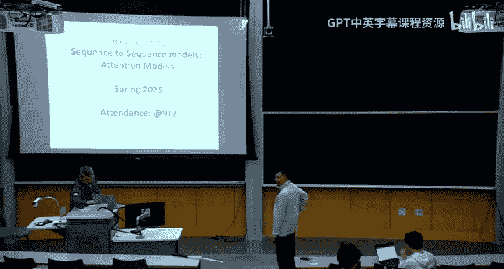
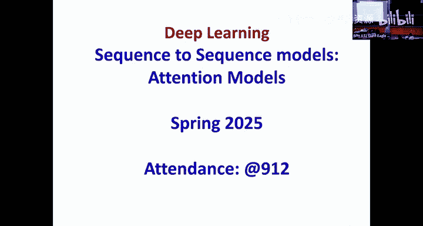
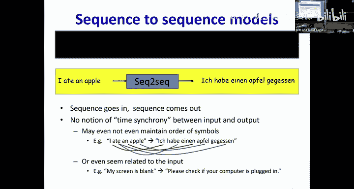
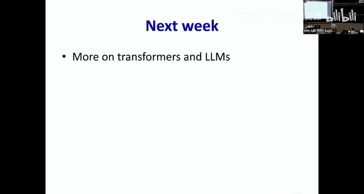

# CMU《深度学习导论｜11-785 Introduction to Deep Learning Spring 2025》中英字幕(deepseek - P21：[19]Spring 2025 Bootcamp - Sequence to Sequence models_ Attention Models.zh_en - GPT中英字幕课程资源 - BV1xbZNYrEbs

Yeah。在这。Yeah。你错。基本可以。是没电。跟要其实系啊。你家点不。Sure。不。はいと。是可看了。to working over that fromington。运运上。确认。你信。1，2，3。

先。one， two， three， check， check， check。最咁。Yeah。Theyre having a bit problem with他。麦克风。つます。

They entire classes on Zoom。At this stage， I think I just moved to Zoom because it's not point in coming to the classroom。

まに？Better1。喂你好，look at the classroom。对。300 people in class， where are they remaining to line。好的。嗯。

And is some technical problem。We can't get， get the result in 10 or 15 minutes。

And I' probably correspondponed past of Friday because we have insurance。D b。Yes。

 the same I'm good I'm just called。I'm sorry， I don't know what's going on。系。佢冇点你发 stand嘅。

broadcast resumes。こちなです。名。又是。ICheck1，2，1，2，3。たで。Checkck， check。Check 1，2，1，2， with。1，2，3， check。

 check don。There are you want。1，2，3，1，2，3。没有。Let me say this is working。Okay， we'll wait a minute。

 and then we'll start。こ。系你先数， o k 啊嗰嘅。Morning， everybody。 Sorry for the slightly delayed start。

 We are having some。 we were having some technical issues。 I think they resolved。

 Please sign up to the attendance phone and do shut down your。啊。Sfttops， okay。Allright， let me begin。

We're going to continue our series of lectures on sequence to sequence models。

Specifically， the kind of models we were looking at were those that converted one input sequence to another input sequence where there was not necessarily a any notion of a correspondence or an order between the input and the output。

 for example， if we were translating English to Germanite and Applish Habein and Aelgis and if you actually look at the correspondence。

 I goes to ish。8 goes to two different words。 How big a getsson。 So， you know，'s not。

 it's not a one to one correspondence。 There's not even an order correspondence。

 If you look at the next example， my screen is blank。

 There isn't a single word in the output that you can find a corresponding word for in the input。

 So how exactly do we to do this。

And we saw that the model for this was the delayed sequence to sequence model where the entire input is processed and then the output is generated。

And so the input is first processed by the initial portion of the network， record network。

 which computes a final hidden representation that captures the essence of the input。

And this is subsequently transformed by the second portion of the network。Which。Generates the output。

And if just this naive implementation of the record network we saw had the problem that the word generated at any time through sampling did not influence subsequent output。

 So we actually had that word go back in。 which gave gave us the final network that we came up with。

 So here is what here was our simple translation model。😊。

You had an input sequence which fed into a recurrent structure。

 The recurrent structure is terminated by an explicit end of sequence marker at which point you get a hidden representation that captures all of the input。

😊，And then the second R N uses this hidden activation out here for at the final time instant。

To generate its outputs。In a auto aggressiveive manner。

So you' would use that to generate the first word， which went on to generate the symmetry which was used to generate the second word and so on until you eventually generated the end of sequence marker。

😊，So this is where we were。And we also identified two distinct components of the model。

 the portion of the model that process the input and the portion of the model that used the values derived by the first portion of the model。

 the portion of the model that process the input is what we call the encoder。

 it encodes the input to some hidden representations and the second portion of the model。

 which generates the output was what we call the decoder。

 which sort of unravels these hidden representations computed by the encoder to the output。

There was a problem with this thing。 we saw it worked and you can actually train it。

 It's not very hard to train that model。 It's very good very simple and does an amazing job。

 All the magical things that you see LLMs doing today。 That network is probably capable of doing it。

😊，In a limited manner， already。The issue here is that all the information in the about the input。

Is stored in this one hidden vector in the red box。

And that hidden vector is subsequently passed down the decoder records all the way to the end。

 There are two problems here。 First， on the encoding side， as the input gets longer and longer。

 the hidden representations， as we know， always have a recency bias。

 They are going to represent the most recent input much more than they're going to represent something from the distant past。

 So which means that。By the time the information about I comes down here。

That information is kind of diluted， and possibly even forgotten。So if the input is long。

 that's going to be an issue。There's a second second problem here that now this hidden representation as it goes down the recurnce on the decoder side。

Each time it goes down。The decoder has done some processing on it so that information is now transformed and somewhat diminished。

And so it's because the decoder keeps gathering additional input from these guys， right。

 And so by the time you get out here。What was in the red box is largely forgotten。

And all you're really doing is responding to what came before。On the decoder side。

 So let's try to address these problems one at a time。Now， let's consider the second issue。

 The fact that this guy。Gets diluted as it goes through the network。How would you solve it？

One question。 the illusionlution still occurs when we're using the LSM cells。

 It doesn't matter because here's what is happening。 You have this hidden representation coming down。

 but you have all of this other information also being stored。 So eventually。

 there's stuff you have to store。So the dilution has to happen， right， So how would you handle this。

 Any suggestions。Any suggestions？Uses something a transsnet。

Maybe you can make the history of the color and color in the end。We could do that， but then。

The real point is the hidden state of the encoder has to go to the decoder as it goes through time at each time。

 you know by the time you know the n output step， the input has four time steps away。

 and so it has been diminished。How would you fix that simpleple solution， Anyone， Yeah。

 you can the box。 Thank you。We can just do this， right？And so this means that every。

 the the recency buy on the decoder side has been eliminated。 So this is something you want to do。

But you still have the other issue that， you know， on the input side， things keep getting。

Dialutted coming in。And so you're compressing all of the input information about the input into a single vector。

 This thing has everything packed in some static manner。😊。

And it maybe information about the in the remote。Past about the very beginning is completely lost。

 right， So this is overloaded with information。Now， in reality。

 every one of these hidden representations carries information。

 So the hidden box up here carries information about the word I。

 This one carries information about the word 8 in the context of I。

 This one carries information about the word Apple in the context of I 8 and。

 So every one of these boxes carries represent information。😊，And。Moreover， if you look at the output。

You see that different words and the output relate to different words and the input。

And so the fact that I'm eating， I'm generating apple over here。

Up fellll really is dependent largely on the word Apple here。 and it has very little letter。

 very little dependence on the rest of the input。 whereas if I'm sooshing everything into that one red box。

 that information is lost。So how could I resolve this， The fact that。

Each of them that the information on the input side first。

 let's consider the fact that as I'm going through the input， the information keeps getting diluted。

I don't want that to happen。So here's what I could do。

AndInstead of just reading only the final red box， I could be considering some kind of a weighted circle or some some kind of an average of all of these hidden representations。

 which means that none of them is diminished， every one of them is equally present and now is being presented to the decoder。

😊，But。This is still missing something key。That when I do this， this is better。

 this is better than just depending on the final re， right？😊。

But it's missing the fact that Apple Hfel is more related to Apple than to the word an。

 and by just averaging all of them together。This correspondence is lost。

So what we really want is something slightly more advanced。Something like this。

Where we computer weighted different weighted sum。For of these hidden representations。

 for every output work。And。Here。This input that we that goes in at each time is what we will now call the context。

The context is a weighted sum of all of the hidden representations on the input。

And the idea here is that this weight will differ the set of weights with which those things are combined will differ for each output。

 So when you're generating the first word H。They are combined by some weight to W 0。

 The 0 indicates the fact that this is the0 toward being being processed。 When you're generating ha。

 they're combined using a different set of weight W1。For I N， theres a different set of weights。

 So for every one of the outputs， you' be looking at a different weighted sum of the hidden representations to generate to compute the context。

 which is now used to generate the output。😊，And this would work。

If the weights somehow magically could be computed， could be derived in a manner that。😊。

Taught the model。To focus on the right thing。 So， for example。If you're at this point。

 you're going to generate up fellll， what would you want to focus on on the input side？Apple。

 so what would that mean for the weights。The weight for Apple must be high and the rest of the weights must be low。

 right， On the other hand， if I'm generating gig as n。😊，What must I be focusing on？8。

 which means you want the weight for 8 to be high and the other weights to be low。

 So if I can somehow figure out how to do this。Then， weered。And this， in turn。

 means that the weights must be dynamically computed。At each time， because at each output。

 you want a different weighted combination of the inputs。

 And so the weights must be dynamically computed as function of the decota state。

 If the model is well trained， we expect that this will automatically highlight the appropriate portion of the input。

😊，But then how are these weight computing？Just first。

 we've decided that that the weights must be dynamically computed， right。

So let's look at all the variables that are available to us that when we are computing the weights。

 depending on the match， this magical business of training to figure out how to use the procedure that we come up to compute with。

 to compute the weights to do it right。 And so now。😊，At this point， if I'm generating you know。

 if I'm generating the word immediately after I n。What is the information available to the decoder？

The only information available to the decoder is the latest hidden state， right S。And so S 2。

 And so clearly， the weights， these weights must be a function of S 2。 This ion N is also provided。

 but that ion is really just a， it's something variable。 You could have drawn something else。😊。

In the process of sampling。 So the more important and the more static component of the processing is the S2。

 So what this means is that these weights。Must be functions of。

S 2 or at any time decoding time time step T， they must be a function of t minus1。

But they must also be functions of these age's。Right， so I want to say that。

When I'm computing the context here， the decoder weight is a function of the weight for Apple。

Must depend on S2 and must also depend on H3。Because H3 is what I derive from Apple on the encodecoride。

So which means that the weights are some function of at each。Output time T。

 the weights for the inputs are a function of S -1 and the Hs。 the back sense to everybody。

But then I have one more requirement。 Can the weight just be arbitrary， can B a。

 can there be anything， Why not。Oh。Because they， they has an。They has no related。

 They has no relation between each other。 Nazi some arbitrary。

 It' not just that they have a relation between each other。 So think about this。If I've got。

 I'm just drawing this in two dimensional space for illustration， right， So if this is80。

If this is H1， this is H2。If this is H3。All of the hidden states on the encode side are within this box。

Right。If one of the weights were 100 and the rest of them were 0。Where does the context end up？

That's going to be something。Thank you。Right， so。And take away。 thanks， Michael。

 Then I can end up with an H out here， right， or I could end up with an H with a context vector C out here or a context vector C out here or a context vector C out here。

 It's unbounded。😊，Where do you really ideally want the context vectors to be？

They are awaited sum of the hidden representation。 So you want them being the same region that the Hs themselves are present n。

 right， In other words， the ideal region for the H is the weights to be context spec is inside this box。

You don't want。 You don't want to let it go outside。 That making sense。How would you do that。

 How would you ensure that the context vectors remain within that box。Make the weight sum to one。

 If you make the weight sum to one， then you're guaranteed。

That the average debate weightd sum as within the outer hull。Of the Hs。

 And so we are going to say the rates must be positive。And they sum to what basically。

 they represent a distribution。And so once they do this。

 then they will be high for the relevant portions。 And low I this okay。😊，I'm good， yeah。

So this is now， how do I make a bunch of weights。 That， I have an arbitrary function。 A。 Let that go。

 We have another board。 I have an arbitrary function A。😊。

And I want to have flexibility to choose my function A。

 But then how do I make the weights also be all positive and sum to one。😊，I can put a soft Max。

 and so I'm going to compute the weights in a two step process。And the first step。

I'm going to compute some raw weights using whatever function I choose that combines the S on the decoder side and the H on the nder side。

 So I'm going to get a set of weights for every one of the inputs。

 So I'll put them through a soft put I'll put them through a softm。 and these gets converted。

 get converted to a distribution。😊，All right， here's a first part。It's not a battery。

That's a very unstable board。 It likes to reach for the sky。Very ambitious。Okay， guys。

 this one's easy。Guys， okay， someone on Zoom， do you want to answer that first question question？

Anyone on Z。比如。你知道的吗？Thank you。All right， what about the second one。It soul。And someone in the room。

 what about the third？True or false。 And so the attention framework。

 why am I calling it the attention framework， I just bun dropped a terminal term onium。First。

 what are these weights doing？Once these weights become a distribution。

Basically by being high for any word， they are attending to that word while being low at any other word。

 they are paying lower attention to those words so the weights you can think of as a mechanism for figuring out which portions of the input to pay attention to and so this is the attention from formalism the weights are called attention weights and so here we have the attention framework computes a different context vector at each output time step。

And the context is。Showden is not chosen as the input vector with the highest weight rather it is chosen as a weighted combination of all of the inputs and the attention weight to any input word is a function of the hidden encoder representation of the word and the most recent decoder state right。

How of this make sense to all of you guys， okay。So now， what is this function E。

That we just casually dismissed。There are various possibilities。So the H is a hidden state vector。

 the s is a different hidden state vector。 And so if both vectors are the same length。

Then I can just compute the inner product between the two， I'm going to get a scalr。

And so I could do this if I have two vectors which are not the same length。

But what I can compute is a matrix in a product。Where I stick a matrix between the two to make sure to make the sizes match up。

 So if S。Its an m cross one vector。 And if H is an m cross one vector。

Can I compute the inner product between these two guys？Directly， yes or no。No。

 because they are different sizes， right， So what would I need to do。At convert the one to the。

Other size， right？ So how can I convert H。So the same size as S。Ptting。完了嗯。

I can multiply H by a matrix。 So if H is a and class one matrix and W is an M。Glass and。

H is an n cross one vector W is an m cross m cross and V matrix， then s transposes one cross m。

This entire thing is going to become a scalealar。 And so that do in the middle is something that you can is a matrix that matches。

 makes both sides sides match up in size， and it's in learnable parameter。😊。

You can have more complex functions， like this ugly one over here。

 you can even make put them all through an MLP。But we found that the simple matrix in a product does the best job so far。

And so here we are。 you know， let's consider a typical process as assumingum this model as an example。

 the matrix in a product。If you had an input， I ate an apple， you would pass it through the encoder。

And now the encoder is going to create compute all of these hidden states to the。

Till the end of sequence marker is processed。Now， on the decoder side。Remember。

 the decoder has now been made independent， separate from the encodeder。

 So the decoder's hidden state now has to have its own initial value。

 How do you set the initial value， There are different mechanisms for this。

 The simplest thing is to say I'm just going to set it to be a zero。

 But then there are other learnable mechanisms for this as well， right。And once you have this。

And that S 0 is very important。 S -1 is important because S -1 is actually what is used to compute the weights for all of the inputs for the very first word on the decota side right And so once once you have that。

 you can compute the weights for the W zeros。For the。For all of the words， all of the input words。

 And then you'd compute your first。Context vector as a weighted sum。

 all of the as half all of the input。Word representations。

And the initial input on the decoder side is going to be a startup sequence marker we have begun generating。

😊，And with these two as input， the decoder will now compute。

A probability distribution over the words， right。And then you can now draw the next word from this probability distribution。

 which。I the is。And now that goes back in for the next time instance， so H goes in here。

 but then I need to compute attention weights for the inputs again and to compute the attention weights I' am now going to use S 0。

😊，And using add0 I get attention weights for all of the inputs。

 compute a new context vector has awaited some of the input hidden representations。😊。

And the new context vector goes in here。And now at the next time step， once again。

 I compute a probability distribution form which I can sample a word。And that word can go back in。

Now I have S1 as my latest decoder state available decoder state。

 so S1 is what I would use to compute the attention weights for the inputs。

And then the attention weights that I computed for the inputs using S1。

Are now going to be used to compute the context factor。C 2， which goes in and so on。

 So you keep repeating this process until。You eventually generate an end of sequence market。

So the process came to everybody。Very straightforward。 Yes。

 Why are you assuming that S and H have different shapes。The S and H。

 the encoder is doing something to process the input8。

 the decoder is doing something to process the output。

 there is no need for them to have the same size。The decoder job could be more for example， here。

 the encoder might be processing speech， the decoder might be generating text。

The hidden states are going to be very different sizes， right？Yeah， I'm just showing text to text。

 That's all。And so here's the entire attention based。Decording process。Now， this is my。

 we can make some minor modifications to this。 Yeah。The weather is good one。

I'm not sure what is the point of multiplying8 by。啊按先さ个。The weight sub to one。The Hs don't。

 so it's a weighted sum of the Hs。And we have to compute the weights。

 So the weighted sums of some of the Hs is a context vector， which is the same size as H。

 That's what is going into the decoder。Is that clear for or did that answer a question。No response。

ok fine。I'm assuming a did。 Otherwise， please post on piazza， okay。And so here's where we are， right？

Now， I can do one more thing。Consider this when I'm at Ih， let's say Ive， I've done is Harbor I N。

And then， I want to decide。What the next word must be。 So I have to figure out the context weights。

 the attention weights， right， So when I'm at I is the fact that I'm eating an apple as important as the fact that it's it's a food that can be eaten。

What actually governs the attention weight， should I be paying attention to food items in general or should I be paying attention to who to specifically apples。

What would you think。I ate an。It would be food items right。

 So to figure out what I'm going to pay attention to。

 I need cos or information that it's a food item， but then once I have paid figure out what how much attention should be paid to it。

 as it's still sufficient for me to say this is a food item or should I consider the fact that it's actually an apple。

There are two different things when I decide how much attention to pay to this。I just had to figure。

 this is based only on the fact that this is something I can write with。

So that for the attention weight looks at categorical information。

But then when I want to translate whatever this was。

 I had to remember that Dick I recognize that this is chauck， right。

 So there are two levels of information over here。 And one is that this。As food。And this is。

 specifically。That item， right？And so，In order to make this distinction。We like to project H down。

To do two different subspaces。A coarser projection down converts them to the food level。

 So this is what what we call a key。And a more detailed transformation says this is a food item。

 So this is what we call a value。 And so instead of just using H raw as S。

 we like to project down to something simpler。Where we want to compute the attention weights using a projection matrix so this you get aW。

 you derive something called a key from H。😊，But then once you derive the attention weights to know what it is exactly that you're translating。

 you need to know what what information specifically it carries。

 so you compute something called a value。😊，Also from H。

 And so this key is what is actually going to be used。To compute the attention weights。

 but once you compute the attention weights， the terms that are going to average are the values。

That makes sense。Good of you guys。Yes， no。Okay， can I hear a yes。Thank you。Alright。

 and so that's what we will be doing。 You'll be using a weighted some of the values。 Okay。

 and there's a corresponding matrix， which is generally not required on the query side as well to make sure that the query goes down to the same size as。

The key。Instead sort of having two matrices， you can have one low rank matrix on the。

Key side and and the process is the same。So in the special case where K V and H are all the same。

Then this is the simple example that I have been excusing so far。

Then we don't make specific projections and that's the one that I've been using for illustrations。

 but I want you to remember that when you actually implement this mechanism you generally sort of derive separate keys and values。

😊，From these hidden and hidden representations。So far so good， okay？So did the whole trial yes。

The wait for key weight of for value all together with some of the。The weights for keyote。

 the keys are used to compute the weights。Right， you want to say this is a food item。

 so I must pay more attention to it。 This is not a food item。

 so I don't have to pay as much attention to it。 So the weights that computed using the keys。

Then I say， okay， I have to pay attention to it。 And this is an apple。That's what the value is。

 right， It makes sense，Now， let's go back to the next thing。

What is the actual objective of this whole process if I'm performing machine translation as before。

I want to derive the most likely German sentence for this particular English sentence and now what is the probability of any particular sentence on the output。

 that's simply the product。Of the probabilities assigned to each of the words。

In the output by the decoder， just as we saw in the last class， right， And once again。

 if I want to pick the most likely。Outrput symbol sequence。

Computing this naively is going to be challenging you have to consider because of the auto regression because what each the words are being fed back。

 you have to you have to consider each sentence in its totality So compute its probability and this means that finding the most likely sentence means you're going to have to evaluate this probability for every sentence in the universe and pick the one for which the probability was highest。

And this is not going to be feasible。 So how did we solve this in the last class。

系 somebody wants something。How did we solve this？Somebody on Zoom。

 can you answer me Gry your beam search Gry your beam search， right。

 Gry is not is going to be suboptimal。 So we want to do perform a beam search， so。In the ideal case。

 you better to retain all choices and for the network with every possible ver's input。For then。

 continuing this。Add， you know， anauseum is not going to be feasible。 So you retain the top K。

And then now you're going to have only two guys， right。

And then you're going to expand the top K and then pick maybe only the top two guys if your beam sizes too。

 just keep the one thing that at any point， the probabilities that you're using to decide which are the top K must be the combined probability of the entire path from the beginning to the word and secondly。

 when you are computing the context vector on any branch， you have to consider the history of words。

In that path。 So， for example， over here， the context vector is going to be computed using the hidden state here。

Whereas over here， the context vector is going to be computed using the hidden state here。

 So the context vectors are going to be different on the different paths because they represent different word sequences。

And then once you， we can continue this till you eventually hit an end of sequence marker。

Sttraight forward。Now。So this's good so far， everybody。Good with this， okay。Now， does this。

 how do we know this works？We can sort of figure out that this whole scheme is working if we inspect the attention weights。

 Remember， I'm performing in machine translation。If I look at the attention or I could be doing the dialogue system。

 it doesn't really matter。 But then if I look at the attention rates， I can eyeball it。 And like。

 if I， if I can observe that it is， in fact， paying attention to the appropriate region of the input。

Then I know my， her entire model is working。 And in fact， when you code this。

 when you run into issues， you always want to sort of visualize your attention rates to make sure that they look okay。

 if they don't， then it doesn't matter what the model is generating something is broken with your model。

 right， So let's look at whether this thing actually learns that I think。

 Here are some examples from the first paper by by then now at all， I believe。

And this was for machine translation。Here they're translating English to。French。

 the English sentences， the agreement on the European Eomic area was signed in August 1992 period and a sentence。

Now， when you are generating the first word in French lure。What do you want to pay attention to most？

For anybody who knows French or even if you don't。D， right， And so that。Horizontal rule against La。

 It tells you which input word it's actually being paid attention to。

 It's paying most attention to the。That aord is agreement。And sure enough。

 it's paying attention to agreement， right， So as on and sure enough， it's paying attention to on。

Then La corresponds to the。 Sure enough， it's paying attention to the。

 And now here's something interesting。The word order between changes between English and French。

 So in English， you would say European E area。Whereas in French。

 you change the word order and you say zone economic， European are。

 And so if you look at what it's generating， paying attention to when it's generating the。Word zone。

 it's paying attention to zone。 but that's not along the D that's off。

 And so in just that little portion， the European economic area。

 the attention pattern reverses direction。And goes and they。Or you know， negative diagonal。

 exactly as it must。 if things were going right。 And then subsequently。

 it continues to go along the diagonal。 right， You can look at other examples。 This was。

My French is too horrible to actually explain some of the rest of them， but that's a pretty。

 you know， if those of you have any familiarity with French。

We'll see that this actually makes a lot of sense， right？So， this is beautiful。

Then here are some examples of translation from English too。French。And I have no idea。

Whether these are right or wrong。What I'm assuming Im told by the paper and by a few other knowledgeable sources that the attention model produces the best translations。

 I am going to believe it。 If you know French you can eyeball this chart， if you don't。

 just believe it with me。😊，喂。So we see how it works。How do you train the network。

 We have seen how the train network can perform ens， but training is a slightly different thing。Now。

 training。In your standard training for neural networks， you perform inference。

It generates an output。 Then you compare the output to the target output， you compute divergence。

 you feed it back。 So if I looked at this network from that perspective。

 then this network really has the structure， right， it has。系。It。An apple。外件。诶，你啥吧。啦啦啦。Coming out。

And so if you are using the conventional mechanism for training neural networks。

 for each training instance， you just pass the input in， it would generate some output。

And then you can compare the output to whatever target， what you really want。

 compute the divergence and feed it back in。 But thats not what we do over here。

 right We are going to treat this。like。A language model。 So here's what we really want to do。

 You want to feed the input in it generates a sequence of probability distributions。

You want to compute the divergence for your target distribution， back propagate。

And use it to update both the decoder and the encoder and also any parameters of the attention framework if the attention framework has any parameters。

😊，Now， the challenge is this。The way we will do it。Actually， let me skip forward， right？😊。

If I just use this simple mechanism。Where I failed some input， I generated some output。

 and then I tried to compare the output with a target output。

In the initial portions of your training。The model is going be really crappy。

 regardless of what your feed is's going to generateed garbage。 So it might。

 I might give it at I ate an apple。 And the model is going to jump generate some ka， go go， Ga， Gaga。

 whatever， right。How do you compare this to Ishaba and upfieldll gig？There is no correspondence。

 There's no one to one correspondence。 There's nothing apparent that you can see。

 I know there's nothing。There's no。Mechanism of saying which matches what that's even visible so that you can compute divergence。

So this is a challenge， right。And so this is why what we will do is sort of guide the decoder during training。

We guide the decoder in a way that actually allows us to compute a one to one correspondence between the actual output of the network and the desired output of the network and the way we will do it is by feeding it as a。

😊，啊。烂桂怎么。I'm actually going to give it the actual output that is required。

 And so what happens is that。On the decoder side。These words going in。

 They are not drawn from the output and fed back in。 The actual output is given。

Which means that at this point。The decota has actually seen Ishhaba Ain。

 and it knows that the next word must be up。So then it can compare the output probability distribution with the word upfill and then computer divergence。

 which can be used used to correct the network。😊，So you're sort of helping the network along by providing this extra guidance。

 which is this guy here， which is the actual output itself。 So in some sense， this is cheating。

In the sense that you are providing a lot of guidance。

 it's not going to be available during inference。 But then without it。

 there's no way for us to actually train the model。So this is what we do。

 this is what we call a teacher forcing。😊，So again。

 this is a traditional mechanism for training the model right， and this has the issue。😊。

So the decoder here takes in the ground truth labels。Along with the input for inference。

This differs from your standard training paradigm， okay。And。

From the perspective of traditional training， it's cheating during the entrance of the forward pass because the ground truth is being fed along with the input。

We are going to call it teacher forcing， you know， it's really like a classroom where where your teacher sort of guides you through the process when you go to when you go to your math first math class。

 they don't just give you the final exam paper and go away right they teach you how to solve the problem。

 So in that sense， this guidance is teacher forcing。Which trains the network step by step。

So we can also think of it as learning to ride a bicycle。 The very first time you rode a bicycle。

 Did you just jump on it and begin pedalling。If you did that， what would happen to you？It fall off。

 So what did you do。追。Training wheelales， or maybe， you know。

 you had your friend or your father just hold the bicycle and help you while you pedddleled， right。

 But if your father always have the bicycle where you pedddleled， would you ever learn to bicycle。

So what did your father do？对。Every now and then they would let go， right。

 and then when you began falling， they would grab the bicycle again。

So we want to do something of this kind。 This guidance is like your dad or your friend holding the bicycle as you pedddle。

But then every now and then you want them to let go。

And so when do they let when when do they actually begin to that go。

 when they're confident that you can stay balanced for a little while， right。

 And so when that happens， So the corresponding equivalentvalence over here is that every now and then。

😊，We are going， instead of。Giving the actual input。The actualctua output as the input to the decoder。

 are going to draw a sample from the output distribution and feed that in。 That might be wrong。

But nonetheless， it's like this， you know， letting go the bicycle every， you know， periodically。

 And eventually the model will actually begin to learn this as well。 So using that perspective。

 how frequently would you be doing this， Just letting the model draw its own output word instead of。

😊，Giving the actual word， how frequently would you be doing this？Come on， guys， anyone。Sid。

 you have the answer。Every other word。If we were， if we were learning about to ride a bicycle。

 how frequently would your friend let go？再换到。And is that going to change as you get better？Yeah。

Right as you get more and better at balancing， they're going to let go more and more eventually they just let you go。

Right， so that's basically the same kind of intuition over here。

 Then when the in the early stages and the model is in really bad shape。

 you guide it all the way through as it gets better， you begin letting go every now and there。😊。

And making the， making the corrections。So this is the rate at which you actually let go。

 which is to say draw an output sample or conversely the rate at which you guide the system。

Your handhold， that's your teacher of forcing ratio， how。

 how frequently you actually provide that the actual target as opposed to the drawn samples。Now。

 there is one issue here that when you draw a sample from a distribution and feed it back in。

 this process is not differentiable。😊，And so to make it differentiable。

 you need some additional tricks。 This is the famous gu noise trick。 It turns out that， you know。

 drawing from a distribution is not differentiable， but。

You get exactly the same outcome as drawing statistically speaking， as drawing from a distribution。

 if you there's something called a gumble noise gumble distribution。And the gumble distribution is。

If you wanted to draw from a category distribution。

Then if you instead computed a gumble distribution with the log probabilities as parameter。

Then that distribution will， and you just keep picking the peak。

 That's the same as sampling from the original distribution。 And once you convert this to an art max。

 an art max can be converted to a softm。And softm can be differentiated。

 so this is a standard reparametricization trick that's often used。

When you want to introduce this business of drawing。Samples during training。

So there have been various extensions to this basic model。

 bidirectional processing of input sequence。Bydirectional networks and the encoder， and so on。

So then the attention， do you want to pay attention just to the entire input of something local。

 There have been various variants to that， proposed as well， right。And then there's something called。

Multi head attention。And that the context vector that you compute from the input。

 you don't need to specify compute just one context vector。So if I were looking at an input。

 if I were looking at it in terms of of。Parts of words， right。

 So now an adjective verb and such like。That's going to give me some。

 Tell me something else about how I must pay attention as opposed to if I begin looking at the meanings。

 This is a food item。 This is an apple。 So at different levels。

 what you must pay attention to differs。 And so you can actually compute have multiple independent。

Projection mechanisms to derive keys and values。And compute and attention were attention vector from each of these。

 and then combine them。 So this was what is called multi head attention。

 We'll get back to this in a few minutes。So， here's your second。嗯。Okay，10 seconds， guys。ok。

Someone in the room， what's the answer to the first question？m。

So which gives you the optimal decocode。Oh，A full tree or a beam。

The full tree is going to scan every possible word sequence。 You just can't do it。

 but that's the optimal one。 The beam search as your heuristic compromise， right。

 for the second one is the on someone on Zoom。 Is that first statement true in the query key value based attention mechanism。

😊，The key end value are used to compute attention rates two or false。SoOkay。

 multi head attention computes a separate set of keys and values for each head at each input true or false zoom。

嗯，比如。嗯O。It computes a separate query for each head at each output true or false。

 someone in this room。True right， training， which teacher forcing computes the theoretically correct loss and minimizes it true or false。

The fourth statement is the true or false。How many of you think it's true？

How many of you think it's false？我 O。The last one is false， right。

 because what do we really want to do， We want to just feed the input。

 generate the output and compare stuff。We are providing extra cues by providing the actual target itself in the forward pass。

 you're kind of cheating and pushing it into some local corner of the output space。

Which you wouldn't have actually got to if you were just。Decoding， right， so it's in some sense。

 cheating， but that it's required to actually guide the optimization okay。And so far， so good。

And so attention based models， they basically attend currently responsible for the state of the art and AI language generation question answering everything that you do。

 right。What with a minor twist。And we'll get to that shortly。

 but here are some very nice examples where attention。

 the original attention model was used for different tasks， like here's image captioning。😊。

The encoder could just be a convolutional neural network。

And the decoder could be working of the convolutional neural network。

 So here's an example where Jay used it for image captioning。

 And you can see what it pays attention to the little girl sitting on a bed with a teddy bear。

When you see what it's paying attention to to generate girl that's focusing on the pixels that capture the girl。

 right， A group of people sitting on a boat in the water。 when you look at people。

It highlights the people。 This one's more interesting。

 A giraffe standing in a forest with trees in the background。

 When you look at what it's paying attention to when it says trees。😊，It's attending to everything。

 except the giraffe。Right， very impressive。 So these things really work。And so as a recap。

 we've looked at various forms of sequence to sequence models。

 which are generalizations of record neural network formalisms。😊，The lots of papers on it。

 please look them up。And it appears in homework for speech recognition for using attention models。

Well then let's move on， right？So， here's where we are。We had the。

Simple translation model initially where the input was processed by an encoder。

 it generated a hidden representation， the decoder used it to generate the output。😊。

We found us to be insufficient。So we converted it to this framework where the input is now processed using an encoder。

But now the decoder and so just using the final hidden representation computes a different weighted combination of the input hidden representations at each output step。

But then here's my question for you。 If my decoder is going to pay individual attention to each of these guys。

Then what is the point of the recur， Do I really need this recurnce。What do you guys think？

What is the the point of the re was to keep pushing information forward。

So that it kept Ga getting accumulated as it went down the line， right。

 but the encode is going to pay attention individually to each input step。😊。

Do we need to be pushing information forward down through through recurrence。Yes or no。

 What do you think。Okay， I'll take a poll。 How many think yes。How many think no。ok。

And Louis has no opinion。I guess I'm wondering if you have some information about the order of。

That'sSo would we have any information about the order， Let's get back to that， But naively speaking。

 this doesn't seem to be required， right， so I could get rid of this one。But then。

 this has a problem。And this this goes back to what。Lewis is speaking about。

And the problem over here is that while obviously， you don't need to be taring information at H 4 about the word8。

 what is what are these Hs， actually， these H's are representations。Of the world。

And the representation of the word depends on what it means， right。Now， the word Apple。

 is it a fruit or is it a company。What do you think it is？In this context。

Where's the cu that it's the fruit8， so you'd have to consider the word8。

 so you'd have to look at the adjacent words to decide what the hidden representation must be。

What is a mechanism that allows you to look at adjacent words to compute the updated representation without using recurrence？

I can use attention itself。Right， so use the attention framework itself to introduce context precipiity in the embeddings and so this the encode a sequence to the sequence to sequence model can be composed without recurrence。

😊，But use the attention framework to introduce comp context specificity。

 This is called self attention。That's what transformables use。

So how does this work first for every word in the input sequence。

 you can compute hidden initial representation。😊，For example， using an MLlP layer， right。Then。

Subsequently from each word， your compute query， a key and a value。And then。

To update the representation for the word I， Im going to use the query of I against the keys of all the words。

 including the key for I itself。You compute some raw attention weights。

 put them through a softm and compute。Actual attention weights。

 And so when I want to compute the updated representation for the word I。

 Im going to figure out what the attention weights are for all of the words。😊。

And then computer weighted sum of the values for all the words。

 and that's going to give me an updated representation for。I。

I can do this for every one of the other words， so I can do the same thing for so basically the output updated representation for I。

Is a weighted sum of the values for all of the words where the weights are specific to the word I and computed using the query for I and the keys of all the words。

 including。High itself。Right。And then once this is done， the same process can be used to generate。

The updated representation for the word8 Now you are going to be using the query for8。

The the keys for all the words。And the query and key combination will give you the attention rates for all the words。

 then you can use those attention rates to combine the values for all the words and that' is going to give you an updated representation for8。

And so on for every word in the input sequence。 Ha this making sense。D out a you guys。Questions。

Anything on Zoom。O。And so。This。This overall process。

 you're going to compute the query key and value sets for every word。

 for each word using the query for that word， compute attention weights for all words using their keys。

😊，And then compute updated representation for the word as attention weighted sum of the values of all words。

😊，This is what we will call a single head attention block。Why is it a single head。

 I have one set of queries， keys and values I'm using those to compute updated representations。

But then I can do this many times， right， So I can have once I realize I can do this， like I said。

 there are different perspectives， different views that you can take to look at the same input。

 And from different views， you might find different things to pay attention to。

And so what we would do is to split this down into to repeat the whole process multiple times。

 So I'm going to have one set of query query key and value with its own。W V， WK， Q and WK。

And that's going to compute one set of keys values and queries from which I could get get an update。

 But then I would have a second， completely independent set of projection matrices through which I would get a second set of。

Query keys and values。 and that's going to generate a different updated representation for all the words。

I can do this many times， each of these is called an attention head。

So all of these will generate different updated representations for all the words。

 I concatenate these updated representations to get the overall。Updated representation for the word。

 This is what's called a multi head attention。But I con you guys， if that makes sense。In sense。

 right。And so that multi had attention。Compututes multiple same potential modules in parallel。

 Their outputs are concatenated to give you the new update。And this now。

Is often you get a vector and the vector has components from the different attentions。

 So you like to mix them up and typically you mix them up using a multi layer perceptron。Typically。

 just one hidden layers to project down。Project up put it through activation Project down。

 It turns out this MLP is the key component of the trans this model。

The parameters of the MLP are where all the information is stored。

And so that's going to give you the final updated representation。

So this whole thing is called a multi head self attention block。And this， of course。

 can be repeated many times to process the input。 The thing is。

 this entire input has now been updated without recurrence。And this has the added benefit。

 attention has the added benefit as that it's kind of。Slightly invariant to distance。

 So when I want to compute an updated representation for Apple。

 the word 8 might have come two times steps ago or 200 times steps ago。

It will nonetheless use the word8 to figure that capital is a fruit and not a computer。

Whereas if I were just using standard recurnce as8 goes further and further in the past。

 its influence on the word Apple is going to diminish and you're going to be less likely to get an appropriate representation for Apple。

 So this works right。But。And so the encoder in a sequence to sequence model can replace records through a series of multi head self attention locks。

😊，But then this still ignores something very important。Which is relative position， right。Now。

 when I'm computing attention， if I'm computing the updated representation for the word Apple。Yeah。

If I'm computing the updated representation for the word Apple。I am。

Looking at the word and before it， right， and relates to Apple。So， I use this。Crety here。

The key here。And combine these to figure out what way to pay to add。

But of the same word n occurred here。With the rate I would need to pay or give it。

Would the attention I had to pay to it be the same as if the word Anna could hear？Yes or no。Right。

 can I hear no right because the only and only has relevance if it is immediately before it。

As still if we go further away， it doesn't。So in general， proximity matters。Correct。

So if I have some word here。And I have some other word W prime over here。

 The attention I pay to it here is going to be must be lesser。

Then if I pay attention to W prime out here， the same word。

How do I enforce this in the absence of any enforcement of this kind， then if this is distance。

And this， if this is attention rate。In the absence of any additional enforcing。

This is how the attention rate would change vary with distance。But how do you want it to vary？嗯。

You wanted to。Fall off。 You don't want it to go to 0， but you want it to fall off， right。

How can you do this？Without writing complicated form distance based formula。Anyone。这个去年。嗯hm。😊。

It was a suggestion， did someone say something。Projection。So what does it do？こちは？

With this position your I position。And how why will I do this？啊，我。Anybody。

You're just giving me an answer that you read off of paper， but where did that come from？Right。

 let's take a step back and say， how can I get something， okay？So。Here is what I want to do。

I'm going to convert each H。To some age。Plus， I'll call this noise。For now。

 I'm going to add some noise。 I can add or concate different ways of dealing with it。

And this noise has a specific property。In that。And。Of T dot N of T plus star。

Is going to depend on top。So I want a noise which is basically if you have white noise。

 then any vector is completely independent of every other vector so the inner product between the vector and any other vector is going to be  zero right。

On the other hand， you can have。 you can design your noise。So that as you go away。Firstly。

 the noise is uncorrelated with the with the value itself， with the8 itself。

 So it's not going to mess with it。But then it's going to add this additional component， which。

 which tapers off with distance。 And so now if I do this， then。That' the areas。 okay。

 I use a different board。Please， come back。現ち？Okay， now I can write。H。So I have it on under control。

 I have my foot on it。Amazing， this is technology at the end of the day， right。

So here's what I can do。 I can convert H。To h plus。Okay T plus N T。 And then if I have H T。Plus， N T。

Dot h T plus star。Plus， N plus star。Whatever this is， this is going to be H T。Nott h plus car。Plus。

 H T dot。And T plus style。Plus h。And。Actually， that we like that here， right， this is going to be。

H T。Dot h T plus star。Plus， H， T dot。And deep plus star。Plus N T dot H T plus star。Right。Plus N。

Go and can stop。So if you look at the inner product， it becomes a sum of four terms。Correct。

And if the noise is uncorrelated with the input。Then in expectation， this goes to 0。In expectation。

 this goes to 0。And if I design my noise so that this is some R of tau。

 I just end up with the inner product between the two。Plus。

 a term that's only dependent on the distance between the taps。That makes sense to you guys。

I see some positive faces， if that makes sense。Guys on Zoom， did that make sense。

Would you repeat that again， please。Okay， I'm going to add this N T。To H T。

 So if I look at the inner product between H T plus H H T plus N T and H T plus star plus N T plus star。

That just expands to these four terms。Does that make sense。Yeah， I got the expansion。

 I didn't get the， the one So then if the noise is uncorrelated to the。Hidden representations。

Statistically speaking， this expectation is gonna be 0。Right， statistically speaking。

 the second term is also going to have a zero expectation。

The only thing that remains is nt times n dot nt plus style。

 So now I want to design my noise so that when I take the inner product between any two terms。

 it only depends on the gap between the two。And so this ends up giving me this term it is Ht。

Dot H T plus star。pl。Some out of town。Which naturally has this behavior that as the distance increases。

 the attention weight goes down。😊，Based on art of。That makes sense to you on Zoom。Yes， it does。

 Thank you。 Okay， good。 And so that's basically what we're going to do， right。That N T。

 we have to design it， and there have been many solutions proposed in the literature how we're going to design it。

 Each of them are getting closer and closer to this particular context。

 And the first one that people used was this thing called the sinusoid suidal positional encoding。😊。

Which has this property。That first， N， you know， the N dot n T is some constant。

So P magnitude of P squared is constant。And the relationship between nt and N plus star was just a matrix which depended only on taru。

 which means that if I look at nt dot nt plus star that just becomes the determinant of m。

And so once you have this， then these properties are satisfied that this inner product only depends on the gap。

The second term is to make sure that they are statistically independent of age。

 So what kind of positional vector has this characteristic And they came up with a sinuside based mechanism。

Which has this behavior that the inner product between two vectors depends only on the distance between the two vectors。

And now this P is just added directly to every single embedding。

And now we've naturally created a mechanism where the attention that you pay to a world depends on how far away it is because of this additional term that comes in。

我这是二道。This make sense to all of you guys。If you ever wondered where that P came from， came from。

 So if you can think of other smarter ways of generating the sequence， you're welcome to do so。

And so this is the self attending inta So when you're saying distance， it is distance and time right。

Distance and time， yes。Ok。Now， so we saw that we can get rid of recurnce in the encodeder。

 How about doing the same thing in the decoder， too。You know you， you definitely can， right。

So with one small change。In the encoder， at any time。

 you are allowed to look at words before the word and also words after the word because you see the entire input。

😊，Whereas in the decoder， you are always generating the words one word at a time。

Which means that you never have access to the future。And so what we actually perform。

 So this is your self attention then in the encode where to update X T， you can pay。

 you can pay attention to all the words before and after。

And the decoder of the future is not available to you， right。

 And so we perform something calledma attention。Where you can compute the way attention weights。

 But then you're going to mask these guys and then set them to 0。

Which means you will not be paying attention to things ahead of you at each time step。

And with this one difference， the rest of the process still looks the same。

 We have the master self attention。Exactly how this is done is going to be in your homework。

 so I won't go over this right， and please Home 4 teaches you a lot of interesting stuff。😊，And then。

That can be put through an MLP and so on。 And so you get the multi head masked self attention model。

Like in the encoder， which can be put through an MLP。

 and so you get a mask multih cell retention block， the decoder can have many of those。

And so we've converted both the encoder and the decoder to a purely attention based framework and got it of recurrence altogether。

 although we began this story as a story of recurrence。

 what we really began this as a story of time series。 And it turns out that the attention framework。

With the positional structure built in automatically also deals with time series。And so。

 here's your poem。嗯。Okay。こ个し。Okay。あ。Okay， guys， first question， true。First statement， true or false。

True。What about the second one？Someone on Zoom， can you tell me the second statement is store false。

Z。Theres the second statement true or false Okay， what about the third one？Os。Fford。哦s。

Only the first statement is true right you can the attention module is just one layer in the network it can always alternate it with records and positional encodings are the same concept on the encoder and decoder。

😊，The only thing that is true is that if I have n inputs。

 each of the inputs is paying attention to n inputs。

 so the overall attention matrix is going to be n crossed。And that is our famous transformer model。

 The attention is all you need model fromvawa and Co， right， Ashvaswa and Co。 This changed the world。

Pretty much everything that you see in AI today， we sort of built up to it slowly that model once you understand it fully。

 basically I can go off and get a good comprehension of how pretty much everything out there works。

And so the transform first。It was originally proposed because transform allowed parallel computation。

 So this was a tremendous increase in efficiency over recurrent networks where you had to。😊。

Passt the process， the input sequentially left to right and so when they first presented the paper。

 they were just speaking in terms of training training costs and they were saying， you know。

 I don't get much of a degradation in performance。But then if I look at the training speed。

 I get orders of magnitude speed up。But that's not where we are these days， right， these days are。

 So they had this in a bunch of different tables。But then at some point， not long after。GPT。

 we realized that you can actually just look at the decoder。

 and there's an interesting story next week， we'll have a guest lecture from Omar Katab。

 who was also who going to join MI T as a prof。 who was a T A for IL。😊。

And his course project as an undergrad for IDL was a decoder only model where he thought。

 you know what， I can just use the decoder and use this to perform various tasks and then he beat the state of the art on a bunch of different tasks。

 seven of 12 or some such thing。But he wasn't happy with it。

 He wouldn't publish it because he wanted to beat it on 12 of 1，12。

 mind you that he was a junior at this time。And so he didn't。 But about six months later。

The guys that met at Open AI came up with GT， which is basically doing what he did。

And GPT has taken over the world。 So it turns out GPT uses only the decoder of the transformer as an LN。

And gave large improvements in performance on many tasks。And then。You can add task conditioning。

 put the nature of your task as input， it can increase the number of parameters by orders of magnitude and so this generalizes not just to more inputs but to more tasks and it does pretty much everything that you see in the world today right。

On the other hand， the encoder derives representations of the inputs。

And so you can train the encoder without refer to the decoder by simply say I'm going to mask certain inputs and train the encoder to predict whatever is hidden。

And so this was the BRT model。And it turns out that the representations that Bert uses are also very good for pretty much most language。

 you know， classification， prediction tasks and language。

And so the self attention can effectively replace recurrence in sequence to sequence models。

 These are transformers。 They require the positional encoding to capture this positional information。

😊，They can be used for in regular sequence analysis settings as a substitute for recurnce and they're currently the state of the a。

😊，So。Here's a final point。嗯。空气那个啥。嗯，让你感知到。Nobody commented in the aisle。

 They didn't even notice they're not here。It's the first time in five years that no one's commented on the owl。

All right， guys。Were out of time。 First statement， true or false。Second， okay，You know， naturally。

 this is what the answer is come ought to be， right？

And so we'll end with this next week were going to have one of our Ts the our Ts teach you all about transformer models。

😊，goinging through it in detail。How they are actually implemented。

 how they can be used to process not just text， but also images and sound。

And then the second lecture， the Omar ktab that I just mentioned。

He's going to do a guest lecture for us， he's finishing his PhD in Stanford。

 and then he's going to just hop over to MIT as a professor。

He's already very famous you can just find him on the Web He has a huge citation index for somebody so young。

And Im immensely proud of him because he is one of us。 So he knows this course very well。

 Some of the homeworks that torture you were designed by him。As an undergrad。AndSo。That's it。

 thank you。

