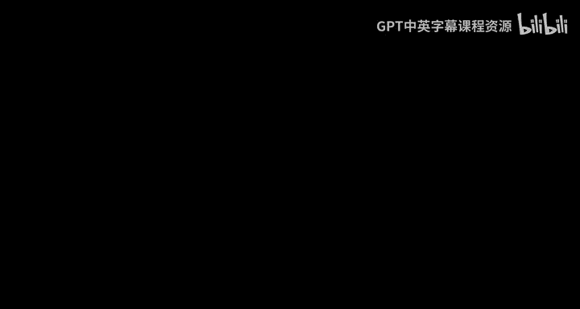
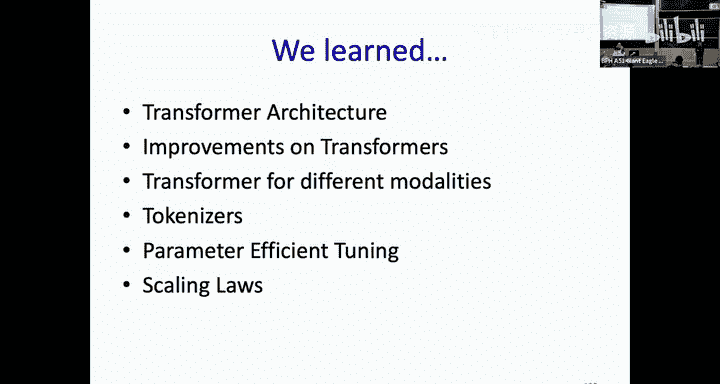

# CMU《深度学习导论｜11-785 Introduction to Deep Learning Spring 2025》中英字幕(deepseek - P22：[20]S2025 Lecture 19 - Transformer and Newer Architectures.zh_en - GPT中英字幕课程资源 - BV1xbZNYrEbs

呃， in这个。遇到你的问题。你 don咩。你 just need the money。So。Sp cold。算次。😔，So的可能。

I do not see the attendance poll the attendance poll。It's off。Okay。不。呢平时。就だ谁。这个。Okay。这。でしょ。这个。

Alright， so good morning， everybody。系啊。We continue with our collect on。あ。To marketss。诶。你说。

This lecture is going to be by turning。They not have people on to发。

What actually works on the subject and probably knows a lot more about it than I do。

He been his kindly agreed to do this lecture at my。

She will be covering trans architectures and human architectures that have manipulated topics。Okay。

 so good morning， everyone。So today we will talk about the transformer。

 the basic building block behind the powerful AI system that we use today like ShagPT。

 So we will start with the original transformer architecture， and we will go through each layer。

 and understand how it works。 Then we will discuss the improvements made on different components in the transformer architecture。

 Then we will dive into the variation of attention mechanisms， including more efficient variation。

 Then we will also explore how transformers can be adapted for audio and images and discuss the importance of tokenizer。

 Finally， we will cover parameter efficient tuning。And we'll talk about the scaling cloth。Okay。

 so before diving into the transformer architecture。

 let's first understand why it is important and why you are studying transformers。

 So a very simple answer， is's almost everything around this currently is based on the transformer。

 Everything that we use is currently as transformer， S GPT and all the co models that we see。

A more convincing answer。 What makes like the transformer such a bar for architecture。

 It has some cool properties。 The first one is the flexibility of the architecture。

 Transformer first introduced in N L B， But it is not just vert text。

 It general as well across different modalities and data types。

 such as fiin audio and in robotics and can be easily adapted with minimal changes in the architecture。

😊，The second one is scalability。 Transformers improve with more data and parameters。

 and this improvement is predictable， as we'll see later in the lecture。And at scale。

 transformer develop unexpected abilities， such as solving tasks without explicit training。

And lastly， be able to to efficiently fine tune the transformer for downstream task by using techniques like Laura。

So let's start for the very basic transformer architecture。

Probably by now we have seen this figure countless times。

 This is the original transformer architecture introduced in 2017 for machine translation。

 this Disc card， the transformer lies on multi head attention alongside the attention include essential components like the embedding layer position embedding fit forward layer and normalization layer the figure represent the encoded decoder architecture but youll see later the transformer can be also function hello hello and also the speaker speaking how are you will you please kind of maybe goes lower it's like you're racing through and maybe it's me I cannot understand what you're seeing So yeah Yeah yeah we can speak the way I can hear but the way you're doing like it's like you know Tbo you know like the movie very fast。

Okay， Augusta。Okay。So as I said， so the， the figure shows the encoder decoder architecture。

 But as you will see later， transformformers can also function with just an encoder shown on the left side of the figure or just a decoder shown on the right side of this figure。

 dependinging on the task。 you can choose one of them。

 So let's break down the transformer architecture and go through each layer。

So we'll discuss the architecture in the context of text moddality and explore how can we convert the text into numerical representation that the transformer can process。

The first two components may change depending on the modellta being used。

 but the remaining components are essential for the transformable block。

So the first step is word toization。The process of decokenization is to break the text into smaller units and convert them into integers。

These units can， can be full word sub or character， depending on the tokenizer being used。

 most modern models use sub tokenization because word level tokenization might introduce like some some problems。

 words may be mispelled or have variation like grammatical variation like E E D or I N G in the end of the word。

 or be or it might be missing completely from the training data。

 So support tokenization helps to handle these cases by allowing the model to represent words even if they weren't seen during the training。

The next step is word embedding。So after converting the words to integers using the tochkenizer here。

 we convert the discrete tokens indices into continuous valued vectors using the embeending layer。

So this layer acts as a lookup table where each token is not to a unique vector representation。

These vectors are learned during the training to capture the relationship between words。

 And we do this because token indices themselves have no relationship。

 no inherent meaning and no direct relationship between the words。 And by using the embedding。

 we create a more meaningful representation where world with similar meaning have closer vector representation in the embedding space。

So we can also view the embedding layer as a linear layer by converting the indice into one hot vector representation。

 And then multiplying this， what one hot vector representation by the weight matrix for the embedding。

The em matrix。So now we'll discuss the most interesting part， understanding the transform block。

 And we will start with the transfer with the attention mechanism。

 and we will see the variation of the attention mechanism。So， in the last lecture。

 you learned about self attention in the context of sequence sequence models。

 So can anyone briefly explain to me what is self attention。应该 said百老。

ProYes take a mechanism listen to providing politics to the meaning of。一。O。That's correct。

 So at high level， attention allows the model to determine which part of the input sequence are most relevant to the to a given token。

 So does this by computing the attention scores that tell us how much focus should we place on each token。

So the key components of self attention are the query， key and value factors。The query vector， each。

 each token has， it is own query vector representing what is， what。

 what is this token searching for in the sequence， The query vector should raise the question。

 what I am looking for， For example， is this token a verb or is this token announ。

And the key vector serves as an identifier of the tokens content。

 So it basically answers the the questions raised by the query vector。

And the last vector is the value vector， which contains the actual content that will be aggregated based on the computeusd attention score。

 So the value is basically， the value vector basically ask the attention score。

 What information should I pass along。 What information should I refine in the input embedding。

So the attention compares the query of one token with the case of all the other tokens to measure the similarity between them。

And this is done by the dot project between the query and the key。

 followed by the softmax operation to get the scores between 0 and 1。So as we see in the slide， the。

 the right， the figure on the right shows the assumption scores as as a similarity matrix between the tokens。

So the final output is awaited sum of the value vector。

 where tokens with higher relevance contribute more to the final representation。

 So we multiply the similarity scores by the value vector。

And this is another refization on the left is the attention scores。

 And on the right is the value factor。 So the final output is weighted sum of the value vector that has the same dimension as the input。

This output which will be added to the input to produce a refined representation。 For example。

 before the attention word， before the doing the attention operation or the multiplication。

 the word station does represent a station。 and we don't know which station it is。

 But after the attention， the embedding will carry a refined meaning that it is a train station。

 not any station。Sorry， what is the value matrix， how do we determine that again？so诶。

So both of them actually， they are coming from the Mbo。And the self attention。

 we will see variation letter in the cross attention。 But basically。

 the value of the key and the query。They are the input multiplied by different weight matrices。

So each， each each component has different weight matrix matrix， as we see in the slide。Okay， thanks。

 And these weight matrices are learned。 Is that correct， Yeah， Yeah， this Yeah， which learned。对。Okay。

So the self attention mechanism we discussed is sometimes referred as single head attention。

In multi head attention， we split the imp representation。

 the embeddings into smaller dimensions or subspaces， and each corresponding to different head。

 And each head learns different aspect of the sequence to capture more diverse information。

So this figure shows the attention scores for the same sequence using different heads。

 And we can notice that the attendant information for each token is different and different head is different。

 completely different than the other head。 For example， one head might focus on verbs。

 the other head might focus only on nouns。 But in practice。

 these learned features are not necessarily tied to grammatical categories。 It can be anything。

And after rebrossing， the output from all heads are concatenated and combined to enrich the empathy presentation from different perspectives。

Okay， so self attention and transformers process all tokens and better。 This means that by default。

 every token can attend to every other token。So the model by default is by direction。

 rather than causal。This， this B this is beneficial for text encoding。

 but for auto aggressivegressive decoding like language models， the future tokens should。

 should not influence the current predictions。So in the decoder。

 we need to enforce causality meeting。 Each token should only attend two best tokens and current tokens。

 not the future ones。So this is implemented by using the triangular matrix， this， this， this mask。

 the triang attention mask showing on the right side of the deco other part。

 where the future position are masked or set to 0 to prevent the model from being attention to them or from looking ahead。

This is called mask， multi head attention。And， and the decoder。

 there is a second multi head attention， this one。And we see there's some connection going out from the encoder to this attention。

 And this， this attention called cross attention。So in class attention。

 the query is from the question。 I'm sorry， I have a question the previous slide。

 will you please differentiate between by direction on Kaou， I I didn't get that。Yeah。

 so bi directionional， basically， the model can see all the tokens from both directions。

So it can see the future tokens and the best tokens。So， for example， if we are working on this。

 this token， so the model can see all the， all the future tokens。And for autoregressive。

 we should mask these future tokens because we don't have these tokens during inference。

Sorry a slightly different question so I see that the first part is like a mask multihead attention in the decoder and then afterwards there's like multi head attention so is it generally you only kind of use one sort of masked multi head attention than everything else is unmasked or how how does that generally work like is that an important aspect？

Yeah， so basically here， because we， it's the second one because it's conditional。

 So we have the entire representation coming from the encoder。But， so we don't need to ask anything。

But， in the first one。Yeah， and the first one， it is self attention。 and it is for the query vector。

Okay so is it also because that when you're masking the multi head attention at the beginning。

 you're kind of by default not getting the information from those future tokens anyways。

 so it's fine to just use straight up multi head attention for the rest of the decoder。

 is that also a reason？So can you say that again。 No， so let me answer that question。

 Can you hear me。Yeah。So for the last multi head attention。When you are performing。

 when you are performing influence in an auto aggressive manner。When you are generating any word。

 you don't do the。You still generate the credit word。So when a performing self。变更机 to yourself。啊，给个。

Wellas for the cross attention， when you're generating any word， you're only。

In the deco quarter is looking at the input。The encode， the encode is completely present。

All the poverty information therefore is always there。 So there's a notion of askinging。It's like。

 when I'm looking at the next room， I don't need to cover any option of。

When I'm looking into my own room， I cannot you see the portion I've already covered。Oh okay。

 so like if to make sure i'm understanding this correctly so we use masking at the beginning because for the like sort of output embeddings that are going into the decoder we don't actually know kind of what those future tokens are but the multihead attention in the middle like that cross attention because the inputs are coming in from the encoder and so thus the input embeddings we do have those future tokens so we don't actually need to do any masking is that understanding correct。

It sayst that found before。Okay， got it， thanks。O。So in crafts attention。

 the query is from the decoder。And the key and the value are taking from the encoder。

So this figure shows how cross attention works。 The query here is the previous translated token。

 And we try to find out what is the most probable next token， given the encoded French sentence。

So this is a very cool a from one of the last semester projects。

 The team here worked on image generation from a given brand， a text brand。

 So it shows press attention between the generated image and the text brand。

So the query here is the text front， and the key and the value are coming from the generated image。

So specifically， the model learns to a see a textual concept。

 such as the word bear with the corresponding visual features。

And the heat maps illustrate how different words influence the synthesis process。

So after learning about the attention mechanism， now we will learn about the positional encoding。

So the reason why we need to add position information to the self attention is because attention is very mutation invariant。

 Meaning， if we change the order of the sequence， the attention scores will be the same。

In this slide， we see that we have two sequences， ABC and C， C A B。 So they have different order。

 but the same tokens。And these matrices are the attention scores without positional information。

 So can anyone tell me。What do you notice hear about these two metricsric for the two sequences。嗯该系。

上结论。So呃 for example， the attention for the no of A and C yes36。Yeah， exactly。 So the basically。

 the attention score is the same。What的 order。哎呀。So the attention weight is the same。

 even though the order is different。 So this is will cause a problem because the order of the sequence can choose the meaning completely。

嗯。Yeah， sorry like。How are those two mees the same， I mean， I mean。

 they don't look like they permitted either the robots or cars。 They just look like they swap。

So the attention score is the same。For for it if you if you call your two rows。

 you must also to corresponding columns。系啊。I change the order of it。 this is some image。

 If I swap E and C， then the kitchen face to aim that。第第是电是独自说亡。But then you know。

 prevention that prevention knows what A。そとすはいました。O。So to solve this problem。

 we add position information to each token that captures the absolute or relative distance。

And the attention， all you need， the proposed abstract of positional encoding Later in the lecture。

 we'll see， well learn about relative positional encoding。So an absence position。

 including each position in the sequence is assigned to a unique vector。

And these vector are generated using a combination of sine and cosine functions at different frequencies。

 as shown in the formula slide。So in the figure on the top。

 the x axis shows the dimension index and the token embedding。

 and the y axis shows the position vector from position 0 to 15。

And the periodic nature of the sign and cos shows that even long sequences maintain a unique positional encoding。

In the formula and the embedding， see， if that if the embedding dimension I is even。

 we take the sign。 And if it is odd， we take the cosine of W K and T by T。

 So T is the position of the token and the sequence。 and W K is the frequency。

And K is for each pair odd and even dimension index of the dimension。So W is a hyper barmeter。

 And in the dominator， the 10 10000 is the maximum sequ length。

 and it can be changed based on the task。And yeah， and DSSD emtting dimension。Yeah呀嗯。

Did you what was case inYeah so。If you see here in the equation， we have if I is even。

 we take the sine。 And if it is odd， we take the cosine。

 So for each ver of the embedding dimension for different eyes， we have one value of K。So basically。

 K is the have the number of damage。I I can be。the size of the embedding。 So and the embedding。

So in the formula， So we have odd entitiesdices and even entitiesdicees。And K。

 it's one index X corresponding to each bear， even an odd number。You're commit science and science。

 Every cycle is a single thing。Yeah。で so case is half half the dimensionいや。And I is the。Is the。

Diamonsion index of the embedding dimension。不好意思。Okay， so now we can see the same example。

 but with position information added to the embedding before the attention on the top。

we see the same two sequences with embedding。 And on the bottom， the same sequences。

 but with be originalal embedding。 And we can notice that the at scores after adding the information are no longer the same。

So thats the step is feet forward layer。This layer is simply an M B layer。

 And usually we expand the input dimension to four times the input dimension and then apply an activation in the middle and then down sample again to the input dimension。

And the majority of the transformer parameters lives in this M B layer。

 and it stores the knowledge learned from the training data。

 And some research found that the context the in contextex learning and the emergent ability in large language models and transformers actually comes from this layer。

不确。The sorry。Butch here， I'm sorry to speak very fast。 sos talking which later。

So this is the feet forward block， feet forward layer。So the feature world layer。

 it's after the multi head detention， and it's just simply an em layer。Okay。

 so next is add and Tom Bla and。We see that between the multi head extension and feet forward layer。

 there are some skip connection and normalization layers。So the skip connection are residual blocks。

 and the layer norm is a normalization for the sample for each sample along the dimensions。

To stabilize the atring。So there， there is two ways to place this normalization layer in the transform block。

The first one is post node， where we applied the normalization after the residual connection。

And the second one is B Nor， where we apply the normalization before the multi attention and before the feet forward。

Layer， so the placement has a big impact on the training stability and performance。 And Re。

 it's generally。ItMore stable and makes training easier。And it prevents。

Extreme activation by normalizing the inputbo before processinging it。

 This ensures the delay received will behave inbo， leading to a better convergence。In Bon。

 on the other hand， it's harder to train because it requires like delivering great warmup and ti groundter tuning。

 But if we train， if we train the model with bus N。

 probably sometimes it produce better result in downstream tasks。

So another way to think about the brainor layer that brainor makes the network behave more like the identity mapping。

 meaning that the information flows through the network more smoothly。 And both Nor。

 the new the row output of the multi head attention and feed forward layer added to the residual before normalization。

This means that the output of fit forward layer grows the output of the fit forward grows too large。

 It dominates the residual connection。And it makes the training unstable。In pre norm here。

 the input is normalized before the before going to multiate attention and before going to feet forward there。

And since the visual connection directly added to the output without normalization。

 the network behaves closer to identity function。Wait， I'm sorry。

 Which one behaves closer to the identity function because I yeah。Because the is happening before。

Before baing the input to the multihi def and feed forwardly。

So then why is post normorm presenting better performance if prenorm is like more stable and you're normalizing before it goes in？

So when you begin normalizing things， they have less scope to learn stuff。えそででみたいす。

So why the better advance less。Okay， got it， thanks。Yeah， because they will be。

So the last layer is the output layer。 It is just a projection layer to project the output representation to the number of vocabulary that we have for the task。

Okay， so now that we have gone through each component， Let's put everything together。

 So the process starts with tokenization and then embedding followed by the position。

Bsal encoding to add the position information。And then the input is best to multi head attention layer to help the tokens interact。

 Then the feet forward layer to refine the representation。

Then the layer normalization and residual are added to the network for stability。

 And the final layer is the output layer， which is just a projection layer。嗯。Yeah。

Can anyone answer answer。三当之后要是。这个关系会制合。不知。I think one and three are correct。我说。我题我飞。Once3 okay。嗯。

Okay， what about the fourth statement。Q K and V， like x multiplied by some weight matrix。

 so it's like not an exact copy。Yeah， so in self attention。 So， yeah， basically。

 the option is not clear。 So， but in self attention。

 they are actually copy from the input X that they are multiplied by wait yeah。Okay， thanks。

 but it T， it wasn't clear。 So they are a copy of the input X and self attention。

 but not in cross attention。So now we will talk about the neural modification on some component on the transformer block。

So first， we' will start by discussing different types of the transform architecture。

Then we will talk about the relative positional encoding。 And lastly。

 we will talk about the efficient variation for the attention mechanism。

So we have three three types of， of the architecture， three different types encodeder decoder。

 encodeder only and decoder only。The first architecture is encoded decoder。

 It is usually used for conditional generation， like machine translation or summarization。

 where we have an input that can be fully encoded without any mask。

 Then the decoder will generate the corresponding output of a given input。

And the decoder usually is causal decoder， meaning the future tokens are masked。

 and we only rely on the best and the current tokens。The second type is decoder only。

 which means that we have only the decoder bar。 There is no encoder here。

 And you actually used for distribution， modeling and generation。And it is auto regressive。

 meaningan it generated token by token。The third type is encoder only architecture。

 And here we have only the encoder part， and the attention is not causal。

 So the the input is fully visible to the attention。

And this is useful for understanding tasks and usually used for classification or representation learning。

And we will see an example of each architecture type in the upcoming slides。So an example for。

 an in example for encodeder decoder architecture is T 5 model。

 and the five Ts are coming from text to text transfer transformer。

The model is retrained on multiple tasks， a mixture of unsupervised andservised tasks。

 And each task is converteded to text to text format。So the input is the prompt for the task。

 and whatever inputbo comes with the task。 For example， if you want to。To work on translation task。

 the input would be the prompt， Trans this sentence。 If。

 if you want to translate from German to English， the prompt will be translate this sentence。

 along with the German sentence。 and the output should be the corresponding English sentence。

So this just T 5 is actually similar to the original transformer architecture。

 And we see multiple encodeder andder。And the， there are some connection between between the。

 So the prompt is best to the encoder， and the decoder generate the output condition on the encoder's output representation。

An example of encoder only architecture is birdt bi directional encoder representation from transformer。

And bird pre training objective is quite different from decoder only and encoded decoder architecture。

Birth is not auto aggressivegress。 meaninganing does not tolerate text。

 but rather understand and process the input holistically。

 And birth is trained with two training objectives。The first one is mask token protection。

 And the second one is next sentence prediction。In mask token protection。

 some words in the input are masked replaced with the mask token。

And the model is trained to predict these must work based on the surrounding context。

And the second one is next sentence reduction。So given two sentences。

 the model is trained to determine whether the second sentence logically follows the first one。

 So the output is binary label， whether it is logically follows the first one。

 So it is true or false。The model is traineded on this objective jointly。

 as shown on the figure on the on the right。So for words。

 the two objective mask talking production and next sentence protection are for brief training。

 and usually B training objectives are not directly usable。

 So we need to plug in a classification layer or a decoder to use the Btrain encoder。

So after re training， we can use the encoder for any downstream task， and we can add a decoder。

 for example， for machine translation or a linear layer and train it for any classification task。😊，嗯。

The left type is decoder only architecture。 this is the same architecture used for Shagipti。

And it is trained with the next token prediction objective。

 where the model learns to predict the word， the next word based on the brievance tokens or previous words。

So mathematically， this is presented by maximizing the log likelihood of the next token。

 given the best tokens。And the diagram at the bottom Federal represent the process where G2 takes the inputot sequence and direct the output talking by token。

So， and there's something interesting about the GBT model。 So in GBT 3。

 where when they scale the model size and dataset set。

 they noticed that the model present some zero set capabilities for downstream task。

 meaningan you don't need to fine tune the model on downstream task。And。Later in the lecture。

 we'll talk about these capabilities and details。And D 4 trained on images and text directlyically with the same objective。

The next talking protection objective。By you said， this is based on mass token， right。Yes。

 this is based on the mask。is that the objective So it is， Yeah， So it is a causal decoder。

Meaning the self attention is masked， but the objective is next token protection。

So is it similar to next sentence prediction because you said that is binary， right？

Next sentence protection， it's it's a binary label。

isSo the next sentence an only model seen the entire report。For example。

 like a baby two sentences and really need sentence。 I can ask a few words。 Yeah。

 and it' very's also to say does the second sentence from the sentence。 So that's。

 it's an end as architecture。GPT is a deco architecture and presented a sentence as well to process the sentence and it's been credit less word one word at a time as you go to the sentence。

Yeah， so GT is next token protection and birth is next sentence protection。 and， and birth is。 Yeah。

 exactly。 So it's it's just a binary label。 Does the first one follows the second one。

 So it's through or false label。 But here we actually predict the next token and the sequence based on the previous tokens。

I see。 Thank you。 It's， It's a derivative model。 But birth is not a derivative model。 It's just。

Representation learning model。喺事。四岁系啊。SoSo excited why they choose that particular objective work because quite counter to have two seemingly different objectives being all at the same time。

Like个。Why did they choose next sentence validity classification as object。

Alongside in master competition。我也是 logic。咿压缩。It's a good question。 So I'm， I'm not quite sure。

 but I think the reason is because the。The one objective wasn't enough to just predict the word for。

 from the context。So they try to understand the entire meaning by predict the next and intent here is to actually derive semantically meaningful representations。

As是。While I kind justify this particular choice of objectives。

 I am assuming that when they came up at the model， they kind of launch。

Everything a word being on everything on the side。啊，他说等大来去一下这次那。不听的我必须 so。In of world like。看你个是。And单。

之前你个确认。So thats the mix of。不是在哪边批。We have to go doesn。真。Okay。

 so now we'll discuss the relative positional encoding。So previously。

 we learned about the abstract positional encoding。 However， this approach can。

 cannot generalize to larger sequences that arem not seen during the training。 So in theory。

 in the original paper， they said that this approach should be able to extrapolate， but in practice。

 it has very limited extrapolation capabilities。So one of the proposed alternatives is to use relative distances between the tokens and add them to the attention directly。

 rather than using a fixed embedding and add them to the token embedding。 So previously， we。

 when we discuss the absent digital encoding， we were adding the positions to the input embeddings。

 But now we will add the position directly to the attention matrix。In the next slide。

 we will see the， we will see two examples of relative positional encoding。

 The first one is alibi attention with linear biases。

 And the second one is rotary positional embeddings。And in the figure below。

 the Y axis is the per lower is better。And the X axis is the number of tokens。

And we can notice that models trained with a embedding fail to fail to generalize to long sequences。

 leading to higher complexity。And on the opposite side drove and alibi relatively positional method journalistize much better and maintain lower publicity。

 even on longer sequences that they were they were not exposed in the during the training。

So the first type is abi， adding bias to the attention matrix before。

 So the idea is adding bias to the attention matrix before the soft max operation。

And this bias is the offset between the tokens。 And we can notice that the diagonal is0。

 So the offset is 0， and the other offset are relative relative distances between the tokens。

So after getting the offset， we add this this bias directly to the attention。

 Then we compute the softm operation。嗯。Im here as the head specific scalealr。

 It's set before the training。 So it's not a learnable parameter。 It's a hyperpar。

And different heads in the multihi attention have have different M values。

 And the intuition behind this M is that for long sequences， the y will be large negative value。

 and the soft mask soft max scores for these tokens will be low。 So setting M to small values like 0。

005 helps the model to focus on long grade dependency。So the value for the。

 for the this M is different for each head and。They changed to focus on both local and long dependencies。

嗯。The second type is rotary original emeddding。 that country used in some language。

 large language models， such as Lama。The idea here is to use a rotation matrix with some theta and to rotate each key and query vector by it is position in the sequence。

It includes personal information by rotating the token embedding in 2D space。So in this slide。

 the example for the word do is， it is rotated based on it is position in the sentence。

 So in the first sentence， the word is rotated by four theta。

 And in the second one is rotated by two theta。And then the first one， because it is。

 the first word in the sentence， is rotate by one theta。So in general form。

 we apply a rotation transformation to the query and key vectors before computing the attention scores。

The lower part of the slide shows the rotation transformation， how it looks like。

 and it looks scary at the beginning。 But the idea here that for each two dimensions。

 we apply a rotation for， for that two for these two dimension with different theta。

 And then we combine all the dimensions together。And the theatre is a hyper parameter。

So Rob shows allows for extending the sequence length after training， and we。

 we can use longer sequences at inference so we can extrapolate the length by just rotating the key and query vector。

对。Okay， so next， we'll talk about efficient attention mechanisms。

So the problem of the attention mechanism is the quadratic complexity of the computation。

As the sequence。So the complexity increases as the sequence length increases。

 and the quadric complexity comes from the dot product with between the query and the key vectors。

And there are multiple attempts to reduce the complexity of this operation。

 And we'll see five examples in this lecture。The first one is linear attention。

 And the idea here is that the dot product is just a similarity measure。

 So we want to replace this similarity measure with linear operation。

Another approach is flash attention。 It is hardware aware optimization。

 that restructured the attention computation to minimize memory access。The other three types。

 the group query attention and multi query attention and multi latent attention。诶。

They are a methods to。To reduce the number of key and values factors used in the during the training。

 and some of them， they reduce the dimension of the key and value factors。

 And we will also blur these techniques in details in the upcoming slides。

So the idea of linear attention is we approximate the similarity measure using a kernel function。

So we replace the softm， the exponential operation with any non negative kernel function that can be distributed and factorized。

 such the RBF kernel。This kernel trick allows us to rewrite the dot product by first multiplying their key and value。

 as shown in the， in the last equation in the slide。诶。So， yeah， so first， we multiply the。

 we can reorder the operation to multiply the query and the key factor。

By using the assess probability of the matrix multiplication so that we can avoid computing the full attention matrix first。

 And this is reduces the dimension to the embedding dimension。 So the， the。

 the complexity will be quadratic in terms of the di embedding dimension rather than the sequence dimension。

So the attention now， so， yeah， so the attention now was quadratic in terms of the embeending dimension。

The second type is flash attention。 It is a hardware aware optimization。

 It reduces the memory users by computing the attention in blockss or tiles。

 And we'll see later how the tiling process works and details。But first。

 let's understand how standard attention works with GU memory。EOn the right， the triangular figure。

 we see that we have three types of memories。 The imported ones are the first one。

 and the second one。The first one is Sram， static random access memory。So it is faster to access。

 It has higher bandwidth， but has lower storage，20 MB。And the second one is H PMM。

 high bandwidth high bandwidth memory It has larger storage， but low bandwidth。

 So it is slower to access。So now let's see the figure on the left， the orange and the yellow bars。

On， on the left part of the figure it shows how standard attention access the HBM while computing the attention。

 So it loads the keys and queries and values from the HBM to the G GBO memory。

 the on chip memory S Ram memory。 And then it performs a single step of the attention mechanism。

And then I tried the result back to H PMM and repeats this operation for every single step in the attention mechanism。

Flash attention， on the other hand， includess the key queries and values blocks in blocks and fuses all the operation of the attention mechanism and write them back to H PMM。

 So it doesn't store any intermediate representation。In flash attention， we don't start the。

 the matrices back。 So the core idea is to break the sequence into smaller blocks and fit them that can be fit in the SRA。

 then process them sequentially to compute the attention efficiently。

The obion happens entirely within the asram memory to avoid the read and write obion to the high band widths memory。

 the HBN。In the table above， we see that flash attention decreases the HBM。

 the red and right operation and reduces run time。But it has higher number of gigap flops。

 which is gig of floating point operation per second。

So flash attention does not reduce computation itself。 It optimizes memory access。

 and it allow the system to perform more aration efficiently on the S Ram memory。

So let's understand the tiling operation。 And the first example on the top it shows how matrix multiplication works without tiling。

And first， we need to load each row and column separately to compute the product and then store the value back。

 And then where be this this process for each row and column。So in this case。

 we need 32 memory access。In the second example， it shows the same operation with Tling。

 and we split the matrix into four small matrices that fit in the is and compute the four values at once。

 So we don't go back and start them in the the HBM。

 So it reduces the read and write memory access to 16 axis。

So the time operation reduces the the access for math matrix multi。 But in the attention mechanism。

 we have another operation， which is softm and。How can we reduce the softm by using the tarring operation。

So。First， to understand， how can we split the softmax operation。

 Let's first understand how the final softmax works。So in the final of our softm。

 we need to perform two full basees to the inputot sequence。

 One for computing the normalizing factor on the dominator。

 And the second one to obtain the attention score。So the problem with this is that if the values are large。

 If the X value is very large， this is my case to over overflow due to the exponential exponential agression。

 So we will actually use safe softms。And in shifts of Max。

 they subtract the maximum value from the input of X for the exponential operation。But in this case。

 if you notice， we need 9 of three forbes instead of two furlobes。So the question now。

 can we do better。 So in say Saof Maxs， we need one loop for computing the maximum value。

 The other loop for computing the dominator， which is the normalizing factor。

 and the final for loop to find the attention score。So a solution for that is the online softm。

And online soft Maxs， they combine the operationion of finding the maximal with computing theory normalizing factor。

But the problem here is that the normalizing factor depends on the maximum operation。

So the idea is that online soft maps update everything as it go through the sequence。

 one element at a time。 So instead of adding the exp exponential here， instead of adding them， they。

They update or rescale the exponential。By the new maximum value。Which is shown here。

So when an neuro input is processed， both the running maximumimum M I and the normalizing factor updated together。

And the key insight is that the final result is the same result as the traditional two aspectss abroad of self attention。

 So these two are mathematically equivalent。And you can take a look at the proof in the paper。

 but I will skip the details of the proof for now。So how does F attention use this idea。

Just for just like the online software Mac。诶。So on set Max， it maintains a running maximum。

 So flash attention does the same thing。 It tracks these values while calculating the attention weights on the fly。

So the outward recurrence relation showing on the algorithm， this one and the algorithm。

 it accumulates the weight value incrementally similar to how the normalization factor do it in the online soft Max。

And there is proof shows that this process produce an equivalent result to the attention mechanism。

 So flash attention does not change the attention computation， like linear attention。

 It just fuses all the computation together， and。Into small blocks and process the。

 the entire matrix block by block。So yeah， if anyone interested in this。

 please just read the paper and post your question on Viazza。For the proof。And okay。

 this diagram shows how flash attention operates。 and it perform the attention computation block by block without st any intermediate results。

Yeah， so this is the full Alga algorithm for flash attention。 This is just for reference。So， again。

 flash attention does not compute the attention。 does not change the computation of the attention like cleaner attention。

 It just reranges the computation efficiently to exploit the hardware of the GBO。

 And the table you see that flash attention has slightly better performance。

 better performance than the standard attention with speed 2。4 speed up and time complexity。

So to understand the other efficient mechanism techniques， we need first to understand K caching。

For decoded transform models， the decoding operation is auto aggressivegress。

 meaning that the attention of the tokens depends on the previous tokens。And at each generation step。

 we are recalculating the same previous token previous talkingken attention。 And when actually。

 we need just to compute the attention for the current token or the current input。

 So the idea here for K B caching。 it's to catch the previous keys and values and focus only on calculating the attention for the new token。

So the figure on the top shows the emphasis operation without K B caching and the green columns means that the key and the value are recalculated。

But on the bottom， we see that when we catch the key and the value。

 we can only compute the scores for the current token。So here we are computing the following matrix。

 And here we only just computing the score for the current token。不是。

So the idea of multi query attention and。Groed query attention is to use a single。

 a single key and value pairs for the queries or a group of of， or a group of queries。

To reduce the number of cast keys and values during the inference and the performance of the multiple query attention and group query attention is slightly worse than the standard attention。

 And this is because the reduction of the number of keys and values。But definitely。

 it's it use less memory during inference。The， yes， which of the following provides a more drastic。

 The loss of performance， The loss in number of， if you compress the number of keys or compress the number of values。

 which is worse。 So they do it jointly。 I haven't。 I didn't see anything value go together。 Yeah。

 I was serious。 but if any experiments or don't try to only one of these two。没没有。Okay。

 so multid attention is introduced in deepse V2 paper。

 And the idea here is to use a projection matrix to compress the key and value。

 So unlike the group query attention and multi query attention。

 they try to reduce the number of queries and the number of  keys and values。 But here。

 they try to reduce the dimensions only。So they， they only start the latent vectors and project them back for computation。

So the only cast values is the compressed values here。For the Keys and Pariss。And surprisingly。

 the performance is better than the standard attention mechanism。

 But there is no clear reason why it is better。 One explanation is that when we project the vector into smaller dimensions。

This projection removes the noise in the in these vectors。 So the model might， might be overfited。

 and this projection reduces the unnecessary information while keeping the most useful ones。对呀。😔。

你个有什么啊子的。the first statement control。三分す。No， it's not true。What about the second。TheYes。

这太 is a capture。好。那个那公。Well， okay， so the only correct one is the second one。Okay。

 so transformer has why been widely used in fi and audio task。

 and we'll learn about how can we adapt the transformer to these modalities。

So we'll start talking about how， how to use the transformer in fidget。

 Then how can we adapt it in audio。 Then we will discuss the to tos and how can we tokenise different modalities。

嗯。So this is， this is one of the early architecture that uses images with transformers。

 The idea here is to split the images to small patches， then use these patches as tokens。

 and the transformer architecture is kept unchanged changed。And to understand this。

 let's first recall H in and deals with the images。So in CNNN， we use a fixed linked kernel。

 and we can this kernel to process each patch in the image。

So we can imagine that if we have an inbo image， we can split the image into small batches based on the kernel size。

In Vi transformer， they adapt the same design for CNN。

 So they split the input images into small batches based on the chosen batch size。

And then they either flatten these batches and use a fully connected layer。

 or they use a convolution layer with kernel size， P and strip B。

So we can notice that we actually lost the spatial information when we split the image between batches。

 So each batch gets a unique trainable representation。 Abal embedding。 And this positional embedding。

 either learned during training or fixed positional embedding。

 as we saw in the original transform architecture。😊。

So we can use this visual embedding into this space instead one this space。

So once we convert the images to these small tokens。

The remaining architecture remains the same as the original transformer。 and in transformer。

 it is an encoder only model。 and it was used for classification task， not for generation tasks。

So this is comparison between the scene and architecture and fi transformer。

The results are for image classification task on the X axis。

 it shows the number of pre traininging samples of JFT dataset。

 and on the Y axis chose the classification accuracy on imagenet dataset by using five fine tuning examples for each class。

In the plot， there are six models， Four of them are for the fision transformer， and two of them。

 the light gray and the gray line is for reant architecture。 And it is based on CNN layers。And here。

 vision transformformer B is the base model with 12 layers。

 and vision transformer L is the large model with 3024 layers。

 And the number 16 and 32 are the batch size。Yeah， the B， the bed size， just the。And we see。

 the best performinging model is the VI T la with the bed size 16。

And you can see here the T N N is better when the pre training data is small。

 And once we start increasing the training example examples。

 the phs transformers outperform these CNN N N models。😊，嗯，对啊嗯。要做啊。Well see now So。

 and the reason for that is the inive biases for CNN and transformer。

 So CNNs assume that nearby pixels are related， which makes them very efficient for image processing。

 and the same filters the kernels slide across the image along CNN to recognize batteries regardless of their position in the kernel and the image。

 So the CNN shares the weights of the kernel。 On the other hand， the fision transformer。

 they don't assume any relationship about the pixels or about the input unless they learn it from the data。

 So fision transformers have no built in inive biases。😊。

And they must learn locality from scratch from data unlike C N。

 which are naturally good at capturing local features like edges。

And this makes fis transformer very flexible， but also requires a lot of data to learn effectively the patterns。

So in the figure below， the first plot from the left shows the initial linear embedding。

 And it shows that a clear bathroom， once the data is enough。And in the middle。

 it shows the cosine similarity between the position embedding of one batch with all the other batches and the。

 the other batches of can you see the plot。On the right， on the right plot。

 the X axis is the network depth。 It shows the number of layers。

And the network and the Y axis it shows the mean attention distance across the images at each layer。

And they did it with 2000 images， randomly selected from imageagenet。

And we see that there is 16 buoys。 It's， it's not very clear， but there is 16 buoy for each layer。

 and。Each point correspond to a single head in the network。

And each point chose the average attention distance。

 which is the distance between the batches and the image multiplied by their attention scores。

And they took the effort for one the 1000 images。So this bullet shows that the lower layers learn local information because it is highly variable across the head and the lower layers and。

As the depth increases， the deeperward layer learns more global information or semantic information。

 So the distances became very small between the heads。Okay， so now we'll talk about Yeah。

 did it like the fine tuning， I or I use pre training the fine tuning。 Like did that work。

Better for vision campaigns like did that like produce because like there needs to be a lot of data。

Yeahear earlier第亚水。Yeah， so they actually retain the model on the GFT dataset set。

 and then they fine tune each the model on5 example from the image。For a bird class。

 for five example for each class in this is after pun tuning。

But this axis shows the pre training examples。 But the result is for fine training。So， yeah。

 so now we will talk how， how the transformer was adapted in the audio modality。

 So one of the early application of the transformers was in speech recognition。

 and similar to the fi transformer， the change was only in the inputot layer。

 and the remaining architecture is kept the same。And the first figure on the on the left shows the speech transformer。

 This model incorporated convolutional layers before the encoder transformer to capture the local structure of the spectrograms and address the the these convolution layers to address the length mismatch issue by striding the along the time axis。

Toduce the sequence length。嗯。Then yeah， they， they extract these features and passed it to the transformer layers as they didn't change anything about the architecture。

The figure on the right shows audio spectrogram transformer。 After the release of Fi transformer。

 they adapted the same approach to audio by converting the audio to spectrograms and treat the spectrograms as images。

So audio spectrogram transformer achieved a state of the art result at that time for audio classification task。

And stood out as a convolution free and attention based a model for processinging audio。

The third architecture is the conformer model and was introduced for a speech recognition task。

And it stands for confvolution augmented transformer。And here。

 they combined the strength for the transformer architecture and the convolutional layers。

And since transform exel at the modeling the global dependencies and。

 and capturing the local features。So the conformal leverages both。

 and they integrated the multi head attention while the convolution layers within each conformal block。

And we see here that the conformal architecture， the the compuls layer is placed after the multi head attention layer and。

Yeah， it's after the multi head attention layer。 And in the paper。

 they experimented with different placement for the CNN layers。

 And they found that the best placement was directly after the multi head attention layer。😊，So yeah。

 now we'll talk about Techkenizers。 So the idea of tochizers here is that we want to convert the continuous representation for any continuous modalities like images of videos or any modality to discrete representation。

And then we want to use these discrete tokens with the transformer as， like processinging text。

And nowadays， most of the multimodal approaches， they actually convert the images or audio into discrete tokens。

 And then they use the transformer architecture to model these tokens。

And we'll not go through the details of these tokeniss。

 but the key takeaway here is that we can train the tokenisizer for different objectives。

 like either we can extract seman information or spatial information or acoustic information from audio。

 And there are many paperss。 I cited few here。 And these papers。

 they are talking about what kind of information these discrete tokens have and。一呀。

And how can you use these tokens then with the transformer architecture。

What sort of programsza would you use what I。Well， not really familiar with that all。

I'm not familiar what these countries。这啊。反正是怪。B一不不是。啊跟你说。是啊。

That civilized mechanisms for divided buildings。ThatPlease on。开看。这那个。

Can someone tell me answer the first question？一个。那你关系。要我。Yeah， that's correct。

 So he said dynamic weight for weights from data and global dependency from data。

 And the second question。先けしな。The second one， Okay， yeah， that's correct。呵呀。So， yeah。

 so now we'll discuss another interesting topic， which is parameter efficient tunic。

So the idea here is instead of to fine tuning all the model parameters。

 we only tune a small portion of the parameters of the pretrain transformers。

And well learn about four techniques， prefix tuning， prong tuning， adapters and Lauraura。

So in prefix tuning， the idea here is to add a prefix embedding to the inputot sequence embedding。

And I built attainable parameters to these embeddings in each transformer layer。And usually。

 they add these parameters to the key and value weight matrices。

And these embeddings are learned based on the task。 So each task has different prefixes。

 and each task has different retaining parameters。So， fine tu parameters。 And the。

 the number of prefix tokens is tin tokens， bird task， as mentioned in the paper。So each token is。

 is， as is an embedding by itself。And B tuning is similar to brieffis tuning。

 It's a simplified version。So we only add the the prefixes or the prompts embeddings to the input sequence。

And we only fine tune the these embeddings。嗯。Yeah， so the the entire parameter kept frozen unchanged。

 and we only fine tune these embeddings。 And usually the。

 they said the number of tokens for the bro toning is 100 tokens for each task。 So for each task。

 we have 100 tokens。 And each token is an embedding vector。

 And these vectors are added to the input sequence。So for adapters。

 the idea is to add a new MV layers called adapters to the retrain model and train them for downstream task。

And these adapters are inserted after the feet forward the layer。嗯。The reason is because they want。

 they don't want to disrupt the， the knowledge of the pretrainren model。

 and they want to modify the most expressive part of the transformer。

 So they put it directly after the feed forward forward layer。So。

They ensure that even if the the adapters is broadly initialized。

 the network still function correctly because we don't change the。The knowledge before the。

Pter there。So the plot on the left shows that shows comparison between the adapters and fine tuning the top layers of the transformer。

 The X axis shows the number of trainable parameters。

 and the Y axis shows the difference and accuracy between a given method。

 either adapter or fine tuning the top layers with full fine tunic。呃。So they。

 they used the globe benchmark for different tasks。To compute this accuracy。

So this block shows that the adapter has similar performance to a full fine tunic because the。

 the deelta here is 0。 So it's similar to full fine tunic， even with the smaller parameters。

And even with small parameters， it matches the performance of finenicity top players。

So the fourth approach is lara， lower rank adaptation。

 And the basic idea of la is to add a lower rank matrices that have lower dimension。

Thenhan the weight matrix。 And we only train these Laura adapters。 And after training。

 we add these adapters to the original weight matrix。

So these lower rank adapters has lower dimension。 And after training。

 we multiply these two matrices together so we can get the same dimension as the original weight matrix。

 and we perform simple additionion operation。So for architects like transformers。

 we will literally inject these lower adapters to each query and value weight matrix without any activations。

And the order value here， the lower dimension is usually set to 16 or 8。

So it depends on the model size and on the fine tunic task。

 So if the model is larger and the task is harder， So you might increase this R to 64 or like。

 a larger number than 60。So essentially， all barmeter barmeter efficient fine tuning methods do the same thing。

 They modify the breach features with minimal amount of bar。And we can notice that here。

 the performance is close to full fine tuning with only training 15% of the parameters。Wai。

 which method is ours。Yeah， this is just taken from the paper。 There is no hours。啊。I'm sorry。嗯。

Good afternoon。Yeah， 2。98 as paper Yeah， I will cite the paper again。 I forgot to cite the paper。

Okay， so， yeah。 so now we'll talk about scaling clause。

So the magic of the transformer that they get better with scaling data， model size and compute。

 And this scalability is or the performances predictableable。

 So while the accelllator memory has increased and it has not kept pace with the rapid scaling model size of the transformer。

 So the size of the transformer models has grown exponentially from 2，2017 to 2022。😊。

So what is scaling G， This is a paper from open AI describing that the scaling trans scaling transform work。

 how scaling transform work and the relationship between scaling model size and data and with the performance。

And the figure on the left shows the relationship between Kimbut and the test laws。

So what they did is that they train different models with different configuration。

 And this is shown on the blue lines here。And the black line shows the best configuration from the small scale experiments that they perform。

 And the orange line is a linear regression model。 So they fit linear regression model between the best configuration and the lost value。

So the idea here is scaling low can be used to choose the optimal hyper barmeter。

And the idea is to run multiple small experiments in small scale。

Then just fit a regression model to protect the best parametersers。

 so you don't waste compute to try different configuration for large scale training。

So an example of that is deepse L。 They actually used scaling law to determine what is the optimal batch size and the optimal learning rate。

So they ran multiple experiment on small scale。 Then they protected the best parameters for large scale training。

So guess we are out of them。还有。这是是问题吧？So yeah。 So this is just a slide for the emergent capabilities。

 And looking at this plot， we see that as the model increases performance on various tasks。

 like arithmetic question answering and multiple tasks。😊，Remains the same for small models。

 And at certain scales， we see that the performance jumps dramatically。

So I guess this is the last slide。 So one of the most exciting capabilities is the emergent capabilities of transformers and large language models。

 which is the in context in context learning。 So in zero shut learning here。

 we only provide a text description。 and the model has to figure out the correct answer。😊，And。

 in fu shot learning， in addition to the text description。

 we give the model few shot examples of how the task should be performed。

 Then the model should learn from these fu shot examples。So yeah， I guess that's it。 Thank you。

 everyone for much。

， please question Therata and thank you again for the very time。

Very color ready。