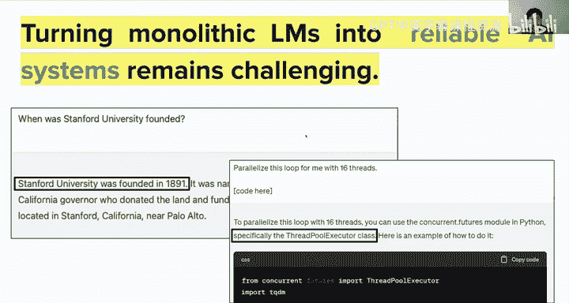
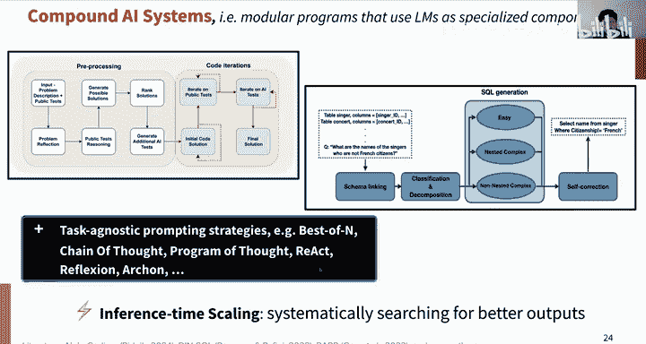
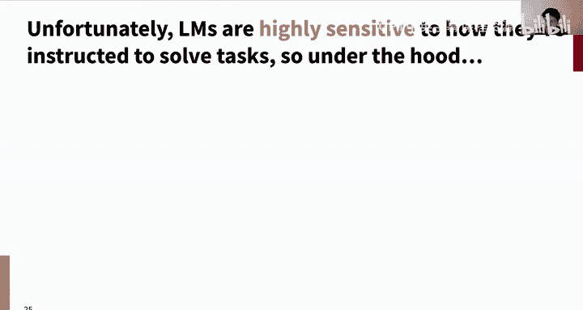
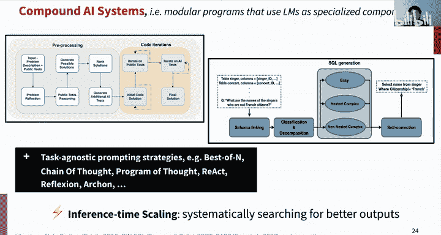
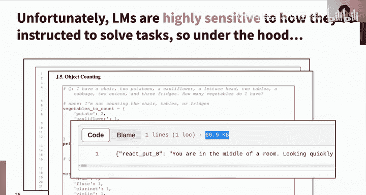
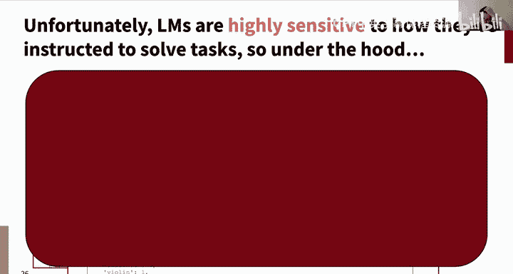
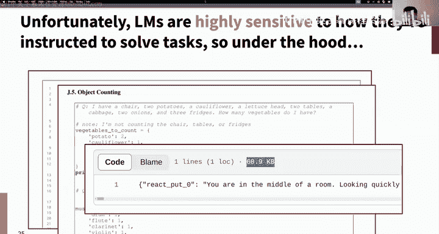
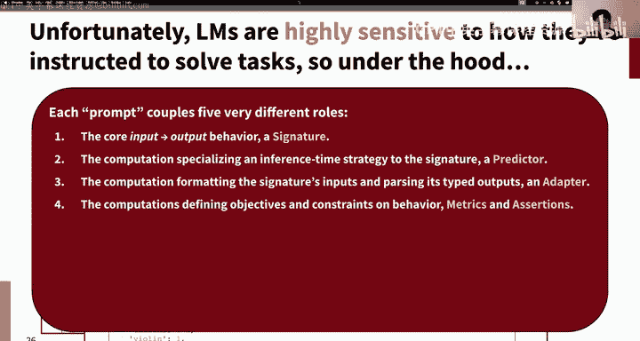
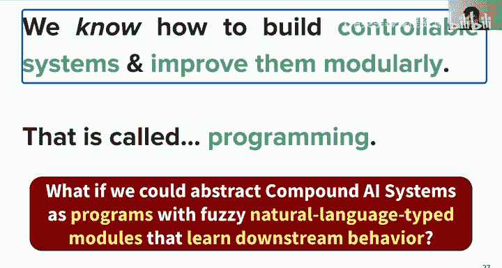
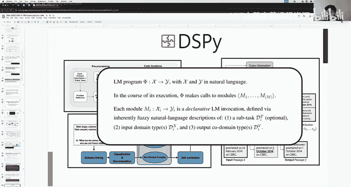

# CMU《深度学习导论｜11-785 Introduction to Deep Learning Spring 2025》中英字幕(deepseek - P23：[21]S2025 Lecture 20 - Large Language Models.zh_en - GPT中英字幕课程资源 - BV1xbZNYrEbs

And we'll wait for a minute。For exactly 8 I'm very very thankful to Omar for doing this yet again it's what's the time where you are 5 a is 5 a yes yeah so it's an ungodly hour for him and somehow he manages to do this for us and。

嗯。I'm grateful so A let me begin it's my great pleasure and immense honor to introduce Ammar Kahaab who is going to get his PhD from Stanford this term this spring and he will be joining MIT for as a faculty in fall。

😊，Omars one of us at said many years ago before he began his graduate career， he was a TA for IL。

Today， he is one of the best known。Upcoming researchers in NlP so he you're going to see his name all over the place in the coming years if you haven't done so already so it speak with great pleasure and honor that I。

And the floor over to Omar， he is going to give us a lecture on last language models， Omar over to。

Thank you so much Bisha it's yes the slides will be posted it's really my pleasure to be here in the class again like Victorsha said I took this class。

😊，You knowNot that many years ago at CMU and I teach it and it's been like one of the most foundational learning experiences I had I did receive my PhD actually a couple of quarters ago I've been working in industry for a bit and then I start I go back to academia in the fall。

Like make sure thing。So。

So I have a little lecture here on large language models and the compound AI systems they enable us to build。

 I will define the term compound AI systems。And I've adapted a lot of material here from many amazing folks。

 many of them at Stanford。So the context of this lecture is that it's never been easier as we're all aware。

 to build really impressive demos and assistant that exhibit intelligent behavior。

And perhaps the best example of this is none other than Chad GPT， it's this one interface。

 one portal where you can ask just about any questions that come to your mind。

 and not only can the system do the usual thing of surfacing results that people have written related to your query。

 it can actually conversationally synthesize stuff specific to the context that you're asking for。

And what makes it incredibly powerful compared to previous paradigms in AI like search is that it can also help you with tasks。

 so I have here an example of me asking ChadGT a couple of years ago to paralyize a loop in Python and allow it to run with 16 threads and lo and behold it as exactly as I asked。

So what I want to discuss today is sort of how the content of this class。

 how deep learning allowed us to get to this stage and what are the you know at a high level what are the。

St or steps on areas of research that allow you to take the things you're learning in this class and apply them to that vast domain of building large language models and making sure they work well as systems or as systems that are user facing。

😡，So one of the first sort of foundational pieces here are neural language models themselves as this sort of you know class of deep neural networks。

 and this is something I believe you guys have discussed in the past couple of lectures where you're just interested in the problem of using transformers to model language and what does it mean to do autoregressive decoding。

 but we'll touch on it very briefly just so that we start on the same page。

One of the foundational stages that allow us to take transformers which are not that new right they actually had come out before I took just before I took this class in spring 2018 so they had come out a few months prior to that I believe one of the things that sort of give them a lot of the power that enabled a lot of the subsequent progress is this idea of pretraining them at very。

 very large scale and pretraining is not new but the way in which it's applied for transformers for language models is truly marvelous and it probably exceeds the expectations of almost everyone just a few years ago。

 so the goal of pre-training as a stage is to take this transformer that knows nothing and give it very broad knowledge of language。

 the world and maybe some capabilities that we will help that will help us do a lot more with the models like things like reasoning。

But if you just stop at pretraining one of the lessons its kind of the silent lessons of the past you know three or four years is that you actually end up with really really cool toys that are not necessarily very useful the first step to getting these models to be useful not just impressive is what is called post-training or aligning them this is where we take these models and essentially we set up a massively multitask learning problem in which we try to teach them to be assistants and give them behavior that we like like the ability to follow instructions you know making sure that their output is safe is not toxic and other sort of desirable behaviors because you're starting from this thing that just samples natural and you know typical and expected language and you want to actually end up with this thing that behaves like an assistant and there is a bit of a you know the latter is really a very small kind of。

Subsid of the former。One thing I've added briefly here relative to when I gave this lecture in the last iteration of the course in November is reinforcement learning for tasks that are easily verifiable but really hard to solve。

 like solving answering hard math questions or helping with programming tasks has seen a huge growth since then and the understanding in the field of how to approach these problems and a success also has progressed dramatically in just the last six months or so。

 so I'll spend a few minutes on this， and then we'll take all of these and then ask well now that you have a pretrained and aligned language model that is also been trained with reinforcement learning to solve hard problems。

 how do you actually go about building user facing systems and building software in which these large language models or model？

That maybe can use tools or can interact with each other or spend time doing classical AI things like search。

And how do you sort of think about fitting all of these parts together and even optimizing the weights or the prompts of these language models in order to build effective systems？

So this will be the agenda for today and please feel free to know ask questions or interrupt at any point。

 you know the goal really is to answer any questions folks might have about this。

So just as a recap neuro large language models or neuro language models are not a new idea and using transformers for this is just going to be a really powerful uniform starting point for a lot of the things that we can do nowadays so I know you guys have discussed the transformer architecture before and at a high level the process of autoreggressive decoding is going to underpin everything we'll discuss today extremely general at a high level this just involves you have a bunch of text some input prompt we have a way to tokenize those maybe into words or sub wordss。

😊，We know how to do a forward pass through our transformer and compute you know attention keys and values for every one of our tokens for all of our layers and given those we will simply start this autoregressive generation loop where in every time step we will。

You know。The forward pass and that will allow us to end up with an embedding at the end from which we can project it to the probability space of the vocabulary allowing us to predict the next token which you from which we can sample from that probability distribution and then we simply end up with a new token that we append to the sequence and we end up where we started where we can actually just do another forward pass to predict the next token and as we do this。

 we're building up a sentence piece by piece。So this is a really interesting pattern for a few reasons。

 one is it's very general， you could imagine that just about any task that you might or function that you might want to process in natural language could be cast generally very productively in this type of framework and what's nice about it is that it makes learning far easier to reason about and far easier to implement and also far easier to learn because you've factored a lot of the problems get into just like how do I predict the next token at every time step。

Now the way I describe this was sort of assuming that we will have a decoder in our transformer and in fact the vast majority of progress over the past three or four years has been through the lens of decoder only transformers so GPTs generative pre-trained transformers but encoders are actually still the backbone of many applications like search like information retrieval and if you count deployments as opposed to maybe you active areas of research there is arguably more deployed encoders out there。

 then deployed GPTs at this point， although I think the gap is shrinking so this is where I spent you a lot of my early PhD research working and it remains a really interesting area but I'm just kind of mentioning it as an aside before we focus the rest of the lecture on large language models implemented through the decoder only transformers。

😊，What encoders really shine at are tasks where our goal is to build really high quality representations。

 so you could imagine that if your goal is to take a massive collection of documents maybe the web or all of Wikipedia or documents on your desktop and build data structures。

 build indexes that allow us to search content of these files really fast encoders are really good because they can actually allow us to do things like build learned term weights where we map every document to a set of weights corresponding to every term that you know maybe appears or potentially even doesn't appear in that document and therefore we can leverage classical data structures in information retrieval that allow us to map search queries to the best scoring documents so this is kind of a direction of work that has been around for the past you know maybe。

😊，Six or so years with large encoders。Another approach that is even older and has been pretty successful because of how scalable it is is just to take the encoder and literally use it as an encoder where you're asking it to produce high dimensionional dense representations of every document in your dataset and given a search query from a user you can also map it into a vector encoding。

 and if you train this architecture to allow the products of these two vectors of queries and documents to mean something。

 for example， if you train it with some kind of ranking loss that allows more relevant documents to get higher scores relative to a query then lower relevance documents。

 you can end up with really， really simple way that makes in very few assumptions that allows you to build scalable search engines。

😊，And this is ubiquitous at this point for the reason that by decoupling the computation entirely between documents and queries。

 you're able to sort of precompute all of these document representations and at scale you you can build data structures that allow you to do nearest neighbor search for these vectors now this does come at a massive cost the whole point of attention if you sort of compare them to things like recurrent neural networks like LSTMs the whole point of attention was we really want to be able to align tokens and we really want fine grainined representations because we want to avoid learning bottlenecks and gradient bottlenecks so this is actually a problem because it is really hard to build these crammed representations that are supposed to cover any query you asked about any part of a long document and so on the other extreme you could actually just use the encoder directly as a scorer these are called。

😊，In crosscoders where you train it essentially you could think of it as a regression model that takes a query and one document and produces scores and as long as these scores are calibrated and relative to each other they' are meaningful you can actually use it for sorting for sorting the documents in your data and of course one issue here is that this requires linear amount of work relative to the number of documents you want to score and so a lot of the research in this field and my own research is actually thinking about and as produced sort of architectures that sit in between they are really scalable so you can actually search data set of size n in time that is asymptotically less than n so you don't even need to look at all the documents in fact you don't even need to look at the constant fraction of the documents as the data grows but you actually still get a lot of the token interactions that make things like transformers。

Really effective， I think there is a question， let me check。Okay。I wouldn't say it pivoted。

 I think there is just two very different types of applications so a question asks has the focus of my research pivoted to the decoder side to I think one or the other or something else is the future of the field。

 I think they're just useful for very different things encoders are really great for building representations and for they tend to be bydirectal in practice so that means that if your goal is to understand the piece of text and map map things to values like classification for example。

 they're actually still really really powerful especially when you factor in computational cost but decoders are just much。

 much more natural generating actual text and as we'll see generating text has applications well beyond like the fact that you want to produce like chat responses so both are absolutely necessary but I wanted to cover encoders very briefly at the story。

So from here on we're just focused on decoder only language models when people say large language models nowadays。

 they typically mean the latter class and the first stage here which actually by the way to some extent is involves a lot of similarities across different types of transformers although we will be focused on things that are specific to decoders。

 so the first stage of getting a transformer to become a large language model because in general transformer can be anything is to give it broad knowledge by training on as much web data out as much general human knowledge。

 basically verbalized human knowledge that you can obtain from crawling the web or purchasing large document data sets from people that have like libraries of these types of text and other forms of other forms of written knowledge or even transcribed videos or audio。

Or podcasts and you know like。This is an interesting sort of tradeoff at scale where you really want as much data and as much knowledge to be in in your pretraining corpus as possible。

 but also you want to get rid of the vast amounts which are probably the vast majority of content that is just really low quality maybe just like you messy HTML documents that don't have a lot of value or spam documents or all the kinds of content that you might not want to train your large language model on。

 so this is kind of you a dark art if you will， and it's really a process of understanding but also a process of trial and error at very large scale that we as a general community have seemed to collectively kind of converge on a reasonable way of approaching。

So I have here a screenshot of the pile， which was one of the earliest kind of pop and open corpora for pre training specifically。

 and you can see here by size。Different slices of data that existed back then。

 and I would say things are probably a lot more fractal and a lot more diverse now than how you know the clean picture you might see here。

 but you know you had archive you wanted to represent。

Academic knowledge and you can see just how big of a fraction it was in this corpus here you have things like Github you wantitarian code you have Wikipedia you have stack exchange so a lot of these kind of。

😊，Hubbs of documents written by many， many different people is kind of a recurring theme and then you have things like NIH or free law or other kind of PubMed central for more domain specific types of knowledge。

 medical or law content and this is the type of things that you know people want their models to typically be good at。

😊，So this is a lot of text and the nice thing is through the lens of self-supervised learning specifically through the task of language modeling。

 which is not a new task， but is a very general problem。

 we can then take our transformer and just teach it to take you every prefix every single prefix。

 you imagine how many prefixes of strings that are in this corpus， given a prefix。

 just try to predict the next word which is just actually a classification and classification objective。

 you could just do it with a cross entropy loss of given words one to t minus1。

 predict the next word or the next token。😊，And this kind of approach with things like Elmo and BerRT。

 which were encoders and then GPT， which was a decoder only architecture。

 sort of started this paradigm of thinking about what you might call foundation models of you know if you want to work with language before you sort of actually even define your task。

 you're going to invest heavily in pre-training your large language model so you end up with this general artifact that is very easy to adapt for different tasks and again pretraining is not new people have been doing an envision for long and other areas and certainly an NLP as well。

 but it sort of became this paradigm where really the final pretraining artifact is almost you could argue a lot more important than just the architecture from a notion of like you what are the layers or whatnot like you kind of get this。

Whole and a lot of the， you know。Observable sort of behaviors of the model depend a lot on how you do the pre training。

And there's a question here of like why are we doing this pretrain so empirically works really well and you know everything else depends on it nothing that we will discuss from here on has any chance of working whatsoever if we don't do this this stage but there's a question of there's a question of you why does pretraining on broad data help and I've seen these sort of two ideas I wanted to convey of you from two to4 n lectures by slide manning and others is that perhaps it's a question of helping the gradients flow better so you're spending you know these you know trillions and trillions of flops to train this large model which is initialized that random initially and so there's nothing that guarantees that your initial random initialization is conducive to。

To gradient flow and to learning and so by training it on so much data。

 you're kind of just brute forcing your way of arriving at a highly you know a model that is really good at learning through gradient ascent。

😊，And that is a plausable hypothesis， I mean it's definitely true it's unclear if it's enough like if it's the whole thing a different sort of way of thinking about this is that maybe when you're doing stochastic gradient and descent in this really really high- dimensionmenional space maybe it likes to stick close to initialization and if you pretrain you end up with this initialization that is pretty general because it's good at predicting next words in any context that exists in the web and so you know even if you just converge somewhere close to that during fine tuning for the task that you actually care about like maybe you want the model to predict you know to act as a classifiedifier it or you want the model to you generate titles or summaries or whatever。

 by starting from a pretrained artifact and ending up somewhere close to that in the parameter space。

 maybe you're ending up with an artifact that has a bias to generalize well because it was trained it was trained to do just。

😊，AboutAnyth on the web that's represented in this text。

So a very related question is what does pretrain actually teach the transformer have a question so we are pretraining on large amounts of effectively random text。

 so why is the output so always so grammatically correct？So I mean in general。

 this is a great question in general a lot of care does go into the into the training and if you remove that care。

 you can actually end up with models that are broken。

 so this is just about as kind of iterative process as anything else we do in deep learning。

 but this is an argument to be made that，By just the sheer scale of reasonably good data。😡。

You're encouraging you're encouraging behavior that sort of。

Appears frequently enough and so mistakes that are grammatical or mistakes that are in spelling。

Every mistake is different and so there is no pattern to learn the only sort of mode or pattern that is really common is you know maybe the it something that people would not be too perplexed when they see which is also something that the model would assign a higher probability so you know you could imagine that this。

😊，This kind of signal emerges， but also it's something that is really baked deeply into these models。

 but it's also worth saying that if you just take a pretrained model。

 like if you take you know a model that is genuinely not been what we'll talk about next which is post training。

 it can actually generate very weird behavior， especially if you。Well， I mean。

 especially if you don't give it like a very long prompt that is that has a lot of。

Contextual examples of the exact behavior you wanted to follow it will generate a lot of punctuation or a lot of you know repetitive behavior and it can kind of look very degenerate in fact。

 but you know I think it will also mostly avoid。😊，You know。

 weird grammatical errors because they are just。Each individual type of error is probably vastly underrepresented compared to what you might look at and consider reasonable grammar。

😡，Are we running out of data to use to so there's a question from Daisy are we running out of data to use to train these types of models for pretraining If so does that mean the focus will turn more towards efficient usage of data or new algorithms so like I mean this is a contentious question pretraining is absolutely essential it's never been sufficient for any of the real behaviors you want it gives you really impressive toys like the GPT3 paper came out you know in 2020 and it was a big kind of a big splash but GPT3 in its original form is completely useless it's potentially interesting for you know。

U in NLP and folks that do computational linguistics to actually ask questions about language and models of language with as little intervention as possible potentially but in terms of their actual use there are not particularly meaningfully useful so I just want to signal that now are we running out of data are we definitely run out of like low-han obvious kind of data where you're just kind of crawling more and just throwing it in there is a lot of ways still to like grow by being clever about how you get data like for example if your Google I don't know can they maybe train on transcripts of YouTube videos that that they have it's not something I know much about but it's something that is closeusable that they are doing in fact they probably are doing it and so there are other ways of ending up with these types of data but what we will see shortly is that。

You need very large scale， but the way these things scale quickly， you know。

 like you know you are really trying to approach this from a brute force angle so the scaling is is not is not linear and we'll see more about it here and we'll see why yes。

😡，You definitely have it's been true for a while that you need a lot of other things it's just that pre training。

😡，Is necessary to do the other things。😡，So before we proceed beyond pretraining。

 there's a question of what does it teach a transformer and we just mentioned， you know okay。

 so it helps us build a good representation of language and maybe even languages that people would consider you know accurate and grammatical。

😡，But it also gives us a broad foundation that we can adapt to a lot of downstream tasks so I have here this this snippet of closed sentences from slides by Chris Manning and it's really nice because it shows that。

Organically and naturally in very large text corpora。

 you end up with a lot of behaviors that can be learned from self-supervised learning from simply predicting the next token or predicting tokens that are masked in some way so Stanford University is located in maybe Palo Alto California so you learn a lot of trivia and a lot of facts about the world I put fork down on the table maybe Fworkk or F workk so you learn a lot of syntax the woman walked across the street checking traffic。

 checking for traffic over her shoulder so again you learning some grammar here co referenceence well beyond grammar as well if there are multiple people mentioned or multiple objects you of learn you can learn pronouns I went to the ocean to see the fish turtle seals and and so you could kind of learn to stick to the topic but it gets progressively more interesting because you could actually start learning things like well you know I was watching this movie。

I got from watching it was the sum total of the popcorn and the drink so that suggests that you didn't like the movie。

 the movie was bad and so you're already kind of learning organically all kinds of natural tasks that occur in people's speech where sentiment is a problem you actually care about and it's kind of organically appearing in the data and you can kind of imagine that you could also see things like mathematical proofs or sequences or you know code or other sort of problemso processes that can become really helpful when you want to use。

These models as as foundations for further task adaptation so this is really interesting but it also helps kind of underscore let me see what's the next slide okay so it helps underscore this slide about scaling laws so I know you guys have briefly covered scaling laws in an earlier lecture。

😊，And is this， you know？I would argue not obvious right this highly unobvious idea that there is a predictable。

 vaguely predictable pattern， potentially or actually really predictable depending on different perspectives whereby you can actually sort of estimate how much data and how much computation and how many parameters you need in order to end up with certain properties in your model like for example。

 the perplexity of the model or sort of how good the model is at predicting next tokens in your corpus。

 so scaling predictably follows empirical patterns which is really important in practice if you're training these models because as you sort of learn in this class。

deep learning does depend on making good choices in terms of just engineering。

 your hyperpar and your data selection and your training runs and so you want to be able to make these decisions effectively and one of the amazing things that make that possible is if you could actually make these decisions at small scale and then basically having ways of extrapolating those two larger runs then you can end up with much more effective usage of your computation where you can actually train much larger models than you can use for searching for hyperparmeter。

So this before we discuss this further， I think it's actually useful to reflect on the scaling laws from a different angle so the scaling laws are not linear you basically like a general pattern we see in a lot of computational kind of study of machine learning is roughly speaking you have to double the amount of work that you're doing to get like linear increases in metrics you care about and one way to think about why this might be the case is just how inefficient the process is of trying to find these little tasks that sort of appear organically in the data when you're not sort of consciously constructing any of them and this is not an argument against pretraining。

 we have no other way of doing this you can't really enumerate all the possible tasks but because we don't know how to construct them at least not by hand you know we have this really inefficient brute force way of learning a lot。

of these organically， but the nice thing is or the bad thing depending on how you want to think about it is that you we have this really。

 really expensive way of doubling the computation that we put into this and getting back linear improvements as a return for our investment。

You know there's a question again of are we running out of those。

 but irrespective of whether we're running out of those or not。

 you do run out of doublings because at some point it just becomes you know having this kind of exponential growth in cost just becomes unsustainable at some point eventually always has to become unsustainable and so that's why you need a lot of other things on top of this。

😡，U。So yeah， I mean， scalingkating laws give you an interesting tradeoffs that we could talk about for quite some time because you have this interesting thing where actually you can spend more computation at training time and end up with smaller models that then allow you to save computation down the line when you're using these smaller models。

So I see a question， is there a way to merge classical rules based NLP？

I will come to something related to that I would say a lot of rules based。You know。

 machine learning or AI was always operating at a very low level of representations and I think you know。

 like for example， if you want to do sentiment analysis。

I think it's pretty clear you do not need parse trees even though parse trees are actually a fundamental idea。

 you could imagine hacks or things that are like less fundamental than that。

 but you don't even need those and if you want to do vision there's a lot of things or speech there's a lot of sort of hand engineered techniques that you do not need and I think we've learned that and so this is one fundamental lesson of sort of representation learning at scale and deep learning especially that doesn't mean that there is no place for anything you would call a rule if you're building a piece of software in which you actually want to program a lot of like high-level behaviors so I think there's this emerging idea of well you don't want to be in the business of specifying very lowle rules because those representations can be learned and they can be learned much better than you can ever specify them but you need to be in the business of specifying like domain or like business logic if you will but like domain logic rules like I don't want the robot to ever do X or I want my。

Web browsing agent to always ask for permission in certain cases。

 like there are certain behaviors where you need rules。

 but the rules will be at the level of the problems domain that you're acting in and not at the level of if you see an edge and another edge next to it you know do the following behavior so you're not building rules for representations。

😡，嗯。What would be the drawback of having an encoder as well？😡，I think that's a good question。

I don't have a short answer， by the way， a lot of the these things are you know。

 I was going to skip the question but actually let me say something useful， which is。

A lot of the lessons in the field are empirical and because of how expensive it is to make progress because a lot of this depends on scale。

I think you see a lot in deep learning and you know I'm sure a lot of this is relatable is there is an amount of productive you know folklore or sort of like people have tried this and it has worked so that's not change it unless we have a good reason to change it so if people get like you know GPTs to work really well at scale。

Everyone else is suddenly a lot less motivated to try a different architecture。

 not because different architectures cannot be better。

 but simply because know like you have this thing that works and you want to make it even better so there's this kind of like genetic algorithm that's running where like humans or like researchers are like taking the best thing that exists and building more on top of it and occasionally some people go on and explore other things but you do kind of want to balance exploration and exploitation and because of how expensive it is to explore and because of how most things don't work like the things that work are actually a very like small fraction of the possible ideas that does reinforce people to stick close to what has been proven so there's a bit of a risk aness and if you're an academic students seeking a class like this you especially especially in the Introde learning class。

 you there's a lot of encouragement in general to like reasonably scope of project。

Or homework approaches that that you try where like maybe you could。Be slightly more risk you know。

 take slightly more risk at the small scale that you're working on than somebody that has like a $100 million budget and they have to spend you half of it training the final model and it has to be really good in a short time scale。

So if pretraining was just about reducing perplexity。

 it wouldn't be particularly interesting and you know we would still exist in the birth world where we pretrain and then we find tuned models after weve pretrained the best model we can and that was actually very effective for a couple of years but what the GPT3 paper observed and what started a lot of different interests。

😡，You know， and actually started shifting a lot of the way in which people do natural language processing and really eventually do just any form of you know a lot of forms of deep learning since then。

 is that scaling also appear to have these like jumps where we get new capacities like in contextex learning and in contextex learning is just this paradigm where we're saying after you pretrain the model。

 you don't necessarily need to collect a data set of thousands of data points in which you then do new gradient updates to train the model to take inputs and map them to outputs。

You can actually just like include instructions and examples Li was originally about examples and if you show the model enough examples of the transformation or the function it can extrapolate so if you show it a lot of examples of English separator French English separator French it eventually learns that okay this person is probably trying to get me to translate it is a pattern I can continue doing and you know it was kind of pretty surprising to people but in retrospect I think you could imagine that if you have a really really good next token predictor presumably the web is full of cases of like parallel structure right and so a few short examples are just an instance of like if you see a pattern repeat。

😊，You try to infer what that pattern is and then you sort of continue doing it and I'm trivializing it to some extent it's not obvious that this had to emerge and it had to happen。

 but I think at this point it's very clear just how powerful deep learning at scale can be and this is one of the things you get。

😡，And so people have studied this type of thing and you know it does seem like getting it to exist in your model does require a lot of computation。

 it was kind of perceived that it requires you know models to be very large but you know I think it has boiled down to you need a lot of computation and need to be very careful and you can actually get small models that do reasonably well here so I have a plot here of model scale in terms of training flops from WL and you know accuracy on different tasks with in context learning and it basically goes from like not working to working。

😊，嗯。A different type of thing that emerges at scale is a chain of thought reasoning。

 so this is just the idea that。For a lot of problems， standard prompting。

 even few shot prompting would have you stick a problem and then spit out the answer and you know this is kind of like a supervised learning formulation of machine learning it's just that it's conducted through text。

😡，And an idea that sort of seems attractive and is natural because this is how humans do stuff is for certain types of problems that are compositional or otherwise just complex you benefit generally as a human from breaking down the problem into steps and you know writing down those steps in some kind of scratch pad that allow you to reach the answer where the individual steps are much smaller so like it's much easier to take a math word problem and figure out a plan for doing it than do the arithmetic one step at a time than to just kind of galaxy brain your way through like either just know the answer computationalally in your head so that's an intuitive thing what is not very intuitive necessarily or at least wasn't was that just by pretraining a model at very large scale it actually develops the capacity to do this for questions it hasn't seen if you give it long enough prompts with enough example。

😊，Or even zero shot if you don't give it any of those。

 and you just like ask it to think in a certain format before it answers。

And and so this means that you can actually turn the computation that you're doing into the autoregressive decoding itself and like essentially you're composing a lot of the forward passes through the neural network instead of relying on the neural network itself to do this and this is not a hack in the sense that people have actually studied whether this gives you more more like。

😊，A larger computational capacity than you have with with just like the direct inference in the sense of computational complexity and so there is a lot of sort of growing interest and we'll talk about sort of you know what exists in this sphere in a little bit。

 so again this is something that only happens at scale。

 although as time goes by you know we figure out ways of getting models that are smaller to exhibit exhibit these types of behaviors。

😊，So I've discussed so far pretraining and all of this has been things that sort of emerge at scale from just working with data I think an important theme I'm trying to convey is that that is necessary it's on its own it only gives you toys if you want something that actually works you've got to actually teach the model intentionally to conduct the behaviors that you want because with the original large language model and if you have not used one of those you should figure like you should get one and like get like know Lama two base or Lama threeb not pretrain and actually ask questions and what you'll see is it has no idea that it's supposed to answer those questions it's just predicting the next word so often if you give it a question you know it will just generate more questions because that sounds like。

Something reasonable that you might want to do and so there's this notion of aligning the models to act more like agents or assistants that sort of kind of get a notion of human preferences in their behavior and so the simplest form of this is just teaching them to know that they should answer your quees rather than just like sample tokens so this I have here an example of that from a 2022 paper。

😊，And this is nothing but at you know massively multitask training at scale where like somebody sits down very carefully and collects examples or like existing data sets of as many language based tasks as possible and it can get somewhat clever here like can we take like。

😡，Questions on stack overflow and turn them into a data set or you know take and have a question yeah so in all of these post training techniques。

 what is the general accuracy with which the model recognizes the task it's supposed to perform？

This is a really great question。😊，Because。I call this massively multitask training。😡。

And there is actually a risk if you truly approach it as a multitask setup。

 you're kind of enforcing hard or sharp boundaries between these tasks and that's a problem because you want these models to be assistance and when people wake up and they want to use an assistant like you know beyond sort of more conventional or classical approaches they don't want to constrain themselves into a pre-existing task they just have a problem and they want to help solving it so I would argue that ambiguity is the name of the game where like the whole reason we're interested in these foundation foundation models is that we。

😡，Think there is there might as well be combinatorially many types of tasks that we want to solve and so really what you want is to show the model as many of these you know instances of tasks as possible so it can actually extrapolate to any tasks that you didn't exactly show it and and in practice this is really hard models as we will see in a little bit are actually very sensitive to how you ask them old models I think we're sensitive in the sense that like they kind of remember the similar type of question that they were trained on and they just kind of essentially it was very obvious nearest neighbor like you're asking for something that looks like sentiment it might not be sentiment at all just as similar keywords and so the model does sentiment analysis for you and it was kind of funny and I think what we have now is just like。

Higher order and more powerful like version of that， but to this day。

 I think models remain sensitive and remain finicky in terms of their prompting。

 but a part of it is actually very fundamental that can never be solved because it's not just a question of is the model making a silly mistake It's also a question of do you know exactly what you're asking or or not and the reason is if you knew exactly what you were asking and you had enough time to specify it。

 you would probably just write a Python piece of code you wouldn't ask a language model The reason you're asking a language model is precisely that you are actually missing some like you're under specifying your problem by design and that's why like one of the most fascinating and powerful things to do with these large language models is expand the space of computations that you can build in software where conventional programming is like you can only build a software like a piece of software if you know exactly what you want to end up with declarly or imperatively or in a functional way and with large language model you can actually not know。

Exactly what you want to end up with but give it some structure and have it do something reasonable right it fills in the blank so I think the question of like ambiguity and can the model how does the model how good is the model at figuring out the right task is a fascinating question because in some sense that's the whole crux of what we're trying to what we're trying to do and if you train the model with like very clear separation between tasks you're gonna get a bad model so what I have here on this slide is actually not a great way of conversion it's a good way of starting it's not a good way of ending up here so yeah exactly unfortunately this is expensive and unskable it doesn't actually teach the right thing for a lot of types of tasks because you're teaching the model to copy right answers and a lot of the time if you're just teaching it like if the square root of x is the cube root of y is whatever if you just teach it that the answer is 64 and the model doesn't actually have the capacity to learn how to arrive at that answer。

You know，' just too many steps and it can't sort of figure out the features it needs to learn in the neural network to make this prediction all you're doing is you're training it to hallucininate right so it sees a question like this and it just makes up a number that looks reasonable as opposed to arrives at the answer through like some kind of reusable or you know kind of through some kind of deduction stages。

So this motivates a lot of work that has been growing over the past you know three or four years of what if we allow the models to learn from thread and error so we still need to get give them a lot of questions but instead of like just kind of supervising them directly on the like copy this answer when you see this question what if we actually take these models that are becoming increasingly good due to better pretraining and due to better posttraining and we allow them to do reinforcement learning for a long time this was captured by thinking about human preferences and what that means is like。

knowGiven a question and two different answers you ask an annotator which one do you like more because we want the model to produce things that people like the assumption here is that people know what they like and also that you know that this captures everything from correct knowledge to like helpful style to good formatting to you know avoiding toxicity and other behaviors and so this is the kind of problem of reinforcement learning from human feedback that allowed you know Chad GT's initial release to you know start convincing people that there is really something interesting in post-training these models actually the original chatdGT was just trained with supervised learning but then quickly switch to autoHF which was kind of decisively better in some ways。

Especially after a while， so the way conventional reinforcement learning from human feedback worked as Open I introduced it around three years ago is that in step one you do supervised learning。

 so you go and collect a lot of prompts go and collect a lot of questions。

 you ask annotators to like act as language models right so they label demonstrations。

 they label the right answer and then you you just do like you know continue you continue training your model at predicting the next token in that in that data set that you build。

😊，Now that you asked people to do this， you have a model that is reasonable right you've trained it。

 it can generate text， it can answer questions， you can take that model and ask it to like generate a lot of answers for a lot of new questions and that allows you to go back to your annotators and ask them you know I don't want you to write answers I just want you to look at like these two outputs from the model or these five outputs from the model and rank them so tell me which one was best。

 which one was worst and that allows you to train a classifier which is called the reward model which basically just tries to figure out between different responses which ones with humanlike more this is kind of a ranking system or you could think of it as a regression model that gives you a score for every output and the idea is the higher the score the more likely it is people would like that output and the hope is that you through training on enough data that reward model captures what it is that。

嗯。That humans like in the responses so given the reward model you've turned the problem into something that's very amenable to reinforcement learning reinforcement learning here would just mean I have this model and I can ask questions when I ask questions it can you I can let it sort I can sample trajectories you from my agent that I get this way so that would mean I would get responses and at the end of each one of those trajectories I get a reward the actual reward would probably be to ask people do you like this or not。

 but in practice we can ask the reward model which is noisy but we can ask the reward model do you like this or not and then it can basically use a learning algorithm to say well。

 keep sampling from your model and keep checking your rewards in order to sort of he climb that reward and figure out strategies or policies that maximize these rewards for the distribution of inputs that I'm giving。

てい？Um， so。OLHF relied on a reward model to represent human preferences and this was kind of I think perhaps too popular and maybe not the best thing to start with it's clearly necessary it's absolutely necessary but a simpler approach that is orthogonal you can actually do both and you absolutely need to do both if you posttraining a model is to think about verifiable rewards so cases where you're not just asking a different model do you like this and the model might not actually have any knowledge like if you're asking you know who is like what is the capital of this country or that country I mean。

The reward model scoring the outputs might have no more knowledge about that right answer than the actual model you're training anyway。

 they're both large language models so there's not necessarily a ton of signal that can flow there from the reward model in fact in fact if you have human annotators there's probably not even a ton of signal if they also don't know the answer and they don't have the time to look it up or do research so like you' got to be very careful about what actually is it that you're trying to teach these models and one of the things you could argue happened is overemphasis on the reward models gave us models that kind of plateaued right so you can kind of distill into the models distill in an informal sense like you can kind of get the models to adhere to some general behaviors from these reward models but you kind of plateau at some point and you stop seeing gains in some of the types of tasks you care about and one of these types of tasks or tasks where there is a verifiable way of checking whether the output is correct so you can think of like math。

problemsblem， you know， literally in a math textbook。

 maybe in grade school or you know in high school or in calculus courses in college or any other in math competitions。

😊，A lot of these have like a very short easy to check answer。

 it might be a number or it might be like a short you know formula or equation or something that's easy to check especially if if the system formats things in a nice way and you ask it to do that and so there is this huge class of problems where you can actually easily check if the output was exactly right and that means that we can take this reinforcement learning approach of sampling completions from the model and checking if know they have arrived at something that is worth rewarding and allowing。

😊，Conventional learning algorithms， you policy gradient methods for example。

 in reinforcement learning， allowing them to sort of drive the optimization of the large language model and this is not just for math can see this for like if you have a programming task you often check that your behavior is correct by checking that the code compiles and checking that all of the unit tests pass and checking that other sort of behavior tests are correct so there's a lot of sort of ways you could set up the enforcement learning environments that allow these models to learn and this has sort of been around for a long time this is not new but there's been massively renewed interest in it because open AI and other sort of large labs have vectored from relying entirely on the enforcement learning from human feedback as the main way to increasingly building these reasoning models that chains of thought during posttrain and sort of throw that away but they do that in a way that maximizes。

They expect the reward they get for these types of verifiable tasks。

So this became a lot popular a lot more popular than before with recent models you guys might have heard of like01 and you know deepse R1 and open AI03 mini gymmin I thinking and a lot of the underlying ideas like reinforcing reasoning is are not actually in you so there's a question of what changed and I'll answer that after looking at some of the。

😡，Questions。So unfortunately in the interest of time。

 I cannot really spend a lot more time on reward models。

 but I think like the slides have these links， I can also share the like citations。

 I mean I can also share the links to relevant papers， how are security fundamentals。Yeah。

 these are like yeah， these are great questions like how do you define boundaries for behavior。

 big open ended questions， you can think of how reward models can get you somewhat close to thinking about that。

 but I do have to move on unfortunately。So one of the reasons this has become so much more popular recently is that the actual base models that we then apply these reinforcement learning algorithms on top of have gotten in much more robust and developed by themselves maybe or where end Dao is intentionally I think this is still contentious it's unclear。

 what people are starting to call cognitive or reasoning behaviors in the base model itself。

 like before we apply this reinforcement learning or at least before we scale up this reinforcement learning that allows for successful oral exploration。

 so this really cool paper by Gandhiel that came out just a month ago or maybe actually less was showing that if you take this model called Quin and you do reinforced and it's a base model although the definition of these where it is becoming a lot more ambiguous now。

 but it's not a model that has conventionally been dubbed as like it's been kind of trained to do all these tasks explicitly although again over。

Time the notion of pretraining becomes closer and closer to like thinking about hard tasks and if you apply reinforcement learning to it to learn math or some other types of verifiable tasks。

 it actually learns really quickly and you can actually detect a lot of interesting behaviors in its pattern if you take a different model Lama from meta and you take the base model so the model that has not been posttrained and you try to do reinforcement learning。

 no behaviors are shown， it doesn't learn very much nothing it really happens and so what's the interesting thing here。

 the interesting thing here is that it looks like some base models by virtue of emergence themselves or by virtue of people endowing them with those behaviors intentionally they are able to conduct things like checking their own outputs in their own reasoning or breaking down problems into sub goalsals or changing their mind and backtracking or like deciding on a goal and then working backwards or figuring out what would need to happen。

or for me to achieve this and these behaviors are really important for successful RL exploration and like to just remind you of why that is reasonable remember that in RL you're not given the sequence of steps youre just given the reward when you succeed and so if you're just trying random things you will get no words right if you're just sampling tokens and just like saying nonsense you get no words so you're not learn anything at all this is different from supervised learning where you're always learning something there's always a gradient that tells you how to move in the right direction and even if you learn something to generate like you just learn to predict the mean or something it's always some signal that's not the case with reinforcement learning so you want to start from a model that's good enough to succeed frequently enough so that you can actually like reinforce that behavior that it does well and so this is an insight on what change that allows a lot of this progress to happen。

Um。So I want to spend a small amount of time on kind of like， okay。

 so we have these large language models we。😡，as a community figured out that transformers are a really powerful architecture for learning sequence to sequence mappings。

 we figured out that that pretraining them is absolutely crucial and that by doubling the amount of work you put into pretraining you can get models that are better on a linear scale in many measures you you could care about and that you can posttrain both by doing supervised multi multidaask learning as well as by allowing the models to learn from trial and error and you end up with these amazing artifacts like the models they have listed here on the top that like you can just go and ask like really hard math questions or like coding problems that they have definitely never seen because you created it on the fly and they can kind of do a pretty good job like deconstructing those and answering those and I think it teaches us a lot actually about like the difficulty of a lot of things that we consider difficult and how the fact that。

Careful composition of these like scalable approaches can get you really far on them like you have models now that can could in principle participate in math competitions and do reasonably well or coding competitions and do reasonably well。

So that's fascinating， but I started by saying that it's never been easier to prototype impressive demos with AI and I showed you these two instances that are you from a particular model in a particular time but they are pretty representative because this has not change and it will generally not really change as a fundamental pattern which is the fact that you the answers were actually wrong and what made them really tricky was that these language models and the way we trained them they are really rewarded for sounding reasonable and for sounding fluent both in supervised learning in self-supervised learning and in supervised learning and in reinforcement learning with rewards with reward models。

 they are really just encouraged to sound right as opposed to necessarily be right and so they said here that Stanford was founded in 1891 which is not true it it's close which is why it's tricky and the whole reason I asked Chad GPT to paralyize the loop for me was that like the Italy。

K of affected each other。 There was a dependency a data dependency between the iterations so when it just did like the stupid thing like the basic thing of parallellyzing it without dealing with that I just got a piece of code that was buggy because it had a database and I'm glad I noticed right if you just like drop this into your project many people can can be affected so turning monothic language models into reliable AI systems things that you can kind of like put into specific applications or like use in your construction of software think of any type of software you might be building like anything from systems that help you book tickets to systems that answer questions about like technical topic to whatever it is you might want to build turning them into reliable AI systems remains hard and this is something that affects a lot of deployments and practice people are starting and have been seeing a lot of instances of like what can happen when this goes wrong。

But I think there is actually a fundamental thing we can do about this。

 so every AI system will make mistakes I'm not trying to single out like this particular powerful paradigm or chatdGT for making a few mistakes every AI system will make mistakes including everything will talk about at any point in any machine learning class but the problem with language models is that the monolithic nature in which they can are kind of like emergemergennt and you just shove in terabytes of text through them and you get behavior out of that makes it really hard to iterate in the way that we need to build software。

 it makes them really hard to control when exactly what kind of boundaries you want to establish to debug when things go wrong wrong and to improve when you figure out that hey I actually want to change this behavior because you have this artifact。

 this black box artifact that was already trained and making any adjustments require a very kind of you kind of restt and。

Hope you kind of get closer to where you want， which is not necessarily conducive to iterating on software。

😡，So to tackle this and to leverage the huge power of these models。

 researchers are increasingly building what you might call compound AI systems or compound language model systems。

 so the language models are still serving as this thing that's irreplaceable that allows you to specify in natural language like English or the different language what is it that you want to happen but then you can put a lot of structure around sort of the control flow or the specific kind of modules in your system and how they are to interact and what kind of assumptions you want to make about the contract between these pieces of software so compound AI systems are nothing but modular software programs that use language models not as user facing chat bots but a specialized components that come together to form a software architecture so a very popular example of this but it just one example is drag retval augmented generation which was this kind of area or used to be called open to in question answering that has been explored for。

Very long time earliest versions of this were done in the late 90s。

 but it sort of became very clear in the last you know five or six years that。

One way to leverage language models best is to start decoupling this monolithic neural network into actually smaller pieces。

 which are themselves deep learning based neural networks in order to like build more modular software here where you could say like I want an encoder that access my retriever it will take hard questions and surface documents from some text corpus that I trust。

😡，And given those documents， I'll ask a decoder language model to。

Generally answers and maybe cite the sources that used and why is this more abstract there's a lot of reasons one of those is transparency this does not guarantee you'll always be right。

 there's a lot of ways that ar can go wrong， the language model can go wrong the corpus can go wrong but you can always take a look at this and say looks like the retriever did a reasonable job but the language model misunderstood a document and that's why it produced the wrong answers it gives you more actionable insights in terms of like what's going wrong and when things go correctly you can get sort of much more interesting attribution where like okay I actually don't need to rely on a magical behavior of an AI system if it tells me that the answer is X and gives me a citation which is the standalone document that I can check and see that the answer is indeed X so it kind of helps build trust iss also a question of efficiency we talked about how you need to kind of you have this scalingkating law and how it's actually question of brute force and it's pretty inefficient but by breaking。

Behaviors like this now this language model does not need to remember everything in the text corpus anymore。

 at least not fully or reliably it just needs to learn how to extract information and that is just much easier and so this model can be smaller or if it remains large it can dedicate more of its computational capacity to learning reusable behaviors as opposed to like remember a lot of facts which is kind of sometimes an inefficient use of of your parameters although I would I do want to say that one of the things that makes language models so powerful is still how they are able to like synthesize and remember a lot of knowledge so it's not like you want to。

Have them remember nothing。Is modularity also the idea behind agents is a question？U。

I think the biggest idea behind thinking about using these models as agents is giving them goals rather than just instructions and allowing them to use tools and the moment you allow them to use tools or break down problems you end up with a notion of modularity but how much of it is software modularity versus AI modularity is an interesting question because a lot of the time agents built with language models are actually very monolithic but they are modular in the sense that they can break down problems。

 they have this capacity to break down problems so they can exhibit modular patterns。

 there's a different notion of modularity where like there is actually a piece of software that has different mods and these mods have contracts the retrieve promises certain things and you can actually think about it on its own and both of these are necessary and they're necessary for different things actually if you do the own way like premature modularity is also bad because you could like break down the system along their own axis and then you。

To end up with a thing that is you know， harder to optimize than it needs to be。

 but there is a question of like。Where you draw that line and it's a really fascinating question。

So one of the reasons that language models are so fascinating is that they can synthesize。😡。

Information from many sources and kind of like come up with knowledge or answers to questions that they didn't see exactly before and this is actually a limitation of like conventional basic forms of rag where like you're kind of assuming that like just asking a question to the retriever will surface the documents and then an language model can answer but a lot of the time you actually need much more extensive research and so you see things in the last like few months from opening eye or others called deep research where you're actually kind of getting the model to interact in a much more extensive way with search engine or which might itself be a neural network。

And this is also an old line of works actually one of the things I started my PhD with was building the system called Baen that would take really complex questions。

 break them down actually broke them down in through representations not through language say it produce these like embedding-based representations that were sort of compositional and by retrieving things sort of iteratively。

 it was able to answer questions that no single document and no payroll document and maybe no triple of document answered。

 but you actually had to read in some cases， several documents in many cases you had to sort of browse through over up to 100 documents in order to find all of the information you need to answer these types of research oriented questions so what's really cool here is that by breaking down things like this you can control the behavior of your system which means that you can take a language model that's not reliable at some really hard thing and it's always true that there's a high。

high ambitious problem that you have that the language model just can't conduct on its own。

 and this allows you to immediately start building software and AI systems that get these types of behaviors that we now see with modular agents like deep deep deep research。

And this is something that we took at Stanford to further levels Yza EL。

 where you can actually start building really complex pieces of systems that work entirely with pretrained large language models generating text in order to break down really complex topics you can just give it like hey。

 I wanted to know about the Colberage River and it would research the whole web and produce Wikipedia lens articles with citations。

😊，A different form of these types of compositions is compositions that explicitly allow you to scale。

 so you can build systems， especially for tasks where you can verify whether you're making progress or not or whether you're producing outputs that are reasonable or not like for example。

 programming tasks you could be building these types of systems that systematically search for better outputs。

 for example， if you're doing coding， instead of just giving the problem to the model and asking it to like autore sample word by word。

 you who of us can code a really big system by just like sampling the next token。

 you kind of need a lot of extensive revision and planning and running a lot of tests writing a lot of tests and so there have been a huge number of systems that have been vastly successful in trying to build these task agnostic inference strategies。

😊，And that sort of leads into a lot of gender agents that you might have heard about。

So。Language models are amazing and they are unfortunately。

Not conducive to iterating on reliable AI software and so the。😡。

Field of compound AI systems has emerged and allows us to build things that are more controllable。

 more efficient， more transparent and thereby a lot more accurate and allow you to iterate on quality but unfortunately it's not as easy as drawing one of these diagrams this diagram is is' very pretty and you can kind of say like well generate possible solutions。

 rank solutions it would be great if you could actually describe it that way。

 but in practice language models are very sensitive to how you're them asking them to solve tasks。

 partly because we haven't nailed how to train them to pay attention to the right instructions。

 but actually more importantly partly because it's actually inherently ambiguous what they're supposed to do especially when you're asking them to do things like bridge the gap between two different modules like you you might have trouble specifying the behavior for a single prompt in which you're asking the model to do something because you don't know all the edge cases upfront that's hard。

Imagine how much harder it is to say something like， well。

 I don't know what the distribution of outputs you'll get from the previous mode module will be because it depends on the model and it depends on the task but I actually want you to do the following transformation on top。

 you cannot possibly think of all of the edge cases， so it's not just that the model is imperfect。

 but it's actually inherently a very challenging problem to describe in natural language what exactly the transformations are。

😡。

So because of this， in practice， the compound AI systems that like。

Researchers have been building over the past few years and know I'm also guilty of this sometimes involve gigantic text prompts that sort of try to steer the model and handle edge cases and whatnot it's really a form of stringly oriented programming if you will a stringly typed programming and you see this in all types of problems an all types of stuff where people are writing tens of kilobytes of throat raw text in order to teach them model stuff and that's actually really a problem and the reason it's a problem is when we do this we end up with this really hacky solution where it's unclear which parts of this very long crumb that you're writing are fundamental knowledge you want to bake into your system versus versus just like a hack for a particular model not knowing how to handle an edge case versus a hack of an artifact of the specific data that you're working with so it's just fundamentally aawed paradigm that you know。

has been a necessary evil for some time and one sort of way to think about this is that each prompt from a software standpoint couples five very different roles it's specifying a core transformation。

 a signature of a function if you will it's a functional interface that takes some inputs and produces some outputs and that's something very fundamental like it's kind of like what is the core specification or job of this step but it's also doing a lot more because it might be asking the model to think step by step or to act like an agent and call tools or do this or do that and all of these inference time strategies are very general but you have to actually adapt them to the specific problem that you're working with and that ends up being part of your string prompt in practice language models takes strings at the end of the day and give you strings but when you're programming you want to work with objects and so there's a lot of like very kind of brittle stuff that goes into like formatting and parsing in a way that is just really not conducive to doing good machine learning。

And there's a lot of behavior constraints that you want to specify and there's a process of discovering what is the right thing to ask for to get the best quality and this is really almost the process of a learning algorithm or an optimizer that is all handled and captured in this like bulky prompt that people are writing so there's this argument that existing compound AI systems are awesome。

 they are really modular and principle we get these really pretty diagrams we build this really powerful software but they're coupling the fundamental system architecture that you want to focus on and sort of express at a high level with the incidental choices that run you into things like the bitter lesson where you're investing a lot of effort into things that will completely get washed by the moment a better model comes out or the moment you want to change the objective or the specific design of your pipeline so an argument that I'll conclude with is that we do know how to build controllable systems。

improve them in a modular way and that elusive concept is called programming so a lot of the work sort of that has been emerging in the space and a lot of my own work has been focused on how do we take this nice idea of compounding eye systems and treat them as programs where we are creating a much clearer separation between what the behavior needs to be and we're kind of specifying this higher level thing that's like like the declarative behavior of the prompt which is called the signature in order to actually focus on building modules and then how do we build machine learning algorithms that。

Can take our program and a downstream objective or a source of rewards like I want you to answer questions correctly or I want you to avoid hallucinating things or whatever it is and find the best instantiations of the models by coming up with the exact details of your prompts or actually sort of synthesizing these trajectories that allow us to learn from trial and error through through reinforcement learning or through automatic prompting for these types of systems so I will conclude here and maybe take a couple of questions but this is the line of work on DSP where the goal is kind of raising the level of abstraction on building AI systems to a level where you're like expressing these types of software and expressing what objectives or rewards you want you want the system to adhere to or to maximize and then how do we figure out what the learning algorithms need to be in order to get these compositions of language models to maximize。

addhernce to the actual specifications that you want to specify so I guess we still have a minute or two and I can also stick it around for a little bit if have if folks have any questions and you know please let me know if any。

😊。

Thank you that was a fantastic lecture as always I learned a lot we are open for questions we have a couple of minutes。

😊，And yeah， and among other things I highly encourage students here to go take a look at Omars DSP work。

 which is。I think one of the more interesting directions of the future。

 how we actually treat these large language models as essentially composable structures through programming go ahead。

 Dauffine。诶系。I啊嗯。I've learned also not I'm trying to understand the question I asked earlier you had said you don't have time so maybe you could refer me to where I can get the answer in one of your slides you mentioned about a PPO model and the class model I really do not understand how it's used in the post or pretraining I'm comfortable with reading materials if you don't have time Thank you。

Yeah， so a good resource to look up is the original GPT instruct paper， Oang E from OpenI in 2021。

 but I can also share links and you know the name is in the slide。At the high level。

 the idea of the classifier because you brought that up a couple times is。

If we have a lot of prompts and we have a lot of systems system generated outputs and we ask people like to rank them。

 this really just becomes。You know， a ranking problem。

 almost a rerieval problem or could cast it in many ways， where you just want the model。

 let's say to produce scores like a regression model that preserve you know or match the ranking that people assign to these completions and if you can do that then you have a way a reliable way of getting rewards for any generation that the model produces in the future because you can take the model sample a lot from it。

 hundreds of times for the same prompt and if you can actually get a really good reward model。

This regression model or classifier between you know these pairs that people are annotating then you have a way of like finding the very best completions and in the simplest form of doing this you could actually cast it into supervised learning where you say generate a lot of stuff。

Use your reward model to find the very best and then like train on it so now you can kind of like learn to imitate your own behavior when you're most successful so this is kind of like the simplest way you could learn from reinforcement is generate you know try a lot of things find the best you've done in the past and imitated in the future and this by itself has been shown to be really really powerful like a lot of reinforcement learning tries to ask questions。

You know beyond that， like how do you handle if you have many。

 many steps and you get rid of the word at the end。

 how do you know which steps contributed to success and failure。

 it's a hard problem but actually simply doing the self-imitation that I described is tends to be really powerful but it hinges on can you actually train this regression model and I say regression and classifier and they similar here because like you know you could always you know like use the classification model without the options and then you can get a score and I hope this answers the question。

Yes， it does， Thank you。Omar， I have a question so you know we are speaking of RLHF but the reward generally comes from an external agency can you think of things like you know parallel chain of thought or graphs of thought as some kind of an internal reward system。

I think it's definitely at least an inductive bias， so to speak。And if if you have the reward model。

The same reward model you know you could use it at inference time for search。

 so instead of sampling you know a tree or a lot of outputs at training time and just like reinforcing the best one so to speak you could just actually use it for discrete search where you generate a lot of you know the user asks you one question you try a lot of different things and they're just waiting and you do them in parallel and you use the reward model to just show them the best one that you stumbled upon and you know I think we're increasingly as a community pushing in that direction。

There is a like the problem here is that you're bound by what you can actually verify。

 so at some point these verifiers start becoming like really hackable or like weird idiosyncratic behaviors you know are assigned higher rewards and other things and it's a very finicky problem。

 but for certain types of tasks， you have rewards that are un。

Deniably useful like that's the code that I produce compile and if it doesn't compile you know if it does compile it doesn't mean it's right。

 but if it doesn't compile it definitely means it's not the best thing I should be showing the user。

 although we could actually could argue that code that is close to the right answer and does compile。

 but anyway。So we have a couple of questions on chat we have if you have the time， Luca says。

 do you expect large breakthroughs in foundational models driven by new architectures similar to what we had in 2017？

I'm。I'm so I don't you know I work at a much higher level。

 so I'm you know take my opinion with a you know， don't this is just my hunch I don't think transformers。

Are that special in the sense that in two senses in the sense that the main reason I see a lot of really great researchers making the argument and it could be correct。

 but I personally doubted that well if there was a better thing it would have been discovered and it's like that just doesn't seem to recognize the way we do things in the field the way we do things in the field is that somebody succeeds so we copy it and do more like we don't try to like backtrack very often。

😡，But I think fundamentally what transformers got right was that they got rid of bottlenecks for gradient flow like it's really just allow all tokens to attend to all tokens and actually like some of my own research Colbert you know like for retrieval it has a kind of a it builds on that similar idea but for retrieving from larger representations of like。

You actually don't need a lot of storage like it's not that like you need big vectors。

 it's just that you need a lot of modular or composable pieces where like you're baking in the assumption that tokens or a unit of computation as opposed to like trying to do what an LSTM would do and get a single vector to represent a very long sequence so that's a fundamental thing people have been looking at architectures that like you know instead of using linear space actually use constant space and I think reality the truth is you probably don't I think people have actually shown and it's obvious it's very intuitive in retrospect。

 you obviously can't solve all problems with just constant space but I suspect you can get you can get away for a lot of problems with like sublinear space like maybe you get away with a square root for a lot of problems or variable space maybe you could kind of imagine if you take it back to a computational kind of perspective different problems。

Qute a different amount of space like fundamentally there are problems like you know if you think of sorting or something like there are problems where maybe sorting is a basic example like know if you think about fundamental problems like there's a minimum amount of space that you need to solve those problems and so you know if your architecture can't even handle you know anything beyond constant space there's obviously a lot of things that cannot possibly do and and I think。

You know transformers just happen to be something that's good enough so there's a question of like is it the only thing that works I think the answer is there's no reason to believe that it is iss a different question of is it good enough like could we just think like you know there's a good scientific question of can you find better things but like if it's good enough you can focus on other problems as opposed to recreating the stack because remember if you change the architecture the hyperparameter will change a lot of the lessons along the way will change so that's that's one of the tensions here。

😡，So Daisy says， what's the biggest bottleneck at the moment for treating compound AI systems risk programs？

What is the biggest bottleneck， I would actually say one of the bottlenecks in practice is a very practical problem to end on a different note is that。

😊，The field progresses really fast and so have you had these language models and we kind of just pretend everything is a language model or you say like you created a sequence and then you sample tokens。

 but then actually there was this subtle evolution with instruction tuning and post-training into chat models which are models that don't just complete the text but actually respond to it and then they can take previous terms and they're trained to assume the structure and then we got reasoning models which are look the same but they actually always always auto- aggressivegressively a lot of stuff before they give you the response they always think out loud they reinforcement learned to do that they're trained to do this so I think one of the challenges is you're essentially trying to build a software layer on top of a new machine or a new device if you think of it like people discovered transistors and they're building CPUs and these models are now becoming our CPUs or one more accelerator or one more coprocessor but unlike in the world of hardware these thing。

Don't become better or like don't evolve fundamentally every few years。

 they become better and change and get many variants of them every day and so that means that，😡。

There's a question of how do you actually find the right？

Boundaries of the right abstractions and the right learning methods because in practice。

 this stuff relies on scale and because it relies on by the way。

 everything computer science does to some extent like you know the CPU you're not you're always kind of you're always writing in the language that is kind of abstracting a lot of you're never coding that transistors yourself let's say or never like expressing things at a very low level with respect to that so because of that because of that you're actually baking a lot of assumptions about the interface this exposes and what behaviors it can or can't do for example you might assume the model is really good at few shot learning so one way to do a lot of learning and optimization is if you can sample a lot of successful trajectories then you can actually give them to the model as an example and then in the future it can imitate its own successful trajectories if the model is adjust with a lot of reinforcement learning such that reasons explicitly about the context you're giving it to an extent that makes it that makes it。

You know overthink the examples that you give it such that it actually bleeds irrelevant information into the outputs all of a sudden the assumption that you're baking in about one way to improve these models no longer applies to a new class of emerging models so you need new ways of modeling that and of course new ways do exist and there's a lot you can do there but you have this sort of interesting problem where like。

😊，Boundaries between these species are constantly evolving and you have to you really have to。

You sort of don't want to couple everything too early because you want every piece to achieve the best you know。

 the best interface it needs for itself。😡，We'll stop here because's 930 and let's say everybody let's just thank Omar again to Omar thank you very much this was an amazing talk I really appreciate your taking the time。

😊，And yeah， I'll post a link with Omar's email in case you guys have any questions。Thank you so much。

 picture。