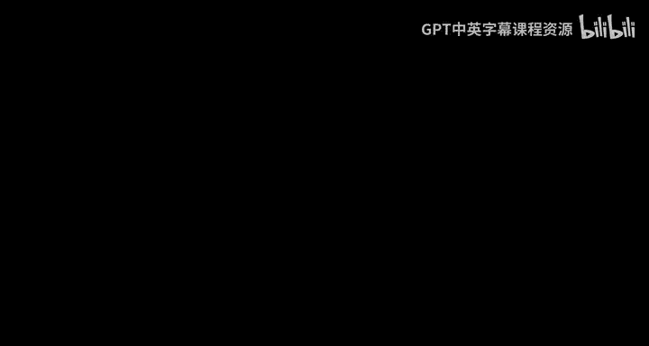
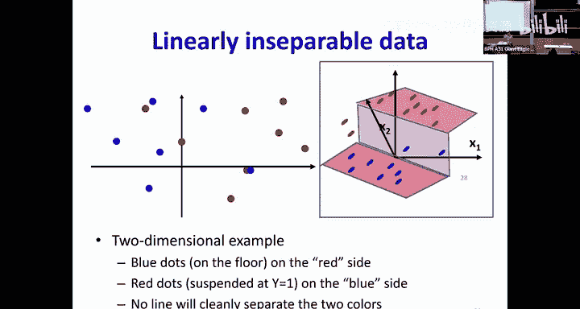
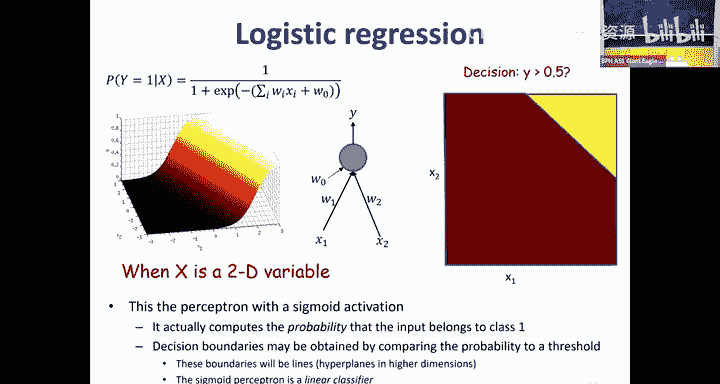
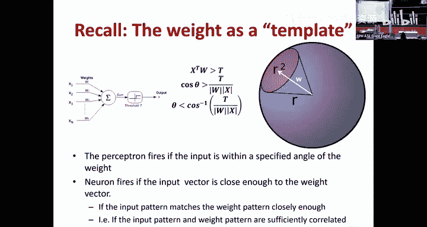
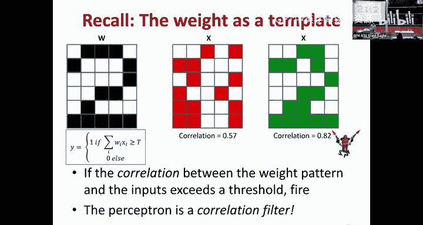
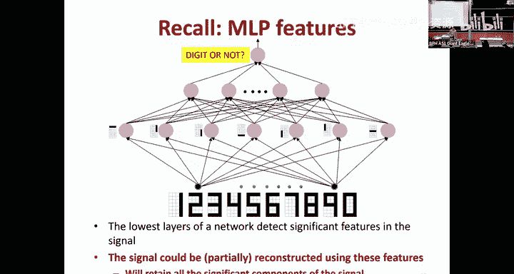
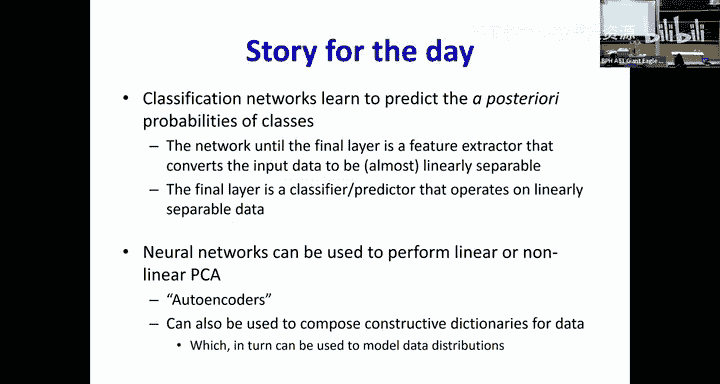
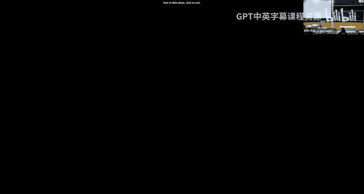

# CMU《深度学习导论｜11-785 Introduction to Deep Learning Spring 2025》中英字幕(deepseek - P24：[22]S2025 Lecture 21 - Neural Networks.zh_en - GPT中英字幕课程资源 - BV1xbZNYrEbs

Which means I won't be wandering around。 And if you have any trouble hearing me， just let me know。

 This is also for the people on Zoom。嗯。The attendance poll only says， do has an option。

Pro of me on the tennis pool。 when it's is like mode of attendance， it only has one option to zoom。

呃ま。一五得。Okay。All right， everybody， let's begin。Re such in laptops， usual stuff。We'll continue with。

Our series of lectures。 We're gonna have a slight change of topics。

 We've gone through different kinds of models。We've gone through。

 We learned initially that neural networks are universal appro。I can model pretty much any function。

They can check static inputs for patterns。 They can scan for patterns， for position and variance。

And they can analyze time cities what happens。But then in every case。

 they must be trained to make their predictions。 So when we actually train these models。

 what do they learn internally。What does the network actually represent？

 So today's lecture is going to look at this and we'll build on it over the next couple of lecture over the next few lectures。

To see how this understanding can be used to to develop generative。

So here's the learning problem in neural network。You are given a collection of input output pairs。

And。We say training data， a bunch of inputs and the desired output for each of these inputs。

You must learn the function from it。 So， again， using our usual picture。

The mesh might be the function you want to learn。But all the data that you provided are just these little red lines。

 and。You must learn the function from it。So in much of the explanation that we saw during the semester。

We assume that the data somehow。Representative of cleanly representative functions。

 So when we want to learn to come to perform classification， for instance。

 if we wanted to learn to classify these the the usual double Pentagon example where the output is required to be one inside the Pentagon。

 double Pentagon and 0 outside， you expect to see a class of data instances inside the double Pentagon marked in red。

And a bunch of data outside。 And from test these data， you're supposed to learn the boundaries。

But then in real life， they're never gonna be so cleanly separated。 They will have some。Leage。

 so you would have some blue dots inside the double pentagon and some red dots outside。

And you must nonetheless， learn the boundaries from these data。So how do we do it？Now。

 to see what happens， let's back off to a really simple example。 Line classifiers。 Now。

 if you had two dimensional if you were working in two dimensional space。

 then a linear classifier is just a line。Which has to separate out one class from the other。

If you were to plot this as a three dimensional function。

 it's going to look like a heavy side step function。 And you'd have to learn。

Can I just carry this with me。Possibly not。 Okay， so you'd have to learn the classifiers from data of this guide where。

You you have a bunch of red and blue dots。And from these dots， you have to learn the function。

 except that you expect to see that the separation is not clean。 So you will see some red dots。然后你这。

And some blue dots in the red region。 So how do we learn this function。 So now， again to。

Really understand this。 Let's back off one more step。

 Let's go go all the way back to one dimensional functions。 So now the input is one dimensional。

And you have two classes， red and blue。Now， what is a linear classifier for one dimensional functions。

 Any。Wder dimension I。Pard me， it's just a threshold， right。

 you're going to have to find a threshold where everything on one side is assigned to one class and everything on the other is assigned to the other。

 Now， over here， can you find a threshold that separately that clearly separates the red and blue classes。

You can't， right。Now， here's the other problem。 We saw this earlier。That your universal。

 your neural network is a universal approm。 It can learn anything。

 It could learn this really ugly function that you see out here。Now。

 would you really want this function， This is a perfect fit to the training data。

 But would you want this function。Obviously not， right。 And even if you said that you this。

 this is perfectly acceptable。What would you do if you had a situation like this。

Where you had a bunch of data。Let's say，100 points， all with the same feature value。

 the same x value。But some of them。A marked class 1 and other rest are marked class 2 plus 0。那我出去了。

So here， obviously， there's no threshold that can separate with you。

 There's no function that you can plot。 That's going to be correct for both sets of points。

So let's say you have the situation where you have 90 instances of red。And 10 instances of blue。

What would you want your function to。Output at this value of effects。

Would you want to just output red because red is the majority。Or would you want to output a 0。

9 to indicate that 90% of the data instances to that value of x are red。What would you prefer。

 What do you think makes the better。Tri seems more sensible。9。

 because it's giving you more information， right， That's giving you the posterior probability of the classes。

 If I mark red as class 1 and blue as class 0， this is giving you the posterior probability tells you what fraction of instances with that specific value of x R plus 1。

But now， let me change things a little bit。I'm going to put up all of my all of my data points just a tiny bit by 10 raised to -17。

 let's say， which is the resolution of floating point data。

 So no two points are identical in terms of X。 They all have， but 90% of these points have。

Are assigned to class 1 and 10% are assigned to class 2。

W is now suddenly want the function to go up and down。

 or does it still make sense to say this must be the output in this range of x must be 09。

Which makes more sense。The second one， right， so。Now。Continuing with。Basically。

 you accept that a small perturbation should not change the output。

 But then how large can this perturbation be。Before you begin changing your mind。

So let's go back and look at this from a different perspective。At each point。

 let's look at a small window around the point。And now I'm going to plot the average value of y at that point。

 So in this example， when you are far out to the left。The average y value is just 0。

 So you're gonna get get get a blue dot。As you keep moving forward。At some point。

 you begin to see see a few red dots。And at this point， the average is going to begin moving up。

 And then if you keep going on。Eventually。All pins are going to be red。

And so this function is gives you a better idea of the posterior probability of。Of the class 1。

For any X。And so。It kind of makes sense that you want a function that actually captures this characteristic。

And what does that function look like？ It looks like this。 Does this look familiar。What is this。

This is just the sigma。 Its a logistic， right， And so indeed， that's what we have， right。

 This is your logistic function。And if you had linearly separable if you are trying to build a linear classifier for one dimension of data。

You would expect that they are roughly linearly separable。

 which means that there is some kind of a threshold where as you keep going further out。

 the number of points that you see from class 0 is going to keep decreasing。

 And when you go in the other direction， the number of points from class1 is going to going to be decreasing。

 And so the overall probability of class1 is going to follow sigmoid。

 which is why we use the sigmoid。 And here's the sigmoid We are all familiar with the equation here。

 So it looks。1 over1 plus eras to minus w 0 plus w1 x。 assume both w 0 and w1 R positive。

So x is a very large， negative value。Then what is eras to minus w1 x。嗯对。If x is a very large。

 negative value， then。Ease to minus x is going to be。Infinity， right。

 And so what will the overall function be，0，0 F x is a very large， positive value。

Then what does E is to minus w1 x。0，0， right。 And the overall function is  one。

 And so you can see the function goes from 0 at the far left to one on the far right。 It transform。

 it sort of transitions smoothly from one to the other， which is why you get this sigmoidal shape。

 and it represents。The posterior probability of。Class 1， given the input of the class。

 given the input。4， unit dimensional data。And so when you have a sigmoid。

 a perceptron with a simple logistic activation function。

 this actually models the a posterior probability of the class of a target class， given the input。

Now， there's a question over here that you're going to have。You probably would ask。

As I plotted these dots， I said I was looking at the average y value。Within a window。

 How wide is the window， I have not specified， right？ clearly， as you make the window wider。

 those things are going to change。 If you make them narrower， it's going to get noisier。

So do we even need to consider it。We'll get back to this。Now， moving on from。

One dimensional to now to a more generic two dimensional problem。 It's the same thing。

 You'd have some， if you want to build a linear classifier， you're going to have some。

Data instances from class 0 on the one side， from class1 on the0 side。 So there's no hyperplane。

 There's no line that's going to cleanly separate the classes。

So wed have a two dimensional set point。Which basically looks like a sheet that falls like so。

And when you're learning the sheet， you're basically learning the rate at which it folds and the orientation of the fault。

Now， this function itself is still giving you basically the same kind of logistic characteristic that we saw for the one dimensional case。

 but。This， we claim as a linear classifier。 Why is this a linear classifier， anyone。

Why would this v yet classify。不。Anybody on Zoom。Can someone tell me， guys， everybody's sleepy。

 So And so why is this a linear classic。Right。Working standing in front of the goose neck is hard。

 So I'm going to go off， and I apologize to the guys on Zoom。 right， So here how。Yes。那个事际上不多啊。That's。

对。たら。相对。や个し。Different。这个算手。actually does zero。What is the locus of input。Where the songs to。

What would that locus be。H anybodybody。That's going to be a line because。我 over。你ます。那经发始。Ex equal。

Right。I taking one plus。In为 violence。特边先还是特别话。It was2。那个这个。支我了。You， take them ones on either side。

 do something get everything。The equation for a line， right， So the boundary between classes。

 although the function itself is curved， the boundary between classes is to be。

Which is why this is this is a linear classifier， although the probability itself sort of curves away from away from the line。

 right。

And so， now。Again， the we go back to the question， how wide must this window be when I begin to average things or do I even need to explicitly consider the window size。

 I don't need to。 I can just use a statistical estimator， so。The way you train it。

 As you just have a single logistic， you'd be given many X， Y pairs。

Thatpresented by the dots over here。And we want to estimate the w 0 and the w1 of the curve， right。

So what is this， I haven't it sorry。P。It was one。One， one plus feelings。Mus w0 plus75。

So what is P of y equals 0 in this case。我も。So P of y equals001 minus6。Oh god， simply winter without。

Yes。There is question you。Yes。Everybody。Can I write a common formula for both。

Does this enable me to just write P F I given X。And你 give me a方 me了。什么呀。

Have a negative one to the X one。W sign changes based on  zero one， basically。IIt's my simple。

 I can actually say， just means this。Ease and。was。I can use a box equal minus。

So the two class is the plus one and the last one。In this case， this is S one。So why those not。

はい本じます。Yes。It gets the minus-1， right？So you'll see the same。 Youll see the y on both sides。

 I can just write this as a common thing， which is。Y equal P of y given x。

Theres one over one plus eraase to minus。Y times w 0 plus w1 x。 That's making sense to everybody。

And so once I have a nice closed form formula， I can go go around to estimating things。

 And here's how。My training paradigm I given a collection of training data。Ex like pair。

Xs are the input vectors。 Ys are the classes。And now。We， we。

 we use what is known as the maximum likelihood learning estimator。

 This is the most common approach for estimating。Probabilistic models。

 So if I give you a collection of data。And if I ask you to estimate a probability distribution for it。

The way we would do it， we would as assume some kind of formula。

 parametermetric formula for the data。And then we are going to try to estimate the parameters of this model。

That maximizes the probability of the data that you have seen。

 because that means that the data that you have seen are most typical of the world。

 And so in this case， we are going to try to estimate。

The model to maximize the joint probability of all of what， all of our training data。

 Now if you assume all the training data are independent。

That's just the product of all training instances of the product of the individual training training instances。

 probability of the individual training instances。And the joint of P， F， X and Y can be decomposed。

 here saying Bayes rule。Theres the probability of x times the probability of y given x。And so。

By our model， what was P F Y given X， We just wrote that down， right。

 That is going to be one over one plus E is to minus。W i times。W 0 plus w 1 X X I， right， and so。

This is what people try to maximize R。Alternativelyternate， we're going to take the log of this。

Probability， the log is a monoonic function。 So if you increase the probability。

 you're going increase the log probability probability。 And also。

 which means the parameter setting at which the probability is maximized is also the parameter setting where the log probability is maximized。

 The nice thing about logs is that this multiplication simply become summations。😊。

And so the log probability that。The sum over all training data instances。

Of the log probability of x plus。The sum of the log probability of y given x。

 which is just a logistic function function， according to our model， right。

 So this is what wed maximize。And so maximizing our training our model means we are going to maximize this log probe。

Which is weestating we， we， we will be， we will be estimating W 0 and W 1。

To maximize the the log probability of the training data。

 But then the log probability of the training data has two components this first component。

Is not dependent on the money。 It's just the probability of x。

So all you're left with is a second component， which means we only need to maximize the。

Some are all training instances of the log of the logistic function computed at that x， right。

Or alternate， minimize the negative log。 And if youve seen the。

 if you look at the equation at the bottom。You would recognize this as just the。K divergence。

Between the output of the logistic function and the actual probability of by given x。 And so。This is。

What we find is that when you perform maximum likelihood training。

Of the logistic function using your training data， which is a very。

Standard and fairly rigorous statistical procedure for learning probabilistic models。

You end up doing exactly the same thing that you would do when you're minimizing the K L divergence。

Or the cross entropy。 So if you were training your logistic function using back propagation and the methods that we've seen in class。

What we are actually performing is maximum likelihood training of a model that。

Does a good job of predicting the probability of y， given the input X。

So that was put a linear classifier， right。But then， your。

What about something more complex like this， like the double Pentagon again。Remember。

 we said that when you want to train the double categoryagon， you are going to get clean data。

 You're going to get some red dark red dots on the blue side and some blue dots on the red side。

So how do we train this。Before we even get here， let's look at the clean case where there are no red dots on the blue side and。

 and no blue dots on the red side， right。Let's also assume that I have the perfect architecture。 Now。

 you'll remember from lecture 2， that I can use this architecture for。Training the classifier， right。

 this first subnet。Captures the first Pentagon。 The second subnet captures the second Pentagon。

 And then， and the unit on top， it's an or between the two， right。And now， what's the outermost。

 the topmost neurondo。That that's， that's a problem， right。

And if I were using a logistic activation function over there， what kind of classifier is it。

 The person drawn on top。Come on。 We just mentioned it， right？

 What kind of a classifier as a logistic function。Can you say that a lot， please。

 It's a linear classifier， right， So that it only does a good job of classifying data。

 It does a perfect job of classifying data， if。😊，The two classes can be separated by a line， right？

 So now， if this network does a perfect job of separating。The red from the blue。Then。

What does it tell us。About。What kind of data this guy is looking at。Specifically。

 if you look at the the outputs of these two neurons over here。

That's what the uppermost perceptron is operating on， right。So in that space。

 what do you think the data will look like。If the network is doing a perfect job。嗯哼，本周。Yeah。

 so what no， but add out here by the time the data get to those two lines that go into the final。

Logistic。Parddon me， there won be one or 0。 They must be linearly seable， right。Otherwise， the atoms。

 that guy is not going to be able to separate the reds from the from the blues。

So what this means is that I can think of the network as having two distinct components。

The first component manipulates the data。 It just moves it around。From this。From the double Pentagon。

啊嗯。Arrangement in the input space。Until by the time it's out at the end of this block。

 the data look like that。So that the reds and the blues are linearly separated。

Then the final classifier can actually separate the， separate the reds from the blues。

So theyre making sense to guys， right， so。This means that this portion of the network。

 which goes up to the penultimate layer， everything except the output layer。

 It can be viewed as a transformation that transforms the data from non nonlinear classes to linearly separable cl features。

And so。This， please wait before we get here。So this， we said， was true for sufficient structures。

 right， That's what I started off assuming。Even if the network is not sufficient now。

If the network has。啊，辩了。Insufficient structure， which means it has fewer perceptrons than is required than the minimum number required for this data。

What would happen again， the outmost， the up the the outermost neuron。

 the logistic regression is trying to separate the classes。That is a linear classifier。

 which means that the rest of the network underneath is going to work really hard and try as try to make the data。

The two classes as linearly separable as it possibly can。 so that。

The final neuron can do the do the best possible job of classifying these separating the two pieces。

But if the structure is incomplete is insufficient。

 all this means is that that final neuron will not be perfect。

 It's going to fail to separate perfectly。 but it was。

 But within the limitations of the architecture。Ideally， it will separate as best as it can。

 The lowest error possible。So， here's your first book。Okay。Okay，10 seconds。

You can't find second poll，956。155， it should be up。They were up last night。No， okay， never mind。

Can someone on Zoom tell me the answer to the first question。 It is on the slide。6十分钟钟。It's true。Zm。

 what about the second question。嗯。Let's see。So the portion of the network until the second to last layer is essentially a feature extraction module that extracts linearly separable features from the data。

And the output layer in your network is a linear classifier that only perform well if the rest of the network。

Successfully manages to separate the classes and。Transform the data so that they are linearly separable。

收。That's when the data linear is， okay， if the data are separable。

And can be modeled by your architecture。Then the lower portion of the network is going to try to make them。

Transform them into a feature space where the classes are separated。

And then the output neuron is going to learn to classify them， right， so。This person at the back。

 and you turn your phone upside down。You're allowed to do your homework。

 You can you should go outside。 That's all。Right。啊， now。If the network is not。Abel。

Sufficient to separate the data or the data are not separable。

Then the feature ex remember that we are actually performing a maximum likelihood classification。

 right。So the， which means it's going to try to learn the distribution of the data。

 So the feature extraction portion of the network is still going to transform the data。

Such that the posterior probability of the class， given the input is maximized。

 even when the data are not separable。 So that's how the whole thing operates。

And so if you have inseparable classes with an output logistic perceptron。

 the output logistic computes the posterior probability of the class from the output of the feature extraction layer。

Which is the posterior probability of the data given。F of x， right。And。Again， as in the most case。

 any efforts。And it's I one to one function that P of y given an offense。

 that's basically the same as P of y in yes。And so。For any class， which means that。

Even if the function， even though you actually have a fairly non linear neural network。

 which is operating on the data and is finally classified using a logistic regression。

 the overall network is actually a statistical model， which computes this。😊。

And he learn to compute the posterior probability of the classes。Given the data X。

 So what does the network do。The network is a statistical model that learns to compute the posterior probabilities of。

And so。Where the data are not separable and the boundaries are not linear。

 The output is P of y given x for multi class networks。

 it will be a vector of posterior probabilities。And if it's trained to minimize the K dive。

 the parameters of both， the final logistics and the network are learned to maximize P of y given x。

 meaning it's actually a statistical model。 And what we are performing is maximum likelihood training of the network。

😊，Which is a statistical estimator。 So the neural network is not just any odd function。

 It's a statistical estimator， yeah。Are we looking at densities a different。You don't need to， right。

 You're looking at P of Y given x because the P of x is not a function of the network。So that is。

 so you don't really model P of x。 You just model P of y given x， regardless。

You're doing a maximum likelihood estimate。Of the component of the。

 of the components of the distribution， namely the parameters of the model to best explain the data。

Right。Second second point。Okay。5 seconds。Someone on Zoom is that first statement true。Zoom okay。

 what about the second one。这ful。You guys here what how about the third statement， true or false。

and fourth。嗯。So the first second and fourth statements are true。 So for example。

 you could train a network。 Now， if you think of the network as combining a feature extractor with a linear classifier。

Once the network is trained， you know that the feature extraction feature extraction portion of the network。

As derived linearly separable。featureseature from the data。So now。

 if you use that as a feature extraction。 Now you can extract it。

 then you can subsequently use any linear classifier like a support vector machine to perform classification。

So a classification network is just a statistical model that computes the a postteiary probabilities of the classes。

 given the inputs。Training the network to minimize the K divergence。

Theres the sames maximum likelihood training of the network。

And it doesn't depend on the actual linear separability of the classes。

 and it is indeed valid and sometimes beneficial to train the network and subsequently replace。

The final linear classifier with some other linear classifier。So， here's the story so far。

A classification multilay perceptron actually consists of two components。

There's a feature extraction network that converts inputs to linearly separable features。

 or nearly linearly separable features。And there's a final linear classifier that operates on this。

Lineally separable features。And if you use a softm， the final layer of the network is actually。

A probabilistic model， which computes the a posterior probability of the classes。

 So training the network to minimize the cross entropy loss or the Kl divergence basically performs maximum likelihood training of the network to best estimate the posterior probabilities of classes for any input。

 which makes sense。 You want to be able to present a picture。And ask the network。

 what is the probability that this is a cat。系。And that is， indeed what the network is learning to。

Computer。So so far， so good。 we've seen what happens at the final neuro。That's a linear classifier。

We've seen what happens at the penultimate layer。At the penultimate layer the。

 the net portion of the network from the input until the penultimate layer tries to derive linearly separable features。

 but。Come on。 But what about the rest of the layers through the network。What happens there。Now。

 there are several hypotheses to this。But then the one that kind of makes more sense is what I call the manifold hypothesis。

😰，Think about the double Pentagon problem。 You had data within a Pentagon and a double Pentagon and data outside。

 So this is clearly not linearly separable。 The two classes are not linearly separable。

 So what is the network doing as you go through the。Various layers of the network。

The data keep getting moved around so that they get increasingly linear linearly separable until when they arrive at the final layer of the feature extraction portion of the network。

 they are actually as close to being linearly separable as possible， so。

Here's a nice visualization of how this works， right？ In this case， we have a small problem。

 We have a simple problem， which is。We have data。Which are separate。

 we have a circular decision boundary and the data separated into two classes。

 The portion of the data inside the boundary and the portion upside。Right。

And now we want to train a network that can perfectly classify。

The portion inside the circle from the from the portion outside。

The network itself has the data are two dimensional。The network has three hidden layers。

 one hidden layer with three neurons with tanage activations。

And then the output of these neurons goes into a final。Logistic function。Now。

 what happens to these data？ Let's just visualize this， right。Again。

 I pardon for going away from the。 Yeah lets this。没发。Yeah。So。I have data。我是就这么去。那 answer。We X。

To read。你是 talking吗？3 plus。Let's get to the three dimensional the scenes。these are what they are tan。

系你你嘅动话。Which is still in three， right？안俾你嗰度等没요。It goes through， which is one plus 3。

Which gives you a new Z capitalism。like the signature。佢啲 man。喂。

 this is a sequence of operation that have。So now if I stand up with the two dimensional plane。

And then transform it using a three cross2 matrix。What is the dimensionality of the output。

What is the dimensionality of。To of the data， when I transform two dimensional vectors using a three cross2 matrix。

 yeah。It's going to be yeah。How many components do the output have。So I have I privilege。

And then want to like。When we comes to matrix。 How many components is output。B。

Because it has to be three right， so if I times on this in two dimension of playing。

Using a three cross to what is the， what is the output going to look like。嗯。😊，Because to。

I'm transforming an entire plane。By three cross2 matrix， what happens。Guys， you're being very sleepy。

Is it going to be a vector。No， dimension it's going to move into three dimensions。

 So what would it like dimensions。have multiple as。やっていきましょう。Mattri。

 which means every point on this screen as we multiply right across the matrix。に不然明知去年。

three dimensions。 So now this is linked live in three dimensions。

Is it going to fill up the three dimension of space。Then what， where is it going to be。

On a single plane in the three leaves， it's going to be on a two dimensional plane in3。

 You're not adding。Right， so this guy is going on some。Two dimension of plane and3。Right。

 everybody with me。So now， if I put this， that's it。The good is going。Protannic activation。

 So every point is being transformed。 And Now what happens， What will happen to the plane。嗯。😊。

Disperse。Shifted shifted every point as being the， you know。

 the values are being transformed non nonlinearly， right。

 Some points are being stretched more than others。So what will happen。嗯哼不可 it to可什么再不。At age。

 this is going to become something like。Something not sure。就这边。It's going to bend the sentence。

That makes sense。Right， and so now I have a curb surface。N 3D， correct。

And then I want to go the curve surface by a。One plus image。回的。

Every part is going to make up a single。So。Any point in the space。

 Im just going enough one dimension。So it's basically this will be a rate factor and you're projecting。

Your data onto the week left。Right， pizza。嗯。That makes sense to everybody。

 So let's see what really happens over here。I'm going to show a little animation。

And this is what happens as you train it。So as you train it， you。

 you're going to learn the weight matrix of the first layer。 right。

 And that is going to figure out how to position your two dimensional space。In 3D space。

 So there are two things happening here for three。7 things。Positioning the 2D spacing。

 the 2 playing 3D space， then a。It's iss working。And the second layer is my is projecting。

All this entirewalk surface onto the s。And the only way a linear classifiedifier is going to work perfectly is after projection。

Everything was the。Folds on one portion of the line and outside falls on the other portion of the。

Make sense。And so the network is learning how to position the。

Plain in 3D space so that when it's warped by a transform by a tanage activation。

The subsequent projection actually separates out the points within the class， from those outside。

And so again， if you take a look at it， this is basically what's happening over here。

 You can see how the plane keeps getting moved around until the war first， the wared。Surface。

Can be projected into two distinct regions of a the two classes on the Wp surface can be projected into two separable regions of a line。

So this is what the network is doing。 Now， mean a more complex problem。

 It's a more complex version of the same thing。 And so here's a more complex example。 This is。

This far can。Problem。 So here each you have data of money。 you have。Points in many different colors。

 Each color represents a different class。This network has 11 layers and a final classification layer。

 So initially， when I just initialize the module。The model is random。

 So all the data points are going to be scattered all over the place。 Now， I've projected the。

 the hidden layers down to two dimensions just for visualization。 And we can see what they look like。

 right？ So now let's see what happens as you train the model。The animation is a bit too fast。

 but you can see that as once you train the money， as you go through the layers。

 the classes begin to get separated。And so by the time you get to the 10th or the9th of the 10th layer。

 the classes are now linearly separated。 You can draw lines to separate the classes。 And in fact。

 this is more visible if you do this in three dimensions， the visualization。

And you can see that as you go through the layers， each layer operates on the data and moves it around。

To increase the linear separability of the classes。Till eventually。

 they're as separable as possible not。 Yeah observe something interesting。

The classes are already manuallyly acceptableparable in this case， by layer 7 or layer 8。

Additional training that， So what what are the additional layers doing。In fact。

 if you just put a linear attached a linear classifier to this gun。来 here。

The classes would be perfectly or nearly perfectly separated， classified。

So the additional layers are actually moving the classes further apart。As you can see。

 And so when you increase the depth of the network， when you train the network。

As you continue to increase train it， initially， the classes are going to be linearly separable at the outermost layer。

Then as you continue。The layer at which they become separable keeps moving lower and lower down。

And so， in fact， if you train a layer and then you chop out the top few layers and then then attached a softm。

 it would still be a pretty good network。 And in fact。

 this is one of the techniques that people often use to reduce the size of networks。 So yeah。

When don't we move beyond three dimensions。This is just visualization。 The actual data is in many。

 many dimensions。 It's， I think。This one was。I don't remember it's about 100 dimensions down to three。

 Yeah， I know we're talking about like the like the the number of layers and like afterwards like a certain amount like it separates them further。

 Yeah but what about like the width of the layers like does that。How do we。

 I guess like can we reduce that afterwards So yeah， you could， possibly but。Now， as well as。さで。

In my example， I've converted this to a plane in three dimensions， right。

And so I could have converted to a plane in four dimensions。And the the principle still holds。

 the more the number of dimensions， the greater the flexibility I have。To， to adjust things。And so。

You might well find that some of the dimensions are furious。 But then if you think about it。

 a three dimensional two dimensional plane and four dimensions is not necessarily going to be of the kind where you can just throw away a dimension。

 It's going to occupy all the dimensions， although it's in two dimensions。that answer a question。

So what happens if we if we just have one of number of， which is going to be projecting it into。

Are very high dimensional。Right， here it's 3。 It could be 200。 The same principle still holds。

Any other questions， Anything on Zoom。Okay。So so far so good， right。

 we have an idea of what happens inside the network。We've seen what happens at the outermost。Layer。

 it's a linear classifier， but it actually computes posterior probabilities。

We've seen what happens at the penultimate layer， the network until the penultimate layer is trying to extract features which are linearly separable。

We've seen what happens as the data goes through the network。

It tries to make the data increasingly linearly separable。But what does the very first layer are。

Or what do the individual neurons learn。For the head。

 let's go back and look at the perceptionceptron again。So here's the basic perceptron。

 And I'm just going to assume for now a threshold activation perceptron。

 because it's easy to explain， but you know。All the lessons transfer to other activations as well。

 So here's what the sexual perspective。You。Computed a weighted sum of the inputs。

 And then you compared the weighted sum to a threshold。If it exceeded a threshold。

The output was  one， otherwise， it was 0。So I can write it like so write my input as a vector vector x。

And my weights as another vector to W。Then the weighted sum of the inputs is just the inner product between the weights and the data。

And so。When I compare the weighted sum threshold， I'm just checking if the weighted sum。

 if the inner product exceeds the threshold。Now， what do we know about the inner product of two vectors。

What does it capture？Anyone。Come on， guys。What is the yeah， value， It's just anger， right。

 So the in very high dimensional spaces。All vectors are more or less the same length。So it's just。

 it， it's just a characteristic of data。 If I， if I restrict the length of my data to anything， say。

1。Then as you increase the dimensionality of the data， the volume of the consider a unit sphere。

The volume of the sphere that's close to the surface keeps increasing。

 And at very high dimensions is basically the entire volume of the sphere。

Lies at the surface very close to the surface， which means all vectors are basically the same length。

So not going computer。Do like。いうチャ。这 is simply simply。Mititude of family， magnitude effects。Co。你家。

And this is De。this is and assist。Coning a product of two。 And so for any class。

When I say that when I， when I'm comparing the inner product between the feature X and the weight W to threshold。

I'm literally just saying， cost data。Should be greater than T over。The norms of the two vectors。

 assuming the norms are all more or less the same。 Basically。

 youre just considering parallel between W and the vector。Must be less than something。So， in effect。

 you're saying that。If your data lies within some angle of the vector。Then the output is one。

 Otherwise， the output is 0。 So what does this make the vector in this case。Similarity。

 what does it make the weight reactor。Anybody。I've got， I'm saying that everything。You know。

 if the angle between my data and this vector is rest less than some angle， some theta。

I'm going to output a one。 right， So in other words， you're saying that any data。

 which if I have a way vector W， youre identifying a sphere。啊是2个。

The radius and anything within that radius is going to be far found to match。 And what is the way。

 the weight vector W itself， that is a representative of that region of the space。

 So the vector W can can be thought of as a template for the class。

And you're matching all of the inputs to the template。Okay。Makes sense， right？ So in effect。

 what what you're really computing is the correlation。Between W and x。

And if the correlation exceeds a threshold， you are going to， the net the unit will fire。

 Otherwise not。 Now， once you understand this， its very simple。 you can begin building things。

 So let's say you had one of those old LED grids that you used to used to have an ancient watches。

 digital watches。

And he wanted to recognize if the digit was a two。Then what would you do。

 You would create a template that looked like the digit2。 And then any time you got an input。

 you would compare your input to this template And the way you would compare it is by computing an in a product between the two。

The correlation。And so， if this。Here， if you going incorrect that pattern。

The template for two is shown in black。 The inner product。

 The correlation between the two here here is is 0。57。 So you'd have a threshold。

 It has to be at least 08。It doesn't match the threshold。 So this is not a two。

 whereas if you have something that looks like this。Here， the correlation is much higher，8。82。

 And so you'd see this， this looks like a two。Right， in fact。

 for any pattern that you'd want to recognize， all you would have to do is just draw the pattern that you want。

And that becomes， as your template。 and that becomes a set of weights。

So。What this tells us that is that if I have an ML LP。The worst layer neurons rock。

It was just simple perceptron。 And then again， we see that the percepts。

 in turn are correlation filters。 Their weights represent typical patterns。

That you expect the input to match。And the neuron fires， if the input matches these weights。

 And so here。

If I have a largeAnd let's consider the simple business of recognizing if the input is a digital or not。

 So I have， let's say I have the same LED grid。And it's 0 to 9。On this grid。

And I want to build a network that looks at this figure and tells me if this is a valid digit or not。

Have you build such a network。What would the first layer neurons learn。

 The first layer neurons are going to become feature detectors。

The weight of each of these neurons are going to represent a pattern that the neuron is trying to detect。

So you might find， for instance， that the first neuron here。The weights end up looking like this。

 It's it's looking for horizontal patterns， right， at the very top。

 Maybe the second one is looking for a pattern for a vertical bar。To the right。

 So the weights would look like a vertical bar to the right。

Maybe the third one is looking for a vertical bar to the left。

 So each of these neurons is going to end up representing one pattern that is's actually looking for in the input。

The subsequent the layer neurons and the subsequent layers will look at combinations of the outputs of the of the first layer neurons。

 So here， for example， the second layer neurons might be looking at。

Do these patterns combine to form the digit one。Do these patterns combine to form the digit2 and so on。

 And the final one is， of course， ordering them all to decide if it's a digit， valid digit。

So once you realize this， here's something I can do。 I can train this network。

And I having' claimed this network。I throw it the upper portion of the network。

I just keep the first layer neurons。And then for any input。 So again， consider this。我睇看啊。Yeah。妈。So。

That't have。 And you wouldn't say。毎？唔事。那。哦系。那个事。嗯。就们这个呢。input is yes。嗯。Yeah。Now。

 will that first neuron fire。If the input is justice。Yes or no。 Okay， so now let me on the side。

The first neuron fire， I just expect it time。Because the rain tells you rain credit tells you what it's looking for。

 right， and for the reason。On the second on快。ですね。Yes， so what more here。上我我好了嗰差别 that上。嗯。

So I need to do anything on the right hand side。What about the4 toilet5。对。对。我的不准。

And if it fire what was say。嗯。一开咗三分钟。怎么看单。I basically just looked at the outputs of each of these neurons。

Which here I'm assuming is  one or 0， but it doesn't have to be， right。

 And then I' multiplied the output of the neuron by its weights。And filled it back in。Right。

 and what will I be reconstructing。What happens if I do this。For all of the new one。Come on， guys。

I'll be reconstructing most of the input。 Would I be reconstructing it completely。

So what would I reconstruct。You'd be reconstructing it with。The features has have been extracted。

 And， you would be reconstructing those features of the input that have been extracted。 In this case。

 you'd be reconstructing features that are relevant to。Classifying whether it's a digital or not。

But nonetheless， here is the situation， right， if I just。

 so what does multiplying the output by the weight mean。

 It's like having the transpose of the weight matrix on the outside。

Going back to the same dimension as the input， right， And so。If all I did was this。

 I put the input through this network， captured the hidden representations。

 multiplied by them by the them by the weights， transpose the weights and combined them back。

You're going to reconstruct something that looks pretty much like the input because the input layer。

 the first hidden layer。Ha captured all the features， relevant features of the input。

 And then I'm just reconstructing these features。This makes sense。Okay。

 so now here I'm only going to be reconstructing those features that are relevant to。啊。Do啊。

Classifying digits。But then if I have， if I actually am more interested in reconstructing the input itself。

Then what would I do？And this problem。The network is optimize recognized。

 It only retains distinct digit like or obviously not digit like features。

The remaining features would be irrelevant， or could be lost。But。I can try to make this explicit。

 what I can say， learn my features so that when I put them back together。

I will actually reconstruct the input。 This is what is called an auto encode。

So here you have a portion which has feature detectors， which detects various features in the input。

 This is what we call the encode。 And then we have a portion that recomposes these features。

To reconstruct the input。 And that's what that's what we call the decoder。Now。

 the simplest auto anchor。 I have a complex one here， right。

 The simplest one would just have one hidden neuron。And to make it simpler still。

 I'm going to assume that that hidden neuron only has a linear activation。

 So I have this one hidden neuron here。It just takes in a eye。the the input and computes W。

 W times the input。The activationation is identity。

 And then I'm multiplying the output to activation by the weight matrix。

 And I'm trying to re reconstruct the input。What will this learn？ Now。

 I'm going to explicitly train this。To minimize the error between the retail and the input。

So if I do this， what will it learn。Here's what I'm doing， right， The hidden representation is W X。

I multiplied that by W transfer。And so I'm I'm trying to minimize the error between X and X。

 which is x and W transpose W X。Does anybody recognize this？ What， what is this actually capturing。

Anyone。How many of you are familiar with principal component analysis。You must have heard of PCA。

 right？ So what is this doing here， Pardon me。This is， I'm just no。

 I'm just projecting it onto a line and projecting it onto a W。 and then。啊。Projectecting it back。

 This is just a principal component analysis。 What this is doing is compute the first principal component。

Off the date。So here， just to see why this is so， right。Yeah， what is that in this case。

What is the damage that happened。What's tell me。喂。So how。

 how many is it is it multiple vectors or a single vector。This is a single vector， correct。

 And so here。最気め？上明。ですかね。And so， for any import。So。And' this books this book for the network I。谁了。不是。

RightZ Z is going to be a scalealr。 What does Z times W look like。Yeah。What will Z times W look like。

Have these guys咩。Different points on this line， for。Right， so for any ads， they。

Projecting it onto a point。哦下。And minimize。Between the， the， the projects。Projection and。啊，我这得。喂。

And when I'm training this network， I'm learning the Wub。To minimize this squared projection error。

So what is that doing in that case， if I'm just trying to find the direction where if I expressed everything as just that one direction。

 what would I be doing。This is the principal component。Right， that is classic PC A。

 You're finding the one principle component that best explains the data。

 This is what you would be finding。And so if I just had one hidden hidden neuron。

I'm going be performing PC。And。Here's the key thing。 The W represents one vector。

 It doesn't matter what the input is。 The output is always going to be on that vector。

Because the output is simply Z times w， right。This makes sense to everybody。Okay。Now， if I have so。

Now， you know， it doesn't matter how you compose the network。The output is going to some z times w。

 So regardless of whether the output weights and input weights are the same or not。

 it's going to learn to perform principal component analysis。Now。

 if instead of having just one hidden neuron， I had multiple hidden neurons。

 It's still the same thing。 I now have a W matrix。 The W matrix can compose a plane。哎，这个来 learned的什么。

What I'm really learning is the principal subspace。

 the plane on such that when I project all the data onto this plane。

The projection error is minimized。Makes sense。 And once again。Here， if I。

 so the math will just work out。 I just have the math X minus w transpo W X squared squared norm。

 you minimize it。 You're going to find the W， which is basically the principal subspace， right。

 represents the basis of the principal subspace。And here's the interesting thing。Once I learned this。

Because the output is always W transpose X。 Any vector that I feed in is only going to con result in an output that lies。

On this principle sub， regardless of what I freedom， right。So he has an exporto。YeahOkay。诶。15 second。

Okay。Someone on Zoom is that first statement true or false。Zoom， zoom。And here， guys。

 what about the second one， Also true， right， So an auto encoder with linear activations performs principal components of the component analysis of the input。

And an auto encoder a linear activations in the hidden layer。

That has been trained on some data can only output values on this principal sub。

 because regardless of what the value is， The output is something like transpose X。

 which only this principal。Everybody's good with that。So， again， terminology。

The portion of the network that computes this representation in this principal subspace space。

 that's called the， that's what we'll call the encoder。 It analyzes the input。

The portion that can reconstruct the input， basically try to regenerate the data。

 That's what we call so the input I going to tell you that。我 this。point maybe。

Please send me a sort of dignity。 But the decoder is actually going to。Along with this。

Create a point。In the original space。So。Now， now I can introduce a non linearity。

 And let's say I begin introducing non linearities in the decoder。So， here。要的。

We saw that if the decoder layer has only linear activations。

 then it can only be constructed a linear metaphor。A linear subspace。

 But then if you have non linearities， we saw earlier that non linearities fold the space fold the manifold。

 right， So now the decoder can reconstruct。Data on curved surfaces。

So what the decoder is good doing now is to represent the best non nonlinear manifold to fit the data。

And waiting， So now。What this means is that this decoder can only generate data on this graph。

Because that's all instead of just doing the line。 It's bent the line。 Or if of in of having a plane。

 it's curved the plane。So， regardless of itss。Found the plane such that when you project the the surface。

 the curved surface， says that when you project all data onto the surface。

The projection error has minimized。But then this also has this characteristic that。

Regardless of what are feeling here， the output is only going to be on this surface。

So with non linearity， this basically ends up in being non nonlinear principle component analysis or rather principle。

Maifold analysis and peoplepo networks can can capture more complicated manifolds。

 So here are some examples。 In this case。 We have some data on。

And this is these are two dimensional data。 And then we have this network where it brings the data down to one dimension and then back into two dimensions。

 The details of the of the network on the slide。So now what is the principal direction of infr of。

 of movement for a spiral。It's just movement along the spiral， right。

 So you would expect that if you learned this right， then called here what you readed learning。

Theres a position along the spiral。And the rest of the network beyond it。

 can only recreate data on the spiral。And so you expect that， and that is indeed what happens， right。

You can see that if I feed this data and train the net。

Then the recreated data lies only on the Phoenixix。Only unspired。

 What do you think is happening here。What's going on here， anybody。What's happening。Anybody。Yeah。

 the model messed up and didn't learn the proper features。It's not what active it has to the data。

 There is nothing over here。 It says that the Z values must be continue continuous， right。

 So you're expecting that have going on this away from 0 to infinity， to expect that。

That going to keepこ。But on the spine。But that doesn't happen。

 All that happens is that disease work to workshop that things live with the spinal in the region where you have to in。

If you have a little gap where you don't have things。Then in those Z value。

 it can do some fun things。 And so here they can see where it goes back so。I mean。

 was this never to destination， right。Furthermore， if the Z goes outside the cleaning range。

Then it goes off and does some strange things as well。 right。

 But within the training space of the training data， it has actually learn the structure of the data。

Makes sense to everybody。 So here's a similar thing with a sin side。 samee thing。

You Z is the position along the curve。And the decoder can only regenerate data on that curve。

 Of course， if you go outside the training data space， it goes off linear。

 It doesn't continue to create a sinus idea。I was ask， yeah。

 like how like the part that it goes off is always linear or like how is Yeah， I have no print。here。

 it's not linear。 right， It just did this funky thing， right， Yeah， we have no idea。

 It's a fun funky function。So， but anyways， so again。

 when the hidden representation is a lower dimensionality than the input。

 we often call this a bottleneck network。 It's not linear PC right， learns the manifold of the data。

 it's properly trained。So now this is interesting， which means this means that if you learn the manifold。

 that the principal manifold of the data。Then the decoder portion of the network can only generate data on this principal manifold。

It doesn't matter what you feed it。 It's going to generate something other a principal manifold。

 So for example， if I were retain the network on the digits data。The auto encoder。

 and then just later in the decoder。 Then regardless of what I fed it。

 what came out is going to look something like a digit。 Here's an example。

 This one was a day was an auto encoder where we trained the auto encoder on music from a planetinet。

And then we take the decoder and stick some random values here， right。What comes out。

I can't hear anything，You hear some songs。Let me see， ass my。Okay， this is on。

啊 the most football like。Okay， let me see this。好啊。Yeah can I I set this up so I can pay the audio。

加唔睇啊。Don the sounds out。可是送的信非常的可ly。And then I just take the decoder and put。

 give it some random input。I give a different import。That sounds like a cl。是什么？

Like a two this this one sound。 Yeah， I clean this in a client。 Let's see what this looks like。系。

So interesting， right， It's only， it's how I learned the manifold on with these data line。

 And thereafter， when you just trigger it。It's only able to generate stuff on that manifold。

 which kind of looks semantically like the data that you trained it。Which is interesting。

 And so here is a very cute little first。 Here's a poll。Okay。😊。

Can somebody tell me that first statement is true。Can you speak up say loud。Second one。And the card。

对。T or false。Somebody on Zoom is the third statement， true or false。对。Is there anybody on Zoom？

Everybody's missing on Z。 Okay， is there anybody on Zoo。It's true。 Okay， what about the fourth。

Throughe。True。So an auto encoder with nonlinear activation performs nonlinear principal component analysis。

 It finds the principle manifold。You know， which is the data log， right。

 and the decoder can only generate data on this principal manifold， regardless of the input。

 So you can think of it as a dictionary。Which composes data like the training data and response to any input。

 And so here's a cute little application to to close out the lecture signal separation。

 I'm given a mixed sound from multiple sources。 I want to separate other sources。

So this is a common problem。 I give you a recording music recording。

 I want to pull out the guitars from the drums， from the vocals。

 and a common approach is what are called dictionary based techniques。

 The basic idea is to learn a dictionary of building blocks for each sound source。

So all and all signals from the source， you model it as being composed from that dictionary。

 So you'd learn a dictionary say for guitars。Another dictionary for drums。

 Then when you got a mixed recording， you'd see how the dictionary entries for the guitar。

And the drum dictionaries would be combined。To compose your mixed signal。And then。You know。

 the separated。Contributions of each of the dictionaries is going to give you the separated sources。

 Now， in our example。So you can recompose these separated sources。So in our example。

 how does that work。If I wanted to separate guitars from drums。

 I could learn an auto encoder for guitars。I could learn an auto encoder separately for the drums。

And now， the decoder for the guitar can only produce guitar like sounds。

The decoder for the drums can only produce drum likesalms。If I have a mixed signal。

The mix signal has both drums and guitars。 So it means that this mixed signal has been produced by adding up something that has been produced by my guitar decoder。

And something that has been produced by my drum decoder。

So if the these two decoders have been separately trained already。From guitar and drum data。

 respectively。Then when I'm given a mixed signal。I can use back propagation to find out what inputs must go into these two。

Decorders， such that their outputs sum up to the mixed signal that I that I have。

And then subsequently， so， you know， that's what I do。 I'd have the mix signal。

I use back propagation to find out what these inputs must be。

 such that the output of this decoder and this decoder and summed up give you the mixed signal。

And then the output of this decoder alone is going to be just the guitar。

The output of this record alone is is going to be that draw because they can only set。

Composed the drum and the guitar respectively。 So let's see how this works。 right， Here's an example。

 Again， this is a very trivial thing that we are doing。These were five layer networks，600 unit wide。

 units wide on the decoder side， the dictionaries。Here's a mixed recording。Is a win instrument and A。

啊成咩。🎼，Or I reference here is not Phoenixix。あ。你八。うんうん。你没吃啥。うんうんん。うんん。As you can see a pretty good job。

 right， again， giving us the idea that confirming our our hypothesis。

That if you train these networks properly。Then what the networks also do。

Is to learn the manfold that the data lie on principally。And when we perform classification。

 it's performing linear classification on this manifold。 when you' are performing reconstruction。

 it's reconstructing data on this manifold。 that's what we are doing for the auto encodeder。

 And this is what we are going to use in subsequent lectures for geneative models。

So the story for the day。Classification networks learn to predict a posteriary probabilities for classes。

 The network until the final layer is a feature extractor。

That converts the input data to be more or less linearly separable。

The final layer is a classifier or predictor that operates on the linearly separable data。

The networks can also be viewed as performing non nonlinear principle component analysis。 So you can。

 in fact， use these to reconstruct data。In the form of auto encoders。

 which can be used to compose constructive dictionaries for the。

Which can be used to model data distributions。 We'll follow up on this in the next。

