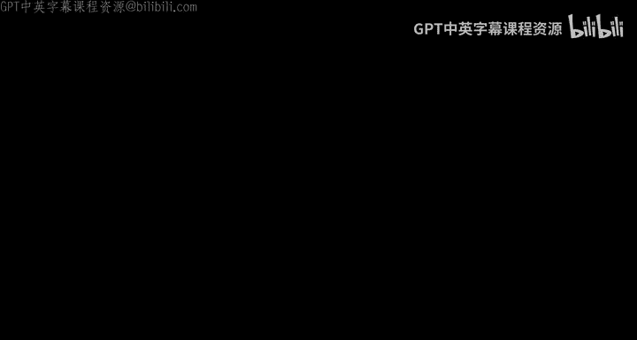
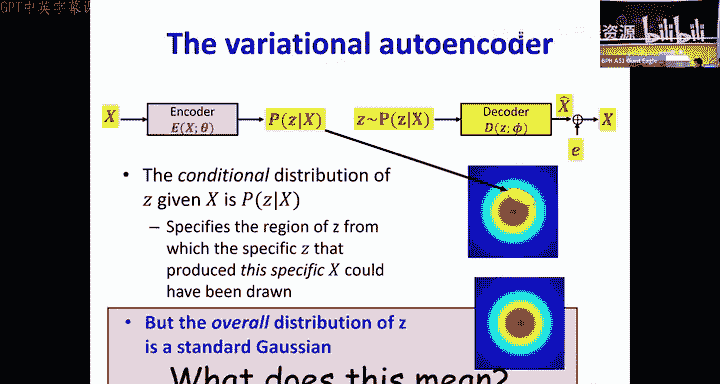
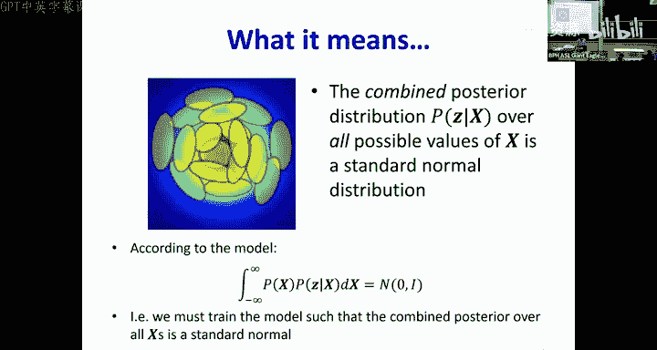
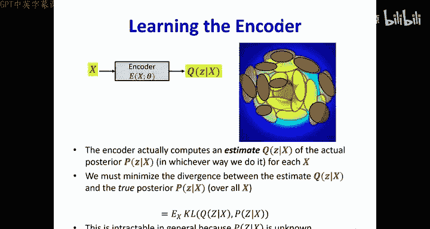
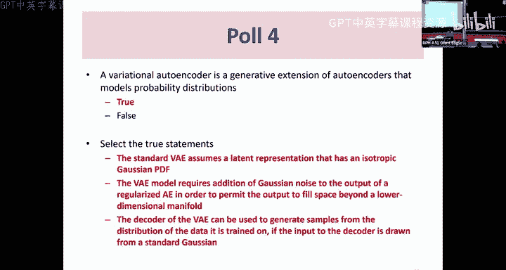
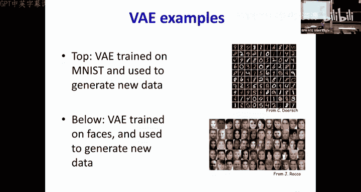
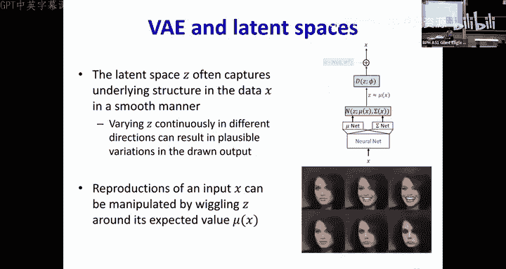
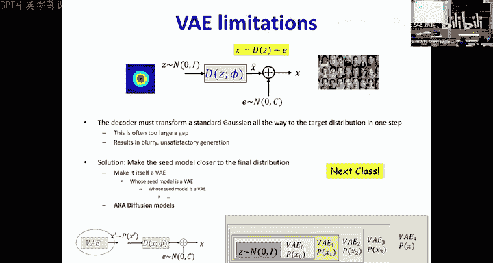
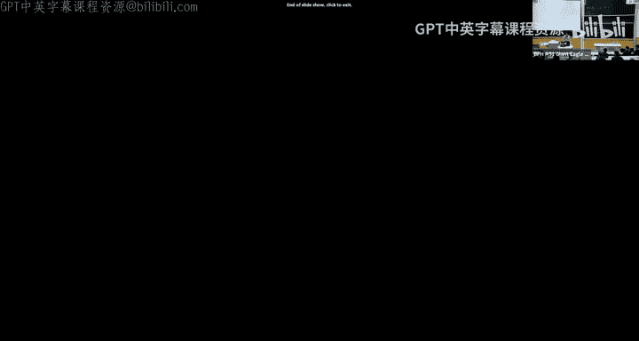

# CMU《深度学习导论｜11-785 Introduction to Deep Learning Spring 2025》中英字幕(deepseek - P25：[23]S2025 Lecture 22 - Variational Auto Encoders.zh_en - GPT中英字幕课程资源 - BV1xbZNYrEbs

。呃干快嘅。你过春个。放之前面那个可个微信是。这s the last question。还意是这个。Morning， everyone。Starting a minute late today。

There a like。30 seconds to complete your。Attendance poll。And unfortunately。

 I'm missing my microphone today。 So my clip on。 So I'm going to have to stand next。

But I'm try to do a reasonable job of it， anyway。另外一个。Okay。Okay。Can we move on， right。

You can't see the can't。Okay， so we've gone through deep neural networks as classifiers。

As predictors， we are going to deal with a new problem。And finally。

 we are also sign the last class that they're capable of。Representing data at various levels。

So the new problem we are going to address is how we can generate data。

 So you're given a large collection say of images of faces。

Can we use this collection of data to train a network。To generate new portraits。So for this。

 the problem is basically that of characterizing the distribution of the of。Facial images。

 and then drawing a sample from this distribution。 But then how do you even characterize this distribution。

Or for example， you might have a large collection of landscape images。

And wed want to use these to train the network to generate new images of landscapes。 Again。

 we must characterize the distribution and draw sample from this distribution， then。

How do we characterize the distribution。So we saw in the last class that， you know。

 you can data can be thought of as roughly lying on some kind of a manifold。

 So the hypothesis is that the data distributed in a curve。Or otherwise。

Non nonlinear manifold in high dimensional space。Now， this has to be true， because。

What is the only kind of data that occupies all space uniformly， anyone。What would that be。当。It。

 it just got to be noise， right， unstructured。 The moment we begin imposing structure on data。

 Basically， we are restricting the data。 And so the more data structure we impose。

 the more we restricted。And so you might have million pixel images or 5 million pixel images。

 But that 5 million pixel images is not occupying， you know。

 the collection of all possible 5 million pixel images， which represent valid。

Pictures of landscapes don't occupy the entire 5 million dimensional space。

 They're going to be in some subre of it， which is very structured。 And so， and just has to be。

And so our hypothesis is that the data are distributed on this curved or non nonlinear a manifold in this high dimensional space。

And the principal components of all instances of the data like on this manifold。

 So if you want to generate data from this class， we have to pick a sample from this manifold。

Question， how do we characterize the manifold。And what's a good strategy for selecting a data a marfold。

So for this， let's go back and remember the V A E， right。The auto encoder。 So the auto encoder。

 basically。Learned to the， we remember that the decoder portion of the auto encoder captured the manifold。

 the curved manifold of the data。 So if particularly the auto encoder had non nonlinear activations。

And we also saw that deeper and more complexs ors are able to capture。manifolds。

 And so we already know that the auto encoder， the decoder portion of the auto encoder learns to characterize。

The manifold that data lie in， such that when you activate this。

 the decoder using any arbitrary input， it's only able to generate。Data from this manifold。

 And we also saw that if you train the auto encoder properly。

 then that manifold actually learns to represent the underlying nature of the data。

 And so we saw examples， like in the case of music。

 where once I trained the auto encoder on samples of music， subsequently， the decoder， when excited。

 produced。New data， which sounded like notes from the instrument that it was trained on and so on。

And so using the same principle， we could assume that if I trained an auto encode on lots and lots of collections of images。

Then this auto encoder is going to learn the curved manifold of image data。And subsequently。

 if I just use the decoder of the auto encoder and excited it， excited it with any odd input。

 what it would generate would look like。Valid images of， say faces。

 If that's what I trained the auto encode on。 So this would be a hypothesis。But then， we have。

We down into an issue。Even when we were doing this。We found that although the auto。

 the decoder of the auto encodeder can。Does learn to characterize。

The manifold of the data in the regions where you have training data。When you go off of it。

Strange things can happen。 So here， for example， when I train the data using the auto encoder using data from this。

 this file。Then。The decoder learn the structure of the spiral， mostly。But then， if you just。

Fed different Z values to the decoder of this of this A E。 At some point， there are some values of Z。

 the the decoder doesn't continue to just produce data on the spiral。You see this horizontal skip。

 At some point， the decoder sort of went off the path。And made escape skip， Similarlyly。

 when you began feeding it new Z values outside the range of what it had seen。In the training data。

 then it no longer follows the spiral， it goes off and wanders elsewhere。

 So both within the space of examples， training examples and both and outside。

In regions where these Z values have not been seen。The behavior of the auto of the decoder。

 of the auto encodeder in general， can be。Unpredictable， so。The solution to this。Is that we。

 if I'm going to be training the auto encoder on data from a particular class so that when I excite the decoder。

 it generates more data from the same class， I want to make sure that the Z values that I feed into the decoder are typical for the class。

But then。What do you mean by saying the Z values are typical for the class。

It means that the Z values that I feed in must themselves come from the natural distribution of Z for the class。

 But what is this distribution， Because， I mean， the whole model is kind of artificial right。

 you fed it faces facial images， It generated facial images。 There's some arbitrary。

 latent variable Z in the middle。So what do we know about the distribution of valid Z and the space of Z。

We don't， right， So here's a question。不是。Okay， then second guys。All right。

Does someone on Zoom want to answer the first question。Is there anybody on Z true。Okay。

 for the second one， guys。Which of the statements are true？Anyone。The second。Right。

 so the decoder of the auto encodeder can only generate data on the low dimensional surface or manifold in the space that we know。

 And what is the dimensionality of this manifold， You can actually make some predictions。

Whatever the dimensionality of the latent variable is， It cannot be greater than that。

 It could be less， but cannot be greater than that。

 So the dimensionality of Z is the upper bound and the dimensionality of this of this manifoldt。

 right so。Now， we want to pick Z values that are typical。

 but we don't know what Z values are typical。We do have the advantage。

That we define the Z through our model and through our learning。

 So what we can do is to impose a distribution of Z。When training the auto encoder。

 I can explicitly impose a constraint on Z saying there is some distribution P of Z and that Z can only come from this distribution。

 And a typical distribution of this kind is a standard Gaussian， standard normal。

0 mean unit variance， Gaussian。 And we like the zero mean unit variance Gaussian。

 because it has some very nice property。 The Gaussian for a given variance。😊。

The Gaussian distribution is known to be the the least informative distribution。

 meaning it has the highest entropy of all distributions with the same variance。

 So we like to work with something where we are not imposing any more requirements than essential。

 But then again， this is for a given variance。 What variance makes， thanks。

Since we want to make it scaling invariant， unit variances kind of makes sense。

And so if we could somehow constrain the model so that the Z values come from the standard gaussing。

Then， to generate novel inputs。Of the kind that the model has been trained on。

 All we need to do is to sample Z from the standard Gaussian。

And then pass it through the decoder of the。啊，因。And whatever comes out should， in principle。

 look like the kind of data that you train the model on。For example， if you train it on faces。

 what comes out should look like a face。 But then how do we train this model。So again， here's。

 here's what we did when we train the auto encoder。 we fed some input。 It generated some output。

 We tried to minimize the error。Between the input and the output， we are still going to。

 We still want to do the same thing。 But now we have an additional constraint。

We want to constrain that the distribution of Z， the late invari。

Should follow a pre specifiedified form， like the standard Gaussian。So how do we do this？

 Here's the model again。 I'm going I'm redrawing it。We have an encoder E， with its parameters theta。

That takes in the data and generates the latent variables。

And then the decota D with its parameters phi， which transforms the Z back to the data。

And the auto encoder， which is to say the parameters。

 theta and Z are trained to minimize the error between x。

But then we want to impose this additional constraint that P of Z。Must be a standard gaussing。 right。

 How do we do this。Now， here's for that， let's go back and consider the。

The properties of isotropic standard gardens， isotropic。

 meaning the same variance in every dimension。Now， here again。

 I want to mention that the standard Gaussian is not a scalar。

It's Z can be in any number of dimensions， whatever we specify。

 All this means is that the various dimensions are independent of one another。 And in each dimension。

 the variance is one。So Z lies in some some low dimensional subspace。So， here's the property of。

Iotropic gas。We all know what Gaussians look like。 The standard bell shape distribution， right。

And furthermore， because this is the Gausian is isotropic。

 meaning its variance is an identity matrix。That means the variance along every dimension。

Is identity。Number one。Second， that the various， the various dimensions are independent of one another。

 So the joint distribution。Z12 is going to be the product。

Of the distributions of Z1 and the distribution of Z 2， P of Z1， That P of Z 2。

And each for each of these。The individual marginal distribution is also going to be a standard Gaussian。

Now， what does a standard Gaussian distribution look like， So here's the formula。

 P of Z is one over square root of two pi raised to D， where D is the dimensionality of Z。

Times E is 2 minus。5。The norm of z squared is basically z minus mean squared， but the mean is0。

 right， So it's so the norm of z squared。 And so if I look at the log probability of this。

 it's minus-05 B。L2 pi05 nu of Z squared says the log of this term on top。

So the negative log probability is this 05 D log 2 pi。Plus plus 05 norm of Z squared。 So basically。

 what this is telling us that if I want to compute the probability of。

Any vector Z as given by the standard Gaussian。This is to， within an additive constant。

 simply proportional to the squared norm of the vector itself。Right。And so using that。

 if I want to minimize the error between X and X hat， when I train my D my encoder。

I also want to impose the constraint that Z comes from a standard Gausian。

 So I'm going to impose the additional constraint that the K divergence between the distributions of Z that I see in the training data and the standard Gausian is minimized and minimizing the K divergence is the same as minimizing the negative log likelihood of Z as computed using the standard Gaussian。

 So that becomes easy。 We know that the negative log likelihood of Z。

 We just saw this is going to be。There's an additive constant square root of two pi phase 2 D。

 but that doesn't really matter because that cannot be that that's a fixed term。

 So what we really to do。你买。The slanm of。This。Because again， remember。

 going back to the standard Gaussian， the negative log this additive constant present z plus 05 times the squared nu of Z。

 So basically， so basically minimizing the negative log likelihood is the same as minimizing the square nu of Z。

 which is the same as Z encode in response to。And so the overall training strategy for this auto encoder。

 where we impose this additional constraint that these must come from a standard Gaussian。

Its going to look like this。 You want to menu。 You want to find the encoder and decoder parameters。

 Theta and phi， such that。The squared norm of the error between the output of the decoder and the input to the encode。

Ass minimized， while simultaneously。The squared norm of the output of the encoder。

Which is Z is also minimize。 Lambda is a waitinging term。

 which tells us how important it is to enforce the Gaussian distribution on Z standard Gaussian distribution on Z。

 something that's a hyperparameter that can be set according to the results we get。

So is this making sense so far。Fairly straightforward， right。Here's your second part。看这。Okay。

 someone on Zoom， what's the answer to the first question。Zoom，'s true。And what about the second one。

厕速。😔，So。A regular Ae trained to also minimize the length of the hidden representation implicitly imposes N。

Iotropic Gaussian distribution on。 So this we've seen。

That doesn't mean that the data can escape from the manifold。

 The decoder is still only able to generate data on the manifold。 All we are doing is that we are。

 we are training the model so that in addition to learning the manifold。

It's somehow ensuring that the Z values themselves for the training data live come from a standard Gaus in。

 which enables us to sample these Zs to generate new data， right。But then， they're not done。

This model does not capture the entire distribution。

It doesn't capture all of the variation in the data。 Why so。Here。

The generative portion of the model is just the decoder。 Once you the model。

 you can throw away the encodeder， then you can just draw these from a standard Gaussian and feed it to the decoder。

 And you expect to see authentic samples come out of the decoder。But then。

The decoder has a constraint。 It can only generate data on the low dimensional manifold and the space。

 So here， for example， when I train the decoder on the spiral。

 pretty much every single output that came out of the decoder。Lay on the spiral。

 except in the regions where the Z was un unknown。 but it still just represented a one dimensional curve in the two dimensional space。

 And pretty much all data that the decoder could generate was only on the curve。

 or if in higher dimensions two dimensional Gaussian。

 then all the Z represents a plane a Gausian distribution on a plane。

 The decoder is going to mark the plane。Kind of a curveb two dimensional surface in the higher dimensional space。

 And any sample that I feed to the decoder is only going to lie on this plane。

 It's not going to be able to escape off this plane。

And the problem is that the actual dimensionality of the data。Cannot be known， right？

 What is the dimensionality of the manifold on which faces life。We have no idea。

 So when we take a guess。We are probably going to get it wrong。Which means that。

A manifold that we are forcing the data to lie on will not capture everything about face to begin right。

And then number two， even if you manage to capture the damagedality of the principal nano hold perfectly。

There is always going to be some variation of this manifold for the natural data。

 Real data don't lie exactly on this manifold。They're going to lie clue to this。This means that。

 in both cases。Even when we get the dimensionality of the manifold right。

 there is variation of the manifold， which our model is unable to generate。

When you get the dimensionality wrong， obviously， this is going to be general variation of the manifold。

 which our model does not capture。 So how do we deal for this， deal with this to account for it。

 We have to extend our。啊。Marking， I think assume that。The actual data that you observe。

Is obtained by adding noise to the output of the decoder。

And so the model now is updated to saying Z is generated。 It's put through the decoder。

I generate some。But then you add some distribution， some noise， which is。

 which is full dimension and allows the data to go off the man manifold into the higher dimensional space。

 And so this is the entire model。 And that the noise now accounts for the variation actually。

V of the manifort。But then if you want the manifold to capture as much of the data as you data structure as you can。

Then you want to train the model to minimize this error。 If you allow this this noise to be large。

 then whatever manifold you learn is going to be completely rubbish。

 So you want to train the manifold to make this error as small as possible。

AndThis ensures that it it has captured。The principal manifold。Most effectively。

And the typical assumption that people will make is that this noise is Gaussian。 Once again。

 why we 0 mean Gaussian， Why， if the noise had a mean that was not 0。

 then the decoder itself could add， could just add this bias and reduce the error。Secondly。

 if the noise had any kind of structure。Then you can。

 you expect that the decoder would actually learn the structure if it's trained properly。

So if everything is done right， the only thing portion that's left in the noise must be the most unpredictable portion of the data。

 And we know that the most unpredictable distribution is the。Gauussian distribution。

 It has the highest entropy of all distributions for a given variance。 and so。

The typical assumption is that the noise is uncorrelated Gausian。And that's independent of it。

Anything that that varies from assumption can actually， in principle， principle。

 be captured by the model。But then this has a consequence。 Now the consequence is this。

That the moment you say that I'm adding noise to the output of the decoder encode the decoder。

That means there's no longer a one to one correspondence。

Between what went into the decoder and what came out of the decoder， because。For any input。

 depending on the noise that you add， the final output could be different。

And so now here is the whole model。 The decoder is now a generative model It has a generative story for how the data are produced。

 You have some K dimensional vector drawn from a standard K dimensional Gausian that's passed through the decoder。

This results in a data lying on some K dimensional non nonlinear surface and the data space。

 Then a full rank， low amplitude， Gausian noise is added to it to generate the final。Alper。

And actual data distribution itself， according to this model， is a fuzzy region around the surface。

 And so this is the model that we have to learn， right， Now， how would we learn such a such a model。

What would that training data be， The training data for our model， obviously。

 anytime you have an input output relationship。Then your training paradigm says， give me the。

 give me input output pairs。 Give me the Zs and the x。

 And if you give me a collections of collection of z's and x's。

 I can train them train the parameters of my model。 So if I had Zs and X。

Then I can run the phi just by minimizing the error between X n。And D of Z， right。ItBut then。

And again， this is what we want to do， because by assumption。

 the noise is the smallest possible correction that we would need to have， right。

The problem is for any when youre no one's giving you the Z。

 the Z is a latent variable that you don't really observe， right， So if no one's giving you the Z。

 where will this Z come from。How would you do it。If I had to give you this problem。Anybody。

Anyone's onz， how would you get a Z in this case。有点过了。Yeah， here you。

 here you can you use the encode， right。We want to estimate the Z。

And so the encoder estimates the Z that permits us to use the file。And so here is the model。

 But then。We are still not。Done why， Because we are adding this noise E at the end of the decoding。

 right， which means that you can't really be sure what the Z is。 There are many different Z values。

 each of them pro generaterate a different X hat to each of which by adding an appropriate noise you can end up at x。

 So that so for any given X。 because of the noise E。 The Z's that could have generated the X。

 cannot be uniquely identified。 In fact， the z's will have There's an entire distribution of Z'。

 Remember， the noise is Gaussian。And so the Z that goes with the smallest amount of noise is going to be the most probable。

 And then as you increase the noise， those Z are going to be increasing， you know。

 less and less probable。 But then there's a distribution of Z's。That。

Could all have generated this X with different probabilities。 And so。

What we want our encoder to do is to actually learn the distribution of Zs that could have generated this X rather than a unique Z because a unique Z doesn't exist。

 right？ And so this is what gives us the variational auto encoder。

Because this process of character finding an encoder that characterizes the distribution of Z。

Such that these drawn from this sample are most likely to end up being the training instance that you saw。

That is， that process is utilizes the maxim of a variation and lower bound on the likelihood of the data。

 We won't get into the details of it。The actual algorithm itself would be obvious from the lecture。

And so here is the variational auto encoder。 You have an encoder that that for any given x computes the distribution P of Z given x。

For that X。Then the decoder tries to convert the expected output of Z drawn from this distribution to the training instance。

 Now， we are learning， the encoder is generating an X entire distribution。Right， and so all of these。

 every single point。In the space， and， in the space of these。Could potentially be converted to x。

 But the kind of noise that you would require to add to it will have different probabilities。

 So there's an expected output where things that require a lot of noise are going to require will have much lower probability than things that require very little noise。

 And so you want to want the decoder to convert the expected。

Output from z is drawn from this distribution to your X， right。 But again。

 characterizing this expected distribution for this nonlinear complex function is hard。

 So more practically， what the decoder will try to do is to convert a typical sample Z drawn from this posterior distribution P of Z given x。

2 x。 is this making sense to you guys。Right， okay。And so to yeah。

 now that we have like put it in this way。 do we train the whole thing and。 Yes， we do。 right。

 And that's what we're going to do。 right， So here is what we need to do to train the encoder。

 We want to estimate the thetas。In the encoder， such that。

When you sample such that the Zs that are drawn from this distribution。

 P of Z given x produced by the encoder are highly likely。To generate the data。X， right。

 You at the back。Hello。Do you mind leaving the classroom if you want to work on your assignment or whatever it。

 Allright， Okay， promise okay。Sure。走。We want to estimate the theta to make the Z that can be decoded。

Into x hat values that are closer to x more probable。 right， That's what you want。

 The encode must produce a distribution。 So that the most likely these are most likely to be converted to X hats。

 which are really very close to x。And the decoder。You want to estimate the degree。

S such that when I saw draw samples from this distribution of these and try to convert them to x。

 the amount of noise that I add to it is minimized。Right， make it as small as possible。 Again。

 this makes sense。 The overall layout over here。Guys on Zoom， this make sense。

Is anybody paying attention any chat on Zoo。Yes。Okay。You see track。

 I don't think people are really paying attention。 That's okay。 That's their problem。

So this is just speaking of converting。The auto encoder itself。 But then there's the final be， right。

 We wanted to impose a statistical constraint on Z。

And the statistical constraint on Z was that Z must be a standard gaus overall。

 But now the conditional distribution of Z for any given x。

What do I mean by the conditional distribution of Z for any given x。あ次。Yeah。We have a standard。

ution你看。Ezy from。 And I pass it to my decoder。It's ready。And so。

But then if I consider any one field of。This space could only have come from these industry。

Based from other regions will generate other consequences cases。

 So the condition the solution I see you the sky， right。And so。Again。

 the business of the encoder is to find this conditional distribution of Z。

It specifies the region of Z， from which the specific Z that produced that particular trading instance is most likely to have come。

We know that the overall distribution of disease is standard us。So this combine。Here's what it means。

 right？What does it mean for the overall distribution of Z to be a standard Gaussian。

 But the condition of distribution of Z for any given x is some localized region。

What this really really means is that if I take every possible phase。嗯。Any wants fish。どんどんたんどんど。

Look at the the distribution of these。That could have changed all of these faces。

Each of these spaces has going to come from a different。Read of the Z space。工会で。I set of places。

 If you look at the overall reservation of z， that's going to be。Standard gu。 That's what this means。

 right？ So this means that it's I take the integrate P of Z given x over all possible values of x。

Then basically， the expectation of P of Z given x over all X。 that is going to be a standard Gausian。

 That makes sense to you guys。Over here。And so we want to train our model combined posterior over all all possible X is a standard I have a question I have a question proof when you are explaining and then you are writing on the board the audio was when all the times you've been writing on the board。

 the audio has been you know， really， really bad so I couldn't hear so perhaps because where you you' standing right now。

 I can hear you perfectly can you repeat what you。

Writing on the board because I didn't see anything there's just a lot of。Like I kind。

 So what we are saying is that the overall distribution of Z is a， is a standard Gaussian。Now。

 difference。 now， But if you take any specific phase。

 that couldn't have come from all possible Zs for any given specific X。

 the region of Z that could have generated that x is very localized， like one of these ellipses here。

 right， and so。Different Xs could come have have come from different Zs。

So each of the ellipses in the figure represents maybe the typical set of zs for a specific x。

 And so when I say the overall distribution of Z is standard Gaussian。

 what this means is that over all possible x， if you look at the。The， the， the， the values of these。

 that distribution is standard Gaussian， which means that the union of all of those ellipses must be a standard Gaussian。

And mathematically speaking， what that means is that。

The expected value of P of Z given x is a standard gaussian。 That answer your question。Yes， it does。

 Thank you。And so。Yes a thank。We want P of Z given x to be a standard Gaussian。

 the expected value of P of Z given x to be a standard Gausian。

 which means we must characterize P of Z given x。But how do we characterize P of Z given X。

This becomes a problem， too， right， The problem is。The Bder is a very ugly， complicated function。

So if I give you any given X and I ask you to work your way back through the decoder and find the Z。

That could possibly have generated x。That's going to be very hard because D is ugly and does and transforms the data in a really ugly manner。

 right， So the encode could it's not it's in general。

 not possible for us to compose an encoder that gives us P of Z given x exactly instead。

What we will do is to try to approximate it。 Our encoder is not going to give us P of Z given x。

 It gives us some other distribution Q。And the objective is that when you train the encoder。

 the Q that it computes must be as close to the true posterior P of Z given x as possible。

That makes sense to everybody。The distinction between the Q and the P， P is hard to characterize。

 We cannot really learn， you know， in most cases， we can't really even know what it looks like there。

 there's no formula for it。 And so。We're going to instead come up with an approximation Q。

 which is as close to P of Z given x as possible。And so good question。 Yeah。

 so I remember you said earlier that we used the encoder to generate some Z's that are used for training。

 So what you're talking about here， which I guess is learning the encoder。

Like do we also need to generate some sort of data like is it generating its own training data or if you could clarify that。

 I think that' would be a little helpful so here's the entire process going back。

What we are trying to do。 So remember， this was the original model， right， from X's。

 we got the Z's and tried to convert the Z' back to x's。This is， this was how the training was done。

 Then En Coder and Dekoder jointly trained。You get that except that it's impossible for us to identify a specific Z。

That the encoder must generate。Thatb gets converted to this x because the say because there are many Z's that could have generated x。

Right， yeah， so which means that the encoder cannot can no longer just generate a specific Z。

It must produce the distribution of these， which could all have been converted to the cells。Okay。

 so is that what we're talking about like right now or I guess I'm just a bit unsure like if the encoder starts out untrained。

Then how are we using it to generate the disease So yes， so the whole thing must now be trained。

 So the encoder must be trained so that it generates。It， it。

 it identifies the distribution of these for each x。

And the decoder must be trained so that Z that are obtained from this distribution all have a very high probability of being converted to x。

And this must all happen together without answer your question。So if。

So I guess one thing I'm just unclear about is like when we're training the encoder。

 what type of data are we using like are we passing it through it or so here's the thing we're not we're using the same X I give you images of faces。

And you're going to， and you're going to train the encoder to generate a distribution Z。

And you're going to train a decoder that that converts z from this distribution to x。

 It's the same data。 X is going in， and x is coming up。Oh， okay， okay， I think I get it。😊，Thank you。

And so。Here's where we are， right， The encode is computing an estimate of Q of Z given x estimate Q of Z given x。

 which is supposed to be as close to as possible to P of Z given x。

And how do we make Q And Z as close as possible。We want to minimize the k divergence between。QNP。

But then。For this， Im special， I say I want to say that expected kale divergence over all training instances must be minimized。

But then to do this， I need P of Z given x。And we started off saying P of Z given X is not characterable if it。

 if it were characterizable。 why would I need an encoder to come up with an approximation。

 It would give me the actual P of Z given X， right？

 And so we're going to have to manipulate things a little bit。 and how so。😊，I rewrite things。

 And so the K divergence between Q and P。Is the expected value over Q。

 meaning over samples of Z drawn from Q of log of Q over P。Which I can write this as， you know。

 log of Q or P S log of Q minus log of P。 So it's the expected value over Z samples of Z drawn from Q of log of Q minus expected value of。

Over Z drawn from Q of log of P of Z given x。 Now， P of Z given x using base rule can be written as P of Z times P of x given Z divided by P of x。

So I can expand this right hand side out。 And so the second term becomes。This my minus。

 the expected value of Z。Drawn over Z drawn from Q of log of P。Minus。

 so these two are minus because they are in the numerator。

 the expected value over Z drawn from Q of log of P of x given Z。 Now， this is not Z given x。

 It's x given Z。My plus。Expected value of over Z drawn from Q of log of P F X。

 Now observe that log of P F X is not a function of either the encoder or the decoder。

 It's just the probability of the actual data。 So this log last term doesn't really matter a whole lot。

So， but these first two terms， expected value over Z of log of Q。

Minus expected value of Z of log of P of Z。Earlier， we started off with P of Z given x。

 And this was the Kl divergence between Q of Q of Z given x and。P of Z given x， right？

 So if I take these first two terms， that simply ends up being the k divergence between log of。

Between Q of Z given x and P of Z， not P of Z given X， but P of Z， okay。

And then the second term here is the expected value over Z。Of log of。P of x given Z。

 And this third term is not really a function of the network parameters。So what is this first guy。

Right， this。When I so when I minimize the scale divergence。

 I end up basically just having to minimize these first two terms。Which is the k divergence between。

Q of Z given an x and P of z。Minus。The second term。 now， the second term。

 P of X given Z is the probability in negative log probability of the data X given Z。

 This is simply the negative log likelihood of the deco。So。

Minimizing the second term is the same as saying。 I'm giving you Z X pairs。 train me the decoder。

So the second portion just ends up being the portion of the loss。

That trains the a portion of the loss that trains the decoder。 the first portion。 What is this guy。

 this first term。This first term is the K divergence between Q。And P of Z。

 which we assumed was a standard Gauss， right， And so we must minimize the expected divergence between the distribution Q and the standard normal。

With0 mean unit variance。 And if we do this， you'll get a pretty good approximation of P F。Z given x。

 right？ Remember  Q was the plus to approximate P， right。And so， again。

This is an expected K diveence between P of Z and the next standard Belian。

But then you don't want to go through the in that， you know， and what。

 what is the expected K divergence， the empirical version of it is the K L divergence between Q of Z given x and the standard Gausian computed over the entire。

Training data。We still have to specify what is Q of Z given X。

 I've just written a random formula over there。What is it， right。

So the encoder now musts model this Q of these。We know how neural networks can give you vectors。

 How does it give you a distribution。It doesn't give you a distribution。

 It's going to give you something parameters of the distribution， right？ Yeah。

 you're making no assumptions about the training data。 The normal distribution is only on。

And that's what the encoder is doing。 Yeah， the encoder does a latent variable。 We say。

 assuming the latent variable is normal。 That's it。 right， And so again。

 remember that Q must approximate Z x as possible。The distribution of these that could generate any x。

And the decoder converts z to x hat such that。 And the decoder is highly non nonlinear， right。

So how do we。Represent Q。 What is Q。Well get back to that。But then。We want Q。To have a farm。

That is as similar as possible to。The probability distribution of P。

 Q of Z given x is approximating P of P of Z given x， right， What does P of Z given x look like。

 Let's take a look。Now， if I take any X， there's an entire region of the input space。

Of the latent variable space， Z。That could have been mapped onto X because I'm adding noise at the end。

 right。But。Because this function decoder D sort of wars the space。

 Wars the Z space and converts it to a very non nonlinearer manifold on the output side。

 If I give you any X， it's impossible for me to go back and identify the region of Z。

On the states that could have generated X。 So we go back and， you know， the math is ugly。

 Anytime you get math， ugly math。Our solution is to simplify。And here's how we will do it， right？

Here's what we see。We know that the distribution of x given x hat is Gaussian Y X hat is the output of the decoder。

And all you' are doing is adding a Gaussian noise E to it to get x。

 So P of x given x hat is Gaussian， right。It's just that going back here and characterizing P of Z given x is not possible。

 But then let's go and look at a standard Gaussian。

 We know that the overall distribution of P of Z is a standard Gaussian。 That's what we assumed。

And this means that if I slice this distribution at any along any plane。On that plane。 So if I。

 if Ive got two variables， Z 1 and Z 2。Then the stand joint distribution of Z1 and Z 2 is a standard Gaussian。

If I give you Z 2 and say， what is the distribution of， of Z 1 at this these Z 2。

 It's like slicing the distribution。Add V2。And when you slice it。

 that distribution is still going to look like a standard housing。So， for any Z 2。

You have V one given example is going to be standard Gausian because in a standard Gausian。

 all of the variables are。Independent of one another， right。So。The interesting thing is。

 it doesn't matter which angle I slice this isotroppic Gaussian at。 If I slice it along any plane。

The distribution on that plane is still going to be a standard Gaussian。 That's the property of a。

Of an isotropic Gaussian。And so， and a plane， of course， is you know any。あ、没。

EThat's the equation of a plane。 right， If I slice it， it's going to be。On that plane。

 the distribution is going to be standard。More generally， instead of slicing it at a plane。

 if I slice it along， along a very gentle curve。Curd sheet， right curved manifold。

 The distribution is still going to be。 for any nearly linear functions。

 the conditional distribution on that curve is still going to be moral as Gaussians。

 It can be well approximated by a Gaussian。 So if I say it the same P of C given A equals B。

Is a standard Gaussian， if I get。比要直接。Where F of Z is kind of a nonlinear function。

 So long as F of Z is not wickedly curved。It's perfectly reasonable to approximate that to say that the distribution of Z on this curved surface is also more or less gaussian。

 And what do I mean by saying nearly linear， It means that。The。火际运营。

And the curve and and the curved surface should be small in high probability regions of Z that's about it。

And so once we realized that， we can actually say that the probability distribution of Z。

On any curve。Is also approximately Gausian。The one distinction between。

Having a perfect line cleaning and finding the distribution on the curve is that it's kind of depending on the nature of the curve。

The mean and variance。Of this Gaussian are going to be slightly different。 And so earlier。

 when you were just slicing it along the plane， it doesn't didn't matter which plane you took。

 The mean was the variance of onewan， right here。Because curved。

 the meanvaris are going to depend on the function。 F。 This makes sense to everybody。 so far。

 it's an approximation， and it's an approximation because of the properties that is mostly valid because of the properties of the standard Gaussian。

So this it's an next。515 seconds， guys。Okay， what's the answer to the first question。对。True。

 what about a second。Right， if Z is a random vector with an isotroppic gausian distribution。

 the conditional distribution of the projection of Z on any aine plane is also isotropic。

And on any curved surface， it's approximately gaussian Gaussian for surfaces of local。

 If it's a hypine plane It's isotroic。 It's， it， it's， it's unittarians。If it's curved。

We don't know exactly what the variance is。 You have to estimate it， but it's approximately Gaussian。

 which means that I can assume that the Q of C given x is kind of Gaussian， right？

 And so here is the overall。Training process， the encoder computes the distribution Q of Z given x for any X。

 which is an approximation to P of C given x。The decoder tries to convert samples。

From the Q of Z given x to the x for E back to the x， for each training instance， x。

And when you train the encoder， we want to estimate the theta such that the Z drawn from this cube。

When converted by the decoder are as close to X as possible。 And when you train the decoder again。

 Same thing， you want the z's to be converted to X hats that are as close to x as possible。

 Both the encodeder and the decoder now have the same objective。

 The output of the decoder must resemble the original training instance as closely as possible。

 We have the additional constraint。 that the average。

Q of Z given x over all training instances is as close to the standard gasian as possible。

 And what is Q of Z given x。Going by the principle that we just saw we're going to assume that it's a Gaussian。

 Once I decide that Q of Z given x is a Gaussian， now， it has a functional form。

 It has two parameters， A mean and a variance， and all I need to do is to estimate the mean and the variance of the Gaussian and M' done。

 So the the encoder now is computing two terms， the mu。And the variance sigma。

And Q of Z given x is basically a standard goesus in with this mean in this area。

 So this is how we compute Q。And we want to compute new and sigma such that the average k divergence。

Between this Gaussian and the standard Gaussian over all training instances is as close to。

0 is as small as possible， right。And additionally， for a Gaussian。

 the covariance matrix can be a full matrix。But for convenience。

 we're going to assume that it's dial。Just for mathematical tractability。

And so we want to estimate the theta， which is the specific parameters that make these。

Sample from x as close to the training data as possible， right。How do you do it？ So again。

 how do you do that。First。To even to see how the decoder is strained。 encodeder is strained。

 we have to look at the decoder because the objective is to make the output of the decoder X hat as close to the training instance。

 as possible。And the input to the decoder consists of samples drawn from Q， right。

And so let's look at what is probability distribution like X。The training instances， given Z。

Once I give you Z， because the decoder is determinacy。Giving you a Z is the same as giving you X hat。

Because I can just pass the Z through the decoder， and I get X。So what is the residue left。

 The residue is the noise that they are adding。 And the noise we are adding is。

 we assumed its a di right It's with some varianceancy。

 It's the the the noise has mean 0 and varianceancy。

So P of X given Z is the same as P of X given X hat。Which is a mean。

 a standard Gaussian with mean X hat。Which is D of Z and variance。 Is this making sense to you guys。

 This one here。Stra forward， right。Furthermore， I'm going to assume that the covariance of the noise is diagonal and isotropic。

 Why can I do that？ It's a perfectly valid assumption， because anytime you have a full covariance。

 there's some structure。To the， to the to the disk， to the noise， right。

 And that can be captured by tilting the plane that the decoder is landing。

 So it makes sense for us to assume that the。Coveience of the noise is。Is diagonal and it's isoic。

 right with some with with some variance sigma squared。 It makes it。

 It's perfectly reasonable to even assume that the variance is this。So when I do this。

 the log probability， the log probability of。X given Z， essentially simply the law of this Gaussian。

Computed at x， which is going to be minus D over two log sigma squared。

 There's an additional two p term that I'm ignoring。-1 over sigma squared x minus D of z。Po squared。

 This is just the log of the Gaussian with the two pi term， with the irrelevant terms removed， right。

And I want to estimate the decoder。That。Maximizes the log probability of my data。 Basically。

 I want to estimate the deco of such that。When samples are drawn from Q and pass through the decoder。

 I want estimate the encodeder。Such that when samples are drawn from Q and passed through the decoder。

The training instances that I did have do have are highly， highly probable。

 And so this is the log probability of the training instances。For any given z。

And so this guy is what I want to。Maximize， right。And the N quoda must be trained to maximize the size。

But then this term doesn't have a theta in It doesn't。 Do you see any encode parameters over here。

Then court has a data in it。 Do you see them here。Where do so what do you think the encoder is influencing。

How is the encoded figure here。Anyone。打六事。Because the encoder。

So we want to learn the parameters through using back propagation。

Which either maximizes the log likelihood of the changes or minimizes the negative log likelihood over training instances。

But what you really want to do is to minimize this。Over the expected。

Minimize the expectation of this over Z for each training instance， which is complex anyway。

The point is。This is implicitly also parameters parameters。 And we want to minimize this loss。

With respect to the encode parameters and the encode parameters themselves。搞们意下。はい。

And where does Z come in。For each training， input X。We again， what keep in mind。

 what we really want to do is this term on top。For all these that could have been generated。From Q。

But you don't want to be computing this over all Z。 So typically。

 what we will do is to sample 1 z from Q。So according for each training instance。

 we're going to compute ZQ。And ideally， you minimize the loss over the entire distribution queue。

 Instead we're going to sample a sink single Z from it。

A you're going to minimize the loss over that Z。And so the Z is obtained as a sample from the standard of of x and variance sigma of x。

 which are both functions of decoder encodeta parameters theta。And now。

 sampling is a not a differentiable process。But then there's a standard reparmetricization trick。

How do we generate data from a Gaussian with some arbitrary meaning。So。

I'm going to try to point this。At me， hopefully， you can hear me。So if I have a。

Pretty much any coding language in the world is going to give you this。事。If you run it。

 it's going to give you a sample from a standard browserus， right。But if I want to sell。明明。ありまか。

How would you do this。What would you do。嗯嗯。😊，Add mean， I can just add a mean， right。国个国。这是面思。

If I want the sample from。Bs in just。二料诶。B and same squared。Then what do I do。Bye。

I would have to scale it up， first， by sigma。And then，Right。And that's going to give me my。Gussian。

From this distribution。 So here， if I want to estimate。drawraw a sample from a Gaussin that mean mu。

And variance sigma。 I'm going to draw a sample epsilon from a standard Gasian。

Multiplied by the square root。Of the variance。Which is a standard deviation。 and then add the mean。

 right。And once you look at this。Epsilon is a random sample。But now it has parameters。

 It has parameters mu and sigma， which are functions of theta。

And so Z can now be different respect is the derivative of mu with respect theta。Plus。The。

Dagonnal of epsilent times the derivative of the spirit of sigma with respect to theta。Right。

 and this is a nice illustration。Which you can get using back propagation。 This makes sense。Right。

And so。Here's what we have。I have in this last is new plus。Square root of sigma times Epsilon。

 where Epsilon has been。Drawn from from a standard Gaussian。And now using that。

 I can the derivative of the loss theta because the derivative of the loss theta is the derivative of the loss with respect to D。

 which is easily derived from the loss formula up there。

Times the derivative of the of Z with respect to theta。Which。We can get。

Because these is a function of new。Sigma， which are functions of theta。

Just using the chain rule repeatedly。 This makes sense to everybody。All of you guys。

 nothing complicated。 We're doing this。 It's all very simple， okay。And so we know how to estimate。

 So we've figured this out， how to compute derivatives with respect。

The next term left is to estimate the phi。That was about encodeder。

 The next term is that is are the decoder parameters far。Which。Make the samples。

The make the X hat computed from， derived from samples drawn from Q。More probable。 Basically。

 we want to estimate。The decoder parameter phi to minimize the error between x hat and x seen as。

 right。And so this， once again， if I write the， if I look at the loss function。

The negative log likelihood was just this guy， right， The D times the log of sigma square。

 which is the variance from the noise。Plus。The second term。

 which is just the error between x and D of Z。And this is a nice quad ratatic。

This can be easily differentiated with respect。啊我等七比饭。And you can get derivative。

And so the derivative of the loss with respect to Phi and sigma square also both trivially computed。

My sense second so far。 nothing complex， right。And the last one。Is the constraint on Z。 You want the。

 We want the average。You have Z given x。To be as close to a standard Gaussian as possible。

 What does that mean， The k between Q of Z given x， which is a Q of Z given x。

 we said was a Gaussian。 with mean mu andvari sigma， right。

The Kback fiberler divergence between that and the standard Gaussian has a nice closed form formula also。

 which is given by on the slide， it's the trace。Of the variance。

 which is basically the sum of all the diagonal elements of the variance。Plus。

 the inner part the squared norm of the mean。Minus。The log of the determinant of the。Vias。

So you have the determinant of the weight log determinant of the weight。

 which is a function of theta。The squared norm of the mean。

 which is a function of theta and the trace of sigma， which is， which is a function of theta。

 If this term is minimized， then you're minimizing the k divergence between。QN。

 the standard goesus in。Now， this guy has to be averaged over all training instances。

So that's what we do。 So now， the overall loss simply becomes this。 this first term。

Is the tail divergence between。哦。The average k divergence between Q and the standard gave Gaussian。

The second term is the actual error between the output of the decoder。And the。

 and the actual training instance。For a random Z sample from the Q for each training instance。

 And so now I have an overall loss function， and this loss function can be differentiated with respect to both theta。

And five。And so I can train the money， right。This loss must be minimize train the V。

And the derivatives for all terms are trivially computed。 Any questions。

How do you get to the real photo the determinants。So the the， again。

 so the derivative of the determinant over here， this in this case， it's easy。

Because if I assume that sigma is a diagonal matrix。It's just， it's a sum of magnet terms。Right。

We have closed form formula。 But here it's particularly easy， right。

And so here is the overall process for training the variational auto encoder。

I'm going to initialize the decoder and encoder parameters。Then for each x。

 I'm going to pass x through the decoder， which is which simply computes the mean and the variance and gives me a standard gaussian。

I'm going to sample a Z from it。 I pass the C through the for each x。

 I pass the x through the encoder， which gives me the mean of the variance。

 And so it gives me a standard gaussian。I'm going to sample a Z from this Gaussian。

 and I'm going to pass it through the decoder。That gives me an X hat。And now I have a loss function。

 which is this first term。Is the average。Of this term trace plus the inner product of the of the the squared number。

 the mean。Minus log of the determinant of the variance of this， I would。This term。Plus。

 the second term， which is the error between the output of the decoder and the。Actual training data。

So if this is summed over your entire mini batch。That's your last function。

 And that's what you're going to be minimizing， right。Now， where is the neural network。

 the decoder has a neural network。 It can be anything。And the encoder。

The only thing about the decoder is square is that it's going to be computing a mean and a variance。

呼 you。The encoder D， So the decoder as a neural network can be anything。 encoder over here。

That's also a neural network。 It's going be computing mean and variance or。Each training instance。

But， otherwise。This is straightforward， right， now observe over here that。

Although I'm writing two different summations。In the process of training。

 corresponding to each x is going to be only one Z because you' are sampling a Z from the from the Q。

 So the overall summation is going to have the exact same number of terms。

For both components after loss。And so once you train the net network using back propagation。Then。

The encodeder， which computes2 can be thrown away。 The decoder is the。

Actual generative portion of the model。 And this is the generative model for X。

 And so once you've trained it， say if I've trained this on collections of paces。

 If I want to generate a new sample of a face， all I need to do is to sample these from a standard gaussian and pass it through the decoder and to within the fuzzy noise。

 which moves data off the manifold。You're going to get an image， which looks more or less like。

Offf face。So this is the variation auto encode again。

The variational auto encoder is an auto encoder with statistical constraints on the hidden representation。

The encodeder is a statistical model that computes the parameters of a Gaussian。 This is the encoder。

The decoder converts samples from the Gaussian back to the input。

And the decoder here is a generative model that， when excited by standard Gaussian inputs。

Grate samples similar to the training data。Any questions？Yeah， again。

 why do we like acknowledge to we to try and remove the the electronic。So noise。

 because if you don't have the noise。Then it's an approximation， right。

 So the noise explicitly accounts for the statistical variations of。The data of the manifold。

 That's it。And we know the noise is unpredictable。Which means that accounting for this。Explicitly。

Gives it， gives us benefit。 If you didn't， then the model and time model actually ends up becoming be B becoming much simpler。

 But again， you have the consency impose on Z will be less satisfied。Now， the decoder again。

 is the actual generatortor model。 and you're never going to actually consider the noise。

When you are generating， right。The encoder is primarily needed needed for training。

 It can also be used to generate and it can also be used to generate the approximate distribution of the latent space。

Z variable Z。For any given input， right， much like an auto encoder。

Z is a latent space representation。And what is the value of Z for any given training data instance or any instance x。

Once it's trained， I can pass any X to the encoder。

And what the encoder will give you is the mean and the variance of the disk of all possible Z's that could have generated the x。

But if I had to pick a specific Z， and probably。Because the mean is the most likely one， right。O。

10 seconds。Okay， anybody on Zoom want to answer the first question。Those true。Okay。

 the second question is the first statement true or false。First。T falses nice。嗯。True。Okay。

 what about the second one。T truee。And a third。对了。What do you guys think。

 can can somebody say true or false loud true。Everythinging。

So the variation auto encode is a generative extension of auto encoders。But models。

 probability distributions。The standard variation auto encoder assumes that the latent representation of Z is an isotropic causian。

It requires addition of Gaussian noise to the output of the regularized regular Ae。

To permit the output of fill space， Otherwise， you're going to be forcing it to lie on the manifold。

 right。And here。When we actually use the model， we don't add the noise。 No the noise is just。Okay。

Do nott have a need to write。It could。great， so you。

You use that noise to basically get closer to the higher dimensional to get to get the right manifold and get the right distribution on the manifold。

Right， otherwise， provides a greater。Right now， the V AE model requires addition of Gaussian noise to the output of the regularized regularized Ae to permit the output to fill space beyond the lower dimensional manifold。

 And this becomes particularly important if you get the wrong dimensionality of the manifold。

RightAnd so and the decoder can be used to generate samples from the distribution of the data it's trained on。

 if the input to it is drawn from a standard Gaussian。

So here are some examples from the original V A E paper。 The top one。

 this was a V A trained on the Mnes data， and they use it to generate new data。

 And you can see that it actually generates perfectly good digits。

And the second one was a V A trained on faces。And you can see that it generates fairly good faces。

 Now， what is the one characteristic that is。我 are的 bloody。edges They're blur， right， so。

I'll get back to that。Now， the latent space captures the underlying structure of the。Data， basically。

 you're saying the data lies on some manifold。 and the latent space is basically capturing the manifold。

 which means that if you travel along with its manifold。

 you're probably traveling along the space of faces。 And so people use this for manipulation。

 You can use it for manipulation。 Here's an example where you have。You take two faces。You get the Z。

 the the mean Z for this phase and the mean Z for this phase。

Take a Z exactly between the two and put that Z through the decoder。 And you get a half smiling face。

 right， here's one way again， is the same face。😊，And then this is the other end。

 you take the mean Z for both these pieces， which are real。 pass it through the decoder。

And you get something which is partially frowning。 It does a very good job of actually capturing。

Delet it。But。So to conclude， the VE is a simple statistical extension of the encoder。

 It's an excellent generative model for。The distribution of P F X。

And you have various extensions like conditional Vs。

 which impose conditions like class generate a male face， right。

Where we have a conditional variable in addition to。

As an additional input to both the encode and decoder。 There's a lot of literature on it。 but then。

The two， this model has two key key key。Limitations。First。Why did we need an estimate。

 an approximation to the。An approximation Q。Why was the decoder not actually computing P or Z given x。

Why did we say we wanted a Q And rather than the than the P， The decoder is very complicated。

 It's hard for us to go back and find out because of the ugly manner in which the decoder manipulates the space。

It's hard for us to go back through the decods， find the specific region of the latent space。

 that could have generated that data。And。There's a solution to this。

We can try to make the decoder invertible。And that gives us a class of models called normalizing flows。

Hopefully we'll cover that in the next class。The other thing is the fact that if you look at this guy。

These spaces are blurry。What is girl。三个。tion if I haven if I。This I个 very case。

The difference between the two look like。 will it still caps have features of faces。It must， right。

 because the blurry image is not a real face and the difference is a face。

 whereas our assumption was that last say。いこる？This noise was uncord to the。Actual data。

If the decoder is producing blurry faces is the noise as the error actually uncorrelated。No， because。

 you know， the error actually looks like a face， right。So what does this mean。

 It means that our model is not doing a perfect job of completely decorrelating the noise。The noise。

Why is that。Why that is。And start this0。哎，什么。Go to a rather complicated distribution。

The distance you must traverse is his large。 It's very huge。

What would be better if your initial distribution itself。我。Somewhat closer to the final distribution。

 You wanted to begin with， remember。We just chose P of Z to be a standard Gaussian。

 There was no need for us to choose P of Z to be a standard Gaussian， right。

 If P of Z were closer to the target distribution， the decoder would have to work less hard。Right。

And in that case， you'd expect to do a better job of modeling the investigation。But then this。嗯。

Where could you get thatか。Anyone。Encoder。Thenen Cor。But the encode is giving us a standard Gaussian。

 right。中。So， here's the thing。没有人吗。没三个考论。We first first。That was。

 that was a decoder of an auto encodeder。But in attempting to give you this。

 it actually gave you this。Right。That gave you the bloody faces。So why don't I use that itself。

As a seed for my auto encounter。So which means that I can make my P of Z。Itse。B。Right。But then。

 I can sort of nest it。I can have an auto encoder seed and auto encoder。

 seed and auto encode a seed and auto encode a see and auto encoder。

 that gives us this one per particular version of this give gives us the famous s of models called diffusion models。

And so we would cover that all in。嗯。

开出。

Thank you very much。