# CMU《深度学习导论｜11-785 Introduction to Deep Learning Spring 2025》中英字幕(deepseek - P26：[24]S2025 Lecture 23 - Diffusion.zh_en - GPT中英字幕课程资源 - BV1xbZNYrEbs

Today's topic of this lecture is about Fusion and my name is Hao Chen and I'm a page student of a professor picture。

 so I was doing research on gen models so Im covering the topic of this lecture。

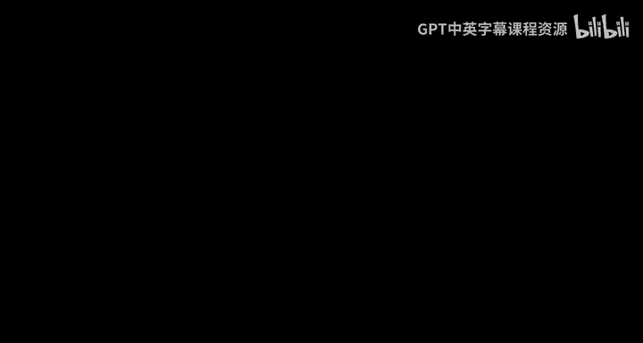

So let's get started it。So first a brief recap recap of a geneative model and disc model。

 I believe we have seen this many times before where in previously we are mainly dealing with the discontinu model which directly estimates the conditional probability from。

Of y given x and the discmin model is basically learning the decision boundary between the data points and instead the geography model is directly implicly learning the condition probability of x given y by and you can deduce probability of y given x from this learned distribution about data。

And we can do data generation for generation models in the training。

 we usually learn these generation models by fitting samples from this data distribution and let the neural network learn this distribution and after we train such generation model。

 we can do sampling from this learned neural network by sample from a usually asian distribution and use this neural network to transform the Gaussian distribution sample or the Gaussian random vector into a real data point as showing this case image here。

So there are usually different types of Japanese models。

 the first known Japanese model is a GN which is a generative adversial network and in GNS is consist of a generator which is in charge of transform from a Gaussian distribution to a data distribution and we also have a discrior which is in charge of discriminating the generated distribution with the ground distribution and will cover GNS is an architecture。

And in last lecture， we've seen vs which maximize the version lower bound with an encodeder and decoder。

 and the lower bound is coming from the posterior latent。

And we also have flow based models which won't be covered in this class actually。

 and this lecture will introduce you different models。

 which is a chair of models that can gradually adding Gaussian noise and then reverse the Gaian noise in the influence and we'll see how the model works in this lecture in detail。

And model or in general the geneative model are actually a very fast evolving field in 2013 where we start with BEs。

 we can see that we can only generate very blurry face images and in 2014 when guns were first introduced it can also generate very noisy images。

And we can see that since that very since 2019 or 202022 where we already generated very realistic image given the class or given the image the text prompt and we have SA in last year which can generate realistic videos from the text prompt and just two weeks ago we also have G4 for image generation which can do a fantastic text rendering jobs where you just given give the model just a text prompt and it will follow the text prompt and generate the text that are actually in the prompt in the image。

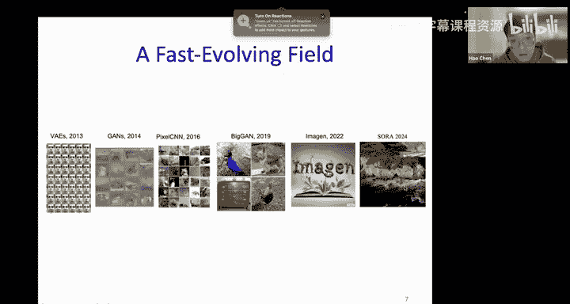

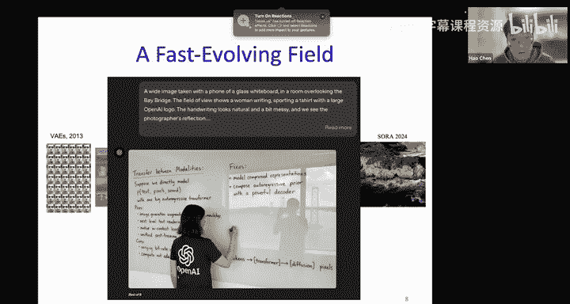

And today's content about different model would be I'll first introduce the different models basics。

 which is based on denoisizing。And I'll also connect the theory models from the SDE part stochastic differential equations with square matching perspective。

And then I'll introduce DDM， which is a common technique for accelerating the inference of different models and I'll introduce conditional different models which is currently basically all used where we can input a class or the text prompt as a condition for the different model to generate the images that are according to the class or according to the text prompt and at the last I'll introduce some more recent applications and techniques of different models。

So let's get started with different model basics， we'll start with a V and see that different model is actually just a stacking of ways and we'll introduce the forward reverse process of different models and training and sampling of different models too。

So when we talk about deferred models， usually this is what we are， I'm sorry。嗯。😊。

Usually this is what we've seen many times before， we have a chain of different latent variables and we have a different level of noisy images and usually the online tutorial will tell you that there is forward different process which is basically a chain of Gaussians in each latent is based on a Gaussian kernel or Gaussian transition of previous latent and we can get the latent T based on the latent initial latent like0 with the Gaussian kernels。

And we have a reverse den noiseism process which can reverse the forward diffion process。

 which we can deduce the T minus1 latent from the Ts latent， it is still a Gausian transition。

However， this lecture will go through a different perspective， as we saw from here。

 will start with VEs and so that the northern diffusion is actually a just stack of Vs。

And from the stack of these， you will derive the forward diffusion process and the reward reverse theno process。

And here is a recap of V I believe we talk about V in detail in last lecture here I will just do a prettycap。

 so VE is a likelihood based ju model where we have an encoder and the encoder is basically an inference model that approximate is the posterior basically latent given the input X where are trying to estimate a latent given the input X which is a of x given Q of the given x。

Whereas the late today and your input is X。And we have a decoder which is actually a generative model that can transform the Gaussian variable Z into real data。

 basically we are trying to estimate P of x given z and P of S given z is actually the geneative model we just talk about。

And in training of the ways， we are trying to maximize the elbow。

 so basically we are maximizing the K averages between the posterioror Z and the Gasian prior。

And here is a more detail recap of ways， so basically we have a transition from x to z through the encoder and transition through z to x through the decoder。

 then decoder is in charge of transform a Gaussian variable into a real data and encoder instead。

 sorry。An encoder is an inference model that upper is posterior and which is actually a Gaussian。

 so beside the encoder is predict the mean and standard deviation of the Gaussian and the mean and standard deviation is optimized by the k divergence between this two parameters with a Gaussian prior。

And a problem of VE is actually they have very nice mathematicale formulations。

 however due to the posterior VEs are usually generally very blurry images as we saw here。

In last lecture we actually also briefly talk about the limitation of A where the limitation of A actually lies in the decoder。

 the decoder must transform from a standard Gaussian all the way to a target distribution in one step。

 so we have a Gaussian data distribution and we want to sample from this Gaussian distribution and decoder the decoder takes this sample and just transform this sample from Gausian distribution into a data real data distribution point。

And this is actually over too large a gap and the polar images are usually generated from this one step generation。

And a solution to this limitation is necessary to have some intermediate latent variables to reduce the gap of each step。

So basically， we can have many intermediate latet z instead of just a standard Gaussian lat Z。

 and each latet Z will gradually transform the Gasian Z into a more nongaussian latent distribution until we reach the real data distribution。

And this is usually known as a hiarchical we， so basically we are stacking bay on top of each other as showing as this image here instead of having just one late variable。

 we can have multiple layer of bit variables and each layer is actually。

The encoder of each layer is actually an inference model for the late variable given the input of last layer。

 so basically the first layer we have the input of x and we are getting the late variable of z1 and in the second layer we have a late input of late variable z1 and we are getting another de z2 and similar for the third year。

And we also have decoders which can do the reverse basically we can sample from the distribution of this three and to get a transform from this three to the two basically the ju model of P of the2 given this three。

 and similarly we can do this for P of the1 given the2 and P of x given the1。And。

So in this hierarchical stacking ways we can have multiple basic T intermediate latent in this T intermediate latent allow us to model the joint distribution of x and between this latents。

 which is cumulative fromnt the last latent in the conditional of between the latent and conditional a conditional general of x given theY。

And we can also have the posterior basically the encoder from each latent from the input X and the z1 to the deeper layers of latents。

And in this way， actually we have a better likelihood code achieved because instead of the one step transform from a Gaussian distribution to a real data distribution。

 we now have more layers of transform， so each one and they can be more non gaussian distributions and this difficulty from transforming from a Gaussian to a non gaussian and from a non Gausian to another non Gauss and from this nons of the one to real data distribution of X is actually easier to model than one step way。

And here's a more detail about the decoder of or the inference of a second phase at each step。

 the decoder trying to move part of the noise for this bay。

 so let's see we are getting actually this to be the of x we are getting a random noise vector from z3 and we use a decoder that are predicting the noise added to z3 which is actually transform the data distribution from z3 to the2 and we are getting a less noise input of the2。

And from Z2 to z1， we are doing the similar thing， we take the Z2 as an input to the decoder and decoder is trying to reduce the noise and a bit of the noise at D2 Z2 which is getting us a less noisy image and eventually we are getting a more clean image the by stacking of the V so this way basically provides a see model that are closer to the distribution from the last layer。

And in this second phase， we can actually have many， many steps in total of lets defined。

 we have a in total of T steps where T can be actually end number usually in the3 model T setting to 1000。

And each step actually inly recover the final distribution。

 we can see of a trend of denoing here through each encodeder decoder and each decoders scope is trying to denoise a little bit of the cutting noise added to the original。

Noise vector in which until the last state will recover the final data distribution。

And we can also see from this data distribution here。

 we are starting from a standard Gaussian distribution and at each step we are trying to remove transform a bit from non Gaussian distribution to a more complex distribution until we reach the real data distribution。

And this actually。Makes it look very familiar as we saw before with ras or as we saw before with diffusion trends in many online tutorialtors。

So this actually tells us that different models are basically a stacking of wayss。

 or at different model is a special case of stacking wayss。

 we can define many intermediate states from x0 to x1 to x2 and until xt in total of t plus1 steps or states。

In each states， we can transform from the last state Xt to getting the previous state Xt minus1 through a decoder。

And。This decoder is actually representing the reverse denoizing process of di models。

 so basically we have a series of juing models， which is a stack of V decoders in our diffusion reverse denoing process where we can try to transform from a Gaussian distribution of XT and gradually into the real data distribution at0。

So how about encoders， we actually can show that the encoder part is actually。

Also a part of the encoder part of stack is also a part of the different models。

 we have modeling the forward process using a series ofs as encoders as a reverse of the decoders。

We can see that in various the encoders are usually learned with the care divergence between the posterior and prior and the prior is usually a Gaussian and the posterior is basically we are predicting the mean and the standard deviation from the encoder about the latent distribution。

However， this care divergence usually suffer from the posterior collapse issue。

 so basically you have to weight this care divergence and a larger weight will make the posterior too simple for the transform and a smaller weight will make this posterior too away from this calcium prior。

So the your model trying to solve this posterior collapse issue？By using fixed inference encoders。

 so basically instead of lacking the encoders to predict the mean of and standard of the Gausian we actually use a fixed mean of the Gausian and standard deviation of the Gaussian transition at each step。

 which we are are show in the next slide。Due to transform from the original data distribution x0 to the final data distribution X T gradually。

So the first proof of this lecture， okay， pull up。He， how。

 there was also a question on chat that the later records。Yes。

 the later decoders basically are sampling from the previous latent distribution instead of a standard Ga。

 only the first decoder is sampling from the standard Ga。She， let me see。

I'll introduce the training of the decoder later actually。

 but you can see that the training of the decoder basis is still the same and it's actually slightly different from V decoders so since in V decoder we are trying to reconstruct the original input images or the original input signals but in the models we can have a different objective for the decoder you can directly reconstruct the original content or you can also predict the noise I to the input and trying to do denoizing which is actually easier to train and more recently you can also predict the velocity so basically the change of the noise and the velocity will also give us or let us to reconstruct the original content so you can have a multiple different objective for the decoder。

啊Yeah。Okay， for the first poll， let me see。The answer should be the reverse processes a stack of V decoderors。

The decoders is in charge of transform from a Gaussian distribution into gradually non Gaussian distribution into eventually the data distribution。

 and the forward process is instead the way encodes。

Okay get continues so well see we see before that different model has two processes the first is the forward different process which gradually adds noise to the input according to a set of stacking way encoders and reverse theno process which learns to generate data by denoising as we see before we can have different objectives and the simplest objectives is denoising and focus on denoizing in this lecture actually。

And the reverse signal process is a stack of V decoders。

And here is usually you can see this example many times。

 so basically we have a forward diff model or the forward di process which is fixed and in this fixed di process we are gradually adding gausian noise into the original input and here is the original image of cat and until we reach the last step where we are getting the pure gauss noise and they reverse learning process we are starting from a pure gauss noise and each step we transform them into an。

A distribution that are closer to our real one through the noiseisy。

 and eventually we get our recover our ordinary data distribution。

And we introduced the forward di process in more detail as we saw before the forward different process is actually a stacking of fixed way encoders。

 so basically each transition is aus each transition of previous step from x0 to the next step of x1 or from previous step of Xt minus1 to the next step of XT we are actually doing a Gaussian transform based on the input。

And each step we gradually I think causing noise according to some fixed schedule beta T and beta t is actually a hyperparmeter which you can set。

 you can set the start value of beta and end value of beta and just do a linear interpolation between the two starting and end values where we can getting the beta value of each step time T。

This beta PC tells us we are dealing with fixed way Gausian transitions in the forward work di process and its a hyper parametermeter to set。

And for each transition， we can model the transition or Gaussian transition asq of xt given xt minus1。

 which is a Gaussian distribution of xt， and its mean is based on beta and its standard deviation is also based on beta。

 we can see that its bin is a square of1 minus beta t and plus by x t minus1 and its standard deviation is purely based on beta T。

And from this transition， we can actually have a joint model of all of this latents from given the x0。

 so basically say we're multiplying the conditional transition in the forward process and we're getting the joint distribution。

嗯。And we actually from this equation， we actually can't get some。

Let's see the jump transform So basically each transform is a individual causinging transform and they're independent of each other So instead of getting the each step。

 so basically getting x1 from x0 or getting x2 from x1 or getting x3 from x2。

 we can also do a jump transform， we can directly get the equation of x3 given x0。

Through or previous a conditional chain of causing transitions。In the forward process。

 basically allow us to sampling of XT at any or arbitrary time step in the close form。

 so basically we can have the close form formulation of Q of Xt given x0。

 which is also a Gaussian transition because it's a multiplicative of different gaussian transition。

 which eventually is still a Gaussian distribution。

Of x T and we can see slightly different in previously we have a square of1 minus beta t or multipied by x t minus1。

 but here we have a squ of alpha t hat multiplied by x0 in the the standard deviation is a a little bit different from the previous beta T2 however we will show that the height of alpha T is actually also based on beta T is basically multiplicative of all the previous beta T steps and similar for the standard deviation。

And from this equation， we can actually rat the equation of Xt。

 which is basically we're trying to skating the x0 by squ of Rt and adding a bias of。

one minus RVT title of RVT given the scored multiplied by a glossus noise， actually。嗯。

And this is a close form of our forward process， basically we getting after we set the beta T。

 we can getting the any Act given x0 at any step in the forward process and from a fixed causingusian transition trends。

And yeah， as we discussed before， the noise schedule is actually designed。

 such that the each step is actually actually a small gausing。

And after knowing the fixed forward word process， we can now introduce the reverse denoing process and we can see that so basically the forward diffion process is a stack of V encodederrs and the reverse denoing process is a stack of decoders and the decoder is actually a geometrytry model so basically say we're trying to sample an iter sample to get eventually the original x0 from starting from Xt which is a coussine distribution。

And starting from XT from the Ga random vector， we can do either sample。

 which is Xt minus1 from the general model or the decoder of Q of X T minus1 given Xt。However。

 one promo of this decoder is that the Q of XT management give XT is not directly tractable。

 as we saw in our forward differff process。So what we can do is actually we can use the decoder or learn the decoder to estimate the Q of Xt minus given Xt。

And this actually can be successful estimate as long as the beta T is very small as each step。

 which is also set by ourselves。And now we'll introduce more detail of the reverse de process the reverse learning process is basically a stacking of learnable way decoders in contrast to our forward different process in the reverse de learning process we're dealing with a very ju purelyjuncive process so we're starting from a causingus noise and at each step we're trying to reduce some noise added to the reduce some noise from this data input of each decoder and until eventually we do this until eventually we get the original data point at zero。

So the decoder is actually trying to predict the mean and standard deviation of the I causing noise at each step。

We have the starting distribution of a pure standard Gaus of XT。

And we have the joint distribution from x0 to xt as a conditional transition from xt minus1 of xt of all the steps in plus prior of xt。

H。And we can see that the each step or each prediction is actually a small learnable wave decoder。

 which we are trying to predict the mean and standard division of the ID Gaussine noise。

 so after we can predict the mean and the ID standard division of the ID cosine we can do thenoising of this idea Gausine to recover a less noisy signal。

And we can see this of。Conditional pro is actually。A Gaussian distribution。

 which is given the previous。Which is trying to predict the previous state XT mana。

 given current state XT and its mean understanding division is based on XT。

Or the decor is taking XT as input and step T as input and trying to recover the noise added to Xt and which we can deduce the noise we can get Xt minus1。

And the mean installation is a trainable network as we saw before。

 and they are shared across all the time steps and the time step T are actually treated as an additional input to the decoder。

So how do we learn this den model the den model actually trained with a variation upper bound as we saw in VEs。

 so this is the upper bound and we won't delve into too much detail of the derivative of this upper bound because we often will not use this upper bound actually。

So I'll directly show a direct of this upper bound can be decomposed into three terms。

And you actually also don't need to know all of these three terms because the first term is actually a constant because it's based on ST。

 the posterior of Xt given an X between the prior of Xt， which is the Gaussian。

And last term is from x the prediction from x0 to x1 and x0 is usually or both signal and x1 is our first latent is usually a scalingkating term。

 so basically in terms of image when to scalingating from a learn distribution of Gaussian into a piece of distribution which has values between zero and 255。

 which is a scaling term and what we really care about is actually this intermediate term which is a KL term。

And we have a multiplicative of assumption of all the time steps that are greater than one in the K term between the transition we are trying to learn。

 which is a P of Xt given xt minus-1 given xt， basically the decoder output in the prior of prior of xt minus-1 given xt and x0。

 and we'll see that we can derive this to or encodeder part。

 basically we use this as a one choose to train our decoders。

And this gives us a tractable posterior distribution because this can be computed from our fixed forward forward differential process。

 we can see that so basically we have Q of Xt minus-1 given XT and X0 also as a Gaussian distribution and we have a meal hat which can be developed as this form which seems very complicated but which we'll show in the next test it can be reduced into a much simpler forms and another beta at T term which seems is actually a constant term which we can ignore that in the actually training。

And here we can actually parameterize the deno model and see how we can use the objective to change this de model so basically we are dealing with care divergence that has a single form between the Gaussian means in this care divergence actually reduced to the MIC between the mean of the decoder we are trying to predict the mean of the Gaussian noise I to the input of Xt and the ground truth of mean hat given t step and given the xt and x0 and normalized by some standard deviation standard division in plus some constant term and you can see what related matters here is actually how do we define the delta of mut and the。

Yeah， the key here is actually how do we define the delta of mut since the mut theta is actually all decoder。

😊，And as we saw in the last that， we have a very complicated form of datata ofmT， however。

 we can put XT which also from our phase forward differential process back into this form。

 which imagery will lead us to this term as based on ST and Gaussian vector theta。

And our train network are also trying to predict the noise me。

 so basically we have a noise me of Gaussian that are predicted by our model。

 which can be also normalized by the some scalar vectors as we saw here。

And putting this two turns back into the original function， we are getting a final objective。

 which is actually the MIC between a Gausian random vector and between the decoder output which taking the input of Xt and we can make S based on I using also fixed forward word process and they are normalized by some scanning vector as we saw here。

 which eventually this skin vector will be turned into some more simpler form which we can set as a lambda t and La T is basically weight based on the timest and usually this is also set by ourselves in the simplest form we can symbolize this lambda t by one and you can see that the tri objective is actually reduced to predict the MA term between the noise I to the Xt and the noise predict by our decoder so basically it's a denoising process once we can predict the noise through the decoder we can deduce the noise from the noisy input to make it less noise。

As we will be clear， so basically we are making this getting form into uniform in all the time steps and usually uniform width works pretty well for both different models and flow models。

 which will also later。So a summary of the training and sampling of different models in training。

 you can see。Even though we covered a lot of mathematical equations and different formulations of transition and different encoders。

 how do we make the decoder predicting the noise， actually the training essentially reduced to a very simple training procedure so each iteration we have a batch of data samples which is x0 and with random sample a batch of times step Ts and also we sample from a batch of Gaus noise and we can use or four word process to get the xt so basically this transition from a fixed forward process here in which alpha T is based beta T and beta T is set as a hyperparmeter and this is basically or network input we takes this input and predicts the noise added to the input of Xt and trying to reduce this noise from the input to get a previous step of xt minus-1。

And this is our training process， it's actually quite simple compared to with the formulation we saw before。

Enmbmbling is actually a bit more complicated， so we are starting with a Gaussian vector XT。

 random sample from a Gaussian distribution， and we have to it do sampling through T reduced to one the original time step。

And at each step， we can sample from a Gaussian noise distribution and we can compute the previous XT mega1 given XT with or current prediction of Gaussian noise basically the noise added to current XT to dennoing。

And each step repeats this procedure iteratively until we reach the final original data distribution or until we recover the original data X0。

So you can。One thing that's is important for di is that create a noise schedule we see that we have to set beta T and from this beta T we can automatically get R T or offer a hat T or square of r T or the square of1 minus alpha hat T and we can see that there are different schedules of beta T and we have different schedules of a different values so usually beta T can be set simply as a linear schedule that are between1 minus well1 e minus square and20。

02 and we can also use a cosine schedule usually it depends on which model you are training both linear schedule and causal schedule works pretty well in practice。

In back connection with hiarchical Vs， we've seen that the different models are actually special case of hiarchical Vs where we use fixed inference models in the forward process。

 so it's determined by the beta T， which is the hyperpar。

And the reason variables has the same dimension as data， so PC。

It's the same dimension of data where but is that we are dealing with a more noisy distribution as we go with the forward process。

 the elbow is cancom as to each time step so we can do random sampling from time steps and which is faster to train and easier to train。

And model is trained on some weighting available， which turns out we can just use uniform weighting of each thumb。

Okay， and the second two。I can also take some questions from here。😔，Let me check。Okay。

 and the answer of this is actually then they are predicting the mean of the added Ga noise because the standard deviation is actually constant term because we are using a fixed forward distribution。

 but actually in practice you can also predict the standard division of the added Ga noise。

 which makes the tri objective a bit more complicated because you have to deal with both the mean and standard deviation。

Yeah， and any hear any questions before we move on？

Okay if no questions or just move out so the second part of this lecture is actually about different models from the stochastic differential equations so we'll use the stochastic differential equation to explain the forward and reverse process so how are the forward and reverse projects actually originally originated and this will eventually lead us to the score matching perspective as well so before different model decoder can be trained with different objectives and they also can be trained with score matching with data to the flow matching models eventually。

So why do we care about the SDEs or stochastic differential equations so stochastic differential equations actually give us a unified frameworkwork for interpreting different models and connect them with score based junk models so there are different barrels of different ways and flow base models and they can be connected through SDEs。

The brief of deccap of SDs before we introduce SD will I want to introduce the OD ordinary differential equation first。

 so in OD basically we have the ODE of this form we are using the gradient of x given time step T as our ODs of x given x and by taking the input of x and T。

And in ODE is basically character the trajectory of x given time step T and at each time step。

 and ODE basically defines how do we move this trajectory or the gradient or the flow of the trajectory。

 the trajectory through this ODE equation。In the audio usually have an solution from here。

 we can get any type of value of X given。Any value of x at1 times sub t from x0 through the integration of F of x given。

 a delta key。And we can also have our iter numerical solution。

 which is basically X T plus X T given X T input， which is a function given the XT input and times times by de。

And the stochastic differential equation is a bit different from ordinary differential equation instead of F of Xt we have another term which is based on a wet noise。

 actually a Gasussian noise term， so we term the first term as drift coefficient which is similar as the ODE。

 and we have another term which we call it as a diffusion coefficient which is based on a Gaussian noise。

And with these two terms， we can see that the trajectory between over the time step of x actually become more noisy compared to the ODE part because we can only do it itary based on this model。

 which we can see that is actually based on our OED solution we've seen before instead of XT and the function of FXT given T times by Dlta T。

 we also have another term of diffusion point， which is based on some standard division or we can call it a sigma function plus across in。

And before we can also dive into more detail of connecting all of this。

 where I also want to introduce the scroll matching objective。

So the purpose of a different model or actually all the geometrytry model is actually we are trying to estimate the probability of the data distribution。

In the general form of the probability density function as we still here， in degree by two parts。

 the first part is the exponential function of exponential part of the function of the x and the second part is a normalizing part of this data。

And the function of x theta given x is actually easier to deal with， however。

 the normalization part of z theta is actually more often intractable。

 so we want to maximize this this data equation then we need to know the theta。However。

 we don't often know this data because。It's also intractable。

 so instead we can model the square function， the square function is actually a gradient over the logarm of probabilityb of x。

We defend this as a score function。And now we can see how forward division process can be modeled as SDs and how the denoing process can be modeled as reverse SDs。

So we'll start with this figure again。So basically we have a forward process with many。

 many small steps and here many most steps can be considered as a continuous time so we have an infinite small time steps and in each step we have so before we have a transition which we can get x T given x t minus1。

 which is basically a Gaussian transition that are based on our beta T and beta t parameter。

 we can have close form transition from this， so basically we are scaling a Gaussian vector by head of a beta t which is a division in plus some bias with a bias determined by x t minus1 which is the previous state state or step minus by the square of by minus beta T。

And we can do a little bit reformation by introducing some deelta T because we are dealing with very small small time steps and the Dlta T sorry the delta T here can be added to the beta T so basically we are formalizing beta T as beta a function of beta over t and times by deelta T。

And we can also do a Taylorer expansion of the first term。

 so basically we only keep the first two terms of the Taylorer expansion。

 which end up with a formulation like this， we have an acting minus1 minus a term regarding the beta T times and a term。

 as we saw before with a gaussian noise and another term of another function that's similar to s。

And we can see that this actually approximate a schastic diffusion equation as we before。

 we can model the delta of xt so basically xt minus xt minus1 as this formulation here。

 so basically we have a beta t a function of beta t and de t formula as a change of time and another function which is crystal B to a diffusion coefficient which is a second function you've same before in Gaussian or white noise part。

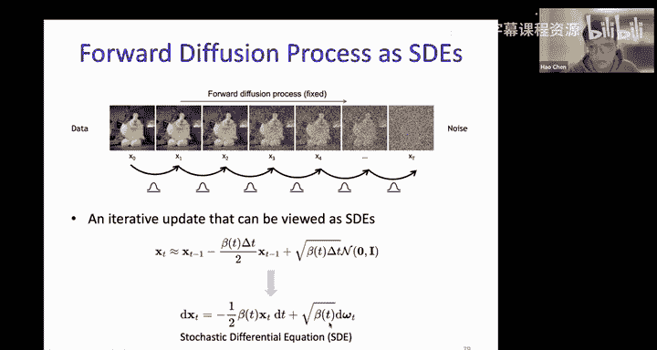

And this forward di process can be or the stochastic or the SD of the forward di process can be visualized as this so they were from a real Gascent distribution of Q0 and at each time we do a drift term and di term which the drift term basic tools for the。

From the complex data division towards the mode of the mean of the Gaussian。

 and the division term is basically inject some noise in the trajectory。

And we can see a more simulation like this， so basically we're starting from very determined probability here。

 we can see the probability are very concentrated here and from this probability we are doing SDE over the trajectory over the time steps to getting the final Gaussian distribution and we can see from the images so basically we're adding the noise and making the distribution towards the standard Gaus distribution over the steps time steps。

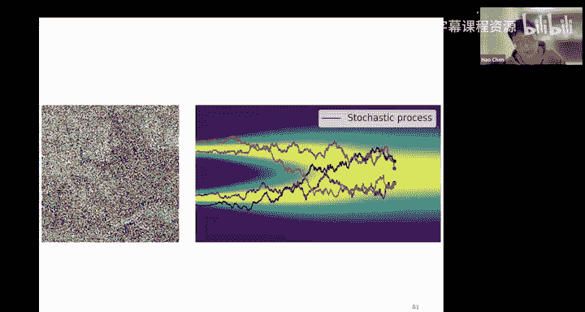

In the back word， the noiseis process is actually。Gtry reverse SDs so each forward SD actually has a reverse form of this look so basically we can this reverse form is actually fixed we have a function of over XT so basically we are taking the score matching as whistle before of QT given XT and multiplied by this function as aing as a drifting term and the different term is keep as form so this is a reverse form over SDE。

And from this reverse term， so basically it's doing a reverse from the standard constant distribution and through the more determin data distribution as we saw here it's more concentrated here and here we have a unmodal constant distribution that is more spread out。

And we can see the trajectory basically move from this more spread or gas distribution into the more con re distribution。

 which can cr or reverse to process。So basically the reverse process of different models。

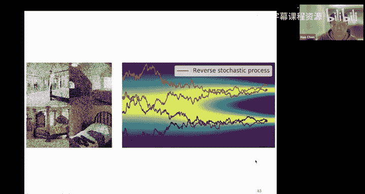

And one problem up here is actually the score function。

Also don't have the grand of this scroll function， so how do we train actually the reverse process or how do we deal with compute reverse process so similarly。

 as we saw before we can use a neural network work to predict the scroll function。

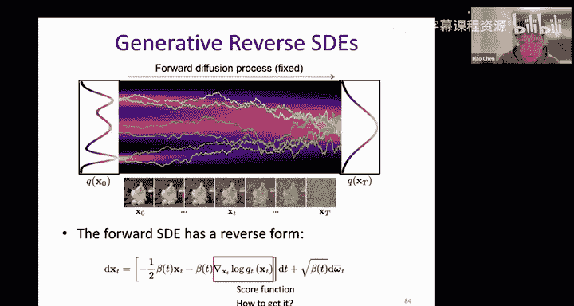

So here is a more formal formulation of the forward or denian square matching perspective。

 so in the forward process we have a forward SD so basically from data to noise。

 which has this form because that the FXT X and T is actually beta T divided by2。

And GT is the square of beta22 and we can have this reverse ID which has a fixed form of the looking like the dig。

 so basically we are adding another term about the score matching is that the forward to them and the drift term is basically the same。

So the problem here is we don't have the branches of the score function or we don't have the score function of each reverse step。

 so we use the decoder to estimate the square function of each time step。So here we are again。

Right to formulate the school matching function or the training objective of this decoders we can ignore all this time step here So basically tell us we are random sample from a different any time step from this forward different process and is compute over some data sample and is compute it over the X so basically we can get X from the forward fixed forward process or using X0 and times step T the weight function we can treat it as uniform and so basically we are trying to minimize a normal network and the ground choose of a score matching of the diffus data sample so how do we formulate this ground choose we can easily formula this ground choose through some as we saw before we have。

This XT as a。Transition from x0 using a Gaussian distribution here and we can formulate this square function as so basically compute the derivative of this formulation。

 which eventually give us a very simple term of Gaussian noise which is theta epsilon divided by its standard deviation and the deno network is basically doing a very similar thing we are trying to still predict the noise added to the input and divided by some sigma T and sigma T is fixed so we eventually we leave to a very similar form as with a different models we are trying to minimize M between the Gaussian distribution and between the predict mean of the decoar neural network and its weighted by some weighting function usually this weighting function can set to uniform。

电当。This weighting function actually evolve some those weighting given on times step T so basically we have a lambda T divided by the second T and those weights is basically a trade between the good perceptual quality so when we are using the fixed term we have very good perceptual quality。

 however if we are using this as a uniform we are getting a more worse likelihood approximation。

 but so this is usually a good trigger a trade if you want to get more visually appealing less the image。

 then the uniform weighting actually works better， but the model perform worse on thelect estimation。

They are more complicated model para and those weighting which we eventually lead us to different different models。

 as was we said before， we're actually predicting the noise here and instead of predicting the noise we can also predict some other things like a velocity or directly request the X0 from each time step using the decoder。

So the third of this lecture。I can take any question here if you have any question。

 you can ask me or have that in the chat。So I got a question of what are we minimizing the analysis between again。

 so the MIC is minimize between let's。Right， so the answer of the is actually pull the data towards the uniquei Gaussian mode。

So we can go back to this equation and see that we are basically minimizing an M between a random sample calciumciian vector and the decoder output。

 so the decoder is predicting the noise and we are minimizing this two termss so basically the prediction of your decoder in the random calciumsian vector。

嗯。And another question is what are different model generally used for and how are they different from others so as we saw from the first slide different model is one type of geometry models and it useful as other geometry models basically it learns the data distribution division and after the delivery model learns we can use the different model to generate the data points for the images using different models as we saw with and as we will saw with Gs in the next next year。

Yeah。O。😊，So let's move on。So we'll introduce briefly the DDM， actually differ model。

 as we saw before it's called DDPM denoizing a diffusion probabilistic model。

 and we'll introduce dinoing diffusion implicson model， it's an inference di model。

 so it don't have any dealing with the training forward word and deno process but instead it's a purely inference technique for DR models。

So why do we need DDM so we can see that in previous different definitions we introduce many steps or many intermediate states and this makes different very slow in generation because in generation we have go traverse from time step T all the way through time step zero and usually this we define 1000 step or even more to in the training of different models so in tri which is random sample one time step。

 however in inference we must transit from2 t to0， which usually is 100 steps。

 this makes it extremely slow for row image or row signal generation。嗯。😊。

So one question here is actually can we do generation with less steps so instead of in the previous reverse process we are trying to reverse each step gradually and each step is actually trying to remove some ga noise from the input to the dec。

And we ask question whether we can do the transition directly by skipping some intermediate steps so let's say we can do a transition from the Ga nodes into some intermediate step and do another transition from this intermediate step directly into the original data step instead of having all of this intermediate steps。

 and this require a more complicated function ameter。

And we can do a brief recap of our DDPM in our DDPM we have a forward process of Q of xt given xt minus1。

 which is a Gaussian transition based on beta T， and we can also do an time step of xt given x0 because it's Gaussian or Markov chain of Gaussian so it's independent。

 we can just accumulate all the previous Gaussian transitions which will give us a head of RRT。

And we're choosing your model by a very simple objective。

 trying to predicting the noise added to the XT using the decoder and trying to make a request to the causing noise。

And we can see that this term is actually depends only on the previous step in this other two terms are used only during training so we can do actually a more simplification using DDM。

嗯。The DDM idea is actually instead of getting x1 given x0 or x2 given x1。

 we can directly get x2 from given x1 and x0 and x3 given x2 and x0。

 so we are using a skiping steps in the reverse process。嗯。

And this keeping will start with a joint distribution。

 so we have a joint distribution of all the xt through x1 through restt given x0。

 which as the transition from x0 to xt and transition from x0 to xt minus1 given xt and x0 and this transition we can also formulate as a Gasine transition of RVt and this will eventually give us a formulation that are based on our Gass。

I'm ignoring directive here， but you can see it's actually easy to derive from this previous definition of forward process and this eventually will give us a non micro forward process which can be reduced from a base in formulation here。

And from this equation， we can do the backward process very simply as a。Another time step。

 so basically this is based on some we are getting XT management given XT and a function of a current XT and this function is completely be derived from our current model estimation。

 so basically some normalizing factor through R。And the alpha T is based on our previous definition of。

 as we saw before， alpha T is based on our previous definition of x0。

 which is based on our alpha t minus-1。And the gradient of。A。And we can see contrast of DDPM and DDM。

 So in DDPM sampling so basically we are sampling from X from the Gaussian distribution and we are traversing through T to1 or or the time step and each time we sampling another Gaussian distribution and try to predict the mean compute the mean from our decoder。

 So basically we are predicting some mean of the Gaussian and adding this mean or deive this mean from or input X T to get another time step of X T minus1 this is basically or DDPM something and in DDM。

 something we can see is different where。Sampling X from a Ga noise and through the time step。

 actually this time step doesn't has to be all the way from T to1。

 we can just use some intermediate time steps， for example。

 can you just use 100 time step instead of 1000 times step all the way here。In the IG stamp。

 we are trying to compute RF and from this set of epsilon。

 we can directly compute an estimate of the x0 and we can use this x0 to compute the XT So you can see here in DDPM basically we are doing this step by step and in DDM we are trying to first estimate the original XT or head of XT based on our current estimation and using this original XT to get the previous state of XT minus1。

 So basically this is the key difference of DDM and GM and this DDM model allow us to use many intermediate steps to model the reverse process。

And here we can see that in DTPM， we have to traverse from T all the way through one。

 but here we can do the increase any fewer steps of DDM by increasing the subsequent。So basically。

 we can just do 100 steps and sating from0 to 10 and sing from 10 to 20 instead of doing all the steps as we in DDPM。

In DDM actually achieved very amazing results， so basically you can see here。

It has actually achieved very similar performance as we so with the GDPDPM。

 but it's much faster since we're union only 10% of the original time steps。So that's our first poll。

Okay。And the other of first police is actually。There two options。

 so DDIM differ from DTPM in the DDM first predicts the noise and then estimate as0 and then finally get x minus1。

And instead of DDP， the Markov transition as waste of DDPM。

 it has a non Markov for process as defined by DDM。So any question are you here？Excuse me。Yes。

In in this slide， you have been showing the。Like the。The training goal is to predict the noise。

 but if the noise has a mean of zero， wouldn't we always be predicting zero for the noise to get the maximum likelihood？

The noise is sampled from a Gaussian distribution of mean of zero。

 but it doesn't mean the mean has zero right is predict the vector of the mean added to the input。

 so its condition is also based on your input right。

So sample a gausian vector from a gaussian distribution and this vector can have different forms right。

 but in all the samples in general they will have a mean of zero and standard deviation of y。

 but it doesn't mean all the values of are0。So we tried to predict。

Wouldn't be the mean of that distribution。

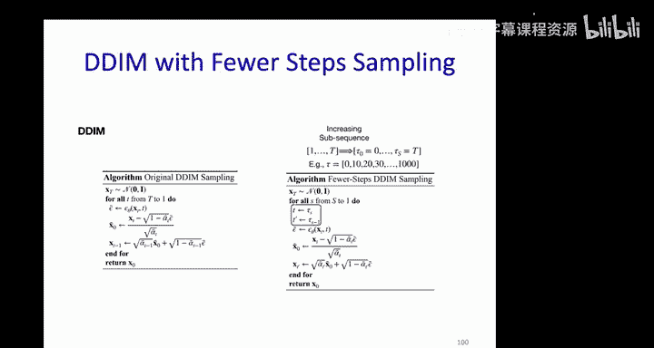

Sorry， can repeat class me？So I get that it's drawn from a distribution and it I have several of the different values。

 but when you're trying to predict it， wouldn't you predict the mean so that you get like as close predict is predicting the noise added to the input it's not。

Predicing the mean， but it eventually it's predicting the mean of the content equation adding to the time step but it will depend on your input so if you when you have different inputs it will predict different values right。

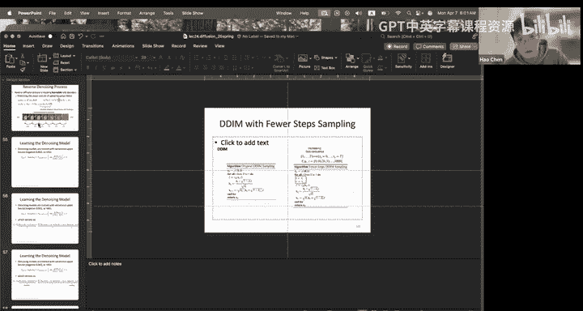

the decoder takes this， for example， the decoder takes this as poor as your input and predicting the noise added to this X4 and you can use X4 minus the noise from your prediction of the decoder look at S3。

Okay。Okay， so I move on to。Baically is the last part， last academic part of this lecture。

 which is conditional different models。And what are con differenter models。

 so basically all different model we saw before they are unconditional。

 all the formulation you saw before is actually unconditional。

 so we' are trying to dealing with the joint distribution of x0 through T so basically all the intermediate temp step in plus the original T data。

 which is the transition from Xt and Xt minus-1 given xt and multiplicable of the conditional distribution。

And in conditional different model， we are actually trying to condition this different model。

 given some condition Y， and one be can be a class can be a text prompt can be some other inputs or like a mask or a segmentation map or the detection bun box。

 any kind of conditions。And we can model this condition by changing this transition or conditional probability also conditioned on not only XD。

 but also y， so we can see here in this unconditional model we are generating more diverse and less controllable examples。

 but with this conditional different model we can actually control to what class or what temp prompt we want to use the different model to generate we can see it's awful is actually more controllable。

So conditional different model are learned with conditional square matching so basically we are trying to dealing with the square matching of XT given y and we can do basic ruless here。

 so basically we are decomposing this square matching into different terms and we end up with three terms which is the first is a prior of XT and second is a conditional of y given XT and third is a prior of P of y and this can be ignored because it's actually constant and not relevant to XT。

Which will lead to only two terms。 The first term is actually an unconditional score。

 So basically the score matching we so before in the same and another part is actually an visual gradient。

 So basically we are trying to make the general Act that are follow by follow our condition Y。

And this score matching can be achieved in two ways。The first way is actually classifier guidance。

 so basically we use a discrimininate classifier or a normal classifier for the classification scroll matching or the adverar gradient。

 so basically after we're predicting some XT from our di model we run this actually through some additional classifier to get the gradient of P of Y given x so basically you can see actually we're adding another control of gamma so basically the gamma control the strengths of this condition。

And the limitation of classW guidance is actually it's need a separate classifier。

 as we will so in guess， it need a discriminator to tell us which class these X are belong to and which class ST should be forward to。

And the conditioning also are very dependent on the performance of this classware。

And since this classifier is also taking a noise of Xt instead of the original x0 as input。

 its per will also be making words compared to its taking the clean images。

So what we can do is that is actually we can do a classifier free guidance。

 It's very very common in all the different model nowadays， they are all using the classifier free。

 you will see some parameter of guidance scale when you are using this different models and the guidance scale quiz to the classifier free guidance。

Again， so previously， we are dealing with the conditional generation of XT given y through an unconditional model of XT in a classifier free or a classifier guidance or advers gradient。

And we can further decompose this aver gradient as another two model。

 which we run it through another B step， which give us another actually give us back of Xt minus1 Mag Gi given y and another prior of XT。

And we can push this back into the scroll matching term by replacing this basin and brush with this P of Y given Xt。

And which end up with some formulation like this， so basically we have a gamma of square matching of a conditional score。

 so basically the st given and y and the one minus gachemma of the unconditional score。

 so basically a P of Xd。So basically classware free guidance decompose the。

Conditional different model into two models， which is a conditional model in the unconditional model so basically we are trying to learn two models simultaneously during training。

 which is the first unconditional one and another conditional one。

 given the extra condition unconditional one we don't take any conditional input and after we train these two models we can do a linear in through the guidance skill we call thisma as guidance skill between this conditional score and unconditional score to interlate between this two model together a more controllable conditional generation results。

And in order to train this conditional model and unconditional model。

 we're actually doing a random job the original conditional embeddings。

 so in training we actually have or decoder input as the T or XT in10 step input of T and some conditional embedding of a toti of given y this y can be under condition for example。

 we have a text prompt， this conditional embedding can from a text encodeder if we have a class index as a condition this conditional embedding can be viewed as a class em。

And when random drops the original conditions with this probability。

 usually this probability set to 0。1 or 0。2 is' similar as robot。

 except where for further jobs conditioners， we are trying to remove this conditional embedding and training the unconditional model simultaneously with this conditional model and after that we are getting an unconditional model if we don't input the condition into the model and we are getting a conditional model if we input the condition to the model and we can do linear interpretation between this two model for inference as a class para guidance。

And the last part of this lecture is actually I'll quickly go through some more recent advance of different models or we can call it an application of different model to see what the your model can be used for and how they are being designed more recently so we'll start with a DDPM so basically DDPM is what we are trying to introduce in this lecture it has a deno objective and actually is operating on the row images so basically you are operating on the32 by32 or 512 512 row images and you can see that DDPM actually can have very amazing generation results especially for the phases。

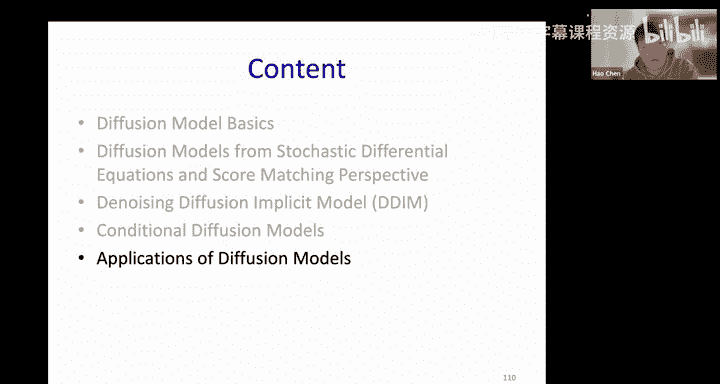

However， the problem of DD PM is actually is down the row image， so it actually have a very。

Savvy competition budget， so you have to make the different model。

 which is a unit model actually operating on all the your pixels。

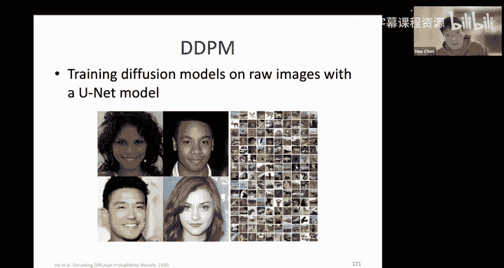

And this paper is actually the first time when different model beat again。

 so basically they are using larger denoiser model with more sophisticated design。

 they basically go through all the abls of different designs and adding idric group normalization for injecting the conditions and adding attention layers in the unit to make the different model perform better and you can see there they already generated very realistic images on the imagenet benchmark。

And latetnt different models is actually a new problem before than the other different model we simply before。

 the two different models they are operating on the pixel space。

 but here in the latent De models they see that you can directly learn a different model on another way latent。

So basically we're wrapping another way on top of this stacking of way of different models and this way is actually preed and the purpose of the D has has two。

 the first purpose is actually is providing a more easy late space for the different model to learn so instead of dealing with very diverse row signal space we can learn with a more regularized late space because we call that in training of the way is we have a clear divergence which actually smooth distance space towards our constant distribution。

In the second purpose actually we provide a compression for different model。

 so we have a lighter computation in training in both training and inference， so for example。

 we can take a 500 tab image and go through this way encoder and compress into a more compressed data vectors instead of operating the different model on directly the raw pixels we can operating the different model on the latent space from this protein bay which is easier to train and much faster to between actually you will implement this in ho file I believe。

And stable diffusion Windows essentially have stunning results like larger scale text conditional data different models。

 and they train their rely on large scale data and train their different model on even larger scale dataset sets。

 and they exactly achieve very amazing results given the text conditions。

But the core of stability is actually just latent differentform models is not any difference。

 just larger scale of both V and different model。And Dolly is actually from Open Air to similar to stable instead of we are using a。

Actually a car decoder here， so basically instead of the unit we're dealing with a car decoder。

 but still is also operating on some business based of ways。Actually， Delhi is operating of VQA。

 but you can understand as a distribution of VE。In DIT so basically in previously we are all deal with a unit architecture of a different models so basically it's based on convolution and DIT is the first transformer architecture for different models we can see that it's basically still a no transformer architecture we have a multi head sub attention and we have a face forward layer and we have a。

Leerome that are skilled and shape by some conditions， so basically equald by adaptive layerer norm。

 youre transforming your layer norm inputs through gamma and beta that are estimated by MRP given the condition。

And this BATT actually also generates more。Better reing opinion results。

And MA is actually a paper from campaign last year。

 so basically is an autoregresssive model with different loss so you can understand it as a standard alarm model。

 but you also can understand it as a training objective so the different model training objective is trying to predict the noise given some noisy image and if you understand as a training objective you can actually combine it with the autoregresssive model in previous auto regress model they are actually using crosscent to change this autoregresssive model so in terms of language models you have the text index or the talkingken index of your text and you can just create entrypy to the next talkingken prediction。

However， it's more difficult to do autoregressive with continuous signals as we saw with images or the late vectors from the protein bay。

 but you can do autoregressive by replacing the costpy with a different loss for this autoregressive modeling。

And actually you can have different orders for this image modeling。

 you can have autoregressive model so you predict token by token and you can also have a random order so you can predict any tokens at any time。

 so basically auto random instead of the rest and you also have the skill orders。

 so basically you first predict a set of tokens and then predict another set of tokens based on the previous set of tokens。

And I may actually achieve questioning results and I believe there are many discussion regarding the GP4 and GP4 imagination is also actually an autoregressive model plus a di head。

 so basically a di loss or it might be using a different models。

 but it's definitely using a diff decoder。

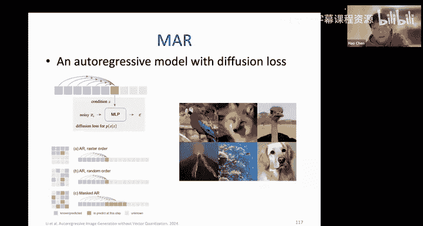

So that actually concludes this lecture。If you have any question， you can type me in the chat。

 I can stay for a few minutes to answer any question。Thank you。😊。

