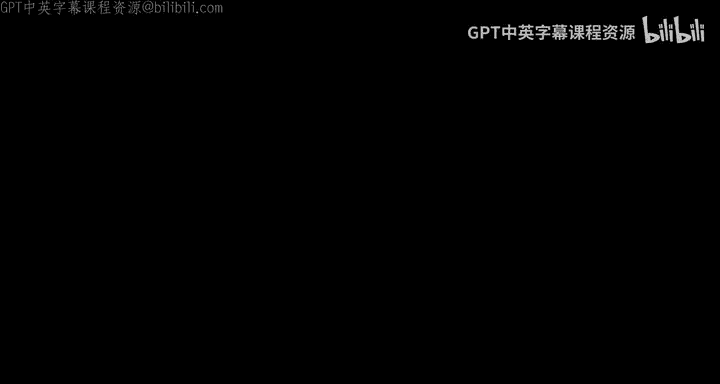
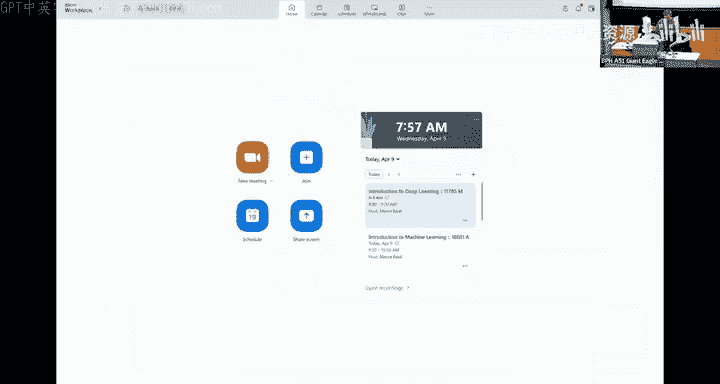
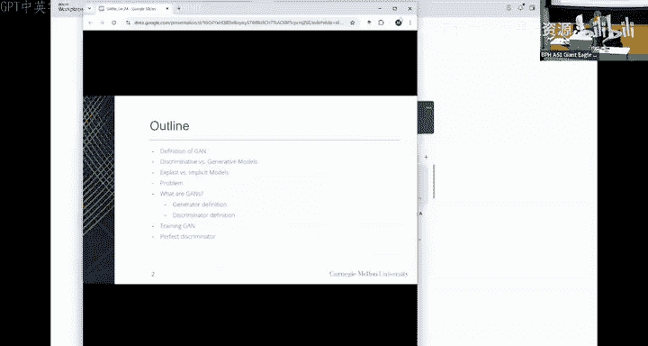
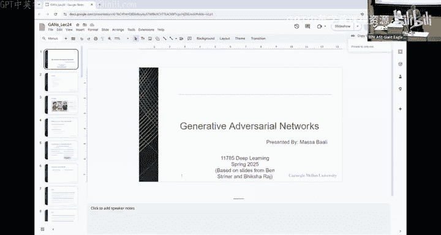
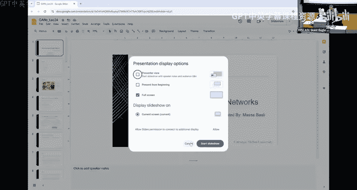
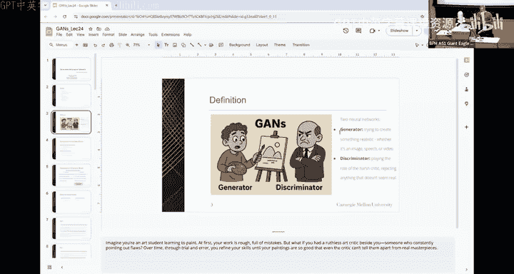
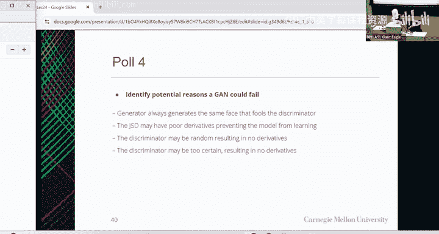
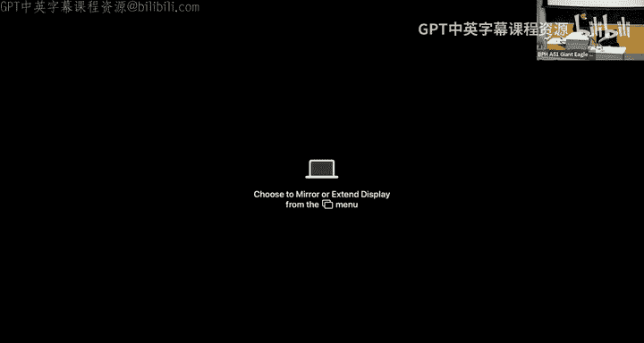
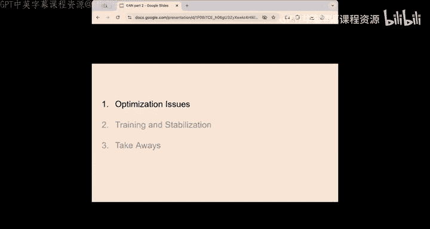
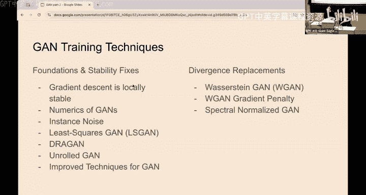

# CMU《深度学习导论｜11-785 Introduction to Deep Learning Spring 2025》中英字幕(deepseek - P27：[25]S2025 Lecture 24 - Generative Adversarial Networks.zh_en - GPT中英字幕课程资源 - BV1xbZNYrEbs

Yeah。

Okay， so。The people on Zoom can hear me well。Yes。Yeah， we can hear you Okay， perfect。So good morning。

 everyone。So。Go ahead professor。So your slides are showing your browser， is that the correct one。

 right yeah？Okay， are we recording， yes。看这。Okay， so good morning， everyone。My name is Maa Bali。

As you know， Im I D L T A， and also I work as a PhD student with Professor B Sharaj。And today。

 I'll be presenting the generative adversarial network。So。

 so today we'll be going through the definition of GN discriminative versus generative models。

 explicit versus implicit models， the problem。 and what are the Gs。

 How do we train them and the definition。And what could be a perfect discriminator。So。

So imagine you're an art student learning to paint。

 And at first your work is rough and full of mistakes。

 but you have a ruthless art critic besides you So who can constantly point out your flows So over the time through trial and error。

 you refine your skills until your paintings are so good that even the critic cant tell that can tell apart apartra them from a real masterpiece。

So this process and this mean mentor。Is that。Is the main idea of again。 So again。

 you have two neural networks。 You have a generator which is trying to create something realistic。

 whether it's an image， speech or a video。 And the discriminator is playing the role of the harsh critic。

 rejecting anything that does not seem real。Before we dive into it。

So we have discriminative and generative models。 So the discriminative models。

 they learn how to discriminate。 They determine the class， given the input， so they compute。

The probability of y， given x。And the generative models they generate。

 So they produce more instances like the training data。 and they compute and draw from the P。

 X comma Y。And they have multiple differences。 So， so the discriminative models。

 they learn from the conditional distribution， whereas the generative models。

 they learn from a joint distribution。 the the discriminative。

 they learn a decision boundary between classes。But the generative models。

 they learn the actual probability distribution of the data。So as you can see。

 because like the discriminative is only used for classification tasks。 It's， it has a limited scope。

 but the geneative can do both。The， the geneticative tasks and the discriminative tasks。

 examples of discriminative models like the logistic regression， S V Ms。

Examples for generative models， the naive base， the Gaussian mixture。

 As you can see that the generative is harder problem because it requires a deeper understanding of the distribution than just the discriminative models。

So。Explicit versus implicit models。 So the explicit models。

 they explicitly define and compute the probability distributions P， X of， the， of of the samples。

But the implicit distribution， the models， they only let you draw from draw the samples from the distribution。

And now， for。Go， first， Paul。Okay。It should be easy。Should give more than one minute。Yeah。Okay。

 so who can answer the first one。It's the first options for minimal models。the decision boundary。

 perfect。So the second one from Zoom， who can answer the second one。Zoom， anyone on zoom。

The second one。Good job。So， so for， so for the first one， we。

 we just learned that the discriminative models， they model the decision boundary between the classes and the generative model。

 they model the class distribution or the second one， the difference， the in the explicit models。

 they compute the probability of the samples。 but the implicit。

 they only lets you draw samples from the distribution。Okay， so now what's the。What's this problem。

Okay， so。We have these smfs， images， these characters。 So you're given a large set of images。

 Let's say that the faces of these smfs。 and we want to train a network which is capable of generating a new portrait。

So effectively， we want， we want to be able to sample from the distribution of the face images or any data we have。

 it's it's not only images。 It could be speech videos or whatever。

 So how do we even characterize the distribution。 What is the fundamental problem。Any thoughts。What。

 what could be the fundamental problem in this。I I， I should have got some cookies。对。Any salt。

 anything you just someone says to differentiate between male and female sfs。😀嗯。😊。

Maybe it's just to know and understand what a sort of looks like at all。嗯。Okay， so actually。

 the problem is that this is a very high dimensional space。 So it could be 1 million。

 It could be 10 million。 So it's really hard to characterize this。This distribution， Secondly， it's。

 it's impossible to work on the arithmetic because the characterization itself is like。

 it's really hard。So。What could be the， What did we see in the V A E。

What we saw in the V A E that we cannot directly characterize the full distribution in high dimensional space。

 So the underlying hypotheses is that the real world data is structured。

 but it does not occupy the full high dimensional space。 Instead。

 the data lies on a lower dimensional manifold embedded in the high dimensional space。

 So this latent code， which is the P Z， is then transformed using the G Z， which is the generator。啊。

Into the， the high dimensional space。 So my question。Here。

 we're saying the generator in the V A E lecture。 What did we say。Okay， I'm memorizing faces。

 So I know who to get cookies for。Someone says decoder。呵。😊，Professor cheating no， no。

 I'm reading from the chat， okay。Okay， so， so， so。So the。

 the generator here and so the generator here was the decoder in the V A E lecture。So。

 so mapping the Z into the G Z alone cannot fully explain the data distribution For that。

 we introduced a correction term。hich is the random noise E that accounts for any errors when choosing the right dimensionality of the space。

 so。This defines the generative model。So it can now draw samples that better match the real data。

And what was the objective function and the。And the V Ae。You can read it。

What were we trying to do when we were training。We were trying to max， maximize what。

Were trying to maximize the likelihood of the data。 or you saw it the previous lecture equivalently。

 minimize the likelihood of the data。So this is the objective。 Do you think。So now。

 where is the problem。Do you think that just the maximization of the likelihood can relate and can tell you whether the output actually looks like a face。

Will that guarantee that the generated samples look like a face， Do you think that。It's incapable。

 right。 So to verify this， we need to check if the output is a face。So imagine， for example， like。

 like you started manually。 you just this， this guy， the， the human evaluator。

 is it like manually inspecting that this sample is a face or not。

 Is this scalable or should we automate the process。Should we， yeah， We should automate the process。

 So we need to automate this check。 Okay， so how， who can give me an idea， How can we do that。

 How can we automate this process， How can we say that this is a face or this is not a face。Okay。

 professorfes， do I have the authority to add grade bonuses。啊。Yeah。

Dem if whether you the face or not。Amazing， so， so actually。

 you just replace the human evaluator with a classifier。

 just a classifier to say whether that this is a face or this is not a face。

 So the loss of this classifier， we named it like D love loss， which is， does it look like a face。😊。

There is another ball。嗯。Okay， so the first one。 Who can answer the first one。

RVAEs implicit generative models through or false。Who says true。Amazing。Okay， so the second one。

Why would likelihood maximization not result in a model that produces more face like outputs。

So who can answer the second one？Zoom， people on Zoom， anyone on Zoom。Usual， is。

 is there anyone on Zoom。I was willing to several people the same one。Okay， correct。Last one。Okay。

 so everyone， you can just answer that last one。 Is it true or false。Okay， amazing。这嗯。So。So。

So so far，m so good。 Any questions， any， any questions， any concerns。Okay。

 so now we can start and dive what is what are Yeah， what are。

Why is it not all options in question number two？All right， I can't you。For the second question。So。

 so， so， so yeah。 so here is the thing。 So for the second one， for， for the， for the second one。

 you can， you can see that the， the the second option and the third options are not are not。

It has to do with the fact that you're modeling what is a face。

 but you're not explicitly rejecting what is not a face。

 so you can think of you know a hypothetical two points in a space which both represent faces and something in between is not a face there's nothing in the model which says that that region should not also be assigned a high probability。

So how does that rule out the second option？The fact。

 whether it runs into a local minimum or local optimum or not is is has nothing to do with。

The underlying issue of the model itself， right local optim as you even in the most optimal situation。

 give any a loss function if you get the best model， it still has this problem。

Isn't the third point like then an outcome of what you said？

The third problem basically says that it says。You capture face like images。

And only only the mirror of the the third point is not saying that at all right。

 the third point says that most space like images are in a tail of the distribution。That's。

Why would you learn a model。We have most of the data in the table。

The tail is in the low probability region。嗯红。But doesn't the model only capture the more to the distribution？

If the mode captures the mode。Would you actually see face like images only in the tail of the distribution？

More realistic face like images， we could have that uncanny value effect in the mode。啊呀呀呀呀。

Exactly where is that question headed to？Sure， you can have all kinds of images of faces which you've never seen in your training data。

 which。At anywhere in the world but。Is that the reason here that this is a problem？看着你们Yeah。Okay。

 so now let's dive deeper。What are the Gs， What does the， this stands for。

 So it's the generative adversarial networks， the generative。

 which can generate data similar to the training data， like what。Give me an example。And you can read。

 by the way， also。Like the V A E。 Okay， O， let's have a deal。 When you come to an office hour， I'll。

 I'll be， I'll be the same。 I'll， I'll answer in the same way。 I'll be like， okay， I， I don't know。

That's the deal。Okay， and thatversarial， which is it is made of two competing networks that are trying to beat each other。

And the networks， it's the neural network。So I'll just like， this is a brief history。

 So thegans were introduced in 2014。 and the goal was to。

 to model a distribution P X so you can generate samples from it。

 And so it was trained using pairs of models acting at， as adversaries。

 which tells you if what was generated was indeed the class you wanted to be generated or not。

So let's see the full picture， the full figure。So。As we can see。The generator's output。

 which is the fake or the generated or the synthetic data。Goes into the discriminator。

 And the job of the discriminator is to see whether the output is right or not and use this information to tune the norms of the generator。

So for， for the， for that generator。The goal here， if I pass the entire distribution of Z through the generator。

 then the distribution。The the， the， the distribution output must match the distribution of your target。

 So the P G， X， the subscript G comes from the generator， the generator。

 which is intended to make sure that the distribution match the true distribution， which is the P X。

 X。So for the discriminator， we train our discriminator to specifically distinguish with what comes from the generator and the read data。

So if a perfect discriminator is full， then the generator data cannot be distinguished from the real data。

So now， how can we train this， How can we train this？

 So now we realized after what we've seen that we need to train both the generator and the discriminator。

 So the discriminator would be trained to distinguish between the sm faces produced by the generator and the read faces。

 So the generator is going to to be trained to fool the discriminator。So now。

 how do we train the discriminator， as we can see， the discriminator is something very。

 very important。 So what， what could be the discriminator。It's， it's a what。

 It's a binary classifier。 We train it in this way。 So whenever it sees a real phase。

 it will output a one。 And whenever it sees a synthetic fake or generated whatever you want to call it phase。

 it will output 0。 So what the objectives， the objectives。 So when I'm training the discriminator。

 I would， I would want to maximize what。The log of the D X。 And when Im and for the synthetic faces。

 I need to maximize the log of 1 minus D X。And when， when I'm training that， the， the generator。

 So the discriminator guides the generator。 That's why I need to sometimes start by training the discriminator more。

 So the discriminator guides the generator， the generator And as you can see that the generator parameters are traineds such that。

 we need to minimize the log of one minus the discriminator score on the generator。Faces。

So to summarize this， to summarize the whole training process。As we can see。

 we have for the discriminator， for the real data， we need to maximize the log D X and for the synthetic data。

 we need to maximize the log 1 minus G X。 And for the generator， we need to minimize the1 minus D X。

So so let's put， let's put them all together。 Let's put the overall loss。 So the overall loss。

 if you want， for example， the you， you want log D X on the distribution of the real data to to to be maximized for the discriminator and the log 1 minus D X where for the synthetic data X。

 it's it's basically the G Z， and you want this to be maximized。

 But on the distribution of synthetic data。 That's why we have here， the expected value of Z。So。Here。

 here is the process。 So as you can see here， here is thegan model。 in the in the beginning。

 your generator will be producing rubbish。 nonsense。

 and the discriminator will be trained from scratch。

 Then the discriminator will start learning the discriminate between the generator faces and the re faces。

 Then the generator will start optimizing using the guidance provided by the。

Disriminator and start to tune itself so it can fool the discriminator。Now， fall。

This one should be easy， right。Okay， what's the first one。Which one。Okay。In in your slides。

 it seemed like it was the discriminator first。 But my question is。

 wouldn don't you need to have a generator generating data before you could even train a discriminator at all。

 So， so here is the thing。 Like when you they generated when you start it we said that in the beginning。

 it could start generating noise。 But when we， when we train them simultaneously。

They will keep optimizing each others。 But also， we need a discriminator that is capable of discriminating before we。

 we start generating， because， as I said before， it guides the generator。

 So you can think of it this way， right， remember the metaphor of， you know。

Painting or drawing sculptures or whatever that she originally mentioned。

So in the beginning all you have is noise， so when you initialize the model that generate is better to be generating noise and if you want to correct it。

Then you want a discriminator to say this is noise。So in the very first step。

 what you really want to do if you don't have a discriminator。

Then the generator gets no correcting signal to say this is noise， and so I must change my output。

If the first thing you update is the generator， then you're getting rubbish back from the discriminator so there's no real correction being done。

In the beginning the generatortor has got to produce noise。

 the discriminator says this is noise then the generator updates itself。So。

 so you need your decision boundary in the beginning that that should be drawn by the discriminator to say。

 for example， noise， read face。 So the easiest thing。

 And then it will start making things harder and harder than things like that。So the second one。

 who can answer。Okay， perfect。 So， so for the first and the second one the discriminator。

 So we we understand and we come to a conclusion that the discriminator， which is the Dlo loss。😊。

Is very important。 So training this loss is more important since it will be guiding the training。

How does it behave， So how does。Each of these component behave。 How can we optimize them， so。This is。

The perfect。 So， so， so let's， let's think about ideal discriminator。

 So what could be an ideal discriminator， What could be the best discriminator on that。What， what。

 what's， what's the job， What's the target of the ideal or the perfect discriminated。What's。

 what's the job。Okay。Exactly， it it like you need， you need to be capable of just saying this is green。

 This is fake。So if there is a discriminator that is capable of separating the real from the fake ones。

 then this is a perfect one。 But in practice， the distribution overlaps。

So the perfect separation is hard。 Like you can't。 You can't。 It's really hard to。

 to reach a point where you can tell。 So the optimal discriminator is the one with the lowest possible error。

And it estimates the probability of a sample。being real， given X。 So， so， for example。

 as you can see here from the following figure。 So what's the probability that this sample X belongs to class Y。

 So it is based on how likely X is under each class。So from the formula。

 we can say that we take the likelihood of x under the class Y。

 and then you divide it by the total likelihood of x across all classes。

 which are the real and the fake。So at the start， the generator's output is poor。

 It's a random noise， or it's a bad face。And the discriminator quickly learns the decision boundary between the real and the fake。

So the， the key in a well trained discriminator that it should give a useful feedback to guide the generator。

So once the discriminator is solid， the generator starts shifting the output distribution。To fool it。

So this process， this back and forth， improves the generator over the time。

 So as we said in the beginning， the discriminator will be the。

 the mean mentor that can help you improve。So updating that generator。 So the generator。

 as you can see from the figure here， the generator updates its parameter to improve the output。

 So it shifts the distribution。 So it start shifting closer to the real data。 So it's like we're。

 we're there。 we're moving to the right。So the goal is to fool the discriminator into thinking that this generated samples are real。

 And this process continues as the training goes on。So let's see all the， all the it the， the。

 all the iterations。 So this is the iterated learning。 So the first step。This one。Okay， so this one。

 so the discriminator learns the perfect boundary， The first one， the first figure。

 And then the generator moves its distribution past the boundary into the real distribution。

 Im I started updating The third one， the discriminator relearns。

 it thought relearning the new perfect boundary。😊，And the generator also shifts the。Pas new boundary。

 So in the in the limit generator distribution sits perfectly on the re。 This is the the。

 the perfect。😊，A discriminator。So what happens when guns are perfectly traineded。So when。

 when guns are perfectly trained。So the discrimator becomes a perfect judge because it。

 it is now capable of separating the real from the fake ones。

And the generator keeps updating with its output until it looks exactly like the real data。

 So how does this happen， It happens by minimizing。The distribution of the fake samples。

 and the real samples。So in this difference， we call it the genen Shannon divergence， the JSD。

 which is a measure of similarity。 So when the generator is perfect。

 It will keep fooling the discriminator every time。 and the discriminator will output every time 0。

5 for everything。 So you can never tell that this is real from fake。 Why 00。5， because it's。

 it's unsure I this， is this real or is this fake。 So it's， it's like flipping coin。

 It's it's a equal probability， so。The discriminator keeps with output at 0。5。

 and there is no more learning。 So both networks stop improving。

So the optimal generator with the optimal discriminator as， as we can see from the figure here。

 the generator of the fully optimizedgan will generate the P G X， P G X equal P X。

 which is the distribution of the generated data， will be identical of the original data。 So you。

 you would reach a point。 You can't even tell that this is generated by the generator。

And this is also the Jenen Shannon diversion。 So this training procedure is minimized minimizes the JSD between fake and real distributions。

 And here is the formula。 also， I will add couple of slides for the derivations， I'll upload them。

 So now we're running out of time I should start。 So so let me just wrap up with this。

 So we have the min max stationary point。 So there exist stationary point。

 So sometimes if the generated data exactly matches the real data。 from that the from the beginning。

 So the discriminator outputs 0。5 for all inputs。 It's also So if if the discriminator outputs 0。5。

The gradients for the generator。Are flats。 So generator won't learn。 So， unfortunately。

 this is also true of a random discriminator。 So you should be careful。

 It doesn it doesn't mean that， for example， also， if it out， if it outputs 0。5。

 that this is always a perfect discriminator， this could also be a random discriminator。

So mean max optimization。 So the generator and what what we understand from the whole thing so that the generator and the discriminator。

 they need to be trained simultaneously。 So if the discriminator is under traineded。

 it provides sub optimalmal feedback as a generator。 And if the discriminator is over traineded。

 there is no local feedback for marginal improvements。Last ball。That。Okay， who can answer。

Who would like to answer this Paul。Okay， so the first one， is it true or false。True。Perfect。

 the second one。Yes， I can hear it。 just don't whisper。Yeah， right， true。 The the third one。Yeah。

 perfect。 The， the last one。So， all of them are。True。

So now we will continue into more advanced gangs。

Yeah呀。This is yours。对。And I think you need to take the。外克风。嗯。好。You hit the mirror under your laptop。

咁的。Okay。

也就是这啊。Yeah。Yeah，不。对。嗯。Alect。Everyone can hear me。Okay。So， let's。Let's move on。

 We'll look at some optimization issues and some training techniques for stabilization and stabilization and some takeaways。

I will you please expand this screen， like it's pretty small thanks。啲。Could you say that again。

 the screen is can you expand the screen she says because it's kind of small。

I's that better。 Of course， that's bit。Alright， great。 Thank you。嗯。Okay， so let's。

 let's talk about some optimization issues and how they can be solved。So。

So Gs are are complicated to diagnose， and you would need to get used to them to figure out。

 to figure some of them out。 And here are a couple different things that could happen。

1 that may be a little easier to diagnose is called mode mode collapse。

 which is when you're trying to learn a distribution like numbers 1 through 10 and。

And you train a model on the numbers 1 through 10。 But as you're training here。

 it looks like only ones，3s or 8s。 And then eventually， it just becomes ones。And。会。Well， you。

 you'll watch it happen， but。So it's not doing any other numbers at the end of this。

 And it's doing a lot of different ones。 But it's not producing all the numbers。

 And so this is a pretty common issue。 But not all failures are as easy to figure out。

So here's another one。 This is， they're trying to train the D C again。 But if the parameters aren't。

嗯。You aren't quite right。 You won't get the per， the results that you want， so。

It's supposed to be a sea far class conditional feature alignment regular regularization。

 So it would be dogs and fire hydrants， but。Sometimes Gs will give something like this where it's really hard to。

 to see what's wrong。So if we skip ahead， we'll see kind of。

The strange stuff that doesn't look what it's supposed to look like。呃。Alright。So。嗯。

So what can we do to avoid this kind of thing。 Sometimes it's just not clear。

 And so maybe your discriminator is too big with too high a learning rate。

 maybe it's too weak or it's not fast enough。 You would really need to look at your data and understand your metrics to figure out the problems。

 And you can try to make it less sensitive to hyperparameter because Gs are really， really sensitive。

 So， for example， bacheor can make something either work or not work。 It's， it's different。

 it's more sensitive。有。Okay， so the reason why we have these optimization issues is because we have simultaneous updates for the generator and discriminator。

 and we can't just have one beat the other all at once。 So generally。

 two player games are not guaranteed to converge。 And there's a stationary stationary point。

 but it's not guaranteed whether you can reach it。In particular， you could ask。

 why can't we just train an optimal discriminator。And that's because if the discriminator can already separate real from fake data。

 then it would just give one for the real images and0 for the fake。

 And there would be no gradient for the generator to work with， which is what Masa said。

 So it's like a teacher that just says you're wrong。 And it doesn't say why。

 So the student can't learn。It's too hard。In the opposite direction。

 if the discriminator is undertrained， it could misguide the generator into the wrong direction。

 or the generator could train to overshoot the discriminator， which might show up as mode collapse。

 like we saw just earlier。 So there needs to be a balance between the two players during the updates。

 and it needs to be trained together。And。This is an example from Ben Schiner。So。Here the。

The blue point is what you would have generated， and the green is what。

was where you're trying to get to。 And the， the colored background is a linear function representing the way you get to the green point。

 And so you're learning the function of the colored background。

 And this is kind of what G training looks like。So what kinds of things affect the balance。

There are many different ways in which you can affect the balance。

 Some factors might include whether your generator or discriminator is。

Is learning fast enough depending on your optimizer。

 If you have atoms on one side and then S GD on the other， they'll train at different rates。

 And likewise， the higher or lower learning rate can change the balance with architecture。

 If one network is really simple， like a two layer M LP。

 And then you have a resnet with 1 to 50 layers or something on the other side。That's another。

 that's something you'd have to experiment with。 So maybe。

You want maybe 1050 layers on one and 100 on the other instead。

 But that's kind of more of an experimental question。

You can have regularization in one network or something making it harder for one network to learn compared to the other。

 And that can affect whether the network is overtrained or undertrained and。Okay， so。嗯。

Another way you can， you can directly change the balance is if you train for more。

 more for one than the other。 So if you had a one step for the discriminator and then five steps for the generator。

 for example， but it's， it's more common that the discriminator will go more times than the generator because you want it to be a little ahead。

So， for instance， if you had a discriminator， that was 60%。Wrong。

 you might wantna train it a little more until it reaches a better score。

So sometimes you'll get something。Unstable， So if you， if you looked at the rock Pa scissors game。

 if player A plays rock and then player B plays paper and， and so on。

 if you were to write out the equation， you could perform gradient desent on that。

 So here we have the expected win for player A as the sum of the probabilities of A winning over B。😊。

嗯。嗯。In each of the three matchups。 And here you have the expected win rate for player A。

 where what would be ideal is if both players eventually reach the optimum with each player having uniform probability。

 but that doesn't happen。 And instead， you get something like this。And。

So what will be ideal is if both players eventually reach the optimum with each player having uniform probability for rock paperper and scissors。

 But that doesn't happen when you perform gradient descent here。 Instead。

 you get this kind of unstable optimum where the response each player gets gives is the extreme。

 And because of this， they never end up converging。 and this can happen。

 even if there's a stationary point， like uniform probability shown in the global optima here with a third for each hand。

So in other words， just because there's the stationary point doesn't mean you converge it。

 And it's because the gradients can circle or point away from the minima。So going back to the。

 the rock paper scissors example， if you're right at 33% probability for each hand you， you're good。

 But if one player is slightly off， then the other player's strategy would be to just end up being 100% off。

 And then the first player would then need to respond by being 100% off again。 And you。

Ben Schiner had said， you can think of it like the tip of a pencil where it needs to balance。

 but it'll fall if it's not perfectly aligned straight。

So there's ongoing research for finding the best scan。And there's a history of different techniques。

 So we'll go through some of these。 and with these。With this part of the lecture。

 we're not looking to get one method of training Gs that's better than any other。

 We're looking at the kinds of things people have done and the general ideas researchers have worked with to try to make GNs better。

 And it's just a sample of techniques to give an idea of what's going on。Here's a list of things。

 the first。The left side。Foundations and stability fixes to kind of introduce why standardgans needed changes。

 And then the right side dive divergence replacement。

 which addresses why maybe we could shift away from using the Jensen Shannon divergence in practice。

Okay， so this was a paper in the generator is actively trying to move into regions where the discriminator has no learning signal left。

 The gradient of your function in one sense。Which direction you go。

 But the norm of the gradient is how quickly you go in that direction and how much gain you can get。

 So you want your generator to have gradients， because if your generator gradients were minimized。

 then you're saying your generator can't go anywhere and you're not learning。

 And you also want to get to a point where your discriminator's gradients are， are being minimized。

 which means everything is even and it can't tell the difference， like Maa said。

 So they're using the squared magnitude of the gradient of the discriminator loss to measure how hard the discriminator。

 the discriminator might push back on the generator in the next iteration。

 So if you're at a point where your discriminator gradient is small。After a couple steps。

 it won't do much。 But if youre， it has a large gradient。

 it can update in the next step and just undo everything that the generator just did。So。They're。

 they're updating the generator to improve its loss without giving the discriminator a big variant。

 a big gradient。In the numerics of Gs， they look at the joint vector field of the discriminator and the generator parameters。

 and they analyze it as a total space of， as a total space。 So they try to determine how does。

 how does this point move overall。 And when is that point stationary。

So it's stationary when the gradients of that point are 0。

 And the objective is to minimize the norm of both the discriminator and the generator's gradients。

 So they add a regularization parameter called a consensus objective and they call it a consensus objective because both sides are trying to help each other to get to a point that's stationary But if you're doing this。

 if you say the gradient。is 0。 There， there's a lot of things。 There could be a saddle， a minima。

 a maxa。 So what the consensus term does is it it encouraged the G to go towards these stationary points so that if it's near a minimum minima。

 it will go down。嗯。But it， it needs a small regularization parameter to help smooth things out in this case。

 So visually speaking。What does the numerics ofgans do First。

 you have what thegan might look like on the left where the generator might be。

 where the generator might be going。 You can see the equiria。

 which are the points where there are no errorss， but you can see that it's not stable。

 And you might go around and around， but never get to that equilibriumria point。

 So here you see the equiria。 And those are where you want to be。 if D and G are optimal。

 but you might never get there。嗯。If you come up with this conservative field in the middle。

 this is the norm of the gradients where we calculate the norm of the gradients。

 We have a new set of gradients that are guaranteed to point towards saddle points and the equilibriumria。

 And once you have this on the left。Not leading you where you want to go。

 And then you combine it with a conservative field， pointing towards equilibia and and saddle points。

 You can， you can see these spirals and。It adds a little touch that makes the arrows kind of spiral inward inward。

 at least towards the minima， even though you might not be lucky and you might find a saddle point anyway。

2 maxma。This one's kind of obvious。 In noise。It's just a small trick， but it makes a difference。

 So if you're adding some noise to your generated images and real images。

 your discriminator so that your discriminator， instead of learning heres。嗯。It。

 it's looking at the value around this point， instead。Sos trying to smooth out your discriminator。

 learn a softer function and have more meaningful things in the region around where you're looking。

The least squares， again。If you're doing binary cross entropy loss。

 loss can be between 0 and an infinity。 And that's a wider range that causes a lot more oscillations。

 And so using an L2 loss can simplify things。 So here they。

 they've got the target where they want the generator to hit where a target where they want the generator to hit in a target。

 they want the discriminator to hit。 But instead of saying that the discriminator should say one or0。

 using binary cross entropy， they are saying use one or0 using the L2 loss。 So this way。

 you don't have a vanishing gradient。嗯。And the losses are in smaller range， and it's much smoother。

 It's in smoother shape to have an L T， so。This is to simplify the loss function over time。Dragon。

 this was a publication from CM MU。 So here， this idea is to minimize the norm of the gradient in the region around the real data。

Minimizing the normal the gradient makes the function smooth。

 So you don't want to have a discriminator that's having peaks at each of the real data and。

Nothing between。 So if the generator is nowhere near the peaks， it won't learn or see anything。

 If the discriminator has a low gradient， that means things are pretty stable and things are converging and。

Versus if you have a generator and it's doing well right now。

 But then the discriminator has a high gradient。 then that means that things are going to keep moving and oscillating and may。

 may never get to where you want them to be。So， for this。

You take random samples around the real data points， and you want that space to be smooth， so。

Minimizing the gradient So the discriminator itself is smooth。 You do that in a region。

 So it's smooth in some area around it。The unrolled G。This is a good example。Computationally。

 it might。It might be a lot， but it does provide。 it's really interesting。

 If you do something like this in the Rock Pa scissors example。

 this unrolled G is just a question of how you do multiplayer adversarial optimization。😊。

So it's not necessarily specific to Gs。 And it says if you have two different players。

 you can descend on what's currently happening or you can gradient descend on what's happening in the future。

Unrolling has to do with game theory。 And it's the idea of what's the best strategy that will be。

What my opponent comes up with after I do my new strategy。

 So it's like rock paper scissors where instead of after rock comes paper。

 you need to play the strategy such as so that you。

 you can play the same strategy regardless of what the other person does。

This was adapted from techniques in optimization and， and。Works in Gs。

 It's kind of an interesting idea for optimizing for the future。 And it's， it's basically not saying。

 don't be greedy and don't go for instant gratification and look for stability instead。😊，So you can。

 you can project out the gradient steps， gradient descent steps and optimize against it。

 So instead of optimizing against the current discriminator。

 you could optimize where the discriminator would be if it had a chance to move against you。

But the implementation is， is hard because it involves。

 you need to do several updates on the discriminator in memory and then back propagate through those to find what would have been the best option。

This is a diagram of it。 Basically， you have several steps of your gradient descent。

 and the gradients are actually going through the gradient descent。 So it's。

's you enroll the discriminator as you train the generator。

It seems to be making the generator less less greedy。And this can fix things like mode collapse。呃。

The results of this is， this is， a simple dataset set。 It's just the ring dots in a circle。

 But the top is what happens in unrolled G。 and the bottom happens in a regulargan。

 So in terms of actual steps， they're counting iterations。It's not about how long the iteration took。

 That could be a long time。 What you're seeing is if you're doing a again。

 it might make a dot on one of those dots。 and that one dot might move somewhere。

 But the modes collapse。 And then that one collapse mode cycles through all the others。

 And basically， the G ends up producing the number one。 And if it does that。嗯。

The discriminator will give a really good value for something like two。

 And then the generator is going to make a bunch of twos。

And it's just like the Rock Paper scissors game。So in， in that's in the bottom row。 And in the top。

 you can see that it equally goes out and covers the space。

 and it doesn't concentrate where you don't want it to。Previously， we。

 we just saw that our objective is to minimize the Jensen Shannon divergence between your real data and fake data。

And and this usess the K L by averaging two KL differences。

 one from the real distribution to the average of real and fake and one from the fake distribution to the the same average。

 But there's a problem with KL。 if we consider real data and fake data as point masses at  zero for real data。

嗯。So if you， if you look at your equation log P over Q， if there's a point where P is not 0 and。

 and Q is 0， then your K L divergence is infinite。And so it's 0。

 it's 0 when they're exactly the same and infinite when they're not， not exactly the same。 And。

 and it's not differentiable。 So it's not really helpful in these cases。

 And Jensen Shannon has a similar problem。Instead of infinity， it gives a log 4。

 but then it's always log 4， except when it's perfectly matched up。 And then in that case， it's 0。

 So it's also not that differential。However， there's a waserstein distance。 It's。

 it's another theory with a different approach。So wassterstein is the， the mass times the distance。

 You have to move。That mass to go from one distribution to another distribution。

 It's intuitive and symmetric， but it's difficult to calculate。And there's a common example。

With a warehouse full of products with a certain distribution。

 And you want to make it into another distribution of products in a warehouse。 But I。

 I found that kind of confusing it。 to me， it's， it's more like clay。

 Like if you have a pile of clay and you want to shift it to be the same shape as another pile of clay made more sense to me。

 but。So to figure out the， the， the problem is， how do you move the。

Move it the least amount to get from one in the case of play。

 from one shape to the other or from one distribution of products in a warehouse to another。

So to figure that out， you need to know the shortest way。

 What are the least number of steps to get there。 And this is called an optimal transport problem。

 And the way you move things is called the transport plan。 So it's going。

 going back behind Wassterstein G。嗯。This is， this is the the the original optimal transport problem。

 And so we're translating this so that it's， it's relatable forganNs。

 we're trying to find the best pair of functions， Phi and psi， that's what the supreme is over。

 such that when you're evaluating phi and the real data and psi on fake data。

 the difference between them is big。 but you can only do that if phi and pi don't get too far apart。

 And， and we're measuring that with a cost function。So。Yeah。Cos， the cost function is。

 it's the cost of moving probability mass from a real point X to a fake point Y。 And in practice。

 we choose the e Eucliideing in distance L 2。Just how far apart real intake points are。

 And then now training two functions by inside with a constraint like this， it can be hard。

 And so waser steamgan simplifies this by just using one function F。

And it replaces the two functions with one。 And this leads us。

 to the definition of a one lifts function， which means F can't change too fast。

And the simplification turns the cost base countrytrain into a geometric1。

 The slope of F is F is bounded。 And that's the exact loss。Waserstein G uses。

 So we've replaced the two functions into one and the cost constraint with the lips shititz constraint。

So， it's implementable。So here's a visualization of what this looks like。

 What we end up doing with this。Wherstein G critic。 The critic is in the， the the light blue and。

It's better than the regular G discriminator in the red。 If you're， if you're regular G， if you had。

If you had so the real data is on the left， the the pile and the fake data is on the right。

 So if you train a a one or0 sigmoidgan to separate the two of them。

 the red line is the kind of line that it's going to draw。 And you can see it's flat and vertical。

 And you can't really do much with that。 it's harder to work with。

 But your washirsteingan instead of being one to0 and a squashing at one and 0。

 you're setting up an upper limit to how sharp the Wassteingan can be。

 And because there's a limit to how sharp it can be， it's smooth and you can go。😊，Down or up it and。

By definition， it has a lift its upper limit。 So you won't have any of these vertical lines。

 which kind of causes these horizontal lines that don't give much information。嗯。So theoretically。

 this is good， but it doesn't quite hold up in practice。

So those straight lines is what happens when you have that constraint and it just clips it。

One of the big， that's， that's。One of the biggest problems。 maybe it is the biggest problem。

So the lipschitz is， is D of x minus D of y， the norm of v over the norm of x minus y。

ESo it's an upper bound。Of what's the difference in your output， given the difference in your input。

And the gradients。It it's the gradients being upper bounded。

 And the way the original paper tries to address this problem is they just clip the weights。

 And if you just clip the weights， your function has these weird outcomes and。

It doesn't really learn anything as useful。So a solution to that is a gradient penalty。

 Their idea here is that the lip shifts should be one almost everywhere。

 and the gradient should be about one， almost everywhere。But you can't calculate the gradients。

Everywhere in general。 And so they take sample points and figure out the gradients at those sample points。

 And then they figure out the the square between that gradient and one， so。呃。Yeah， so if。

 if it's larger than one， it regularizes it towards a one instead of contraining it to a one。So to。

 to pick the samples。The idea is to do linear interpolations between your real data and fake data data。

 So the question is， where should you regular rise and smooth the gradient。

 And it would be the points around the path between fake and real data。

 So you can kind of see it where。In between every point， it's just a little smoother after this。So。

 yeah， you so you see circles instead of boxes that are roughly aligned to the points。 So it's。

 it's just a better result with the gradient penalty。 It's not exactly the last thing to。

 to come out， but it's， it's had a lot of success and。Is a good starting point。嗯。Oh， boy。

So another approach for bounding the lipsitz is the spectrally normalized skin。呃。So the。

 the spectral norm of a matrix is the maximum stretching a matrix A can do to a vector X and Euclidean in in Euclidean norm。

 If your x is in any direction， in what direction will it grow the largest and then。

Put a limit on that by making sure no layer stretches it， its input too much。

So you want the full network to be one lip shift。 So you normalize its weights to ensure that each layer has a spectral norm equal to one。

 And this would mean it doesn't blow up the magnitude of inputs。

 And it gives an upper bound on that lip shititz。 And that might be good enough。

 So in contrast to the， the Wasstein G。呃。Gient penalty。

 where we're doing sampling to constrain the lipes to an exact value here。

 We're calculating an upper bound。Of the lipss， of the entire space， no sampling。

 And it guarantees lipss at any point will be less than this value。So。And think quite early。

So we have some takeaways。Trends， to keep in mind。People are working towards regularization and smoothing。

 How do you take this discriminator and say some area around here should be smooth and meaningful。

How do you get them to go towards a stable region or a central point。

And how do you eliminate non nonlinearities to simplify the training process。

How could we constrain the complexity of the neural network so that it it doesn't grow too complicated and manage during。

 too complicated to manage during training。some methods like unrolling， they， they seem。

They look good theoretically， but they require a lot of computational resources， especially。

For memory and time， if you're minimizing the gradients of the gradient。

 it could lead to unstable computations or GPU explosions。

And while sampling based methods look promising， the high dimensionality often makes them ineffective。

 So in practice， you can't sample enough to achieve reliable results。

 Saming strategies are hard to control and and may not get you the data you need to make the progress that you want。

And bound based methods， while they're helpful in some situations， they often lead to strange。

Outcomes or artifacts。 And this happens because instead of optimizing the true objective。

 you end up optimizing a bound， and the result can be not， not satisfactory。

 So it's like the straight lines that you saw in the waser seam G where you would rather have a smooth curve。

So where to from here， we're left with。A questionest。

 how can we architect a neural network to learn a meaningful loss function？

 So this is crucial for advancing Gs。 And it's a key direction for future research。And yeah， he。

I spoke a lot faster than I expected， I guess。嗯。Yeah。

 what is like the what' like the current state of Gs because like one I look like most of the fixes were like suggested in like 2017 2016。

 and that seems like right around on transformers became like the new architecture。

 So like is there a lot more research we thought in the past。There are， yeah， I didn't。

 I I should have probably added some， but。Yeah， there's。

 there's different methods that rely on like cyclegans and star conditionalgans that you can look look into and then。

They kind of merge them with architectures to make something like stargans。 That's pretty important。

 too。 But I， yeah， I didn't include those。It still way close for the disseminator to say this part of the image is more fair。

 and this part seems more real so that the loss function。嚟我咩啊你。嗯。So can you say that one more time。

 Like the discriminator instead of saying 0 or1。 Can it say something like this part of the image seems more big。

 fix this。Yeah， that's。呃。I mean， yeah， there's， there's different ways to do that。

 So the least squares G， I think that focused on。哦， sorryorry。I forget the name of it。 But， yes。

 there's ways to， to focus on just one area。 And you can。 yeah， there sorry， I Maha。

 do you remember the name of it at all， or like， theres， I know there's a couple， but I just can't。

Remember what they。 That's okay。Professor maybe。嗯。I'm having a problem， my screen is flickering。

So I can't really see a screen or the chat box or anything。Don to fix this。

Im notI'm not following right now as the past 10 minutes， Okay， no worries。

And I sort example where we like basically point the gradient so it points towards the local minimum and then like the or like the global minis in order to help it convert how do you like I guess know where I feel like I feel like we're trying to finance so how do you know where they are like how do you like add those two together。

Could I repeat that question， I'm sorry？I'm trying to remember which technique it was。

 but it was the one where we basically had an issue where we're spiraling around and never actually achieving。

 yes， this ones， how do we so。

要啊可。That's just a。So this generally happens and the point is when this happens。

 one of the issues we have in these models is that you don't really know if where you are is a good place or not。

 so sometimes it's just important to ensure that there is a point that you're converging to instead sort of just wandering around for M。

And so a lot of the regularization and other things that we do have to do with just trying to resur modify the loss surface。

Such that you get something that looks like a pretty distinct local minimum that the gradient descent will head to words now this is this isn't a guarantee that that local minimum minimum that you constructed through your regularization is actually a meaningful one and that that's a common problem with all optimization problems as you know you just construct it based on some reasonable principles and so here we maybe try to minimize the Lton norm of the data and you know the eton norm is nice and convex and has a clear minimum so if you sum to any odd loss function then it tends to begin to show emphasize minimum。

So that's basically what we do over here。One way to make these feels a little more。

Give them a little more clarity is to add these regular rises that。Guide you in some direction。

 You have no way of knowing whether that direction is right on。

So it's just lucky if you find minimum it was it's not lucky， it's principle， but yeah， you know。

There's no absolute reason for you to believe that this is how it should be。O。

It is conditional with scans。系。嗯。Any other questions？I can't see the chat。So。

It appears we have no more questions we done kind of early。Yeah， sorry about that。I can't hang up。

 so。But I can't see my zoom。Thank you啊。Okay， thank you。嗯。

