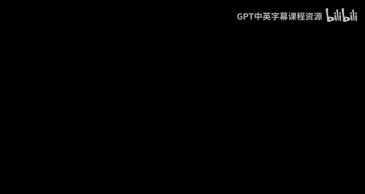
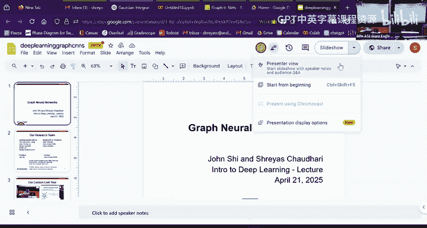
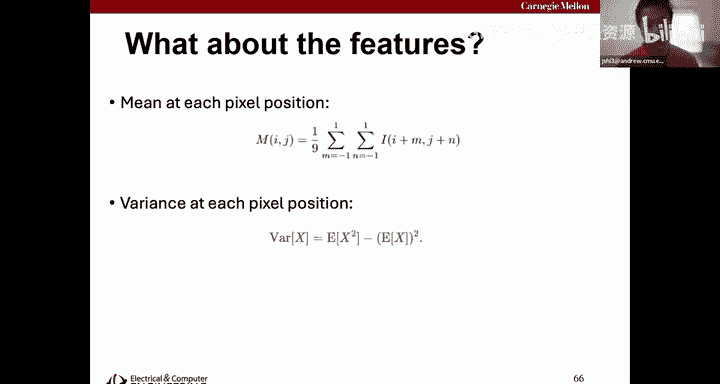
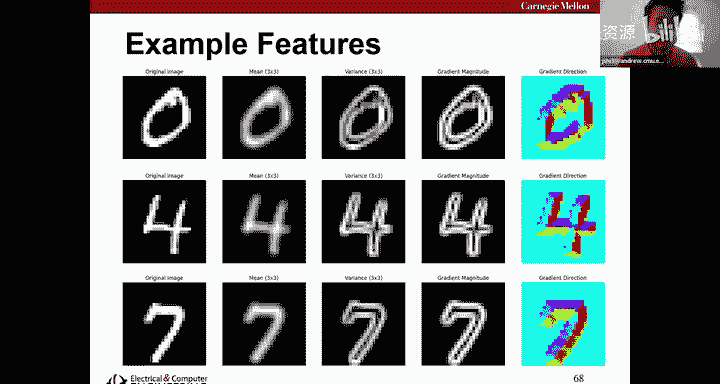
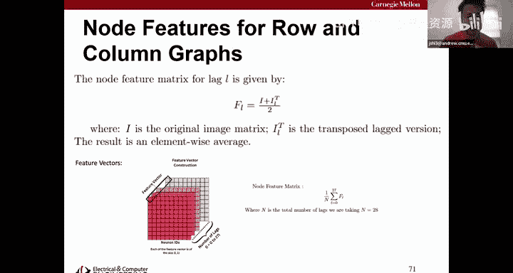
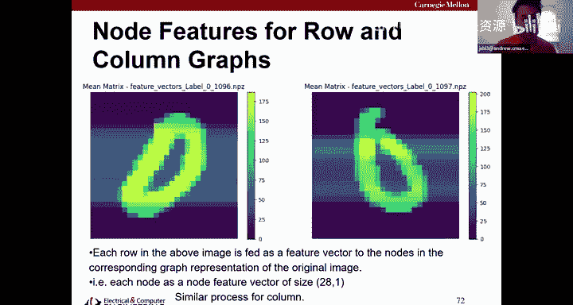
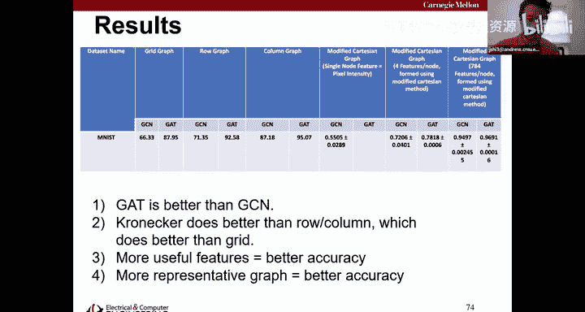

# CMU《深度学习导论｜11-785 Introduction to Deep Learning Spring 2025》中英字幕(deepseek - P28：[26]S2025 Lecture 27 - Graph Neural Networks.zh_en - GPT中英字幕课程资源 - BV1xbZNYrEbs

还是那个那个。Back here。嗯。可以。No， I think you're。あんとそういう。You should be also right。So I have one。

ho will being throughoo that's fine， I it Peter what last？Okay， if you going first or you all right。

 then I'll make sure you's able share screens。IOr I can， I can hear the screen。

He's using the same twice as you。O，PtoYeah show。嗯。谢谢。O。哎，他那个。我西。咁你再见啦。So。

嗯。其你开先啱上你咧。さですねはい。yeah， my 1 I， if he's probably feeding back through is， let's see。So， he needs to。

我是。Is it it just what is like Andrew I J she 3， J2， she 3。哎。哎，好。咁你听唔到。안这个。Okay。

 can you hear me first。Okay you want to get started or do you want to wait a little bit。肯定说。系啊同我自己绍。

Sorry， I was the here。这3 but think。If you can spoil up。谢谢。Is there a why。Is there an attendance pool。

 Tina。That's， that's up to the Ts。 I have no idea。Yeah。We we're not really close that。你等等。All right。

 let's wait a few minutes and then we can get started。Recording。

All rightLet's sweet tonado5 and we'll get started。All right， let's get started。Everyone can hear me。

 right， Trace。对。Good morning， my name is John X and presenting with me in the classroom is Reyas and so we're here to talk about graphph neural networks。

So yeah， next。All， so Treus and I are both part of Jose Morris's ECE research team and throughout the years we've had。

Many undergraduate interns， many masters and PhD students， a postdoc。

 and of course our advisor and so this work that we're presenting and a lot of the research that we're presenting comes from not only us but also these great interns and students and of course we'd like to thank them and our advisor。

 Jose Moura for their support。A couple of kind of shameless plugs this archive paper is we wrote a few years ago。

 but basically it coversvol graph convolutional neural networks which we're also covering today and its a pretty it's written in a way that's supposed to be a kind of a gentle intro so it' not it doesn't have a lot of verbose language。

 it doesn't have a lot of confusing technical language it it's written in a way that's supposed to be approachable。

So that paper is here and then。Also if you're interested in learning more about graph signal processing。

 which is what I do just and geometric deep learning learning with graphs， we do have a course。

 it's run by Jose， it's 18898D in the EC department and so if you're interested in that you can go check it out。

 it's only offered in the fall。Next。So we actually gave this lecture last year and it was pretty fun except for the fact that it was the day after Icast 2024。

 so we got back from Korea the night before last year and got up Monday morning for lecture。And so。

Luckily this year， while Bsha did offer me the day after ICP again。

 we chose to do it the week after to have a week to recover。对呀。Next。

So in this course you probably have worked with，s you generally work with grid structure data and what that means are like time series or images and these and this data is defined on a grid and so it has a natural ordering。

You know which pixel is on the top left， you know which pixels on the top right， you know。You know。

 like in ordering to your time series， right t equals 0 t equals 1 equals 2。

 and so that's generally what we mean by grid structured data。Next。

And so today what we're going to be talking about is how to deal with data defined on an irregular graph and so these could be examples of social networks sensor feeds web traffic supply chains and biological systems these type of this type of data is。

I is not constrained to a regular grid and so because of that it makes it more challenging to deal with than the grid structured data that we were just talking about and so you can pretty much have any data defined on a graph and yeah and so we'll talk more about that in this presentation next。

So the challenges in graph data is。When you have an image like on the left here。

Can they see my cursor， maybe maybe not that's fine。

 but so if you have an image like on the left it has a fixed intuitive order in。But。Okay。

 that's fine has a fixed intuitive ordering， but on the right here。When you have a graph。

 you don't have an ordering and so the question is like which node would be first and so you would have to define an ordering。

And you and I may not get the same ordering。Um。Also， another question is。

 how do we get this graph information？Or like how do we incorporate this graph information into our learning or deep learning models and so these are the challenges that we're that we face when dealing with graph data and this is something that we're going to be addressing in this presentation today next。

And so the challenges， as I said before， like you have discrete signal processing or DSP。

 which works well on time and images like time series， but it fails for graph data。

 mostly because of the reasons I mentioned before， there's no fixed ordering and there's no way to incorporate graph data。

 no natural way to incorporate graph data next。Similarly， for the deep learning side。

 you have your traditional CNN， which you learned about in this course and it performs well on this grid structured Euclidean data but。

It actually fails for graph data right you can think like for to move a convolution kernel over your CNN。

 how would you do that for a graph right there's no fixed ordering and how would you incorporate the graph itself into this architecture and there's not really a natural way to do it。

Next。And so one of the things that graph data has to have is that operations need to be permutation invariant and what that means is that we want any operation we use to produce the same or permuted numerical results。

Regardless of order and what that means is like if I have the same graph like I do in this picture。

 I have the exact same graph， this one and this two。Essentially， if you order the nodes like one。

 two，3 like that， and then someone else comes along and orders the nodes  two，3，1。

 you want the ordering to not affect the result。So when we have graph data。

 we also have a signal which is essentially you assign a number to each node and that could represent like like this is an electrical grid and these could represent voltages right and so you're storing that in a vector。

And so this first node here on the left it has minus5。

 and then on the right has six and the one at the bottom has three。嗯。Yeah， and so oh sorry， has。

 I think 10， I don't know 10，1010， sorry， 10。 And so。And so you have negative five， six and 10。

 but then by writing down negative five， six， and 10， you've imposed an ordering。And so now。

 when you do operations， you want that ordering to not matter。 And so， for example。

Let's take the sum right so you just add up the three numbers and so you get 11 and so on the right here you also have the exact same vector just with a different ordering and so the sum you also get 11 so you could say just summing the elements is permutation invariant。

But what if you take like the difference， So you take the first one， minus the second one。

 minus the third one。 So in that case， you would get minus-21 in this case on the left case and on the right case。

 you would get9。 and so that operation is not permutation invariant。

And then let's say you take a raylu， so you get 0610。

On the left and on the right you would get 1006 and so that's actually okay because。

Despite getting like a different vector the numbers are the same and the order is also the ordering is the same with respect to our different orderings so essentially what we want to have is we want to have any operation we do on graph data to be permutation invariant in other words we want it to produce the same results or permuted results we do not want the ordering to affect the actual calculation like in this first difference calculation。

O， next。So the other thing is that the other challenge I mentioned is incorporating graph data so in the previous example。

None of the operations actually used the graph itself and what I mean by that is we never used any of these edges connecting the nodes all we did was use the three numbers right and so you could have a graph without the edges connecting it and you would get the exact same results and so this illustrates how you the need to incorporate this graph data these arrows yes question。

Yeah， I are you， Are you actually trying to， maybe are you showing your caa or。

L you when you're talking with I I am not because S is controlling the computer。

 which is why I keep saying next Okay Yeah， I will try to get Tres to highlight certain areas I point for you All right。

 thanks， right next。And so this leads us to our main question right。

 how can we design deep learning techniques？For graphs yeah so I see another question I will address it after this so so how do we design deep learning techniques for graphs you must find a way to incorporate the graph information and all the operations must be permutation invariant and this field is called geometric deep learning。

There's a question in the chat that's what is the difference between graph neural networks and graph signal processing？

We're going to cover that， but essentially graph neural networks is like the deep learning equivalent。

And is deep learning Well graph signal processing is like signal processing it's a way to analyze signals without using deep learning so the relationship is essentially。

Like you have discrete signal processing， which is like four year transforms。

For grid based and then on the other hand for graphs you have graph signal processing so like how would you define a fourier transform。

 how would you do convolution stuff like that and then similarly you have your CNN。For。

For like deep learning on images or time series and。

Similarly you have graph neural networks which are the deep learning thing like how do we incorporate graphs into that and so that's the difference graphphing or processing is a more theoretical kind of set of tools like before you transform that type of thing well a graph neural network is the deep learning equivalent。

And so。Incorporating these deep learning techniques for graphs。

 this whole field is called geometric deep learning。Next。Okay。

 so now we're going to go over the graph signal processing stuff。嗯。Essentially。

 discrete signal processing， if you don't know if you don't have to be a signal processing expert。

 but basically it works well for grid structured data， you can take a foer transform。

 you can do convolution， you can do all these techniques。

 but graph signal processing tries to essentially do everything you can do in discrete signal processing。

 but for graph data。And so here we have a graph。And so on the left here， and then we have next to it。

 the adjacency matrix。And so something to notice about this adjacency matrix is you have a one where the edges are。

Right， and so。In graph signal processing。whichch is different from computer science in the computer science you learned that an edge connecting one and two would have a one going row a column。

So like if one connects to row  one column 2 would have a one。 But in graph signal processing， well。

 we do actually do the opposite。 We go column to row。 So if there is an edge connecting。

Two to one to two， then it would be column1 row two。I think this is the reverse of that， but yeah。

 anyway， so it's different from computer science and that's just stuff I know。

Forormality kind of thing next。So。The question as we've been asking is essentially how do you go from discrete signal processing or this time kind of graph to a any type of graph and so in DSP the time graph is a path。

Plus a boundary condition so it's very intuitive right like the time goes starts at t equals1。

 then it goes to t equals 2， then it goes t equals 3， then it goes ts 4。

 and then it circles back to t equals one。And so for a general graph G。

 instead of having this nice structure， which is a path and a bounding condition on the right。

 we would have。Any graph。So we just have an arbitrary graph here and so then how do we define a signal。

 Well， the signal is going to be this purple kind of bars on these things。

 and so those are going to be just a vector。So for this graph， we not only have the graph itself。

 which is defined by this adjacency matrix， we also have the signal， which is this vector。

Of these purple bars and so that's just four numbers in this case and they can represent measurements on the graph so like a knowledge graph。

 the sensor network measurements， voltages and a power grid。

 you could have a social network and these could be connections between the different people and your social network and then the bars would represent the number of people in your social network。

Or a number of friends that you have， Okay next。So also there's something called a graph shift。

 which so in DSP， a very key fundamental thing is that you want to be able to shift in time。

And that basically just means move the values down by one and so here we have the time graph。

Which is A sub C here。 And then the signal S， we're going to assume is 25-110。

And so to shift down in time， you just multiply the adjacency times S a times S。

 and so by doing that in DSP， all your values just move down by one。

 and then the last value becomes the first value。But in graph signal processing， same idea。

 we have this a matrix， but it's arbitrary， sos not it's not the path right it has a different a and then you have the same you have a signal25 minus 110 and then let's and then to shift you just do a times S and so you get whatever you get and so like the value kind of travels along the arrows so for DSP in time。

 the value is just traveling along the arrows and the arrows go from one to the next but in GP the value at each node propagates along the edges。

So you can kind of see that it's actually the same operation。

It's just that in GSP we can have one node go to many edges one node go to many nodes and in DSP the node just goes to the next one and so this graph shift is fundamental to signal processing。

Next。And so an interesting question would be like， okay。

 is there permutation invari on this graph shift operation that we just defined。

Here we have the same we have a， which is the J matrix I was just using and the S。

 which is the signal and so if you do ASS on the left here。

 you would get minus-12 121 and so on the right I have the exact same graph except that Ive reordered the nodes。

So if you look at these node labelings， they're different。 And so because I reorder the nodes。

 the S2 is reordered in the same way。 the A2 is reordered in the same way。

 And so when I do a2 times S2， I get 12 minus-1，2，1。 and if you notice。

While these vectors are different， if you actually put the values onto the graph。

 they correspond to the same thing so if you look this 12 on the on the A2 S2 here corresponds to node one which would be this bottom right one here and in the previous on the left here。

 this 12 corresponds to number three， but if you look at the picture that's actually the same node as one。

And so therefore， this operation is permutation invariant。Okay， next。And so you can prove this。

The way you prove it is essentially you define a permutation matrix and what that is is it's obtained by permuting the rows of the identity matrix。

 each row has1，1 and n minus1 non zeros， and each row column only has11。And because of that。

 every permutation matrix is orthogonal。Which just means thats inverse is its transpose。

And so here we have a permutation matrix which I just made up， and then you have S equals the signal。

 and then you have S2， which is going to be a permuted version of S。

And so to prove permutation invari， you just show that assume A2 is a permutation of a1。

So this would be for the adjacency matrix and then S2 is a permutation of S1。

 so your signal is a permuted version of the other signal。

 and then you just apply the operation a to S2 and you multiply it out。

And then you get this pi A1 S1。 So what does that mean。

 that means that A2 S2 is a permuted version of a1 S1。It seems a group then one yes。

 I think it is a group。So that goes into a field called algebra， signal processing。

 like defining it as like a group and all that stuff and that in that is。

The predecessor to graph signal processing。Yeah， I think it is a group， though yeah， all right。

 so anyway， so that's how you prove permutation invari。

 you essentially assume that there's some type of permutation on your a。

 some type ofm the same permutation on your S， and then you do the operation and show that you get a permuted version of the original。

Next。graphYeah，'s like in the DSP GSP structures data side like that graph under the DSB side does a sub C。

 What exactly is that graph or what is that graph so that graph is called a cyclegraph or a line graph essentially what it is is it's just in DSP。

 you have a fixed graph， So it represents time， right， So。

It's like one goes to two goes to three goes to four goes to one。

 and that is called a time graph or a line graph or cycle graph and essentially it's with you can actually produce all of DSP using this line graph using this cycle graph。

I see。All right thank you and that is if you take the course in 18898。

 you'll see the details of that， but yeah。Okay， so then in graph signal processing。

 we also have the idea of convolution。And so in GSP。

A linear shift in variant graph filter is a polynomial of the adjacency matrix。

And so it has a max degree of n minus1 and the reason why is because of a theorem called Kayleley Hamilton which pretty much says that the higher powers like a to the n a to the n plus one and all of those can be rewritten as a linear combination of the lower powers so if you have a to the n is just change it'll just get merged into the a to the0 to the a to the n minus1 and so。

Convolution therefore， is the matrix vector product of this polynomial of a times the signal S。

And so， you know， convolution is a very fundamental operation you processing and the way you do it is a polynomial of a times S the graph four your transform。

Is found using the eigen decomposition of a。 So if you decompose the A using eigen decomposition。

 then the。Into V lambda or V inverse lambda v， then the eigenvectors form the GFT inverse and then the right eigenvectors form the GFT and so the spectral signal or the frequency signal S hat is equal to GFT times S。

Okay， next。And so。In the interest of time， we probably won't go over this too detail too carefully。

 but essentially you can prove that both convolution and GFT is permutation invariant， which again。

 so that means that if you reorder your a1 and you reorder your S1 the same way， then。

The convolution operation polynomial of A2 S2， if you multiply it out。

 actually just becomes a permed version of A1 and S1。

And also the GFT is also a permutation invariant， so if you have an A1 and you take its eigen decomposition and then you have an A2。

 which is the permitive version and you take its eigen decomposition。

 then you can show that S2 hat actually produces the same thing as S1 hat because these permutations will cancel。

So essentially， the operations that we just defined are permutation and variant。

 which makes them useful for graphs。Next。Okay， so now I'm going to turn it over to Sres for the middle half of this talk。

 so Sres。Oh actually no wait， no hang on， I cover this， sorry， yeah， I cover this sorry。

 so go back a slide。So now the question is like， what can we do with graph neural networks？

And what type of tasks can we solve with them next？

So the types of experiments are node classification and graph signal classification。

 so node classification is I have a graph， it has a bunch of nodes and the goal is to classify each node in the graph。

So let's say I have a graph with 100 nodes， then my goal is to say each of the 100 nodes is like class one or class two the graph shows connections between each data point。

So that means that。Like node one being connected to node 2 is saying that like。That the。

That the thing that I'm classifying is connected to another data point。嗯。Yeah。

 and so there's no pooling because if you pool or reduce the size of the graph。

 then you can't really classify the nodes anymore because the nodes are quote un are not there right and so you can't really pool using node classification。

嗯。Yeah， and so there's also this kind of trade off between GNNs versus multi layer perceptrons。

 which we'll go over in the next slides。On the other hand。

 we have graph signal classification and what graph signal classification is。

You've given a graph and you're given a signal on the graph， a bunch of numbers。

 and so your goal is to classify the entire graph signal。

So instead of classifying each individual node， you're classifying the entire graph signal。

 so your your training set would be a bunch of these different graphs and each graph would you'd just say you'd look at a graph and you'd say like that's class one and youd look at another graph and say that's class two。

Um。And so graph each graph shows the connections between the features。

And the graph can be different for each data point， you have a single graph for each data point。

 and then because of this you can do pooling。Next。And so let's do an example。

 so you have something called a citation network where essentially you have which is pictured on the right and I think this is Cora and so what happens is your goal is to classify the type of paper in the citation network so each node in this picture represents a paper。

嗯。And then the papers are connected。So each edge represents a citation。

 so if paper one cited paper two， then there is a connection between between the two nodes。And so。

And then you have and then at each node， you have a bag of words， which would be your graph signal。

And so the goal is given some amount of these nodes to classify the remaining nodes。

And so the type of paper would be like the genre of paper， so like physics， math。

Biology stuff like that， so the so the goal of these citation networks is paper one ci paper two that for each paper is in a node each edge can is a citation。

And then each node has a bag of words， and the goal is to classify。The field of paper。

 the where physics， math， biology， et cetera， next。

And so a very interesting question for this would be why do we even need a graph。

 right why not just use a multilayer perceptron？Right， so like。So like， you know。

 you have a bunch of， you have a bunch of。Notes， we have a bunch of papers。

 Each paper has a bag of words。 Why， why do we even need the graph at all， right。

 Why don't we just feed the bag of words into our MP。 It classifies into one of the76 classes。

 which are the field that it comes from， Like， why do we need。Graphs。

 and the reason is because the graph allows for a smaller training set。

So if you look this is at this red box here for these different citation networks。

 you'll see that the label rate or the amount of like training label data that you have is pretty low。

And so the question is like why can we get away with this， well。

 it's because the graph kind of behaves like an answer key and it helps with classification。

So the fact that I know the graph and I'm relying on the graph allows me to have less training data。

Next。And so a very interesting question then becomes like how good is my answer key。

 so if you think about it。Like let's say that you're taking an exam maybe in this course and then you so you have to study right and you so to study you do a bunch of problems but if I told you that you know I give you an answer key then you don't have to study as many problems right you would just have the answer so you would could just copy or use the answer key right so that's kind of like this so。

Before you had to study for an MLP training you would have to maybe have like I think 30 or 40% label data。

 maybe a little maybe more， but now that you have an answer key you don't have to study as much right you can just rely on the answer key you can just rely on the graph to give you the quote unquote answers。

But a good question is how much does the graph affect the accuracy right like if my answer key is bad if you were taking an exam and I gave you an answer key with all the wrong answers。

 then you'd probably not do very well and so it turns out that the graph。Greatly affects accuracy。

 so if you look at this picture here。We ran the Cora data set。

And so the accuracy in green here is the graph that's given for Cora while the other line。

 the identity and the Erdo Reni。Which is a random graph you can tell that the quality that the accuracy has gone down by a lot。

 and so this shows that there actually is meaning to your。Do your choa graph。

Because as opposed to a random graph or an identity graph， which is essentially no connections。

 the connections actually do affect the quality of your classification。Next。

So this leads to a very interesting topic， which is how do we form the graph？

And so there's two ways to do it one is using some type of intuitive heuristic believe to be related to the classification and what that means is like for example。

If you have a like for the citation network you're you're saying that if I if paper one cites paper two then there's a connection right and so that intuitively might help you。

For might help you。嗯。What you say so that intuitively would help you with classification right so if paper one cite paper two。

 it's pretty intuitive that they're probably in a similar or the same field right you don't generally have a lot of math papers being cited by biology papers and so because of that that itself can help with the classification。

Another way to do it is using cross correlation of the features。

 so you calculate a lot of statistics and then using that you say if they're correlated statistically。

 then there's an edge。嗯。So many factors about the graph will affect the accuracy。

 and so this is a large research topic， but essentially there's something called homophily and heterophily。

 which is our nodes with the same classes connected then it's high homophily。

So like in the previous in the citation network example， it has high homophily， right。

 Note that cite the papers then。Or nodes that are connected that cite each other generally come from the same class。

嗯。Features on the other features right， so are nodes with similar features connected。

 so this goes back to the cross correlation of the features。

Clustering are nodes with the same class clustered together。

 or is it just kind of random and so all of these factors can greatly affect the accuracy or the quality of your graph。

 which affects the accuracy of the classification。Next。And so for graph classification。

 we'll give an example of a biological network where you have a protein。And each protein。

 chemical or enzyme structure is a different graph。

So like you have a single protein that in itself is a graph and then if you have another protein that's a different graph and so the data is the elements of each node in the structure。

And the goal is to predict properties based on this chemical structure。

 so all of these are kind of chemical data sets mute tag essentially you have one graph per each chemical and your goal is to classify whether each chemical is mutgenic or not。

And so we have 188 different graphs and two classes and the goal is just to classify each individual graph as opposed to the previous example。

 which was classifying each individual node。Next。嗯。One now is that when you are making the graph。

 for example， that quota ML data set， do you only make a graph for your label nodes or for all the nodes and all the Itry you do it for the all the nodes so like your entire like everything that you're trying to classify is in the graph and connected。

I think so if I this if I go this right， like you take the edge information。

 the like the node information， you make a graph and then you pass out to the graph neural network。

So the graph is data。 The graph can have like the edge connections。

 but you don't know which type of paper each node corresponds to。

 And that's what you're trying to predict。I see。 Thank you。 Yeah， so yeah。

 what Treya said essentially the graph is the graph connects different different data points。

 but then you don't know the class of all of them that that's what that label rate was。 I see。

 Thank you。 Okay yeah， All right， next。And so some more examples is you can have IMDB binary or Reddit binary where you have essentially these connections between different movies or different actors and the goals to classify like。

Like the Titanic is connected to these actors， and so the goal is to classify this entire graph。

As whether it corresponds to an action or a romance movie， same thing with Red a binary。

 you could have like someone's chat or like all these someone's chat or someone's Q&A or something and the goal is to connect is to identify whether this block of chat。

 whether the user comes from a a Q&A forum or discussion forum。Next。Okay， so。

We just saw how we could change this DSP to GSP， and now the question is how can we change this CNN architecture to graph CNNs？

Next。And so the challenges of doing this like is that a traditional CNN since it relies on a rectangular structure。

 like an image can perform well on graph data， and so the questions that we have to ask are what graph problems can be solved。

 can we solve the node classification or graph classification using graph CNNs。

 what are graph convolutional layers， can we do graph pooling and which graph architecture should be used？

And then。And so I'm going to pass it to Sreus and he'll talk about how to answer those questions。

Yeah， okay， so， so now we'll talk more about like how to actually implement these things in code and how to actually make graph neural networks。

So to start and just recap what John basically said。We are given a graph。

And the graph is defined by the adjacency matrix A。

 which tells you which nodes are connected to which other nodes。

 And we also have some node features on the graph。 So just for example。

 this graph could represent like a molecule。 The edges could be bonds。

 chemical bonds and the node feature could represent what type of atom or what elements each node in the。

 can is speaking into the mic， the desktop mic your faint。Okay， is that better。Yeah， okay。Yeah。

 so so the idea is then we we take this graph defined by the adjacency and the node features and pass it through this graph CNN and the output of the graph CNNN will be different depending on what type of problem we're trying to solve。

 If we're trying to do graph classification， the output of the graph CNNN will be a single vector like an embedding for the entire graph that we can then train to do classification as we normally would with the CNN。

If we want to do node classification， then we have to output an embedding for each node in the graph。

 And then we can still do like kind of like a multi multi taskask type of classification that we normally do in deep learning。

该手。Now I'll talk more about like the the overall structure of graph CNNNs。

 It's kind of similar to an MLP， except you replace the linear layers with these graph convolutional layers So you'll have this input graph signal。

 you'll pass that graph signal through a graph convolutional layer。

 and the form of the graph convolutional layer is very similar to the type of graph convolution that John discussed in the GSP fundamentals。

After you pass it through a graph convolutional layer， you will then。Apply a non linear activation。

 and youll do this like a set number of times， depending on how many layers you want to the network。

And at the end of all of this， you will obtain embeddings for each node in the network。

If you're wanting to do node classification， then you can simply apply like a softmax and try to classify the nodes at that point。

 if you want to do graph classification， then ideally you merge all of these node embeddings into a single embedding。

 which you can then use to classify the graph and you can feed that embedding through an MLP to do so。

Okay， so， so why do we need graph CNN nNs And John touched on this a little bit。

 But just to give you more detail， Well， the first thing is。

 if we wanted to just classify a graph or different types of graphs， for example。

 whether molecules are mutgenic or not。Well， graphs themselves have varying input sizes。

 So if we wanted to apply an MLLP to classify graphs， it's。

 it's not really clear how to do so to account for all of these differing graph sizes。

 Graph neural networks enabled us to handle this easily。

The second thing that we discussed is permutation invari。 So here we have two graphs。

 they're the same graph， but we've just reordered the nodes。

 So the adjacency matrices are different and the node features shown in X here are also reordered。

 but these graphs are the same。 So we want a way to classify them in the same manner。

 if we feed these graphs or these representations of these graphs to an MLP。

 we might get completely different answers。But graph neural networks enable us to get the same answer for both of these。

O。So before going into the details for the actual form for some graph convolutional layers。

 we can kind of study like what these things do at a very high level。嗯。

Each graph convolutional layer， what it does is just take the embedding at a given node in the network and update that embedding through this general procedure here。

 So the ag stands for aggregate。 What we'll do is like。

 let's say we're updating the feature at node I， the red node in this graph。

The aggregate function basically says for node I in the graph。

 let's look at all of the neighboring nodes and somehow aggregate all of the features from these neighboring nodes into a single vector。

 So that single vector is given by AI here。After we have the aggregated information from all of these nodes。

 then the next step is just to combine it with the feature that we already have at node I。

 And that's given by this combination step here。So the majority of graph convolutional layers in the literature today。

 you can basically decompose them into these two steps where step one， look at your neighbors。

 aggregate the feature vectors from those neighbors， step two。

 combine that aggregated information to my current feature vector。Okay。

 so let's look at at an example here。 What we're doing here is first。

 taking like X I is going to be the feature at the current node。

 This is the feature of vector that we want to update。So on the left hand side。

 we have the updated feature vector。The first thing we do is we。

 we look at all of our neighbors given by this summation。

 and we take await weighted sum of their feature vectors and then process them through this linear transformation W2。

 So this is kind of like the aggregation step。And now to combine it。

 we then process our own local feature by multiplying by this matrix here and then add the two together。

So， this shows。This shows how we update each feature vector in the node individually。

 if we concatenate all of the features across all of the nodes in the network。

 then we can equivalently write this expression here in terms of this vectorized expression here where the matrix X will contain as its rows。

 the node features。And the matrix A is the ad adjacency matrix。

 which will accommodate these edge weights。Just to be clear， the second term。

 the aggregation and the combination is the combination。

And the addition of the combination but sorry， the second term is the aggregation。

 is the first the sub part Right， right， So the aggregation like here。

 it's typically a function of the neighbors， although you can aggregate in a way that maybe takes into we can't hear you。

 So can sorry we can actually move that go next towards yourself。要看 you。Yeah， exactly。 So。

 so this step is the aggregation part。 And then to combine it， you。

 you add it to your transformed features。Thank you。Okay， so。

 so when I took this class we we thought of CNNN's as kind of like scanning MLPs。

 which maybe you guys have also covered this year。 And actually。

 these graph convolutional neural networks have a similar interpretation。

 You can think of them as distributed MLPs。So what I mean by that is like。

 let's say we're starting with a node feature vector here， X I。

 And this is the initial feature vector at layer0。 like the one that we observe in the data。

What we'll do is we first multiply this feature vector by the matrix W1 at layer 0 that is learned。

And we can think of this term as kind of like a bias where we aggregate the information from our local neighbors。

 And after we do that， we pass it through an on linear narrativeity。

 and then we continue doing that so on and so forth。

 So it's kind of like we have this M LP where this MP is applied to each node in the graph。The bias。

For the MLP will be the information that you aggregate from your neighbors。O。

And you have the same MLP at all of the nodes and the graphs。 So the weights are shared。Okay。

 so in this way， you can kind of think of it as。Basically。

 applying the same MOP across all of the nodes in the graph in a distributed manner。O。So。

 so that that basically covers like a large majority of graph convolutional layers that are present in the literature。

 One of the first types of graph convolutional operations is shown here where we update the node representation at the next layer by taking。

A linear combination of the neighboring nodes。 where here the neighboring nodes that includes the current node。

Okay， but here the。The weighting is slightly different than what we saw on the prior side。

 We're doing this。Division by the degree， which is basically basically the sum of the we edge weights given to a current node。

嗯。It turns out when we look at this from a vectorized manner， we get this equation here。

 So here a is going to be the adjacency matrix with self loops added to all of the nodes。

 So this is like the original adjacency matrix plus identity。 And we call that a hat here。

D hat is going to be the is going to be the degree matrix。

 So you basically take the row sum of this A hat matrix。And it's the row sum of the ahab matrix。

 which gives you a vector。 You insert that as the diagonal entries of a matrix。

 And then you can take the minus on half of that。 And now， now， why would you wantan to do this。

 Well， it turns out when you。When you consider a matrix of this form。

 you're normalizing the spectrum of the adjacency matrix。Okay， so four matrices of this form。

The eigenvalue has。Maximum， maximum magnitude of one。Okay。

And the idea for normalizing the adjacency matrix in such a way is let's say we ignore the nonlinearities in the network。

 and we just have a bunch of these linear layers。If we just have a bunch of linear layers。

 then we can write the output at layer L。Like this， as shown on the right hand side。

Where all of these weights that we learn are， are accumulated on the right。

 and wed have an adjac C matrix to the e power on the left and x 0 are the initial node features。

But the problem here is that if the adjacency matrix is not normalized to have maximum eigenvalue of magnitude 1。

 then a to the L will blow up， right， because we can take the eigen decomposition of this a in terms of the GFT as we covered in the GFT fundamentals。

 but this lambda L will， will growbound unbounded right。

 if the maximum eigenvalue does not have absolute value of one or less。So that's why we normal。

 You mentioned that like maximum mienvalue is one。 what prevents the the opposite part from happening and like this thing to vanishing's it' the。

Right， so that's something we'll cover on the next slide。Ideally， like。

 like here we're just worried about it blowing up。 So here we want to limit the。

Absolute value of the maximum liigenvalue。 But as， as you rightly pointed out。

 that leads to another problem that we'll look at next。

So there's another type of graph convolutional layer that we actually developed in our lab。

 It's very similar to the GCN。 you see here。 So we still have this normalized adjacency matrix。

 but we have a sum of different。Different exponentials of that matrix。

 And in the following two sides， I'll， I'll kind of describe what the intuition of this process is。O。

Yeah， so， so as he pointed out， like。The normalization of the spectrum。

Ensures that we don't like the gradients behave in a stable way when we train these networks and that as you increase the number of layers。

 you don't get this sort of blowing up behavior。 But it also leads to another problem。

 which is referred to as the over smooththing problem in the literature。

So here we have a plot that shows node classification accuracy on the Y axis and on the X axis。

We have the number of layers in the GCN。And interestingly， as the number of layers increases。

 the accuracy after a while tends to drop， which is a lot different than something we expect to see in MLP's or CNNNs for that matter。

 because as the number of layers increases， we expect to see at least some sort of overfitting behavior on the training dataset set。

And the reason why this sort of behavior emerges for graph neural networks is exactly the problem that was brought up。

 which is。When we stack a bunch of these linear layers together。

 these graph convolutional layers together， we get this a to the L term。But。

This8 to the L term will ultimately converge to the dominant eigenvector of， of this matrix itself。

So what this means is that no matter what your initial node feature is。

 if you have a bunch of these layers stacked together。

 you will ultimately get the same embedding for each node in the graph。

 which is why we observe these， these sorts of issues with as the number of layers increasing the accuracy tends to drop。

 So this is still like an open problem that people are trying to address in the literature。

 And there there has been some progress made on it。 But still， still people are looking at it。

She yes， is there any notion of a residual structure in？

The GNN meaning can the different layers have。啊。There' be computing residues which keep adding back to the original。

You mean like kind of like a resnet type of thing。Yeah， so。

 so people have come up with or people do try those sorts of things。

 But still you can run into the same problem。 The advantage， though， with the resnet。

 is that you can kind of find what power of a is required to。

 to give you like good performance in a way， so。In that sense， it does help。Okay， thank you， yeah。

Okay， so。Now we'll talk about the T A GCN， which sounds。

 which stands for the topology adaptive graph convolutional network。

 It's topology adaptive because depending on what you set to be this capital K here。

 you can incorporate information from varying sized neighborhoods across the graph。

 So capital K here is a hyperparameter， if you set capital K to be 0。

Then when you aggregate or when you do the aggregation set for updating the feature at the red note here。

 you don't look at your neighbors at all， right， because a to the zeroth power will just be identity。

If you set K to be1， then when aggregating information。

 you will look at all of the neighbors that are exactly one hop away。And similarly。

 when we set K equals 2， you look at all neighbors that are two hops away。

So the original GCN architecture only considered neighbors that were both。

Zero hops or and one hop away。 the zero hop away part came from the fact that we added self loops to the adjacency and the one hop away came from。

 you know， the normal graph convolution。 But what this sort of neural network allows you to do is control how。

 how far away in the network you want to look when you aggregate information。Yeah， so。

 so this might relate kind of like to how you can adjust the kernel size in a CNNN to look at more local or or farther away features when you do the。

 the convolution。Okay。So all of the graph neural networks that we looked at so far。

 they use fixed edge weights when you do the aggregation step。

 meaning regardless of what your neighbor's feature is。

 you'll wait at the same as all of the other features of your neighbors。

 but there are a lot of applications that you can imagine where you may not want to do this。

 Maybe you want to wait some features more than others because those features are more informative for you to identify what type of node you are in the in the graph。

So this is what graph attention layers actually enable you to do instead of now taking a fixed linear combination of your neighbors features。

 you learn a set of edge weights and then you use those edge weights to update the feature representation at the current node。

So this is one such attention mechanism。 I think this is actually the first attention mechanism that was proposed for for doing this and essentially what this paper proposed in 2018。

 is that in order to identify what these edge weights are， these learned edge weights are。

 you learn this W matrix and you concatenate W times the feature representation at neighbor I with W times the feature representation at neighbor J and then you project that using a learned vector A here。

So you do this for all of the neighbors at a given node。

 and then you'll take a soft max across all of the resulting edge weights so that the edge weights of all of the neighbors sum to one。

 That's the idea。So after you obtain these edge weights， which are， again。

 learned and and trained during the。During the training procedure， you can then。Now。

 replace what was what used to be E I J here， which was a fixed thing with these alpha I Js。

 which are learnable。And now that like， since this is just a normal attention mechanism。

 you can now easily generalize this to get multi headeded attention by doing this multiple times and concatenating the outputs and。

 and then， you know， proceeding as normal。Okay， so。

 so after we do a series of these graph convolution operations。

 we have updated node representations or updated node embeddings at each node in the network。

If we want to do node classification， then at that point。

 we can apply softms at each node and then train the label at each node to be what we want it to be。

 If we want to do graph classification， then there's one more step that's required。Which is。

 we want to take all of these node embeddings。And basically。

 combine them into a single embedding that represents the entire graph。

But we want to do this in a way that is permutation invariant。 I， if we reorder the nodes。

 the entire graph embedding should still， should still be the same。

So there's a couple ways to do this。 This is not an exhaustive list。

 but these are some simple ways where you can obtain a graph embedding from all of these node embeddings。

 The first thing is just you take a sum of all of the node embeddings in the graph。

You can also just take a mean， or you can take the max across each node embedding， each entry of。

 of all of the node embeddings。And after you get this kind of global graph embedding。

 you can then use that to do classification。Okay。Yeah， so。

 so here we just have some results that were originally。Gathered by Mark。

 who is a PhE student in our group that shows the effect of different aggregation methods on overall graph classification and accuracy。

But maybe I'll， I， I'll go through this quickly。没。Okay。

 so so now we're going in chart in the previous chart， what was the depth of the。Updates。

 meaning how many， how many links。Did you follow update？How many layers。How know how many links。

 what is K？Oh， what was， what was K。 I don't remember in this chart。 But yeah， I。

 I can check and get back to you。Yeah interesting to see how how performance change is okay。 Yeah。

 so， so I， I think actually， he tabulated these results by searching over various different cases and then reporting the best result for each aggregation method。

But I can double check that。Okay， so in traditional CNNN pooling， we。

 we know how to do this in a straightforward manner because we have this grid structure to the data。

Right， so we can have a kernel。 and we know in what direction to side this kernel in order to effectively down samplele the feature map in a interpretable way。

But for graphs， it's not really clear how to do this。 Like。

 how do you define a kernel on the graph and how do you slide this kernel around the graph in order to down sampleamp it。

 So sampling is still actually being looked at in the GSP literature。

But there have been some methods that， you know， are able to kind of do this in a learnable way。

Right。So what graph pooling is essentially trying to do is the same thing as what we want to accomplish through pooling in CNNNs。

 which is we have these。Which is we have a feature map。 In this case。

 it's given by a graph structure and the feature vectors at each node。

 And we want to take this and somehow get a smaller representation of the same graph。Okay。

 so the output of the graph pooling should be a new graph structure， which tells us what。

What nodes are connected to what other nodes？And we should also have some new。

 maybe feature vectors at each node here in the graph。But ideally。

 we want to also do this in a way that is permutation andvari， right。

 So if we reorder the notes here， we want the pooling operator to give us maybe the same graph just reordered in a different way。

So one of the first methods that was proposed to do this， it's called top K pool。It essentially。

Takes the feature vectors at all of the nodes and kind of learns to mask some of them out and then use only the remaining features to。

 to， to， to pool with。 Okay， so， so here we have the feature matrix where each row is going to be the feature vector of a given node in the graph。

Which means we have four nodes in the graph。 And here we have the 4 by 4 adjacency matrix。

The first step here is to multiply each row of the feature matrix with a learn vector P。Okay。

As a result， you get this4 by one。Vctor y。 and from the 4 by one vector y。

 you can select the top K entries。 and this K parameter is something that you would select。

 depending on what type of or how much pooling you effectively want to do。

And you mask out all of the other entries that are not part of this top K set。

So here we've selected the top two entries of this vector y。And we multiply or or we feed these。

 these two entries through a 10 h。And multiply the masked entries of this vector x。

 where the masks are given by which indices are thrown away here by the resulting vector Y totallyde here。

 which is the10 H of， of these entries of y。And after you do all this。

 you get the updated feature representation at the two nodes in order to update the graph representation。

 you can simply look at which nodes are masked out and remove those nodes from the adjacency matrix。

 So here we remove the the second and the fourth node from the graph。

 And as a result get this2 by2 adjacency matrix。So a lot of the other pooling methods do something similar where the way in which they learn the mask is。

 is different， but they， theyve generally follow this procedure where you learn to mask out certain nodes and then only keep the graph structure corresponding to the nodes that remain after masking。

so maybe I'll， I'll skip this one for the interest of time。 but the。

 the idea is similar as as the previous one。OkaySo I hope like now you have a general idea of how graph convolutional neural networks work。

 There are a variety of packages now that enable you to implement these things。

 the one that I think was one of the original ones。

 which now has a lot of functionality is the pythtor geometric package if you do want to implement these things yourself。

 I recommend you check it out。 And it has now maybe tens or hundreds of different graph convolutional layers。

 But each of the graph convolutional layers。 if you take a closer look at them in the in the documentation。

 you can always sort of break them up into this aggregate。

 look at your neighbors aggregate information and combine step。

 And it's just a matter of identifying how those steps are are executed。Okay。

 so there has been ongoing work on seeing how expressive graph neural networks are。

 just as an example， like。The blue nodes here indicate values。 So if a node is blue。

 that means or if all the nodes are blue， that means all of these nodes have the same value。

And let's say we want to come up with the graph embedding for， for these graphs。

 So the node embeddings are all blue， meaning all node embeddings have the same value。

If we apply mean pooling or mean aggregation， where we just take the mean of all of the features in the graph。

 then we'll get the same embedding for this graph and for this graph。Similarly。

 if we apply max aggregation。We'll get the same embedding for this graph and the same embedding for this graph。

哎。So the idea here is that we would， we would maybe want to represent these graphs differently。

 right， because the graph structures themselves are different。

And something that John has been working on with or something that John has previously worked on with an intern in the group is。

 how can we。Sort of identify that the graph structures are different。

And and one way to do this is to transform this graph structure into a different domain。

 and then to consider。The original adjacency matrix of the graph and also the adjacency matrix in this transformed domain。

 So if you're interested in that， you can take a look at this paper titled the dual approach to Graph CN and Ns。

 which， which does just that。So， so in the paper here we have the original graph adjacency matrix A。

And we also have like a transformed version of the adjacency， which is given by M。

 And the star here is going to be the。The omission of the matrix。Of the lambda。And you can see that。

 like， when you apply。The learning with both A and M versus just a， you can get higher accuracy in。

 in some cases。In some cases， just using the M is better as well as you see in this like second。

 second row here。And this goes back to John So on how good is your answer key。

 there may be certain cases where just the original adjacency that you're given doesn't really allow you to identify certain critical subgraphs within the entire network。

 whereas using this transformed M can better allow you to do that。Okay。

 and now I'll pass it on to John to discuss a case study that he's currently working on。Yeah。

 so we like to end these talks with something this current research， so last year we presented。

At ICAS 2024， we talked about this paper here， is that which kind of relates graph convolutional neural networks and convolutional neural networks in a more intuitive way。

Yeah， so we're going to go next。Pretty quickly through this。

 but this year we're going to be presenting that work that we're currently working on which is inferring the graph structure of images for graphph neural networks we're presenting this next month at the GSP workshop this is a citation and you know I'd like to thank my co-authors in particular Mayor who is currently an IDL student listening to this lecture so。

Well。So one of kind of one of the interesting questions is how do we represent images using graphs and so let's say we have MNIS and instead of using the traditional CNN approach。

 we want to use graphs。And so if you look at the literature。

Probably the most intuitive way to represent image as a graph is you use a grid graph which essentially just connects the pixels with adjacent pixels so every node is a pixel every edge connects adjacent pixels and the features are just your pixel values your intensities in the image and then you would take this grid graph and feed it into a graph CNN and so the reason why you would want to do this as opposed to using a CNN is this this type of procedure is used to test or kind of benchmark graph neural networks so yes the CNN does better but on the other hand。

you might want to use it for benchmarking like a new graph CNN。Next。

So the question that we asked in this work is can we produce a better graph representation of images to increase the accuracy for downstream geometric deep learning tasks so before I feed it into my graph attention or my GNN can I can I create a better graph a more meaningful graph a better answer key to relate to what we were talking about before and so。

There are many methods in the literature one involves like super pixels and like clustering different chunks of the image together and connecting them into like a smaller graph color similarity and stuff like that。

 and so our goal is to try to do that。Using a specific algorithm next。

And so the algorithm we're going to use is this written by some of our collaborators called Inferring the graph of network dynamicnaal systems and so in this case they use time series to do it and so we're going to use to create a graph that kind of connects the different time series values so we're going to do the same thing but instead of time series we're going to do it on an image and we're going to connect the pixels together using and create a graph that way and then we're going to feed it into our downstream graph convolutional neural network or graph attention next。

And so the way this algorithm generally works is you have an image and you consider the image's rows and then you compare each row with every other row in the image and so this is the image transpose and lagged and so then when you do this multiplication you get a bunch of features。

And then from there we're going to feed it into K means clustering and what that's going to do is that's going to classify whether an edge exists between every row so row I given row I row J and the features produced by these correlation matrices。

 our goal is to classify whether the edge exists or not and so that will produce a since our 28 rows it will produce a 28 node graph where each each edge essentially indicates whether there's a connection between row1 row I and row J。

Next。So if we do this representation on this zero here。

 you end up getting this type of graph and so you have 28 nodes and so you have 28 rows if you have 28 nodes and so you get a 28 by 28 adjacency matrix which is shown on the left here and then which we will superimpose the image onto so we'll just。

We'll use as the feature since this is already a 28 by 28。

 we'll just put the image onto the thing and so the question is is this a good idea？Next。

So directly using the 28 by 28 ajaency matrix for the row graph as the image or the features is kind of a weird operation and so because the graph only relates the rows。

Unlike the grid graph， which was 784 nodes because it connected pixel to pixel。

The graph only relates the rows and not the relationship between the 784 pixels so it only relates the 28 rows to 28 rows。

 it doesn't relate the 784 pixels the 784 pixels as a grid graph does and so intuitively we should have a 784 by 784 or 28 squared a agency matrix like the grid graph。

Next。And so。We can also produce a column graph correlates which is also 28 by 28 that basically indicates the connections between the correlations of each column so instead of relating the rows to each other we can relate the columns to each other。

 but again this has the same issues as the row graph， it only relates the 28 columns。

 not the 784 pixels with the 784 pixels next。And so to remedy this。

 there's something called a chronicer product。And it's used in GSP， and essentially as an example。

 you can imagine that you have data defined on a graph like an electrical grid。

But it's also a time series so like let's pretend that on the left here you have your electrical grid and on the right you have your time graph。

 which is the psychograph that we were talking about before， how do we represent。

How do we represent like time data over space and so there's two methods one is to represent it on the space graph and then have each node instead of being a singular value be a vector of time values。

The other way is to do it on the time graph where each vector represents space。

But that's rarely done so another way to do this next。

Is to essentially take something called a chronicer product where you take your time。

Your time graph and you multiply it by your space graph using this Cher product and by doing that you can kind of you get this big structure on the bottom left here where if you slice it one way you see the space graph and if you slice it the other way you get the time graph and so this is a more intuitive representation of time and space then just space or just time and so this is done quite frequently in graph signal processinging when dealing with this spatial time kind of data。

Next。And so and so what we're going to do is while we have a row graph that relates the rows and we have a column graph that relates to columns so a very intuitive idea is why don't we just chronicer them together and so if you chronicer the 28 by 28 row graph and the 28 by 28 column graph using the Chroner product you get a 784 by 784 so that's what we're going to do with this approach next。

So yeah so so if you apply this to this to this zero here。

 you can kind of see and these are different products kind of they're different chronicer products and Cartesian products。

 you kind of see on the right here that this operation which is the chronicer of the row and column graphs。

嗯。Along with the pointwise multiplied with the Cartesian product。

 you can kind of see that it's capturing more of these the relationships of where these zeros are and so that's why we're going to use the chronicroner product of the row and column for this next。

And so these are more examples， yeah， next。So the other thing that we can consider is the features right so now that we've chosen our graph what about the features and so the current feature that we're using is just the pixel values right the intensities。

 but can we use more descriptive features and graph signals besides pixel values next。

So like you can do a bunch of these features， we can just keep going straight next next nice so you you have like gradient directions means like mean like a blurring kind of pixel thing variances and these are all very common operations done on images next。

And so by doing that， you can see how just by increasing the amount of features and making them more meaningful。

 the GCN accuracy goes up from about 55% to about 72%。

 so simply adding more descriptive features allows you to increase the accuracy next。😊。

Okay i'll skip all this， but essentially we designed node features for rowow and column graphs kind of using the correlations and the lags from the from our collaborators' paper and so by doing this we created our own。

Row and graph kind of features row row and column features and then yeah we can kind of skip all of this next and so want to go up on。

And so one of the issues with producing these features is that again。

 you only get because it's a row， it's just relating the rows and just relating the columns。

 you end up getting a 28。Notode feature for a row and column while the graph itself is 784 nodes。

 which is 28 square so how do you create go from a 281 like row feature。

Matrix and another 28 by one column feature matrix how would you make that into the 784 and so the kind of insight that we had was well if we're going to chronicer the row in the column together to make the graph why don't we do the same thing with the features and so we're going to chronicer the row in the columns together and we're going to make a 784。

That by 784 features as well next。And so results wise you can see going from the left to the right as we add more features and as we change the graph。

 the accuracy gets better for both GcNs and GATs so here the first numbers are the grid graph then we did the row correlation graph the column correlation graph which and then we did the。

Chronicer product with a single feature。Then we did the chronicroner product with the four features and then we did the chronicroner product with the the Chroner product graph with the Chroner product features and as you can see the accuracy slowly goes up as we increase the number of features and the and the more and using more useful features and also with a more representative graph the accuracy also goes up and so。

And so this case study in this research basically shows that if you have a better graph or a more meaningful representation on the graph side and a more meaningful representation on the feature side。

 you can increase the accuracy by a lot。On both GCNs and GATTs。能小日。That's all we have。

Thank you very much it was a very nice lecture guys， do you have any questions。😊，Any questions？

If not， let's thank our speakers， this was a really ap for joining a bit late。

But this is an excellent lecture， I went over everything and we learned a lot of stuff。Thank you。

 shares， thank you， John， we appreciate it。嗯Thank you。

