# CMU《深度学习导论｜11-785 Introduction to Deep Learning Spring 2025》中英字幕(deepseek - P2：[02]S2025 Intro to Deep Learning - Lecture 0.zh_en - GPT中英字幕课程资源 - BV1xbZNYrEbs

Hello students， this is lecture 0 of your In to deep learning course for spring 2025。

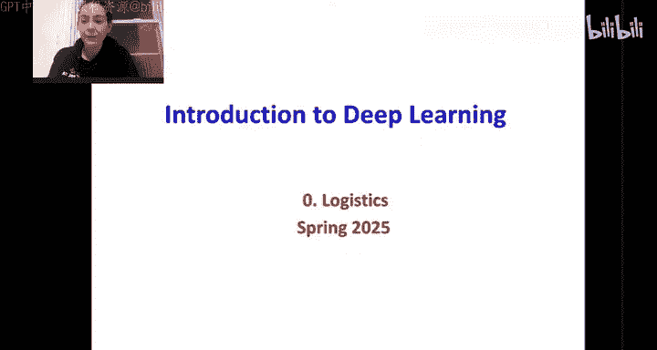

Here， we'll cover a brief intro。The instructor， Ts， course topics， and you。Challenges of the course。

Components of the course。 How to go the extra mile。Components of your grade。

 as well as common sense and integrity issues。

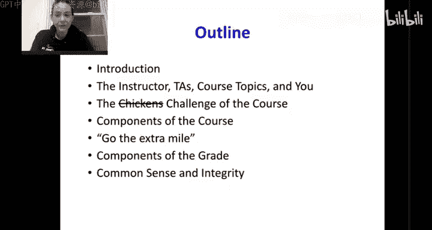

Neurural networks are taking over。They have transformed from theoretical concepts to practical tools。

 shaping industries and everyday life in so many areas that we interact with。For example。

 models like chat GPPT are setting new standards for problem solving and contextual understanding。

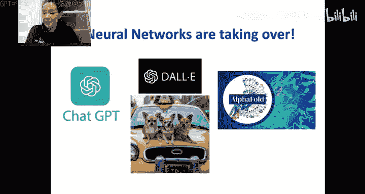

In visual applications， Dali is pushing the boundaries of machines can generate in creating photorealistic or highly imaginative visuals。

And there is also scientific breakthroughs， like Al fold。

Which predicts protein structures with unprecedented accuracy。

Positively impacting fields like medicine and biochemistry。

This course will give you the skills and understanding to engage with these advancements。

 whether to build or apply them or analyze them critically。

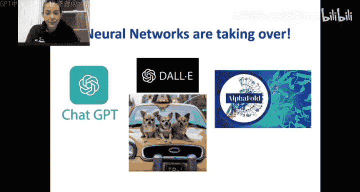

Early systems like Siri and Alexa pave the way， and now we have conversational AI like Cha GBT4。

 Barred and Claude AI。These systems don't just respond。 They're engaging in meaningful。

 nuanced interactions with us to be collaborators for technical problem solving。

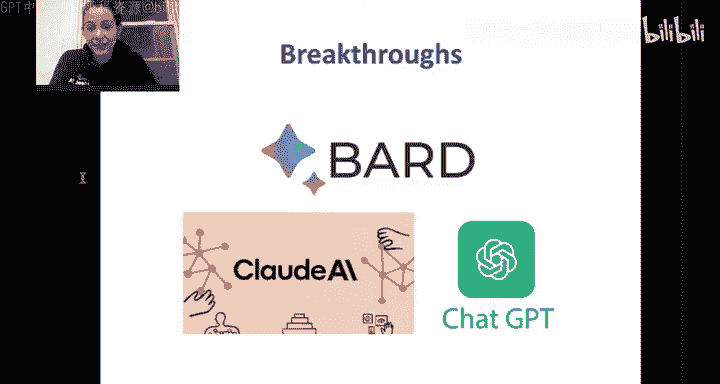

In computer vision， we now have stable diffusion， which enables us to create and edit images in ways that we couldn't do just a couple years ago。

We also have Nerf neural radiance fields， which are creating new possibilities in 3D modeling。

Constructing spaces and objects just from a handful of photographs。

Autonomous vehicles are also continuing to showcase power and limitations of neural networks。

 Weimmo is creating self driving taxis in some cities。

And Tesla's full self driving vehicles also represent the potential and ongoing challenges in achieving fully autonomous navigation。

The primary instructor of your course is Professor Bixshaw Raj。Professor has open office hours。

 and you're welcome to stop by to see him at any time。There are many TAs for this class。

Approximately 20。All of our emails and our names are listed on the course webp page if you'd like to get in touch with us。

We have Ts from Pittsburgh， Kigali and Silicon Valley。We have remote and in person office hours。

 and these are all listed on the web page。

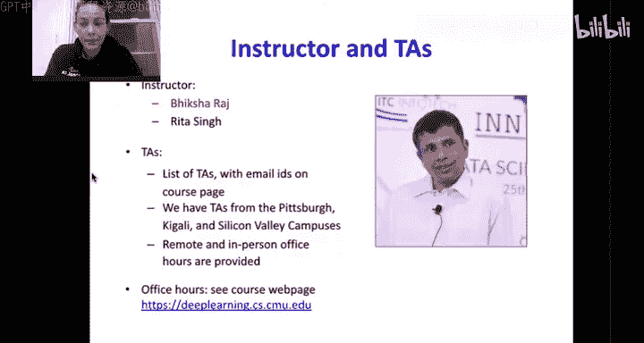

This course is designed。For someone who knows how to program Python， program in Python already。

We highly recommend calculus and linear algebra。And we。

We also recommend vector calculus in software engineering。

 although these are not as much of a priority as Python。

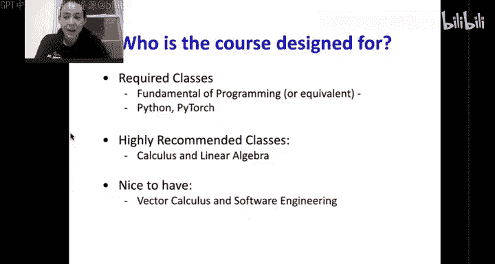

General course topics。The introductory neural structures include multi layerer perceptrons。Cnns。

R and ends and boltolsman machines。Beyond this， the professor will also present lectures on generative models。

Adversarial models。Graph neural networks。Transformers。

Practical focus areas of these structures include computer vision。Text processing， Ma translation。

Moodeling distributions and generating data， as well as speech recognition。

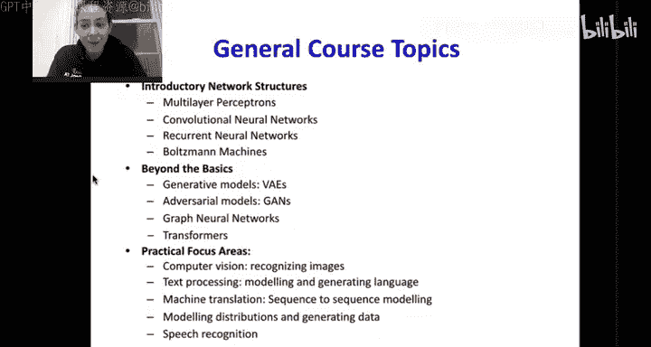

It is implementation heavy， and there is a lot of coding in this class。We use Python and Pytorch。

 and you're welcome to use other languages and toolkits。

 But if you're going to ask for help from the Ts， you will need to be using。

The the course language and course toolkit of choice。

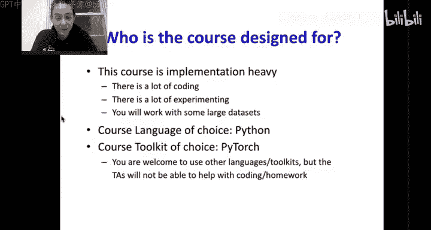

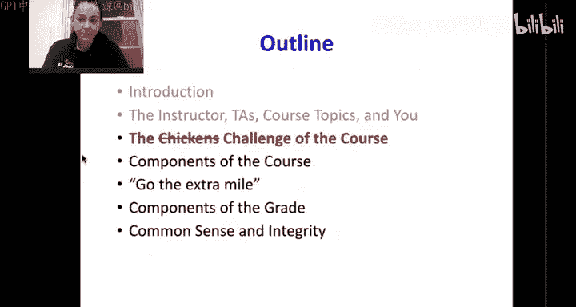

The challenge of the course。This is a very difficult class。 It is a lot of work。

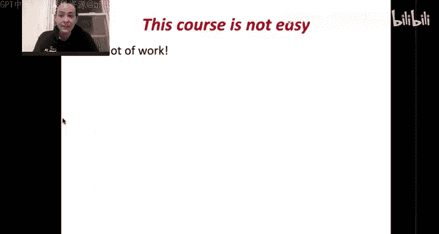

And we expect you to spend a lot of time studying and working hard to better understand the material。

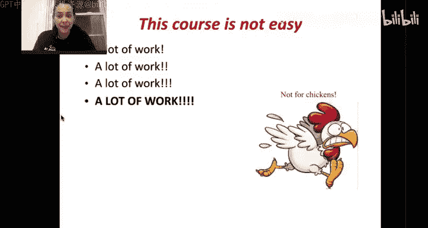

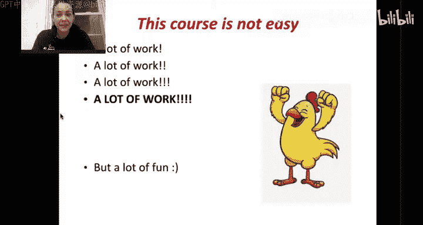

If you complete this class with an A， you are likely ready to enter。

A job and industry for deep learning。We have quizzes to test your understanding of the topics in lectures。

 We have homeworks to teach you how to implement these and optimize and。If you're in the。

Graduate level version of this course。 We have projects to expose you to real world problems。

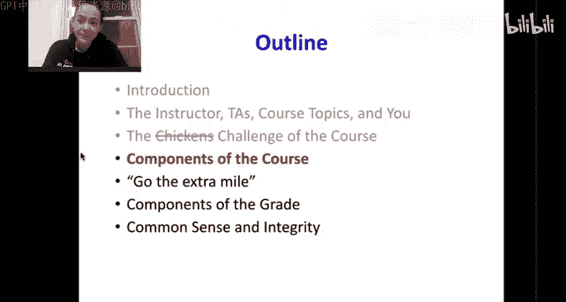

The lectures。In class lectures， theyre also streamed on Zoom。

And they'll be recorded and uploaded to YouTube as well as to media tech。

It is important for you to view the lectures， because。In addition to explaining the topics。

 your quizzes are based on those slides。We'll also monitor your attendance。

 and I'll talk about that later。

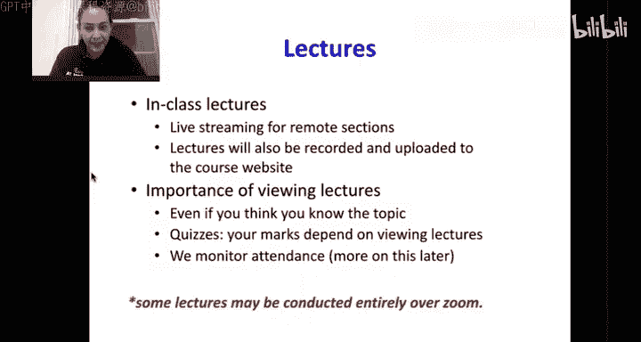

The quizzes。You will have 14 quizzes in total。There's one released every Friday， and it。

Coses every Sunday。Out of the 14， we'll accept the best 2。And for each quiz， which has 10 questions。

 will accept the best of your three attempts。

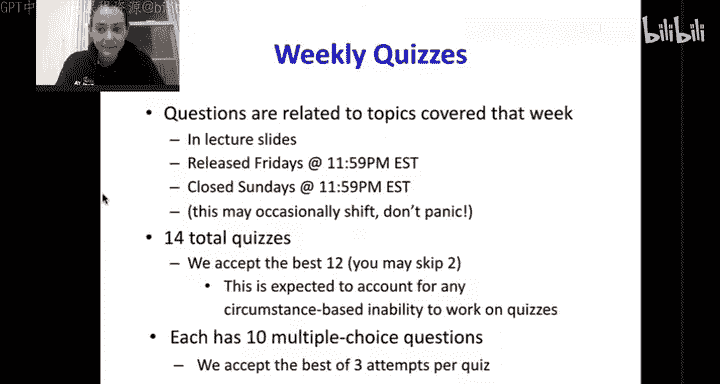

We also have recitations， hackathons and boot camps， which are led by the teaching assistants。

We strongly recommend you attend all of these。There are 14 recitations every Friday in the lecture room。

And they are hands on labs。 They'll cover implementation specifics。

 and you'll get to follow along interactively。The hackathons are held on Saturdays。

The rooms are to be determined， but they'll be in person in Pittsburgh， as well as Kigali。

 and will provide pizza here in Pittsburgh。There are boot camps。There's one for every homework。

These are held right before Haabon。啊对。The Saturday after homeworks are released。

We will also have a boot camp for homework 5， which is for the 11685 section。

These are kind of a handhel walkthrough of the homework assignments。

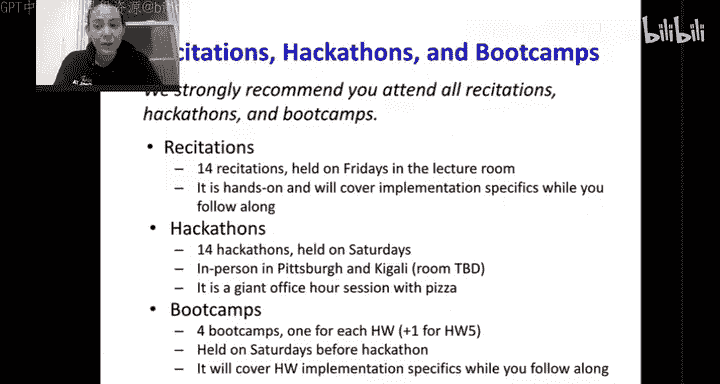

The assignments， there are four main homeworks， bonus homeworks， and then an autograd bonus。

Main homeworks have two parts， there's a part1， which is auto graded。

 and you'll upload them to AutoLb。We also have a part two， which are Cale competitions。

And then we have homework bonuses and autograd bonus。So these bonuses are meant to。

Give you a chance to make up for marks that you missed。In other areas of the class。

 they're not going to be added to the curve。The course also offers study groups。

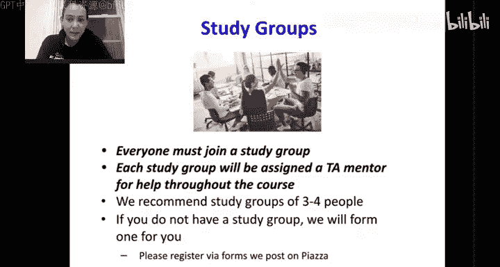

You must join a study group， and each study group will be assigned a T A mentor。

We recommend that your group be three to four people。 you may have more， if you like。

If you don't have a study group or can't find one， or if your group falls apart。

 let us know and we'll assign you to a new group。

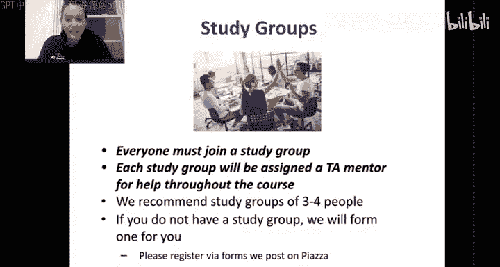

The course project。If you're in 11785， you'll do an original project。

11685 students will do a project that we assign called homework 5。And if you're in 485。

 you don't have to worry about this slide。 and please do not sign up for a project。

Projects are intended to exercise your ability to comprehend and implement ideas beyond those covered in the homeworks。

It can range。 You can do a completely original idea with a completely new model design。

 or you can implement something that has already been verified to try to improve upon it。

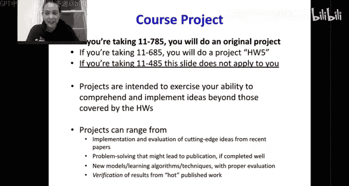

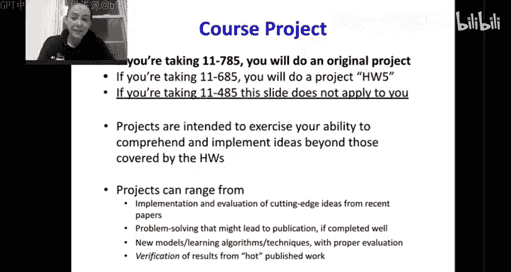

Go the extra mile。In order to do well in this class， we recommend that you attend every lecture。

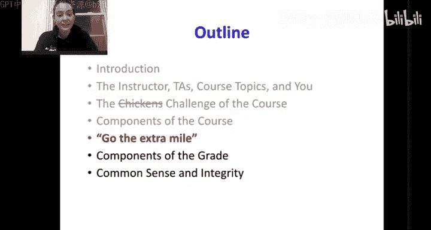

You'll get marks for attendance， which might be the difference between an A and a B。

And we'll be tracking your attendance through the polls released during each lecture。

We also recommend that you look through every recitation zero that we post on YouTube。嗯。

In addition to help with coding， we also present information for compute infrastructure。

And we ask that you please refer to them prior to asking us questions during office hours regarding these topics。

Homework1 part1。Is also valuable， since。All of the parts of homework 1。

 part 1 will be used later in the class。 So scoring 100 on that is vital。

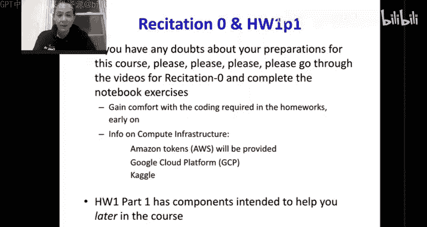

Course communication is all held through Piazza， so please feel comfortable using piazza。

 receiving notifications through it and reading it on a daily basis。

 because that is where the polls will be released。 That is how the professor and T As will be communicating with you。

That is where announcements will be made and questions and answers to questions that you might post privately or publicly in your peers as well。

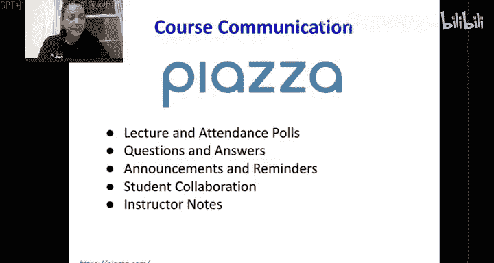

There are additional reading materials， if you would like。To。

Go further into the topic besides what the professor presents in class。

You can find these on the course website。

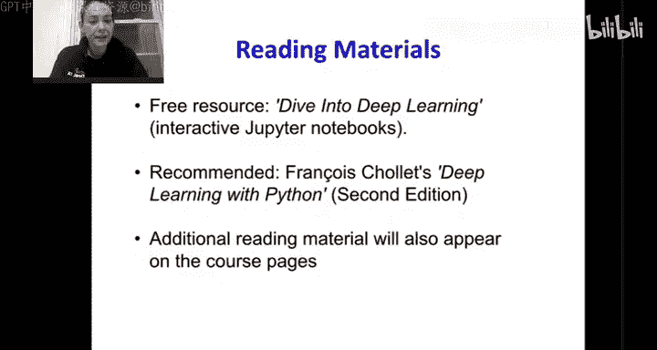

And study groups。Study groups are especially valuable。

 since you can together discuss homework problems and solutions， the papers。Classwork in general。

 and your quizzes。We highly encourage you to get together on a weekly basis。

 and you could even make a project group based on your study group as well。

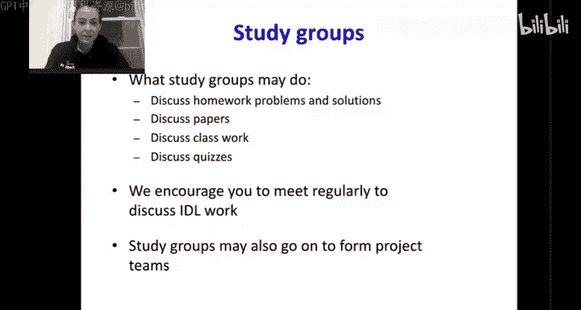

Each study group will have a mentor。And the mentor is there。

For you to reach out to any time you're behind or struggling。

If you're facing issues outside of your class。Or if you're。

If you're just needing to find a way to get in touch with a professor。

 even your T A mentor is there to support you in every way。

We are looking to make sure that this experience， the course experience is positive and by having a teaching assistant be in touch with you directly。

 we're hoping that this will。Help you find your footing in the class to get a good grade。

Every project group。In the 11785。Section will be assigned a project group mentor。

 This does not apply to 1，1，6，8，5。Nor 1，1，4，8，5， only 7，8，5 students will get project group mentors。

These mentors will be in touch with the groups。And in addition to the T A mentor。

 your group is allowed to also have an external mentor who you might seek out。

 if you would like to have。Additional guidance for your project。

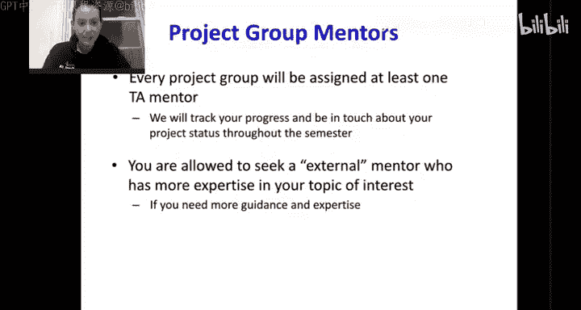

Components of your grade。

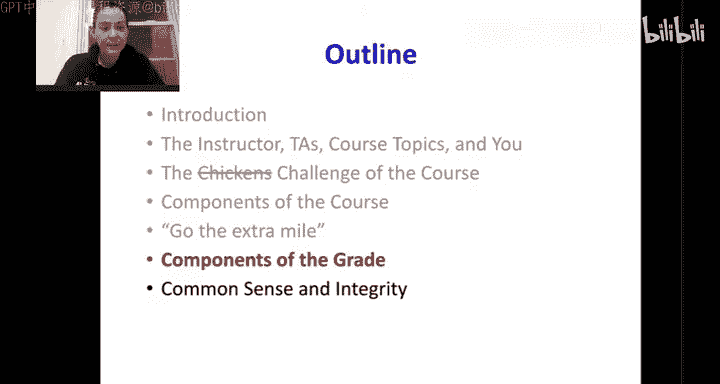

Your scores are evaluated based on four types of tests。 This is a typo。We have attendance。

 weekly quizzes。Homework assignments and your team project。

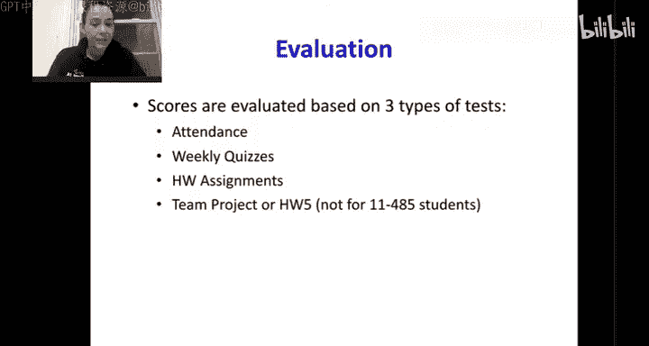

Homework 5。Y。Attendance， it must be in person， or you must attend via zoom。

We will get your attendance stats through the in class polls。

An initial attendance poll will be released at the start of class。

 And then the professor has three or four polls per lecture。Where you will have one minute to answer。

Questions that are based on the。What he has just presented in class。

If you're in Silicon Valley or in a time zone where。

It is unreasonable for you to be awake to attend lecture we understand。

 and we would like for you to instead watch the lecture via media tech。

Media tech allows us to track who watched the lecture and for how long。 And so we can。

We can determine that you have attended in this way。 If you watch the lecture on YouTube。

 that will not count。Please watch it within one week of it being released。Quizzes。

Weekly quizzes are based off of the professor's slides。Often， the， the professor will not。

Will not go over all of the information that he has presented on the slides。

And so your job will be to work through the slide deck to answer the quiz questions。Occasionally。

 there will also be questions that are based on publications that are included in the quiz for you to read。

But for the most part， the quizzes are based on the。

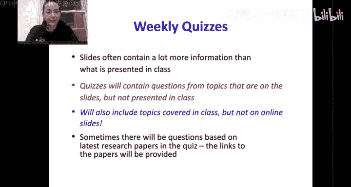

The slides from class。The homeworks。Part one of each homework。Is。我。My torch， so you have pie torch。

And then this course is giving you my torch your own toolkit。So。Part when homeworks are auto graded。

 you upload them to autolab and。

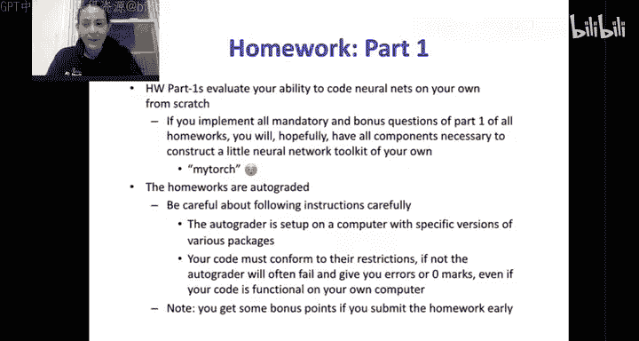

If your grade is showing as0 on auto labb， that means that you received a zero grade。

 so you'll need to。To resubmit it， to get， to fix the errors that you're facing。

 to get the score that you might be seeing locally because otherwise we won't know that you。

You actually。Deserve a better grade。 You'll have to fix it on autola。Part 2， homeworks。嗯 you。

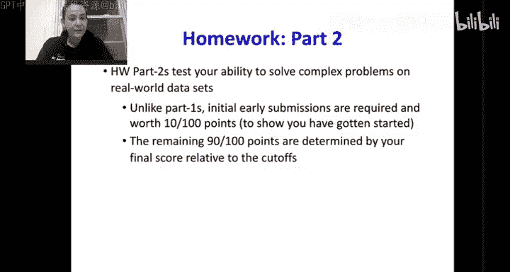

Oh， I'm sorry。You'll get bonus points if you submit homework part one early。

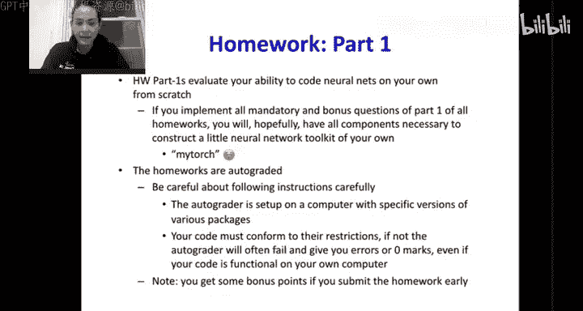

This bonus is。An added bonus on top of your grade for part 1。In contrast。

Early submissions for part 2 are part of the part 2 grade。 It is worth 10 points。

 You don't have to get any。Type of score for this early submission。 You just need to submit it。

The remaininging 90% of your grade for part two is determined by the final score relative to the cutoffs。

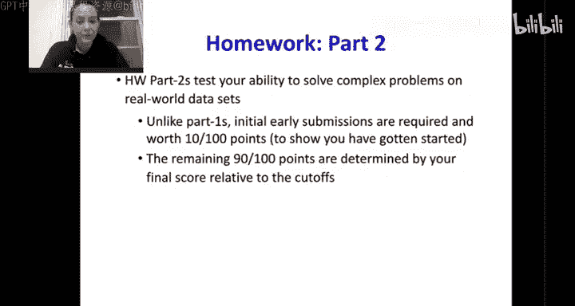

Your cutoff score is linearly interpolated。Between the cutoffs。

 and this is just a sample of high medium and low cutoff points， each homework will differ。

If you are the highest scoring student。Of that kle competition。

 you'll receive an extra 10 point bonus。And so overall。

 you could achieve 110 points if you submit on time。

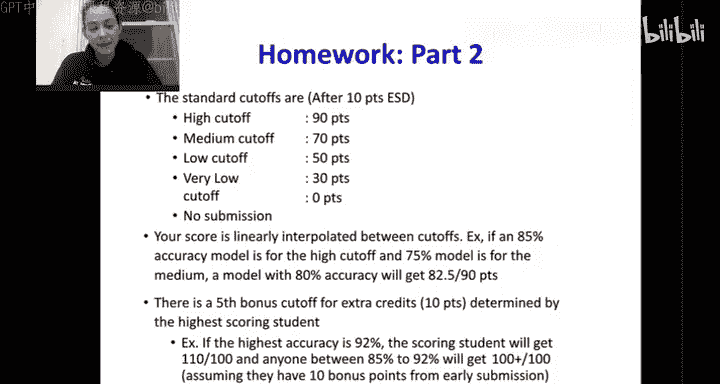

And then get the highest score。Look for your project team members as soon as possible。

This is for the graduate。Level version of this class。F people is the maximum number of students。

 four117，85 projects， and three people is the maximum for 11685 homework 5 projects。

You'll be required to submit a proposal。A midterm report。

A final report and also a video presentation that is 5 minutes long。Your final report， and。

Will be reviewed by not only the Ts and the professor， but also a group of external viewers。

Who are affiliated with CMU and also working in industry。Your video project。

Presentation will be reviewed by the external reviewers， as well as the TAs。

 professor and all of the other students in the class。11485 students。

 685 and 785 students will all be watching your video presentation to grade。To grade your。

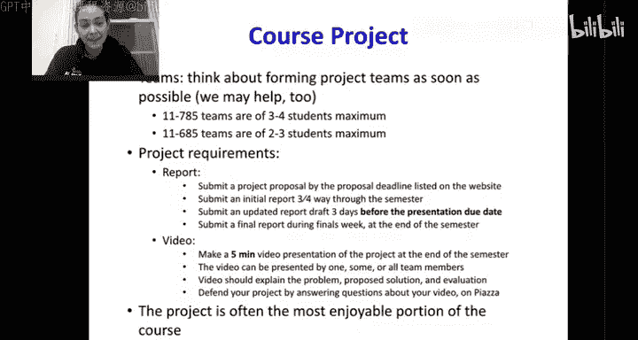

Final report presentation。Grading is shown， as follows。

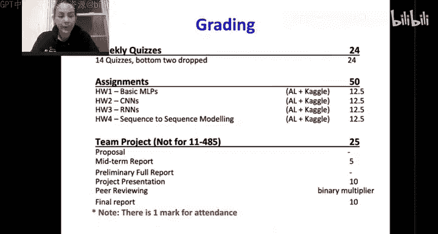

We have。Weekly quizzes。14， where two have been dropped for your grade。

We have four homework assignments， each with two parts， but autolab part1 and Cale part 2。

And we have your team project if you're not in 11485。嗯。

Your midterm report and presentation and final report are part of your grade。

There will be one mark for attendance。

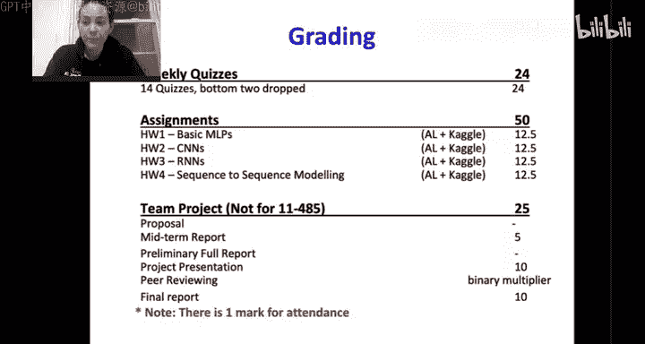

Please note that homework deadlines are separate for part1 and part 2。

Homework part 2 has multiple deadlines。 You have the early submission deadline。

An on time submission deadline and also a late slack deadline。

Slack refers to 10 slack days that the professor has given all students。

 which you can use up all at once or distribute across the semester。

 And it is meant to allow you to submit late。 You'll get a 10 per cent penalty。嗯。

For every homework that's been submitted late。 And in total， you can have 10 slack days。

Will accept submissions until you run out of slack days。 and you can reach out to your。

Study group mentor for submitting late homeworks。Lastly， common sense and integrity issues。

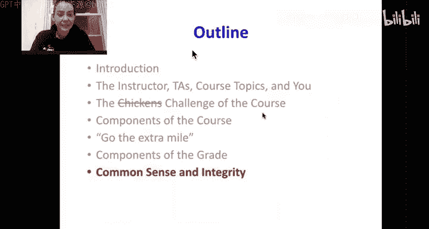

Please feel free to post on piazza about anything we we look to reply to you immediately。

This being said。We would appreciate that your code related questions have some structure。

 so make a good title to your post。Reread your your question and problem so that to make sure that it is clear。

Do not just paste。Your entire file or add a notebook。That is not acceptable。

 We'd like you to explain what you tried， the results you got already。

Arrors and expanded stack traces should be presented we want to know what。

What you've been trying to fix about it。Otherwise， it is just extra。Work and。

It is not a productive way to ask for help。Lastly， personal and academic integrity。

So you are a CMU student here to learn deep learning and you're not here to learn how to pretend。

To learn。So we're expecting you to please。Not insult yourself and not lower your own integrity。

 Please be honest about your work。If you have questions， always reach out。

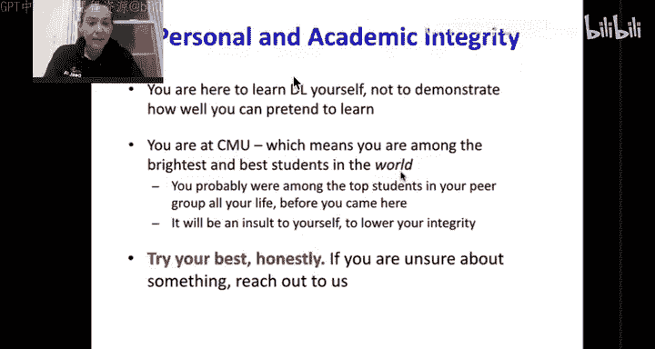

And in your study groups， we allow you to work together， and we expect you to share the workload。

 especially for homework， too during exploration。 However。

 your final submissions need to be your own。You may not just copy and paste from each other。

 You must actually complete your own work， although you can help each other debug and。

Discuss and solve the problems as a discussion together。

Plagiarizing code is an academic integrity violation。And that's about it。

 thank you for deciding to take this class and we look forward to teaching you。

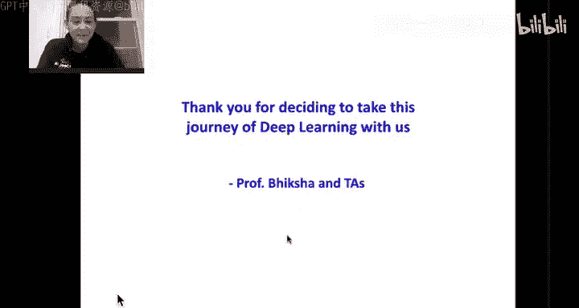