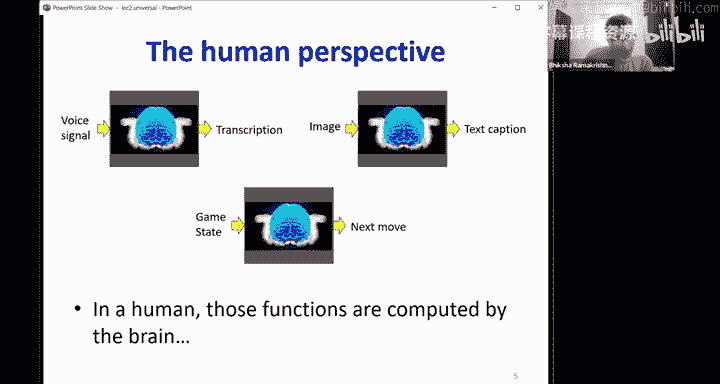
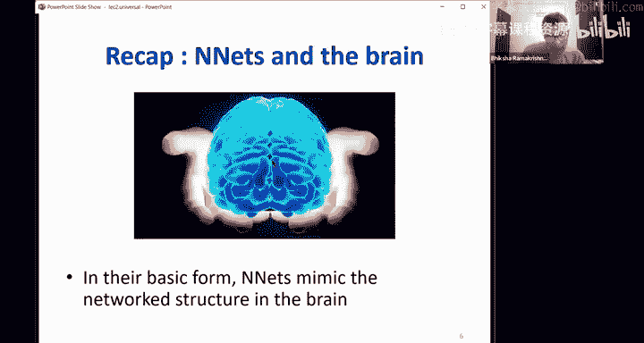
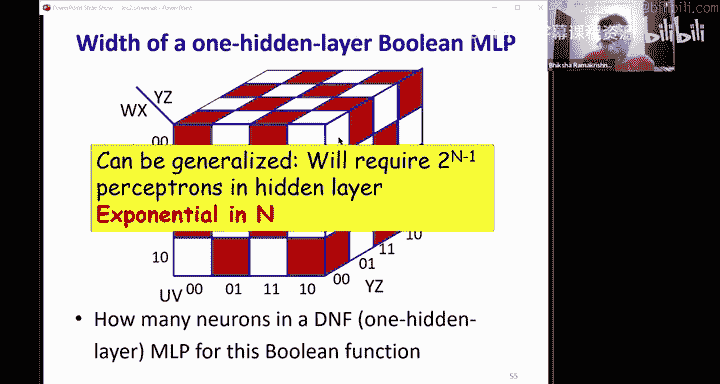
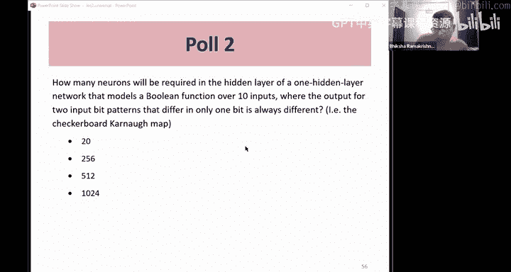
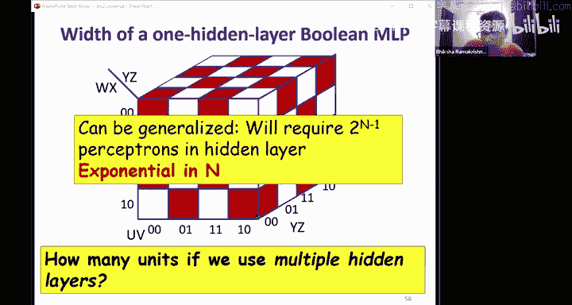
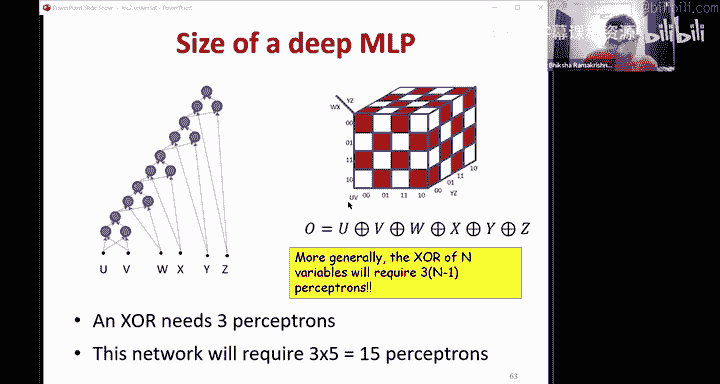
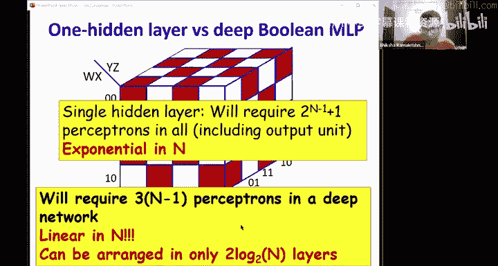
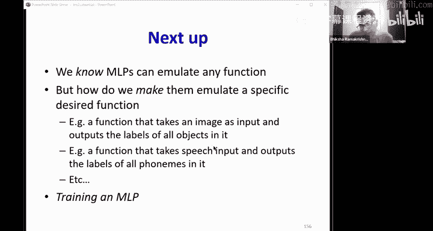

# CMU《深度学习导论｜11-785 Introduction to Deep Learning Spring 2025》中英字幕(deepseek - P3：[03]S2025 Lecture 2 - Neural Nets As Universal Approximators.zh_en - GPT中英字幕课程资源 - BV1xbZNYrEbs

Okay， folks， can you hear me？Hello， can you yes I good。All right， we have a。Minute before we begin。

 so do we have any questions from the last class？Any questions？Any questions about the logistics？No。

 okay。So。Today where while I lecture， I'm going to pause at various points。

And ask you if you have understood what has been presented so far。And when I do that。

 you can you this zoom actually gives you the ability to。S thumbs up。

 You don't have to show me your thumbs。 You can just mark a thumbs up。

 and I can count the number of thumbs ups or count the number of hands shown on zoom。

 And so I will actually check that to make sure that。

A majority of you have understood whatever it is I'm trying to convey before I continue。 So please。

 anytime I ask you。To。give me a show of hands to confirm that you have understood what has been presented。

 please do so， right？Ruthwig， there will be project presentations 11785， it's all on the course page。

 right？So and check lectures zero， all right， let's begin， right？啊。They啊。So Jack。

You will have to watch the video on media tech。We give you some amount of leeway until the course had deadline because people joined late。

But if you don't watch the lecture， you're not going to beable to answer the quiz。

And so please watch the lecture for your own sake anyways， right？All right， let me begin。

Here are the topics for the day of we've introduced neural networks。And the previous class。

Today we're going to go a little deeper into what neural networks can represent。

And what the restrictions are for these representations and when I'm speaking of。Restrictions。

 I speak of rep restrictions in terms of depth。And width of the network and the activations that we use in the network。

So here's what we saw in the last class， neural networks have taken over AI starting about 2016 and tasks that were once presume to be purely in the human domain of intelligent expertise no longer have actually been made possible by neural networks and in fact。

 in many of them they outperform human beings by large margin。

So what exactly are these neural networks which do all this magic magic？

They are these boxes which take in some input and produce an output。

Like a neural network that does voice recognition takes in a voice signal and produces a transcription。

 or if it were performing image captioning， it would take in an image and generate a caption。Now。

Things that take in an input and produce an output are functions。

And so these neural networks are functions。But what are these functions？Now in a human being。

 those functions are computed by the human brain and so。

In their basic form， as we saw in the last class， neural networks mimic the network structure in the human brain。

And we also saw that the brain is composed of a network of these basic elements called neurons。

And so。Artificial neural networks， too， are。Composed of networks of simple computational elements where these elements are computational models of the neurons。

 these are our perceptrons。And the preceptron， we signed the last class。

Mins the human neuron in roughly speaking。It's a casual unit in its most basic form。

The perceptron obtains a number of inputs。Corresponding to each input is a weight。

If the weighted sum of inputs exceeds a threshold。The perceptron fires otherwise， it does not。

 So here is the mathematical representation of how the perceptron operates。

It computes a weighted some of the inputs， if that exceeds a threshold， it fires。

 there is an outputs of one。Otherwise， it outputs are0。 Now。

 this unit is what electrical engineers will call a threshold gate。

 It's a basic unit of Boolean circuits。Now， here's a slightly modified and possibly better figure for it。

Instead of computing await weighted some of the inputs in comparing it to a threshold。

I can redr it in this manner where you are computing a weighted some of the inputs plus a bias。

 And so what we are computing is an aine function of the inputs again。

Does anybody remember the difference between what is an aine function and what is？

A linear combination， anyone？The bias， right， So if I say summation W I。Exile。This is。

A linear combination。But if I say summation， and so when I equate this to0。

 this is going to give me the equation of a hyperplane that goes through origin。On the other hand。

 if I say submission W I。Exite plus B。This is an aine combination。If I equate this to zero。

Then this is also going to be the equation for a hyperplane， but that equation。

 that hyperplane will not go the origin。And so what we do here is first to compute an aine。

Combination， and I fine function of the inputs。And this aine function is put through a threshold activation。

 so this is perceptron here is exactly the same as the perceptron here， it is stating it differently。

Within the perceptron， we first compute an aine function of the inputs to get an aine value z。

This aN value is put through an activation function， a threshold activation。Which outputs in one。

If its input is positive and zero otherwise， and so this is our perception。你好。

Once we separate things out in this manner， we can replace this activation with with other functions。

 so for example， instead of having a threshold over here。

 I can have something that looks like a threshold but it's smoother， this is the sigmoid activation。

And so in this version of the perceptron， the F fine value computed from the input is processed by the sigmoid activation。

It can also have other activations like the Tage activation， which looks like the sigmoid。

But it goes from minus1 to1 instead of going from zero to 1， or these activations over here。

 this is the rectification function also called the rectified linear unit， the red line。

For positive inputs， the output is the same as the input for negative inputs， the output is 0。

Or this blue line， this blue curve， which is called the soft plus。

 is a smooth version of the rectification function。

 all of these are different activation functions that we can use。

On the aine term that you compute from the。Inputs。For the purpose of this lecture， however。

We're going to continue to assume a threshold activation that operates on this aine function of inputs。

 so the perceptron that we will be working with is the original basic perceptron。

And so here is our first poll。Let me release it。This is。Can you see the poll。

Wehan there's no attendance poll because I'm going to get the attendance off Zm。O。Five seconds， guys。

right， let me install this。😊，Okay。啊。Here's what your results were， if you can see it。Stop sharing。

 Does anybody want to answer me？Is this first statement true？

3 x plus 7 ys and linear combination is a second statement tro。That's right。

The third statement is this truth。This is true， right， and the fourth statement。

Is also true and so it turns out that this is a linear combination。

 but linear combinations are a subset of aine combinations where the bias is0。

 so the first third and fourth statements are true。Right。And so let's move on。

So we've defined our perceptron， but then we found that we really want to work with networks of perceptrons。

Multi layer perceptrons， where you have many such peritrons which are connected to each other in layers。

 What is a layer， we'll get to that shortly。 And so we have a layered network of perceptrons。

 This is a multilay perceptron。And。Now。The kind of networks we are speaking of are deep networks。

So what is a deep network Now， in order to define a deep network first， we have to define depth。

So what is that？Deepath is defined in terms of cross。Now。

 how many of you know what I mean by a directed acyclic graph？

Does anybody know what a directed basically graph is？So what is it？It's a directed graph。

 which means that we all know what a graph is， graphs have nodes and edges between the nodes。

And a directed graph is one in which the edges have directions， as shown by the arrowhead。

 It's acyclic and there are no loops。 Now， any time you have a directed acyclic graph of the kind。

 you're going to have nodes which are sources。These are node from which all the edges go out。

And you have nodes which are sinks， nodes where all the edge come in。

And when you have a director basically graph of this kind， the depth of the graph is defined as。

The longest part from。A source to a sink。 So in this graph， I have a part of length 1。

This is the source。 This is the sink。 I have a path of length 1。But I also have a part of length too。

So although there's a path of length one， the longest path is length2。

 so the depth of this graph is2。Here's another graph。This graph also has a source and a sink。

There's a path of length one between the source and the sink。There's also part of length too。

And a path of length 3。What's the depth of this graph， anyone？What is the depth of this graph？Three。

 because the longest path is three， right？And so when we define neural networks。

You can perceptrons feed perceptrons， so there are outgoing edge， all the connections are directed。

 and you have parts going from the source， which is the input to the sink， which is the output。

And and the depth of the network is the length of the longest path from any input to any output。

 So in this。Network， for example， you have neurons essentially arranged in layers again we'll get to layers in a bit。

And so if you take any path from a source to a sink， it has to go through one， two。

 and three neurons， so the depth of this network is three。

And if the death of the network is greater than2。Then we call it a deep network。So here again。

These are the output neurons， these are hidden neurons because we are not really interested in their precise outputs we are only interested in what's coming out here and so we have two hidden layers and one output layer。

But the length of any path is three， so this is a deep network。What is the depth of this network。

 anybody？What's the depth of this network out？嗯。This one here on top is。Okay， is it a deep network？

This one is this a deep network now， right1，2， so the depth of this network is2。

 What's the depth of this network at the bottom right。Anybody。Four， one， two， three， four is indeed。

Yes， right， so beautiful forget get it。Now I'm speaking of layers， but what is a layer in this case？

Visually it's very apparent what a layer is， but then if I draw a network like this。You know。

 you might be fool into thinking this is a layer， but no， there is a formal definition for a layer。

A layer is the set of neurons that are all at the same depth with respect to the input， which is。

The source。And so the depth so and the depth of the layer is the depth of the neurons in the layer with respect to the input。

 so here， for example， can you tell me which are the neurons which form the first layer？They what。

Anyone。Which neurons would form the first layer？The left， no， this is the input， this is a source。

 right， so these this is not the first line。And so what would be the？These are these the first layer。

These guys， these four red neurons are all at depth one with respect to the input。

SoSo these are all at depth1， the longest path from the input to these neurons is length one。

 so these form the first layer。The second layer。Now look at these green neurons。

 these green neurons also have a direct path from the input。

 but if you consider the longest path from the input to these green neurons it's two。

 it's two for this guy it's two for this guy and it's two for this guy right so the green neurons from the second layer。

The yellow neurons， they do have paths which are only length two。

 but the longest path is length three。So the two yellow neurons are the only neurons which have a path of length 3。

 so the two yellow neurons form layer 3。And the two blue neurons。Form clear。Is this making sense？

Just confirm right so all the visually what you might think of as layers would be very different if you go by the formal definition。

 this is how the layers are arranged。And so we have。The balloon neurons， in this case。

 the balloon neurons are the output layer， okay？And so we have a multi layerar perceptron。

 which are networks of neurons connected in layers and they are directed generally。

The neurons themselves are the basic persecum。Now we saw from the last class that in this kind of a network。

 inputs inputs could be Boolean or real， outputs could be real or boolean。

And although in this figure， I have just drawn a single output。

You can have multiple outputs in the network。And so now the question is。

 what kind of relationships can this network compute。

 what kind of input output relationships can at market？So for this。Let's go back to the Nakins。

 I mean already that。MlPs can compose Boolean functions。

 We saw that they can compose any Boolean function。We also saw that MLPs， this S should be a P。

 can can compose classification boundaries， so these are category functions where you say within this region I'm going to output a 1 within this region I'm going to output a 2 and so on。

 so MLP can be arbitrary classifiers we also saw they can saw they can compose real valued functions。

But are there any limitations to this， that's what we're going to explore。And today。

 you're going to look at multi perceptrons as universal Boolean functions。And the need for death。

 we look at them as universal classifiers and the need for death and as universal approxiators。

And we will discuss optimal depth and width。So let's look at the first issue。

 MLlP's universal Boolean functions。Now。What do I mean by saying that MM andMlT is a universal Boolean function？

For that， we start off with how well to enter these model Boolean functions。Now， we already know。

That an individual perceptron can model any Boolean gate， right？ What was this gate over here。

 Anyone remember。What does this gate？This is the end， right。 And this guy here。

This guy was an a and this was a knot， right？So we saw that a perceptron can model any simple binary Boolean gate。

 but in fact， a perceptron is much， much， much more powerful than a boolean gate。

A single perceptron can perform computations that would require an exponential number of Boolean gates to perform so here are some examples。

Look at this network， right， They look at it look at this perceptron。 it has any inputs。

The weights corresponding to the first L inputs are all1。

 the weights corresponding to the rest of the inputs are minus1， that threshold is l。

What kind of output does this produce， can anybody guess？What will this produce？听吗。

Does anybody want to take a guess？Okay。This one。This is going to produce an output of 1。

 if and only if。These guys are all one。And these guys are all0。Under this condition。

 the total input that comes in over here is going to be kept。If I flip any one of these guts。

This is going to become L -1， and it will not fire。 So also， if I flip any one of these guys。

 this is going to contribute a -1 to the sum。 And once again， the sum will decrease。

 and this will not fire。 So this will only fire if these guys are all one。And these guys are all 0。

This making sense？To all of you guys。So。And there was one person lost why。好了。So Hannah。

 what was your doubt here？So。Hna Kassim，We're not sure。 I don't understand why this has to me1。 Okay。

 consider this。 These are the weights， right， If all of these guys are one and all of these guys are 0。

What is the total that comes in here？What is the total that comes in here？And if I flip one of these。

 what is the total？If I flip one of these， what is a total hammer？Eman Swan， right。Okay。

 let's say I keep this guy， but I flip one of these。 What is the total。If I make this a one。

Because the corresponding weight is minus1 then 2 it becomes l minus1 right so literally the only condition under which the total here is going to be L is if all of these guys are 1。

And all of these guys are zero。Right， and so this single perceptron models this very complicated boan function which says all of these must be 1 and all of these must be zero and then and only then is it going to file。

Make sense， right？And so。Here's another one， right？

This guy is going to fire if any of these first L is a1 or if any of these guys is a zero。

Can you figure out why anybody？Why would this work that way？Anyone。Why would this work this way？so。

Let's see the condition under which it doesn't。Right。

It doesn't fire if only condition under which it doesn't fire is if all of these are zero and all of these are one。

 right？So。Because你。Under this condition， the total sum that comes in is L minus that。

Because these have a weight of minus1 and these have a weight of 1 and so these are all contributing zero。

 you have n minus L of these guys， they all have weight minus1。

 so the total that comes in is L minus n right？If I flip any one of these。

 this is going to become L minus1 n plus1。Which means that if any of these is flipped。

 it's going to fire。Which means that this will file if any one of these guys is a one。

Or if any one of these guys is a0。So let's say this is what I would call a universal hand gate the previous one。

 I can compute， I can create a single perceptron for any kind of hand， here's a universal or gate。

But then。Is this making sense？Yes， no。Right。Okay， here's something even more interesting。

 this is the majority gate。This will fire。If。And only if so which one this last one？So， here。

We'll run out of time right， but post it on the and I can explain right now consider this one here。

So this will。Fire， if any set of。K inputs or more K or more inputs as well。Does this make sense？

But this one。The threshold is k， so if at least k of the inputs are 1， it's going to fire。

if you want to build a Boolean circuit for this kind of operation。

 you have to consider every combination of K inputs。But a single perceptron。

 So that's going to be exponentially sized and that exponentially sized circuit is replaced by a single perceptron。

 So perceptrons are very， very powerful。😊，Right。😊，Yet。😡，We know that in spite of all their power。

 which is why for a very long time， people thought that perceptrons were universal Boolean machines。

 but theyre not。We know this， because。We know they cannot compute exc on the last class。

We saw that for an exor we need a multi layer perceptron， you have this hidden layer。

The first one computes x or y， the second computes not x or not y。The outputward perceptron。

Ands the two。 And now you have an X。Right。😊，Everybody remember this？Yeah， they're the same thing。So。

And so in fact it turns out you don't even need three perceptrons， you only need two perceptrons。

 this picture was I got the circuit from my friend Gerald Friedland in Berkeley。

Here's a multilayer perceptron with only two neurons and five weights and two thresholds。

 and it too computes the XR， but you need at least two perceptrons。But once you realize that。

 you realize that I can compose Boolean gates with perceptrons， so I can compose any Boolean circuit。

 which means that if you give me a Boolean function， I can compose a multiier perceptron for it。😊。

In other words， multi layerer perceptrons are universal Boolean functions for any arbitrary Boolean function。

 there is an MLP that can compute it。that make sense？That MLlPs are Boolean functions。So okay。

 give me a thumbs ups， guys， I can count the number of thumbs up up here， okay。

And the next time I ask I'll wait for 100 thumbs ups。And so MLPs are universal Boolean functions。

 any function over any number of inputs and any number of outputs。I can compose an MlP for it。

 But then how many layers will this MP need Now， in this example， I have three layers。

 I can have other circuits with four layers， right， and so。😊。

One might assume that the number of layers required。

For the MLP is going to be dependent on the complexity of the Boolean function itself。

So before I go down that line， I'm going to ask you guys a question。

What is the smallest number of layers that an MLP will need to model any。

Bullion function in the worst case。So please， you say two， why wouldn't be two？Can anybody tell me？

Why is it too？Anyone？XR requires2 Xr is just still。

 but of standard boion any complicated boolean function， why would it be 2？So he why， right？

Any Boolean function can be written as a truth table。These are all the input variables。

 this is the output。And this is the combination of input values for which the output is one。

 So the first row of the table。As written as。The output is a 1 when x1 is a0 x2 is a 0 x3 is 1 x is1 x1 is0。

 and so I can list out every combination of inputs for which the output is a1。

I only need to list out these combinations for all other combinations， the output is implicitly0。😊。

Once I write it like this， I can write this Boolean function。

 so this is any Boolean function it can be written as a truth table。

And then the Boolean function can be written as a disjuncive normal form。

Where it is an additions of multiplications， addition represents all multiplication represents at。

I can say this first row says the output is1。If I have not x1。

 meaning x1 is 0 and not x2 and x3 and x4 and not x5， so that's this first clause over here， right？

Or the output is 1 if I have not x1， x2， not x3， x4 and x5， that's the second clause or。

If I have nor x1， x2， x3， nord x4， nor x5， right？And what is this cause？Anyone。

 what would this class be？咁下。The fourth one。Someone on to hazardous， I'm sure you guys know。

It's going to be x1。N x2， not x3， not x4 x5 and so on right and so for each of these six rows I have six clauses。

And they're all odd， but once I write it this way。I can build an MLP very trivially。

 one perceptron for the first clause， one for the second， one for the third， one for the fourth。

 one for the fifth， one for the sixth step optimal。

And so once I express my truth table in thistanive normal form。

 I can build the MLP with just one hidden layer to represent the Boolean function regardless of how complex this Boolean function is。

So any truth table can be expressed in this manner。

 which means a one hidden layer MLP is a universal Boolean function。

MLPs with just one hidden layer can express any boolean function at all。

 These are universal boolean functions。But then if I want to express this with just one hidden layer。

What is the largest number of perceptrons I'm going to require in this hidden layer if I have N inputs？

Anybody want to guess if I want to take any odd Boolean function？And build it with。

Just one hidden in there。So Daniel， Ragazo， why do you think it's too raised to hand？

Or anybody who says to race to end， why is it to race to him？Anybody you want to tell me？

All the combinations， right， so to explain。Here。So。Look at this。 How many of you are familiar with。

Car maps。Anybody familiar with Carno maps？So a Car map is basically a truth table that suggests a topologically arranged truth table right here's a cardno map of four variables。

W X and y Z， the four rows represent all combinations of Wx。

 The four columns represent all columns of yz。 Ad rows differ by only one bit。

 So every cell over here represents a combination of four bits。 This cell is W x。Is 01， y z is 1，1。

 and here I can just。So observe that every cell， every row differs by the next row by just one bit。

 every column differs from the next column by just one bit。

 and the leftmost column is connected to the right column right most， they differ by only one bit。

The top motra is connected to the bottom motra， it's they differ by only one that so this is actually a toroid。

And now I can just color up the cells。For which the output is one。

 and so in this function of four variables， I have seven combinations where the output is one。

 So if I were to write a simple DNF formula。The basic DNANF formula would require seven terms and the clauses and so a one hidden layer network is going to need eight neurons。

 the seven clauses and the final or， right？So Delphine， the DF formula is this guy here。ok。And。

 but then we can begin grouping things。 The nice thing about arranging things in a car map is that adjacent cells differ by 1 B。

 So now I can group up this entire column。 When I group up this entire column。

 it tells me that it doesn't matter what W and x are。 so long as y and 0 are 0，0。😊，The output is1。

 so now I can have a single clause for this group it says not y not z。

 Similarlyly I can group these two guys and what these these two guys tell me is that it doesn't matter what z is so long as y is 0 and w x are 01 the output is 1 and so I get a clause not w x not y。

Similarly， here I've group these two in fact we can group the four corners and so that group is going to give me not x y n z。

 so although there are seven terms in my Caroma seven cells。

 the DF formula can be reduced to having only three clauses and so the one hidden layer MLLP will have just three neurons in it。

Hidden layer， although there are four inputs， it's s so you here， look at this。

 you look at this vertical group。What is it telling us？That it doesn't matter W x。

 what W and x are so long as yz is 00。The output is1， correct？So linear here， you see that here。

 so which means that anytime you have adjacent cells。Which are colored， you can group them up。

Because they differ by only one bit and that bit is basically irrelevant， right？

And so you can reduce these clauses。But then。What arrangement of ones and zeros simply cannot be reduced further them。

 anyone？Which arrangement cannot be reduced？A checkerboard， right。

This is simply not going to be reducible。 So in this case， if I want to have a DF formula。

 how many neurons will I have in the one hidden layer， how many clauses will it have over here。

Anybody？How many clauses will it have it's going to have8 to the hidden layer plus the one output right so and similarly here I've drawn a three dimensional k map in six variables。

And of these three dimensions， again， it's a three dimensional checkerboard。

There are 64 cells in all。How many of them， but how many clauses would I have in my DF formula。

 irreducible DF formula？I'm going to have 32 clauses and the output， right， So in general。

If I have n inputs， Im going to need two rays to n minus1 perceptrons in the hidden layer。

For this worst case。It's exponential， the size of the hidden layer is exponential and the number of inputs。

Did make any sense？Over we here。Yes， no。

Okay。Just give me thumbs up， guys。Here is my second poll。And let me release。不。う up。嗯。嗯。Okay。

 15 seconds， guys。Okay， let me stop this。And this is what he came back with。

 let me stop sharing this。And。What is the answer？Anybody 512 because you have 10 inputs。

 so two raiseds to 10 combinations， every alternate combination is in the clause。

 so two raiseds to 10 divided by two that's two raiseds to  nine that's512 right that's the correct answer。

So this can be generalized， This is going to require to raise to n -1 perceptrons in the hidden layer。

 but if I use more than one hidden layer， how many perceptrons will I need。

For this， let's go and look at the formula again。 This guy， this is just an X R。

 Any time you flip 1 bit， the output changes。 That's an X R， right， So this is W， X， R X， X， R Y， X。

 R， Z。 This is an X， R， U， X， R， V， X， R， W， X， R， X， X， R， Y， X， R Z。😊。

An X function is one where the output flips any time you flip a single bit， right。

 So any time you slide by one cell， the output has flipped。

And we know that an exor can be built using only three。Perersceptrons， in fact。

 I can build it using two perceptrons， right？And so this guy over here。I can just have a W X or x。

X or that output with y。Xor the output that output with。Z， right？And so。This whole thing is。

Going to need one set of three perceptrons for each exR。

And you just have about as many exs as the number of hundreds minus1。

 so this one required only nine perrons in this case it's an xor of six variables。

So there are five xOs over here， I can build the circuit over here， UXRrb is three perceptrons。

 Xor the output with W3 perceptrons， I'm going to need only 15 perceptrons。And so。More generally。

 once I begin to go deep， the X sort of n variables is going to require three times n minus1 or even two times n minus1 perceptance。

So here's the lesson， right？If I use a single hidden layer。

 this is going to require two rays to n minus1 plus 1 for the output unit perceptrons。

 so with a single hidden unit， the number of perceptrons required exponential in the input。

If I let the network go deep。Like here。Where I have many hidden layers。

I can get away with just three times n minus1 or even two times n minus-1 perceptrons。

 which is linear in the number of inputs， and so depth allows the size of the network to go from being exponential under inputs。

To linear in the elementss。Now， how many layers do you need for this to work？You need。At you know。

 two law to of layers。You can't go below that but the smallest number of layers you can get away with is too long to f why so because the XR is associative so if I have x1。

 x or x2 x or x1 and so on， I can rewrite it this way I can X or x1 and x2 x3 and x4。

 x5 and x6 x6 I can X are all of the inputs and pairs。

So these are the excs of inputs， pairs of inputs。I can exhort their outputs。

 as you can see in this rewritten formula over here。And so I can pair those up and ext them。

 then I can pair those outputs up and exhort them so when I do this I'm going to have one block。

I can have several blocks within each block。The number of outputs is reduced in half because I've taken pairs of inputs and produced a single output。

And so how many such blocks will I need to go down to a simmeter to one output。

If the number of variables is reduced in half in each layer， how many blocks would I need anybody？

Log n， right it's going to be log to ofM， does everybody agree？Yes or no， right。And so。

You're going to see that and within each block， you need two layers。

And so you need only two times log to offend layers。

And so two log 2 n layers are going to give you the minimum depth depth required for you to be able to construct。

The network with a linear number of neurons， what would happen if I go below these number of layers？

So other it's log too because I'm pairing things， right what would happen if I go below these number of layers？

没说。So。Exponential are they a look at each point the number of terms is being reduced by a factor of two。

 correct？So at each point， if I start off with n variables here， I'm going to have n minus2 here。

 n over two over here， I'm going to have n over4 over here， I'm going to have n over8 over here。

 so that's log base2。So here is what will happen。If I decide that I'm not going to use log 2 log 2 and layers。

 that I'm only going to use four layers， then the best thing you can do is you can keep reducing the number of variables by half。

And then at some point， you're going to get some number of variables which must eventually still be exored。

 and you will have one only one more hidden layer。And that one hidden layer is now going to be exponential insights。

And so anytime。You have a fixed depth to the network。

Then at least one of the hidden layers is going to have to the exponentially launch。

So so long as this is satisfied， you can get away with a linear number of neurons that makes sense。

Yes or no。喂。And so what happens if I don't have these many neurons， if I get rid of just one neuron。

 what will happen， anybody want to guess？I say I'm not going to have many I'll just kill this one neuron。

 what will happen？Anyway。攞丝。Here's in here' of magic about the XR function if you miss one bit。

The excs error rate becomes 50% basically it becomes random if you just miss one bit。

 you're going to become it's going to become a random function and so。

Just losing one neuron in this collection is enough to make your entire circuit completely useless。

And so here's where we are deep Boolean NlP that scale linearly with the number of inputs can become exponentially large。

 a free cast using only one hidden layer。So in summary， an MLlP is a universal Boolean function。

 but can represent a given function only if it's sufficiently wide。It's sufficiently deep。

And depth can be traded off for sometimes exponential growth of the width of the network。

And optimal width and depth depend on the number of variables and the complexity of a Boolean function。

We complexity and quantifying in terms of the minimal number of terms and the DNF formula for the function。

So here's the story so far。MlPs are universal boolean functions。

 even a network with a single hidden layer is a universal boolean machine。

But a single layer network may require an exponentially large number of perceptrons。

Deper networks may require far fewer neurons than shallower networks to express the same function they could be exponentially smaller。

 right？So we've seen Boolean functions， but let's look at classifiers。

We saw how MLPs operate over real inputs。An MLP can find a complex decision boundary over a space of res。

 We saw this in the last class。 The baby we do it。😊。

A single perceptorron models are heavy side function， a step function。

8 outputs are one whenever the weighted sum of inputs matches a threshold。

 So is greater than a threshold。 So the boundary between where the output is one and where the output is 0 is where the。

Weighted sum is exactly equal to the threshold。 That's the equation for a hyperplane。

 So there is a hyperplane in the space where on one side， the output is one and on the other side。

 the output is 0。And so a single perceptron looks like this。

 the output is zero on one side of the hyperplane， one on the other side。

If I use zero and1 as class labels， it's a linear classifier。

 it's separating the classes with a single hyper plane。But then once you see that。

 we also see how we can compose Boolean functions with it right。

 So if I draw my boundary over here or Boolean inputs。What was this guulan function， anybody。

 you remember， what was this？It was an all right。 This was a no。

 And now you can see why a single perceptron cannot model an exort。😊，An Xor has two boundaries。

 A single perceptron can only capture one boundary for an Xor。

 The output is one between these two boundaries and 0 outside。

 which is why a single perceptron cannot model an exor。And so here is our third poll。系面。Pleaseise it。

W。😔，Why am'm unable to this。Has somebody released the poll already。Okay。Can you see the poll？

15 seconds， guys。ok。Let meで here。So here's have you answered。And。What's the answer？True， right。

 an exxon network needs two hidden neurons and an output neuron because we want what one。

For one boundary and the other for the other boundary， and then you're adding them。Right。

For the twocept two neuron perceptron you actually end up with one perceptron capturing the other boundary and the second is working on the output of the first perceptron。

 so you still end up getting the same kind of boundary structure。

But then we saw how we act once we do that。We can compose more complex decision boundaries like this one for this Pentagon。

 Id had one perceptron here， one here， one here， one here and one here。All their outputs。

And their are outputs， and nowvoila， I have an output， which is a。

One inside the Pentagon and zero outside。And then once I can build a Pentagon。

 I can build things like double Pentagons we saw yesterday out in the last class。

 one subnet for the first Pentagon， another for the second， then I ordered the lot。

I can have more complex decision boundaries like this one here。

Where all I need to do is to partition the decision boundary into little polytopes。

 have one perceptron for each polytop， one subnet for each polytope。And or the lot。

So we can compose all kinds of decision boundaries。

But then in know arbitrarily complex decision boundaries。

 but can I do it using just one hidden layer。So let me ask you this。

Can you think of how I could build one hidden layer NlP for this decision boundary？Anybody。Any ideas？

How could you do this？I giveive you 15 seconds and I will answer you。Nobody at all。

 no one wants to has it a guess。one you郎的 care。Here's what you can't just say I'm going to have one neuron for these guys and one neuron for all of these guys。

And and them， because if you do so。Then what will happen is， look at this。For a single Pentagon。

 you had this region where the sum was4。If you have another set of neurons for the other Pentagon B2 will have a sum of four over here。

 the total is going to become8， so oddly enough you will have a higher sum outside the region than inside so you can't just compose things up so trivially right it's not going to be possible so here's what we are going to do。

喂。Let's go back and look at our problem polygons again first。Consider this this polygon net here。

 I've built a network。To output a1 inside a diamond and zero outside。

 So I would have one perceptron for each of these four boundaries。And their outputs are sum， right？

But then if you look at the output value over here， the output value。

 which is the sum of these four outputs。😊，Is4 inside the diamond。

It's going to be three in these yellow regions which go all the way to infinity。

 and it's going to be two in these white regions。This making sense？Over here。This figure。

And so if I draw the sum， not the threshold at value， but the sum。

 this is what the sum is going to look like，4 over here，3 in these regions，2 elsewhere， right。

 which is why if I use a threshold of 4， I'm going to get a perfect diamond decision boundary。😊。

But observe that the area of the regions which where the sum is three is infinite， right？Now。

 let me go up to a Pentagon。If I go up to a Pentagon。I'm going to have one boundary。

 one perceptron for each of these boundaries。But when I sum their outputs up。

The sum is going to be5 inside the Pentagon。 It's going to be four inside these little triangular regions。

It's going to be three here。And two in these cons。which is why if I apply a threshold of five。

 I get a Pentagon decision boundary， but here's the sum， the sum to which I apply the threshold。

 this is what it looks like。If I go up to a hexagon， here's what the sun looks like。

 It's 6 over here。The regions where the sum is just below 65 is smaller。

And so on now the key to all of this is these regions where the sum is not6。But close to6。

 because if I have multiple polytopes and each of them produces a sum that's close to the peak。

 but not equal to the peak。 If I attach them up， their sum is going to be the p from the first pair polygon and the5 from the second polygon will sum up to 10 over here。

 If I just begin patching these together， I cannot。So just keep observing this file。

This n minus1 region it became smaller。So here I have this with。Hptical， you know。

 where I have a polytop at seven boundaries。 Here's where the sum is7。 This is where it's 6。

 This is where it's five。 This is where it's4。This is with 16 sides。This is with 64 sides。

 Where do you think we are headed， What will happen in the limit。Anybody。Does anybody want to guess？

I keep going down， right？Eventually。As I keep increasing the number of sides。

 this is what you're going to get。That with infinite neurons over here， infinite sides。

 that function or approaching infinite， it's going to become something like this。It's a circle。

 It's a flat circle on top。 And from there， it falls off exponentially。 So if you have n neurons。

 if the sum is going to be n over here。And N over2 everywhere。

And so you can approximately model this as something like this， it's a perfect cylinder。

Where the sun inside the cylinder is n and outside the cylinder is。And over two。

 and so my network over here， if you look at the sum over here， that sum looks like this figure。

It never goes over n over two because at any point。As you go around。

 at least half of them will be on the one side。You can check this out， right plus some minus1。

 so in the limit it's going to be n over two。And so。

Here's something if I can just add an extra bias and subtract out the n over two and now。

Inside the cylinder will be n over2 and outside is' going to be 0。Right。

And so now here's what suppose I want to have a decision boundary that's two disconnected circles。

Here's what I can do。 I can have one sub。Where the sum of all of these neurons composes this first cylinder。

Another submit by the sum composes the second cylinder。If I sum the outputs of these two subnets。

 because these two cylinders are not intersecting。The overall network is going to produce this output just before the threshold。

Where the sum of the outputs of all of these peritrons is two cylinders。This making sense？Over here。

Yes or no。Right。Can I get a few more thumbs ups？I have three out of 300 people telling me yes。

Maybe 25 would be nice。O。好啦。So and now if I use a threshold of n over two。

 I'm going to get a perfect double circle decision boundary。

And so now I know how to compose this guy， right。I'm going to fill it up with circles。

 I can make the circles arbitrarily thin。And compact them arbitrarily tightly。 And so eventually。

 Im going to， I will be able to approximate this double Pentagon。To arbitrary error。

 You give me an error bound。 You say， I want at least 99。

99999 per cent of the double Pentagon to be put exactly filled。 I can build your network for it。

Regardless of what error you specify， I can build a network that gives you an error lower than that so I can achieve arbitrary precision。

And so。啊啊， yeah。MLPs， that's right，100。A universalivers classifiers。

 they can capture any classification boundary， but even a one hidden layer MLP can model any classification boundary。

 which means MLP are universal classifiers one hidden layer MLP are universal classifiers， but。

You know what。 This is where depth comes in。 If I allowed myself two hidden layers instead of just one with one hidden layer。

 I needed infinite neurons in that hidden layer。The moment I allowed myself two hidden layers I got away with just 12。

12 hidden neurons， so deeper networks con are going to require far， far fewer neurons。

Then shallower networks to model the same function。Does making sense？Yeah。😊。

Give me a thumbs up if does， right？Okay。So we saw this very simple double Pentagon。

 but let's look at a different pattern on worst case decision boundaries with threshold activation networks。

 it generalizes to other nets。A naive one hidden layer neural network if I want this decision boundary。

Where I want one inside the yellow regions and zero in the gray regions。

If I try to build this using a91 hidden layer network。

 we just saw you'd need infinite hidden neurons。But then with two layers。I just need 56， why？

We have to  six neurons y。This ash is composed of only 16 lines。So in the first layer。

 I need 16 neurons。Each one of which captures one of these boundaries。

The next layer is going to have one neuron for each of these bright cells， which says that， you know。

 this one might say for example， I want to be on the right of this above this and to the left of this and so on。

 and so I' need one neuron for each of these bright cells。There are 40 of these zero regions。

 so I need 140 neurons every year。40 plus 16，56 plus the one。 So with two hidden layers。

 I can get away with 1557 neurons。But then this is a cache of grassache。 It's just to make salt。

If they are first layer a neurons output the variables y1 through y 16。

This guy is just an ex sort of y 1 through y 16。 And so if I let myself go deep。

There are 16 variables， 15 xs。E Xor needs three neurons。

 so you know the 16 neurons for the first layer。Plus3 in order 15 xR， 3 times 15 neurons。

 I could get away with 16 neurons。If I use the two neuron XR model from Friedland， in fact。

 I could do this with just 46 neurons as opposed to。57 neurons。

 now that doesn't seem like a big win if I go to a more complex。

 slightly more complex function like this one， which is a grid form of six form of 64 lines。

Where the network must output one in the yellow regions。Then。I need 64 neurons in the first layer。

 first hidden layer to capture these 64 boundaries。And then there are 544 of these yellow cells。

 I'm going to need 544 neurons over here。So there are a total of 544 plus 64。608 hidden neurons。

609 total neurons so with two hidden layers， this is going to need 609 neurons。But then once again。

Once I capture these 64 boundaries beyond that， it's just an Xor。So it's an x sort of 64 variables。

An extra of 64 variables can be done using just one with with just one190 neurons。

 So instead of needing 609 neurons。I could do this whole thing。

Once I realized that it's an XO with just 1190 neurons。So yeah， go yeah， this one， I have 16 lines。

So I have 16 neurons in the first layer。And then I have 40 of these yellow regions。So， I have。

14 neurons in the second mass so 14 was 16，56。Did that answer a question？It was using so， right？

So here， for example， I have 64 lines。So 64 neurons one for each of these lines。And then， I have。

544 of these yellow cells composed by these lines。 So 5，44 neurons in the second layer within 6 or9。

 But once I use it as a model it as an exor， it becomes much tinier， so。

The summary is that the number of neurons required in a shallow network。

I potentially exponential in the dimensionality of the input。

Worsse case are exponential in the number of statistically independent features， but if you go deep。

 the number of neurons can become much， much smaller， so adding to our lessons。You know。

 multi layer of courseitrons are universal classification functions。

 even a network with a single hidden layer is a universal classifier。

But a single layer network may require an exponentially large number of percepts。

 more than a deep one。And。Deeper networks may require far fewer neurons than shallower networks。

To express the same function， they could be exponentially smaller。 So in other words。

Deper networks are more expressive， more layers are better， right？Now let's go to the last one。

 MLlP as universal approximators。This is Boolean functions， these are classifiers。

 what about real valued outputs？We already saw for the case of a scalar input。That we can model。

Scaalar functions with a neural network， so three unit MLP。Of this kind。

 So assume we have a scalar input。 this three unit MlP can be configured to output a one between two thresholds and 0 elsewhere。

 right， This first guy fires if the input exceeds t1。The second fire is if it exceeds T2。

 if you sum their outputs with weights 1 and minus1。Then if x is less than t1， the output stays1。

And stay zero because neither of them5。If x is greater than t2。

 both of them fire and cancel each other out， so the output becomes0。In between。

 only this guy fires in the Albertism。And once you can compose this little step function。

Then you can get a stepwise approximation of any continuous function of a scalar input。

Turns out that this doesn't generalize so trivially， too。Multidimensional functions。

So if I have multidimensal functions。How to do this。It's somewhat differently。

We know that an Ml peak can compose if I have infinite or a very large number of neurons over here perceptrons。

 and I sum their outputs。Then， the output。Begins to look like this， this can compose a cylinder。

Where its dark where sum is n over2 inside the circle and0 outside。

And so if I have some multivariate function。Then the way I would approximate the function is by filling the space with cylinders and scaling the cylinders up to different heights to approximate this continuous value function to arbitrary precision。

😊，So this makes sense。Yes， no。Anyone。Okay， so Deline， where did I lose you？On this， okay。

 so did you understand this bit about how。This networks out this one where the outputs of these neurons are just summed up can compose a cylinder。

手。I can have one such network。 I can have。An infinity of such networks。

 Each one composes a different cylinder at a different location。

Then this output can be scaled by the height of the function that we are going to try to approximate in the region of the cylinder and all of these scaled outputs can then be summed up and then when you do so you are basically approximating this overall function with by a sum of scaled cylinders it's going to be scaling the weights of these outputs that's right。

 these outputs。Wes are these height of the function in the region， and so that's how we would do it。

That makes sense。So。There's just one hidden layer over here， right？啊。Over here。

 the basic cylinder is n over 2， so it would multiplied by some value that makes the height of the cylinder approximately equal to the height of the function over there。

And in the region of the Senate。And so， well， the point is。

You can actually model a continuous value function。It's not going to be exact。

 it's going to be an approximation， I can make the approximation arbitrarily small。

And I can model any continuous valued function with a neural network with just one hidden layer。

So here's my fourth poll。Let's see if I can。Launched。Can you guys see the poll？Okay，10 seconds。嗯。

Let me end the poll and share the results。Here's what you guys thought。

Can somebody give me the answer， true or false？超。False， okay， those of you who say false。

 why is it false？It's an approximation I can approximate the functioned arbitrary precision but it's never going to be exact there's no guarantee that it will be exact so the answer is false it can only be an approximation but I can make the approximation error as small as you want。

So。The cylinder height and radius is something that you can。So if I have a bunch of inputs。By。

By adjusting the weights of the weights coming in to these neurons。

You can actually adjust the location at the height of the cylinder。O。😊，So the heights and the bias。

The are the they are the the place side by side， okay。All right， so finally。

Here's a discussion of sudden depth and sufficient depth and。

So in the previous discussion we showed that a single hidden layer MLP as a universal function approximateroator it can approximate any function to arbitrary precision。

 but may require infinite neurons on the layer。More generally deeper networks would require far fewer neurons for the same approximation error。

 this is true for boolean functions classifiedifiers and real value functions。

 but there are limitations。Right。So how would we determine the weight of each cylinder？

The weight of the cylinder is the output of the cylinder is going to be scaled to the height of the function in the region where the cylinder is that。

The point is we are trying to make is that you can model a continuous valued function with a single。

Up hidden layer。If you have infinite neurons in the layer， but the moment you go deep。

 you can get a you need far fewer， right？So that's the point we're trying to。

I get to it over here depth， okay。So for that I'm going to go back。To this。Decision boundary。

Now we saw that for this decisionion boundary， it's composed of 16 lines。

 so you need 16 neurons in the first layer to capture these 16 lines。

There are 40 of these golden areas， so you need 40 cells in the second layer。

To compose each of these golden regions。From the outputs of the first layer neurons。

 and so 56 neurons can compose this reci boundary exactly， right？

But then suppose I decided that I'm not going to use 16 neurons in the first layer。

 I'm going to use only eight。Can I， and I'm allowing myself as many neurons I want。

In the subsequent layer and going as deep as I want in the subsequent layer。

The only restriction being abus threshold activation。Perceptron。Can a network of the kind where。

The network is。Unrestricted after the first layer， but the first layer has only 8 threshold activation neurons。

 Can this network。Capture this decision boundary。 Can you do something。

Here are to make it capture the decision boundary， Why not Bishop。Why not。

Because you'll never get the decision boundaries for the lines that you want to draw in the first place and you can add as many neurons but that will only tell you where exactly those yellow regions are。

 so you'll never be able to recover from the loss of those lost lines。

So I think what he's trying to tell me is something like this。

 right if I have only eight threshold neurons in the first layer。

Each of these neurons is going to capture one line， correct？

So it's only going to tell me whether I'm to the right of the line or left or to the left of the line。

 but it's not going to tell me how far I am from the line。

And so these eight neurons are only going to capture information of this kite。

Once I go past this first layer。The only information that I will have remaining is。

In which of these regions I am， but I will not have any information about where I am in the region。

Because the threshold activation simply tells you you to the right of the line or to the left of the line。

Even if these eight neurons were to capture these eight boundaries， which form across hassh。

By the time you cross these neurons， the only information that remains is which of these various cells you are in。

 but you have no information about where you are within the cell。Right。

 they can't tell you where you are within the S。 And so the information that you that's required to form the finer。

Cross has is lost。 There's nothing you can do downstream to recover that information。

 That makes sense。Do you guys。Thiss a one time that。对。Okay。So。啊。Similarly， right？

Let's say continue to use 16 neurons over here。But I decide to use fewer than 40 neurons over here。

 Can I get the cross hash。Once again， in the worst case。

 the answer is no right because there are 40 regions over here， so basically。

Every layer must be sufficiently wide。In order to capture the function。

But then let's go back to this issue of why。It you need enough neurons and how to fix it right。

 so let's say I decided to have only four neurons in the first layer。

If we use a threshold activation。The threshold activation only tells you whether you're to the left of the threshold or right。

 but it doesn't tell you how far you are from the threshold so that by the time you get to this dotted line。

 youll only know which region you are in， but you are not going to know where you are within the region。

 which means that the rest of the network has no information to operate on to create the rest of the boundaries。

So given this， how can you fix this？Anybody。We need the activation function to be graded。

 it's not enough for us to save whether it to say whether you're to the right of the threshold or not。

 you need information about how far you are from the threshold。

And so continuous activation functions result in grade output at the boundaries。

This provides information to subsequent layers about how far you are from the。Boundary。

 this ist for right， and so subsequently as can operate on it。And again， over here。

 not every activation function is good， so look at this。

 this is a sigmoid the sigmoid does give you information about how far you are from the boundary。

 but that information saturates very quickly， right。Or here's a real look。A relo is better。

 On one side， it continues to give information forever。About how far you are from the boundary。

 but on the other side it' zero。So even the soft version of the real。

 the soft plus gives you information primarily on one side， but on the other side。

 it quickly saturates to zero。So what would be an even better activation。

 something that gives you information on both sides about how far you are from the boundary that is。

 for example， this leaky yellow。Which has two different slopes on either side of the boundary。

But in on either side， you're going to continue to have information about how far you are from the boundary as you keep going away from the boundary。

And so once that information is provided。Even if it's a narrow layer。

There is information being provided downstream so that subsequent layers can recover more of the information about the decision boundaries。

And so narrow layers can still pass information to subsequent layers。

If the activation function is sufficiently graded， but means that means that downstream。

 the network has to have greater depth to permit later layers to capture patterns。 Again。

 keep in mind that this is not a guarantee。 So， for example， if I want to capture this cross has。

 this， this。crorossache。And。I'm using four neurons and the four neurons are giving me grade information from the boundary。

 but the boundaries end up being parallel， there's no way I'm going to be able to recover。

Changes aretgonal to these boundaries。 So while they help。They're not a guarantee， right？

And so did this make sense， all of this？What we said so far。对吧。

So the first layer gets the number of edges and the same subsequently。

So have six0 layers get the number of squares， pretty much， yes， right？And so。啊。

MlPs are universal function appromators， they can model any boion function。

 classification function or regression。Deeper MLPs can achieve the same precision with far fewer neurons。

But must still have sufficient capacity。 The activations must pass information through。

Each layer must be sufficiently wide。To convey all relevant information to subsequent layers。

So did all of this make sense？Swear。If you restrict the first layer in the XR。

 you still needed two neurons， right？With one neuron。

 there's nothing you can do because youve got only one boundary。But now。

And so here's your final poll。Let me see。What I call it statements。Okay， 15 seconds， guys。

I will go over by maybe in minute， please bear with me。5ive seconds。All right kind of stop this。

Here's what you guys thought， okay， as this first statement。

 a network with an upper bound on layer width can model any function by making it sufficiently deep。

 true or false。This first one。Fall second one， networks with grade activation functions are more able to compensate for insufficient with true。

We can always compensate for limits in the width and depth by using more graded activations through our falls。

False， right。And for a given accuracy， networks with more graded functions will generally be smaller than those with less graded activations to or false。

这块的。So。Only the second。And all statements are true。So we have this notion of a capacity of a network。

What can a network model is defined in terms of information capacity？VC Di， what have you。

 there's been a ton of work on it。But in general， a network within sufficient capacity cannot exactly model a function。

That requires a greater minimal number of convex house than the capacity of the network。

 lots of work on capacity， we won't go through it， but here's the here are the lessons for today。

MlPs are universal Bo functions。The universal classifierifies the universal approximators what I mean function approximators。

 what we mean by this is that if you give me any Boolean function。

 I can always compose an MLP for it， give me any classifier。

 I can always compose an MLP that captures the classification boundaries。With arbitrary precision。

Give me any real valued function I can compose an NP that can approximate it。

To arbit reasonableable error。And a single layer MLP can approximate anything to arbitrary precision。

 but could be exponentially or even infinitely wide。

Deeper MLps can achieve the same precision with far fewer neurons。That is the more expressive？

More graded activation functions result in more expressive networks。And so we're going to stop here。

We know that MLps can emulate any function but how do you make them emulate a specific desired function。

 this is the business of training and MLP that's what we will begin with in the next class。

And stop here and take any questions， but before you leave， just give do me a favor。

 There are still 2 50 of you in the class。 give me a thumbs up if the lecture made sense mostly。

I'd like to see 100 or so of you。To just agree with me or have lost your guys， right？

So I'm still in 75。Mostly， I did say mostly right， but if you go back over the slides and the lectures lecture it should all kind of make sense。

So everything flash by。啊。I will。Wait for a couple of minutes after this let me stop recording。

And answer any。