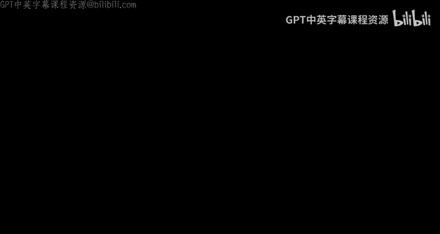
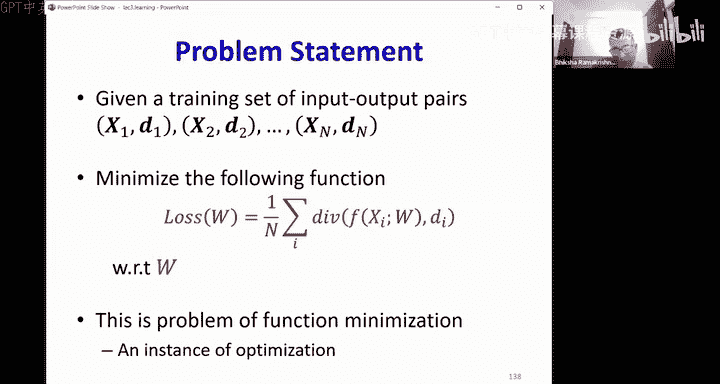

# CMU《深度学习导论｜11-785 Introduction to Deep Learning Spring 2025》中英字幕(deepseek - P4：[04]S2025 Lecture 3 - Training Part I.zh_en - GPT中英字幕课程资源 - BV1xbZNYrEbs

Good morning。 Good morning， all， Can you hear me。Yes， yeah， we can get from。Okay。

So before we begin today， if we have any questions from the past couple of classes。诶。

I could answer in the next minute or so。Any questions， anything， any logistics。

 questions about logistics？No， okay， very' good。I will wait for another minute， and then we'll begin。

There's a hackathton on Saturday， yes。So we have a the usual hackath。

 but tomorrow's hackathton also includes a lab。And that was the lab that was supposed to be happening today。

 but because I'm taking over today with this class， we will have our first lab tomorrow。

 I would urge all of you to attend。Because this will be a handson session where we actually get you teach you how to set up your environment and how to code a neural network。

 it is in person and the information about it should be posted in Piazza。当然。So like the professor。

 I had a doubt in the last lecture actually， so when we are calculating the optimal depth for generic network in that how do we calculate the number of neurons required in the second year。

 I understood the number of neurons needed in the first year。

 but I was not able to understand how many neurons you require in the second year。So wait， wait。

 wait， we weren't showing how to compute the number or number of neurons in any layer for a generic problem。

We specifically showed an example with Xs， right？Yes， and in the case of the x source。

 if you have n variables you're going to need。And over to Xs and the。First XR layer again。

 XR has two layers right， and then then that would leave you with n over two variables。

So then the next the next layer you're going to need， you're going to be pairing them up again。

 so you're going to have n over four xRs。And so on。OkayOkay。

 it's somebody passed this question on Piaz I answered it， all right。

 let me begin with today's lecture。We're going to talk about learning the network and this and the next four lectures。

 next six lectures are all about how you learn the network。So。

We're going to look at the problem of learning。We will look at the perceptron rule for learning individual perceptrons and how it does not apply to multi layerer perceptrons。

We will mention greedy solutions for classification networks， Addeline and Madeline。

 now Madeline and Madeleline are described in some detail in the slides。

 but I won't go over them in class because we won't have time。

 but I do expect you to go over the slides yourself because they will be questions about them in the quiz。

Next week'squiz。And then we are going to begin at learning through empirical risk minimization。

So here's Rika what we found was that neural networks are universal function approximators。

 does anybody remember what I meant by a universal function approximator？Anyone。

 what did we mean by this？We can model any shape。Inor any shape。Anything else does in circles？But me。

Using cylinders and circles。That wasn't the that was for a single hidden layer there was the weekend exactly it said that as is mentioned on chat。

 you give me any function， give me a Boolean function or a classification boundary or a continuous value function。

And I can build a neural network that approximates that function to arbitrary precision。

 In the case of Boolean functions， I can always build a neural network that will compute it exactly。

 The key is there exists a neural network， which can do this。

 It doesn't mean that we know what that neural network is。

 So provided the network satisfies minimal architecture constraints。😊，For any given function at all。

 there exists a neural network that will compute it to arbitrary precision。

But to compute it to that precision， the network has to satisfy minimal architecture constraints if you have fewer than the required number of parameters in the network。

Then the approximation is going to be poor。 This is what we had seen in the last class。

So everybody remembered that。Just give me some thumbs up health I'll just start off but give me a thumbs up so you know。

 there are 230 people here so maybe I can get 50 thumbss right al right， let me go。

So what we found is that neural networks are these functions because neural networks are universal function approximators。

 they can compute any function， and so when we look at different tasks like voice recognition or image captioning our games or playing games in each case something goes in a voice signal。

 something comes out at transcription so this whatever of us doing the transcription is a function。

 all of these neural networks are functions， they take an input and produce an output。

And because these are functions， they can be modeled by neural networks。Again。

 because neural networks are universal function approxiators。

But then that's at the high level neural networks are mathematical objects。

 which means if you want them to operate， what goes in must be a collection of numbers。

 what comes out will also be a collection of numbers and what happens in between is also manipulations of these collections of numbers。

 So when I look at a task like this， you know transcribing voice or captioning images or playing games。

The inputs and outputs are not him numbersumbers。 What's a game state。

 a game state is not a number right， So well， we have to worry about some preliminaries。

 how do we represent the inputs and the outputs in numeric format so that they can be operated on by a function And then the second question is。

 how do we compose the network that performs the requisite function。

We are not going to worry about this aspect， how to represent the input and the output in today's class。

 we will do that next week。But we are going to focus on how to compose the network that performs the requisite function。

 where we will be assuming that what goes in is already a collection of numbers and what comes out are also numbers。

So to do this。Let's first start off by looking at the basic units of the network， the perceptrons。

Here's how we model the perceptron。 A perceptron is a simple unit。 It has a collection of inputs。

It computes an aine function of the inputs， namely， awaited some plus a bias。

To obtain an aine value Z， I'm going to use the symbol C to represent the aine value computed from the inputs of the proseron throughout the course。

And now this a find value C is put through an activation function to compute the output of the perceptron。

And in the case of the simple perceptron that we saw in the last class。

This activation function was a threshold function， but we can also have other activations like the smoother version of the threshold。

 which is the sigmoid or the rectification function or the soft plus and so on。😊。

So we've defined the perceptron， I'm going to make a small modification to this。

When I write it in this manner， this term Z is an affine function of the inputs。

 which is the sum of the weights plus a bytes。 Now this bias kind of stands out。

 so it's sometimes more convenient to just extend my input。

By a constant one and so now I can replace this this weighted sample plus bias as simply awaited some of this extended input。

And the weight corresponding to this one fixed input of1 now becomes a bias。

 so in this case I can simply write z equals summation W X with the implicit assumption that I have tagged on an extra input。

 which is pegged at1。And the rest is the same as this making sense。This minor change。ok。So if it is。

 then let me continue right， so anytime I don't explicitly mention a bias。

 you're going to have to assume that。Instead of having a bias over here。

 I just had an extra input of one whose weight is the bias， that's all， so Wn plus1 becomes the bias。

ok。And so here's the structure of the network， we are going to assume a feed forward network。

 which is a layer wise network of these。Versceptrons。

What I mean by a feed forward network is that there are no loops。

 neurons outputs go to other neurons whose outputs go to other neurons all the way till the out final output。

But at no point does the information flow back and no neuron actually visits a specific input a second time。

So part of the design of a network is the architecture of this network。

 how many layers and how wide are the layers and so on。That we won't deal with。

 we just spoke about it in the abstract in the last class and the exact manner in which these are arrived at is a manner of matter of experimentation。

For now， we are going to assume that the architecture is given and it is capable of representing the needed function。

So once you do this then here's going to be here's what the network looks like I have these extra one just to account for the bias and so the entire network is a connection of many perceptrons each perceptron has many inputs corresponding to which there are weights and so the entire network can be written in this manner by equals f of x semicolon w this uppercase w log w represents the set of all weights of all the perceptrons in the network and so when I write it in this manner the network is basically just a parametric function it's a function that operates on the input。

And has parameters W。 So I use the semicolon in the middle to separate the input from the parameters。

 So the network is a function F but parameters W。 And if I want the network to perform a specific computer specific function。

 what I must do is to set the parameters W so that the network computes the specific function I wanted to compute。

And when I speak of learning the network， we are really speaking of determining the values of these parameters。

 W so that it computes the function that we want it to compute。IThat making sense？To all of you。

So all right。With that if there's the basis， assuming that everybody got it。

 I'm going to move on so again， the network is a parametric function with whose parameters are the weights of the perceptrons。

And when I'm speaking of learning the network， I'm trying to figure out how to set these weights so that the network computes the function I want it to compute。

Now we know from our previous class that if the MLP is a universal approximator。

 it can be constructed to represent any function， but how do we construct it。

 so let's say I have this function of two inputs so this mesh represents the function how do you design this network。

 how do you set up this network so that when it's given twodial inputs it exactly computes this function。

So one way to design a network to compute a given function is to just handcraft the network。

 for example， if I want to build a network to classify this diamond shaped decision boundary。

 I know what the boundary exactly is so I can begin composing perceptrons for each of these boundaries exor a lot。

 I can just handcraft it。But。is this kind of handcrafting a solution that would generalize to more complex problems would it generalize？

Just handcrafting things and setting the weights。It could not try。To complex。So。This is not possible。

 but for all but the simplest problems。So we want automatic estimation of these parameters for the MLP。

 so more generally you're given some function G of x， and we want to derive these parameters W。

 such that when the network parameters are set to that value， the network，Compututes this function。

How can we do this？Now let's say this dotted line represents the function that you want to compute you want the network to compute。

Now， for any given setting of the weights of the network。

 the network is going to compute some function， not necessarily the function you want。

 it will compute some odd function。And so for any given setting of the weights of the network。

 it's going to computer function shown by this dotted line。And there will be an error between。

And this function depends on W right， and there will be an error between your target function shown by the blue dotted line。

And。The actual function computed by the network shown by the red dotted line。

That error is shown by the shaded area in the picture。And what do we want to do with the weights。

 how does this， how do these weights relate to this shaded area anybody？

How do the weights relate to the shaded a？干嘛？You want the weights to be set so that such that this shaded area is minimalist。

 right。So how can you do how do you go about doing this。

 What is the first thing you would need to even define。To quantify the shaded area， anyone。

So so here's the thing when I speak of the shadow you're throwing loss function and such like you need a distance。

When I show you this these two curves， you just implicitly believe there's a distance over here。

 but no， this is math， right， you need a way of quantifying the error between the actual function and the function computed by the network。

 and so you need a function， some mathematical function that can compute that that gives you a quantification of this gap。

 This is this error function。 The total shaded area is the integral of this error function over the entire space。

 and so what we want to do with the weights is to set them to the value that minimizes this integral。

 which is the total shaded area。 I that making sense。第二。Okay。So。And so。By the way。

 someone gave me a Red cross for the last question， who was that and what was the question。

 what was your problem？I just noticed that okay， it's gone away all right， so this makes sense right。

 but can I do this， What is the problem with trying to do this。Anybody。What would the problem be。

 I don't have G， right， So in most real cases。you want to be able to do this the function G must be fully specified everywhere。

 but then if it's fully specified， why do I want to construct construct a second neural network to compute it I already have the function The problem is that in most real life situations G is not given。

And so you cannot compute this integral， you do not have the specification of J。

And so the way we do it is we sample G。 what we mean by sampling G is that for a bunch of inputs。

We will just read the value of G。 Now， how's that different from knowing G where it turns out collecting。

 collecting such samples is very easy in real life。

 you're basically getting input output pairs for a number of samples from the input and in real life。

 this is like saying okay， you pick up collection of images and get their class labels or pick a collection of speech recordings and get their transcriptions Getting samples of G a is not a challenging task。

And so。We want to characterize this entire function。

But we don't have the entire function instead we must learn the network from just these few samples。

 which we call the training samples， where where we have a bunch of inputs。

 where for those inputs we know the value of the function and from these we must learn the network at parameters2。

Computer the entire function。So going back to our simpler illustration。

 if the dotted line is our target function and the red， the blue dotted line is our target function。

And the red dotted line is the function that the network is actually computing。

What we want to do is to minimize the total shaded area， but we can't do it because G is not known。

Instead， at a bunch of training samples， x1， x2 x3， x4， x5， and so on。We will know this value of T。

 so we know this guy here。The value of the dotted line are those x's。At those x's。

 we can also compute the output of the network， basically read the red dotted line。

 add those in at those training instances， and so now we can compute the error at each of these points。

We compute the average error over all of these training points。

And this average error is what we call an empirical error。And were going to try to。

Find the W that minimizes this average error now。If I just minimize the average error at all of these points。

 will this necessarily minimize the shaded area？What is it。Obviously not right， nonetheless。

 we're going to assume that it because it's the best we can do。

And so when we speak of learning the function from training samples。

 we want to find the network parameters that fit the training points exactly。This empirical error。

 which is the average error around over our training points， that's what we will try to minimize。

 assuming the network architecture is sufficient。And we are assumings that for any input the output is unique that for any x you don't have multiple outputs to deal with in that case it only be a function and so the objective is to try to find the w such that the error。

At these training points close to zero or as close to0 as we can send it。

 and then we hope that when we compute the function at these points。

 it somehow magically computes it correctly at the other locations as well。

There's no guarantee that it will。For what's happening in the locations that are not training points。

It's just hope。 We don't know that it will actually compute the correct function。

 but this is the best we can do。This makes sense？Sir。

 are we assuming that all neurons are the same weight？No， no， no。

 this w is the set of all the weights of all the neurons。

So w is going to be a function right So no w is not a function， So if I for for example。

 in this picture have 10 neuronss， right？So that they the lower eight neurons each have two weights and a bias so I have 30 parameters for the lower8 neurons。

 the upper two neurons will have 18 parameters so it's 48 parameters this guy is going to have three parameters。

 51 parameters there are 51 weights and biases that in this network right。

So this w is the entire set of weights and biases。That makes sense。Yeah。Okay。

 we're making our assumptions， we're just collectively aggregating all of the parameters into this coupling。

Because it's just symbolically， it's simpler to write and simpler to explain。

So here's the story so far， learning a neural network is the same as determining the parameters of the network required for it to model a desired function。

The network must have sufficient capacity to model to function。Ideally。

 we would like to optimize the network to represent the desired function everywhere。However。

 this requires knowledge。Of the function everywhere。

 So instead we draw input output training instances。

And estimate the network parameters to fit the input output relationship at these instances。

 and then we hope that when we do so， it fits the function elsewhere as well， but that's just hope。

And so here is our first poll。Let me release it。So Yui。

 I will get to that your error function can never be negative。

It's an error function and the way we will define it is that when you compute the error between two values。

If the two values are identical， the error will be 0， otherwise it will always be positive。

That answer question。O。Okay， I'll give you 15 seconds， guys。Out of formula。You can me on the poll。

And share their results。This is what you guys thought。And。For the first question。Tru or false。

Why is it false？You're right， it's falses right。嗯。Capacity。

 the network should have the right capacity。 The second one， which statements are true。

 the network architecture must have sufficient capacity。啊。One， two， three， right。

 so the network must have sufficient capacity。The network is indeed a parametric function whose parameters are its rates and biases and the parameters must be learned to best best approximate the target function so no we cannot be perfectly learned from just a few training samples so we're good right so let's see how we do this and let's to begin with a very simple task let's try to learn a classifier。

Now， classifiers are simpler regressions， and so this is what we will do。

And classification was also among the earliest problems addressed using MLlPs specifically I'm going to consider binary classification so in binary classification this generalizes to multiclass classification but binary classification is really good for illustration so in binary classification you want the output to be either plus1 or0 two classes right or you can make it plus1 and minus-1。

And so what is the most obvious way of quantifying the error between the network output and the。

And your desired output。How would you do it？For binary classification。

So what is the actual error percentage of wrong answers right so basically what you would say is this this training instance has got the output should be plus one。

The network is output to zero， so there's an  error， right？So okay。

 it's made one error here the output is desired output is 0， the output is also0， so the error is 0。

The most natural。Error function over here is actually just the count of errors， right。😊，Yes or no。

If you had a classifier and if you had to report results to your investor。

 are you going to go and say crossent piece 0。3？Or are you going to say it's correct 98% of the time。

 what would you say？98%， right。So that is there or that is what you want to minimize。And so。

 here's what you have。The obvious error metric is binary over here。

The dotted line shows you what you want the trainer。

 the classifier to be output to be at various inputs。

The green line shows what the network actually computes。And at some locations。

 the network outputs either zero or one if I'm using a threshold perceptron right。

 and so if I assume I'm using a threshold activation， the outputs either zero or one。And then。

I can count the number of locations where the that the output is not the same as the input。

 and that is going to be my error。 The empirical error is the fraction of instances， for which。

The target output and actual output don't match， this is what you want to minimize max。

So how would one go about training the network to minimize this error？To do this。

 I'm not going to look at an entire network I'm going to start off focusing on a single perceptron。

 remember， the original MLLP as proposed by Rosenbl was a network of threshold units。

And our question is how do you train it given only training instances of input output pairs？

And to rather than the entire network， let's begin by looking at the simplest possible network。

 which is just a single prospectceptor。Now in the case of a single perceptron。

 this is what with a threshold activation， this is Rosenblt's perceptron right so deelphine empirical error was this guy right。

The average error over all of your training data。As opposed to the shaded area。Good， so。

Let's see how we train this perceptron now in the case of the perceptron with a threshold activation。

 here was the perceptron。A you。Compute this aine term。

 which is the weighted sum of the inputs cluster a bias。And basically。

 and the output is a 1 whenever this assign term is positive and zero or otherwise alternately speaking。

 there is a。Boundary where the weighted sample plus bias exactly equals 0 and everything to the right of the boundary is being labeled as one by this plusitron。

 Everything to the left is a0。 And this， So the function， if you do it。

 would be this heavy side function。 This is the function you want to learn。😊，Except you're not given。

T have function for you to learn the weights。 All you are given are these training instances。

 These red and blue dots where you are told that for the red dots。

 the output must be one for the blue dots， the output must be 0。 And so from these alone。😊。

You must come， you must learn the perceptron。So assuming that the red dots can be cleanly separated by from the blue dots by a hyperplane。

 then what learning the perceptron really means is to find。The equation for some hyperplane。

 any hyperplane， such that the red dots lie on one side of it and the blue dots lie on the other side。

So is this making sense？What I mean， what we mean by learning the Poseronia。

Can you give me a thumbs up guys so I can see 50 thumb up before I move。嗯嗯。Okay。

 stopping at 20 the 3 or 250 people at class so please keep going I have to verify right and so given a number of input output pairs we want to learn the weights and the biasers。

Such that。For the red dots， the output is always one for the blue dots， the output is always0。

And I can write it differently。This one， instead of having a separate bias using the old trick。

I'm going to include an extra input of1 over here and its weight becomes the bias。

 so now instead of having an aine combination which includes a bias。

 I'm just looking at a linear combination of the inputs and comparing it to zero this is just for simplification。

So again， here's a little trick。We wanted something of the kind， aation W I。exite。Cllapy。

Equals0 right this is this was the boundary if you had an aine function。

But then when I added this extra one over here here and made its weight to bias。

 you simply ended where off sum w X I equals0， right？

So now we know the difference between an aine function and a linear function is that an aine function doesn't necessarily go through origin。

A linear function must go through origin。So how by adding an extra one did I convert an aine function that didn't go through origin into something that did go through origin。

 How did this magic happen， Can anybody tell me。So so that this is my explanation。

 but we do this all the time， right， but can anybody anybody tell me how did this happen？

How does adding an extra input suddenly？B shifts the plane， right， exactly。

 So here's what happens in two dimensions。Maybe this， I have dots over here。

And I have minuses over here， and the actual boundary is going to be。This guy。

 this one doesn't go through the origin。But then when I add an extra input。

 now suddenly the inputs are in three dimensions。Except the third dimension is always fixed at one。

So because the third dimension is always fixed at one。

 all the data now live in this plane where the z value is 1 and so these dots would be out here。

 these minuses would be out here on this plane the boundary would be something like this it doesn't go through origin。

 but in the three dimensional space， I can now draw a second plane。

Which intersects the first plane exactly over here and goes through origin。And that's how， by adding。

Yes， and that's how by adding an extra1， I converted a a fine function。

 a fine boundary to a linear boundary that makes sense。老乡。Okay， so xn plus one， no。

 the weight of x n plus1 is going to be P xn plus 1 is1， okay。

Simple where I give you fix an extra dimension that is one。

 that's like having a third component value is always one there that means all the data live on this plane where the C component is one。

And so now。Here are the pluses and the minuses on this plane， the boundary is here。

But in 3 d space now I can actually make that part of another plane of this kind which goes through origin and where the two planes intersect as the boundary。

 so I managed to convert my。A fine problem to a linear problem that's for convenience we'll see what okay and so。

Now I can say that the problem we are dealt with is this one。We want to find。

A hyperplane summation W X equals0。That perfectly separates the two groups of points。

 This is our problem， right， Now， I'm going to give you a few few few things When I say summation W。

 I X I equals 0。😊，I can write it differently。I can say， I can put all of the WIs into a vector。

W1 through WD， right？I can put all the X size into a vector。X1。如。Exti。Okay。So。啊。

I'm not sure I understand the question you fair。We just want a hyperplane where。

All the data outlined， all the red points lie on one side and the blue lie on the other side。

 That's about it because you want to classifiedifier。 right， just bear with me for a minute。

 But anyways， suppose I write my weights as in this manner and my data in this manner。

 Then I can just write summation W I X I equals。The inner product of W and X， correct。

And so now the equation becomes w dot x equals 0。Do you guys agree with this？你翻。

If I like my weights in this manner， okay。Yes and not， right， Okay。

 now if the inner product between two vectors is 0。

Then what do you know about the relationship of the two vectors？They are orthogonal， correct。

 And so here is what happens。 What we are saying is that W is a vector。

And when I say w dot x equals0， then this is the set of all xs that are orthogonal to wing that is going to be the hyper play。

RightSo W fully specifies the hyperplane because the hyperplane is the set of all vectors that are orthogonal to Wub。

We're good with this， right， Now， take a point on this side of the Hyplane。

 This is not on the hyperplane。For this guy， will w dot x be0。Will it be zero？No。

 because it's not on the hyperplane right， so what will w dot x be assuming that this is theta？

What will w。tx be for this guy？It's w dot x， if you remember your algebra equals magnitude of w times magnitude of x times。

Cost data， correct。You remember this？Right， so over here。

 for what values of theta has cost theta positive？When is cost Theta positive？Anybody？

When the magnitude of theta is less than or equal to 90 degrees， right？

And for what values is it negative？So what values the negative less than9 magnitude of theta is？

Greater then。Greater than night， right？So let' we now， given this。For this vector。

What will w dot xb whether it be positive or negative？For this factor， positive。On the other hand。

 for this vector。What will w doX be？For the blue1， negative， right。

 So for all data points on the same side of the plane as。啊，W。你。あ。

In a product is going to be positive for data points on the other side。

 W doesn't have to be a unit factor。So long as the data point is on the same side as w。

 the inner product is positive if the data point is on the other side of W。

 the inner product is negative， that's it， right？And so。As everybody we think so far， yes or no。

Give me thumbs ups， I'd like to see a bunch， okay。We're good to see。Okay， somebody says no。

 so the person who said no， what is your issue here？I can spend I second yeah。

 I think I'm a bit lost so I'm trying to understand what taking the cosine is going to help us I'm not sure on the very well。

 Okay， so do you agree that this W represents this this plane。Yes， I do。 Okay。

 so then if I take this vector。This vector has a angle that's less than 90 degrees from W current。有。

😊，So the inner product of these two vectors， which is proportional to cost theta is going to be positive。

 right？Yeses。😊，This vector。Has an angle， which is much greater than 90 degrees。Right okay， yeah。

 so the inner probability be negative that's about it， okay， so you can so what this means is this。

I can write the whole thing as saying w transpose x。

Equals zero is the equation of the hyperplane and for classification I can just。

If I have a hyperplane， it's a classifier for any data point。Where w transpose x is greater than 0。

 I can call them the positive class for any data point where the w transpose x is less than 0 within a product is less than 0。

 I can call it the negative class so this actually is a linear classifier right。

 but then let me ask you another question。Suppose I have a data point okay in my space and this belongs to the positive class。

So this belongs to a plus one class， okay？And。The answer now， if I。

I can draw this hyperplane with this weight。And this is on the same angle as plus1。

 so this will this hyper plane will classify this is a positive class。

This one will also classify as a positive class if this is the weight right。

 this one will also if this is the weight， this will also classified as the positive class in every case。

 you know so long as this guy is on the same side as the weight。

The data point is going to be annotate called a positive instance。

 but then now consider these two plane， this is my。Vctor， I'm giving you。Two boundaries。

 one of them is this boundary。Okay， well this is the positive side。The other is。

 I'm giving you three boundaries， right， the other is this boundary。And the third one is。

This boundary， which is exactly at。90 degrees to this data point。Of these three boundaries。

 which one would you think is the best？Given the choice between the blue one。

 the red one and the green one， which is the best。The blue， why Sir。

Because it's the farthest from the training part from this point， right？

For the red data point over here it gets very close for the green boundary over here it gets very close。

 the boundary that's at 90 degrees to the data point， that is the nicest boundary， right。

 Similarlyly， if I have a data point which is supposed to be negative。

So if the data point is supposed to be positive。Then。

The optimal weight vector is going to be in the same direction， pointing exactly at the data point。

Correct， you agree with this。That's when the boundary is at 90 degrees。Yes什么。好。Simple again。

If I have a positive data point。Then I want my optimal boundary to be orthogonal to this。

So the optimal boundary will be orthogonal to it if the weight vector itself is the data point。Right。

😊，Vanjeli， that right。Yes色。then similarly， if I have a data point that have that must be the negative clubs。

Then what is the optimal suppose I want this data point to be belong to the negative class。

 even in this case， this is the optimal decision boundary， right， but what is the optimal weight。

In this case。If this is a negative class。It's going to be exactly opposite。

Right and so here is the thing， very simple idea for any data point。

 if it belongs to the positive class， the optimal weight is the data point itself。

If it belongs to the negative class， it belongs to the。

 the optimal weight is the negative of the data point。

 And so there's an online perceptron solution originally proposed by Rosent Lo。

Which is based on this， it initializes W and incrementally updates it each time we encounter an instance that is incorrectly classified and it's guaranteed to find the correct solution for linearly separable data。

 So here's what we do you're going to cycle through all the training instances。

And with some weight and then if you check every training instance if the training instance is correctly classified。

 you don't do anything， if it's incorrectly classified you adjust it but then the way you adjust it if the data instance belongs to the positive class you add it to the weight if it belongs to the negative class you subtract it from the weight how does that work I'm here this is just math I will just show the whole thing with pictures。

 so let's say I'm trying to build a classification class for these red and blue dots。

I just start off with a random initialization for the weights， which is this cut。

 so this is the weight， right which is this one and this is the boundary。Now。

 I begin checking my training instances。 These three training instances are correctly classified。

 but then I come to the fourth training instance， and I find that this is a negative instance that is being classified as a positive instance。

 What is the optimal weight for this negative instance for this guy。😊。

You know is this is my instance， right， what is the optimal weight for this guy？Anybody。

We just went through this。The optimal rate is this one， right？

So what we will do is just add this one to this guy。And that will be mine。New weight。

 And so that is my new weight。 And now I get a new bound。O。😊，And then。啊，我来。so。

And then I can check all of my data again with this new boundary。

And then I cycle through all the data and I find that this positive instance is being misclassified for this positive instance。

 what is the optimal weight？😊，For just that instance。What would be the optimal weight。

 what is this posted？X itself， so I'm just going to add x to it。And adjust it。

 and now I have a new boundary。And at that point， I find that。啊。I now have a perfect classifier。And。

The whole thing works， so this was Rosenlt's receptorceptron algorithm it's very pretty where basically you keep testing。

 you initialize your weights， you keep testing the data instances and any data instance that is misclassified。

 you add the optimal weight for that data instance to the current weight and adjust it and keep doing it。

And if the classes here， classes are linearly seable。This is eventually guaranteed to converge。

To a separate separator in a finite number of steps。But then if the classes are not separable。

 like you know， I have this red dot on the blue side， I have a blue dot on the red side。

 what would happen to this algorithm， would it ever stop？Would it converge， no。

 because you're always going to find something that's misclassified is going to keep going on and on and on。

 it will never converge。And so this works only if things are linearly secret now。

Let's consider this double Pentagon problem。 We want to learn this double Pentagon boundary。

 except you're not given the boundaries， they're only given the training instances。

 the red dots and the blue dots Do you want the output to be plus one wherever theres a red dot。

 you want the output to be minus1 or a0 wherever there's a blue dot right So we know that this double Pentagon boundary can be modeled exactly。

By this network。You have these five neurons， which will capture these five boundaries， you are them。

 so this subnet captures the lower Pentagon。This subnet。

 which is composed of five lines from these five neurons， which are these five guyss and an orR。

Computute the second Pentagon， and then you can and an and compute the second Pentagon。

 and then you can order a lot。 So this a network with this architecture architecture can。

Find this decision boundary， right？But then， let's see。I am not given the I'm given the architecture。

But I'm not given the parameters。That means those parameters must be learned from my training data。

 the red bluelus， right？So can I。L use the perceptron classification rule that we just saw。

To learn this boundary， and learn the parameters。Let's see。Now。播。Okay， let's take a poll。

 How many of you think you can。Give me thumbs ups。Quite a few， right， so let's see how this works。

Now， here are all the。一啊。Pcept of was slide。These layer of percerons must learn these 10 boundaries。

 right？And so。Let's assume that these nine perceptrons and these two guys and this one they have all already been learned。

 So I'm giving you the correct weights for all， but this one perceptron， right。😊。

So now this perceptron。For the whole network to capture the double Pentagon boundary。

 this perceptron must learn this boundary， right， yes or no。If it doesn't learn this boundary。

 you won't be able to come the double Pentagon okay。The training data are labeled in this manner。

 red and blue。Can you learn this boundary from this training data， What do you think。No， why not。

Why not。It's not linearly separable， right？What would you have to do。To learn this boundary。

You would have to relabel all of these blue guys， right？Do on this side。But do we know which ones。

 you don't right， so here's a poll。Your second poll。Let's see poll two。Can you see the book。十尿。

We were able to construct a boundary because we knew the weights for the other neurons， right。Well。

 the point is， can we get to that， I give you 15 seconds for this poll。那听就对对。Okay。

 let me end this call。啊。She results， this is what you guys thought for the first question。

 what do you think， yes or no？For the double Pentagon。

 given the data shown and all but that one neuron， can we use the perceptron learning algorithm， No。

 right， So what are the problems you see in the perceptron rule to along the remaining perceptron。

A A or B。Both right， perceptron learning requires linearly separable classes。

 but the data are not linearly reseparable， so it requires relabeling the data to make them linearly separable with a correct decision boundary。

 so which means that。This classifier cannot be learned from these data。

We are going to have to go back and paint all of these blue guys to red。

So that we can learn this including this one， right so that we can learn this boundary。

 otherwise the perceptron rule cannot be used， right？But then do we know when you look at this。

 which data points to relabel？Do we know a priori which wants to relabel？We don't， right。

So then what so how do you go about it， all the other guys are given， so how do you go about it？

I've given you the information that it's possible to build a perfect classifier。

 I've given you the weights for all the other neurons。

I want you to learn this one neuron so that the overall network learns the correct decision boundary。

 How would you do it， anybody。Right。The problem is。

We have to find out which data instances to relabbel so that we can learn this boundary。Right。And。

The the thing is the only way you can do it。Is to try out every possible way of relaing your data。

Such that you eventually get a labeling where when you learn the classifier。

 the overall network gives you perfect classification。😊，On the data that makes sense。

You know that there exists a boundary that will give you the double Pentagon。

the rest of the network is perfect。So to learn this pertron。

 we are going to have to check every possible way。Of relabeling your training data and then learning a classifier and then you test that classifier and see if it's not a double pentagon。

 meaning if it's done a perfect job in the training data， if it's not。

 then you go back and try another labeling， right。So Mogo。

 I'm not sure what you mean by that question。So the point is this。You don't know which data points。啊。

Just to learn this boundary， you can relab it， right， That's it。Relabel the point the point is this。

 we need to know。The local labels for all the training data。And so。

We are going to try every one of all if there are N training instances。

Even if you're given all the rest of the perceptrons。

 you're going to have to try every one of the two ways to end possible ways of relabeling this data。

To learn a boundary so that when you stick that boundary over here。

 the overall network learns the correct classifier。That's when you are given everything except one。

 in reality， you're going to have to do this for the entire network。 So for every single perceptron。

 you' are going to have to try every possible way of relaling all that of labeling all the training instances。

 such that the combination of all of these perceptrons will give you the perfect decision boundary。😊。

So。Basically we must know， remember when we were trying to draw this guy， we had this one。

And so this one was going to make everything on this side positive and everything on this side negative。

 right， similarly this one。Was going to make everything on this side positive and everything on this side negative。

 meaningan we need to know that for this perceptron， these guys are all on the positive side。

 meaningan they must be labeled one。 We need to know that for this perceptron。

 These guys are all on the positive side。 They must be labeled one。 We don't have that information。

 So we are going to have to。Test。So what do you mean by the same as the previous day learned one。

 there's nothing being learned。Perceptron has not been learned， right。

So what do you mean by the previously learned one？Well， you have the rest of these。

But you still don't have a network that can compute this double Pentagon， correct？

This perceptionron must also be determined。But for this perceptron。

 this perceptron is trying to learn this bound。Which means everything on this side must be a one。

 correct？If I just give you a pile of data， do you know since you don't know this boundary？

Do you know which ones must be labeled on？You don't。You're going to have to try every which way。

The only information you have is the output out here。That if you get this boundary just right。

 then out here， you will get a one within the double Pentagon and a0 outside。

 That's the only information we have， so。There are two ways to end possible ways of relabeling breath。

There are each one each one each of these can be labeled red or blue so there are two ways to end possible ways of pre labelbel and you're going to have to crack all of those right professors I had this question so for each point if like as you mentioned we wanted the points to like a certain side of it to be like labeled red and the other side blue so the two factors in when we consider the points on the other side which are initially blue to be red and the other side to be blue。

I'm not sure exactly what you're saying I'm saying say let's go with this right。

 so let's say all of this network is known。You're going to try to learn this perron， right？

Yes I know。Yes。This Posetron runss this boundary， correct。Yes。But to know learn this boundary。

 everything on this side must be one。Rightite， bread。Great。

How do you know which ones are on this side， you don't know the boundary。

 so how do you know which ones are on this side？Yeah。

We would have to mark all the points there as what mark。Which ones would you mark。Okay， right。

 I get it for each point you'd have to。You'd have to test everything got it correct so what this means is that I mean you're seeing a simple picture and seems obvious。

 but in the general case you don't know right so。Training this network using the perceptron rule is a combinatorial optimization problem。

 we don't know the outputs of the intermediate neurons。

So we have to determine the correct output for each neuron for every training instance。

 which is exponential and time complexity， right？So Richsha that so basically this。

 the point is if you want to do this， you'd have to try this for every neuron。

And see how they combine it's it's just computationally impossible that's all。

 What this means is that the perceptron learning rules cannot be directly you used to learn an MLlP you have an exponential complexity of assigning intermediate labels。

And it's even worse on the classes are architecturally separable。

So can we use some kind of a greedy algorithm instead it turns out people came up with algorithms called adeline and Madeleline。

 Bernie Woodron， Stanford and in which they introduced the Delta rule and some stuff which we still use there on the slides I'm going to skip check the quiz okay。

But the bottom line is not here。That learning a network is learning the weights and biases to computer target function。

 in practice， we learn networks by fitting them to match the input output relationship of training instances。

A linear decision boundary can be learned by a single perceptron in linear time if the classes are linearly separable。

Non nonlinear decision boundaries require networks of perceptrons。

Training and MLP with threshold function activation perceptrons requires knowledge of the input output relationship for every training instance for every perceptron in the network。

 so this must be determined as part of the training。And so for threshold activations。

 this is an NP complexity combinatorial optimization problem。That's collect editing。

Here's where we got stuck for a very long time， the realization that training an entire MLP was a combinatorial optimization problem stalled the development of neural networks for more than a decade。

Someone did suggest a solution， Paul Warbono， who was it Paul Warbos。

 suggested a solution in the 70s in his master's thesis in MIT。

 but people ignored it until Jeff Henon discovered it when he was here at CMU and published a famous paper on back propagation。

So what exactly is it all about？The problem is this。This is our target classifier。

 the dotted blue line。Let's say the green line is what the model is currently。Computing。

 is it making errors over here？Is the model okay， what is the parameter of this model over here？

The parameter is a threshold， right where it goes from  zero to 1， correct？Yesさ。Okay。

 suppose I change the function and I move it all the way from here to here， will the error go down。

Tot letter。On the other hand， if I move it up here and move it all the way from here to here。

 will the error go down。No， right， so basically I can change the parameter a whole lot。

And the overall error is not going to go down。 So when I change the network。

 I've change the threshold from here to here， I'm actually moving in the correct direction。

 But because the error does not go down， I do not get any indication that I'm moving in the correct direction。

That's a problem right so that means I don't have cues on how to adjust my parameters and so in the more general case。

 the perceptron is a flat function with zero derivative everywhere。

just look at this at zero derivative everywhere and infinite derivative at these locations。

So which means you can vary the weights a whole lot。And the error is not going to change。

 and there will be no indication about whether you're changing the boundaries in the correct direction。

That making sense？咁冇 here。Okay， so。You go on larger problems。 This becomes even more complex。

 compounds a whole lot。 The simple m is a flat non differentiable function。

 with zero derivative nearly everywhere and no derivatives at the boundaries。So what is the solution？

Right now we were computing the error， the actual error。

 which is the mismatch between the actual function。And the target function， right。

 the actual function and the target function。We are going to change the way in which we compute the mismatch such that modifying the classifier slightly lets us know if we are going in the correct direction or not。

 But then this requires changing both at activation functions and the manner in which we evaluate the mismatch between the classified output and the target output。

But now the mismatch function that we use will not actually be counting what we really want to minimize again。

 what we really want to minimize is error。 We want to go and say we have， you know， 99% accuracy。

 not some random mismatch function。 You go and say my loss is 70783 year Investor is going to look at you with a you know like you've gone mad。

 right， He wants an error。But what we will minimize is not errors。

Instead of using a threshold activation which doesn't have。

 which not doesn't have non zero derivatives。啊。Anywhere。

Except are these places where it doesn't even have a elevator。

We're going to make the activation functions differentiable。

With non zero derivatives over much of the input space， that way。

 small changes in weight can result in non negligible changes in the output。

And then we can figure out whether we are moving things in the correct direction or not。

 which enables us to estimate parameters using gradient descent， so let's go back over here。

Here is my example again。So the red and blue dots are my training data。My current estimator。

As a threshold T1。If I move it from T1 to T2 and if I had a threshold activation in the upper picture。

 will the total number of errors change。Yes or no。But am I moving it in the correct direction。

The threshold And I， when I move it from T 1 to T 2。

But does the error give me any information that I'm moving in the correct direction。No info， right。

 So instead sort of having a threshold activation， I'm going to use a smoother activation of the scan。

😊，And。Now。I can use the smoother activation and the actual classification will be based on whether the output is greater than 0。

5 or less than 0。5， so I can still perform classification。

But then instead of simply counting the error between my function。

Another the actual classification output and the desired classification output。

I'm going to be counting the total distance between my target output and my function。

And so you can see that over here， the total distance is the sum of these two red dotted lines。

T1 is where it crosses over from being below 0。5 to above 0。5。

 so if I move that from T1 to T2 move this whole function left。Then。These two guy。

 this guy still being misclassed here。 This was the only instance being misclassified here。 too。

 This is being misclassified。 If you look at whether the activation function is greater than 0。

5 or not。But then if you look at the length of the dotted line， that's lesser。 In this case。

 the sum of the length of these dotted lines is lesser。In the right hand side。

 then on the left hand side。 And so by looking at the sum of the lengths of these dotted lines。

I can determine that when I move the threshold from T1 to t2。

 that is when I move the function left and moving in the correct direction， is that making sense？

Yes or no， yeah。But then。The sum of these dotted lines is that the actual error I want to compute or is it a proxy。

Is it this actual error is it a pro？It's not an approximation， but it's a proxy。

 some other function that is indicative of what will happen to the error。

 Will minimizing the proxy actually minimize the error。Tellling。Are you sure。Not always。

 So let me give you an example。 this function never really approaches， becomes one。

It keeps approaching one。Arbitrarily closely。 but it's going to always be somewhat away from one。

 So now let's have what。Like an infinite number of red points over here。

Each one of these guys is going to have a small non zero distance from the。Actation function， right？

 So what will these points try to do， They will try to minimize their distance from the activation function。

 so they will push the curve left。But because there are so many of them。

 they are going to be happiest when the curve is as close to one as possible。

 which means they can move the curve all the way out here just because of these data points over here that makes sense。

Each one of them has an error of 10 race to -30， where there are 10 raised to 50 of these guys。

 They don't care about these data points。 They're going to push the function all the way up to the left。

 And so this minimizing this proxy doesn't mean that you're actually minimizing error。

It just gives us a nice handle for us to be able to minimize error， make sense。Yes， no。

 just give me a thumbs up or a thumbs down。There's no such thing as misclassified points。

Its because you're just looking again。So but even in the first case where the differential was infinite。

 you could have moved T2 behind the first red dot right。

How do you find out where the first red dot is， you're looking at a simple one dimensional example here。

Okay， okay， how do you know which doctor move beyond right， so right？

So that's basically what we do when we're using the perceptron classification tool。

 but in the more complex case， we don't even know where to move it so here is my third point。

30 seconds， guys。Okay， I'm going to stop this。Yes have you replied。But okay。First question。

 which are the true statements， can anybody tell me？One and two。Second one。

 which are the true statements。张飞。So。Increasing or decreasing the threshold will not change the overall classification error unless a threshold moves past a misclassified training instance if you're using a threshold activation。

 so we cannot know if a change of the threshold moves it in the correct direction or not。Now。

 the derivative with respect to the threshold is zero。

 so it gives us no indication at all this third statement is false。And the second one。

 all of them are true shifting when you are using the continuous activation。

 shifting the function left or right。Will not change the overall classification error unless the crossover point moves past a misclassified training sample。

So it's in terms of classification， these two are behaving the same way， right？

But shifting the function will change the total distance of the value of the function from its target value。

 And so now， because that changes continuously with the position。

 the derivative of the total distance with respect to the shift of the function does give us an indication of which direction to shift the function to improve classification error。

So the first question is the derivative zero infinite zero， right？

The derivative is going to be0 everywhere， and it's going to be infinite， right。

When you cross a point， because at that point， it's suddenly going to go。

 therearrow is going to jump， right？So the two key key requirements for learnability are the。

Punction must be continuously have a continuously vary activation differentiable。

But you also needed continuously varying error functions， so let's look at this first guy。

We cannot use a threshold activation。We are going to use graded activation functions again。

And these functions are differentiable everywhere or almost everywhere in the case of the recification function it's almost everywhere because it doesn't have a derivative at this corner but even there it has something called a sub derivative that we will get into later。

Which still gives us information about which way to move it， so we use。

Continuous greater activations。And in particular， one activation that we really like is the sigmoid for the soft mats。

Because when you apply to the output layer in particular， because it has a very nice interpretation。

 it can be interpreted as the probability of the positive class。Given the input。

We will discuss the more about， you know， the fact that perceptes with sigoid activations are actually normal class probabilities in a later lecture。

 but for now moving on， so what this means is that this sigma Z is differentiable。

What does it mean to say something is differentiable when you say something is differentiable。

 it means you're able to quantify how much a small perturbation of the input changes the output。

 That's what it says。 If it's differentiable， then I will be able to say that if it increases the z by delta Z y is going to change by delta1。

 So you're able to compute dy by Dz。So now when this is differentiable。

 you can see how much perturbing this will change this。

But then Z is just a weighted combination of these guys。

 so you can immediately come compute how much we you know perturbing this w will change Z。

But then you know how much per turbing z will change y and so you can change those up and determine how much perting w W will change y。

 does making sense。Yes no。So that's a definition of differentiability right and so for our network now this means is that you know I can figure out because all the activations are differentiable。

 I can figure out how much changing this little weight will change the output of this neuron。

I can figure out how much changing the output of this neuron will change the outputs of these neurons。

 and I can figure out how changing the outputs of these neurons will change the output of the network。

 So overall， I will be able to compute how much perturbing and wubling。Will change why。

And now that allows me to figure out how to modify my doling， right？And so by extension。

We will be able to say for every one of the parameters in our network how changing perturbing it by a small amount will change y。

 and so you can determine for instance， whether increasing it increases y or decreases y and by how much。

 and then you can use that information to adjust your parameters。

We'll actually look at how to compute these derivatives in a later lecture。

 but is this making sense so far？Yes or no。ok。See。And so we saw we need a continuously vary activation function。

But we also need a continuously varying。啊。There's no equation over here。So we also made before that。

It one。There's no equation here one more。Yeah， I this one。What do we change。

We haven't changed anything， right？The second thing we need is a continuously varying error function。

😊，What do I mean remember， I said we needed a quantification of the error between these two guys。

But there's something very specific。 How do we define this error function。

 We define something called a divergence， and the divergence function takes two arguments and has the property that if the two arguments are identical。

 then it is 0。And if the two arguments are different then it's going to be known on0。

Those are the two key properties right and so and he want it to be differentiable with respect to the first argument。

So this way， if the divergence is large， it means they are very far away the again。

 or in the sense of the divergence right， if the divergence is0。

 it means they are identical so you can manipulate the divergence to make this as small as possible。

And in additionally， you want the divergence to be differentiable with respect to F。

 which is the output of the network。Which in turn is differentiable with respect to all the parameters。

 which means that the divergence is not differentiable with respect to all the parameters。So again。

 the divergence is not the classification error anymore。It is the。 It is a proxy to it。 And so now。

We have this stavers。And the overall shaded area is the integralte of this shaded the overall error is the integral of this divergence over the entire input space。

 this is what we want to minimize。But then I take into consideration something else。You know。

 if I never see training if I know that my data only live in this small range。

And there is no data I will never see data outside。

 Do I really need to be minimizing the error in those regions from where data never come。

 Do I need to do that。Let's say。So for example， if I know that。

All of my training data only come from this portion of the space。

Then do I need to be minimizing error out here？Makes no sense right。

 so you want to focus on those portions of the wave space where the data are， the way we will do it。

Ass by considering the probability distribution of the data。

We will weight the divergence by the probability of the data instance。

 which means data points which are more frequent。The error at those points weighs more than data points that are less frequent。

 And if a data point never happens， it never contributes to the。Diveigence to this error function。

But this function， which is the integral of a function multiplied by the probability。

 it is simply the expectation of the divergence。And so which is basically you know the statistical average of the divergence over the entire space。

 and so the actual function that we want to minimize is this expectation。

 the expectation of the divergence over the entire input space。Again， going back。

 we don't have G ofx。So we will be sampling to your effects。

But then good sampling means that the x values are drawn from the true distribution of the data for P of X。

 which is the probability distribution of X。 You will never draw impossible values or unreasonable values。

 and so。This average that you compute of the divergence over all of your training data。

This naturally factors in the probability of the training samples because if you collect your data training data in a reasonable rational way。

 then you're going to get more data from more probable regions and no data from impossible regions and so this empirical average of the divergence。

 which is what you will be using this divergence function。That is a pretty good。Estimate you know。

 it's a pretty good quantifier。For this expectation， and this is what we will minimize。And so。

This empirical average of the divergence is what we call the loss。The x's are given。

 the training instance are given right so the only way you can change this loss is by changing the network parameters。

Which means the loss is a function of only the network parameters and so when we train a network。

 you'd be given a training set of input output pairs。You'd be given a quantification of the error。

 which is the divergence。You'd compute the average divergence on your entire training data。

 that's your loss。And you train your network parameters to minimize this loss again。

 will minimizing the loss actually compute the true G of x。No， right。It's just an approximation。

And so this is empirical risk minimization again， it's really a measure of error。

But using standard terminology， we call it a loss。 The empirical risk is an empirical approximation to the trueless true risk。

 The expectation of the divergence， which is our actual minimization objective。

And if even this guy is only a proxy， right， And so for a given training set。

 this loss is a function of only W And so here's the overall problem statement。

Given a training set of input output pairs。We define the average divergence over all the training data。

 which is your loss。And so now the loss is a function of only the network parameters。

We will minimize it with the W， so this is a function of problem of function minimization。Yeah， lazy。

And so this is an instance of optimization and so。Sttorory so far。

 we learn networks by fitting them to training instances from a target function。

Learning networks of threshold activation perceptrons requires solving a hard combinatorial optimization problem。

Instead， we use continuous activation functions with non zero derivatives。

To enable us to estimate network parameters， because this makes the output of the network differentiable with respect to every parameter in the network。

And the logistic activation perceptron actually computes the a posterior probability of the output but given the network。

 we just briefly mentioned it。We defined differentiable divergences between the output of the network and the desired output for the training instances。

And a total error also called a loss， which is the average divergence over all training instances and we optimize the network to minimize this error and so this is an instance of。

Function minimization， this is where we will stop。I can I can take any questions。

 So is the error quantization known to us because for divergence， we would need that， right？

So the divergence is something you define right the divergence is your proxy for whatever error you really want to estimate sometimes the divergence is the error itself and some problems in other cases it's a proxy。

But it's something you' define。We'll be looking more about divergence functions later。

