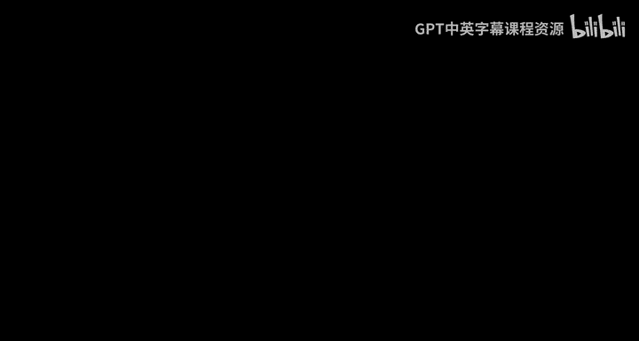
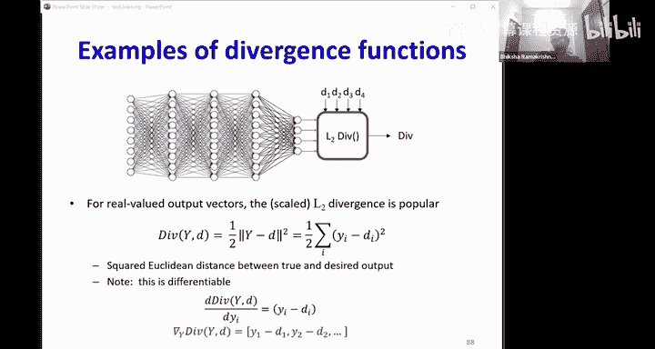

# CMU《深度学习导论｜11-785 Introduction to Deep Learning Spring 2025》中英字幕(deepseek - P5：[05]S2025 Lecture 4 - Training Part II.zh_en - GPT中英字幕课程资源 - BV1xbZNYrEbs

Good morning everybody， can you hear me？I guess graphf。Yes。

S you the slides are should be on the website and informed that they were up last night。

So while we wait， do we have any questions from the past three classes， three lectures？Any questions？

If not， we're good。Let's start。Shortly after 8 AM。So Alal， I'll just write to Karen Kirk。

All of you were on in Section B。Please write to Karen Kirk and she tells me that the waitlists are clear so she needs to hear from you because I can only tell her to clear the waitlist。

And you I had to believe her， so email her and CC me and you'll get cleared。If。

You have credits free and you have no cs。Okay， there are no slides。Ts， can you check。

Why the slides are not up on the Web I had given out the slides last night， I believe。Oh。

 I had not my mistake。 Oh yeah， I have。 So can you please notify the。

Website folks to upload the slides， this slide should have been up。

The in person lectures will start on。But trust me， you man。

 you get a lot more engagement from soon all right， let me begin。So， here is where。

We were at the end of last class。We saw that neural networks have to be trained to emulate our compute。

 whatever function they are trying to compute。But one big issue is that we don't have the entire function。

 so just give me a second I've got to shut my window so very noiseis here。

It's crazy we live in a rural area so people don't drive cars they drive tractors and the tractors are really noisy so you have tractors going up and down the street all the time making terrible noises anyway so we saw that neural networks have to be trained to compute the function that they're trying to compute。

But we don't have the entire function。 We only have samples from the。啊。

Function that we are trying to estimate or model， and so the samples consist of input output pairs。

Example inputs and the corresponding function values are these example inputs， and from the subset。

 we have to learn to model the function。And the way we do it。

 for any given setting of the network parameters， the network computes sum function F。

This can differ from the target value D。 And so we define a divergence function。

 a divergence between the output of the network and the target value。And the loss。

The term we define as the loss is the average divergence over all of our training samples。

And so once the X's and Ds are given， the only way to move way to modify this loss is by changing the W。

 and so the loss is just a function of the network parameters W。

And so we estimate the network parameters。To minimize this empirical estimate of the expected divergence between the function computed by the network and the actual function。

 So that's what this loss is。And the hope is that when you minimize this loss。

 you actually minimize the error between the output of the network and the true target function over the entire space。

So this ends up being an instance of function minimization。

 This loss is a function of network parameters。 and so when we try to minimize this loss。

 we are basically minimizing a function with respect to its argument。

 So this is an optimization problem。And so we'll quickly take a quick look at function optimization and an initial discussion of derivatives now。

Suppose I were to have a function of this kind， this is x， this is F of x。And。At any location。

 this function has a derivative。So let me call this derivative alpha。Now啊。What。😡。

Do you understand by the term derivative， Can anybody tell me。

What do you understand by the term derivative over here。哪你吗。Spe rate of change。Slope， slope， slope。

 Okay， that's what you learn。 Talk， right， But then， and the。strictest sense of the word。

 what you mean by the derivative is this。At this location， X。Suppose you were to take a small step。

Delta X。So very infiniteim step delta x， that is going to take you to a new location。

And that results in a change。I'll call this y equal ofence。 this results in a change。

Delta y in the in the function， right？And so the slope。

 this derivative here is simply the multiplicative term。With which you must multiply Delta x。

To get Delta。This is how you define the derivative there is no other definition for the derivative。

 this is the only true definition for the derivative。So。When I speak of derivatives。

 the actual definition of a derivative is as follows。

The derivative of a function at any point tells us how much a minute increment to the argument of the function will increment the value of the function for any function y equals f of x。

This is a multiplier alpha。 The derivative at any point is a multiplier alpha that multiplies Delta x。

To give you the corresponding Delta by， this is the only way to define the derivative。

 There is no other way to define the derivative。So and this is based on the fact that for continuous functions at fine enough resolution。

 the function is locally linear。Now， in your college classes or high school。

 you might have often have used this notation Dy over Dx。4 derivatives。

How many of you are familiar with this notation， I'm sure all of you are familiar with this notation。

 right？Yes， no no。Okay， so given this definition。Does this notation make sense？

Given this definition does this notation make sense？Yes or no。It does。

What if I told you it doesn't make sense？Then what would your answer be。好。Okay。

 so let me tell you why it doesn't make sense。And for that。Here。

 if I have a scalar function of a scalar argument。Then in this case， the argument is scalar。

And the function value is also scalar right in that case， y is a scalar x is a scalar。

 So this is a scalar， this is a scalar， and we are all we all know how to divide by scals right and so I could always write in this case alpha equals。

Delta y over Delta x。And in the limit， this simply becomes dy over dx。

 so when x and y are both scals， this notation is just fine。

Except you are better off representing it as F prime of x than this one。 Why is this notation better。

 anybody tell me？Where is this notation data？Anyone。Multivate case。Ands。

This notation is better because it's telling you that it changes with the location X。

Whereas if I write something of this kind， that information is。Hden right。

 so this is a much better notation because it actually indicates that the derivative itself depends on x。

 the more generic notation doesn't do so。But this works with scalrs。

Suppose you know and so for scalar functions of scalar arguments it's easy let me just draw this plot right suppose I have some function and I am computing。

The derivative at X， right， and so there's a corresponding y。

Then if I say the derivative alpha is greater than 0。Then if I increase x by a little bit。

 what will happen to y， will it increase or decrease？It's going to increase， right？

If alpha is less than 0。Then if I increase x by a little bit， what will happen to y？

Increase or decrease decrease， so you can see right， Delta y equals alpha dx。Delta x。

 so if alpha is positive。That increases in x will result in increasing y if file P is negative。

 increases in x will result in decreasing y and so when you look at this figure over here。

 anywhere where the function is increasing the derivative is going to be positive anywhere it's decreasing it's going to be negative and at these local maxa and minima over here if you look very。

 very closely at the function then a small step doesn't change the value of the function at all if the step is small enough and so at these locations the derivative is0。

Now， what happens in the multivariate case， it turns out that in the multivariate case too。

 I can use exactly the same notationer clearly。In the multivariate case， x is a vector。

 so I cannot write 1 over x。 Can you divide by a vector。

Is this a valid notation in the multi when x is a vector， It is not right， So I cannot write1 over x。

 I cannot also not write D y over D X。 This does not make any sense。So what does make sense？

This notation still makes sense。Delta y， the change in y is。

The derivative times the corresponding change in x。This making sense over here， do you guys？I here。

Okay， and so now suppose x is a vector of this kind。So x is in our vector x1 through x n， okay。

 or xt。Then what will deelta x be Delta x is a small increment in x。

 what will the shape of delta x be？What's it going to look like？The same， right。

 Delta x is also going to be Delta x1。Through Delta xt， right？Now， why。And this case is a scalar。

It's just a height， right， What is Delta y is Delta y a scalar or what is it。Avis the killer。

What is Delta Y。In this case。It's also going to be a scalar Delta y is going to be the same as y。

 right， so Delta y is a scalar。Delta x is a vector。Of this kind。Delta x1。To Delta xn xt。

 so what will alpha be for this whole thing to make sense？Delta Delta x is a column vector。

Delta y is a scr。 what is all going to be。Anyone。Alpha must be a row vector， right？

Nothing else makes sense。 The math doesn't work otherwise。 And so Al is going to be a row actor。

 right。And so the。So this means Delta y is going to be alpha 1， delta x1 plus alpha 2。

 delta x2 and so on， all the way to alpha d， delta xt。This is how it must be written。

 this is how it comes up right now in this case， something interesting happens。Now。

 when x is a vector。Let's look at a two dimensional case， this is x with components x1 and x2。

So let's say the current location of x is out here。

Is there a unique direction now x by x was a scalar， you could either move forward or backward。

 Those are the only two directions， right。Here， is there a unique direction in which x can be modified or is it possible for delta x to be in any direction？

啊我 here。The next is a vector。Delta can be in any direction， right？And regardless of the direction。

 this equation must hold。And so suppose I take Delta x in a direction where only this first component changes。

And the rest of them do not change。 so that all of the rest of them do not get perturbed。

 I should still get Delta y equals alpha Dlta x。 but that's only going to leave me with this one because all of these delta x's are 0。

Right。And so in this case， when your delta x is pertbed only along one coordinate。

Then the multiplicative term that multiplies that corresponding deelta x。

Is called the partial derivative。Of y with respect to that component。 And so there's vector alpha。

 It's a vector of partial derivatives， where each one of these is。Each one of these is a。

Divative with respect to partial derivative with respect to one of the coordinates of。X。

This making sense so far？All of him。So okay， how many， so alpha is a row vector， right。

 how many of you have heard of the term gradient？Have you heard of the term gradient。Okay。

 what is the gradient？So here's what it is。But I'm living in some space X。

Then there's a term called the gradient G and G is it lives in the same space as x。

 it has the same dimensions。 And if x is a column vector， G is also a column vector。

 it turns out that the gradient is simply the transpose of the derivative。

And so if I were to write Dlta y， that's what their delta y is going to be gradient trans gradient at x transposed。

Times delta x， the gradient is simply the transpose of。The derivative。That's just terminology。

 that's because the gradient is in the same space as the original data that makes sense to everybody。

Yes or not。Okay， so can I see a few thumbs up， please？I've got so far。

 I've never got more than 10 people agreeing with me， okay。And so。Then， because。

This again is a function derivative of y with respect to X I'm going to use this notation。

 this inverted triangle called nabla。Subscript x， which means I'm taking the derivative of y with respect to x。

 this derivative is basically a vector of partial derivatives。

And the gradient is simply the transpose of this sky。 The gradient lives in the same space as X。😊。

So far so good， right？So I can write it like so。I can say that increment the F of x。Is。

AThis increment here， its a scala。As a。Divative vector。Timemes me。X increment vector。

 right this is what we've got。This is an inner product between two vectors。

 It's actually the inner product between the gradient。Anytime you speak of x dot y。

 that's simply you're assuming that x and y live in the same space， if we have both column vectors。

 this is just x transpose y， right？You might be familiar with this notation。So what doesn't matter。

 the point is this is an inner product between two vectors。Is that making sense。

 the increment is an inner product between the derivative。And the step。Are you good with this？Yes。

 I no。Okay， so if you're good with that。Now。Let me ask you this question。What do you think， I mean。

 how do we how do we interpret this derivative， it's just a vector of partial derivatives。

 but what does it mean？Does anybody have an intuition for this？

What does this specor of partial derivatives mean？So Prite。

 can you explain why this is the direction of steepest asscent。卵。

So anybody else want to explain why this is the direction of steepest asscent。Why is that。

You know the answer， but I'm asking you what professorfe because you're essentially trying to like reach the global minimum so this would essentially I'm not asking in terms of objectives why is this you you for the。

而他的呢。啊 they talking咯。To the isotopic line。Is that it？O。

So we agree that this is a vector in a product， right？

Now let me ask you this if I give you the inner product between two vectors， x and y。What is this？

You remember the formula for this？If the angle between the two vectors is theta。

And what is the inner product？Anybody remember this？Anyone。Come on。

 we have mod mod Y cost theta mod mod Y。Costheta， right， This is the。

Inner product between the two vectors， right？And so if I look at this， if I U transpose V。

 it's module mode v cost theta。 So let's say this is V。And the blue vector is U， right？

Then as you keeps rotating around， when is this inner product maximum。Anyimone。When is it maximum？

angnge咯。When the two are perfectly aligned， right， angle is0。

So when blue is right on top of the red red， and when is it minimum？아多은。啊，他的呢。Where is it minimum？

When blue is exactly opposite to red， look at this curve， right， theta is 180 degrees， you see this。

Andm plotting the inner product to the right。So when the blue sits on top of the red， it's peaking。

And the blue is pointing in the exact opposite opposite direction as the exact opposite。

You know it's a negative of this value， it's the minimum。Everybody good with this sofa。

 this little picture。Okay。I have one right， so let's see。Now， dearf。

Was the inner product between the derivative and the X right So this red line is your derivative。

 The derivative is fixed。 The only thing you can change is the direction in which you take your step。

D x is the blue line， right？When is this inner product maximum？Anywaybody。

 when is this in a product maximum？Looking at the figure。Come on， guys。

When the step that you take is exactly in the same direction as the gradient， right？

So in other words， although， so in the space， if your gradient points in some direction。

 you could take steps in any direction， it doesn't matter and this relation will still hold。

But D F is going to be maximum if you take step the step in the same direction as the gradient。

That making sense to everybody。Yes算 no。can you give me some thumbs up so because everything is going to be dependent on this way？

ok。And so， here's where we are。At any point， you have a gradient。

The gradient is the vector of partial derivatives。But that gradient is the direction of steepest ascent。

 If you take a step in that direction， that's when the function is going to increase fast test。 Now。

 if you want the function to decrease， which direction would you take the step in。😊，From here。

 anyone。The exact opposite right moving exactly opposite is going to decrease the function fastest。

And so wait。Vjeli， I don't understand your question， what do you mean by rule law right？

In products right between derivative and gradient so is an outer product that's an outer product that's going to give you a matrix Okay so whereas you want to scale。

The scale is going to be in a product， right？Great， so okay。And。At the。These points。

The minimum or the maximum that's where a small step doesn't change the direction at all。

 change the function at all。At those points， the gradient is going to be 0。

 There is no direction in which you can walk where the function is going to either increase here or decrease over here and so。

There's another rule if I you know， if I slice the function at some height。

 then I'm going to get an edge that edge is called a level level set。

And the corresponding value of the function is the level curve。

 and there's a property which says that the gradient is always orthogonal to the level curve。

That's something that we will use， but I'm not going to explain why。 Now。

 there's also another property called the Hassian， which is the matrix of second derivatives。Again。

 the function it's a scalar function of many variables。

 And so this matrix of second derivatives where every the I J at the term is the derivative of。

The function with respect to Xi and Xj， this is called the Hessian。

 we'll encounter the hessian again later。So here is our first poll。And let me release the poem。

Can you see the ball。Okay， six， five seconds。Okay， some of you are unable to see the poll。

 but let me share the poll， right？And。So here is what all of you thought。Over here。

But before we continue。First question。Which are the three three true statements？

Anyone which are the true statements？And the first question。You want to reply。1 and at any x。

 there may be many directions in the tweak and steps that F increases。

The direction of the gradient is the direction of the steepest increase， right？

And is the gradient that derivative with respect to x？Why is the third statement of not true？

Is the transpose of the derivative correct， if f of x is an n cross1 column is a scalar function of an n cross one column vector。

 what is the shape of the derivative with respect to x？What is the ship。The derivative。

One process right and Daisy we're not guaranteed that x will increase at maxa this no it's not going to increase anymore It's just that that if x increases。

 that's the direction of steepest increase。 If it's a smooth function。

 it will increase in some directions and decrease and decrease in others it's only at maximum and minima that it won't。

At maximum in particular that there's move further increase and so。The gradient is going to be zero。

So now here's the problem of optimization going back to our problem。

 right you're given a function of this kind。Like loss of w and we want to find the value of the argument where the function is minimum it can be pretty ugly right so functions can have global minima they can have local global maxima local minima inflection points we want to find the location of the global minimum now we've seen how to do this in school if I have a continuous function of this kind。

And it's a function of a single variable x。Then you all know how we did this。

 you just found the place where the derivative was 0， so you equated D over dx to0。 you solve for x。

And was that sufficient？Was that sufficient？To check for where the derivative was 0。Okay。

 so to get back to I， we'll get to this。A minimum is a turning point。 Why is it a turning point。

 The function is decreasing till it hits the minimum。 But then it turns and begins to increase。

 We find a turning point， but it's not sufficient to find a turning point。

 You have other criteria to consider， And let's see how many of you are familiar with this。

Other criterion？Why is this why am I not able to。啊。O。What's going on。Okay。

I assume you can see the poll I'm giving you only 30 seconds for this one。嗯。Some issue。

 those if you are logged in through Andrew， you should be able to see the poll。

 I'm not sure why you're not able to see it。ok。10 seconds。All right， let me end the poll， right？

So here's what all of you thought。And。Okay， which statements are true， anybody？

Which are the true statements here？3， right。啊。Which of the following criteria would be true？

The third one， the derivative must be zero， the second derivative must be positive right this is the this is the one。

 so here's what it is if you have a function of a single variable。When the function is increasing。

 then any increment in delta x is going to result in an increase in y。

 so the slope will be positive when the function is decreasing。

 the slope will be negative and so the both but at both max and minima。

The derivative is going to be 0。 So it's not sufficient to look at the maximuma and the minimum。

 In fact， if you look at the derivative， then in this region。While they are arriving at the maximum。

 the slope is always positive so the slope is going to be positive。

When theyre going away from the maximum， the slope is always negative。

 so the slope goes from being positive to being negative and hits zero at the maximum。At the minimum。

 you have the exact opposite criteria condition。Before you hit the minimum， the slope is negative。

 so you know this thing is below the horizontal line。And then once you go past the minimum。

 the slope becomes positive， so the slope goes from being minimum negative。

This is the zero line to being positive and the slope is0 at the minimum， both at maximum minimum。

 the slope is0， right。But there's something else that's indicative of the derivative of whether it's a maximum or a minimum。

At a maximum， the slope goes from being positive to being negative。

 So the slope of the red curve is going to be negative。

 The slope of the slope is going to be negative， at the maximum。At the minima。

 the slope goes from being negative to positive。So the slope of the slope is going to be positive at these places。

 And so as we learned in school， we look at the deck second derivative， the slope of the slope。😊。

And at Maxima。The slope of the slope is going to be negative。

 The second derivative will be negative at minima， the second derivative will be positive。

 And so in school， when we actually tried to find a minimum of a function。

 we found where it was0 and where the second derivative was positive。😊。

This making sense to everybody， you must remember all this right， is this making sense？Okay。

And so here's what we did， right， find the value of x at which f prime x is0。

That's always going to be a turning point， or almost always we'll see where it's not and then check the second the second derivative。

 if it's positive， x is a minimum， if it's negative， it's a maximum easy。

But then you can have other ugly things， for example， if you have a function of the kind。

 it has a minimum maximum， it has an inflection point。

 it has a minimum so all of these are critical points points where the derivative is zero they call critical points。

 not all critical points are turning points。Only maximize and minimize turning points。

 that's where the function turns。 If you plot the derivative。The derivative is going to be zero here。

 it's going to be zero here and it's going to be zero here。

 but then here's the derivative curve at the maximum the derivative goes from being positive to negative。

At an inflection point at this inflection point， the derivative is always negative。

 it's just that its magnitude reduces and then be good and then increases again。

 so it goes from being negative and goes back to being negative。And then at the minimum。

 the derivative wisdom being negative to positive， but then。

At inflection points and at maximum minimumma， the derivative is going to be 0。

And so if you look at the second derivative。Then you find that the second derivative is going to be。

Negative at maxa positive at minima and at these inflection points more often than not it will be zero that's basically this red curve is the derivative of the blue curve。

So these are the tests we can run， right？But then when we get to more variables。

 it gets more complex。So let's look at what happens with。Functions of multiple variables。

 so you're going to have a function of this kind。The minimum is still going to be a turning point。

But it's turning in multiple directions over here。A turning point was because as you approached it。

 the function went from being increasing to being decreasing and there was only one direction to travel。

Here。And I mean， there were two directions， you could go from left to right or light right to left。

 regardless of which way you went， the function would initially be increasing and then decrease。

 so it's a turning point。Here there are infinite different directions in which you can travel。

 it could be coming this way it could be coming this way。

 it could be coming this way and regardless of which direction you approach this point from initially the function will be decreasing and then it will be increasing it's going to be a turning point from every direction and it's going to be a minimum from every direction direction so and at the minimum itself regardless of the direction you arrive from。

The slope is going to be zero that makes sense。For the multiate。case。Right， and so。

The optimum is still a turning point， the gradient will be 0 and we have to find the location where the gradient is 0。

 so how can we do this？It turns out this equivalent of the second derivative in the multivariate case is the hessian。

And so we would write out the formula for the derivative or the gradient and  to equate it to zero that would give us some。

Potential solutions for x and then add that x， you can compute the Hessian matrix。

And the hessian matrix is going to be positive definite。Meaning all the eigenvalues are going to be。

Positive at local minima， all the eigenvalues of the hessian are going to be negative at local maximuma and then you can get other things like sa points。

So for example， if you have a function of this kind， which looks like a saddle， right？B。

So this is a function which is。A saddle， so if you approaching this direction。This is a minimum。

If you approach in this direction， this is a maximum。

 so in this case the Hassian will have two eigenvalues。

One of them will be this the second derivative along this direction。

 the others the second derivative along this direction and you will find that one of the eigenvalues is going to be negative and the other eigenvalue will be positive it's only a strict minima that all the eigenvalues will be negative and so you run the test and you can find the solution for x。

But and there's a little example on the slides where we actually solve for this for a toy problem。

The problem is that， you know， for most functions， you cannot simply solve。For the minimum。

 you can't write out the derivative and get a nice closed form solution for x where the derivative is0。

In these cases we need iterative solution so what we do is we begin with a guess you have this ugly function and you say I think the minimum is over here then you look at there go to that point。

 you look around you find it's not a minimum how would you find that it's not a minimum over there。

 what is your check。How do you find that it's not a minimum？Anyone。Check the derivative right。

 and if the derivative is not zero， then it's probably not a minimum， so then you take a step。

And then you come to a new point。And then you check again。

 am I at a minimum if I'm not I take another step and I keep doing this until I get to a point where the derivative is0。

 this this would be the same for the univariate case or the multivariate case start with an initial guess check if it's a minimum if not take a step keep doing this till you arrive at the minimum there are a couple of questions which direction should I take a step in when I do this。

You know should I be going this way this way or this way and how big must the stem be these are the two questions right so let's look at this for a simple to problem okay scalar。

Now， let's say。This function y is what you're trying to minimize。

And so you're at some initial value x0， okay？And then， at this point。You have some value by zero。

 you check around and then you find that that the derivative is。Positive。So if it's positive。

 then we'll going forward increase y or decrease y。What will happen？Over here。

 if I take if I increment X。Will why increase or decrease？

It will increase if the derivative is positive， so。Which direction should the step be and。

 should I be going forward or backward？Remember I want to minimize why which direction should I take a step in？

I should go backwards， right， so I'm going to say x1。The next iteration is going to be x0。

Minus some step， right？So I come here。I get to x1， but then at x1， I have some other value of。喂。

And I check the derivative over here， and I find that the derivative is。Negative， okay。

 if the derivative is negative， then if I increment x will y decrease or increase。

What will happen if the derivative is negative？What you guys think right decrease right so over here it means the function has this direction。

 so should I increase x or decrease x。Increase x， right。

 because going forward is going to decrease the function。

 And so now my next step is going to be x2 equals x1。Plus8。Very simple procedure at each point。

 you find out look at the derivative and determine whether increasing x will increase y or decrease y。

 and you take an appropriate action。 So this is what it's going to be。 You initialize at 0。

You check the sign of your derivative， if it's positive， you take a step back。

If it's because if it's positive going forward to increase the function。

 so you take a step back if the derivative if the derivative is negative。

Then it means that increasing x will decrease the function so you take a step forward。

 so if the signine of the derivative is positive xk plus 1 is x k minus 10。If it's negative。

 escape plus one is escape plus step， is this making sense to everybody？Yes or no。

Very easy right and so but instead of writing it in this manner。

 can you think of a nice short way of just writing this exact same equation？

How else could I write it， anybody？I could just write X plus1。Equals。XK。Minus。Sign of derivative。

Times。Step， correct。And you can verify that this satisfies both。When the derivative is positive。

 you end up with this guy， when the derivative is negative， you end up with this guy。

 this making sense to everybody。Yeah。And so I can compact both。And just right it likes so。

I can say xk plus1 equals xk minus sine of the derivative times step。

That still leaves us with this issue of how big this step must be， right and so。

Suppose you have a function of this kind and this is the ideal kind of function。

 this is how we like functions to be so this is the minimum right？If you are out here。

Do you want to take a big step or a small step。Big。You want to go here if you're out here。

Do you want to take a big step or a small step？Small step。

 what is the distinction between these two guys？It's the magnitude of the derivative， right。

 When the magnitude of the derivative is large， you want to take a big step。

When the magnitude of the derivative is small， you want to take small， careful steps。

So let's factor that in。 And if I factor that in， instead of just writing sine times step。

 I can say some step size times the derivative itself。

 This actually factors in both the magnitude of this derivative and the s of the derivative。

 And so this is the actual update rule that you're going to use。 This make sense。Yes， no。

I'd like to see a few thumbs ups。And like four and five。Maybe you can give me 20。All right， okay， so。

Here as you are。Hertable。And。I'm assumingming you can see the quote。20 seconds？

Is it the sample it shouldn't be。I guess it is。Doesn't matter。

 let's see how many gigoff you get it right the second time around。嗯，O。Let me stop this。

Bems to be a mistake。Not really， stop sharing。Okay， so here's where you are， right？At any x。

 there may be many directions in which we can step。

The direction of the gradient is the direction in which the function increases fastest。

And the third one is wrong。 You all agree， right？ So based on this。

 when I get to a multivariate function。The gradient is the direction in which the function increases fast。

 so if this is your initial estimate for x， which direction do you want to work move in。

Which direction do you want to move in if this is your。You want to go。Back with。

 So you want to always take a step and the。neegative。Well， the gradient， so to find a maximum。

 you move in the direction of the gradient。To find a mean minimum。

 you move exactly opposite the sign of the direction of the gradient。

 xk plus 1 equals xk minus some scaling term。Times the gradient。

 the scaling term is something there are many solutions to choosing it。

 We'll see some of those later， okay。So that's what we will do。

 we start up at some point take a step against the gradient keep doing this， when do we start。

We can stop， weather。Divative is zero， right？Or we can stop when the additional steps don't change the function very much。

So off these two， which would you think is the more reasonable？啊。criteterion。Anyone。

 which is the more reasonable criteria。It turns out the first one is and we'll see what， okay。

And so here's the gradient decentcent algorithm， you're going to initialize x。

Then you keep taking steps against the gradient until the steps don't change the function very much okay？

Now there's gradient decentcent algorithm。That's a gradient decentscent algorithm because you're always taking a step against the gradient you's descending the gradient。

So it's the descent gradient descent algorithm。And for functions like these it' will behave very nicely with nice bold shaped functions。

 you know when you're away far away from the minimum you'll take large steps you'll be more carefully at the minimum and eventually you'll get that if you have crazy functions like these you can arrive at local minima global minima you can arrive at inflection points you don't really have any control but you have no choice this is that proof we will generally take。

So this poll should not be de。But let's see， maybe it does。O。20 seconds。5。And lamb is here。

Here's what you guys thought。Stop sharing， go back。Okay。Which of these statements is true？

In which direction must we move to achieve the maximum decrease in F exactly opposite to the direction of the gradient。

 right？Perfect， this is the good one。 So here's our original problem。

 we've figured out what it means to what derivatives are and how we can use those to minimize the function。

 So now weve get given a training set of input output pairs， we' defined a loss。

 which is a function of only the network parameters and we want to minimize this loss This is a problem of function minimization so we can use gradient descent you'd initialize your network parameters and then at each point you'd modify the current estimate by taking a step against the gradient of the loss with respect to the network parameters and you'd keep doing this until the loss no longer decreases easy enough right so we've defined we've sort of set up the problem that's define all the terms。

Now啊。Here。This is our problem set up given a bunch of training input output pairs。

 we want to minimize this loss function， but for this to be solvable。

 what are all the things we must define， Can somebody tell me what are the things that are not being defined properly。

What must we define？Anyone。We want to define what are these input output pairs。

 I mean what is a compute， what is an image numerically， what is the target。

 we have to define these input output pairs， right。Everything must be numbers。

We have to define the function F， what is this function F？And then we have to define the dives。

 these are all the things we must define， otherwise this whole thing is not solvable。

 Everything must be numeric right so let's start up with defining this function f。For us。

 the function F is a multi layer peritron。And unless I otherwise state otherwise it's a directed network where all the edges point。

In only one direction and so this is a network without loops where the neurons are connected in layers。

 the inputs go into the input input layer。And you're going to read the output from the output layer。

So we will assume a layer network， each layer of neurons gets inputs only from the earlier layers。

And output signals only to the later layers。 so this layer over here this layer over here would get information from these layers and pass its outputs would go to these layers。

I'm going to refer to the inputs， although there are no units over here as the input layer。

I'm going to refer to the output units as the output layer。

And everything in between is a hidden layer。Standard terminology。

These hidden layers are not really hidden， it's just that their individual outputs are not of interest to us we are interested in the final output like in the Xon。

What are the individual units of this network？We are going to assume that the individual units are perceptrons which have the structure we saw before。

Each perictron has a bunch of inputs。 We first compute an a finee。

Function of these inputs weighted simpleus bias， which are represent by z typically。

 and then we put this affine term z through an activation function f。

This is the structure that we are going to assume more generally。

 a perceptron is any differentiable function of its input in。啊。And its parameters。Now。

 I'm going to assume this guy。Andless otherwise specified and the parameters of this receptorceptron are the weights。

And the bias。喂。😊，Now， the other thing is the activation function， what is the activation function？

So there are different kinds of activation functions。

 the earliest one that people used was the sigmoid。Which is， you know。

 remember the activation function gets the input Z。So the sigmoid is 1 over1 plus ease to minus z。

Now， if Z is a large， negative number， you can see that。You know。

 negative times negative is positive。 Okay， tell me this if z is a large negative number。

 what is E raiseds to minus z。Is it a large negative number or what is it。

And Z is a large negative number。阿咪啊。L z is a large negative number。 Z is minus infinity， right。

 minus of minus infinity is going to be。Plus infinity， right？E raised to infin is infinity itself。

 so this term becomes infinite。This whole term becomes zero， that makes sense。

And Z is a large negative number。So out here， the function is going to be zero。

I these is a large positive number。Then e raiseds to minus z becomes 0。

 so this term goes away and this whole function becomes 1 out here the entire function is going to be 1。

 and so the function goes smoothly from 0 to 1。What will the derivative look like？

The derivative is initially zero， right？And then。At this point。

 the derivative begins to increase and is going to increase to some value。If its always positive。

 then the derivative begins to decrease。And then the derivative goes back to0。

So the derivative of this function has this shape， in fact， it has this。

Pmla and you can see it's symmetric when for large Z and for large negative z and large positive z still going it's going to be0 and in between it's going to peak so this is a sigm in activation。

ThereI have this other activation， which is the tanh， which has the same structure。

But the whole thing is shifted and scaled， so it's centered at zero instead of going from minus1 to0 to 1。

 it goes from minus1 to 1。And its derivative is also going to have this spell shape。

Then you have the rectification function， the so called re loop。

 it's zero for negative numbers and one for positive numbers。 What will its derivative look like。

 What will this red curves derivative look like anybody。What what does its derivative look like。

Anyone。It's going to be zero when the input is negative， it's going to be1。

When the input is positive。And add zero， it's kind of undefined， but you know。

 if you wanted to plot it， it would be a step。And the soft plus is a smooth version of this guy。

 the blue curve， and so the derivative is actually going to look like a segment。my god。

I said what is really widely drawn okay， you get the idea。

 so these are all the different activations we can use。

You can also have vector activations where I just say that in of each the activation taking a single scalar and producing a single scalar。

 it can take a set of numbers and produce a set of numbers。

 so the function operates on a set of inputs to produce a set of outputs。

 what this means is that if I modify any single input over here。

 all the outputs are likely to change。😊，Whereas in something like this。

 if I modify the input only the corresponding output changes。

 so let's look at an example of this one， the so called softmax， so the softm is this guy here。

Where it takes a bunch of inputs。But then each input is exponentiated。

But then all of the exponentiated inputs are normalized。So that there sum to one。That way。

 all of these outputs， these ys。If you sum them， the output is， that sum is going to be1。So。

Suppose I increase Z 1。What will happen to this guy in this case？Will it increase or decrease。

Each Z is being exponentd。So if I increase z1， what will happen to this guy。

 is it going to increase a decrease？How many of you think it's going to increase give me a thumbs up。

嗯。What about this guy， Is this going to increase or decrease。

If I increase z1 is this going to increase or decrease。

 it's going to decrease right so the derivative of y1 with respect to z1 is going to be positive。

The derivative of yL with respect to z is going to be negative。 So changing 1 z changes all the y。

 So this is a what I call a vector activation where you take in a vector of inputs and produce a vector of outputs where changing any one component can change all of them。

Right this making sense？Good everybody。I'd like to see a few else。Okay。

 so it is Js the number of inputs。So where is the is the sum you're summing over all of the inputs over here。

 right？In this case for y's summing over all of these guys and this is just telling you how the individual z' were computed okay。

 so what this means is that if I change this parameter here。

 all of the ys will change because it will change this z and that's changing this z will change all of these ys。

Now， even when each of the neurons is individually computed， I can still think of this entire set。

 this entire layer as。哎呀啊。Vectctor activation where the interaction between a single input and the remaining outputs is0。

 you can view it as a single vector activation。So we have defined the function f。It's a network。

 its parameters are it's an MLP， its parameters are the weights and biases of the perceptrons。

And the activations can be vector activations or scalar activations， right？

Is the distinction between vector and scalar activations clear to you guys？Yes， no。

In the scalealar activation， changing the input， one input changes one output。In a vector activation。

 it can change all of them， right？The next thing is what are these input output pairs？

So for these input output pairs， these are the inputs and the outputs you're given a collection of training data。

 x1 d1， x2 D2 and so on， each input is actually a vector。Now corresponding to each input。

 there's a target output you this is what you want the network's output to be and D doesn't have to be scar D can also be a vector。

And then at each input， there the you have a network。

And the number of outputs that the network will have must be the same as the number of components in the desired output。

So for each input， there's an actual output of a network。

There's a desired output of the network and there must be this then the number of components should be the same in both of them。

 does making sense。The distinction between D and Y。Yes， so along， guys。

I'd like to see it at least a dozen yeses， so I know I've got 10% of the class okay。

 definitely' fine。So。Where did I lose you Dophin？You lost me in this slide。

 the vector notation slide。Yeah， you have X。Which is going to be some vector， right？

This is the desired output， it's a function value that you want it to be。

 so you might say that for each input the network produces for a vector of four outputs。

Not making sense？Yeah。Okay， so this is a desired output。

Then if the desired output has four components， how many outputs must the network have？

The same the same right and so there are two distinct terms over here。

The first is the desired output。For each input and the actual output for each input。

 and these two will have the same number of components that makes sense。Yes does， thanks。ok。

So what about the input， the input is a vector of numbers。

So it could even be a scalar if the input sizes want right。

 so for example it could be a vector of pixel values。

Or it could be a vector of speech features if you are working on speech signals or if you are working on text now text is obviously not nuic。

 so we will somehow have to derive a real valued vector to represent the text well see how later in the course。

 but eventually this thing has to be a vector of。Numbers。Now， what about the desired output。

 the desired output can be real valued。Or a or or a continuous number。

 or it can be a classification output right， so if the desired output is a real value like a regression。

 it can be anything。Then you have no special tricks required。

 typically we don't even use an activation function。

You're just going to add up the outputs of the computer weighted some of the outputs of the penultimate layer。

And if they desired output as a scalar。Then you're just going to get the network will have a single output。

 which is a scalar。If the desired output is a vector， the network is going to have many outputs。

 which is a vector。Basically， it's just a network and when you're trying to compute predict real valued numbers。

Then。Nothing magical， you don't even need an activation function。 you just computeiv it some。

The Nine function of the outputs of the penultimate layer， okay？

But then if you're trying to perform classification， then the desired output is。

Going to be categorical if the desired output put as binary like you know。

 you're doing binary classification， is this a cat or is this is this not a cat？Then。

The desired output is going to be you have， it's actually going to be。Simple， right？If it is a cat。

 the desired output is1， if it is not a cat， the desired output is 0。

 so which means that you only need a single there's a single scalar output。

Which has to switch between these two values， so the network will just have a single output。你ron。And。

In reality。Although the desired output is going to be switching between 1 and0。

 what we will use is a sigmoid activation which slides between 0 and1 for this output neuron and the output of the sigmoid can be viewed as the probability of class 1 given the input so this goes you know。

 just to give you an idea of if these are all the features of the cat right。Then out here。

 you're very certain that it's not a cat。Out here you're very certain that it's a cat in between。

 you know you become increasingly， you're not too sure but you become increasingly certain that it's a cat as you go from here to here。

 so this is what your activation function is going to look like right？

And you can think of this as the probability of CA。So when you have a binary target output。

 you will use this network with a single neuron output and its activation with the segment。Now。

 if you have them， is this making sense， yes or no？Okay， now if you have。Multi class output。

 for example， if you're trying to classify between five classes， catd dog， camel hat and flower。

These are not numbers。 How do you convert them to numbers？

So what we will do is arrange them in some canonical order cat followed by dog followed by camel。

 followed by cat， followed by flower。 There are five possible classes。

 so there are five elements here。And now our numeric representation of the output is going to be a five component vector。

Where the component corresponding to the actual desired output is going to be 1 and the all the rest are0。

 so for example， if you provide an image classifier with an image of a cat。Then the CA component。

 which is the first one will be one， the rest will be zero。if we desired output as dog。

 then the dog component will be1 and the rest will be  zero。And if it's a camel。

 the camel component will be one and the rest will be0。 So these are what are called one hot vectors。

 only one element is hot and it's one， the rest of them are0。

 and the element that's hot is the element corresponding to the plus。That it represents。

In this canonical artery， this making sense。Yes sir no。And this is one hard representation， Okay。

 and so。In this case。If I have N classes。The network must clearly have n outputs。 So if I have。

 for example， this cat dog camel plus， I'll have one output corresponding to cat。

One outward corresponding to dog， right， one outputward corresponding to camel。

And all of these are going to be。Values which go between zero and 1 and the network is designed so that all of these outputs together sum to one。

 which activation would I use if I want the outputs to sum to one。Anyone。

Which activation would I use and I'm going to use the soft minutes right and so now suppose I provide an input of a cat。

W an input image of a cat。What do you want the output to be？Ideally。You want the CA output to be one。

And you want the all the rest to be zero right on the other end。

 if I provide an output a picture of a dog。What do you want the output to be？

It's going to be zero here， one here and the rest must be zero right。

 so that's how you want the target to be right？And so。We will actually use a softmax activation。

Because we know the softmax activation produces probabilities with sum to one。

And the ideal thing is that if it's provided an image of a specific input of a specific class。

 say an image of a cat， then you want it to compute a probability of one for cat and 0 for everything else。

 although in reality， it would be something not quite so perfect。 So in a typical setting。

 you'd be given a number of data instances， E G images of digits。

 along with information about which digit the image represents。In binary classification。

Based on these， you'll be trying to perform a classification lesson as is this an instance of two or not？

In multi class classification， you'd say which digit is this， right？

And so for the binary classification case。Only the instances that are two will have an target output of1。

 the rest of them will have a target output of zero。And you'd have a single。

Neuron and the output with a sigmoid activation。In the multiclass classification case。

 each of corresponding to each image would be the actual label for the class。

 except this is going to be represented in what format。How will this be represented？

For the multiclass classification case， anybody？We just went through this。

It's going to be a one hot vector， right each of these is a different one hot vector。

And the network itself have as many outputs as clause。Right。And so we've defined。

The function we've defined the input output pairs， the last thing to define is the divergence。

 what is the divergence？Now the diverggence Godta is a very interesting function。

 this diverggence is God， it has this property。It has a function or it's always a function of two variables。

 x and y。And this will be zero。If x equals y。And it's going to be positive if x not equal to y。

 basically it says that when x is not equal to y， then there's a distance between the two and the distance can only be positive when x is equal to y。

 the distance between the two is 0， right。So for this loss to be differentiable this divergence function must be differentiable or the divergence is not differentiable。

 the loss is not differentiable and we cannot apply gradient descent。And now。

 what kinds of divergences can we use if you are doing real valued predictions？For example。

 if you're doing some kind of a regression。And you're predicting real valued vectors。

 then an obvious divergence function is simply going to be there。Square Euclidean distance。

Which is going to be half the stem half。As for convenience， we always have the half。

And it's going to be by minusty， But the squared nu of y modestty。

 which is to say it's a component y sum of the square of the difference between the actual output and the desired output。

 And now when you take the derivative of this divergence。With respect to the output of the network。

 with respect to Y， you'll see why you have this half。When you take the derivative。

 the two comes out and cancels this half。And yet， the only thing that you' are left with is y minus D now。

We know that y minus d holds squared。Is the same as d minus my home squared， right？

So when I take the derivative， why is it y minus d and not d minus1？

Then you can think of it in terms of math。 you can say， okay。

 this is actually a day there's a minus y over here， so there's a minus that comes out。

 You can get your head twisted， but there's a very simple way of thinking about it。

Suppose this is my desired output， right？And suppose。My actual output is y。W is below it。Then。

Is y minus d going to be positive or negative in this case？If they desired output。

And it's going to be negative。 Do I want to be increasing or decreasing y。To reduce the error。

in other words， if this guy is below this。D， then increasing y is going to decrease the dives。

 correct？So if y minus d is negative。Then increasing y will decrease the divergence that's basically what this is telling me right。

 this is when this guy is negative， increasing y will decrease the divergence if y minus d is positive will increase y increasing y increase or decrease the divergence。

A I is is positive。What will happen？It's going to increase and so you can take a look at this derivative over here。

 you can see that if y is greater than D。This gives you a positive slope。

 increasing y is going to increase the divergence， correct？If this is positive。

Then if the derivative is positive of the divergence with respect to Y is positive。

Increasing y is going to increase the diveence correct？Yes orの。And so you can see this。

If y is greater than D。Then increasing y is going to。Then y minus d is positive。

 increasing y will increase the diverg。So it has to be y minus D， right。

 it cannot be d minus y if you had d minus y。And if y is greater than D。

 this is going to be negative and if this is negative。

 then the information it's telling us is that increasing y will decrease divergence。

 which is not true。 So the only way this works is if y is you know y minus d and n d minus y can sort of think about it in terms of the sine of the derivative。

 but anyway let me move on right for the binary classification we have another issue。

 So let's say I have only two classes right1 and 0。Suppose the target output is1。

But the network output is 0。 So your the。Your image is that of a cat。

 but the network is 100% certain that it's not a cat。Is it just slightly wrong or infinitely wrong。

If the target output is one， and the okay。So also the target output is not a cat。

 but the network is absolutely certain as it that it's a cat。Then is it just？

Slightly wrong or infinitely wrong。And。So you want a loss。

Which goes to infinity when the network is certain of the of the wrong thing。

 That's what the scale divergence is as minus D log Y。1 minus d1 minus log 1 minus y， so if ds1。

And if y is0， then log of0 is minus infinity， you're going to get infinite error。Right。😊。

This will become 0 if y0 log of 1 becomes 0 so this term disappears when d is1 and so you're going to be if the network is infinitely wrong。

 if d is 1 and y is0， this becomes infinite， if d is 1 and y is 1。This becomes zero， right？

So the other hand， on the other hand if d is0， then 1 minus d is1， right？And now if y is 1。

 you end up with a log of  zero again， and so again this becomes infinite。

The onlySo anytime this thing has the property that makes sense to guys。No， okay。

 let's just see this， let's consider the case d equals1， right？So if I say minus D。log个ify。

You can see that if y is also equal to 1， this becomes zero。So this becomes zero， correct？别算了。

If D and y are both one， but if d is 1 and y is0。What is log of y， what is log of0？😡，Minus infinity。

 correct？And so I put a minus over here， and this becomes plus infinite。

So you can see how this satisfies our requirement when both are the same， this is zero。

Where the network is absolutely certain of the wrong thing， it's infinite。Makes sense。

Same thing over here right， this is the other side if these is zero。Then1 minus d is1。

Log of1 minus y。If D is 0。And y is 1， this becomes log of  zero。And this becomes。

 if I put a minus out here， this becomes infinite。Whereas if d0 and y is also0 and becomes0。

 and so this is how this works。That。It actually mix penizes you infinitely for being infinitely wrong Now this has an interesting characteristic if you look at the derivative。

 the law derivative is this minus1 over y and minus1 over1 minus y so here's the thing I could have very well used the Euclidean diver distance between y and D the Euclidean distance is the red curve。

But the Euclidean distance doesn't penalize me infinitely for being completely wrong。

Whereas the Kale divergants？Ualizes me infinitely for being in completely wrong it's going to be zero when you're perfectly right and infinite when you're perfectly wrong。

 regardless of whether D zero or D1， right？But then， observe something。

The slope of the k divergence is not zero at the minimum， Do you see this？This slope is not zero。

Can you see this over here。And in fact， if you look at it， here's what it is， right？😊，If。

That if D is one。Then you want to push y towards one right， And so if these is one。

 you want to keep increasing y。And increasing y must decrease the error。

 so you get minus1 over y you can see that this term is always positive。

And so the slope is always negative on the other hand if b is0， you want to decrease y。

 so you want the slope to always be positive。Right。

Because you're taking a step against the derivative。And so you get1 over1 minus5。

But more importantly， the derivative is non zero at the minimum。

 which is why you cant just use you know， you can't just use a derivative check for zero。

When you're doing gradient decent， you have to check the actual function value， okay？Now。

 same thing for multiclass classification。You have the same thing。

 except now we have the KL diveggrgences。Minus sum D log。Be over。What is this。

 D is the desired output。The desired output is always going to be either0 or1， right？

And so I can write this out as summation D log D minus summation D log log。

Now d is either going to be 0 or 1 when d is 0， this term becomes0， and so this whole thing becomes0。

When d is1， this term becomes 1。 So log of t becomes 0。 So this whole thing becomes 0。

 So regardless of。You know， in every case， this first term becomes zero。

 this disappears because either， you know， if I have a one Hawk vector。

Then the components are either zero or one。So if it's zero， this term becomes zero。If it's one。

 this dumb becomes zero， either way this gets canceled up。So you're only left with this term。Now。

 in this term， D is going to be zero for all the non target classes and it's going to be one only for the target class。

So basically， you're just left with minus log of the probability assigned to the target class when you do a。

KL divergence。In the multiclass case， this makes sense to everybody。Did this make sense？Right。

 and then once again。You can see that if I take the derivative of this loss。

 this is that loss is only a function of the probability assigned to the true class， right？

And so if you look at the derivative。Does this have a derivative with respect to the probabilities assigned to the other classes？

Yes or not。It does not， right。This is just a function of the probability assigned to the true class。

 and so all the other terms will become zero。And for the true class。

 the derivative is going to be minus1 over。The probability of the class。

 I'm going to go over a couple of minutes guys， right？And once again。

 when you get the correct answer， you can see that the slope is actually1 right。

 the truth if you get the ideal answer for the correct class。

 y there' be1 and the slope is actually going to be minus1。Right。And so。Again， the slope is。

This slope doesn't become zero at the optimum。And so when you actually write out the KL divergence。

 you're only left for the second term because the first term goes to zero。

 the second term is also called the cross entropy loss。

And so the cross entropy loss is also simply called。As simply minus log。

 the probability of the correct clause。We can revisit this， so one final term。

It turns out that when we actually perform training， when we perform compute the neural network。

 we first compute these aine terms Z， then you put it through a softm to get ys。

 and then you compute the divergence with respect to the vice。

This term here is the derivative of the divergence with respect to the vice。

 But if you take it all the way back to the Z's， it turns out that the derivative or the male divergence with respect to Z is simply going to be。

By myty。You can prove I can show this on Piazza， it's very trivial。

And so it turns out that regardless of whether using you're using the Euclidean distance when you're trying to perform regression。

We don't have any activation function when you're trying to perform classification。

 we have a softmax activation。So in both cases， you get the Z， that are fine terms Z。

And in both cases。The derivative of the Euclidean divergence。

 the L2 divergence with respect to Z in the regression case。

And the derivative of the Kale divergence with respect to Z and the。

Clasification case is simply going to be the error。Between the actual output。

Of the activation and the desired app， that's very convenient。So we've defined all terms over here。

I'll skip this poll。But actually， this is the end of the lecture。

 so I'm just going to give you this poll and we'll stop right here。1en seconds。嗯。Let stop this。And。

Can anybody tell me which one is true before I stop recording？Is this first statement true？Yes or no。

No， right， the gradient may be zero。But it may also have a large magnitude。

The rest of it doesn't make sense。And so here are the lessons for the day neural networks are trained to approximate function by adjusting their parameters。

To minimize the average divergence between the actual output and the desired output on training instances。

And which are the input output samples from the functions to be learned。

And given also the the loss to be minimized to train them， several terms must be defined。The network。

 the manner in which inputs are represented as numbers。

 the manner in which outputs are represented by numbers。And the divergence function itself。

 So I will stop right here， but I'll continue recording。 And if you have any questions。

 I can answer them， I suspect that some of you didn't quite get。This， for instance， right。

 so does anybody want to have an explanation of what's and what's going on here？Okay， so yeah。

You have your desired output B， which is going to be something like 00100， right。

 you have your actual output， which is going to be y1， y2， y3。Why 4。Wfi okay。

This is how the KL divergence is different， okay actually。

 let me see if I can go to the previous slide。啊。So this is how the care is defined D log D over y。

Which is summation D log D minus summation de log1。So let's take D log D， right， it's going to be D。

Times log B， which is going to be minus infinity minus infinity0 minus infinity minus infinity。

 but then。This minus infinity is being multiplied by0， so this becomes 0。Because log zero。

 increases much more slowly than zero。And this is multiplied by zero， so this becomes zero。

 so all of these guys become zero。Here。These one， but this is a zero so this becomes a zero。

 and so this first term always disappears。Because it's either zero。Log zero。

In which case this0 will dominate and kill it or its's 1 log 1。

 and log 1 is0 so this will dominate and kill it in both cases it becomes a zero。

 so this term disappears， that makes sense。都不 here。O。So now let's look at the second term。

It's going to be0 log y1 plus0 log y 2 plus0 log y 3 plus0 log y4， right？Because of the zero。

 these guys will disappear。Correct。😊，Yes， I do。So what remains？Just this one tongue。

And so it is going to be minus of one times。loggo。The probability assigned to the true class。

 which is minus log y c。 That makes sense。Okay， so this is beautiful。 Is this a function of this y。

 So let's say the target class is cat。 So this is just minus log。You know， the boyca， right？

So will increasing the probability of dog。Change this。Let's say dog and camel swap probabilities。

 it will not， right？So the derivative is going to be zero for the non target classes， right？

Yes or no。Okay。So you're only left with。This time。What is the derivative of this guy with respect to the probability of the target class that's simply going to be minus1 over yc。

 correct？Yes sir。ok。Now， what is this telling me？Is this this derivative is negative， right。

 what is it telling me must I increase yC or decrease yC？Again， go back and remember this function。

 right？If the derivative is negative。Should I increase it or while？I should increase YC， right。

 y is always a positive number。So it's always telling me that I must increase yC。

 I must always increase yC， correct？This is good， so we got a sign check here。

Are you guys with me on this？Okay， what is the ideal value of YC？Whats the ideal value of pricinging？

It's going to be one， right， the ideal probability for cat is one， right？

So when you have the ideal probability for CA， what is the slope？It's going to be minus1 over1。

That's going to be minus1， right？So in other words， when you actually arrive at the optimum answer。

The the slope of the divergence is actually。us one。Right。😊，Does makes sense？

And so here's what we have。The KL divergence only depends on the probability of the target class。

The way it works out， cross entrypy us is the same thing。

It always pushes you to increase the probability assigned to the target class。

But even when you get the maximum probability for the target class， the slope is not zero。

Did all of that make sense？Sir， one question， increasing yC will reduce divergence。

 but it is minus1 by yc no。So increasing YC would reduce if the stop is negative over here。

This is yc， this is divergence， right？So。Do you want the slope of the divergence with respect if I want to say increasing YC？

Must decrease the divergence， right？So will the slope of。

The divergence with respect to YCD negative are positive。明月度。Exactly。

You always want this sign to be negative and you want y to increase， correct？对。Right okay。

 when yc is zero， what is going to happen， you tell me？

become infinite hope is going to be minus infinity， correct？So it's going to be very steep this way。

And it's going to tell me， come on， increase by increase by a lot， increase by a lot。

 is basically getting panicky about increasing well。Make sense。So。

And so that's basically what we have over here， so even the binary case is basically two classes。

 so this is。You know。The one minus y is the other class， it's like having y 1 and y2。

 only one of which is one， so that's easy， but the whole thing makes sense。

And so now when I spoke of this Epedian case over here， once again， if this is D。And this is why。

Do you want to increase y or decrease y。When if this is D and this is y。

 do want to increase y or decrease y。Decrease it right So what do you want the slope of the divergence with respect to y to be y to B。

Do you want it to be positive or negative？You want to say that when y increases。

 the error is increasing， correct？If y is greater than the。Then if y increases， the error increases。

 right？Yes so no。That's what。 So and y is greater than D。This slope is positive。That makes sense。

Because why minus sleep will be positive。If this is D and this is y。

 do you want to increase y or decrease y？So。Basically。

 you want to say that increasing y decreases the divergence， correct？

Increasing y decreases the damage right， so will the slope be positive or negative？

Increasing y decreases the diamonds will slowly be positive or negative。negative个定。Y is below D。

 this is going to be negative， right？Yes。😊，And so this also satisfies just inspecting the sign of the derivative。

Tells you whether you get， you know， tells you what you must do for y to y in each case。

 and if the sign of the derivative is not giving you the correct information， then you have an error。

In the formula they derivative。D minus5 cannot be the derivative。Y minus d must be the derivative。

 you can see this directly by checking this， right？Okay， any other questions？Not。

Stop。