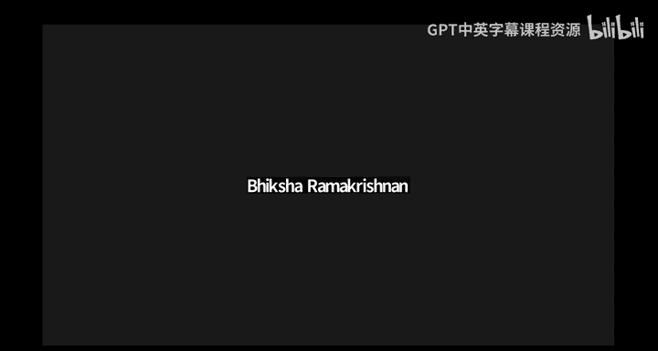
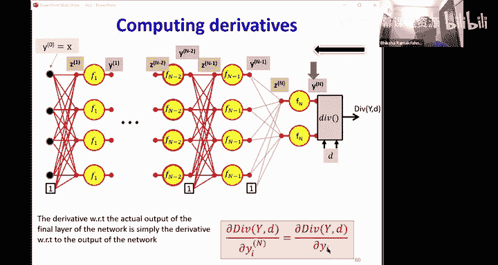
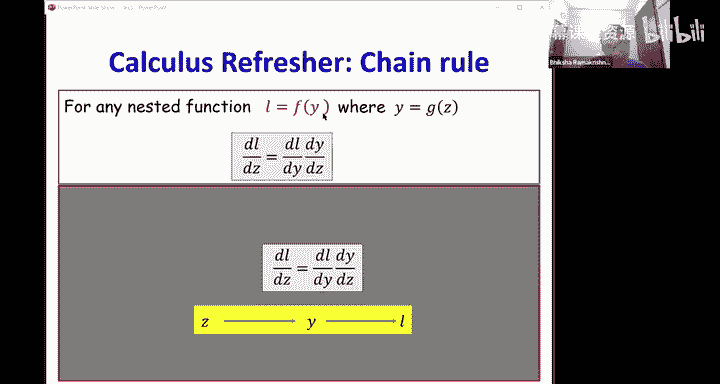
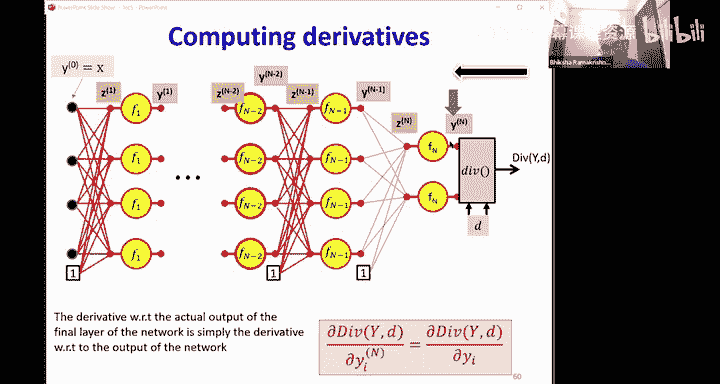
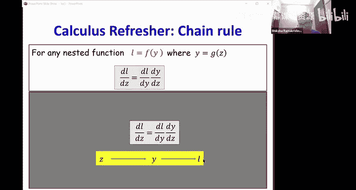
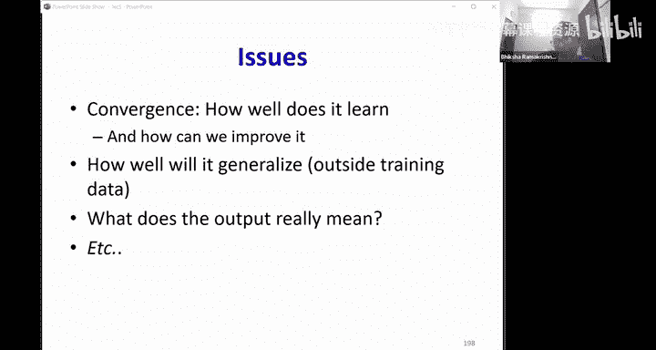

# CMU《深度学习导论｜11-785 Introduction to Deep Learning Spring 2025》中英字幕(deepseek - P6：[06]S2025 Lecture 5 - Training Part III.zh_en - GPT中英字幕课程资源 - BV1xbZNYrEbs

Good morning everybody， can you hear me？Hello， can you hear me， Good afternoon， proof。没吧。Okay。

Good afternoon， you that。你去隔里 right嗯。Yes I am。Okay。Ive got three minutes， let's wait。All right。

 folks， why we wait？If you have any questions from the past classes， now's the time。Any questions？

你要听我几咩句。Okay， my question is Janna， can you hear me？It's about the quizzes。

 Can we post on be about the quizzes now？Sure， I mean the quis。You can always ask questions。

 but because it's already Monday， you should be able to post on actually I would appreciate it if you wait it till tomorrow because some people have extensions。

But that's only a request。Okay， thank you。It6，30 and。Only 75 people online。

 they're missing 200 plus people。Wait 30 seconds and by the way。

 so since the coreet deadline is behind us， we will actually begin posting。Your attendance。

We were a bit casual about it because there are students which are adding and dropping at this point。

 but now at this point。啊。We are assuming that the roster is final and so we can begin。啊。

Taking your attendances into consideration， so with that saying， let's begin with today's class。

We are going to continue our series of lectures on learning the network。

Now here's where we left off after the last class。We saw how learning was post。

You are given a training set of input output pairs。

So each instance consists of the input and desired output of the network。

 which is the value of the actual function that you're trying to learn。

And then for each of the training instances， we define a divergence between the desired output and the actual output of the network and the divergence had some properties。

 What were these properties， do you remember。What were the properties of the dives， anybody？So。

utter silence， what were the properties of the diveence can someone take a guess， someone brave。

Zero for success and positive for error， right and it was always positive and they was the third property we wanted。

 which was that。What was the third property that we wanted？

Anyone differentiable it must be differentiable right and so our loss is the average divergence over the training set and it's a function of only the network parameters which are the weights and biases of the network now I'm using some notation over here let me clarify we are going to be using this notation through the course。

😊，The layers are numbered。And so the weights， when I have W subscript I J superscript 1， this one。

Represents the layer index。 The input is the zeroth layer。

 subsequentequent layers have layer numbers 1，2，3， and so on。

 So the superscript represents the layer index。 The subscript I represents the index of the source and the subscript J represents the index of the destination。

 So any connection goes from the Ih node to the J of one layer to the Jth node of the next layer。

Now these bees， so also the superscript represents the layer index and the subscript represents the particular neuron and also so now。

This is this notation here。It's very straightforward， we' got to use it。Yes or。

Can you please come again Okay， so this the weights you're going to be representing is W subscript IJ superscript。

This superscript is the。Index of the layer of the neuron。To which。We are connecting。

So these are the weights for the first layer neurons， the subscripts IN J represent the source。

Of the connection and the destination of the connection。

 so W subscript IJ superscript 1 basically means that it's a connection from the Ih node of the zeroth layer to the Jth node of the first layer。

Similarly， B Bj superscript 1 is the bias of the Jt node of the first layer， okay？你听。Yes， yes， okay。

 please respond quickly because it's a long lecture， right？

J and the superscript will not be the same j is is the index of the neuron so for example I can have w32 superscript1。

 which means it's the connection from the third neuron of the zero layer to the second neuron of the first layer so the superscript1 is the layer index okay。

And so here's how gradient descent worked， you have this loss function and we saw that we would initialize these parameters。

 the weights， and then at each step you take a step against the gradient。

 which is the derivative of the loss with respect to the weights。

And we keep it this until the loss converged。 and now the weights， of course。

 this derivative is a vector of partial derivatives， the weights W。

Represent all the weights in the network， all the weights and biases in the network intact fact and so the big W is a large vectorer of all of these small ws which are the individual weights of the network and so when we perform gradient descent here again is the loss it's the average divergence over all the training training instances。

 we are going to be modifying each of these individual weights by taking a step against the derivative voltage loss with respect to that weight。

So this is what gradient descent is all about and it makes sense right we are basically checking will increasing this weight。

 increase the loss if so， then you're going to decrease the weight and viceC versa and the amount which by which you're going to change it。

Is proportional to the derivative。So。That means the term we now have to estimate is this guy。

 the derivative of the loss。With respect to the rates。Now let's look at that more carefully。

 the loss is the average divergence over the entire training set。

So using the linearity of the derivative。The derivative of the loss with respect to any individual weight is simply going to be the average of the derivatives of the divergences for the individual training instances with respect to that same weight。

So that brings us to this situation here。Where we want to compute the derivative of the loss with respect to any weight。

 which means we want to compute the average derivative of the divergences for the individual training instances with respect to that weight。

And that in turn means that this guy， this in and circle term， is what we really need to be able to。

Estimate to compute。All this care so far。Yes， no。Any questions？So I have three thumbs ups。

 does that mean that our remaining 200 of you have no clue？

Elevate becausem this is we're going to use this so maybe I can get 50 thumbs ups I have seven。

Please， respond。16， 14， 15， are you guys paying attention at all？21，20。Guys。Lien。

If you are not paying attention， the rest of the lecture is going to go over you and I ask you to give me a thumbs up please do I'll wait again。

 is everything so far clear。Ill wait for those thumbs up and wait for 50 of them。Can we， please？

Because if there aren't， then you're going to have to tell me why， where where I lost you。30。😊，Guys。

 okay， fine。Alright， so now let's go on。So this term is what we're going to compute， right？

So here's where we are。We are going to begin looking。

It doesn't matter I got it all so here is where we are going to begin taking a slight step sideways into the basic rules of calculus right so when for any differentiable function I say y equals f f of x assuming x and y are scalar and let's say。

The derivative is Dy over Dx。 Then we saw that。The increment Delta y。

 what this means is that for any increment deelta x of x。

 the corresponding increment in y is given by B y over D X of Delta X。 We remember this， right？

 I can represent this using a。Pctorial representation X influences y every time I modify x Y changes。

 So this is not influence diagram。 X influences y and now。

This graph on this graph on top of the edge， I am going to write the derivative。

 So this connection is going to be given a weight， which is the derivative of y。With respect to x。

 And so what this means is that any time I increment my x by delta x。

 the corresponding change in y is deelta x times this edge weight， which is dy over dx。

 And so deelta y equals dy over dx is this notation making sense， this picture。

I'm going to be using it a lot so this picture makes sense。All right， great， so most of you got。

So now let's say I have a differentiable function of this kind whereby is a function of many x。

 what will the corresponding influence diagram look like？Anybody。

What will the influenced item look like？Anybody want to？Has it a guess。Many arrows to y， right。

 Each of these excess is going to point to y beautiful。

 And what will the weights of each of these edges be。Anyone。把 derivative of。

The y with respect to that x， and so then immediately you can see from this。

 what is Delta y going to be？If I increment all of these x's by Dlta x。

 what will the corresponding Dlta y be anyone from this picture？It's going to be the sum right。

 and so this is going to be delta x multiplied by the partial of y with respect delta x1 multiplied by the partial of y with respect to x1。

Plus， Delta x2 times partial of y with respect to x2 and so on。

 So Delta y is now going to be given by this formula。

 which is the sum of all the incoming increments over all of the edges。So this picture makes sense。

 And so this immediately gives me this distributed derivative rule。 Now。

 I have a nested function of this kind。 Okay， if I have a nested function of this kind。

 I have buy is a function of。ジ。Where G is a function of x， so this is a next rate function。

When I do this the the influence diagram is going to look like this x influences G right because g is derived from x and G influences y because y is derived from G。

 so this is my influence diagram。Is this picture making sense？

How this translates to this figure here。Yes， okay， what will these edges contain。

 what will the bes on the edges be？Anybody。What are the the partials right so this is going to be partial of y with respect to G。

And this is going to be。The partial of G with respect to x in this case is there's no difference between the partial and the full derivative。

 so it's going to be for the full derivative。Now I want to compute。

 so if I want to compute the derivative of y with respect to x， let's work this out。

What is Delta y in terms of Delta G？This is going to be Delta y is going to be the partial of y。

With respect to。G times Delta G， right？But what is Delta G in terms of Delta x？

What is Delta G in terms of Delta x？他我 here。Anyone。This is going to be partial of G over x。

Times deelta x， right， so I can plug this one into this guy。And when I plug it here。

 I'm going to get deelta I。Equals partial of y over。G。Times partial of G over x。Times deelta x。

So after looking at this， what is the derivative of y with respect to x？What can you say？

Just looking at this picture。what's written on the screen。What will the day。Anyway， it's just。

Just this product here， right， because this is the term that multiplies Delta x to give you Dlta y。

And so you end up with a chain rule， okay？And so if this is clear。

 we're going to get through most of the lecture easily。

 and so I can say easy enough dy over Dx is Dy over Dg times Dg over Dx， which is sort of ped， right？

😊，Now， suppose y， okay， so we're good with this。 Now y， suppose y is a function of many Gs。

Each of which is a function of x。Then what will the influence diagram look like anybody？

What will the influence diagram look like？Anyone。ALong line。What will it look like？Anybody else？

X is going to go to many G's。And each of these is going to go to a while， right。

 it's going to look like a diamond。And so this is what it will look like。没有没有。

X is going to influence many Gs and all of these G's influence the ver I'm just going to say instead of G1 I'm going to say I'll use the variable z1 okay and then what will these edges contain the edges are going to carry the partial derivatives of y with respect to the output with respect to the input。

Right， so given this， what is the derivative of y with respect to x。

Now you will be able to write this tell me this immediately， right， the derivative of y first。

I can see。That right here。I can say the Delta y。Equals because y depends on all of these guys summation。

Partial of y over Z。Times deltasia， right？But then we also have Delta Z is going to be simply partial of Z over。

X。Delta X。Right。😊，And so when you combine the two， you're going to end up with。This one here。

Delta y is summation over all z's of the partial of y with respect to z times deelta z。

And each of the delta z is the derivative is the derivative of z with respect to x times delta x putting it all together。

 we find that the derivative of y with respect to x sums over all of these edges and over each edge it's the derivative of y with respect to z times the derivative of z with respect to x you'd sum over all in coming edges。

 so as this making sense this picture。Yes or no。喂。So。It's a very nice。

 pretty way of looking at things right， and so we will lose that。And so for any nested function。

If I have L equals f of y， dl over where y equals g of z。

 then dl over dz is Dl over d y times d y over dc， and for something of this kind。

Where f is a function of L is a function of many z's where each of them is a function of a common x。

 then the derivative of l with respect to x is going to be the sum over all zs of the derivative of l with respect to z times the derivative of z with respect to x easy。

And so first calculus lesson， we'll have more。So now how do I compute the diver derivative of the divergence for any individual training instance with respect to any network parameter？

For this。Before we do that， we'll have our first vote。And let me notice this。

Can you folks see the poll？没有。Okay，10 seconds。All right， let me。And the。Yess what you guys thought。

Stop sharinging， go back。And okay， first statement， true or false。

The first statement true false true okay。Second one is the first statement， is it true？

The second statement。Also true， right？Is it true。Second statement is false Okay。

 the derivative of the influence variable respiratory to the second all of the material。

 the derivative of。The influence variable with respect to the influencer must be summed over all outgoing paths。

From the influencer variable， basically you have to sum over all outgoing paths to the。

Influd variable anywhere so。Let's go back and then look at the network。

 so here I'm going to going to use use a short tiny to input network for an illustration for the rest of max don。

 but then within each perceron we actually have two operations happening first。

We compute awaited some of all of the inputs。 I'm not explicitly showing a bias。 In of a bias。

 I have an extra value pegged at one to account for the bias， light。

 like I explained in the last class。😊，And so first。

 we're going to compute weighted some of the inputs and then you put that through activation， right？

So。This are fine terms and。I've explicitly shown all the weights over here。

 the W zeros are the biases。Now what happens？The first thing you compute is this aine term for each neuron。

 The aine term is the weighted sum of all inputs plus the bias， right？

 So the aine term is going to be。I they opposed that on the。On Piazza and I would reply。

 so the aine term over here。Again， z1 superscript 1 says that it's the aine value for the first neuron of the first layer。

 so this z2 superscript1 is the aine value for the second neuron of the first layer。

The output of the activation and labeling is by so y1 superscript 1 says is the it's the output of the first neuron and the first layer。

 this is the output of the second neuron and the first layer and so on in each case the superscript is the layer index and the subscript is the neuron index。

This notation clear？To everybody。O。So。啊，那。Again， deeline， the superscript is the index of the neuron。

 the the subscript is the index of the neuron， the superscript is the index of the layer。First。

 so what is we want to compute the derivative or the divergence with respect to some weight。

 say the sky， right？But then if I want to compute the derivative of the divergence with respect to this one。

I we know from our earlier discussion that when I have a function。

 the value of the derivative depends on where I compute it at at different locations the derivative can be very different and so in order to get the information about where we are computing the derivative。

We will need all of these highlighted terms， which are the intermediate variables in the network。

And those must be used to compute the derivative。 And that's where we will compute the derivative。

 So the first thing we will do is to compute all of these intermediate terms。

 That's what we will in what we will call the forward pass。 So in the forward pass。

 you pass in the input。And then you pass it all the way through the network and compute the output of the network。

So the information is going forward through the network， that's why it's the forward pass。

 how is it computed， this is the basically the same as inference and so how is it computed。

Here's how it is for notational simplicity， I'm going to represent the input as the0th layer。

 so y subscript I superscript 0 simply represents the input。

And the bias is represented as the weight of the zero。Element in each layer just for a notation。

 okay？So what happens in my forward pass？We first compute starting from the input。

 we first compute the aine values at each of the neurons in the first layer。

 so what is the aine value of the first neuron in the first layer。

 the aine value is simply the weighted sum of all of the inputs。

Where each of these edges has its own weight， so z1 superscript 1。

 which is the aine value for the first neuron of the first layer。Is the sum over inputs？

The bias is being subsumed by this value this one over here added an extra component which I fixed at one and its weight becomes the bias just for the illustration right so I'm summing over all of the inputs and。

I'm going to be multiplying the weight。From I'm going to be multiplying the input by the weight of the corresponding connection and。

So that's going to be y1 times w11 plus y2 times w12 and so on。

 and this sum will give you my aine value for the first neuron very straightforward， not complex。

I can do the same computation for all of the neurons in the first layer。And so。ああ、This。

Simple weighted summing of inputs is going to give me the f find values for all the neurons。

Once I compute the aine value， I can put each of these aine values through the corresponding activation。

 and then I get the outputs of the neurons， all the neurons in the first layer。

 so the output of the JF neuron yj is simply the activation function of the first layer applied to the aine value Zj and now I will have the outputs of all the neurons in the first layer。

From those， I can take a step forward。And use the same weighted sum equation。

To compute the Aine values for all the neurons in the second layer。

And now those aine terms can be put through their corresponding activations to get the outputs of the neurons in the second layer and so on。

 I can keep doing this all the way to the end of the network， so did this computation make sense。

Or what we tested？It's clearly straightforward I have a question。Yeah。

I'm seeing this notation where W has this first。 the second sub is corresponding to the next neuro。

 like destination here。 So how is that。How does that make sense with when we do matrix multiplication and needs the row of the weight which defines。

Which New gets。We are just speaking at this point element by element， okay。

 we will get to that later， okay， all right。So again， hang， this one over here。

 I have I just put in an extra one in every layer and its weight becomes the bias， that's all。ok。😊。

So this forward computation， if I just write a simple pseudocose code for it。

 I'm going to iterate through all the layers。I just said the zero。

Layer to the input and then for each input within each layer。

 I'm going down the neurons and for each neuron， I first compute an a find value。

And then I put that affine value through an activation to get the output of the new。

 the outputs of that layer， and I can keep doing this till I get to the final output。

 and so this simple iteration will perform inflical， perform the forward pass or the input。

So I have some pseudo code over here。You set y is zero to be the input。

 then you go through the layers within each layer you go through the neurons and for each neuron。

 you compute the a fineine value and pass the aine value through the activation to get the output。

The output of the final layer is the output of the network itself。So at this point。

We have computed all the intermediate values and the output of the network these are supposed to me must be remembered。

Then。Since we are training for the input， there will be a desired output and we can compare the output of the network with a desired output and we will get into divergence。

Now， once we have a divergence， remember our divergence function is。Differentiable， right？

We will use this having computed the divergence， now we can go back and compute the derivative of the divergence with respect to all the elements in the network and the way we will do it。

First， we will compute the derivative of the divergence with respect to the output of the network itself。

And this we know we know how to compute because the divergence function is something that we devise。

 and so I'm going to assume that we know how to compute the derivative of the divergence with respect to。

The y values which go into the divergence function。Subsequently。From here， I can take a step back。

 Basically， what the derivative over here tells me is how much perturbing this y perturbs the divergence。

 Next， I going come go take a step back and figure out how much perturbing this Z perturbbs divergence。

 and the baby we will do it。😊，We will see how much does perta being z pertu y。

And we've already seen how much perturb being y perturbs the divergence， so if you combine the two。

 you're going to find how perturb being z perttus the divergence。

And then having computed the derivatives for these Z's， we will take a step back。

And compute the derivatives of the divergence with respect to all of these weights。

 the weights of all of these connections。Then take a step back。

And take the derivatives with respect to these vices then take a step back and take a derivative with respect to all of these Cs and and so on until we keep。

Till we go back all the way to the beginning， you can even eventually compute the derivative of the divergence with respect to the input itself。

 Now， why do we have to go backwards， Can someone tell me。Frothers。Yeah。

All the parameters and all the intermediate variables。So the okay， here is the it's not just， yes。

 it's a Cha， but here is how it does， right？Consider the Z， right。

When I'm computing the derivative of the divergence with respect to Z。

 what I'm really asking is how much does perturbing z perturb the divergence， right？But then， Z。

Perhaps why。And y perturbs the divergence right So first we have to say how much does perturbing y perturb the divergence and then how much does perturb being z perturb y。

 and then you can combine the two So you need to know how much perturbing y perturbs the divergence before you can compute how much perturbing z pertus the divergence。

 which is why we have to go backwards， you always need the derivatives ahead of you in order to compute the derivative for any variable that that make sense。

Yes no。对。So。Okay， maybe half a dozen yes， I'll go with half a dozen。😀呵。😊。

The makes sense guys is okay， right？And so let let's see the math， the math is very straightforward。

 okay。Again， here are all the here a network。I'm assuming that I have the derivative of the divergence with respect to all the outputs of the networks。

 I have the derivative of the divergence with respect to these value。

The output of the final layer。Then I'm going to apply my chain rule if I have l equals f of y。

Then。And y equals G of Z。 Remember， this is this loss is a function of y， but y is a function of Z。

 right。 So if I have L equals f of y where y equals G of Z。

 then we know that Dl over Dz is Dl over dy times d over Dz。 That's just this chain rule。 right。

 C influences y， Y influences L。 So when I plug it in here。

 the derivative of this divergence with respect to this Z。😊。

Is going to be the derivative of this divergence with respect to this y times the derivative of y with respect to Z。

And the derivative or the divergence with respect to y is something that we have already computed。

We assume we have it。What is the derivative of y with respect to Z anybody。

 what is the derivative of y with respect to Z？What would it be？Anyone。

And anybody want to answer this question？This is going to be。

The derivative of this activation function add the current value of the z right and the z， of course。

 has been computed in the forward pass。 and so I can replace this dy over Tz by the derivative of the activation function simple enough and at this point I have the derivatives for all of these z's。

Next， I'm going to compute the derivative of the divergence with respect to the weight of。

The connections going into the。Into these Zs， which is the derivative of the divergence with respect to。

WIJs for the end layer。But the derivative or the divergence with respect to this weight is simply the derivative of the divergence with respect to z。

Times the derivative of Z with respect to the weight。 That's just the chain rule as before， right。

And of these terms， which term have we already computed？Of these two terms。

 which have we already computed guys。We already have this guy， right， we just computed it， right？😊。

And what is Dz over Dw。What is this term？你湾。Here。We know that Z。

Is the sumation over all of these guys of y times w right。

 So the z is this W y times this W plus a bunch of other terms。

 So the derivative of the Z with respect to this W is simply going to be the input rock。

And so this making sense。The derivative of the divergence with respect to any weight。So again。

 this Z is this y times this w plus this y times this w plus this y times this W and so on。

 right and so。These other terms don't don't involve this W。 So I'm just writing it as other terms。

 So the derivative of Z with respect to W is simply going to be。喂。Right here from this one。

That answer question as。要冇听。Okay， and so I can just replace d Dz over D Dw by this y。

 which I have computed in the forward pass and so the derivative of this divergence with respect to。

There are no other terms， the other terms over here， this one。That is， yeah。

 it's this guy times this， that's this tongue here。

Plus this guy times this plus this guy times this plus this guy times this。

 but none of them involve this particular w， so I' have just group them as other terms。

That answer your question why。Okay， so continuing。And so I can replace this DCz over Dw by y。

And so here we have the derivative of the divergence with respect to this W is the derivative of the divergence with respect to the z。

Times the body。 So for any connection， the derivative with respect to the weight。

As is the derivative of the divergence with respect to z times the input。

And cut us and we will see more， right？So and for the bias teamim ofquizvis one。

The next thing we will use is this distributed Cha。If you have some x。

 which influences many Z's and all of these Z's influence L。

Then we know the derivative of L with respect to x has got a sum over all of these connections。

And so。The next thing I want to compute is the derivative of this divergence with respect to this y。

But this why influences both of these。And both of these Z's， in turn， influence the divergence。

 So if I want the derivative of the divergence with respect to this， y。

I must sum the derivative or the divergence with respect to the Z。

Times the derivative of z with respect to y plus the derivative of the divergence with respect to this z。

Times the derivative of the z with respect to this y so I have to sum over all z's and I have to and and and the term I will be summing is the product of the derivative of the divergence with respect to z。

And times the derivative of z with respect to y is this making sense to all of you guys？

This is just a simple distributed change rule right。

 and can you simplify this for me this term we've already computed right what is derivative of z with respect to y。

Over here。Anyone。It's again， remember z equals wy plus other terms， right？

So the derivative of z with respect to Di is simply going to be this weight。

So the derivative of this z with respect z with respect to this y is going to be this weight。

 The derivative of this z with respect to this y is going to be this weight。

And so I can just replace these guys by the weight。And so there I have it right。

 I have the I can use the same formula to compute the derivatives for all of these vis。

And so the derivative or the divergence with respect to or in each of these y's is the sum over all z's of the derivative or the divergence with respect to z times the weight。

 it's a weighted sum of the derivatives for the z values and so here I've now computed the derivative with respect to these y's。

 these z's， all of these weights and finally these ys right again， why youre the bias term。

 you don't need to compute derivative with respect to the bias term it's fixed with just one right。

For there， you only need the it。You could compute it it you' never going to use it。Now。

 having computed the derivatives with respect to these wise。

I can take a step back and now use the same chamber to compute the derivative with respect to these Cs。

By multiplying the derivative for y by the derivative for the activation function。

Then I can take another step back and compute the derivatives for all of these weights。

And the derivative for any weight again is the derivative for the divergence with respect to the Z。

Times the corresponding input bar right， where for the bias， bias 1。

And then I can take a step back and compute the derivatives using using the same formula。

The weighted sum of the derivatives for all of these these's is going to give me the derivative of the tas with respect to these ones for all the wise here。

And then I can take a first step further back and compute the derivatives for all of theses and keep going back until I can。

Compute it until I get derivative far。All the variables， including weights。

 biases and intermediate terms in the network。Did this simple procedure make sense？Right。

 yes no guys。Can you give me some thumbs up， like 50 of those， it's very straightforward。Okay。

And so here is the backdrop， very simple， right？I'm assuming the forward propagation is already done and so I'm going to first initialize the derivative the derivative of the divergence with respect to these ys。

Then multiply goes with the derivative with the activation function to get the derivatives with respect to these Zs。

 then I keep going backwards。The derivative or the divergence with respect to the bias is simply the weighted sum of the derivatives for these C's。

The derivative of the divergence with respect to the z is simply the derivative for y multiplied by the derivative for the activation。

And off to the side。The derivative for any weight is going to be the product of the derivative。

 the divergence with respect to z。Times the corresponding one， so very simple pseudocode。

 which I've actually also written in pseudocode form now if you look very carefully。

This is what the pseudocode looks like right instead of writing dy in a partial divergence with Z。

 I'm going to write this， I'm going to use a different notation and this looks a lot like the forward pass。

Look at this， right first。We are computing a weighted sum of the derivatives in the next layer。

And then you're passing it through the derivative of the activation。 So in the forward pass。

You first computed a weighted sum and then passed it through an activation， right？

In the backward palace， we are doing the same thing。

We are doing a weighted sum of the derivatives in the next layer。

And then passing it through an activation， but only one extra term。

As the derivatives for the weighted itself。And so it turns out that。

The code that you use for the forward pass is very analogous to the code that you would use for the backward pass。

 right？So。That makes sense to everybody so far。If not， here， let me。Wunch the second poll。

Can you see the poll。Yeah。O。So I'll answer that Mary， just give me a second。

 do you guys have five seconds for this poll。All right， let me stop this。

Here's what you guys thought。Back， okay。Which of these statements is true？Only three， right？

 So this whole business of computing your derivative is going backward。

 This is what we call back propagation。 It's called back propagation because we keep propagating the derivatives backward。

 But back propagation is the process of computing derivatives。 It's not a training algorithm。

 Back propagation is only used to compute derivatives。

 And these derivatives will be plugged into the gradient descent rule for the actual training。

 And my three over here， Which I are you speaking of。you're going down， so here's what we do。

As I go back。At each layer， I'm going to go down。All of the neurons within the layer。

 and so the I over here is the index of the neurons within the layer for which we are computing the derivatives that makes sense。

Metter。😊，Okay， so here。As no， back propagation is strictly the process of computing derivatives。Back。

 if I want to compute the derivative without this divergence with respect to any weight。

 I've got to propagate derivatives all the way backward till I compute this derivative。

 So it's a back so back propagation is the algorithm for computing derivatives once you compute derivatives you will use those derivatives in。

In the gradient decentcent algorithm for training， so definitely this is all about computing derivatives。

 we' are not speaking minimizing errors at this state point， okay。So now in the discussion so far。

 we have assumed that the computation of the output of one neuron。Does not directly affect。

The outputs of the other neurons， each neuron is individual right weve computed that the inputs to the neurons are basically weighted sums in terms of weighted sum of inputs and we assume that the activations are differenti。

 we made three assumptions。And you know， implicitly， I suck them past you。

 let's examine them and see if things can be different。

So consider this business of vector activations。In the simple me model I just showed。

 you'd compute these aine terms for all neurons and then pass each aine term individually through an activation。

So if this affine term changed， only this y would change， the remaining rise would not change。

But then you can have vector activations where changing this1 z could change all of the vis we actually mentioned an example in the previous class。

 which was it。An example of a vector activation。Anyone。Soft Max right。

 and so what happens is in a scalar activation modifying a Z only modifies the corresponding bar。

In the vector activation， you have to think of a vector of inputs going in and a vector of outputs coming out。

And so when I draw the influence diagram in the scalar activation case。

 E Z only influences the corresponding y。In the vector activation case， each Z influences everywhere。

The influence diagram becomes more complex。So this changes the way in which we compute derivatives now here in the scalar activation case。

 if I have a divergent。Each of these vices is going to be influencing the diverg。

But then if I want to compute the derivative of the divergence with respect to this Z。

 I just have to go past this one line。 This is the only connection between D and Z。

 So that's enough for me to say the derivative of the divergence with respect to this Z is the derivative of the divergence with respect to this Y times the derivative of y with respect to this Z。

 It's a very simple straightforward。Computation， right for this simple case。

But then if I have something of this kind where the Z influences all the vice。Then each of these ys。

 in turn， influences the T， right？So here， if I want to compute the derivative of the divergence d with respect to the z。

 I have to follow all of these paths， so this derivative of the divergence with respect to the z is going to be the derivative of this divergence with this respect to y times derivative of y dy over dz plus。

The derivative of the divergence with respect to this y times this Dy over Dz and so on。

 had had to summ over all paths。 And so now， in this case， in the vector activation case。

When I want to compute the derivative of the divergence with respect to any Z。

 Im a sum over all of the outputs of the layer。And the term I will sum。

 terms I will sum are these guys， the products of the derivative or the divergence。

With respect to the vi。Times the derivative of y with respect to Z。 Is this making sense。

Everybody over here。Okay， and for the specifically for the softmax case。This is the softm， right？

Where you exponentiate each Z and then you normalize it。Here。

What do you think the derivative of y with respect to Z will be able to be positive or negative？

The derivative of z y with respect to z， this， this direct line。

 is it going to be positive or negative。Anyone。One person says positive。Said Darha。

 why would it be negative？If I increase the Z will this y increase or decrease。

What do you guys think？If I increase the z， this z。If this z goes up。

 will this y increase or decrease？It's going to increase， right， and。If I increase this Z。

 what will happen to these vices， will they increase or decrease？Decrees right。

 so basically that means this derivative will be positive and these derivatives will be negative。

Right anytime so you can work it out can just for those of you don't believe it just check it out right if I increase the numerator this term will increase and to compensate for it。

 the rest of the terms will decrease okay。And so。When I write up the derivative or the divergence with respect to Z。

 I need this derivative of y with respect to Z I and for the soft max for the direct line。

The derivative of y I with respect to the corresponding Z I is simply y I times 1 minus y I。

 you can see that this is always positive because y I is between 0 and 1。

1 minus y I is also between 0 and 1。 This is always positive。 And furthermore。

 its maximum when y I is close to 0。5。😊，When y is close to 0 or 1， this becomes close to0。

For all the other terms， because both Y I and Yj are。Positive， it's minus of Y I Yj。

 so this is actually negative。So the direct derivative is always positive and all the others are negative。

And the actual derivative value is proportional。To the products of the mice proportional to each of the mice。

 So this is what the softmax activation will look like。

And so that gives us the update rule for vector activations。And so I can， in fact。

 write this whole formula using a chronicer delta。It says， you know。

The derivative with respect to any Yj is summing over all the shall be with any Z is summing over all Js。

Of the derivative with respect to the corresponding yj。Times why J itself。And this term here。

 deelta will be one for the straight line and 0 for the non straight line， says theor。

Simplified notation， but anyway。You get that， right？The the the general啊。Update rule。

 the derivative computation rule make sense over here。Yes or no。Okay。

What's for the delta this is just a shorthand notation if I equals J this becomes 1。

 if I is not equal to J it becomes0， so this is just my way of using a simple Ch or delta to determine whether I'm computing the straight derivative in which case I equals J or a cross derivative in which case I is not equal to J and this becomes0 that。

Just a simple notation。But this is the formula， okay， any questions？Questions， anybody。Okay。So。

There theres some special cases， right？They have some other vector activations here on the slides。

 but I'm going to look at two special cases。Let's look at this guy a relu activation does that looks like this。

 right？Is this activation continuous？As the rain continues， yes or no。Is it why do you say no。

 is there any point where the value changes suddenly？

Regardless of whether youre approaching any point from the right or the left。

The value at each point is unique， so this is continuous right it's not jumping。

 but is it differentiable everywhere？Is it differenti， but no？At this point， it is not differenti。

 So in this case， how will you actually write out the derivative of a function of this kind。😊，So。

 when you have this。Functions which are non differentiable in locations。

 Then we had to play some tricks。 and so one of the tricks that we like to play is called sub derivatives。

 remember， we are basically asking what is a derivative。A derivative is saying。

How much will increase increase in a perta being this value per of the output？More generally。

 if you think of it in terms of gradients， you're going to say which is the direction of change？

Which gives me the greatest increase。 Now， there's no such thing at far。At discontinuity， so。

What we can do is basically， you know， we know if I can。Draw any line。

Which sort of just touches the function over here。And I can use the slope of any of these lines as the derivative at that point。

And it's still going to give me a valid value for the derivative as far as gradient dissent is concerned。

But you know there's a lot of theory around it， they call it subgradient subds。

 Koiccoiccans and so on， but there's a much nicer way of thinking about it。

You can think of this as a line which instantaneously rotates。From。Wait a minute。Why is it。Like so。

 right you can think of this as the line going or going down and instead of taking its time to rotate to this point。

It's rotating all the way from here to here。Within an infiniteim distance。

Is this visualization making sense？Over here。Is this Sir。Right， so you can think of it this will。

 right， as it making dis sense to all of you guys。 I just got one ears。

So as what is the question of what was the doubt over here， while it's not clear？

So when I have something， you can when I have a continuous line， right？

When I have a continuous line of this kind， the line is changing its direction at each point。

And it's changing slowly or fast， but but。The line is rotating at some point right it's going here and then it's rotating like if it could rotate slowly。

It could rotate fast， it could rotate very fast。Correct。😊。

And so you can think of the line as rotating from。From one point to the other， right， so。

 so when so that means that。All of these slopes are occurring at the same point。

 meaning at that location， any slope value between 0 and 1 is valid。And so for the derivative。

 you can use any slope value between0 and1， they are all equally valid。

Typically we'll use the extremity， we'll use one that's for real okay， that makes sense so far。

Yes or not。ok。Now， what about the max， there's another derivative called the max。

 Supp I have y equals max of。In all， sorry， Z1， Z2。And so on， right？Z3。And specifically。

 let's say that Z3 is the largest value。Then will perturbing Z2 or z1 change y？

F z3 so what is the derivative of y with respect to these zs， which are not the max？

Zero because changing these guys will not change y， correct？

But what is the derivative of y with respect to this guy， the one that is the maximum？

It's one any change over here directly reflects on on why right and so for the for the max activation which is something that we will often use。

The derivative， you many variables go in。 One variable comes out。 It picks the maximum value。

 The derivative of y with respect to any z is 0。 If it's not the maximum value and one。

 if it's the maximum value。 This makes sense。Yes， no。Okay。And so。No， this is perfect。

 there's no approximation here at all， right？If this guy is not the maximum value。

 will perturbing it perturb y Suar。The derivative is 0， right。So。Okay， and here is your third poll。

And let's see。15 seconds， guys。And。O。Here's what you guys thought。Ill go back。

Can somebody tell me the answer？245 right z3 is the maximum value。

 so the derivative re respect z1 and z2 is going to be  zero。

And the derivative with respect to Z3 is going to be1。Perfect。😊，Then so okay。And so。

You know the backward past these terms， these derivatives may be sub gradientds or in the case of the maximum those two are actually sub gradientdients。

That's the only change that happens。 So the overall approach for each data instance。

 you have a forward pass， you pass the data instance forward through the net store all intermediate variables。

 then sweep back through the net and it literally compute all derivatives with respect to all the weights。

The actual loss is the average divergence over all of the training samples。

So the derivative of the loss with respect to the network parameters。

Is the average of the derivatives for the individual training instances？

These derivatives are computed using back propagation once you compute the derivatives。

 you can plug them into gradient descent。You update your multiple parameters to decrease the overall loss。

So the training by backdrop， training by backdrop back is not training。

 but it's part of the training process， there's a forward process pass where you come pass every data instance through the network。

 there's a backward pass where you compute all the derivatives。

You aggregate all the derivatives and compute the weight average derivative。

And then update every network parameter。By the average derivative of the loss with respect to that parameter。

 simple process。So I got so far with this because I'm going to change the way in which。

We represent everything， soon， yeah。Sir where Z is not maximum， it still has an effect y right。

 How will it have an effect y。Tell me this。If I change the Z and Z goes from1 to two， will y change？

No， I mean， I'm saying not significantly， but it will right because it's a better。Mally change。

Just tell me significant， just look at this and tell me if z becomes Z becomes 1 to a 2。8， no。

Is there any approximation there？No。😔，That's it， right？So。Where this was the derivative。

 the transpose of the derivative is the gradientthe， that's why there's a transpose， okay？

The database of itself okay so now I've just showed you how the math works for individual elements。

 but we never do it that way we always think in terms of vectors and vector operations because the math arithmetic is much simpler and we have fast matrix libraries to make those things much faster so we can restate the n tap process and vector terms and this is what is really used in any real system for this right first。

Consider any layer， right？So I can write all of these vis。These y over here as a vector。

A column vector of the scan。I can write all of these Zs。As another column vector of this kind， okay？

Then look at any Z。This Z is going to be this weight times this y plus this weight times this y plus this weight times this y。

 and so on。 so I can write all of these weights。As a如。And of course。

 the y values are written as a as a column。 And so we can I can also write all of the biases。

 but all of these neurons is a column vector。 And so if I actually go back and look at it。

 I can easily see。That。You know， if I write all of these Vi out。This is y1 through yn， right？爱喂啲。

Then I can say W。Say for the third。For the second guy， right， W 2，1， W 22。W2，3， and so on。

And so this will give me。The2。You can see how this works， right？Is this making sense？Plus， be， right。

And so once I write out all of these weights as a matrix。

 all the weights going into the Ih neuron are the Ih row of the matrix。And all the vices become。

A column does these become a column， and so once I write it in this manner。

 then I can simply write Zk。Equals W Subscript cover here represents a layer number times y k minus1。

 the y for the previous layer。ま beけ。And Yk simply applies the activation of the layer to Zk。

 this making sense。Everybody here？Just give me thumbs up， I want to see 50 thumbs up so I can。

Very very straightforward right and so once I do this I can actually write the forward pass very trivially I can set y0 to be the input。

And then the first a find value is simply w1 y 0 plus b1 simple matrix operation。And then。

The next y is simply going to be applying this activation to the Z1。

 which which was computed over here。And then the next Z is W2。

 the weights of the second layer times y1。Plus B2， the bias is for the second layer。

And then I can apply the activation for the second layer。To02。

And keep doing that till I get all the way to the end and I get the I find terms for the final layer and put it through that activation function to get the output of the network。

So the overall editiththmetic now looks much， much simpler， much cleaner。

When you're writing it in matrix form， I can say y0 equals x。And then within each layer。

 the Z is the weight matrix。Times the y of the previous layer。Plus， the bias with the layerir。

And the y for the layer simply applies the activation function of that layer to disease。

 and of course， the output of the network is the output of the final layer。

 Is this pseudocode making sense to you guys。Yes色 no。It's very simple。对。So。Okay。

 can I get a few more enthusiastic answers？O好好的， okay。And so here's the forward pass。

 right z equals w y plus b y equals f of z period， very， very trivial when you write it in matrix 1。

But then you probably get a little， you know。Concerned about how do you write derivatives when you're doing things with vectors and matrices。

 it turns out it's even more simple and I'm going to before presenting the backward pass I'm going to give you some vector calculus first。

We are going to use the same notation as we did before。I can still write an influence diagram。

 Z influences y。Except I' am no longer specifying Z or y to be a scalar。Z can be anything。

 y can be anything。And this edge contains the derivative of y with respect to Z。

 which I' am representing as this inverted triangle， the Nabla Zva。Is this making sense？

This is still the same notation as before I' just changed the I've just generalized the variables now。

 if y is a scalar。And so if I is a skater。You know， and as Z is。A column vector of length n。

Then what is the shape of this derivative？Anybody。Avis a scaler， draw。It's a row vector of length n。

 right， and then you can see that NaBla Nablla Z y。Times deelta Z。Equs。

Delta y and the same equation that we had earlier also holds。They' making sense to everybody？

This one。😊，So give me a thumbs ups because I'm going to just build on this and fly。ok。Now。

Suppose y is a vector instead of a scalar， right， If y is a vector， y is a vector of this kind。

 But then I can think of why。As a stacking of many scalers， correct？Now， even if y is a vector。

I can still write the same thing。 Delta Y。Equals。The derivative of y with respect to Z。Times Delta Z。

 I can still write the same thing。 Nothing changed。So what happened。

 Why now is a stacking of scalarrs， right？Z is still a column vector。

So then what can you tell me about this guy。Z is a column vector， right？I just taed a bunch of vices。

So what will be the term over here that multiplies Z， anybody？What will it be？Want to take a guess？

It's a matrix， but what is the matrix。 So here it will be a matrix。

But the first entry is going to be the derivative of this y with respect to this Z。

 which is a row vector。The second entry of the matrix is going to be the derivative of this guy with respect to Z。

 The third entry is going to be the derivative as so basically。

 this derivative is a vertical stacking of the derivatives of these individual y with respect to Z。

That's all it is， that makes sense。To you guys。Right， so there's nothing magical about it。It's just。

Over here， if I look at this vector。Then the derivative of y with respect to Z is called the Jacobbian。

And the rows of the Jacobian are the derivatives of the individual vice with respect to Z and each row。

 of course， is going to be each row。it's going to have as many components as Z itself。

 and you can still write delta y equals T times deelta z。Okay。And， of course。If you have。You know。

 a layer being shown by scalar activations。Then， you know that。

The derivative of this y with respect to the remaining z is going to be zero。

 so the Jacobian will be a diagonal matrix。Whereas if this is a vector activation。

 the Jacobbian will be a full matrix， but this is in general a generic notation。

So this making sense to everybody so far。It's okay。I'm going to fly from here， right。

 so now look at this again， suppose I have z equals wy plus B。If I increment y by Delta y。

What will the corresponding increment in Delta Z be？If I increment y by Dlta y。

 how much will Z change？Anybody？And this is simply going to be w times delta y right you can just plug it in here。

 I can see you know I can say w times y plus delta y。PsB。It simply。Z plus。W delta y right。

 So this is the incritency。 So what this means is that the Jacobian of z with respect to y is going to be w。

In this particular case。Ed。If I increment B by any small amount。

 Z is going to increase by the exact same amount so up here。Again， take a look at this。

If I increment y by delta y， so then I'm going to get y plus delta y， right？And。W plus B。

 So if I increment y by Delta y， this is going to be the output。Yes， I not。

Which is the same as wy plus B。Plus。W delta y， correct？一岁咯。Which is Z plus。W Dlta work， right？

Wch is the same as z plus delta Z。So in other words， delta z equals w delta y。

 which means the derivative is the Jacobian is w。Again， nothing fancy， clear， right？

And so also the Jacobbin of Z with respect to B is an identity matrix。

 how much you how much ever you perturb b by is how much you perturb z by okay？

And now here's the nested function right， suppose I have y equals some function of z。

 which is some function of x。Then the thing is x influences z influences y。

Each of these edges is going to have the corresponding derivative on top of it。

This is exactly like the scalener case。But something important over here。

 it is the order of multiplication， right what is the if I want to replace this by simply saying x。

Influences by。What is the derivative over here？That derivative is going to be the product of this derivative。

And this guy exactly as before， except this term comes first。And this term comes second。

 otherwise the sizes won't match。This making sense to you guys？

And I will show you why it must be in this order。ok。And why must it be in this order？Check。

I know that y Delta y equals。The derivative of y with respect to z times thelta z。

Delta z equals this derivative， Nala z x times Delta x。 So plugging this over here。

 Delta y equals deelta y and Nabla y z。Times nala Z x times delta x。

 which means that this guy over here。This time。Why is my pencil are noting up？Next time here。

Is the derivative of y with respect to x。RightCan you change the order over here？

Will this will this relationship hold so that type if you change the order。Right。

 so the order is very important。Okay， vector multiplication， the order is important。

 the dimensions will not fit， okay。Sple。So suppose I have this thing x influences z influences y influencer z influences y influences D。

Now that's right Eric， the dimensions won't fit。 So here's how we can compute the derivatives。

 I already have the derivative and I put the edges on each edge。 I put the derivative of the。😊。

Destination variable with respect to the source variable， okay？Then if I want。

 I already have the derivative of。D with respect to y2 on this edge。 Now。

 if I want to compute the derivative of D with respect to z2。Then I just need to consider Z。

Y 2 and D and so going backwards， the derivative of D with respect to z2。

Is the derivative of P with respect to y2 times the derivative of y2 with respect to z2。

 this making sense to everybody。US no。Okay， so what is the derivative have D with respect to y1。

 what will it be？Anyone。What's it going to be。That's simply going to be the derivative of D with respect to Z2。

Times the derivative of z2 with respect to y1， correct？

I can simplify this diagram and this has already being computed。Right。ItDoes making sense？有咩嘢色咯。

We're running out of time， so please to quick， I'd like to see half a dozen ssses at least， okay。

 then what will the derivative of D with respect to Z1 be。Anyone。

What will the derivative D with respect to Z1 be？Somebody。Want to take a guess？

Exactly this right derivative R with respect to y1， which is already computed。

Rightite multiplied by the derivative of y1 with respect to z。All of this works if I'm going to be。

 if I'm using column vector notation， if I use row vector notation， the orders will change。

And then I can take a step back and get the derivative with respect to x as a derivative of D with respect to z times。

Nabla Z x right and so this is how the chain of derivatives works。

 and that's what we are going to use one final thing。 Supp I have z equals w y plus B。

And D is a function of Z， okay？Then easily enough， the derivative of d with respect to y is the derivative of d with respect to z times the derivative of z with respect to y。

 which we saw as w this works， right？The derivative of D with respect to B is the derivative of Z with respect to。

Z。Times the derivative of z with respect to B， but in this case we already saw that the derivative of z with respect to B is an identity matrix。

 so the derivative of D with respect to this B is simply the derivative of D with respect to Z。

 so you guys with me on this one。Right。ok。So so that I just post that on Piazza and we'll get to this。

 What is the derivative of D。With respect to Dubling。This gets crazy。

The derivative of D with respect to this W， it turns out， is y times。

The derivative of D with respect to Z， Im not going to prove it。 We don't have the time。

 but we can check this very different。 simpleim。 If I have a connection of this kind。

The derivative of D with respect to the W here is going to be y times the derivative of D with respect to the Z。

 And let's see how。We know that the derivative of a scalar divergence with respect to an n cross 1 vector is 1 cross n。

The derivative of this with respect to m cross M matrix is its transpose m cross n。So check this。

If this is， guys， I may go a minute over， if this is size M， right， if this is size n。

 then this is going to be this is going to be n cross M， right because it's going from。M m。

So its derivative must be m crossing。The derivative of w must be m cross n let's look at this y。

Is am crossman， right？And。This guy。This is the derivative of with respect to an n cross 1 vector is going to be one crossing。

And so this product is m crosss n， which is the correct size。They're making sense to everybody。

Yes or no。Okay， so you can check。And so here's where we have it right。

 I have the derivative with the divergence with respect to B。

 I have the derivative the diverggence with respect to doubling。😊。

And the derivative of the divergence with respect once I have this equation and now。

Everything is good， right？So why did I go over this because this basically represents a layer in any layer we found z equals wy plus B and the divergence of course。

 eventually depends on z so when you go back you can apply those rules to compute the derivative or the divergence with given the derivative or the divergence with respect to z。

We can get the derivative with respect to y and also go W and B using the rules that we just saw here。

 And so now let's go back here。 we know just this， right。The derivative。

For B is simply the derivative for Z。The derivative for W is simply y。

Times the derivative for z again， remember this。 This will work， right。

 So this has to do with this simple rule over here。 And you have something of this kind。

 It's y times the derivative for z。And now how does this solve to again， right， actually。

 let's take this poll and you'll have to spare me a minute because it doesn't take a long。

A lot of time afterwards。This is a short poll only 30 seconds。And seconds， guys。All right。

 let me stop this because I'm running out of time。Anybody want to answer this question。

 which one is it？Which one is it。Number two， right， you had to go。Outwards。

 x influences H influences G influences y。 So first you want the derivative of f with respect to G the outermost。

Then the derivative of G with respect to H， the derivative of G h with respect to x left to right。

 right？This is the correct one and so here's the backward pass。Here are all the variables。

The final y is put through the divergence， I can write this influence diagram like so x influences z1 influences y2 and so on。

And I'm using this nala notation to represent the derivatives on top of each edge。

 I can write the local derivative， so this here is the derivative of z1 with respect to respect to x。

 this is the derivative of y1 with respect to z and so on， right。And these guys。

 the derivative of any y with respect to Z is simply the Jacobian。Of the activation function。

What are the derivatives of Z with respect to bar anybody？

What are the derivatives of Z with respect to I？怎么。'Just the weights， right。

 these guys are just the weights of the lab。And so once you have this， it is trivial。

 you can just computer derivatives going back。 you already have this guy， the derivative for y。

 you write multiply it。By the Jacobian。To get the derivative for Zni， right， which is a Jacobian。

Then we have the derivative for Z。Then I can write multiply this by what W to get the derivative for y。

 right？And then， of course。And this is the new term and then of course， for these weights。It's just。

Y times the derivative for Z， that's the derivative for the spa。

The derivative for this bias is simply the derivative for Z。Then I have the derivative here。

 I can write multiply that by this Jacobian to get the derivative for the z。And then。

I have the derivative there。 I can write multiplied by this weight to give the derivative here。😊。

And then for these weights。The derivative for this weight is this y times the derivative for this z。

And the derivative for the bias is simply the derivative for the z right and I keep using this all the way to the beginning of the network and so here's the simple pseudo code for it。

Basically， you just keep right multiplying it each time。收话。Did this make sense。都好听。That's very soon。

Yes。So you start off with the derivative for y， as you keep going back。

 you keep right multiplying by Jacobians and weights。

The derivatives for biases is simply the derivatives for the fine terms。

 that are derivatives for weights is going to be the previous y times the derivative for the fine term。

 so here's the backward pass pseudocode。So。I'll skip the ci code， but so here。To wrap up then。

When I'm setting up for something like digit recognition。

 you'd be given data of this kind for binary classification。

 something of this kind for multiclass classification。And you just。

Perform the forward and backward passes， compute derivatives and update your network parameters to the story so far。

To conclude neural networks must be trained to minimize the average emergeence。

Between the output of the network and the desired output， this is performed using gradient descent。

Graaddients are computed using back propagation， which requires a forward pass。

Of inference and backward parts of gradient computation。

 and these are incorporated into gradient descent， right？And in the next class。

 we look at how well does it learn， how well does it generalize and what does it really mean so before I close。

Can you guys all just give me， Let me know if this lecture made sense。

 You will do so by giving me a thumbs up， and if I get。You know。100 of these。 I got half of you guys。

 so please。And I'm here for questions。It's not particularly complicated and we stop the recording。

