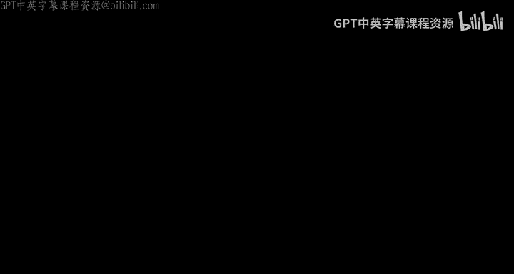
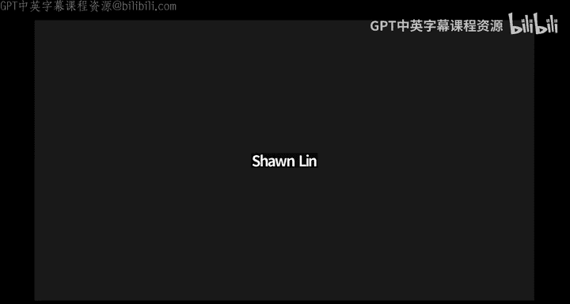
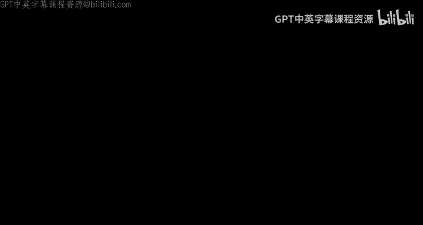
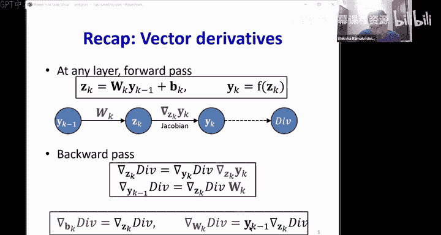
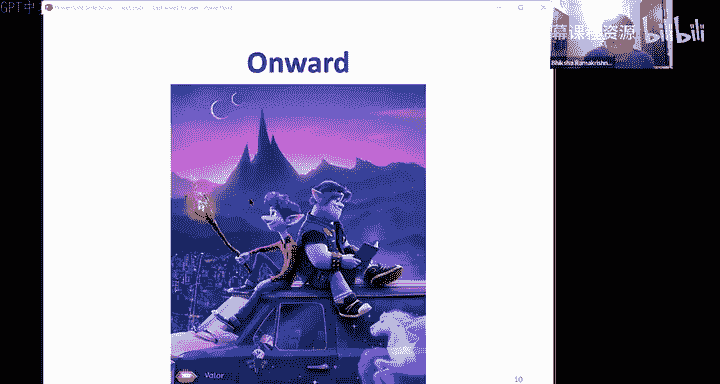
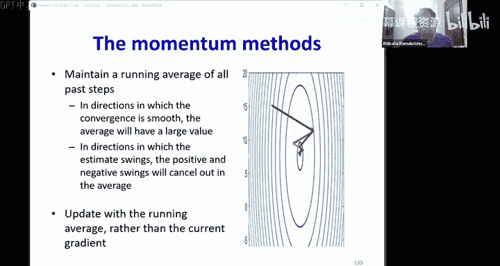

# CMU《深度学习导论｜11-785 Introduction to Deep Learning Spring 2025》中英字幕(deepseek - P7：[07]S2025 Lecture 6 - Training Part IV.zh_en - GPT中英字幕课程资源 - BV1xbZNYrEbs

Morning， everybody， can you hear me？hello。😊，Yes， I good luck。Okay。

Somebody says something so I can make sure that you can hear me。Very。

Say something so I can hear you I just want to verify that I can hear you someone say something Good morning hello bro Okay good。

Alright， so。Let me check if I have I。Andold and I think， okay， let's talk。

We're going to continue our series of lectures on。Training neural networks。

And we have since seen two things so far。Well， what were the key things that we have learned about training neural network？

Does anybody remember， can you tell， can you remind me？

What were the things that we've seen about training neural networks？Anybody。How do we。

 what is this business or training a neural network， anyone？What are we trying to do？

Minimizing the error， minimizing the error between what and what。

So we are minimizing the divergence between what and what。Again， can you remind me？

Are we minimizing the divergence Okay， so are we minimizing the what is the target or what is the objective that we want to minimize。

Actually。Anyone， what is the true objective？Do you remember this？什么。The loss。

 the approximate function， what is the true objective you want to minimize the true objective？

So the expected divergence， that is the true objective， right。

 the shaded area that we saw what we want to minimize is the expected divergence between the function and the network output。

 What is it that we actually minimize。We minimize the empirical error。

 which is the average divergence over the training data instances。

 these two are not necessarily the same。And so， but still。

Figuring that we want to minimize the average divergence between the trainings data and between the predicted and actual values at the training samples。

 we end up with a loss function， this is an empirical estimate of the expected divergence and this empirical estimate is a function of the network parameters。

 how do we minimize this empirical estimate， this loss anybody。How do we minimize it？

Anybody remember this？Big quick guys， when it we're taking up time gradient descent right and what is it we need to be what is it that gradient descent needs。

It needs。What is what it needs derivatives， gradients， and how do we compute the gradients？

Anybody remember that， how do we compute the gradient？

Back propagation perfect right and so we saw that neural networks are universal appromators。

 they can model anything provided they have the right architecture。

 but we must train them to approximate any function we specify the architecture and on their weights and biases。

Networks are trained to minimize the total loss on a training set。

This we do through empirical risk minimization。And we use variance of gradient disintror。

 So the gradient of the error with respect to the network parameters is computed using back propagation。

So here's what we had， we defined a loss， which is the average divergence between the actual output of the network and the desired output of the network。

It depends on the network parameters。 And so in the gradient descent algorithm。

 we in initialize all of these parameters and iteratively find the。

Divative of this loss with respect to network parameters。

The transpose of the derivative was our gradient， the way we defined it。

 and we keep moving the estimate of the network parameters in a direction that's exactly opposite to this gradient。

And the reason we go against the gradient， we go， why do we take a step against the gradient in the negative of the gradient？

Why do we do this， why is it minus gradient to anybody？Do you remember this？

Why is this minus in that plus。Because the gradient is the direction of increase and you want to go in the direction of decrease。

🤧Okay。And then so we saw the vector derivatives right。

 we saw how we can compute the derivatives in the vector format。The output of each network。

Influences the fine value。At the next layer， the output of each layer and this aine value in turn influences the output of that layer。

 so the derivative。Which connects y k minus1， the output of the k minus1 layer to Zk。

 which is the fine term at the K layer， is the weight of the K layer。I'm including the biases here。

And the derivative of the activation of the K layer with respect to the input to the activation is the Jacobbian of the activation。

 so in the backward pass which you keep going back through the layer through this chain at each step we write multiply the current derivative by whatever is in top of this edge so when you go back from yk to Zk you just multiply the derivative of the divergence with respect to yk by this Jacobian the right Jacobian when you go back from Zk to yk minus1 you multir multiply the derivative of the divergence with respect to Zk by this weight matrix and in between you want the derivative of the divergence with respect to the weights and biases here。

The derivative with respect to the bias。You are computing the derivatives that transposes the gradient。

 so the derivative of the divergence with respect to the bias is simply the derivative of the divergence with respect to Zki。

The derivative of the divergence with respect to the weights is y k minus1。Okay。

 so this should have been like k minus1。Times the derivative with respect to Zk。

 right that was what we found in the last class。Now。And do you remember all of this？Every morning。

Do you remember all of this。 Okay， so while I did， let me。Actually。

 come fix this error because we try tend to。Hes get。嗯。Okay。And so let's move on。

Here is the overall training algorithm。啊。You iteratively update the parameters within each iteration。

 you go through all the training instances， past the training instance through the network in the forward pass。

Compute the derivatives going backward and the backward pass you compute the average derivative over the training instances and then take adjust just all parameters against this derivative and the negative of this derivative so that was our training algorithm right so here is our first poll。

And let's see if I have this photo here。We've just spent eight minutes on the recap but you should be faster than that。

 so I'm giving you only 30 seconds for this。嗯。Okay，10 seconds， guys。That mean in this sport？

Here's what you guys thought。Stop sharing。Can somebody answer this？

Which is the derivative for the way to WK， anybody？

Which is the rate for the way derivative for the rate WK， we just saw this。

Can someone answer me this？The first one right I don't know how why so many of you got it wrong。

 I just literally showed you this the derivative with respect to wk is y k minus1 times the derivative for Zk I even made a correction over here and you should have been observing this and so this is the correct answer right please pay attention。

Because you know。

Otherwise， you will be blessed。Let me continue you。

So backdrop or rather gradient descent using derivatives computed using backdrop。

Does that always work。This is something that we want to consider right。

 so we're going to look at convergence of gradient descent on rates and restrictions。

We look at hesss and acceleration astron alternate approaches we're going to look at consider all of these in the next couple of classes。

 but today we're going to focus mostly on the convergence of gradient descent。Meaning does backdrop。

There's a bit of a poor use of terminology。People use the term backdrop to refer to gradient descent where the gradient disc gradients are computed using back。

So the question is， does gradient descent？Find the correct solution。

Even when it finds the actual minimum of the loss function。This is the question we want to answer。

 so to go back， remember when we train the network。

What we wanted to train the network for was to minimize the for classification error if you wanted to perform classification the classification error looks like this。

 there's an ideal target function which might be this one goes here predict predicts  zero till here and then predicts one from here on but then the actual network compute something different zero until here and one over here and so there's a there is a。

InDence， there's an error between the network output and the desired output and we can compute quantify the error by the total number of classification errors that it makes。

Now， in this situation if the network makes an error， we know that we want to move this threshold。

But the data itself doesn't tell you which way to move the threshold。

 if I move the threshold from T1 to T2， the overall classification error doesn't change。

And so to account for this， we made a change， we saw this in the last class。

That or the class before that， we changed this。This this manner of this activation。

 which goes directly from zero to1 to a more continuously graded one of this kind。

Then what was the second change we made， instead of simply counting the errors。

 we counted the total distance between the desired output and the actual output of the network。

And if we take this dotted， the lens of these dotted lines as instead of the count of error。

 we found that if we move this function backwards。This total length actually reduces and so this tells us that we have to keep moving the function backwards and this will reduce the error。

So we saw this two classes ago now here's my question。Will minimizing the error using the smoother。

Acttiation function and this continuous variant of the divergence actually minimize classification error。

 so we'll minimize the length of these total length of these dotted lines。

 actually minimize classification error。What do you think。Yes or no。 is a guaranteed。So。A now。

 why do you say on？If we were to have a lot of red dots on the far right， then。

The graph would keep shifting left to minimize better。

So right so this guy we note is just a proxy for this one right and so let's say I had like a million training points at a very large number of training points out here。

USo， you know， I had like a million a large number of training points out here， but even out here。

So if I have like an extremely large number of training points。

 each of them has infinite this distance is going to be infinitesimly small for each of these training instances。

 but cumulatively the distance is going to be so large that in an attempt to minimize that distance these data instances will keep pushing these curve out left and you may end up with a curve of the kite。

And so minimizing the error using this continuous curve is not necessarily going to minimize the classification error。

That makes sense。Havebody ready to remember this？Right， so。Here's a different way of looking at this。

 and this is a very nice paper by Brady andlaney。I be back then。

So it answers this question is backdrop or rather gradient decent using backdrop always right in classification problems the classification error is a non differentiable function of widths。

The divergence function you minimize， which is this one， the average length of these lines。

 is only a proxy for the classification error， and minimizing the divergence function may not minimize classification error。

So here's an example， let's say these are my training data。And are these classes red in blue classes。

 are they linearly separable， what do you think， are these classes linearly separable？Yes or no。 Yes。

 right。 And so I'm going to consider two。Eror minimization methods。

 one is the perceptron learning rule。The perceptron learning rule actually uses the threshold activation and counts error。

 the other is gradient descent with a smoothed version of the activation function。

So both of these should be able to find this decision boundary， right？

So regardless of whether you'd use this guy， the perceptron rule， or this guy。

 where we use the continuous activation function and the differentiable divergence。

 both of them should find this decision boundary。So both backdrop and perceptron algorithms will find the solution。

 but now for the same data， I'm going to add one data point as spoiler。 So let's say， for instance。

 that I add this guy。As a spoiler， so this is a red dot。So if I add one extra data point over here。

Where will the perceptron these are the two classes linearly separable in this case， yes or no， yes。

 where will the so where will the perceptron rule find the decision boundary now？

Where will theron rule？It's going to draw a line of this kind right this is your linear boundary。

 correct？So the perceptron rule is going to find this decision bound。

Because this is what linearly separates it what about the gradient descent method where we're using the proxies？

For the classification error。What will happen there？What do you think。What would happen to it？

Anybody？Because you have so many of these data points， right？

So if I'm using so many of these data points， since the loss is the average divergence for all the training data points。

 this one guy is going to add contribute very little。Compared to all of these guys。

 And so when we minimize the divergence。It will change the boundary。

 but not very much because this guy doesn't have enough influence compared to the mass of data points out here。

 Similarlyly， if I had a different data point， if I put a spoiler out here。

The perceptron rule is going to learn this dotted line as the decision boundary because this one actually separates the two classes。

 whereas when we're using gradient descent backdrop， we're using the proxy for classification error。

 which is the divergence again， remember the divergence function we have is a proxy for the classification error and the average divergence is not going to change very much because this is just one point。

And there are so many of these guys， and so maybe when you use the minimize the loss。

Instead of this decision boundary it' going to it's going to learn this one。

 so why does it save a boundary w if you fifth leave you feel it W go to infinity。

 then you it will indeed find this boundary but you want。So so also， if I add boiler over here。

 right？Then。The perceptron rule is went along this guy。Graaddian descent is going to find this one。

 right， Or if I have a spoiler over here， the perceptron rule is going to find this guy。

 The gradient descent is always going to find this one， right。

 And so what we see is that the perceptron rule， which does a perfect job。

Ken actually is always going to give you the correct answer。Whereas gradient descent。

 uses which minimizes the average averages， may， in fact give you the wrong answer。So clearly。

 gradient descent doesn't find the optimal the class of the the。

Boundary that minimizes classification error every single time。

 is this a good thing or a bad thing in your opinion， what do you think？Is this good or is this bad？

Goodby is this good。Why is this good right so it's not sensitive to outliers here's what happens the perceptron may change greatly on adding just a single training instance。

It will fit the training data very well， so it has low bias because it fits the training in data very well。

 but then it has high variances。 I can just move one single data point and the solution can swing wildly whereas。

Our backdrop based method。Is not going to be so sensitive to a small number of data points and so it prefers consistency over perfection。

 meaning。It's a low variance estimator at the potential cost of bias that makes sense。Hey everybody。

Yes no and so are are they here to answer your question we are going to use a divergence function which is continuous and differentiable you could always I mean even your classification error is a form of divergence but it's not differentiable so the ones that we use which are smooth and continuous the callback lab divergence and so on those things will have this property and they have they will they can make errors。

So， they have。Some bias， they may have bias， where they have low variance。 They don't get changed。

 They are not sensitive to minor changes in the training data。So what do you mean by cost of bias？微身。

会冇香。So with this one over the potential cost of bias meaning over here look in this case it's actually misclassifying one data point right so that is the bias it's actually not doing the perfect job。

 the answer is going to be shifted with respect to the optimal answer which is the dotted line。

But in exchange， you find that the boundary itself is not changing a whole lot， the variance is low。

 did that answer a question？RightSo so basically it's a low variance estimator at the potential cost of bias now that was for a single perceptron。

If you have an entire network， then the network is actually going to have captured nonlinear boundaries of this kind and again。

 if I just add one spoiler over here， you don't want this network to swing around and give you this boundary。

And so even the larger networks have the same issue that。

They will not be changed massively by a small number of outlying data points。

 so they are low variance estimators and that is a good thing。

So backdrop will often not find a separating solution。

 even though the solution is within the class of functions learnable by the network。

And this is because the separating solution is not a feasible optimum for the loss function。

So one resulting benefit is that a back train neural network classifier。

As lower variance than an optimal classifier for the training data。

 because the optimal classifier would always find the solution that works。

 but that may not be what you wanted to do。 you want it to find something that doesn't get perturbed usually just because you added a little bit of moisture data。

So did this make sense to everybody so far？Right。So。AAlu， we remember the perceptron。

Learning rule always finds the linear separator of the data linearly separable。 You remember that？

We did that several of classes ago and so that's why it would if you were just counting classification error if youre always minimizing classification error。

 then this is what would happen you'd always be following the dotted line if you use the proxy for the classification error you'd be following the solid line and so while the proxy is not a perfect proxy for classification error it actually is a good thing because it lowers the variance of your estimator and so here is your first fold。

Let's see。If I can pull watch this ball。It's a short poll， 30 seconds。Yes。

 the optimal classifier code overfit， meaning it's chasing the data。Okay， 10 seconds guys。

 this was easy。All right， let me end this。And this was a short question you should not have。

I needed so much time， here's the correct answer， right？IGo back， and。Let's see。

 what do you guys think minimizing the differentiable loss function will minimize classification error true thoughts。

False， right， that's what we just saw。Because and that's a good thing。Now， okay， I mean。

 this living highlighted。Now let's go on and look at the next issue， the loss function。

Now the example in the statements earlier assumed that the loss objective had a single global optimum that could be found and so the statement we said about low variance estimator actually assumed that we found this global optimum but what about local optimum your loss function can be ugly it can be like this with many little ra right so what does the loss function itself look like as a function of network parameters。

It turns out we can't really say it's a very ugly function。

 and there are many hypotheses about what the loss function looks like。

 So one popular hypothesis is that in large networks， you have many more saddle points。

Thenhan local minima， So these guys， you have many little dips。

 they're all local minima gradient decent can end up in these little holes。

And you have a global minimum and the gradientlist can miss it right。

 but in large networks you also have you tend to have things like these where。

If you came in this direction， this is a minimum， but if you came in this direction it's just。

A slight pause， right or something like this。 This is a saddle point in this direction。

 it's a minimum， but in this direction， it's a maximum。 So these kinds of points， saddle points。

 they tend to abound。In in your loss functions and so your classifier your gradient descent can end up very frequently in these saddle points and it can of course also end up in local minimum and these are all problems you want to avoid you really want to find the global minimum right so。

How do we know when things will work and when things will not？

We would need to analyze that and so just adding to our lesson so far。

 neural networks can be trained via gradient descent that minimizes a loss function where back prop is used to compute the derivatives of the loss。

Cradian descent is not guaranteed to find the true solution， even if it exists。

 is unique and lies within the capacity of the network to model。

Because the optimum for the loss function may not be the true solution。For large networks。

 the loss function itself may have a large number of unpleasant saddle points at local minima。

 which back propagation， basically its gradient descent might end up finding。So。

How can we analyze this？What will happen？Now in the discussion so far。

 we've found that the training arrives at a local minimum， let's first start by looking at this。

Will the training always converge to the local minimum And if it does so how long does it take now。

 this is very hard to analyze for a multilayer perceptron because the loss functions， as I said。

 are ugly， but we look at the problem through the lens of convex optimization Basically you must have all heard of this old joke。

 here's the guy who loses his keys in a dark bar and his farm searching for it under a street light。

And when the policeman asks what he's doing here， he says he looking here because out in the bar it's too dark he can't see anything anyway。

 so you might as well try to search where he can see things it's a joke。

But you know what we do that all the time in math and in computer science we analyze what we can analyze and try to generalize and so we are going to this is a street light effect we are looking under the street light instead of very elastic keys so we will use the street light effect we are going to analyze convex functions now does anybody know what a convex function is。

What is a convex function？Anyone。Anybody remember what is a convex function？收。

A convex function is basically a function of the card， it's got a bowl shape。And the thing is。

 if I take any two points。On the function。And draw a line connecting the two that line will lie。

Either either on or about the function curve itself always。

 so this guy is a convex function if I take any two points and draw a line it's always going to be above the curve。

This guy is not a convex function if I took this point and this point and I connected the two with a line。

 see then you see that there is this region where the line actually goes below the curve。

And so this is not a convex function， so a simple thing if you can drop take any two points on the surface and connect them up if the line lies entirely about the function about the surface it's convex。

 otherwise it's not similarly you can define a convex set a convex set is one where if I take any two points within the set。

And draw a line between the two the entire line when we' lie within the set， so this is a convex set。

 this is a convex set。This is not a convicx set。And so we are going to analyze convex functions。

 optimize over convex sets because these tend to be easier to optimize to analyze。Now。

 we will think of what we are interested in is to find out how gradient descent behaves。

Now for an objective function。The objective function has a minimum。

 assume for now that it's a global minimum。You start off from some initial point。

You say your algorithm is converging if each step。That it takes brings it closer and closer to this optimum point。

 If it does this， then the。Algorim is converging。But you can also have this behavior where it comes close and then instead of actually arriving at this minimum。

 once it comes close， it can keep bouncing around， so this is jittering。

Or you can even have this behavior where instead of coming closer and closer。

 it keeps getting farther and farther away so this is divergence of these three。

 which behavior do you really want when you're training your algorithm。Your model。

 you want the first one， right， so does that really happen？For that。

 we will start off by analyzing a quadratic function because quadratic functions are convex and in some sense quadratic functions are the nicest convex functions why。

So quantum quadratic functions have this x raised to to characteristic Now if this exponent was lower than two。

 say if you had mod x mod x。Looks like this。 This is also convicts。

But then here's the thing if I have when I'm doing gradient descent， the slope is always constant。

 If I have a constant step size， then you will keep coming here， But then once you get here。

 you're going to keep bouncing around because the step size is constant。

 so you won't actually converge。If I have a quadratic。

Then what will happen is that initially you will take large the slope is large。

 so even if this ingredient descent， if this step size parameter eta is constant。

 initially your steps will be large and then as you get closer。

 you're going to get slower and slower till you finally arrive at the minimum。

 this is for things that are x squared。But if you have something that's greater than the power of two。

 so let's say I take more X cubed。This two is cornx， it too is going to look like this。

 but then it's going to look something like this， it's going to be steeper。

And so what this happens is that initially it will take a very large step because the slope is large。

 but then it becomes very shallow and now here the steps will become much smaller and it will take much longer to get to this optimum。

So amongst all the convex functions， quadratic functions are probably the nicest because they get they bring you to the optimum in the cleanest possible way。

Did this make sense， pay？Why we want to look at quadratic functions because limits。喂。So。那。

What does a quadratic function look like？A quadratic function looks like ax squared。Lets be x plus C。

 right？And in fact， I'm going to instead of writing a squared plus b x plus。

 I'm going to write a half over here。Simply because of convenience when you take derivatives。Now。

 if I give you a quadratic function of this kind， a quadratic function can be either like this。

Or like this， right？So when a equi this， which of these do we want when you're trying to minimize the function？

Which of these is the nicer function？First right， so for that， what will A look like？

Is a going to be positive or negative？Anybody。A is positive if a is negative。

 then this is going to be it's going to look like this。

 so this is the kind of function we are looking at okay。And now。

 if I give you a quadratic of this kind， do you guys know how to find where this thing is minimal？

There's a nice closed form formula， right？He must have encountered us in high school。

Do you remember this？It's minus v over2 a right so you're going to get there's a nice closed form formula which will always find you the optimum in one step。

But then you can also do this using。Using gradient descent， how。

I can start off with some initial guess and then keep utilizing this。

Graaddian decentcent rule and that too should get you to the minimum except that it may take many steps。

They clear。Makes sense to everybody。Yes sir了。Okay， so if I decide to use the gradient descent rule。

What is the optimal step size？The optimal step size is one that will get me to the optimum in a single step。

Right。That's how I'm going to get to my answer fast it， okay， what is this value？

So to see what this value is， I am going to。Look at Taylor series expansions。

 how many of you are familiar with Taylor series expansions。

Are you familiar with Tennessee' these expansions？Okay， there's five of you guys，1。Soly。

 you should all be familiar with theater series。Here is this， here is what we said。

If you had some function FFx。Then you could approximate it as around any point x0。

You could approximate it as f of x0。Plus， what was the next step？Anybody remember。F prime off。Ex0。

Times。X minus x0， right？Plus。阿 for。F double prime of x0。Times。X minus x0 squared。And so on。

Do you remember this guys。It must be。Okay， so what is this property right， if I take x0。

 if I set x equals x0。If I set x equals x0， then you see that all of these guys become zero and say again the correct answer。

 correct？But if I consider x equals x0 and I differentiate both sides。

 then on the left hand side I get f prime of x。This goes away because it's a constant。

This is going here when I differentiated this term goes away and I'm going to be left with f prime of x0。

And then for the rest of the terms， I'm going to get。

In a sum thing multiplied by x minus x0 raised to some power， right？

And so what will happen is that if I set x equals x0 because x minus x0 becomes in0。

 all of these terms will also go away and the first derivative will also be the same so in general the Taylor series expansion says that the n derivative at x0 is going to be the same on both sides and so so the series expansion。

assuresures you that if the function has infinite derivatives。

Then the derivatives are going to be the same for both sides。

 and so the both sides are going to be the same function。

And so that's what Taylor series expansionist expansions are all about。

 so if I want to use it let's say I start off at around this location。

If I want to write the Taylor series expansion for this guide， right？I'm going to first write。

 this is my quadratic。I'm going to write f of x equals。F of x0。Plus。F prime of x0， right？

Times x minus x0。Plus。下 off。F double prime of x0。Times x minus x0vol split。This is mine。

Taylor series expansion for F ofX。Would you agree with this？

Those of you who are familiar with Taylor settings will I have additional terms where am I likely to get F？

Triple prime of x0 times anything。X minus x0 whole cubed。For instance。

 no because it's a quadratic higher order derivatives are going to be zero。

 so the higher order derivatives are zero then this thing is exact， right？

And so I can actually write this。Taylor cities are expansion in this manner。If t is this quadratic。

Then I can write T of W equals。E of WK plus E prime of W K times W minus WK。

Plus half of E double prime of W K times W minus Wk all squared。 And this is exact。

It doesn't matter what your value of WK is this guy is going to be exact。This makes sense？

Both are quadraranttics。Both of them match in the first second， zero。

 first and second derivatives at any point， and so they're going to always match。Does make sense。

 yes no。Guys give me some yes or no thumbs ups， I have three yes。Okay， all right。

 so suppose I use this one。Instead of this function。And then I compute the optimal point。

What is the optimal value of w going to be to compute the optimal value of w。

 I just have to take the derivative and equ it to 0。If I take the derivative with respect to W。

 this first term is simply going to be give me E prime。Of WK， I'm not going to write the WK， right？

This second term is going to give me。Two will come out two and half will cancel。Plus E double prime。

Times w minus Wk， right？So。Solving for this， I can say w minus WK。Equals minus of。二。

Double prime inverse。Timeskeeper。Right。😊，Or I can push this WK over here and I can write WK out here and so this is what my。

Solution is going to be。Did this make sense over here？What I just thought。If I just， right。

 and so here's what it is。If I tried the Tayloror series expansion out， this guy is going to be mine。

The inverse because remember， if I just take this here。Let me erase this。

Then I can just consider this right if I equate this to zero when I'm equating the derivative to zero。

Then I can say E prime。Equals minus of。E double prime times w minus Wk。rank。😊，Od this。

And so this becomes EW track invoice。Rightrank。And so this is what you have。Now。

 consider this if I have， this is what I write。Then this is my solution， right？

And if this is my solution。If I were using gradient descent。This is my gradient descent rule。

 so comparing these two， which is the optimal step size that will give me to get me to the global optimum in a single step。

Can anybody tell me just comparing these two？What's the optimal step size， this one。

 the inverse of the second derivative so if。The second， if you take a step size。

 that's the inverse of the second derivative。Then。In a single step， you will get to the optimum。

 Is everybody clear on this so far。This makes sense to everybody。Okay， so now here's my question。

I have this goal。If I take a step size， which is exactly the inverse of the second derivative。

I'm going to come to the optimum in a single step。Suppose my step size are smaller than they。

A learning rate and step size is the same thing， right so they are they are so suppose my step size my learning rate is lesser than this one。

 What will happen。Yet my learning rate is lesser than this on what will happen。Anybody。

It's going to go on very slowly， right？If it's greater， what will happen？😊，If it's greater。

 what will happen？It's going to。First， overshoot。But then it's going to bounce back and it's going to do that。

 right？Is there any step size where it will actually diverge？

Is there a step size where it will diverge？Yes三六。What is that step size two times， right？

If your step size is two times the optimal step size， you're going to go here。

And then you got to keep bouncing back and forth if it's greater than two times the optimal step size。

 you'll actually climb out of the。Bookote。This makes sense to everybody。So far。😊。

So here's what we will happen。With the optimal step size， you get here in one step。

If it's greater than the optimal step size， but less than twice the optimal step size。

You will still converge， but you'll bounce around。If it's greater than twice the optimal step size。

 you will actually diverge。So that's what a quadratic。

 but then zuming Taylor series approximations at validette， even if you have a generic。

Function of this kind， I can always take a quadratic Tayloror series approximation to it。

And then try to find the optimum of the quadratic Tayloror series approximation。

 and the optimal step size is still going to be the inverse of the second derivative of the function。

 and you can get divergence if you're greater than the optimal step size， right？

So there is no condition if the learning rate is more than the optimal twice the optimal step size。

 you're going to go out of the curve， we just saw that， right？

So now that's what a function of a single variable。What if you have a function of multiple variables。

 when you have a function of multiple variables， then the quadratic still looks the same as before。

 except that instead of just saying you w squared， you're going to you know a times w squared。

 you will have w transpose a is a matrix times w。Plus w transpose Bness C this is a quadratic。

 which is a function of many variables The simplest case is where a is a diagonal matrix and that's enough to analyze So if a is a diagonal matrix。

 basically what am I saying and'm saying that my function my E is a function of both w1 and w2 and it's a quadratic of both w1 and w2 so I can write it as minus of half of a1。

W1 squared。not minus equal half of k1 w1 squared plus b1 and w1。

So this is the qua for the first term plus。Half of it too。Of w2 squared。Plus， B2。Of W2。pl。

So this is a quadratic， but it's a quadratic in both W1 and W2。Right。😊。

This making sense to all of you guys？This is a multivariated quadratic。

I don't see enough enthusiastic essence， can you give me a few essence， okay？

And so that's what we've seen right， this is my quadratic function and now if I plot it。

 this is what it's going to look like。This is going to be this is a quadratic function。

 so if I look at it from a and if I plot it it's going to be an elliptical bowl。

 it's going to be something of this kind where why does my print tend not show？This is my W1， W2。

 and the whole thing is meant to be a bull of some kind， right？

And so if you look at the bowl from above and you plot the equal value contours。

 these are all the equal value contours， the minimum is out here。

 and this is what the overall bowl is going to look like。Now。

 in which direction is it shallow and in which direction is it steep and this direction clearly it's shallow because the ellippses are wider and this direction it is steep。

 right？Because the ellippses are narrower， but then。

It's actually the sum of two independent quadratics， right？So if I try to find the optimum for this。

解。Here's what we will find。Suppose， I fix。啊。If I take the slice， the slices at different locations。

 it's like saying basically what we had was we had a quadratic of W1。

And a quadratic of w to you know F1 and f2 are both quadratics。

 so I had a quadratic of w1 and a quadratic of w2 if I fix W1 w2， this becomes a constant。And so。

At different values of W2。This constant will change。

But as far as a function with respect to W1 is concerned。

 it's still a quadratic so it's always going to look like a quadratic against W1。

 but at different W2s the height of the quadratic will change because this second term changes。

The location of the minimum always stays the same。Similarly， if I fix w1。And just very W2。Then。

The f of w1 is just an additive constant which you which is going to be different for different values of W1。

 but as a function of W2， it's always going to be a quadratic。

And the minimum is always at the same location。 So what this means is that if I take many vertical slices。

All of these vertical slices will have a minimum right here。If I take horizontal slice。

All of the horizontal slices will have a minimum on the slide， did that make sense？

If that's not clear， here is my bowl。 If I slice my bowl at any of these dotted lines。

 all of those slices are going to look like this， and they are minima。

Are going to be right over here right on the line that goes through this。 And similarly， this guy。

Is going to have its Mima on the line that goes through。で one。And so。

On the line that goes through this one， right？So this is good now here the thing。If you look at。你啊。

Two sets of quadratics， this is a function of w1， this is a function of w2 each of them is an independent quadratic right this term is all the terms that don't involve w1。

 this is the terms that don't involve w2。Now here， what is as a function of W1？

The quadratic is half of a11 times w1 squared。The second derivative is simply a11 right here as a function of w2。

 it's half of k22 times w squared， the second derivative is k22。

So the optimal step size for this quadratic is the inverse of a11。

The optimal step size for this guy is the inverse of a22， the2。

Optimal step sizes for the two quadraranttics are different， that makes sense。Yes， I know。O。小 now。

Sos that them。If you look at the function as a step。

 this multivariate quadratic is a function of w1 that has a。

Second order constant of w to a11 as a function of w2 the curvaulture is a22 and the optimal step size depends on。

If you're optimizing with respect to W1。Is going to be the inverse of the second derivative。

 So it's a11 inverse here， if you are using gradient descent and minimizing with respect to W2。

 the optimal step size is going to be the inverse of the second derivative， which is a22 inverse。

 The two are not the same。 that that answer your questions about them。Right so。

Here's the thing when I'm using gradient descent， I'm using the same learning rate。

 I'm just taking a step against the gradient。Which means。

I'm using the same learning rate with for every single。Component。Of my parameters， will that work。

 What do you think？Will that work？Yes， no。Why not。So here's the thing， right？

We find that the optimal step size can be different for different directions。

 so let's take a look at this guy right first。Suppose I have a wide。😡。

Qudratic versus a shallow quadratic， a steep quadratic。Where will the step size。

 optimal step size be larger， here or here， which has the largest step size？

This guy will need the largest steps right， so that's very clear now let's take a look at this guy。

Here is a quadratic function。So it has a horizontal direction。

 it has its quadratic against the horizontal axis and the vertical axis。

 which has the larger optimal step size。The horizontal of the vertical over here。

Wwhichhich one will have the larger the vertical will have the optimal step size。

 so let's say the vertical has some optimal step size which you get from here to here in a single step。

If I use that optimal step size， what will happen in the horizontal direction？

What will happen in the horizontal direction？It will diverge because what happens is that the optimal step size in the vertical direction。

Can end up being more than twice twice the optimal step size in the horizontal direction。

 so here I have a few examples here in the vertical direction here here this step size we are taking。

Is less than the optimal step size in the vertical direction。

 but it's already more than twice the optimal step size in the horizontal direction。

 So in the vertical direction， you' are converging slowly to the solution。

 but in the horizontal step direction you are overshooting You are you're diverging here the step size is further reduced。

 So the step size is even lesser lesser， and it's much less than the optimal step size in the vertical direction。

 but it's exactly equal。To twice the optimal step size in the horizontal direction。 So what happens。

While you convert slowly to in the vertical direction。

 you're still sort of oscillating in the horizontal direction。Here I've chosen a step size， which is。

Less than twice the optimal step size in both directions。

And so you find that you're converging monoattonically in the vertical direction。

 but you're sort of bouncing to a solution in the horizontal direction right here the step size is exactly the optimal step size in the vertical the horizontal direction。

But then what happens in the vertical direction， it ends up being too slow。

 it takes a long time to converge。And here it's less than the optimal step size for both directions。

 and you can see that it went while it converges cleanly。Because the step size is too small。It can。

Take a very long time to converge did this make sense this picture。So。

So what is the condition that we would have to guarantee convergence。

 what is the condition needed for convergence？Anyone？What is the condition unit for convergence。

 step size is small， how small？阿什么。Very small， no， it has to be the step size。

Has to be lesser than twice the optimal step size。The twicew the smallest optimal step size for all the directions。

 you check all the directions， each direction has its own optimal step size and the overall step size has to be twice less than twice this minimum did this make sense。

Over here， otherwise it's going to diverge。Why twice because if it's more than twice。

 it will diverge。Remember that if I have something， if the optimal step size will get me here。

Even if it's greater than the optimal step side so long as it's less than twice。

 it will still converge， it's only when it's more than twice that it will diverge。

That I' say you're right okay， so right and so。Again， other things。

 so let's say I'm trying to use the same step size for these two quadratics。

The optimal step size over here is going to take me here in one step， right？

What will happen for this one？And this direction for this quadratic。What would happen by the day？

It dives that's basically what happens right so you want the step size to be less than twice the optimal step size for the steepest side。

But that。And that's for a quadratic， but even if you take a generic function。

 I can always write a Taylor series approximation to it。

And then there are many directions and your optimal step size should be less than twice the second inverse of the second derivative twice the smallest optimal step size。

And so。Convergence behaviors become extremely increasingly unpredictable as the dimensions increase for the fastest convergence。

 Ily， the learning rate must be close to both the。 you want this learning rate to be as large as possible。

 otherwise， it convergence becomes very slow。At the same time， it has to be smaller than。

Twice the smallest optimal step size。 and so if in the different directions。

 the optimal step sizes are widely different。Then the convergence is going to be very， very slow。

 so convergence is particularly slow。If。The ratio of the largest optimal step size to the smallest optimal step size is very large because you want to the step size cannot be greater than this guy。

Which means that。In the other directions， the convergence is going to be very slow right in the ideal case the optimal step sizes are going to be identical in all directions that makes sense。

嗯。Is there a minimum threshold so you're going to go through all of the directions and every direction is going to be a different。

Qudratic right？ So you'll have maybe this quadratic in one direction， this one in another。

 this one in another， the steepest one in the fourth direction。 So you're going to pick this。

Qudratic for which the step size is smallest。And the optimal step size has to be less than twice this guy。

 but that step size is going to be really bad for this quadratic， right？

And so we are using the second order of the quadratics as our bases for the explanation。

Because I can always use a second order approximation and work off of that and it will still hold。So。

This was a problem right and there's a lot more on this on the slide deck， please go over it。

But then here's the thing much of the analysis we just saw was based on trying to ensure that the step size was not so large as to cause divergence within a convex region right so it had to be less than twice twice the smallest optimal step size。

 otherwise even if it converged in some directions it's going to divergge in other directions。

But then is this actually required？Is this， is this necessary？For that。Heresday。You know。

 let's look at a more complex function， something that's not quadratic， right？So。我 sell。One second。

 one second。Alright， so。Do you think this is necessary。

 do we have to ensure convergence every time or is there something else that could be faith and error。

 something else that needs to be considered？What do you think。Is convergence always necessary？

What is your thought in the process on this problem？Anyone。Why not。W by local minimum， so here。

So if you look at an objective function， your loss function can be quite ugly， right？

If you always ensure convergence， your initial point may be in some crappy local minimum。

 and then youll end up converging to this local minimum。So what you really want to do is that。

You know， in situations like these， you really want to diverge。

 which means that you actually want your step size to be greater than twice the optimal step size。

But then if you keep your step size to always be greater than the optimal step size you're always going to keep bouncing around right so what is the solution。

😊，Anyone， did this make sense？That when you are over here。

 you really don't want to have a step size that's less than twice the optimal。Because if it is。

 you'll just end up right here， you want to come out， right？So。

 but if you always keep the step size greater than twice the optimal。

 you're never going to converge so what we want is that you want to start with a large learning rate。

Greater than twice the optimal step size。And then it will converge and then it will diverge。

 but then over the iterations， you want the step size to keep shrinking。And in general。

 global minima tend to be large deep bowls and so eventually you'll find yourself in a large deep bowl。

And there， as you keep decreasing the step size， eventually you'll find yourself in one of these large bowls and then because the step size has become small enough by then youll find you'll go to the minimum of this bowl。

And then you will actually end up at a better minimum when where you began from。

Diveence is not a bad thing， but only in the earlier early steps of the training。

 so what we really want is to start with a large learning rate。

And then gradually reduce it with iterations here and so we have these decayK schedules for the learning grades。

 you start off with some step size learning grade， and then you can decrease it。

In inverse proportion to the iteration number， or you can have quadratic decay where you decrease it。

You know。In inverse proportion to the square of your iteration number or exponential decay。

Where the learning rate falls off exponentially with iterations。

And a common approach that you will have in neural networks is that you start off training with a fixed learning rate for a while。

In the lost plateaus。Then you decrease it by some factor。And。

Then continue to have the loss plateaus and then you decrease by a factor and then to continue until the loss plateaus and so on。

 this this schedule is typically is followed because you want such behavior。But that's right， Mara。

Any questions did this make sense？Yes or no。Does the rest stuff you did this make sense？对。So。

You don't need to。Right。The weight decay is a very different thing we'll talk about that in a couple of classes。

 this is the the learning rate schedule okay。So can you guys give me some thumbs ups so I can actually know that you got it？

20 of those would be nice。Okay。I think I have 2。And so we saw that gradient descent can miss obvious answers。

 but this may be a good thing， convergence issuesbound the loss surface of saddle points。

And local minima and gradient descent can stagnate on stable salary points a local minimum。

Vanular gradient descent may not converge or may converge too slowly the optimal learning rate for one component may be too high or too low for others right so Santiago beautiful question right so why actually let me give you the second poll。

And。We're going to give you only 40 seconds， we will。Okay，10 seconds。O。I will stop this right here。

Heres what you guys thought。And。咁 sharing。Can you tell me？Which of these statements are true？

Step sizes that are greater than twice the inverse of the second derivative derivative can cause it to diverge。

 but this is not necessarily a bad thing。On the other hand。

 you don't necessarily require decaying learning ratess if you happen to be a quadratic F learning rate would work just fine。

 right only the first statement is true。Anyway。So decaying learning rates diverg divergence causing learning rates may not be a bad thing for ugly loss functions。

 decaying learning rates provide a good compromise between a peak escaping lower or local minima and convergence。

 but all of these issues arise because as Santiago just pointed out we are using the same learning rate on all parameters。

 but why are we doing this， Why are we using the same learning rate on all parameters anybody want to kiss。

hy。Why are we learning using the same learning rate on all parameters？Anybody。If it was different。

 you would duplicate the size of parameters that you need to estimate。

It's not really that the issue is that we don't really know what the optimal learning rate is for any dimension。

 right。Ideally， we would use a different learning grade for every direction， but when what is it。

So let's take a step back， our problems arise because of requiring a fixed learning rate across all dimensions because we're using gradient descent。

 let's try releasing this requirement。And there have been many algorithms which have been proposed that release this requirement。

Algorithms that use derivative information for trends。

 but don't follow them absolutely like RP and quickP。

And here what we do is we keep track of the optimal learning rates for each direction independently。

And the real challenges in figuring out how to keep track of these things。

So I'm going to talk about one algorithm， there are other algorithms over here that I was planning to cover today but I won't because we are running behind。

 but R rock was one very famous algorithm called resilient propagation that's a simple algorithm which is followed independently for each step each component。

At each time。You just say， so here is the simple idea that you use。I have some function， right？

So let's say I came from here and now I'm just going to。Take a step， I'm not speaking of step size。

 I'm not speaking of learning rate， I'm speaking of the actual length of the step。

And I take a step over here。So how do I know that when I came from here to here that I've taken a step in the correct direction？

How can I know that I'm going in the correct direction， anybody？What is the immediate clue？

Just looking at this function。It's not just the loss is decreasing， right。

 because if I went from here to here。Does this mean I should continue in the same direction？

The the direction， the slope， the sign of the slope is the same here I'm not diverging so that I've actually gone closer to the optimum。

 right。So the sign of the slope is the same in the two cases， so here is the simple thing I can do。

I can start off and say， I'm going to take a step。In some direction， based on the initial slope。

 I check the slope again。If the slope， the sign of the slope is the same。

 now we'll take an even larger step。Then I check the sign of this of the derivative again here the sign of the derivative is negative here too。

 it's negative。And here too it's negative， so it means I'm going in the correct direction。

 so I'll take an even larger step。😊，But then when I take an even larger step。

 even though the loss has decreased。What has happened over here。

 what happened between these two points？Anybody？嗯。The sign of the derivative changed。

 so what should I do？I can go back。And then decrease my step size and take another step。Right。😊。

是不ラgo。This is our prop， did this algorithm make sense to you guys？Yes so。Right， very simple。

And you do this independently for each direction。And so that's our problem。

Select an initial value and compute the derivative。

And the derivative sign or the derivative tells you which direction to go。And then。Take a step。

Against the derivative， you're going to end up at a new point。

 Then you check the sign of the derivative at that point again。

 the sign of the derivative has not changed。Then you multiply your current step by some term alpha and take a longer step。

 you get to a new point。Then you check the sign of the derivative again， if it's still the same sign。

 then you multiply this step size by alpha again， so that gives you alpha squared times the initial step size。

And then you take that step。And then you're going to end up at a new location。

Then you check the derivative over here。You see that the derivative or the sign of the derivative has changed。

So that means you're overshot。So then you go back。And then whatever step size you had over here。

 you multiplied by some beta to reduce the step size。And you got over。

 which brings you here and then you continue as before flow。

Did this algorithm make sense the whole thing？Very simple。This is artrop resilient Pro and yes。

 it can get stuck in local minima and such like but it turns out that it's actually and you know quite resilient to local minima and such like and works really nicely so here is the overall artrop algorithm。

For each parameter。You just compute the derivatives。

And the derivative is going to be computed using back。喂。😊，And then once you compute the derivative。

 you just check the sign of the derivative。If the sign of the derivative is consistent between the previous step and the current step。

Then you increase your step size by some factor alpha。And then take a step that step size。

 on the other hand， if the sign of the derivative has changed。Then you go back。

Multiply that step size by some compression factor beta so that instead of taking this long step。

You take a shorter step。And then。And then continue the process， that's it。

So the pseudo code may look complicated， but the whole thing makes sense。Yes I know。喂。

So there are different things right you can try to you can try to change the sign and so on but the simple thing is to just go back and take a smaller step there are different ways of dealing with it the are the heuristics that people have used so it's a remarkably simple first order algorithm that's frequently much more efficient than gradient descent and can be competitive against some of the more advanced methods that we use today。

And makes minimal assumptions about the loss function， it makes no assumption about convexity。

 it really works。 And so here' is my third poem for the day。

AndI don't think I'll have time to get to the fourth floor。Okay，10 seconds。不来。

I think you guys are done。I only want 80 people。This is what you thought。Stop sharinging。Okay。

 what did we do answer guys， which was the correct answer。对。Right right。Look， what we did was。

Look at this。The way we define it if you overshot。You found the sign chain。

 so you went back to the earlier point and then whatever step size you had over here。

 you multiplied it by some shrinking shrinkage factor beta。

So that you ended up with a smaller step size and then took the next steps step next step right and so our correct answer is that you revert to the earlier estimate and take a smaller step。

The second one is also feasible， heuristic， it's a little more complicated you have to keep track of more things。

 but yes people use it。So part properly really works。There were other techniques like Quick Prop。

 which was invented by Scott Felman of LTI。Which uses Newton updates with Npicular derivatives。

And this is quick prop is an upgrade on ourP and is even more efficient and still one of the fastest training algorithms today。

For many， many problems。So the story so far gradient doesn't can miss obvious answers。

 this may be a good thing。Vanular gradient descent may be too slow but unstable due to differences between dimensions。

I have not gone over second order methods， but they are in the slides。

 they normalize the variation across dimensions so that they try to make the curvaing the same in all directions。

 but they need an Hessian inversion and they are complex。

You can have decaying learning ratess to improve convergence。

And methods that decouple the dimensions can improve convergence。So any questions？Reestions。嗯O。So。

Here's the thing。Here's a closer look at the convergence problem。

With dimension independent learning grades， the solution。

Converge smoothly in some directions and dive diverge or oscillate in other directions， right？So。

Let's do something， let's look at a heuristic， let's keep track of the oscillations。

In directions where it's converging slowly， we will increase the step sides。

In directions where the direction keeps flipping right like we saw in the case of parrop。

 the direction of in which we want a step can keep flipping so in directions where the step sign or the step keeps changing like over here。

That means our step size is too large。So in these directions， we will decrease the step size。

And so we can actually look at how the updates behave。And based on that behavior。

 we can modify the step size that makes sense。This is a principle we are bringing forward from Arop。

Right。That makes sense to all of you guys。I just see a single yes。

What about the rest of you guys right？So。This is what we will do， but then how do we do this？

To do this， have something called momentum methods。

You maintain you want to do this without explicitly looking at whether signs are changing or not。

And so that's where momentum methods come in， I won't have time to go over this today。

 but we will we're going to revisit momentum methods in two lectures because it's more important once we look at stochastic gradient descent。

But do go over them in the slides there in the quiz。

What they do is maintain a running average of all past steps。If I maintain a running average。

 the directions in which the convergence is smooth。Will have。

The average running average will be large。In directions in which the derivative keeps changing sign。

 the positives and the negatives will cancel out because the running average of a series of positive and negatives is going to be close to zero。

And then you update with the running average rather than the current gradient。 does make sense。

So basically， in some direction， if my derivative is always going forward。

Then it means that I'm going in the correct direction so I can keep increasing the size。

In other directions I keep going back and forth， it means I have to decrease the step size right so what if I look at the running average of the derivatives over here。

The running average of the derivative is going to be constant。😊，Consistent。

 whereas if you look at the running average of the derivatives out here。Some are positive。

 some are negative， the net running average is going to be small。And so that is going to。

That is going to give you a smaller step size and these directions that is the basic principle of the momentum method。

 does make sense。Yes色咯。And so those are momentum methods we will cover them in a later lecture they are there on the slides And yesanya。

 we will look at momentum methods and nest of accelerate ingredient。

 I just wanted to convey the basic idea today I'll stop right here I sort of。啊。

So short of how much I wanted to cover， but we should be good。

