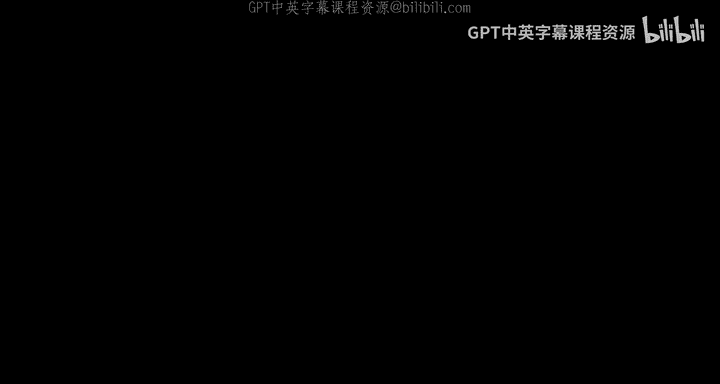
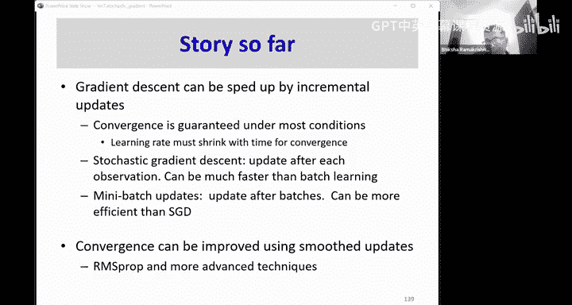

# CMU《深度学习导论｜11-785 Introduction to Deep Learning Spring 2025》中英字幕(deepseek - P8：[08]S2025 Lecture 7 - Training Part V.zh_en - GPT中英字幕课程资源 - BV1xbZNYrEbs

Morning， everybody。 Can you hear me。Yes， yes。 I can。谢谢，感谢。Let's take a minute。There are 83 people on。

 let's see you'll be for 100。All right， so let's begin。We are going to continue our series on。啊。

trainraining deep neural networks so here's what we've seen so far that neural networks are universal appromators they can model any function。

 but in order to model any specific function we have to train them to do so。

And we train them to minimize a total error on a training set。

 which quantifies the error between the function you want to model and the function that is currently computed by the network。

And we do this to empirical risk minimization。The ERM itself minimizes a loss function。

 which is a function of the network parameters， and so we use gradients of gradient descent to perform this minimization gradients are computed using back propagation。

So we also saw that whenever gradient doesncent may be too slow or unstable。

So we can get better convergence。Through second order methods that normalize variation across dimensions。

And using adaptive or decaying learning rates that can help you escape from local minima and improve convergence to a better minima。

 we also saw that methods like R crop that decouple the dimensions。

Can make convergence better because you're able to control the learning grades better。

We also briefly mentioned momentum methods which emphasize directions of steady improvement and deemphasize unstable directions。

 we didn't spend a lot of time on that， we will go over that in more detail today。So moving on。

 there are other topics but today we're going to look at incremental updates and we'll revisit trend algorithms。

 we'll look at generalization and other tricks of the trade in the next next lecture so let's start with the first topic incremental updates。

So when we train a network， here's what here's the problem as we pose it。

 you are given a bunch of training points。And at each of these training points。

 you are given the value of the function that you want to compute。Then。

Well once you set up your network， your initial value of the network parameters gives you some function。

And over the entire training set， this function is going to be wrong。

Pretty much at every training point。So we aggregate gradients over the entire training set。

And when we aggregate gradients over the entire training set。

 these gradients tell us exactly which way to move the function at each of the training points to better approximate the function that we want to estimate a model。

 so they would tell us for example， that if there's blue line is the function we want to model and the red dotted curve is the function currently modeled by the network our gradients will tell us that the function must be pushed up at these two points。

 it must be pushed down at these two points and then pushed up at this point。

So we adjust the value of the function at all the training points to make the because we are aggregating gradient from all of these training points in order to make the outputs closer to the required value。

And then that will give us a new function value because all the parameters have been updated and then once again the gradients will tell us which way to adjust。

The parameters so that the functions， the error reduces at each of the training points and that givess a new value for the function and so on so we keep repeating this。

Till we get arbitrarily close to the target function at the training points。

The key over here is that we are adjusting the value of the function at all training points。

To make the outputs closer to it required value。Because the gradient。

 the loss is a function of all the training points and the gradient because we want to minimize the error everywhere。

And so the overall gradient contributions from every single training point。

So this is your conventional gradient descent。We try to simultaneously adjust the function。

At all the training points， so this means we must process all the training points before we make a single adjustment。

 this is what is called a batch update us so can anybody tell me what the problem might be this is what we intend to do。

 this is what we would like to do。But what could the problem be with this approach， anybody？

Any problems with this approach？All errors get sum to zero or the errors。

If there does get sample to zero， there are no computation costs would so can you tell me why is it computationally expensive？

Anyone。Maybe he can do so。By answering this first quote。So really the first one。Can you see the poll？

So 15 seconds。All right， let me stop this score。Here's what you guys thought。And。Stop sharing。ok。

Which of these statements are correct， anybody？The actual loss function that we must minimize requires batch updates to our falses。

Yes or no。Anybody want to reply？Two are false， guys。Really。😊，Tru or false， okay？

What is the function that what is the objective we actually want to minimize guys？

What is the function you actually want to minimize to anybody？Do you want to minimize the。

Expected divergence over the entire training entire space， right？And so our loss。

 which is the average divergence over the entire training set。

 is an approximation to the expected divergence over the entire input space。

 So the actual so that is the best we can do。The function that we must are lost is the average divergence over the entire training set。

 so if you want to minimize it， you want to perform batch of date that making sense。

That is the only thing we need to do because we are trying to minimize the function everywhere。

Does that make sense， yes no。Okay， so second one， batch updates minimize the total loss of the entire training data two or false。

对。So they optimize the actual loss function true or false。你开吧。Right。And so。

Why would he call this false？Got of bits re。So。Why would that be false？

The what is the actual loss function， It is the。Average divergence over the entire training set current。

And batch updates are correcting over the entire planning set， so this is in fact。

 the correct thing that you would be minimizing， right？

RightAnd so the statement fourth statement batch updates require processing the entire training data before we perform a single update tro。

 so all of these statements are true， right？So。What we really want to do is this。

 this is the only true objective we've got everything else that if we would do is going to be some kind of an approximation。

 right？So the problem here is that for this to work。

You want to minimize the error at every single training point， correct？

Which means that you have to process the entire training data to find make sure that the error at every single training point is minimized。

 but that is too slow you'd have to process the entire training set before each update so here's an alternative。

The alternative is。Let's make incremental updates now to give you an idea of how this works。

 imagine I have a lump of clay and you want to shape it into a do。

So the ideal thing you would do is to have some kind of a， you know， you'd sprout like 5。

000 arms and simultaneously press it。All over the place until the whole thing sort of shapes into a single doll。

 But then if you've ever worked with modeling putty， you know that this is not how you do it。

 you don't have 1000 arms you don't have 5000 fingers and so you can't really you know mo your putty all at once into the shape of your dog So what do you do when you have putty and you want to make it a doll Any who's worked with putty everybody has played with putty in your childhood right what do you do in this case。

Anyway。How do we do it？You want to make this doll from the pudding。How do we do it？

You press one area at a time where you pop this。And then this goes down and then you poke this。

 and you gently pro and poke each point one at a time。

 And the problem here is that if you poke it out here， it's going to pop up out here。

So how do you control for that？When you are poking and plotdding one spot at a time。

 how do you control for it？You make each of those corrections small so that things don't you know doing something at one point。

 you don't try to push one spot all the way to the position of the dog。

 it will cause other things to pop you do it slowly one spot at a time right and so this is exactly the same process we're going to use you're going to adjust the function one training point at a time。

But we're going to keep the adjustment small so you pick up maybe this point。

 push the function up here， when you push it up， it's going to go up everywhere a little bit。

But not change so much far away from this point then you pick some other point correct the function up there then you pick up a third point you know here this point the function is overshot。

 you push it down a bit then you know each of these corrections makes an adjustment to the function and so eventually when you've gone through all the training points or processed all the training points you would have adjusted the entire function at all of the training points and this can potentially give us an over greater overall adjustment then if we had made a single batch update this making sense。

嗰个一。Right， so this is literally like modeling put， you poke it one place at a time。

 but when you poke it you don't poke it till it goes all the way to the you know to the target because then it's going to keep popping up all over the place you make gentle prods at each point。

Until you shape your body， so that's exactly what we do with this function。

Now this is the incremental update as you go through the training data。

You go through each of the parameters and after each training instance you。O， we have happened。

After each training instance， you make a correction。

To the function parameters after each training instance and eventually when you've gone through all of the training instances you'd have made a correction to the entire function。

 at least at all the training points and in fact， when you do this your iterations can make multiple passes over the data a single pass over the entire training data called an EpoC。

So an epo over a training set with3 T samples means that because you're making an adjustment after each sample。

 you will make T updates of the parameters。And so within our student code。

You would be passing over the entire data multiple times each passover the entire data is called an epoC within each epoC after each data instance you're going to correct your parameters that's one update So if you have T training instances youd make T updates within each epoC。

And you can have multiple efforts as you update your parameters。So that making sense so far。哎，不是。

Yes or not， right， okay？Now， can you think of any caveats over here？What can make this break anybody？

What could make this pick？那。This is a single instance， where's a bad size coming in out here。

You're trying to have terminology at me， where is a batch？Right， so what could？What are the caveats。

 anybody？Take a guess。We may run into a loop we can cycley right this so here's what let's say these are my training samples and I have four training samples out to the left four to the right the dotted line is my target function。

And this is my current function。So， then。When I begin making corrections。

 I go process the first four samples， the ones to the left。

 what will happen if I process these four samples， what will it do to this function？Anyone。

I just process these four samples first。It's going to push the left side down right boom。

 it's going to push the left side down， but when you push the left side down。

 this can make the right side pop up。So then。I process these for。

And this is going to make the right side go down， but then this can cause the left side to pop up。

So then if I go back to the left， it will make the left go down and the right pop up and it will keep bouncing back and forth and you can get a seesaw。

Presult， so what。Can you suggest a solution to this？Any you suggested solution to this？Anyone。

Go through the points randomly right So what we can do is。

We must go through the points randomly to get more convergent behavior。

 you maybe make a correction over here， randomly select this point， push it down here。

 then you randomly select something and maybe you get something on the right side you push that up here and so you have to randomize the order in which you sample the points to prevent such cyclingic behavior otherwise it will not work so the pseudocode how do you randomize it。

Within each， if you keep going through the data points in the same order。

 you can get cyclic behavior， so between Es you're going to have to permute your data instances to change the order and only then is this process going to work in any reasonable manner。

That making sense？Sofi。Yes， no。Okay， so so far so good。At least half a dozen people are saying yes。

So here's the story so far in any gradient descent optimization problem presenting training instances incrementally can be more effective in presenting them all at once provided the training instances are presented in random order。

 and so this approach is called stochastic gradient descent why stochastic stochastic is because we are presenting the training instances in random order one at a time。

So this approach holds for any function optimization and so also for training neural networks。Now。

 why does the process of incremental updates work？And under what condition。For the why。

 first I'm going to consider a very simplistic explanation that's often given and you know it will give you some sort of an intuition。

 let's look at an extreme example。Now， when you perform gradient descent。

 the actual loss function is the average divergence over all the training points。

So the derivative of the loss with respect to any network parameter is simply the average of the derivatives of the divergence with respect to the parameters for each training instance so the overall gradient is the average of the gradients of the error for each of the training instances Now if you pick any given training instances。

 maybe for one training instance the gradient points this way for another it points this way or the third it points this way for the fourth it points this way so the overall gradient that you choose is the average of all of these gradients which is perhaps given by this red line and that is the direction。

In which you would move the network parameters。 This is what happens， right。

 in your standard training。 So now consider， but this averaging。

Works nicely all of your training data diverse。Now。

 if I have many training instances which are all identical。In this case。

 what would happen if I took the average？Divergence over all of the training samples。

 what would happen anyone？If all my training points were identical， what does the average look like？

Anybody。Maybe the question is not clear， right？It's just going to be the same every single training instance will have the same divergence。

 so the average is going to have just the divergence as same as the divergence you'd get for one training instance and so。

What would happen is that if although you processed your entire training data。

The net correction you got was exactly the same as if you had seen only one training point。

Because the average was the same as the divergence for any individual training point。

 whereas if you perform stochastic gradient descent。

 every training point is going to see an updated parameter and so you're going to get over T training instances you'll actually end up getting T corrections and so even though the individual corrections may be smaller。

 this cumulative correction could be much greater than this case。That makes sense to everybody。Yes。

 perfectf， just if I'm getting you well。 So are you saying we should randomize every apo or yes。

 every apo otherwise。Otherwise it's cycling， right， it will use cycle it correct？Yeah。And so now。

 instead of all of the data points being exactly the same。

 suppose they were very close to each other。Would you still expect to see greater benefit from stochastic gradient descent and from a single batch update？

In this case。Yes， because the good， the gradients are going to be very similar to each other， right？

So when will the one begin to lose out over the other？Anybody？

When will the one begin to lose out over the other？Take a guess。When they are very， very different。

As the data become increasingly diverse。The benefits of incremental updates decreasees they don't entirely vanish。

 we'll see more of it， but。You have to be more careful。This is a high level intuition， okay？

Let's go into a little more detail， what are the considerations and how well does it work for this。

 instead of a neural network I wanted to start off with a very trivial problem to explain one simple concept。

Now here I have a bunch of training data points and I want to find somewhat of a principal component which like a regression line through the origin。

 I wanted to go through the origin and I wanted to model the data。

 so basically what I'm trying to do is to find the line find this hyperplane such that the projection the average projection error for all of my training data points is minimized simple problem right so if I were performing batch processing。

I would find the line through the origin that has the lowest overall square projection with respect to the data。

But instead of batchge processing， let's say I began performing stochastic gradient descent。

Then first I got this training point， then my line is going to go this way through that training point。

 zero error， right？Then my next sample is this one。

My line is going to swing around and go through this training point， zero error。

 then I can pick up my next point， my line is going to swing around， then go through that point。

 and then my next point is going to go through that point， will this ever converge。

If I'm always chasing the latest training data instance， will this ever converge。

 so what is the solution？A solution， anybody？Week morning。Any other ideas？I have more than one find。

 any other ideas？Decrease the。Updates right so you update the model to always minimize the error on the training instance。

 but you shrink the learning rate with iterations。So with increasing iteration。

 it will swing less and less towards the new point， so your first date may go all the way to the sky。

The next one。Instead of swinging all the way to this data point。

 it's only going to go part of the way there。Then the next one is rustling all the way here。

 it's only going to go part of the way here。Then interesting all the way here is going to go even less。

啊。All them two you know it's going to make even less of a swing to that point and so on and eventually as with increasing iterations。

 if you keep decreasing your learning rate， eventually it will arrive at the correct solution where adding new data points is not going to make swing it too much because the learning rate is so small that it it's not going to it's not going to really change your solution。

Did this make sense？Do all of you guys？Okay， and so。

Update the model to always minimize the error on the latest instance。

 but then we must shrink the learning rate with iterations for convergence。

 so correction for the individual instances with the eventual minuscu learning rates will not modify the function。

If I go back to my pseudo code， I have two things， again。

 I still have to randomly permit my training data instance， training data in each eOC。

But then this learning rate is going to keep decreasing。With each update after each update。

 the learning rate must change and it must become smaller。Now。

 how much does it must it become smaller， is there any constraint on how fast the learning rate must reduce。

 so let's look at that， right？Consider this， even if I let's say I have。

 I'm going to try write scribble。Say for any parameter。

Let's say my derivative D loss over Dw magnitude is always lesser than not equal to some constantsancy。

 So this is my upper bound on my。Deerivtor， right， say if I have a learning rate of Eta。

 then what is the largest amount by which I can correct my parameters in an update。

If Kata is my learning rate and the derivative is bounded and it always is because you never have infinitely steep loss functions。

 Those are horrible things。 So we try hard not to permit them， right？ So then in this case。

 what is the maximum by which。This maximum value for this correction， anybody。What will it be？

It's going to be。Eta C， right， you know that this correction。Delta W。Ass less than or equal to a C。

Is this making sense？Everybody。Yes色龙。Okay， so now。This Eta is the learning rate this one。Okay。😊，Now。

 suppose。My learning rate changes with iterations， so the K iteration， the learning rate is Eta K。

Then what is the maximum value。Of the corrections over infinite。Iterationerations， infinite updates。

That is going to be the total correction， Delta W。Is going to be less than or equal to summation over K。

记得起。Oh， what happened？嗯。你得起。四。Is this making sense to everybody？This one。😊，This is my seat。Yes or no。

I this from making sense， guys， okay， so in other words， okay， within any update。

 the maximum values correction is Eta k right， if Eta changes with iterations。

 the total correction is upper bounded by summation over k8ta K C。That makes sense out you。

And so the delta W total correction is lesser than or equal to c times。Submission key。It得け。

So now for for your model to actually find the optimum。This upper bound must be large enough。

For you to span the entire gap so let's say your optimal point is out here。

 this is your optimum and your initial estimate is out here。You want this distance。

This gap from here to here should be less than the upper bound on。

The number of corrections you want to make， so if this gap is say G。

 you want to make sure that G is less than or equal to。C times summation K Eta K， right。

Because if it's greater than that， then you'll never get to the optimal point that making sense。

And I was just making， okay。How far can your initial point be in the worst case？

How far can the initial point be in the worst case？Your initial point can be。In the worst case。

 it can be infinitely far away， right？So what does the tello about this guy？What must this value be。

If G can be infinite。C is a finite value， so this summation must be infinite， correct？Yes or not。

Right。At the same time， you want the ATS to decrease with iterations。

And so we have these two constraints on the。Correction terms， they're the learning rate。

 the sum of the learning rates must be infinite。It must not be the otherwise the entire parameter space cannot be searched。

At the same time。The square sum must define it because you want the learning rate to keep decreasing。

Otherwise you'll keep oscillating， these two conditions must be satisfied。

What is the fastest converging series that satisfies both requirements？

What is the fastest converging series where which is squared summable but not absolutely summable anybody？

Anyone。You've done this in college。你问。Squared some of it because he wanted to shrink with time right that's this guy one over k。

What is the absolute is the sum of 1 over k？This is infinite。

At the same time one hour case square is finite it。

 so this is the fastest converging series that satisfies both our requirements more generally the learning ratess are heuristically determined and typically we are going to have learning ratess of this kind where we have some initial learning rate for a long time。

Then we have some other learning rate for a long time and then we have some other learning rate for a long time。

 but then whatever schedule you use， you will eventually find that this schedule has the property that both of these conditions。

Are satisfied if it doesn't satisfy both conditions。

 then conditions then youre not guaranteed that you will actually be able to learn the function。

This makes sense to everybody。So far， everybody good okay。

And so what does SGD work like here's an example from a very trivial problem。

 this is actually from cleaning clustering。And。The square is because he wanted to be you want it to shrink and so the math for it just says that how do you make sure that it keeps going down and eventually go to zero that's where the square comes from I'm not going through the math for that but it has to shrink it has to converge。

The point is it has to convertverge， okay， so here's an example from Cans。

They you know K means you get different initializations。

 so in this example they tried to perform K means clustering or regardlessdess off the web。

 they tried to perform K means clustering on a bunch of training data。And these are how。

This is how the total error converged。With iterations and this little bar shows the variation across rats。

 this is when they perform batch update。This is when they perform stochastic gradient descent。

What do we find？SGD converges much faster than K means。But at the same time。

 there are two obvious problems that stick out， what are the two problems， what can you see？

The two obvious problems， anybody。It is。What are the two obvious problems over here。

 this is the variance across France。It doesn't， the final solution is crappy number one。Second。

 the variance across runs is very large。Right。Yes or no。ok。And that leads us to our second poll。

And let's see well two。Can you see the ball。15 seconds， guys。Okay， let me stop this。

Here's what we thought。Okay。嗯嗯。Stop sharing here。50。Okay， first statement， true or false。

It's true online methods are whether where you make computations as data come in， second one。

 true or false。这 third吧。Partt。As GD is an online version of batchup dates。

 it can have oscillatory behavior if you don't randomize the order of inputs。

 it can converge faster than batchup dates。But arrive at poorer minimumma and convergence to the global minimum can only be guaranteed if step sizes shrink across iterations。

 but sum to infinity in the limit。So let's try to understand why you see this also why you see this kind of behavior。

 why we have this wild variance and that can result in were estimates， right？Look at this。

 this converges much faster， it just converges to a quarter minimum right dolphine。So。

Let's see why this happens。Now let's go back and look at what is the objective function you really want to minimize again。

 guys， what is the objective function we really want to minimize。Anybody。What is it？

The expected divergence， right， you want to take you want to the the error is the integral of the divergence over the entire input space。

 It is the expected divergence。 This is what you want to minimize。

The problem is you don't have the function everywhere。

 We can't compute the expected divergence everywhere。

 so we get the divergence at a bunch of training points。

 Our loss is the average divergence over all of the training points。

 And we are hoping that by minimizing this we are actually minimizing the expected divergence Now why can we hope so。

 So first I'm going to give you some math。Here's the thing。First。

 if I take x1 plus suppose I have two random variables， x1 plus x2 plus x3。Right。And I。

Take the expected value of all of these。And divide by。One third say。What is the expected value。

 what is the expectation？Of this。X 1， x2 and x3 are random variables。

 then what is the expectation over here， does anybody remember？What is it？Plenarity of expectations。

 right， it's going to be x1 bar。Over three。Plus x 2 bar over 3。By bar， I mean the expected value。

 right plus x3 bar over 3。And so on。 So in general， if all of these are identically distributed。

 then it's just going to be。Three times x bar over three， which is subtract， cancel this out。

 This is just x bar。Is this making sense to everybody so far？Okay。

 so what this means is that if I take the statistical expectation of the guy on the right。

 that is going to be exactly as the statistical expectation of the guy on the left。Which means that。

In expectation， which means if I take lots and lots of different training sets and compute the average divergence of over all of these training sets。

Then if I compute the average of these averages， that is actually going to be the true divergence function that the true objective we want to minimize。

 which is this term。So because the expected value of the empirical risk is exactly the same as the expected divergence。

 This is what is called an unbiased estimator。 This is why we believe that if I minimize this guy。

 I'm also going to be minimizing this guy， okay， it doesn't matter how many training points you have。

 the expectation on the right is the same as the expectation on the left。 So minimizing this value。

 you can kind of hope that you are minimizing the actual objective function。 Now。

 let me give you another thing。 a couple of other things。

 Supp I have a training a random variable X with a variance v， right。😊。

What is the variance of x over n？If y equals x over n。What is the variance of y？

If the variance of x be anybody？What does the variance supply y？Come on， this is easy。

And the variance of x's。This is going to be v over and squared， right？Now。

 suppose I take random variables x1， x2， x3 to xn。Right。

And each of them has a variance exactly equal to v。

 what is the variance of the sum of these independent random variables anybody？

What is the sum of this。That's going to be。N times v， right。What if it's x1 over n plus x2 over n。

All the way to XN over N。What is the variance of this guy？What is the evidence of this one？

It's going to be n times， but each of them is locally v over n squared。

 so this n squared and n will cancel， this is V over n， right？

So if I take a look at this term over here。The variance of this term is simply the variance of the。

Divergence function of x。Divided by n。That's the variance of this term that makes sense to everybody。

Can I get a I。ACo of dozen 25 thumbs ups， please， because this is kind of key for the rest of the explanation。

That makes sense， to you guys。Okay。Out of 250 people in class。

 less than 20 are actually responding guys。可 still。You got them depending on your feedback， right？O。

是 not。Let's go back， what this means is that for this one。

 the variance of the empirical risk is1 over n the times the variance of the divergence。

The variance is proportional to 1 over m， the larger the variance。

The greater the likelihood that the estimate of the W estimate that you get will differ significantly across different training runs。

 If the variance is small across training runs， youll get the get a smaller estimate。 Okay， now。

 if I go at stochastic gradient descent。 In the case of stochastic gradient descent。

 I'm not taking the average of many divergences， It's just the divergence over a single training point。

😊，Even so， the expected。Loss is the same as the expectation of the divergence。

 So even for the STD case， the sample divergence is an unbiased estimate of the expected error。 Okay。

 expected divergence。 But the problem is， you know， N in this case is one。

 you have only one training point。 So the variance of the sample divergence of the variance of the divergence itself。

This is n times the variance of the empirical average minimized by the batchge update。

So this is what the math says， did this make sense to you guys。

 I don't expect it makes sense but did it make sense to you guys。

I'll try to explain it with pictures。This makes sense to you okay。Honestly， when I read this。

 it never made sense to me。So I had to draw pictures and convince myself。

 so I will try to do so for you。Here it is。This blue line is the function you want to minimize。

 correct？The red line is the function that you have currently estimated by the network。

And you have a bunch of training parts。So when you try to minimize the error across the batch error。

 you're trying to minimize the error across all of the training points。

 which will tell you that you have to push the function up in these two places。

 you have to push the function down in these three places and up again in this place that's what that is the advice you'd get from these six training points。

But suppose I had a different set of six training points， these guides。

These guys could end up over here and in this case。

 the advice I'm getting from the same number of training points is just a different set is that the function must go up everywhere。

And so if you just believe these training points， youd also be pushing up the function in these places where it is the wrong thing to be doing。

Suppose I had a different set of training points， suppose I had these as my training points。

In this case， the majority of my training points are telling me to push down the function and so I'd end up pushing the function down everywhere right so depending on the set of training points I choose the advice that I get from my training points my training data can be wildly different。

That's what we mean by variants that different training data instances training sets can give you completely different recommendations。

That makes sense？Yes or no。喂。So going to get a few more times like， okay。

 so how would you fix this one simple solution。Howeverware is better。 Do you really want it to be。

 So this one。Is this good that in one case。It asked me to push up the function in another case。

 it asked me to push down the function same function， right。

 is higher where a better thing or a worse thing。What do you guys think。

Is it better to get completely different recommendations from different training sets or do you want them to be consistent？

Do you want。Rightright。You want if the different training sets tell you give you completely different recommendations that is not good。

 you want it to be consistent， what is a simple solution to making it consistent。Anyone。嗯。

More samples， just having more samples means that you know。

 as the data increases the chance that you're going to get completely different recommendations from different dataset sets is going to go down。

 this is what we mean by saying the variance of your loss goes down as you increase the amount size of your training set and therefore the variance of your estimate also goes down。

But then when you're performing SGD you have only one training instance。

 so if your training instance fell here you're going to say oh， I'm fine， my estimate is perfect。

 If it fell here， you're going to say I have to push my function up If I fail here I'm at failure you're going to here push my function down everywhere and so you can see how with SGD because you have just one training instance the choice of training instance can completely change the advice that you get from it。

😊，Which is why you're going to get wild variations。In the loss function across different runss。

 which is why you get such wild variance variation and the。

That loss function is what you' are minimizing， right。

 And so which is why you get such wild such large variances in your estimate itself。

 and which is why your loss itself is so much poor， Even the width converges。

 whereas for the batch has batch updatesates， because the number of training instances is much larger。

 the variance is much smaller and it converges much more cleanly。 This makes sense to everybody。😊。

Yes no。Okay， so here's the thing。Batch updates are goodd， low variance， better estimate。

But they are very slow。Is GD。They converges very fast， many updates perpoc。Auththetic variance。

 crappy estimates， so can you give me a solution？How can I combine the two？Anyone？

How do I combine the？啱啊。So SGD uses the gradient from only one sample at a time。

And is consistently high variance。But also produces significantly quicker updates than back so there's a good medium。

Such as the function， not at just one point， but a randomly chosen subset of points。

Keeping the adjustments small if the subsets cover the training data youd have adjusted the entire function as before vary the subsets randomly in different passes through the training data。

 so maybe in one one update you get these three samples you make your corrections then the next time around you pick a different set of three samples you make your corrections and keep good and and so on so in your pseudo code now you actually choose。

Bgeches of instances， you compute the average gradient over the batch， and that's what you use for。

 correct。喂。😊，收。And so， now。The mini batchche loss is the average divergence over a small set of training samples。

And as it turns out， this is also the expectation of this is also the same as the expected divergence。

 so this is also a unbiased estimator because the expected value of the mini batch losses。

The same as the actual objective you're trying to minimize。

But then the variance is1 over B times the variance of the divergence itself。 Now。

 if you look at this。So if I were to plot this， right， plot the variance of the loss。

And this is my mini back size B。And this is Anne just。Sorry guys， I'm here。

 I just my neighbors drilling his wall。And I was I just， okay， so here's where we have。As your。

 this is your。Your variance right， so this for b equals1。

 the variance of your loss function is the variance of the divergence itself。And。

As you keep increasing the bad size， this。Is one over n times。This variance of the divergence， right？

And as you keep increasing the bad size， you will find that this curve falls very quickly like so。

And so there's a sweet spot somewhere around here where your bat size is large enough that you're not very far from this variance。

And yet small enough that you can get the advantages of。啊。

Of incremental updates that makes sense to everybody。Me and so。This is what people do， right？

The mini batches， if you look at how mini batch updates work in this example。

 you find that mini batch updates， they have only slightly greater variance than batch updates。

They convertverge as fast as stochastic gradient， and the error they achieve is comparable to what you would get with batchs。

 So many batch compareer fs。😊，So what did I make， so where did I lose you？Many batch are here。

 the point is。You agree that if I work with mini batches， the variance is going to be smaller， right？

And because the variance is proportional to1 over B。And one of our Bs went to go down， like so。

The largest batch size of course your training data size。And so。

It begins the variance of your mini batchchelors begins approaching the variance of your bachelors。

Very quickly as you increase the batch size and so you get more stable updates。So。

That's what we find over here when you use mini batches， you actually get much better。Convergence。

 and it's much faster。So this makes sense the whole thing so far。O。Ana。

 what do you mean that makes the data noisy， can you explain？It doesn't change the data， right。

 you're just using subset of the data。The variance is still going to be greater than the batch update case。

 but it's going to be much less than the stochastic gradient case。It is similar to SGD。

 it's very similar to SGD except that you know， again， in the SGD case。

 the variance is just the variance of your loss。Yes。

In each step is simply going to be the variance of the divergence。Whereas in the mini batch case。

This is going to be。The variance of the dit is over B。

 this 1 over B term is what decrease the increases the stability。Of the loss across iterations。Okay。

So convergence is now， how do you define convergence is generally defined in terms of overall training glass。

 not sample or batch loss， and it's infeasible to actually measure the overall training loss over the entire training data after each iteration so more typically we estimate as as the loss on your latest batch or on a heldoutet so all of the losses and all of the convergences that you're reporting in your experiments for instance they are somewhat bogus the only thing that you're guaranteed is the convergence over the entire training set it doesn't mean that the loss is going to necessarily converge on the latest batch。

The fact that it does is a good thing。え but。Just because the current has not converged on the latest batch doesn't mean that it has not converged on the entire training set and viceC versa。

So。In practice training is performed using mini batches。

 the mini batches size is generally set to the largest that your hardware will support without compromising overall computer larger mini batches is less clear less variance。

 larger mini batches also means fewer updates per Tpo。Definitely always。

 regardless of whether you're performing mini batch or SGD。

 you have to randomize the data in each e otherwise it doesn't work right you have the same behavior cyclingic behavior。

And convergence in both cases depends on learning rate。

 which must decrease with the up to iterations， so it must be absolutely not summable。

 but must be square summable。So a simple technique is to fix the learning rate to Arablas than reduce it by some fixed factor and so on。

 And you can also have adaptive updates whether the learning rate itself is determined as part of the estimation。

 we will see that shortly。 But at first， that mean， give you a。Oh。We'll get 10 seconds。All right。

 let me stop this yeah。Here's what call a you thought。And。Let me get back， okay。

 minibas Discent as an online version of batch updates date true or false。

True or false it's true online is you know you keep updating as the reader comes in so you could use it in streaming mode。

 for instance， it's faster than SG even the bad size is one true or false。

F because mini batch is the same as as GD even batch sizes one。The variance decreases with ba size。

Derfox。True， right。It approaches batch updates and variants， but approaches SDGD in efficiency。

But vector processing in large batch is true false。Also true， right， beautiful， you guys get it。

And so the story so far。In the case of SGD or presenting training instances one at a time。

 this can be more effective than full batch training provided they are presented in random order。

For SDGD to converge the learning rate must shrink sufficiently rapidly with iterations。

 otherwise the learning will continuously change the latest samples。

As GD estimates can have higher variance than batch estimates。But mini batch updates。

 operate and batches of instances at a time， estimates have lower variance than SGD and so convergence rate is theoretically worse then it's theoretically worse than SGD。

 but because you perform。You know， you can actually use the vector processing insights like。

 you end up with much。Better convergence to answer your question， yes。

 once you increase the batch size， you can increase the learning grid。So so far， so。

Any questions so far。Any questions？I guess not。How do you choose okay。

 so you want to choose the largest mini batch size that you can stuff into your memory basically。

 because the larger the mini batch size， the lower the variance of your loss and the lower is lower the variance of the estimate updates。

一打车不。嗯。So batch update will have variance too， you know。

 unless you have infinite back you know if you have infinite training data。

 then the variance is zero， otherwise the batch update is going to have a variance which is proportional to one over the size of your training set that usually tends to be very small that's all。

Because your training set is typically very， very large。That answer your question answer？Yeah， okay。

Right， so now we're going to go back to trend。Algorithms。In the last class。

 we briefly mentioned this。The mini batch size should be a portion of the actual data set。

If you could fit the entire training data set into RAM， you should。That has the lowest variance。

Provided you training data div， which they usually will be。 So now let's go on to trend algorithms。

 right， So we saw， for example， in the in the last class， that when， when you have a loss function。

 the。啊。The optimal learning rate in one direction is going to be different from the optimal learning rate in the other direction。

 so you can instead of you know， if you start off from some point of going smoothly to your objective。

 you can end up doing something like this。Swinging up and down， right， spending a lot of time。

 So how did we say we could deal with this， Anybody remember， it's if I want instead of doing this。

 if I'm doing。This。How could I deal with this？So。We want to what we do is we observe that at each point you have a horizontal component to the gradient and a vertical component to the gradient again here you will have a horizontal component to the gradient but now the vertical component to the gradient is this swing over here the horizontal component to the gradient is this way。

Over here， the horizontal component of the gradient is this way。

 but the vertical component is downwards。Here the horizontal is this way。

 but the vertical is this way right， so what are we seeing at each point in this example。

If I have updates like this， then over here the horizontal is forward。

The vertical component of the gradient is asking me to go down， right？Here。

 the horizontal component of the gradient is asking me to go forward。

But the vertical component is asking me to go up。Here。

The horizontal component of the gradient is asking me to go forward。

 but the vertical component is asking me to go down。

 which is why when I follow the recommendations I keep swinging。Right。😊，Over here， what would have。

 What is the gradient telling me if this is my update at this point。

 what is the horizontal component of the gradient telling me forward or backward。At this point。

Parmer and the vertical。Upright， so what do we see？When you have behavior of this kind。

 it's converging cleanly in this direction， but it's。Swinging in this direction。

 and that is immediately apparent。From the gradients， right， from the。

And so suppose it took a running average of the gradients。Then in this direction。

The gradients are always consistent， so the running average is always going to be a significant value pointing forward。

But in the vertical direction， this downward and this upward and this downward and this upward。

 they will cancel out。 And so in the vertical direction， I'm going to end up with very small。😊。

Net gradients in the vertical direction， right。 And so we said。

 if you use a running average of all of the gradients。

 then you expect to damp out nasty oscillations while enhancing the consistent directions。

 Everybody remember that。😊，Yes， no。Right， give me a yes now I'd like to see a dozen yeses。

Or least do that make sense to you guys？Okay， it turns out that when you are doing stochastic gradient descent。

This kind of behavior is going to be even more dramatic because even if you're doing mini batches。

Each time you' are looking at a different loss， you're looking at a different set of data。

 And so because of that， you're going to get a lot more of this crazy oscillation。

 And so the necessity to damp out these oscillations becomes greater。😊，And so what we do。

 the momentum method uses。The running average of all of the gradients have G1， G2， right， and so on。

 At each time you're going to take one over n summ I equals1 to n。

GI and this running average of gradients is what you will use for your correction。

Now the problem is this running average of gradient it's going to it's hard to you do you don't want to keep track of all of these gradients。

 but then you can do it very simply， you can say deelta w。At thecade step。

Is going to be some alpha times Delta W at。G you minus1 step。

Plus some beta minus because you're going against the gradient。

 minus some beta beta times the gradient， the K of gradient。

So this is your running average formula where does it come from just look at it this way if wk is the average gradient after k steps。

 then w k plus 1， I mean delta wk right then delta w k plus 1 equals k times。Delta Wケ。

Mine is the latest gradient。Divided by K plus one。Right。😊，Is this formula making sense to guys？

Is this one making sense？What does this look like， it's basically K over k plus one。Times。Delta WK。

Minus。1 over k plus one。The latest gradient right， or more generally some alpha times Dlta w k minus 1 minus beta times the。

L gradient。 so that is how you keep a running average of all of the gradients and that is what you use in your correction so。

The correct the correction to the parameter is going to be some beta times the previous correction minus some beta times the gradient of the loss in the current。

In the current batch and that loss， of course， has been computed using the previous estimate。

In the network right and this correction is what you use to correct your network parameters。

 Is this making sense。A we here？Everybody。And so typical data values are 0。9。

 this is your learning rate right and this running average will get longer in directions where the gradient retains its the sign and becomes shorter in directions where the sign keeps flipping so here's what the momentum method is going to look like suppose you start from here。

 say the previous correction was this way。Then you're going to compute the gradient over here。

 which is in this direction， So the correction recommended by the gradient is going to be this guy。

So that is this Tom。But to this term， you're going to add some scaled variant of the previous gradient。

And this is the net correction。That you' are going to be using to update your parameters。

 That makes sense。Yes no。等冇嘢。Okay。So that's your momentum method， momentum update， right？

Now observe that the momentum update steps are actually computed in two steps first。

 you take a step against the gradient。Then you add a scaled version of the previous step。

And that is going to give you the net correction。 It turns out that if you reverse this order。

 it ends up being more optimal。 What we will do is。Instead of first。

Taking a gradient step and then adding a scaled version of the previous step。

 we will first take a scaled version of the previous step。

And then make a gradient correction from here。To get the net correction。

So there is the change of the sequence of operations。Making sense to you。那不要。Yes or no。It turns out。

 this is the famous。An nest of a rule。And it turns out that this is much more optimal than simple this guy here is called the momentum method。

It's called momentum because the current correction。

 it feeds almost as if you are maintaining a momentum from previous corrections。And yeah。

 momentum will it can reduce the randomness of HD and Nestuov's update rule is an improvement on that because you make the you continue with the momentum and then make the。

Graaddient， take the gradient step。So here is the Natros method。From the previous step。

You take a step， which is beta times the previous step。And then， you add。

Some eight times the gradient computed at the new point。It is WK minus-1 plus。Beta。

 So this is the new correction， and that is what you correct here。Prameter width。 So Mail。

 why does it， does， Why does the order matter， Here's a nice pictorial illustration。

 but the math of it is there in a very nice paper。Right so again， this guy。

 you're adding the correction because over here you have minus minus eta。

 so the going against the gradient is already factored in over here okay。

So but here's a very nice pictorial illustration， so this was from hint。

 suppose this was your previous step。And this is your optimum if you were following the momentum method。

 you'd first go here and then add a scaled version of the previous step and end up here。

Whereas if you were following nest offs。You would first continue here and then take a step against the gradient which would end up here。

 which is much closer。And so you can fertn nice convictx functions of this kind。

 you can show that this netro method。Is considerably more faster to converge than。Simple momentum。

This makes sense to everybody so far。Yeah ok。No。Where is。Back propagation figure。

If you are using the momentum method， this gradient。Is computed using backboard。

And this loss over here is the instance of many bachelors。If you're using Netros method。

 this gradient is computed using backdrop and this loss is the SGD or mini batchchelors so。Okay。

 so now here's what we got。Here is your standard。Update ruin， right。Now， this update rule。

We found that this gradient can be very noisy。😊，Particularly if you're using SGD or mini batch。

And so we smoothed this out by using running averages。Do you see a second term over here。

That can also be corrected， do you see something else over here that can also be corrected？Anyone。

This guy， right。So。How does that figure look at this。

 so this momentum method speaks this tongue to reduce unstable oscillation。What about this。Now。

 look at this。I have three different updates， Okay， in this case。

You have vertical swings of this kind。 here too。 You have vertical swings。 here too。

 You have vertical swings In all three cases， the running average is the same or very similar because the positive and the negatives cancel each other out。

😊，But。😡，Should I be using the same learning rate in all three cases。

 should I trust these oscillations as much as I trust these oscillations？

Or should I trust these guys less？What do you think。How many of you think I should trust this more？

How many you think I should trust this last， just let me know。Right， okay。

 how do I know that I should trust this less？Simply， I have moved a lot more。I have moved a lot more。

 right， It's not the average motion。It is the net motion right。

 so if I take the average motion in both cases， the average is going to be small。

But instead of taking submission。Gradient。If I took sum gradient squared square root。This guy。

 the root means squared value is going to be much larger for this one than this one， yes。

This is going to be small for both cases because the positive and negative oscillations will cancel out here is' going to aggregate。

 right？And so。This is what people will do。That makes sense， yes no。Guys I need you guys to be prompt。

 otherwise I run out of time， okay。So。This is what we will do in RMSP。

We are going to maintain a running average of the square derivative in each direction。And we'd come。

 which is basically。We want the mean squared derivative， the RMS value。快啲。We want the means squared。

 not yet taken the root for that， we will maintain a running average of the square derivative。

 So just like we maintain a running average of the derivative。

 this is exactly the same except it's a running average of the square derivative。

 and then the learning rate itself is scaled。 by the inverse of the root mean squared value of the derivative。

 This plus epsilon is to prevent division by 0。😊，And so you can see where how this will naturally sort of dampen oscillations where you have wild oscillations and give you learning ratess while where the oscillation is not so swinging。

 not so wildly。And you can also see that if you have a constant slope of this kind。

Then when you have a constant slope， this is simply going to be。The partial derivative。

 because in every case。For at every step， the derivative is going to be the same。

 So this and this will cancel out。 And all you are left with is thee。Sign of the derivative。Now that。

Which was the learning method where we only considered the sign of the derivative。

Anybody to remember。Did this make sense？Did this make sense that if you have a constant slope at every point the slope is the same。

 right？So the RMSs value is simply going to be the slope itself， so it will cancel out。

Audio left it is a sign right， so it turns out that's why this was called RMS Pro RMS Pro is basically viewed as an extension of R prop。

啊。You know。Because the magnitude of the derivative is being canceled out。Now。

 so R S pro momentum methods correct this guy。RNS Pro corrects this card。

 it only adapts the learning rate。Momentum only smooths the gradient。 What is the obvious next step。

Anyone。What is the obvious next step？Combine them， right。So how do you combine them。 beautiful。

 Let's combine both。This is Adam。Aam is simply， Adam is propped with momentum。

You maintain a running average of the meal。You also maintain a of the you maintain a running average of the derivative。

You also maintaining a running habit of a squared derivative。And then you use the same。

 let's skip this for the moment。If you focus on this guy。

 this is the same as your standard gradient descent rule。

 except here you are using the running average of the derivative。And。

You are normalizing by the inverse of the RMS value of the derivative。

 so atom is simply RMS pro plus momentum。This making sense to all of you guys？Yes no。Okay。Now。

 what is this crazy bit over here？Why do you need this， This is just a hack。

 It turns out that typically you initialize this guy as0。

Typically you also initialize Delta as something close to 1。

 what will happen initially this is0 because if delta is close to 0。

 this also becomes zero so the thing this never gets updated。

These things don't get updated simply because of the manner in which we initialize these things and the values we choose for these parameters。

 So this1，1 minus delta is to K I deals with it。 What it does is。

It ensures that the Delta and gamma terms do not dominate in the aiterations。

 and at higher iterations， as K becomes large because both deelta and gamma are less than one。

 these will basically disappear。 and you end up with the simple vanilla update truths。 Okay。

 So this is basically a act。But。Adam in general is this Rms perus momentum that makes sense to everybody。

Yes not。ok。I have some typical values， typically mu zero set to 0 delta set close to 1。

1 minus delta will become 0， so without this denominator， mu K will stay close to 0 for a long time。

The denominator ensures that it updates actually happen for large。

 the de denominator just becomes one。That's a basic idea。

 and they have many more variances of the same theme at a Grd addedl Aax。

 The nice thing about these things is that now you don't have to adjust your learning rates in theory。

Because the update rules automatically adjust your learning rates， supposedly。

And this also takes care of variations in your derivative so typical values for Adam is for you'd be 8 as 0。

001 gammas 0。9 Adamom is going to use the same thing with this delta as of 0。

9 as well delta as the learning rate for the mean gamma as the learning rate as the rate for the mean。

Gamma is the up rate for the squared derivative。 Anyway， these are just engineering details。

 It turns out that in spite of these， you still need learning great schedules and such like。

I'm going to go over by about 30 seconds， so I'm going to actually give you this poll。啊。

Can you see the ball。Make it quick。Only 30 seconds。All right， 10 seconds guys。Let me stop this。

Here's what you guys thought。So anybody want to tell me vanillaila as GD considers long term trends of gradients。

 does it， Yes or no。First one， no， right？Momentum considers the long term average true or false。

RMS prop only considers the second order moment， but not their average trend true or false。

Adam considers both。Average trend and second moment through or false。

trend based optimizes like momentum or MSs prop andatum are important to smooth out the variance of SGT or mini batch dates true or false。

Right， all of these are very nice so this guy he actually showed he compared the different。

Optimization methods for different loss functions， different functions。

I don't have time to go over it， but these behaviors you can actually look at these things and see。

 get a very nice feel for how these things。Behave。And you can see that SGD， for example。

 simply gets stuck。In a salaryavly point。Whereas all of the other methods manage to escape from it。

 and in particular you always find that Nephs accelerated gradient in momentum regardless of the function。

They tend to approach the optimum pretty quickly。IThat's another one， right， as GD gets stuck。

Butら still what on。So the story so far， gradient descent can be sped up by incremental updates。

 convergence is guaranteed under most conditions with the learning rate musting time。

Stochastic gradient percentscent， you update after each observation。

Can be faster than batch learning， many batch updates you update after batches can be more efficient than STD。

 convergence can be improved using smooth updates， particularly trend methods and things like Rs prop add right。

So that's the end of today's lecture。I'll wait for questions， but before that guys。

 if this lecture made sense， can you give me a thumbs up。

 I'd like to see there are 200 of you in the class I'd like to see maybe。1 hundred of those。

 so I know I'm going to write with。Thank you， that helps right that really helps。

And I will stop the recording。

