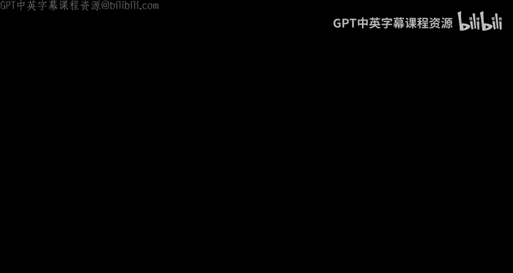
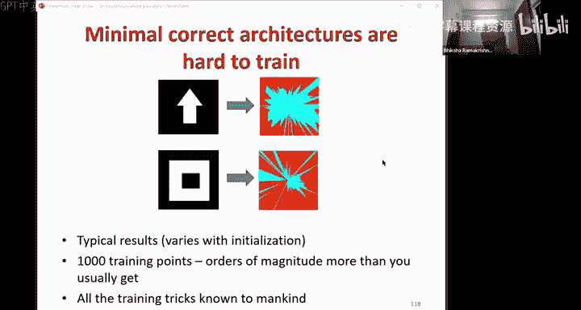
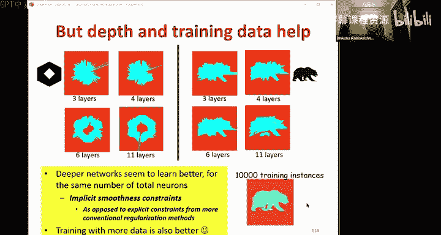
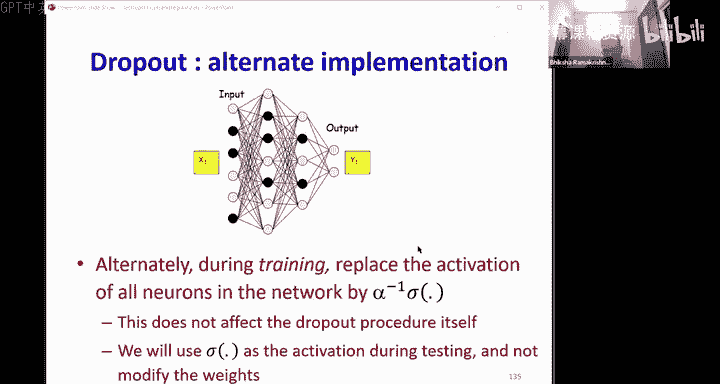
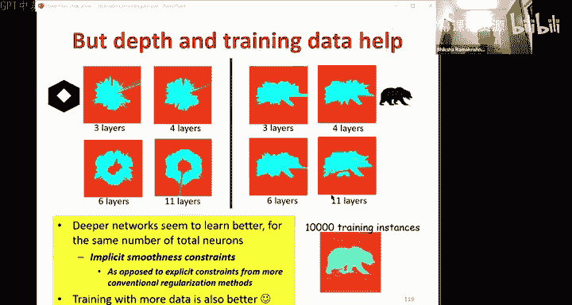
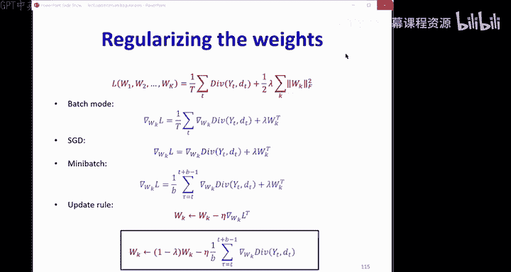

# CMU《深度学习导论｜11-785 Introduction to Deep Learning Spring 2025》中英字幕(deepseek - P9：[09]S2025 Lecture 8 - Training Part VI.zh_en - GPT中英字幕课程资源 - BV1xbZNYrEbs

Oops， can you hear me？Okay， it's eight o'clock， I'll wait a few seconds。

Or maybe half a minute for more people to join。All right。

So this is the last in the series of lectures on how to train neural networks here's what we've seen so far。

We train networks by minimizing a loss function where the loss function is the average divergence over a training set。

And this is only an approximation to the true objective that we want to minimize。

 which is the expected divergence between the desired and true outputs。

We minimize this using gradient descent。And we can do this either using batch updates。

 which process the entire training data before each update。

Or are using incremental update algorithms like a G or mini batch。Which can speed up the update。

Greatly and when you use HDd or mini batch， we have to randomize our inputs these these are also faster to converge。

We also saw that trend algorithms smooth out the variations and incremental update methods by considering long term trends and gradients。

 this can lead to faster and better convergence。So。Let's move on。

 we're going to talk about some issues of generalization and tricks of the trait divergences normalizations drop out and a few other things。

 so first we'll talk about the divergence。Now the loss function is the average divergence over a whole bunch of training points。

So how where your gradient descent converges is going to depend on the loss function。

 which in turn depends on the divergence function。 So ideally。

 the divergence must have a shape that results in a significant gradient。😊。

In the in the correct direction。Well， it's not at the optimum。

 so the gradient must be of the kind which guides the gradient descent towards the optimum。

So this means is that the the divergence must be smooth and not have lots of poor local optimum。

 for example， if you had a divergence function， which looked like this figure to the left。

Would you think that's a good function or an ugly one。

 the divergence function to the left as this good or bad in your opinion， what do you think is？

It's bad right now here are two divergence functions on the right。Both of them are nice and smooth。

 they both have a light a nice global minimum， but which of the two to the right is the better choice。

Anyone。The blue why。So。Let me explain。You want low， you know。

 the slopes are low far away from the optimum， it's bad。If the slope is high at the optimum。

 that's also bad， because in that case， what will happen is that when you are far away because the slope is small。

 you're going to converge very slowly。 And then when you get close to the optimum because it's steep and the step size is proportional to the div to the derivative。

 you're going to take large steps and bounce out。 whereasas if you have something that's a bold shape like this。

 which is steep far away from the optimum and shallow near the optimum。

 then you will take large steps when you are far away and smaller， more careful steps。

 close to the optimum， So the best type of divergence function is steep， far from the optimum。

 and shallow at the optimum， not too shallow， I rate must be quadratic。😊。

So here are a couple of popular choices for divergence。Now。

 if you're trying to predict real valued terms， then the L2 divergence is very popular。

 which is half the if you're predicting a scalar， it's half of the squared error。

Whereas ifre predicting a vector adds half of the sum over components of the squared differences。

 So this is the sum squared error divided by half this half is basically a convenience factor。

 which we always have on the other hand， if you are performing classification。

 then the desired output if you just have a single output it's going to be a binary output 1 or0。

 in which case we use the k divergence。Which is if D is the desired output， y is the actual output。

 it's going to be minus d log y or minus of 1 minus d log 1 minus y。

And this is for a single output if yourre binary classification。

If you are performing multi class classification， then the output is going to be a vector。

And the ideal output vector is one hot。And in this case。The divergence that we typically use。🤧Is。

The KL divergence， which is the sum of all components of D logg b minus D log y， we've seen this。

But then even when you had a classification task。It's perfectly possible。To use the。L2 L2 divergence。

 it says that here D is going to be1 or0 here it's going to be a one hot vector。

 so why do we use the KL divergence and not the L2 divergence when we perform classification？

Let's take a look， so this is whatm predict if I'm predicting a single output for classification。

 this is what the KL divergence looks like。If， for example， your ideal target output is 0。5。

 the KL divergence is become is going to have a z at 05 and it's going to be very steep out at the boundaries。

The L2 divergence for the classifier is going to be a nice bowl。

 which of these two would you think is the nicer divergence as far as convergence is concerned。

Which of these looks nicer。L2， right？Why don't we use L2？Because。If you think about it。

What happens is you have the aine term C。Which goes into your sigmoid activation function。

And then you get a why。And you're taking the。Divergence between D and y out here。

 So are at this point， the L2 is a much nicer。Function then the care。

 but if I looked at the loss as a function of Z， what do you think it would look like？

Here's what it looks like。It's if I look at the loss as a function of Z。Then。Interestingly。

You find that the L2 is。No longer。Con no longer this nice convetx function。

 So when I look at Z going into my sigoid my。Softm。

I'm my logistic and I have a y outside and but D and I compare the laws out here。

Then if I plot this loss as a function of the C， then we find that for the case。

 if when we have the care loss。That is a nice convex function， whereas for the L2 loss。

 we get this flower shaped thing so given this， which of the two losses do you think we should choose should we be choosing K or should we be choosing L2。

Care clearly right so just at the looking at it in terms of the latest variable is not enough so here is the same thing plot of L2 and KL dives for a single perceptron as a function of the weights when you have two weights and you can see that you know in this case again I have a perceptron I have two inputs each of them has a weight。

W1， W2， and then I compute this and this is Bura sigmoid and I'm computing the loss。

And so if I plot this loss as a function of W1 and W2。

 this is what it looks like and you can see that。The L2 divergence is no longer convex and the KL divergence is nice in convex。

And this is said this is because the logistic has a log in it。

 which compresses large values and maintains small values。

 so the KL gets compressed but not enough for it to become non convex。

 the L2 in the L2 these large values get compressed to a point where they basically it ends up becoming like a nonconvex flower like shape。

So L2 divergence is not convex with respect to the weights。我で。Caless convics。

 although both of them have a unique global minimum。So any questions？Any questions， okay， if not。

 let me continue。Another thing。So when we perform， when we train it， when we perform influence。Then。

We are going to have some activation out here and you make predictions if you're predicting real valued outputs。

 then you have a Z out here。And by out here， you typically just use an identity activation。

 so here y is going to be Z。Whereas if you're performing classification， you get the Z out here。

 but then you put that through a softm to get a y。And once again， when you compute the in this case。

 where you're predicting real varied outputs， you would be using the L2 divergence。

And when you compute the gradient of the L2 divergence with respect to Z。

It just turns out that this is simply the error between the target value and y。我啲。A regression case。

When you're performing classification and there's a softm over here， then two。

 here if you come take the divergence of the KL divergence with respect to the Z over here。

Then do you find that that。Deevted that gradient is simply the error between the desired output。

And the output y， again， in both cases， it turns out that the gradient of the loss with respect to this aine term is simply the error between the desired output and the output of the network。

In this case， it's the output of the softm， in this case it's the output of the linear activation that makes sense to everybody。

A over here。So which is why？You know， using KL makes sense when you have classification there too。

 the derivative with respect to the aine them is just the error in both cases， just the error。

 which is why back propagation is often called error back propagation because it's this error that we are back propagating。

So。That derivative is the error， so you end uproppating the error。Let we got some polls。

Why transpose okay， the gradient is the transpose， that's why。The derivative will remember as。

As the same shape as the transpose of the variable。

 so you have to transpose the derivative to give the gradient。Okay，10 seconds， guys。Okayright。

 let me stop this。And here is what all of you thought。So now I'm going back。

Can tell me someone tell me the answer to the first question。

 which of the losses is cons with respect to the weights care， right？And。For most popular networks。

 a regression network with a final linear layer using L2 loss or classification with softms and crossenttropy。

What is the gradient？In this case， in both cases。Is it different in the two cases or what is it？

And it's just one right， we just said， that's what we just said in both cases， the error is just a。

 the gradient is just the error。Beautiful。So it makes things very convenient。

So the story so far gradient descent we saw can be spread up by incremental updates and convergence can be in producing smoothed updatess。

 the choice of divergence affects both the learn network and the results。So on to the next topic。

We are going to be using mini batches for the most bit。 but when we use mini batches。

To update our model parameters， what is the assumption behind using mini batchs anybody？

What is an underlying assumptionion between using mini batches？Anyone。

So would it be okay for me to say that I expect that the overall distribution of the mini batch is going to be similar to the distribution of the overall data？

We make the right and so you'd expect that if each of these colored patches represents a mini batch。

 then they all have similar distribution。In reality， they're not going to be very similar。

 particularly if you look at some strange location inside the neural network where data have shifted around。

 and they can， in fact， be very far away from each other。 So in this case。

 none of the mini batches is truly representative of the overall data。 So what do you want to do。

 You want to move the mini batches all。 somehow so that they all fall in the same region of the space but what is this region and what is the shift for each mini batch It's not known。

 So the way we can do it is to first shift all the mini batches down to origin。😊。

How do you shift a mini batch of data down to origin？Anybody， how would you do it？

You just for every value， you can just take x minus mean of the mini batch and that that means it's going to be centered in the origin。

To further standardize it， what can I do it， what can I do？

I can divide by the standard deviation of every component right and so this is going to。

Standardize each mini batch by centering it and normalizing the variation。 And then once you do that。

All of them lying in the same space， you can move all of them out to some common region and we can even find out how to shift this this business of normalizing each mini batch and moving into a common location is called batch normalization it actually is mini batch normalization we don't use the term mini so it's batch normalization So here is our second poem。

And let's see。30 seconds。All right。Okay， let me end this poll。Here's what all of you thought。And。

What is the answer？One， right， we are miniizing the accounting for this shifts。

 the covariate shifts between many batchs。So this is the correct answer。So where do we apply this。

 we can apply it at any location typically apply you apply it to this aine term just before it goes into an activation and it's going to be done independently for every neuron in the network。

And now in during training， the adjustment occurs over many methods。

So here's what is going to happen in a typical neuron。

 you have a bunch of inputs and you first compare compute an aine term。

 which is sum of these inputs plus a bias that is put through an activation。

Batch normalization occurs。Between when the aine term is computed and when it's put through the activation。

 So the batch normalization converts this aine term Z to this term Z hat。 Now。

 how exactly do we do it First， you compute the mean of the entire mini batch。

 So this is the average of the aine terms for the entire mini batch。

Then you also compute the variance of the entire mini batch， and then from every one of these Cs。

 you first compute these， you center it， which is to say you move those things out here， right。

 so that you do by subtracting the mean。Of the mini batch from each Z and dividing by the standard deviation。

 this plus epsilon is mental driven division by zero。So now this step。

 this step is computing the mean and variance of the mini batch。

This step is basically shifting everything， the entire mini batch。

 every shifting all the instances of the mini batch so that so that the overall mini batch is centered。

And then， subsequently。Every not instance you as there is first scaled。And then shifted。

 So that is this operation。 This mini batch is scaled to some to some standard size and shifted to a standard location that is done by multiplying each instance by the scaling factor gamma and adding the shift term beta。

 So these。This is this these are mini batch statistics。

 every instance in the mini batch is normalized using mini batch statistics and then every instance in the mini batch is shifted to the new location is this making sense so far。

So。You compute the variance， square root to the variance is the standard deviation。

So this step over here。 and I can just write it like。 So right。 You've got Z。

 you normalize the Z to U。 That's this block。 And in this block， you is multiplied by gama。

 and then youve had a beta to get Z hat。 And that's passed through the activation。

 This is the actual operation of bachelor。😊，So somebody asked。

 how do you perform black propagation in this case？

It turns out this little operation actually causes a lot of grief。

The mini batch laws we know is the average of the divergences for all the training instances。

In the in the mini batch， so we perform mini batch and scalrs， Z is not a vector。

 going you're going to be doing it component by component for the vector。So anyway。

 here's the mini bachelors， this is the average of the divergences over the entire training set right so when you if all of the training instances are individually and independently processed。

 then the derivative of this loss with respect to any parameter is the average of the derivatives of the divergences for the individual parameters with respect to that。

Prameter so here you can just compute this D dive over Dw independently for each instance using backdrop。

When you're not doing in conventional training， when you don't have bachelor。

But then when you have batch norm， things get complex， why， because。The output of any network。

 any neuron where bastom is being performed。Depends not only on that one instance of the mini batch。

 It also depends on the mean and variance of the entire mini batch， which means that for each y。

 the y depends on not just that instance， but the entire mini batch。

And so the divergence for each five depends not just on an individual x。

 but over the entire mini batch， which means I can't just use this simple rule over here to compute the derivative of the divergence over here。

Is this making sense？Okay， so how does it do it， the correct way to think about it。

These are all the Z's of the mini batch， so Z1 through Zb。Bch norm is a vector operation。Which。

Computes all disease。It transforms all the Zs to their Z hats and if any one of these Z's changes。

 all of these Z hats will change so when I'm trying to compute the derivative with of the loss with respect to any ZI I have to consider all of these guys。

So， let's look at this。Relationship more closely but let's look at the influence diagram。

What does mini batch normalization really do？All of the Zs。Influence the mean。Of the mini batch。

All of the Z' and the mean of the mini batch influence the variance。

And the mean and the variance influence the use。For the normalized values for the entire mini batch。

Subsequently the normalized values independently put through this scaling and shift to get the z。

 the updated Z or for every instance of the mini batch。

 so as this making sense here batch known has two steps， the first is normalization。

 the second is scaling and shifting so end during the normalization every incoming z influences every U。

 because every z influences the mean and the variance and V influence the U。

And the scaling and shifting each you just influences its song Z independently， does this make sense。

对。Okay， what do we need to scale and shift you don't need to。

 but scaling and shifting puts each data， each neuron each variable in its own local region of the space。

 and that seems to make a big difference okay？Now， when I'm performing backdrop。

I can compute the derivative for the loss with respect to E Z。

And then I can transfer the derivative backwards and compute the derivative with respect to each U so this is the batch forward pass right。

 you computed the mini mean and the variance of the mini batch normalized each instance。

 scaled and shifted it。Mve been imp performing backdrop。

I would first have the back propagation algorithm would have given me the derivative of the loss with respect to the Z hat。

This derivative must now be shifted back。To give me the derivative with respect to you。

But then I have the hat。Heals。咁乜要。Plus， bid， right？

And gamma and beta are learnable parameters I already have D loss over DZ hat from background。

So what is the loss？Over the gamma。What would this be guys？Given this relationship。

What is the loss of Gamma？Anyone。Test you。D loss over D gamma is going to be D loss over DC。

Times Dy over Dgamma， right。Yes or not。So what is this？So what is this？上么。

It's going to be delo over D。Times要。And so this is how I compute the derivative for this time。

 what is over D loss over the beta？What is this？What does the loss of a deta anyone？

That's just going to be D loss over Dz， right？And what is G loss？

So that gives me the derivatives for the parameters of this clock now I need the derivative for you。

 so what is d loss over D。What is this？What is the loss over to you？Anyone。

This is easy S is going to be the loss over to you， D。Times。God， right？

Straight up derivatives and so using that。We can compute the derivatives for the parameters of this box。

 namely beta and gamma， and then take a step back and also compute the derivative for the U。

Once you'll have done that， so these of course can be used to update the gamma and waitta parameters。

So at this point， I have derivatives of the loss with respect to every one of these use。Now。

 my problem is how do I convert these？First one， this is Dlo Z hat， is it on Z hat side， out yeah？

And this is Z， we want to compute de losss over easy。

So at this point we have the derivatives of D loss over D。

 derivative de loss over D basically the derivatives for all of these use。

 these must be propagated to get the derivatives for these theses and that's the complicated bit。

So how do we do that？For this， before we get there， and let me actually release the third bowl。

And let's see what you guys say。嗯。We'll give 15 seconds， guys。Okay， let me end this for。

Here's what you guys thought。Stop sharing correct。First question， what is the true statement？

In Vietnamchna， the normalized U eye depends on all the others the is true our fault， right。

So the use。Depend on all the disease， not on the other use， so the first statement is true。

 second one。2防。So it's a true， right？And so the first statements to the two top statements et true。

 so now let's go back。And let's see how we compute the letters。

 Here's the complete dependency diagram， every Z。It influences everyU each every Z influences the mean of the mini batch。

 all the z's and the mean of the mini batch influence the variance。

The U each U is influenced by the local by its own Z。

 but also the mean the variance is this influence diagram making sense？This one over here。

And I get a few yeses。ok。So， now。Well if I have a loss， all of these views influence the loss。

So if I want to compute the derivative of the loss with respect to any ZI。

I have to sum over all the use at sum over all the use。

 the derivative of the loss with respect to that U times the derivative of that U with respect to Z R。

 I can't just do a simple chain rule。 I have to do the distributed chain rule。Is making sense？

This one here。Why I need this， okay？接算了。I say one or two kind of solitary assets。

Does this need clarification guys， okay？The loss， if I want to compute the derivative of this loss。

With respect to this Z。I can't just compute the derivative like this why。

 because this Z also influences every other U， so I have to sum over all u。

 and I am going to have to sum the derivative of the loss with respect to that U times the derivative of the U with respect to Z。

Because of the complete dependence， because every Z influences every U， that makes sense。ok。

So this makes things complicated， okay？This term， the derivative or the loss with respect to use already computed this。

I what we need to compute， we need to data compute the derivative of every U。With respect to every Z。

If you want the lost derivative for all these。So let's see how we compute this。

 let's consider a specific case。Let's consider a case where I' am trying to compute the derivative of a specific Q with respect to its own Z。

 right， So U I with respect to Z I。 What are all the dependencies between U I and Z I first。

There's the direct click ZI directly goes influences you are。

So observe that this node has three incoming edges right so to compute the derivative of you with respect to Z it had to sum over all three incoming edges。

One directly from Z， one from UN one from Sigma。So the derivative is going to have this one component。

 which is the partial of you with respect to Z over this ta path。Can you see the second derivative。

 what is the second component anybody？What would it be？The second term。

It's going to be D over Dm times Dm over Dz， right？And then is there another？What is it？

What is the third one？D U over D sigma times d sigma over d d0 and sigma again connects to z through two paths。

So this is the actual derivative of view with respect to Z。

Let's see how that works right what is D over DZI so here here is the Oon u equals z minus me over sigma squared square root of sigma squared right so what is D over DZI guys。

Was DUI or TCI， anybody？It's one over。我的我 what。1 over the standard deviation right。

 the U or DZ is1 over squared of sigma squared plus epsilon。So I can just replace this first term。

What is D over Dm this chain so that that was this derivative？What is do overee me of this like。

 what is that？You can still use this formula， what is it？Anyone。

That's minus one over the standard deviation because mean has a negative sign。

And so I can stick this over here， right？What is D so what is D mu over Dz again mu as the mini batch mean。

 what is D mu over DZI for any ZI using this formula anybody？What is it？It's just one over B。

 correct？So from this one。So this is what it would be。And so I can stick that over here。

 everybody good with this so far。Yes， I。Give me a thumbs up if it made sense， then okay。

What is D so now we've got these first two terms， what is D over d sigma squared？

You have to use this formula right what is D over d sigma squared？Anybody？So I can write this as。You。

Equals z minus mean。Timemes。Sigma squared and。plus epsilon。Raised to。us1 over two， correct？

So if I take the derivative with respect to sigma squared， that's going to be minus1 over 2。Dmes。

Z minus六。Times。Sigma squared plus epsilon。Raace two。-3 over 2。

You guys remember this from your already。Calculus class， right？Yes， no。对吧。Right， and so that is easy。

I can actually write this formula down。This guy here is。

inus z minus mu over 2 sigma square plus epsilon raised to minus 3 over 2。

 that's this  derivativetic。And so I can stick that over here。Coect。😊。

So that now only leaves me with this final term。 What is the derivative of sigma squared with respect to。

Z。Now， let's look at this derivative sigma square respect to z Sigma squared has two connections to z the first is directly from here。

 so it has two terms sigma direct。The derivative of sigma squared with respect to z。Over this edge。

 and then over this edge， it's a derivative of sigma squared with respect to mu times the derivative of mu with respect to z。

Is this making sense to everybody here？This one， yes， no。Okay。What is this first time。

 what is derivative， what is this guy， anybody？So Ra up， how did I lose you？Sigma squared。

 how is that sigma squared related to the dependence between z and to Z。

 the dependence between z and sigma squared is this， right。有lishia。

So that means the derivative over here， you need one component over this edge and the other over this edge。

 yes。Yes， those are these two termss。So。What is derivative of sigma squared over Z anybody again。

 you can use this formula， right？It's simply going to be22 over V Z minus me。Easy。

 so I can stick that over here。What is the derivative of sigma squared with respect to mu？

I can use the same formula here， right？And if I do that。

 I'm taking the derivative with respect to you。 So let me write it out。

 That's simply going to be1 over B times the 2-2 comes out。Smation of z minus命。Right。😊。

I can pull out the minus-2， so minus-2。1 over B summation Z minus1 over B summation mean。

 I' just sort of expanded this out what is this term over here？So is this making sense？

Is this formula making sense first， this is directly from here？Is this making sense？Okay。

 can you see that this this translates to this？I just moved the minus two out and one over began。

Right。What is this guy over here？What is this guy， I'm adding new B times， but I'm dividing by B。

 So what is that。That's going to be just one hour B times。微妙。And so the be will cancel out， right。

 what is this？What is this？That's just me right， and so when you look at this guy over here。

This derivative。This whole thing simply becomes。-2 times mu to mu minus mu that is0。And so。

 as a result。What happens here is that。This term becomes0。

 we don't need to even worry about this gap， so this whole thing goes away。

You just get these derivative sigma squared with respect to Z as this one term。

Which I can plug in here。And so this crazy formula， which is the derivative of you with respect to Z。

😊，Once you actually work through it with the help of diagrams， it's very easy to derive， is it not？

There was nothing complicated。Did anybody find this to be complicated？

It's easy and so that's what it is， right， but that's for UI with respect ZI。

This is for the through line， right？What about for something like this， UGA with respect to ZI。

 what is this， what are all the dependencies you see over here？Can you point out。

What are the dependencies？Anyone？Between U2 and Z1， for instance。What are the dependency paths？

There's this path， so this one is going to give you to you over。De you tabs de you over D C。

And then you get this path， which is D over d sigma squared times d sigma square over Dz。And so。

This is similar to the equation for i equals J， but without the through term and if you actually work it out。

 it's just going to be minus1 over B times squared root of sigma squared plus epsilon。

And for the term that goes through the variance， it's going to be minus because it's I and G。

 it is minus Z I minus mu。Times times Z J minus mu divided by B。Ts sigma squareds to  three over2。

So again， no need to go you know， deliver this too much， but here is a very simple formula。

The derivative of U J with respect to Z I， when J equals I has these three terms。

When Jay's Noric about light has these two terms。ok。😊，And so。Now。

 remember that the derivative of the loss with respect to any Z must sum over all the use right this was the derivative of the loss with respect to anyz。

And so the derivative of UG with respect to ZI， we just saw that this was this formula， right？

If I plug this formula into this derivative of the loss with respect to Z， just plug in。

I end up with this crazy formula which I don't expect anybody to memorize。

 but my point is it's very easy to derive。And if you ever decide to come up with some variant。

 you can derive it yourself using this nice dependency。plots。And so when we perform batchcheon。

The derivative of the loss with respect to Z I。Given the derivative or the loss with respect to Z hat is given by this。

Nasly looking formula and once you have this， the rest of the backdrop can continue from here。

But then this one little thing that is that you had to be very careful about。

 So let's say I have a batch okay and let's say all the instances in the batch are very similar。

 so all Z I is approximately equal to ZJ or all the instances in the batch。O。😊，そう。

Or the batch consists of a bunch of almost identical instances。Then for any guy。

 what you would get is Dl over。Do you I。Is going to be approximately equal to dl over。D UJ。

 because all the instances are almost identical。This making sense so far？

Because I'm going to continue from there， so is this making sense？O。

So assuming that all the deal over DUJs are the same， what does this guy look like？This time。

All of them are identical， right， so this is simply going to be1 over B。Gmes。

1 over square root of whatever G times B times。D loss over。理由。

Right because all of these terms are identical for the mini batch are almost identical。And。使れらしいますか。

This B and this B will cancel。 And so yet this term simply becomes minus。

1 over square root of sigma squared。你球。我，我理。I making sense？Others and her down。

This time over here becomes dys oneia。Yes， no。Is it making sense， guys？Invest okay。

 and how does this term relate to this first term？This is1 over sigma squared dl over D。

 this is 1 over sigma squared minus dl over D， so what will happen is that these two guys will cancel out。

Can you see that？Okay， let's go to this third。This third term has this。

 If D loss over D is almost the same for all of them。

 then I can just write that as D loss over D U times summation。Z z minus mean。ok。😊，What is this guy。

 What is summation Z Ym？Me being the minibech mean， what does this？

You already showed this this becomes zero， correct， so this also goes away。

So what does this tell us that if your mini batch consists of essentially。

Identical or near identical data in strain instances。

 then the derivative of the loss with respect to z is simply going to become0 and the back propagation is stopped right here。

 so it's very important for the case in the case of batchchelor or the mini batches to have diversity because if they don't。

 then your derivative back propagation is going to stop at the batchchelor。So Daisy。

 both have been tried and that's a different empirical thing。

 some claim that it's better to do it after the activation others think it's better to do it before。

You must experiment， I think it's birds better after the activation。

 but again that's a bit of a debate， right？From a derivative computation， there is no difference。

All right， so 10 seconds guys。Let me and the po。Here's what you thought not to answer say a question。

 you can use batch on variable on any subsetsid of instances， it doesn't matter。

So this is what it thought， does somebody want to answer the question？True or false bathroom。

Blots back propagation and prevents gradient computations of all the instances are made identical and very similar。

 true， right？So。You want mini batches to be diverse。

Now that's during training but what about during inference when you're performing inference you don't actually get a mini batch。

 you're performing inference over individual instances but you still want to perform the same computation right so where do this mean and variance come in for your testing instance。

When you' are performing testing individual instances。

 the individual instances are not part of a batch there is no mu there's no signal。

 so what we do here is to compute the average mini batch mean over all of the training mini batches and the average mini batch variance over all of the training mini batches so once the model is fullytrained then you'd pass all of your data through the model and compute these mini batch means and variances for each mini batch and take their average。

Not more realistically， it just to a running average。 And that is what you would use。In the baknob。

In the during inference。Is this making sense？Yes sir。You're going to encounter this in your homework。

 Okay， so Si during inference， you don't really have。

A mini batch so you can't compute a mini batch and mean it a mini batch variance。

 so what you would do is once the model is trained。You pass all of your data through the morning。

And you'd compute the mini batch mean and variance put all of the mini batches in your training data and average these guys。

 You don't actually have to gather all of these。 You can do this as a running average。

 just as we did in the case of momentum， that's one。Okay， and that's what it would use。Influence。

Now batchn could be applied to only sound layers or even some selected neurons。

It improves convergence rate and neural network performance in every case。

Anecdotal evidence is that batch norm eliminates the need for dropout， which we will discuss shortly。

To get maximum benefit from batch， learning rates must be increased。

 and learning rate decay can be faster。😊，Since the data generally remain in the high gradient regions of the activations。

And yeah。Inprints would be instance， by instance。You need better randomization of training data for bam to work。

 but once basorm works how well does it work in the first paper UF and Zri showed this beautiful thing that without basm here is a model slowly struggling to convergence but the moment you throw in bash on hoops in a fraction of the time it's gotten to a much better result。

So that's a typical result of ba no networks。And so。TheTo continue the story so far。

 gradient decent can be spared by incremental updates con convergence can be introducing smooth updates。

 smooth updates， the choice of divergence affects both the learn network and results。

Covariiate shift between training and test。May cause problems or between training instances。

 forgetge about test and can be handled by bash normalization。Oh that is great。😊，But then， you know。

 in everything that we've said， there's a little bit of。Something not entirely chill， right？

So how's that？When we tried to learn a function， we said we were going to try to learn it from a small number of training instances。

 right？And we hope that when you fit the data model on these training instances。

 it would fit the function everywhere and the way we do it。You have the training data。

 then you actually have the current function and so there's going to be an error between the desired and target values。

 actual values at each of these instances， you take the average error。

 average dive which could be L2 or KL or whatever and minimize this。

The problem is there's nothing stopping our model training from just fitting only the training data instances and doing something like this。

So is this red curve？はい。What you really want。Why is this broken？What would you think。

It's not what you want， right， this looks broken， right？

So we need additional smoothing constraints to make sure that it doesn't do something so stupid。

And this is needed for generalization， but first。😊，Why do that， why can't such behavior happen。

 so let's go back and consider a simple binary classifier。

So we have scalar inputs and scalar output test format illustration。

 and so these red dots are one class and the blue dots are the other class。

Your ideal classifier is going to look like this blue curve where the probability of1 goes from zero。

 class 1 goes from  zero and slide smoothly up to class 1。But then。

Remember that your neural network is a universal approximator。

 It's fully capable of also learning this model。And this model fits the training data perfectly。😊。

But is the purple curve something that you really want， or would you rather prefer the blue curve？

Which one would you want？The blue， right。And so the question is， why is this purple curve even。

Possible。To understand that。We have to look at the network。

This purple curve happens because you get these very sharp changes。

And these sharp changes can happen because the perceptrons in the network are individually capable of sharp changes in output。

So。Let's see how let's consider a simple sigmoid activation。

 but it's also also for other activations a sigmoid activation is 1 over one plus key raised to minus w。

 right？😊，And now。As I keep increasing w when W is very small， the sigoid is very shallow。

When W becomes infinity， the sigmoid basically becomes a step function。

So as the magnitude of W increases， the sigmoid becomes steeper and steeper and steeper。

 this making sense to all of you。喂。I see one， Yes。 What about the rest of your guys。Okay。

And so we are able to get this crazy undesired function because every one of these perserons。

Is able to just adjust its W parameters so that it basically becomes something very steep。

 like a step function。So how do you prevent this from happening？

How do you ensure that you get a smooth curve？Anyone。How do you prevent this from happening？

Paization。You want to constrain the weights w。To be low。That way。

 if you force W not to prevent W from becoming too large。

 then the individual perceptrons will never become so steep and so then you'll end up getting a smooth curve。

This making sense， yes or no。Okay， and so that's what we will end up doing。So how do you do this？Now。

 remember。That in your conventional training you have a loss function。

 which is a function of all the network parameters。

 it's the average divergence over the entire training data。

And you minimize this loss function with respect to all network parameters， right。Now。

 in addition to the regular loss， I' am going to add a second term。

 which is simply the square number half of the square norm of the weights themselves。

 and this augmented loss function as what I will minimize by minimize this augmented loss function。

 What will happen。 It will not only minimize the average divergence。

 It will also additionally try to keep the weights low。Is this making sense？夜算啦。嗯。

And this lambda term over here。Besidess how important it is according to us for the weights to be kept low。

 okay？And so。Because you are minimizing the loss， when you are minimizing the loss you will also be minimizing naturally the squared norm of w because the squared norm of wina is now part of your loss。

That answer said。ok。So， now。Let's see how this works out， right？In I performing batch training。

Then in the case of batch training。The loss is going to be the average divergence over the entire training data。

Plus。This regularization term。 So when I take the derivative gradient of the loss with respect to any weight。

 it's the average gradient of the。A loss gradient of the loss over the entire training data plus。

 And now the second term is the derivative of the guy。 The two comes out and cancels as half。

 You are just left with lambda times the weight weight matrix itself。

 So what has happened similarly in the stochastic gradient instance case。

 You are only using one data instance at a time。 So you just have one divergence And now the derivative gradient of the loss or the derivative of the loss is going to be the original derivative of the divergence。

Plus Lada times the weight matrix， or if you're doing mini batch。

 it's going to be the the average derivative of the divergence over the mini batch。Plus。

 lambda times the weight matrix。 So all that happened when you use this regularization is that this weight matrix itself gets added。

To the derivative of the loss with respect to the weight matrix， as this math making sense。

 this is very simple。 This is， in each case， you just got the second term。

 which is the derivative of the。Squared no， does this make sense？Everybody。

 and I see some yeses or no。ok。And now you get something interesting， right？ See， this is our usual。

😊，Grareient a rule， right， But then so what will happen as you were to get WK。Is going to become。甲企。

Minus。And then eighter times， let's consider this guy eighter times this term。Eer times。The average。

Divergence derivativein， right？And then there's a second minus eta lambda times。Doubly。Right。

 that's that comes from the second time。 I can groupove these two guys together。

 and you're going to end up with one minus。你得懒得。dubling。Minus。玩 word笔。

Sumation gradient derivative of the gradient。Of the divergtence， so is this making sense？

Is this update making sense here？也三个。It is， why does it have at 1 minus ata Because the Eta is also going to be multiplying this guy。

 right Eta is multiplying this guy and E is multiplying this guy。Okay， so this theta lambda。Okay。

 the one in the box I can here， I've just written this Eer lambda as a common Lambda， that's all。

What is the point of having an Eal lambda that's it right and so it turns out that when you use this regularization all it does is to scale your original parameters down by a factor 1 minus lambda and then do your correction you've encountered this in your homework what did we call it。

Do you remember what we called it？It had a town， right？We call it weight ranking or something。

 what did we call it？Do you remember this？Yes or no， maybe， right， exactly， thank you。我 did弟。So。

I can't forget remember things wrong wrongly weight decay right and so that's what it is what weight decay does is to multiply the current weight where decay factor and then do your correction all it's really doing is regularizing your。

Wais to make sure that this stays small。That makes sense to everybody so far。O。And so。

Then the standard mini batch update， all that happens is that your double is now multiplied as mark by1 minus lambda before you do your correction。

Now here's another way of doing it。So smoothness can also be imposed through a network structure。

Your network is typically many layers right and each layer is going to be transforming your surface if you can think of the input as going in as a flat flat surface and each layer is reshaping this flat surface now it so happens that。

As if you start up with something really wonky， each time you go through a layer。

the what the depending on the weight matrix of the layer。

 the overall surface is going to get less and less steep and so the more layers you add the less steep。

 the less。AJgged the surface gets and so for a given number of parameters。

 deeper networks impose more smoothness than shallow ones because each layer by itself。

Damps some of the jaggedness in the network let's see how this works here is an example of two different decision boundaries and here we chose a000 training data points from each of these。

And trained a fairly complex network。And through every single trick that we had in the book。

So this was actually done for me by Paul Kiha Garva who's now a professor in MIT。

 and you can see that。You don't actually learn this decision boundary， you end up at this garbage。

 you don't learn this decision boundary， you end up at this garbage。

Using1000 training data points on the other hand。

Now， in each case， we had 616 neurons in one day， okay？

So now let's do something else Here are a couple of decision boundaries one looks like this bolt。

 the other looks like a bear。In each case， I have 6，16 neurons， I have000 training instances。

 If I arrange my 616 neurons as three layers of 2，20 neurons。

 this is what the decision boundary I learned looks like。

 If I arrange it as four layers of 115 neurons。Then it ends up looking like this。

If I arrange it as six layers of 110 neurons， it ends up looking like this。

If I arrange it as 11 layers of 16 neurons each， this is the decision boundary I get the same thing with a bear。

 you know，3，4，6 and 11。 in each case， the number of neurons is the same。What do we observe。

 which one gave us the best decision boundary？11， so what is the lesson that you want to get over here and the deeper networks impose more regularization and give you more generalizable better generalization。

Another way to do it is to just have a lot more data instances， training data。

 so this is with100 data instances。If I use a 10，000 training data instances。

 pretty much all of these models will give me the pair。

So to add to our lessons， data underspecation can result in overfied models。

And must be handled by regularization， and more constrained。Generally。

 generally deeper network architectures。So any questions？Yes， I have a question， Prof。

 they ask the lab down。Is it Club de dereg parameter。

 Did you randomly access it or you use your wrist its like what happens。This one here。

 that is a hyperparameter， you have to set it。啊，O。Okay。😊，So what are typical values for AD。

 if you've been through your homework， you will find out。Okay。Anyways。

Other techniques have also been proposed to improve the smoothness of the learned function like urban regularization of network activations。

 regularizing with added noise， and possibly the most influence method has been dropout what is dropout before we introduce dropout we want to introduce this notion of bagging how many of you have encountered the term bagging。

😊，What is baggging， anybody。What is baggging？You must have encountered this in your machine learning classes right so if I have a bunch of if I have a training data what I said。

You can either just train one model with it or a better technique is to randomly sample different subset of these training data and learn a bunch of different classifiers。

And then finally you vote over all of these classifiers to make your prediction。

 and there's a lot of theory to show that this actually is better than simply training a single simple class single classifier because this ensemble of classifiers gives you some kind of better generalization because it covers the space pattern so this is a very common technique and it's very successful。

 it's been around for a long time bagging。😊，Again， the idea is to train many different classifiers and then use the ensemble for your actual task。

Now， dropout， what is dropout？In dropout， you'd have a network of this kind during training for each input at each iteration。

You turn off the neuron with a probability 1 minus alpha。

 so you basically flip a coin at each neuron， which has a probability of head's alpha if it turns up tail you kill that neuron so for any particular data instance。

Although you start with this network because some of the neurons have been killed。

 the actual network you may end up using might be this one。So。These。

 all of these black and neurons have the ones that have been set to zero， they've been switched off。

By your。Dropout and they have been switched off according to the failure of a benoary random number generator which success probability。

So this making sense so far。Yes no。ok。So。The thing is。For every single training instance。

 we would do it differently， okay？So for the first training instance。

 maybe these are the guys switched off。For the second training instance。

 maybe these are the ones switched off。For the third training instance。

 maybe these are the ones switched off and now because you're doing afresh each time。The next time。

In the next steppo， when you encounter the same training instance。

 you will have a different set of neurons that are switched off。Rather than the same one。

 So basically， every time you encounter a training instance。

 you're randomly switching off some of these。 you not。

 So each training instance sees effectively a different network。

Forward the forward passes performed over this network and back propagation is also performed over this network。

 and you're going to be accumulating gradients for any given parameter only over the subset of networks where that gradient was invoked。

So。This is not to work very well。 What is the reason。There are a couple of different interpretations。

 the first relates it to bag。If I start off with a network of this kind。

Then by randomly switching on and off different edges， if the network has n edges。

 I can construct two rays to n possible different subnets。

Each of them is effectively different classifier。And then。What I'm doing is。

Basically now two race to n is going to be a very large number。

 so by flipping a coin I'm sampling from this two raised to n possible networks and I'm effectively learning to。

Train all of these two wayss to end different networks all at once。That makes sense？Yes or not， okay。

 and so we are effectively learning two ways to end possible networks and then during inference。

 you're going to be ensembling over all of them。So that's one explanation。Here's another explanation。

 If I have a rich network of this kind。During training。

 there' is absolutely nothing preventing my model from just learning a pass through in one layer in in some layer where this value is simply copied over。

When that happens。You know， because of whatever local optimization， right， when that happens。

 I've effectively lost one layer in the network。When I use dropout， this cannot happen because。

Every now and then this neurons。This guy will get switched off。

 which means this photo can't just copy things over here， it has to pull things from the side。

 and so you end up learning a much denser weight matrix than if you didn't have dropout。

Did this make sense？Right。And so here are the two reasonings。

 in one case you can view it as training an ensemble of networks where you sample from two race to end networks。

 and the other case you can think of it as forcing the neurons to actually get a look at more of the previous layer rather than just copying values over。

So how do you implement it？When you are performing the forward pass at each neuron。

 you're going to run a binarynoary random number generator to compute a mask。

The mosque is going to be either zero or one。And the output of the neuron is simply multiplied by the masks。

 So this switches on or off the neuron。Similarly， during back， you store this mask。

And the forward pass， then during back forag。The derivative at each neuron is multiplied by the mask。

 So if the thing had been masked going back in in the forward past， then obviously。

 it's not carrying any information backwards。 And so that will get masked out as well。 That's it。

 Basically， you compute mask in the forward pass and apply it。

 and apply the same mask in the backward pass。 Very simple。 So that's what you do for training。

But then。How do you perform inferences？Dropout effectively train stories to end different networks。

On the test data， you in theory you want to perform inference with every one of these two ways to end networks and compute average。

 so you want to take an expectation over the network of all neurons right this is what you want to perform if you're performing actual bagging is this making sense。

This formula here。That you're taking the expectation of all two raised and networks that you get by switching off different edges。

okay， can we actually compute this？Can we evaluate all two ways to our newed networks and average them？

Why not？Why not？Easy answer guys， too many right a typical network might have2 billion neurons you're not going to be able to do it so now we will use an approximation。

I'm going to say that the expected value of a network of wise。

Can be approximated as a network of unexpected value of vice。Do you see the approximation here？

And is this？Is this valid， is this exact or is this an approximation first place？

What do you guys think？It's an approximation， right， but then it makes this tractable。

And so now the problem becomes how do you compute the expected value of the alpha neuron now now come understand this。

 look at what each neuron is computing， each neuron is first computing its activation and then it the activation is being multi multiplied by a bernoli random variable which takes value 1 with probability alpha。

 so when I take the expected value of y。I'm just going to be taking the expected value of this benoli variable D。

 which simply becomes alpha itself。😊，And so all that happens is that during inference。

 every neuron is going to be neuron's activation is now simply going to be multiplied by the alpha。😊。

And so that's all you have to do in the forward pass。

 every one of these outputs is going to be multiplied by alpha。The expectation of D alpha。

I took an expectation as it。That's a bonoly variable inroability alpha， but answer a question。ok。

And so I'm just going to be multiplying all of these with alpha or。

Instead of explicitly multiplying all the activations with alpha。

 I can simply factor this alpha into the weights of the next layer by multiplying the alpha at h alpha for any layer into the weights of the next layer and storing the scaled weights。

And now I don't have to worry about， you know， having to deal with dropout during inference。

Because I've stored the scaled weights， I can just use the scaled weights directly。Or alternately。

 during the forward pass for all the neurons that remain。

 I can multiply the activation by alpha inverse。And then during inference I just use the regular activation。

 These are all different engineering solutions to。Computing this time， That's all。

But the idea of the inference itself should be clear to you。

Why the inverse because I can either multiply by alpha during inference。

Are alpha inverse during training？Did not answer your question， Daisy。Yeah， that's it。ok。And so。Now。

 we are going to be multiplying alpha inverses， only the neurons that remain alive by alpha inverses。

ok。And so here。Infer， you just multiply every on。And here are some typical results with Dout with Nikti Srivasta weal first reported it。

 they showed that this was an emist I think， that without dropout this is how the model converseged。

 but once they use dropout。The thing keeps getting better and better and better， it's just amazing。

So it doesn't work everywhere， but yeah， it's a great trick。

And there have been various variants on dropout like zone out。

 randomly chosen units remain unchanged or drop connect where instead of neurons you drop edges。

 things like shake out where you scale things randomly add noise， white out。

 these are all basic variants on the dropout idea take a look at you can look them up on the on the web。

So the story so far。AreAdding to our lessons。The final thing we've seen is that dropout is a stochastic data or more esion method。

That sometimes forces the network to learn more robust models。Any questions so far？Listens。

So it turns out that combining dropout with batch normalization is not a very great idea。

Because one of them reduces the variance the increases the variance they stand to cancel each other out。

Os on Piazza， it's a very nice question。Okay。There are other heuristics that we apply。

There's something called early stopping if you continue training on your。Training set。

 you might find that the loss on the training set keeps going down。

But on a validation separately held validation set at some point， it begins to increase。

Either the loss or the classification performance， that means that beyond this point。

 the model is beginning to overfit。So this is a standard technique that we use， we will as we train。

 we will test on a loss on a validation set。And whenever the performance and the validation set begins to。

Dive overge the saturate， we stop and this is the model we will use。

And there are many such early stopping criteria to decide when to stop training and to use the model。

Another thing is gradient clipping。😊，So in spite of all of our best efforts。

We will often find that the derivative of the loss can become very large because the loss function is very steep at some point。

If you use the derivative over there to train your model。

Then you will get large increments and unstable training。

 so there's a common technique where anytime a derivative exceeds some threshold， typically five。

 you cap it at that threshold。You also have things like augmentation where you create synthetic data。

 for example， if you're building an image classifier。

If you're trying to train a image classifier for Coca Cola cans。This is a Coca Cola can。

But then if I reflect it， if I rotate it， if I twist it， all of these are also Coca Colla cans。

 so now these are all synthetic data。That are obtained by distorting the original data and retaining its label。

So you can rotate， stretch， shrink， add noise and so on。

 This is data augmentation and often having a lot of data augmentation ends up being very critical to getting a robust model。

 So this is something that we also do。And there are other tricks， like normalizing the input。

 you normalize the entire training data to make a zero mean unit variance。

Which is equivalent of batch input on input， there have many clever initialization techniques like Xavier or King。

Sing validity compositionposition and so on。And then there's a key point here。

 neurons that look identical at the start。Will often stay identical so we often will we have to make sure that the neurons are diverse during training so Hannah what are you asking this question about。

What was the reason for what？I'm asking about dropout and batch normalization you said they cancel each other out what was the reason for that again？

So again， posters and piazza， one of them increases variance。

 one of them decreases variance so they tend to cancel each other out。あそ。

Because drop out each time you go over it， you're going to see a smaller。Set of values， right？So。

Anyway， in closing。Having outlined the process of training neural networks。

 we've gone through some history， a variety of algorithms looked at gradient disem based techniques。

Regularization for generalization and we've seen algorithms for convergence and heuristics but at the end of the day this there an art training neural networks is an art there's only so far science will take you and so to finally get it all the work is a bit off。

嗯。你好。Means not just。Knowledge， but also skill and intuition and practice makes perfect。

So I'll stop right here。And take any questions。I have a question。 Can you move to page 150。1 and15。

Yeah呀。

I 115 you， can you say a repeat， what is the weight decay， Thank you。So wait， okay。

 did you understand this vi right here？Why we have this Oh， yes， because of the regularization。Okay。

 so now this loss includes this term， right， so let me call this G。Let me call this capital D。

 right so the derivative of the gradient of the loss。Is going to be。The gradient of D。pl。W， right？

你个 landed得等。The second term was the difference。De bit of this， right？Okay。

 so if I use w as corrected as w minus eta times the gradient of the loss。

This is your standard gradient is， right。This is the same as W minus。Eer times。The gradient of the D。

The term minus Eta lambda。Her names W， yes。Which simply becomes1 minus and is going to count this Lada。

One minus lambda W。minus几多？你天病。Yes， which is this。Just this problem like here yes， yes。几。😊。

So which parties we decay。This is the red decay。You're taking the current weight and multiplying it by one minus lambda。

 right？Oh， yes。Yep， you're thinking the。So the way decay is a。It's very similar to regularization。

 it is regularization it is similar oh gosh。Thank you。Any other questions， let me stop the recording。

Well， I have another question whether， whether can move to page 131。

