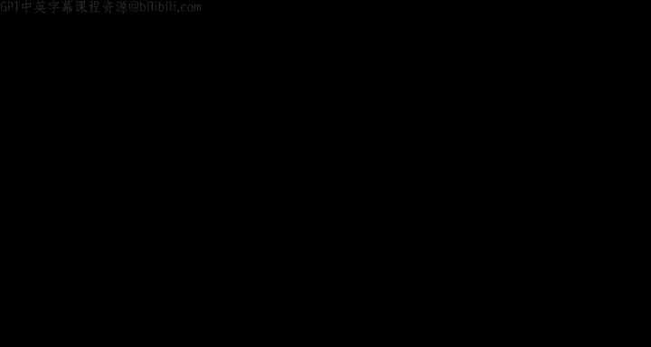
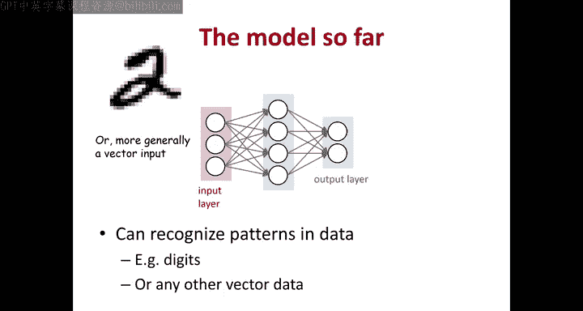
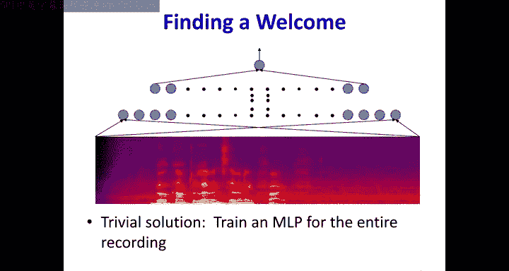
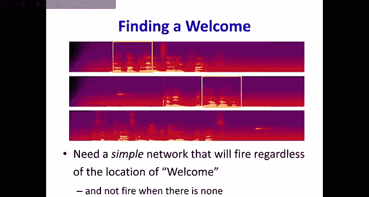
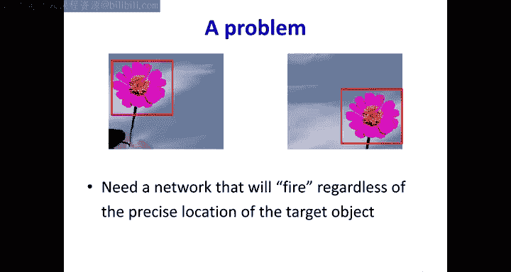
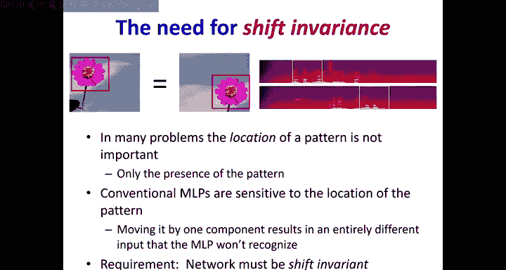
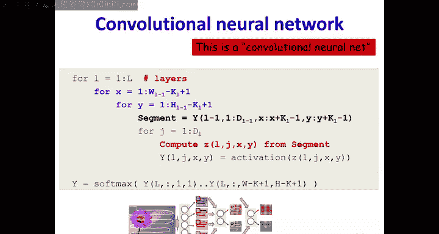
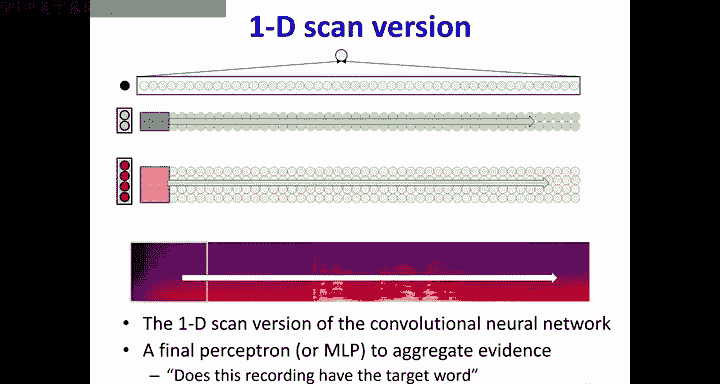
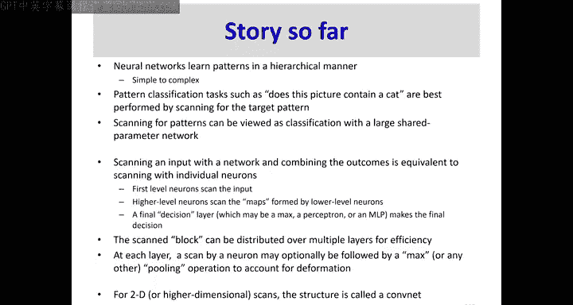

# CMU《深度学习导论｜CMU 11785 introduction to deep learning Fall 2024》中英字幕（deepseek - P10：[10]Fall 2024 Lecture 9.zh_en - GPT中英字幕课程资源 - BV1CfsReEEw8

嗯。我说应该写。Yeah。没有。嗯。你想玩。はい。嗯。そ道。Right morning， everybody。Please get set the usual rules。

Kindly shut your laptops and your phones。And just to keep yourself from。ああの。Being attracted by them。

 turning your phones upside down。And don't forget to sign on to the attendance poll。

 which is on the slides， right？Yeah。とこ。Atdependance poll should be。51， right。Okay。Allright。

Give everybody everybody a second for。Marking your attendance， and let's begin。Today is a very long。

That says usual 80 minutes， but then I have 290 slides because。Yeah， that's， that's this lecture。

 right， So let me begin。So here's what we have， I'll wait for you guys to shut your laptops。有啥的？

Thank you。So。Here's where we were so far。I get your name tags out， guys， if you can。

 We saw that ML LP are Boolean function appms。 I mean， the universal function appros。

 they can model any odd thing。😊，Cpoolean functions。Classifiers， regressors。

 they can be trained to approximate these functions through variations of gradient descent。

And the kind of models we've seen so far are of this kind feed forward multi layer perceptrons。

 where information starts。At the input layer， and then it goes progresses sequentially through all the layers of the network till it eventually arrives at the output layer where a decision or a prediction may be made。

But now， let me change the problem。And let me say， no， let's consider this model again。

And let's consider the problem of trying to recognize a wake up word。Now。

 all of you are familiar with the wake up wakeup words when you usually your Alexa。

 you just call call it Alexa or hey， Google or whatever。 That's a wake up word。So。

If you were to do this nightly。Then you're going to have your wake up word， which is some recording。

And。From this recording， you'd get。A sequence of features。

And this sequence of features is going to go into。Newed on that。Which produces an output。

offer三六。So this is how you would do it。 if you were to do this slidely。 So if I gave you this word。

 does this signal contain the word welcome。The obvious thing would be to first extract some features from it。

 maybe some maybe a spectrogram and then construct an ML LP。

 which looks at the entire spectrogram and takes a decision。

What could be a problem with the setup of this kind here。Anyone。

What could be a problem with a setup of this kind？So A， so this is a triviale solution， right。

 train and MLP for the entire recording。So， would。A recording a network that has been trained in this manner。

 so if the network we trained to recognize the word welcome when it occurs in the beginning of the recording。

Would it also recognize the word if it occurred later in the recording。Yes or no。Why not。

it's not present in the training data。 It's， it's there in the training et cea， there。

It's there in the training data。 It's just in a different position。 right。

 So if you were to look at the recording。As a vector。In the first case。

The pattern is occurring in these components。 And the second case。

The pattern is occurring in these components。 They are living in entirely different subspaces。

 Different components are being activated。So。If I want to find a wakeup word。

 what I really want is a network that's going to fire， that's going to output a yes。

 regardless of whether the word welcome occurred bigger earlier in the recording or later in the recording。

Similarly， if I were be， if I were to build a network to identify pictures with flowers。

Then the naive T adds， you know。Just begin with lots of pictures with flowers in them。

And put the whole thing through an MLP。And I going to ourya Sono。

So if I were to do this and we can actually do this with your M N。

Digit classifier does does a pretty good job。 We've got a 98% accuracy if you did that。

 But if I were to do that。Then would a network that's been trained to detect flowers when they occur in the top left corner of the image。

Also， output a yes if the flower were to occur in the bottom right。Would it。And yet again， why。

It's not position in。 It's in this is now because the second picture lives in a completely different space。

 Then the first one does a different set of components are being activated， right， So once again。

 we need a network that will fire， regardless of the precise location of the target object。So。

We have this kind of situation in many problems。 the location of the pattern is not important。

 Only the presence of the pattern is important， but conventional MRps are sensitive to the location of the pattern。

 Just moving the entire pattern by one component is going to end up with an input that lives in a completely different subspace。

 So you know， if I had a three dimensionmenal input， And in one case。

 the pattern occurs in the feature X In the second case， the same pattern occurs。

 but now in the feature Y， they are different subspaces， different coordinate taxis。

 So if you recognize something along X。 it doesn't mean anything about what you can do along y。

 whereas what we really want is something that is position invariant。So how would you deal with this。

Any auditions？对啊。系你个本是我。下。我没啥了，他 sorry的一个。処るされ。

我哋啊我就咩。Thank you。 right， You can scan。So what I can do is to train a classifier which looks at a section of the input that is roughly the length of the word welcome。

And then， I can analyze every。啊。Se segment of the input for the word welcome。

And what will this output here？That's going to give me an output for every single location， right。

 But the original question I asked was， is， does this recording contain the word welcome。

 How am I going to derive that from this collection of outputs。

 I don't want the output output for a single segment。 I want the output for。😊。

At the level of the recording。 So how would I do this and。嗯，Would adding do the do the job。Anyone。

是啊公对对。Yeah。What would MLLP be doing？Someone， right。I mean， this is easy， right， instead of which。

 do you have any idea of Miguel。Exactly， I need an R operator right and what would an R operator look like？

呃实际上。It's just going to be a max。 So here's the thing。 If I have a single。

 if the word welcome has occurred at any single location。

Then that location is going to output something close to one。

 And so if I just look at the largest output， if it's close to one。

 then I know that the record of the word welcome has occurred somewhere in the recording。And。

 of course， I can do fancier things like Add perceptron， as Theo mentioned， or an entire MP。

 some of you have mentioned， But they eventually you think as you're performing an awe and an a is just a max operation。

😊，Right， so this is how you do and。So here's what you do。 You'd be scanning left to right。

 And I at each position， you're going to be looking at a。Section of the input。

And youd pass the section of the input through E through and MLP。

 So you're going to get a collection of outputs1 per position。

 And then you can take a max or a soft max of the entire collection that comes out。 And this is。

 this is good。 This is going to be position invariant， right。😊，But then if I look at it this way。

 the whole thing is just one giant network。 because why remember the Mac， soft Mac。

 all of these are standard percepts。 And so I had。😊。

an output at every single position and all of these outputs were passed through a downstream perceptron or MLP to get my final output。

 So this entire thing is just one giant network with one minor modification at the lower layers I have many subnets。

And all of these submits are identical。So it's a large network where the global layer networks are are all shared。

 They are common。 It's a shared parameter network。 And the entire network is shift invariant。

 If the position of the pattern moves， the output does not change。Make sense。Questions。Anyone。

So we're going ask got a question mark on his face。Any question。No， okay。Alright。

 so this entire thing is just one giant M LP where the final soft Max is the final output layer。

 I can just draw giant MP。 And Im down， right， so。😊，Same thing with images。

If I want to find out if there is an image。If theres a flower in this image。

 then I would get started off with a flower size MP and then scan the entire input。

With this flower sized MP。 And I'm going to get one output for every position of。So know。

 once I scan it， I'm going to get one output for every position that I have analyzed。

 and then I could put the collection through a max， a soft Mac or an ML LP。

 And that's going to give me a final decision on whether the image。😊，Has a flower or not。

So once again。If I look at it， this is just。So this is what I'd be doing I'd be scanning left to right top to bottom at each position I pull out a little segment。

 I put it through my MLP， I get a collection of outputs one from one per position。

 put the collection of outputs through a max or a soft max or an LOP and thats my final decision。😊。

But then the whole thing is just one giant network， exactly as before。

With one minor modification that are the lower layers， I have a collection of submits。

Which are identical。 Basically， the same network is looking at every position。

 So these are all subnets with identical parameter。

 which are analyzing different positions of the input。 So once again。

 this whole thing is just one like giant network where the final soft max is the output layer。And I。

 I could have just written， a giant M。Right。嗯。嗯。是。Okay， I think we've had enough time for this。

Does anybody want to answer the first question？ So let me pick on this person here， Rihik。

The first ones true and what about you what how about the second one also true right so we can determine if the picture has a flower by scanning it for a flower with an MLP scanning for a flower to determine if the picture scanning a picture for a flower to determine if the picture has a flower and it is strictly the same as analyzing the entire picture with one large giant shared parameter MP。

 What do I mean by a shared parameter MP anybody。😊，我这个。So， kind of。Can we be more specific。

 The initial layers are shared between。 So at the lower layers。

 we have put a constraint that all of these subnets are identical。

 They have exactly the same parameters。 And this is an externally imposed constraint。

It's not something that just automatically got learned。

We said this scan subnet is the same as this subnet as the same as or this submitnet by imposing this constraint。

 we're forcing them to share parameters。 So it's a shared parameter MlP。 Now before I continue。

 I'm going to introduce a little change in how I visualize things so far I've been showing an input of this scan if Ive scanning across time then there axis here as time I have an MLP which is looking at some section of the input and then it's scanning left to right as you know as it goes forward like this。

 but then if I drew an MLP in this manner theres a you know visually this there's a bit of an auditity auditity it just gives you the impression that this yellow neuron follows the orange neuron in time。

Whereas it doesn't， that entire network applies all at once at that location。

And so the correct way to visualize it is something like this。Where， you know， all of these。

 this entire operation occurs at just one instant of time。 And so the inputs go into this layer。

 which has three neurons。 The outputs of these layer go into this layer and so on。

 So in order to ensure that we don't get the wrong impression。 when I draw these pictures。

 I'm going to draw my networks in this。😊，Vertical manner to convey the right image。

This clear to everybody。Yeah， okay。收。I can simplify this further and not draw all of the arrows。

 and is going to draw it like so。 where where if I have an arrow of this kind。It means that this net。

 this layer is fully connected with this layer。 Every neuron in the follow layer is connected to every neuron in the。

Upper layer。 Okay， and sometimes I might completely eliminate the little circles。

 You just have to be aware that these are layers connecting to other layers。

And so this network is going to actually look like this。 This is a full shared parameter network。

 But this is the same as scanning with one column where when I'm scanning。

 I'm stepping by two inputs at a time。 So that's my stride。

 And the collection of outputs is finally being passed through the decision layer on the top。😊，So。

 this is a。Single M LP， It's a shared parameter M LP。 It's also scanning with an MP。

Were clear to everybody。Many different， many different interpretations of the same thing。

 So let's be very comfortable with this picture and this notion of scanning with an MLP and how parameters are shared。

 because this is going to appear in your quiz and and， and you're going to have many doubtts。

 If you don't understand this just right。 Can you explain why strike two There's three neurons。

 mean why don't we just。😊，So that's exactly。 The point is this。 This strike could have been one。

Right， I could have had all three of these guys just look at this one。In this case。

 it just happened to be looking at。A width of two time incident There is is completely arbitrary。

 right， And I put that there just to just specifically to convey the idea that these two are different things。

 The width of the input that it's looking at has nothing to do with the number of neurons on the player itself。

Right。So here here's one with a stride of one。And then this。

 that's what it would look like to answer a question。Right。So， again， it's looking at two inputs。

 but it's writing by one。They are two very different things。

This picture clear to everybody how it's looking at two inputs， but's striding by one。YeahOkay。嗯。

So how do I train these networks？ What， firstly， what is the earthly benefit of having this。

 you know， scanning and putting the whole thing through an oil， Can anyone tell me。第二。

Way fewer parameters。 there's a much， much bigger benefit to this。Can someone give me an idea？

Why would I do this？We'll get to that way few parameters is indeed a big deal。 Yes。

 theres a better generalization since better generalization tray here。 parts。

 You are able to get the smaller parts respective location。😊，Irrespective of location。

 That is the correct answer here。 But there's something bigger than that， right。

 suppose let's go back and look at this。 If I wanted to train this explicitly。

 how am I going to train it。Go back here。If I want to train this explicitly。

 how am I going to train it， I'm going to have to find boxes which surround flowers。

 And I'm going to have to mark every section saying this has a flower or not， right？

 We started off saying， I have a box， F sized MP。 that can detect flowers。

 How do you train such an MLP。😊，You're going to have to give it lots and lots of flowersd images。

 some with flowers， some without flowers， yes or no。

 you know this has a flower and this doesn't and then train the model right and who's going to actually be sitting there marking out individual flowers in every single picture that you've got on the web。

😊，Nobody。Right， whereas if I do something of this kind， or I can just say， here is a。Picture。

Somewhere this is a flower。I don't have to specify the location of the flower during training。

 And so this is a much， much bigger deal than just， you know， shared parameters and everything else。

 The ease of representation and labeling of the data etc。That makes sense to everybody。Right。

 and so that's it yeah。そ理スとすか。You want to identify the location of a particular。

Then we have to specify in that case。 So get to that right。 But most generic campaigning。

 How often do you you actually want to identify the location。 Now， here's something else， right？

 So this is very pretty。And I'm being slower than I should。

 But maybe I'll speak through other things to what did we eventually learn at the end of this。

 So first， how do you learn such a network。If I to see how I learned such a network。

 I got to consider the fact that these are shared parameter networks。

 all lower layer network subnets are identical。 they are all searching for the same pattern。

 which means when I'm performing back propagation and gradient decentcent updates。😊。

If I find gradients coming up to this call， this column of the network。

 And if you update the parameters here， Im must strict to reflect those updates。

Into every copy of that column。So how does that work When I have shared parameter networks。

 I basically decree just by， you know， Victor by fiat that these two guys are going to have the same parameter。

 for instance。😊，This is just me saying these two are going have the same parameters。

 Then when I actually construct the network， here's what I have。

 I have two completely separate weights， but they are restricted to having the same value。

So when I draw the influence for this one。You know， so any training。For any training instance。

 X perturbing this guy will perturb the divergence so I can update it。

 but that must be reflected here Also。 How do I do that。Here's what the influence picture looks like。

 The two weights have a common shared value， W S。So perturbing WS pertu both those weights。

 perturbing either of those weights pertu the output right when I'm learning what am I trying to learn。

 I am not trying to learn the individual weights they have a shared common value so I am actually trying to learn。

The shared common value， W S。 And so if I were to guide down the derivative of the divergence with respect to W S。

What's that going to be again。Here is， here is what I had， right， I had the divergence。I had W1。

 I had W2， but then both of them have the common value W S。

 So what is the derivative of the divergence there with respect to WS。系。

I' have to sum over both paths， correct， And so this is going to be。How about Dw1。

Times D W1 over the air， D W S。Plus D diver Gen。DW 2 times D W2 over D W S。

 And what is this guy here。嗯。That is one。 I'm just copying the value over， right。 And so also。

 this term here is also。Just one。 And so the derivative of the divergence with respect to this common shared parameter is the sum of the derivatives of the divergence with respect to every individual weight that that was required to have the same common value。

And each of those derivatives can be computed using。Backrup。Now。

 here's the beauty of the whole thing。In so doing， I have managed to train this entire network。

But I train the network without actually ever marking the location of an individual flower。

What did I eventually learn though。I recommend。Can you say that I that how to recognize the flower。

 Not just that。 I learned the M LP that that recognize the individual boxes。

Without ever giving my model the location of a flower。

 I have implicitly learned a model that can find out the precise location of a flower。😊。

That's sound magical to you guys。Because basically。

 what I have done is I have also trained this network。And that network， what does that network do。

 It tells me where the flowers。So。Questions。Yes， how did it learn whether to detect a flower or not without actually labeling the red itself。

 Because the only label I gave it was the label at the final output。Yes or no。

 Does this large image have a flower or not， and the gradients were passed backward and all the parameters were trained。

Right， in training the parameter， you train the parameters of the individual sub metalals。

And what does the individual submit do。Detects a flower at the gra。

How does the individual subject know that this particular。The flat is located at this place。

 or let's see the individual subnet is looking。 the way I've drawn it。

 the individual subnet is looking at a specific。Portion of the input so notes。Pioot， right。Yeah。

 you are。The gradient of dirgence with respect to W US， there is no double US。

Something that as a condition that W1 and W2 are equal So how that back propagation influence of the W1 and So the back propagation updates WS。

 which gets copied to W1 and W2 So then there is some WS I mean they have the same value So right yeah does the size of the flower matter。

So in this naive discussion， so long as the lower subnet is looking at the size of the， you know。

 something approximately the size of a flower， you should get it。 But yeah。

 I'm assuming over here that the lowest subnet knows the size of the flower。Anyway。

 let me continue because before we get dragged too far down this， right， so。Any other questions。

So here， for more generally， if I have something of this kind， I have a bunch of edges。

Which are supposed to have the same common value。 So the derivative of the divergence with respect to the common value is going to be the sum。

 not the average， but the sum of the derivatives of the divergence with with respect to the individual terms that must。

That share that value。 And so that's what I could just stick in， right。

 if I'm doing or if I'm training a neural network。A shared parameter network had initialize all the weights。

I want to compute the derivative of the loss with respect to the common value for each subset of weights that are supposed to share a particular value。

 For example， all the。Red edges over here should have the same value。 so they will have1 Ws。

 These blue edges will have the same value， So theyll have a different WS。

 And so I need a derivative with respect to those guys。😊，And so that's this term here。

 which is going to be。You know， the sum of the derivatives of the divergence with respect to each of the individual weights。

That share that common value。 And that's what I would stick into my。啊。Greatient update。So。

 and that one is computed using backdrop questions。Okay。So let me go ahead， right？

The story so far position invariant pattern classification can be performed by scanning 1D scanning for sound。

 we saw that 2D scanning for images， you can have 3D scans for higher dimensional data。

Scanning is equivalent to composing one large network with repeating submits。

 So the large network has shared subs。 Learning is performed using back propagation rules that are modified to combine gradients from parameters that share the same common value。

Right， okay。So。But then let's change。They take a slightly different look。

I'm just using this vertical figure as before， right。

 And so Im scan when I'm analyzing this input at each location。

Each layer of the network is computing a bunch of outputs。

 Every neuron in the layer is computing a bunch of outputs。

 So the first layer might be computing these for guys。

The second layer neurons are going to be taking reading those four values and computing their own two values。

 and the third layer is going to be computing its own value from the outputs of the second layer。

And this。Set of values is compute is computed at every single location that you're scanning。

And the final output are， of course， put through the soft max or max。

This was the computation we were performing。 Everybody click clear with this， right， You lady there。

 Can you turn your phone upside down， please。😊，Can you turn the phone upside down， Is that a phone？

Yeah， thank you， right。So。We don't want。I mean， my apologies， but I don't buy phones up。 Yeah。

 so here。 So let me do things differently， right。So instead of just having the entire network compute the its outputs at each location。

Let's say that Mayor 1 is in a hurry。It computes its position。

 Val that the first position doesn't wait for the second layer and just go ahead， goes ahead and。

 and runs off and computes its outputs everywhere。Then， at the first location。

The subsequent layers read the outputs of the first layer neurons and compute their outputs。

Will the final output be different at this location。Yes on。Can we here combined now， right。

 cannot be， right， I'm using the same values。So， same thing。

So the output here does not change due to the reordered computation。Same thing。 Now。

 I can have the second layer neurons not wait for the third layer。

And compute their outputs through the network。And then the third layer neurons take the output of the second layer and compute their output at the first position。

 Will the output now be different。Can I hear a no， No， Thank you。 right。

 I need to say the next time I need that corner of the room to also say no。 Okay。

 so another third layer can go off and perform its computation。And nothing changed。Right。

So all we did was reorder the computation。And we know that this will not change the output。

So if I were to look at it from the from the perspective pseudocode earlier。

 here's what we were doing at each location。 we were pulling out a segment and passing it through the entire M LP。

If I were expand the MP， this is what you were doing at each position。

 you were pulling out a segment。That segment was then put through。The layers of the MP。

 And so here is the key bit。 The first layer of the MP alone looked at the entire width of the input。

 right， So if I were to draw this。I had some inputs， and the first layer of the MLP。Looked at。

Maybe many vectors， each could each of which could have its own dimension。

 but then subsequent layers only look at。The output of this slay。

So I need a special if clause for the first layer to consider to read in this span of input。

But subsequently layers just look at one position， right。And so， and then start each later， I'm just。

Computing an aine value from the outputs of the previous layer and putting it on activation。

But now observe that all of the operations are happening inside the second loop。

 inside the layer loop。Right， so if I were to。 So the first loop is over time。

 the second loop is over layers。Now， if I were to flip these two indices。

Would the final output of this computation change。No， because， you know。

 all that happened was I just changed the order in which I was doing things， but the final output。

Shouldn't change， right， Because they don't interact。 And so。That gives me this。This pseudo code。

I'm going through the layers in the outer loop。 And within each layer， I'm going over time。

And the result must be the same。So this is what we have done， right。

 Same thing for a two dimensional input。So in a two dimensional input。

 what we were doing earlier was scanning the entire input with an ML LP and then putting the whole thing through my softm。

And so the input layer is just sections of the image。

We are going through the MLP and the MLP is computing one output at each position like so。

And so I've arranged the outputs of the MLP in the same order in the same arrangement as the input as the input image itself to show you that one to one correspondence between each dot at the output and the corresponding location in the input。

 And that final thing is put through the smax， right。😊，So， instead。

Let's say the first neuron of the first。Layer of the MLP。Went off and performed its computation。Like。

 so scanning the input without worrying about about its neighbors and friends。

And then the rest of the neurons did their job。Would the final output be any different。

 It should not be right， Same as before。 And so， in fact。

 you wouldn't be doing this with just one neuron。 you'd be doing this with all four neurons。

 So the first layer neurons are all going to be looking at each position and drawing their outputs right And so when the first layer is done。

 I'm going to have four maps one per neuron indicating the output of that neuron at each position and the input image。

 And now。😊，I have the image。Original image。 I have my first layer on neurons。

 Let's say three of them， which have generated their little。Outputs， so then my network itself has。

 let's say， in my example， a couple of other neurons later。Witch。

Which are fed by the firstlay in Europe。If I want to compute the output of the network for this block。

What would I do。anybodybody。What to代。So here's what this neuron has can analyzed the entire input and generated these。

😊，Gots， right。So， this block。Corresponds to this dot。For this guy， right？

And maybe this do for this guy and this do for this guy。And so I could just feed these。3 things。

Into my second layer neurons， which would go into my third layer neuron。

 And that output should tell me whether theres a flower or not in that particular block of the image。

Makes sense to everybody。Yes or no， right， Okay， so easy so。I just had to pick。

 if I want to analyze any specific location of the image I had I just had to pick the corresponding blocks the corresponding outputs from the maps generated by the first layer neurons and pass them through the network。

And now， the second layer neurons can do the same job。

They can begin generating their outputs for each position of the input without waiting for the third layer neurons。

 And so they did that。 the second layer neurons Now observe this。

 The second layer neuron is actually looking at for each position。

 the second layer neuron is looking at one dot from each of the maps。😊。

Produced by the first layer neurons。 So now the second layer neurons are going to be jointly scanning the。

Outputs of the second first layer neurons。 And now。

 if I want to find out if there's a flower in that central box， I just have to read these dots。

From the maps generated by the second layer neurons and look through it and analyze it。到。And。

 of course， the third layer neuron can also now go ahead and scan the outputs of the second layer neurons in unison。

 And there are。 And finally， the map。😊，Generated by the output。

Muron is going to give you the outputs at each location， which can be put through the sax。

But theater to everybody。 right So once again。And so if I want to want to。

 want to know what happened in any specific location。

 I just read that the value at that location in the map generated by the third layer neuron。And that。

 of course， can be put through the soft nextax。Or I we do something typically， what we do is。

Flatten the outputs generated by the final layer and put them through a softm。

 But that's kind of a bit besides the point。 So here is what happened。Earlier。

 we were scanning the input。Along x and y， pulling out a segment and then analyzing that segment using the entire MP to generate one value at every position。

And that value was put through the final softmax。And if I look at this again。

 our is going through the the input。Scanning the input at each location I was pulling out a segment and observe again that only the so。

But I was doing this for the。Image。I had an image。At each location。

 the first layer and the first layer alone look through the。Looked at the entire block。

 and then the subsequent layers only looked at the output of the first， the previous layers。

 That's how we did the computation， right， and so。This is what we are doing here。

 For the first layer， we are pulling out a section of input。😊，And then for every other layer。

 we're just operating on the output of the previous layer， we first compute an aine term， and then。

Put that up fine tanron activation function。 And then once again。

 observe that all of the in action is happening inside the。Innermost look。

Which means that if I flip the order of the loops。So I push the layers up up on top。

And the scanning inside。The final output should not change。And so that's basically what we are doing。

 So if I were to do this in vector notation， yeah， this is what it is。My slides are kind of。对呀。

We are going through the layers。 Each layer is scanning。

 The first layer alone is looking at a section of the input。But， you know。

 each layer is scanning the outputs of the the combined outputs of the previous layer neurons。

To generate its own output， okay。So the story so far。

 position invari pattern classification can be performed by scanning the input for a target pattern which is equivalent to composing a large network with shared parameters。

😊，The operations and scanning。Can be re equivalently reordered as scanning the input with individual neurons in the first layer。

To produce scanned maps of the input。And then jointly scanning the map。

Of outputs by all the neurons in the previous layer。To generate sub the outputs of subsequent layers。

这黑子跑。而谢谢。嗯。So there's a question on Zoom， somebody asked it here if the size of the flower matters。

Again， in the naive opera mechanism that I just。Described。

 then the lower more sub subnet is assumed to know the approximate size of the flower。

We'll see how we can get on that。Okay， guys on Zoom。 you're going to be answering this question。

Not able to read the poll。 Okay， thats。Maybe okay dragon guys。嗯。

That gave you plenty of time to read the questions，Okay， someone on Zoom。

 do you want to answer the first question？没吃。Okay， and the second one。This主要是。True as well。

 So let's take a look scanning an input with an MLP and is mathematically equivalent for scanning it with the individual neurons in the first student layer and scanning input maps of the first layer with the rest of the network true right。

😊，And the operation can be recursed， scanning the output maps of the first layer with the rest of the network is equivalent to scanning。

The first layer map with the second layer and then scanning the second layer maps of the remaining network。

 So basically， all we are saying is I can read， I can change the order of scanning and then going through the layers。

To going through the layers and scanning with each layer。

 and the final output is going to be the same in both cases。 But then magically。

 what happened is that we suddenly went from just scanning with an MLP to a structure that we all know is the convolutional neural network。

😊，Right， so。不带。Let's go back and look at what happens。

What do the neurons and the individual layers do， the way I define it right now。

The task of looking for a flower sized pattern。Which layer does that job。The first layer。

 because the first layer is the one that's looking at a flower sized region of the input。

 The subsequent layers are just looking at the outputs of of individual neurons in the previous layer。

 And so the entire M LP looks for a。For a flower sized pattern。

 But then the fact is that it's only the first layer that's looking for flower sized patterns。

 you know， things that look like a combination of sepals， petals and maybe leaves or whatever else。

 right， And then subsequent layers is are just going to determine if the flower sized patterns that are detected by the first layer neurons。

😊，Could technically combine to give you something that looks like a flower。

 So the entire ownersus of finding。The appropriately sized patterns is on the first layer neurons。

Right， so the first layer a neuron is responsible for evaluating the entire window of pixels。

 subsequentent layers only look at single pixels in their input maps。😊，Let's do this differently。

That's too much responsibility for one layer。We know that， you know。

 overburdening individuals with too many responsibilities is a bad thing to do。

 So let's share the responsibility， right。I'm going to make the first layer neurons look for。

Smaller patterns， maybe things like the sizes of individual petals， individual sphas statements。

 things like that。 And so now the first layer neurons are looking at smaller blocks。

And they are going to scan the input using this smaller block。And so here， here is what happened。你啊。

First layer， are neurons。Scan the impact。And they scanned in with， maybe。A box of this size。And。

 so I have say。Three neurons， and they generated their maps。Again， remember that these maps are。

Individual dots， right？One from each position。But then what I really want to do is to look for flower sized patterns and flowers are not dismal。

 right， So let's say。The flower is this sized into which I could fit four of four the four of these guns。

How can I compose a flower size pattern。When the， the neurons are the first layer are looking at things smaller than flowers。

How can I do that？so。Somebody on Zoom， you answered me， please， can you complete the answer？

Move more windows。 like I can actually look at。Four of these guys over here。At the same time， right。

And so when I look at these four4， I'm effectively looking at the outputs of this neuron at four different locations。

 which is now the size of a flower。😊，So instead of looking at individual dots。

 individual outputs at the outputs of the first layer neuron， I begin looking at windows of outputs。

That makes sense to everybody。Right， and now， if I look at the second layer neuron。

Which is looking at these windows， How many different elements is the second layer neuron considered。

In this example。一企。3。How many would it be considered。1 one。Can somebody give me a better answer。人总。

There would be 12， correct， because this second layer neuron is looking at all of these windows。

 So it's going to be looking at this guy and this guy and this guy and this guy and this guy and this guy and this and this。

 So the second layer neuron is actually looking at。😊，12 distinct inputs。

 because it's looking at a two cross to window in the outputs of each of the three first layer neurons in my example。

That makes sense？To everybody。You guys on Zoom， did that make sense。Yes， no。Not okay。

 someone reply because you're representing the entire collection on Zoom And so yeah。

 It I don't understand this。 could you come with us please Okay， so here is going back to my example。

 thank you for asking。 So we said that if the first layer neuron only looks at blocks this sized。😊。

And if I really want to look for flowers which are the bigger sizes， which I'm drawing on the board。

 then I'm going to have to look at four of the smaller blocks。To compose a flower， right。

 which means I'm going to have to look at。4 outputs。

From each of the first layer neurons to compose a flower。

And there are three first layer neurons in the example I drew on the board。

 I'm looking at four outputs from each of the three first layer neurons。 So that's a。

 that's a total of 12。Did that answer a question。Yeah， yes， does although I'm seen for。

You're saying for， but you're seeing for here。From the first clear neuron， the first neuron。

4 from the second。And far from my example， let's look at the slide。

 The slide is a little more explicit。Here I have， if I want to look at something the size of a flower。

 then I'm going to be looking at three cross 3， a three cross3 section。

From each of the output maps of each of the neurons in the first layer。

In order to compose something the size of a flower。

 So each of the second layer neurons is looking at every portion of the input that was considered in computing any of these nine dots。

😊，Right， so its， and those9 dots came from the  nine little boxes within the dotted region。

Which means that by looking at those， by collectively looking at these four windows。

 each of the second layer neurons is actually looking at this larger region of the input。

But then once again， if you look at all the values being considered by the second layer a neuron。

 there are it's looking at four maps within each of the four maps。

 there are 9 highlighted yellow dots， each of which was individually computed。

And so the second layer， a neuron is actually looking at。How many values are there in this example。

9 times4 36？Go to answer a question from guys on Zoom。Did not make it。So in this case， it's9。

 but in other image case， it might be more。 This is just my administrativeative example， right。

 So in the homework that you will do， you'll actually look at smaller regions。

 How can we generalise because these side types cannot be seen for every other image。😊。

Because it carry one iPhone other。 No， this is the size of the approximate size of the flower you're looking at over here。

 right， So which is going to be you're looking at。 So this。

 the first layer neurons are looking at small subsections。

 You can think of this is what you're going to。Look at for small regions of the image。

 And so I need to compose something which is， again。

 I'm assuming a priori knowledge when I explain it this way， But if I I recursive。

 that's no longer required okay。And so this is going to give me something that's approximately this size。

 And you， you raised an interesting question。I don't know if I'll be answering it in today's class。

 but this will come back， okay。And so what you will learn。For example。

 here is so each of the first layer neurons is looking for a different kind of pattern。

So the first neuron will be looking at flowers， petals that are standing up。 The second neuro。

 second layer neurons may be looking for things that look like the the the statements in the middle。

 right， the third， the second neuron in the first layer。 So you might have。This neuron。

 say looking for petals， which are， which which are on the upper edge。

 These guys may be looking for stuff in the middle。And these guys might be looking for， you know。

Paals which are angled this way。And so the second layer neurons are going to learn that if I find that this neuron fires in the first two positions and this neuron fires in the top right。

And this neuron fires in the middle。 and this neuron fires in the bottom right。

 Then this is probably some substructure of a flower。 So again。

 it's looking for patterns in the output maps generated by the。Firstly， and neurons。喂。And， of course。

The second layer neurons are going to be scanning the out output maps of the first layer neurons。

 but now jointly。You're looking at are all the maps of the first layer neurons together to compute your output。

 And now， if I want to know if there's a flower in the top left corner， I just have to look at the。

Top left。A element of the maps generated by the second layer neurons to analyze it for a flower。

 right。And so my output， my cur layer neuron is now going to be scanning。

 jointly scanning the output maps of the second layer neurons， but just one dot at a time。

But then I don't have to stay with this， right。Again， I want you to remember that this。

 in spite of this very fancy， in the distribution of parameters。

 it's still a shared parameter network。外兽。So if I look at this guy。

Each of these nine dots was computed using the same neuron。So it's like having nine values。

Obtained from a different location of the input。 But those9 values were computed using the same parameters。

Similarly。In this map， each of these9 dots。We're computed using the same neurons。

 So I'm getting 9 values each computed using the same set of parameters。

 And so also for the third set of dots。So the second layer neuron is actually now looking at these in my example now。

 there are only suddenly suddenly only 27 inputs。 I have to there's only so much I can fit on my slide。

But you get get the idea。 by the time I get to the second layer a neuron。

 I'm looking at a flower sized window。But this network。

 the M LP that's looking at a flower sized window， is a shared parameter network itself。So earlier。

 the network that was looking at the entire input was a shared parameter network。 Now。

 even the subnets within it。A shared parameter networks。 But overall。

 the entire structure remains a shared parameter network。

 It's still the same as scanning the input with an MLP with the additional constraint that the MP that's scanning the input itself shares other parameters。

😊，O。So， and now I can recurse this logic。The first layer neurons could be looking at something much smaller。

The second layer neurons could be looking at windows and the maps generated by the first layer neurons。

And so now the second layer neurons are looking at a slightly bigger region of the input。

And the third layer neurons could be looking at windows。Anddy。

At in the maps generated by second layer neurons。And now the third day neurons are going to be looking at a much less。

 you know。When the third layer neurons looks at these windows。

In the maps generated by the second layer neurons， they are effectively looking at。

Any region in this map that was used in computing any of these four values。

Which is the region region shown by the。Shaed red region， red box。 And so that， in turn。

 means that it's analyzing any region of the input。

That was used in computing the elements within the shaded red box。

 And so that's going to be the entire window of the input。

So I just distributed the para parameters across the network across three layers。But， regardless。

And I can keep doing this， right， So how did this change my， my pseudo code。

So regardless of how I do it， regardless of how many layers I I distribute this over。

I' am still scanning the input with an MLP。The only thing that happened was that within each layer of this M LP。

 I have additional shared parameters。 And so the entire thing is still just the same as scanning the input with a shared parameter network。

And if this is not entirely clear， then I have a write up that's going to be posted on piazza and you're going to deal with this in your quiz and your homework。

 So by the time you are done with you， you will understand or get to a marks。ok。So。

How does this change my pseudo code？Now， earlier again。I was。

 if I was just scanning with an MLP of scanning over the inputs。Scanning。

 they had put pulling out a window， flower sized window and then analyzing it with MlP。

And then when we read that， we said， here's what we look like。 We are scanning through the layers。😊。

But then each layer scanned the input。 And when it scanned the input。

 the first layer alone had a special if clause。 It was pulling out a segment of the input。😊。

For the other layers， it was just directly reading the outputs of the previous layer。

 one position from the output of the previous layer。

It turns out that when you distribute things in this manner， the pseudo code Actually。

 you'd have thought it would get more complex， it actually gets simplified。

Because every layer is now reading a little window。

From the output maps of the previous layer and then collectively using those to compute and compute an aine term and then an actual value by putting the aine term through an activation。

Any questions？Yes， no， so again， if you look at the code， this， there's a window size。

 I have the sub here。Whi。Indicates that the window sizes can be different from layer to layer。

Nothing changed， right。any questions。Any questions on Zoom？O。Alright。 So this business is scanning。

With a window， this is what is called a convolution。

 which is why this is called a convolutional neural， okay。Again。

I want you to remember that the basic premise that we began with has never been violated。

We were looking for flowers， We wanted us to be positioned invariant。

 so we came up with an idea of what the size of a flower could be。

 We built an MLP and scanned the input with our MLP and then took an or over the collection of outputs。

😊，And we had additional ways of distributing parameters through the M LP。

 but it's still scanning with an M LP。

It just happens with shared parameter L， right， So most should occur。

And so here's what it would look like， know。The first layer is gonna be looking the over a section。

 If the way we had originally did it done it。If you wanted to look for a welcome sized region of the input。

 the entire MLP would be looking at。A welcome sized section of the input。 But now。

 if I want to do this with a distributed network， the first layer would be looking at a smaller section of the input。

The second layer is going to be looking at and is going to be looking at。啊。A window。

In the outputs are the first layer。 And so now it's going to be looking at a larger window of the input。

And the third layer is， again， going to be looking at。A window。Of the output of the second layer。

 And so looking at an even bigger region of the input。 So when I do this。

 when I scan this across when we saw the image pictures where I was scanning for a flower。

 I was looking at two dimensional input。 That's what is traditionally known as a convolutional neural network。

 This too is a convolutional neural network。 You just happen to be scanning。In just one direction。

 across time。And so this can be called a 1 D CNN or also called a time delay neural network。

Just terminology that you must be familiar with， okay。So。This is what it look like， right， And then。

 of course， you can put the final output through that。Softmax or an MLP or what have you。

So this is a time deenial network。嗯。Any questions so far？Questions。ok。So。

She won is the first statement true？能。O。Samuel， what about the second one。啊。True， second one's true。

And。啊， you are。He， yes what about the third one？True。And what about the fourth one？Oh sorry。

 Ive put some got some chalk on your shirt。 I'm very sorry。Okay， let's look at that。

 So non distributed scanning does not require output maps to be arranged in the same shape as the input。

 because you're just looking at things one element at a time。

 You only need to make those arrange them in the same manner as the input when you look at windows。

Non distributed scanning does not require the outputs to be arranged in the same shape。

Distributed one does require it to be arranged in the same shape as the input。So so far， so good。

 Any questions。Now， okay， now， why bother a distribution， Why do we even distribute。

 What do we gain from this， There are a couple。 There's several things we gain， right？

 So this is on top of the fact that you're scanning。

 We already saw why scanning and putting it through an R。Is useful。 And why was that useful。

Partdon me。い。the neural network shift in variant。There was something else Id mentioned， guys。

 you can't have forgotten in just 60 minutes。So the training data doesn't have to have the locations marked。

That was the key piece right， I could just scan put it through an or and the network magically learns to detect flowers regardless of where the data flower is。

 whereas if you were not scanning， then you'd need exactly flower sized images that you are inputting to make sure that you you know the image had just exactly a flower or not。

Everybody with me and that， right， So but there are other benefits now。

What we are talking about now is what we gain in addition through distribution。And so first。

 distribution forces hierarchical representations with localized patterns。

 which makes it more generalizable。Fure computations， because you have reusable parameters and。

few number of parameters。 So let's look at the first thing。

Remember when we were doing the multiple polygons， you didn't try to compose the individual polygons at all at once。

You broke it down。 The first layer neurons got the the ages of the individual polygons。

 The second layer neurons got the individual polygons。

 The third layer neurons then compose the largest structure。

 When you distribute things in this manner， you found that you able。

 you were able to generalize much better and needed needed much smaller networks。 So this。

You really want to encourage such hierarchical learning because it ends up giving you more generalizable models。

 So this is one big reason why we want to this enforce distribution of the parameters through the network and not have the first layer neurons be responsible for the entire flower。

Number one。Second。Is computations and parameters。 And to see this。

 lets let me use an example over here。 I'm going to use a 1D scan。😊。

Where I'm using this vertical illustration。 and I'm assuming that the first layer is looking at8 input vectors。

 but each vector is d dimensional。So if I have something of this kind。Then， let's say。

 I'm looking at。This is my input。 And if my first layer looks at。8 of these guys， and has N1 neurons。

How many parameters does my first layer require？Anyone。eight。8ight。哎。8 8。 So there are 8 D inputs。

 correct， and I have n1 neurons。 So how many parameters does my first layer require N N and just n1。

There are8 here， right， So how many does it require one last try before I I give you the answer and like one。

8 and 1。Am I missing something D times D， correct， So guys， anytime I answer a question that I pose。

 it means I'm collectively smarter than the 300 of you。 Don't let that be true。ok。

So suppose these N1 neurons feed n2 neurons。 How many neurons does the second。

 How many parameters does the second layer require。And two times N and one times N and2， right。

And if these feed。AAnother layer say with N 3 neurons。

How many neurons parameters do I require three times into。And two times N 3， right。

 So you get the number of parameters over here。 This is what you get。

So if I'm scanning the input without distribution， I and let let's assume I have a stride of say two over here。

Then this is what I'd be doing。 The computation， right。

And the number of parameters I require got I've got rid of the dots， the little circles。😊。

Just to simplify the illustration。 But if I have N1， n2 N N3 neurons。

That's how many parameters I'm going to require In general， If the input is K wide， K wide。

 then it's going to be K times D times and  one plus  million 2 plus 2 and 35 easy。

Or L has ever written over here。Now， let me distribute this。 Okay， yes。可。因为。这个你可第。いうこと。

If each of these vectors is d dimensionional。So then this block has 8 D。Fand use， correct。

 Each of those feus is feeding N1 neurons。That notify。Okay， so now let me look at distributing this。

So when I'm distributing this。I have a neuron。 I have the first layer。

 which is looking at only a width of two。And it's scanning the input with a width of2。

The second layer is looking at four of these guys， all at once。Okay， so if I do so。

 what is the effective input that the network is looking at and input width that the network is looking at。

不。Guys，8， correct。Can everybody say8， please answer me， guys， I。

 I don't want you falling asleep 15 minutes before the class is done。 Okay， so now here。

I'm running behind so。Now， if I have。This one。Each of these is looking at。

Let's say each of these has N neurons。Then how many parameters is the first layer required。

Assuming I'm scanning how many parameters is the first day I require。

It's going The first layer is just going to require two。And one。2D and one， right？

 And then if I have N2 over here。Which is looking at all four。

 how many neurons parameters is the second layer required？And part of me。F and one and two， correct？

So。Now， let's compare these two。 If I want the same number of neurons in both cases。

This cannot be N1 anymore， right， This has to be。4 and1， right？ So if I were doing this。

 how many parameters does this require。This is going to require 32。And one day， plus。4 and1， and 2。

Do you see the difference in the number of parameters。

Everybody see how the number of parameters is hugely different， right， So in general。

 this guy is going to require 2 d and1 plus4 n1 and 2 plus。😊，And 2 and 3 parameters。

 when I distribute it。Whereas if I didn't distribute it， I'm going to require。What32 D N1 plus。

4 and1 enter， so the first layer just blows up。This it be。Right，32 versus 8。 It's a factor of4。

Now let's do the same thing when I distribute this across three layers。

 so this is what the scan would be like， right？Now， there's something else that happens over here。

If you， if I look at this when I'm scanning the input。Then。Am I。

 are there any computations that are performed when I'm scanning the first position that I can reuse at the second position。

Which ones， Second and third， right？ So if I do this。Over here。

 I can actually reuse these three guys。Second， third and fourth。

 So which means suddenly I also am performing fewer computations。

Because I'm reusing the computations at each position， right， so。Now， now let's do。

 let me distribute this over three layers。If I distribute this over three layers。

Then how many parameters do I require in the first layer。Justs going back there。

Can can someone tell me。How many parameters would I require in the first first layer？嗯。

It's still going to be 2 D and1， right。Nothing changed for the first layer neurons。

 It's looking at two inputs。 each other them has dimension B。 There are N1 neurons。

 What about the second layer。都会问。That's going to be。2 and1 and 2。And the third layer is going to be。

2 and2 and，2 and 3。Okay， now going back here， they were if I had a corresponding。

Network of this kind。So this would require four and1 neurons， right。

 to maintain the same number of overall neurons， this is going to be 2 and2。

So that the second layer has the same number of neurons in both cases。

 And so then if I go back and work this out。How much come the first layer is going to require 32 and 1 D。

 right？ And what is the second one going to require。That's going to be。啊。4，8， and1。En to。

Second again， compare the two。So you can see how just the further I distribute things。

The fewer the number of parameters I'm going to get。 Yes I。 have a question。 So why exactly have to。

吧。So if I'm just looking for an equivalent network in both cases with the same number of neurons。

So here， the first layer effectively has4 N1 N1 neuro scanning。And input，8 white。Correct， so here。

To have the same number of neurons， this would have to have4 and one neurons too。 That's all。Okay。So。

Looking at this， you can see that the number of computations is greatly reduced。 And once again。

 you can see how things get here。 I was just sing by two。

 So this middle guy is not even if the second one is scanning。

 The gray ones are not being used in computing the first position。

 but they're definitely used in computing the。😊，Second position， right， And once again。

 you can see all the things that are being reused。When I'm starting by two， right， And if I。

 if I have a network of this kind。So again， the same principle holes。

 except that the third layer is looking at three consecutive inputs。From the first layer。

 then if you actually got this out， I won't go through the details。But you， if you word this out。

 you can see how much reuse happens from position to position。 So in general。

 just distributing the network parameters。Network is going to first give you。

Distributed representations， which are more generalizable。 Secondly。

 it's good for the same sized network， scanning the same sized input is going to use far fewer parameters。

And computation wise， they're going to be reusing a whole lot of compute。Which makes things very。

 very， very efficient， right。Makes sense to everybody。Yeah， so I have the same。

 I have some pictures and numbers for the 2D version of it on the slides。

 I'm gonna skip that because we are out of time。But the one D illustration must have sort of conveyed the idea fully。

 hopefully to us。Right， so。Why distribute distribution forces localized patterns and lower layers？

And。You can get large， sometimes orders of magnitude reduction in parameters and gains increase as we increase the depth over the which the blocks are distributed。

 and you get significant gains from shared computer computation。 So the key intuition。Remains that。

 regardless of the distribution。We can view the network as scanning the picture or the input with an MLP。

 The only difference is the manner in which parameters are shared in the MLP。

 And because we are sharing parameters， we you need fewer parameters and we can reduceuse computation。

 right。😊，So。Sttorory so far， just adding to what we saw。

We said position invari pattern classification can be performed by scanning for a target pattern。😊。

The operations and scanning with a full network can be reordered scanning with the input with individual neurons in the first layer and then joining jointly scanning the maps produced by the。

Earlier layer neurons including each layer。And the scanning block can be distributed over multiple layers of the network。

 This results in significant reduction in the total number of parameters and the compute， right。So。

 final poll。For folks on Zoom， this is for you。Okay。

 I'm going to hurry you up guys because we're running out of time，5 seconds more。All right。

Zoom is the first statement true。音乐。Second one， yes， yes。Yeah。

 yeah or it doesn't result in reduced memory requirements。We are scanning with an MLP。

 Nothing changed， as far as scanning with MLP is concerned。

 The number of intermediate values that you achieved stor at each position doesn't really change。

 All that changes is the reduction in the number of parameters and the reduction in the amount of compute because you're reusing terms。

 right， Okay， growth。Yeah。So if we tried it by say4 in the example you'll be using much more computational time since we are not reusing any of the neurons。

 but we'll be losing any information。So if you're sliding by more than one， yes。

 you are likely to lose information。Again， these are all just for illustrative purposes， right。

So some final touches， terminology and shrinking the maxs and accounting proitter terminology。

 The region of the input that a neuron looks like looks at is its， it's called its。啊。

What is it called， So again， the entire operation can be read read on as maps of the entire image Each。

 You can think of each neuron as looking for a particular pattern。

And redrawing the image where it highlights the specific pattern it's going to， it's looking at。

And so in that sense， you can think of the neurons as just repainting the image with some things highlighted。

And so the second layer neuron， which actually scan jointly scans the。

Maps generated by the first layer neurons are also essentially repainting the image with some patterns highlighted。

 And this happens all the way to the end， right。And， of course。

 the set of weights of the scanning neurons is often called a filter。 Each filter scans for for the。

😊，Scans for a pattern in the map that it operates on。And furthermore。

 the size of the input and the pattern of the input that that each neuron is looking for is called its receptive field。

Now， in the first case of in the layer of the first layer neurons， case of the first layer neurons。

 the recceptive field is very simple。 It's just。你。Size of the input itself， right。

 And the pattern So the patterns， the weights。Give you the pattern it's looking for that is the receptor field for higher layer neurons。

 because once you go into the higher layers， you can have R's and ans。

 So finding out what the precise reive field is can be quite challenging。

 You often have to do it by assigning， you know， by using back。

 back propagation to determine which inputs。Had the greatest influence on the output。And then。

Theres a terminology called flattening， the output of the final layer of the scanning network is often just recast as a single vector before passing on the to an MLP or a softmax so it's called flattening。

 then you can actually stride in the examples we showed we showed striding by two。

So the length by which you move is called a stride。 And if you're striding by two。

 then all the maps are going to shrink by a factor of two。 If you're striding by one。

 they won't shrink。We'll see more of this in the next class， right？And so， and then one final thing。

When we are beginning， once we have this kind of composition by parts。

 then the second layer neurons are looking saying something like if there's a petal here and a sepel here and maybe something a petal spacing sideways here。

 that's a pattern that could represent a flower。But then if this petal moves by one pixel。

Does that suddenly become not a flower。 It does not， right。

 And so you want to have some jitter invariance。 And so for this， we have things called pooling。

Which will look at regions of the import。And then fire based on the， on the set of values it sees。

 For example， if a flower is discovered anywhere in that region。

 if a petal is discovered anywhere in that region， it's a petal， right。

So you have this pooling operation， which just picks max within little regions。

 So this is the pool operation with the more of this later。And so the overall structure。

 this convolutional neural network has is essentially a distributed。

Is a network that scans an input with an MLP？With some additional engineering distribution of parameters。

 things like pooling。And so on。 And there's some decision making on how the final outputs are。

Used to come up with a final decision。 But other than that， this is a general idea。And so。

We'll pick up more on this in the next class， right。这是谁的。Here's a story so our slide。

 It can be a Thank you， everybody。Yeah。

That's。