# CMU《深度学习导论｜CMU 11785 introduction to deep learning Fall 2024》中英字幕（deepseek - P11：[11]Fall 2024 Lecture 10.zh_en - GPT中英字幕课程资源 - BV1CfsReEEw8

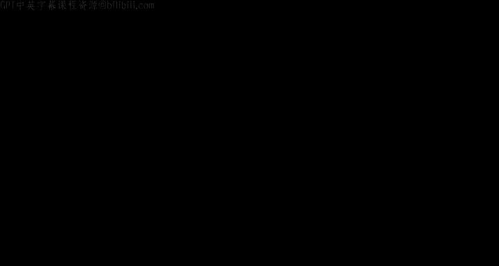

Convolutional neural networks。Please shut your laptops， all the usual good stuff。

 You'll not notice something。Conspicuous by its absence， I don't have my pride into today it。

So I'm going to have to use the laser pointer to point。

Those of you on Zoom may not be able to see the pointer if that is the case， please let me know。

So today's lecture is going to begin with a story on cats。And。

What do cats have to do with convolutional neural networks。Has to do with with。Fum vision。

So for the longest time， we've tried to figure out how it is that we actually visually perceive the world。

 What is the set of processes。Within our head， it allows us to see things and allows us to interpret whatever signals we get to our eyes and。

Much of early research based was based on this concept of Je art。

 where we assume that we sort of composed things out of class。 So look at these pictures。

 the picture to the top left。What do you see。Anyone。It looks like a cube， but is it really a cube。

 No， right， It's just a bunch of。Packman looking things。What about the next one。

It's not really a dog， right， And my favorite one is the one to the extreme right。 What do you say。😊。

Mm。😊，A mine。 You see， you know how many of you see a sphere with spikes in it。😊，All of you do， right。

 And therean， there is no sphere。So what your brain did was to fill in things and imagine stuff that wasn't there And believe it or not。

 pretty much all of your vision is essentially， just you imagining things。😊，Almost certainly。

 none of what you think you saw was actually here。 So including me。Nowは。

This sort of gives us an idea of how things， you know， the bigger picture of how we perceive。

 But what's the cognitive process that goes on inside， Nobody really knew until these two guys。

 Hubel and Rezel in 1959。And this is where cats come in。

 They first did the first study in the neural correlates of vision。

 the receptive fields of the cat's tri cortex， the cat's tri cortex is equivalent in the humans of the V1 cortex。

 And again， I like to use human vision as an example of why we are brilliantly bad design。😊，啊。

Firstly， your eyes are all inverted。 Your nerves are outside the retina。

 They have to punch a hole through the retina to go inside。 And now if I。

 as an engineer whenever were to build an eye， I would have the sensor and the wires behind the sensor not in front of the sensor。

 But that's not how our eyes of eyes built。 You have the wires in front of the sensor it has to punch a hole through the sensor。

 which is why we have a blind spot。But then I， as an engineer， if I were to build a build a robot。

 the wire that went out from the camera is going to just attach to the closest portion of the processor behind it。

 That's not what happens in your brain。 Those things go all the way to the back of your head。

 And that's where your V1 cortex is。 And then the signals flow back forward as you make more and more interpretations of what you see。

 So brilliantly bad design， right。😊，That's an oxymoron， isn't it so。And well。

 the cat's stride cortex is the equivalent of the V1 cortex， which is right at the back of our head。

These guys got a whole of 24 cats。 They don't exactly tell us where they got the cats from。

They anesthetize the cats with throat serum。Held their eyes open and beamed light into it。

They don't tell us if they actually， the cats actually survive their experiment。

 but then they do allude to the fact that their brain tissue was studied afterwards。

So they leave that to our imagination， I suppose。 Now， what exactly did they do。

They held the eyes open， and then they。Beammed lights of different paveth。 basically had dot。

 and they moved it in different directions to see how the eye responded。 And here's what they found。

And this， this defines the immediate 20 millisecond response of the retinal cells。

 What is it that I cs immediately， right。And here's what they found。

 There's a lot of text on the slide。 But the general picture is this。

 If you move the point of light in some directions。The cells。

 there are individual cells at the back of your head light up in other directions they do not。

 specifically， they found that there are that any individual cell in your V1 in the in the strip V1 cortex doesn't respond to every point on the retina。

 It responds only to signals on a small portion of the retina。 Much of it is ignored。

Even in that region of the retina， there are certain regions。Shown by these red dots over here。

 where if there's any light incident on it， that cell will never fire。

 So these are inhibitory regions。And then there are regions shown in blue where if the cell。

 if there is light， the cell does fire provided there is。

 there is no light on the on the red regions。 So if you have a uniform。You know。

 if you have a uniform field of light falling on every portion of the retina。

 then the portion that falls on the red cells is going to cancel out the portion that falls on the blue cells。

 But if you just have a single dot， which avoids the red regions and falls on the blue regions。

 the cell fire。 So basically， it turns out that every one of these cells has what is what they call a receptive field。

 how it responds， which looks like this。They are oriented。Patterns of light。

 So each cell in the V1 cortex or the strip cortex responds to linear patterns of light。And。

So here's one of their experiments。 The arrow to the the line to the left shows the direction in which the light。

 the beam of light was moved。And the figure to the and these figures show the response of the neurons。

 And in this particular case， when the beam is moved left and right。

 you see there's no response as you keep increasing the angle by the time it comes up to 90 degrees。

 the neuron is really responding。 But then as you continue further， eventually it stops responding。

 So this was a neuron which responds to vertical patterns of light。😊，Canancecl。

Here is what they found oriented slates of light where the most effective stimuli for activating the strat cortex neurons。

 Now observe these patterns。 We're going to see them again a couple of times in the next couple of days。

😊，So in a later paper， they also showed that within the stride cortex。

 there are two levels of processing。It turns out that it's not just。

 It's not just a simple response to a stimulus。 Ex。

 why do we have this kind of response It has to do with how the neurons themselves are connected。

So each neuron in the V1 cortex is connected to a to linear patterns of cells in the retina。

 Each cell in the retina， of course， has an isotropic， almost isotropic response kind of circular。

 But then if you connect up to a line of these guys， then you're going to see。

You're going to respond to linear patterns of light。And so this is what they call the S cells。

 each S cell。Responded to a linear pattern of light oriented in a specific direction。

But then there are other cells。The S cells tended to be very easily fooled by noise。

 You have some diffused light。 You have other kinds of garbage they fire。

And so you had something called C cells， which which where C stands for complex S stands for simple。

 And the complex cells would read in bunches of。S L responses and only pick up the largest of。

And here， the point was that the C cells， the complex cells。

 seem to be cleaning up the response of the S cells to eliminate any kind of incidental firing by the S cells。

 So， we have a robust response。And they also showed that the responses in the cortex kind of build up。

 So you have the first level of S cells， which are responsible to。

Stimulating the retina on the retina then have the C cells which cleaned up the S cells。

 Then you have a second cell of set of S cells which read the responses of the C cells that cleaned up the previous previous response。

😊，And then you have， they have their own C C cells and so on。

 And as you go through these layers of S and C cells。

 the kind of patterns that the brain responds to become more and more complex。

 So the first layer maybe just responds to linear oriented patterns of light。

 But then the next layer builds up more complex patterns。

 And then the next layer builds up more complex patterns and so on。So， eventually， of course。

 they graduated from working with cats， which is bad enough to working with monkeys。

 So I won't follow that line of research anymore。 But then let's get back to。

 you know computer science。 We have by now in9， by 1959 or 1962， some idea of how。The human brain。

 or at least the cat cortex responds to visual stimuli and of course。This is adding insult to injury。

 They said the model cannot accommodate color， spatial frequency and many other features。

 kind of invalidating their own torture of cats。 But first， there a point。没。Okay， angel。

 can you tell me the answer。嗯。1， right。 So the S cells find patterns and C cells clean them up。

 Eas enough， right。Now。Fast forward，21 years，198， Knohiko Fukushima。 Now， this is Knohiko Fukushima。

 But this was not Knohiko Hikushima， Fukushima in 1980。 I just found a picture after， at some point。

Taken at some point in his life on the Web。Now， he tried to computationalize the Hubal and visual model。

And in doing so。He realized that the basic model。 So this is now your first computational model of vision。

 But then Fukushima found that there's something missing in how they describe things。

 How many of you have heard of the Jennifer Aniston neuron。You have。 can you tell us what it is？Okay。

So。It turns out that some people have this thing called the Jennifer Aniston neuron。

 It's a neuron in their head that responds only to Jennifer Aniston。So people who have epilepsy。

 they tend to be fantastic subjects for cognitive neuroscientists because they have to get their heads opened and the lesions are treated。

So they'd be lying there with a skull open in the hospital for for a few days。

 And these guys come along， you know， easy subjects。

 They put a mesh of sensors on their hair and show them various things and make them guinea pigs。

And they found on one particular subject that there was a neuron that only fired any time this person was shown a picture of Jennifer Aniston。

 There was a paper in nature of science about it。 That's the famous Jennifer Anniiston neuron。

Now there's nothing special about Jennifer Eiston。 It's not as if， you know。

 she's such a special person that each of us has evolutionly developed one specific neuron just to detect her。

 It's just that we have neurons dedicated to specific object specific people。

 the famous grandmother said。😊，That we all almost move。

 many of us have a grandmother's cell in our head。Whi will respond any time we see our grandma。

Except they're going to respond， regardless of where grandma is in the field of vision。

 It doesn't matter whether she's to the right or to the left the center。

 there is position in variance。And Hubo and Viel's model doesn't actually capture this position of an invariance。

 So Fukushima came up with this model， which he called a neocornaron。

The fact that it's called the neocogniron tells me that they must have been a previous model called the coogniron。

 but I have no idea what it was。I do know what the neocogniron is。It consisted of blocks。

a sequence of blocks within each block。 There were two sub components。

 One was a layer of what they call S cells modeled after Huber and we， simple cells。

And one was a layer of what they call C cells modeled after Hual and weasels。

 C cells S cells respond to signals from the previous。Block from the previous layer。

 because each block had a layer。And C cells， just like in the in the in the cat cortex。

 clean up the response of the S cells。And so here's how it is。The way it worked。Firstly， within。

You know， each block had。1 structure， which they call the S。 But the S itself consisted of several。

Cleans。Each corresponding to one pattern that this block could detect。 And so within each plane。

 you had many neurons。I didn't like so。In a grid。And the specialty over here is that every one of these neurons responded in exactly the same way。

 So if you consider the very first block。😊，Of this model。

 this very flip of first block is going to be looking at。The pictures。 And here has grandma。

And this block is going to。This cell over here may be looking here。 This cell may be looking here。

 This cell may be looking here， and this cell looks at grandma so it's going to fire。

 but then the point is because all of them have the same response it doesn't matter where grandma is in the picture That some cell in this plane is going to fire。

 and so you have several such planes。Each one detecting a different pattern。

And then corresponding to each S plane， there was a C plane。The sea said。

 the sea plane is also grid of cells。And。Each cell over here looks at a small region。

Of responses in the corresponding S plane and cleans it up。

 It takes perform some kind of a majority vote or a highest value vote to response。

 So the C cells clean up the responses of the S cells and the S cells respond to what happened earlier。

 Now， if after this， there would be a second block。Of the same kind。 So this is S， and this is C。

And now over here， youd have several sea cell planes。1 corresponding to each S cell over here。

 And then the next S cell block is again， going to have several planes。Also it。A grid of responses。

 grid of neurons。 And now each neuron over here is going to simultaneously look at。

Exactly the same region。Of each of the sea planes from the previous block。

 this look familiar from the last class。This looks a lot like what we were doing with our CNs， right。

 And so。And so each of these， now， again， you have a bunch of cells over here all with identical response。

This might again be。Doing the same thing and so on。饭厅。

Corresponding to each of these S cells is a C Splans is a C plane where each cell sort of cleans up the response in a small region of the the corresponding S plane。

 And because the C planes were cleaning up stuff， they are looking at groups of neurons。

The sea planees are smaller。Than the S planes。 And so as you go deeper and deeper into the networks like so。

You get， the sea planes keep getting smaller and smaller and smaller。 So do the planes。

 But the number of planes keeps increasing。And and how exactly do the S and the sea planes respond。

The C planes are socal complex cell planes。 They do not have a learnable response。

 They have a fixed response。 They just respond to。 This is what what the model is born with。

 The S planes are the only ones which have plastic cells， things that can learn to respond。P。

 they have parameters， which can be trained。And so as you go through the model。

 the first layer cells are going to recognize simple patterns。

 The second layer cells are are beginning to compose the patterns。From the first layer。

 the third block composes patterns from the second block and so on。 as you go through the。

 as you go through the blocks， you expect the patterns that each block recognizes to be increasingly complex。

Now， they actually came up at formulaly。For how the S cell and the C cell responds。

They formula are ugly。 There's no reason for us to know what these formula are。

 There's no reason for us to understand them。 because if you take a step back and look at them。

 the first one。The S cell responses look like a reello。

 The C cell response also looks a bit like a reo。 But if you look even closer。

 it just looks like a max。And so you have an S cell。

 which computes a weighted sum of all of these guys。

 So this S cell over here is going to compute weighted sum of all of these termss。

And then then then apply re activation to it。The C cell is going to look at a bunch of stuff over here and just pick up the maximum value。

 could you let us know why the size decreases across the layers。

Because when you have an S pattern of this S cell of this kind。

Then if a seailil over here looks at this region。The next C cell doesn't have to look at any of the cells within this region。

 All of these are supposedly capturing the same pattern as just picking up the largest one。

Do that answer your question。Okay， thanks for right so and。How do you train this model。

They train the model。 So， again， the deeper the layer， the larger the receptive field of each neuron。

 because you're seeing larger and larger regions of the inputs input。

And so the sea planes get smaller with layer number and the number of these planes。

 The number of these layers planes increase， right。And how did they actually train it。 again。

 there's a lot of math on their slide。 We can skip it， but it's just simple， heavy and learning。

 So let's say I have。A C cell from， from the layer L -1。B。This sea cell is going to feed。Some S。

So in every one of the correspond of the S planes in the next layer。 So if this is in position I J。

Then this one would be feeding。You know， the。K L position of every one of these guns。

So they would just look at which of these， So any time this got activated。

 they'd find which of these had the largest activation。And they'd say， okay。

 this guy has the largest activation。 So I'm going associate this C cell with this one here。

And then you can just use heavy and heavy and learning to increase this weight。

But once you increase that weight， because all of these cells have the same response。

 you're also going to increase the weight of this guy here。This guy here and so on。

 And it could you would redistribute the update across all the cells in the plane。And eventually。

 of course， all of them get learned again， there's no reason for us to get into the details of it。

Its just conveying the idea of what the model was really like and what it learns。

Observe that the entire learning process is now completely unsupervised。

All you do is provide stimuli。 and you're going to use heavy and learning to learn the weights。

 meaningan anytime a C cell causes an S cell to activate。

 you increase the weight and then you share the weight across all the cells in the plane。

 And that's about it。😊，And if you keep providing it with the same pattern over and over again。

 they found that the cells in the first early layers would learn， you know， for instance。

 if you provided lots of pictures of A。The early cell layers might learn components of a。

 The next cell layers that the next layer block would learn more complex patterns with substructures of A。

 By the time we got to the final layer。😊，You'd find that the cells fire only when you actually get an entire A in the picture。

And so they actually ran these experiments They used all of these digit pictures to train the model。

 And they find that eventually， when you get through the layers。😊。

It turns out that each of the planes in the final layer。Responds to a specific kind of pattern。

 There is no supervision over here。 All you're doing is providing pictures。

 And it turns out that it automatically learns to detect semantic concepts。 Maybe there's one cell。

 which only fire any time it Cas 0。 There's not the plane which only fire any time it Ca a 1 and so on。

 So the model actually manages to capture the kind of。

Semantic structures that we actually perceive in the world with no training。

 with no supervision whatsoever。So this is great。 right， We have a model which kind of explains how。

Vision or visual concepts might be formed。But， the reality is。In the real world。

 we would like to have some supervision， so。嗯。O， kill。The first statement。

You think it's true How many of you think the first statement is true， Ra hands， right。

 What about the second one。Also， I could add supervision。 So how would I add supervision to this。

 anybody。How would I add supervision to this model。再看没瑰报的边说。But then these are unsupervised guys。

 right？ So what more do I need to do。Thank you。 So I can just feed all of these。

Into a classification neuron， one more layer， a soft max。Out then outcome something。嗯。I have a label。

 I provide pictures。 I can。I mean， I provide inputs and the corresponding label。

 And then I can just train the network。Right。Andvoila， you have a convolutional neural network。

And so the neocnaron is a fully un is fully unsupervised。 semantic labels were automatically learned。

 This was in the 19， early 1980s。😊，But then people began figuring that， you know， this。

 we could probably add external supervision to it。 And there was a lot of work on it。

 We had Homeless and Marx in 1988。 We had Kevin Lang's thesis in 1989 and CM MU。 So in fact。

 the earliest CNN models。😊，Where from from CM MU。And these guys actually got a NiEP award for their work。

But then and Jan Lacoon， I think， did his work slightly after these cuts。

The difference between what Yan did and what these guys did was Atlas and Kevin worked on speech and Janan worked on images。

So。How do you add supervision。He just。Pass the final final layer outputs。Through a soft max。

You get a probabilistic outcome， you can compare that outcome to some target label。

You get a divergence， you can back back propagate this divergence。

 and you can learn all the parameters。 Now， remember， we are still using。福ク島マスマル。

And Fukushima's model is still based on Hu and Reel's 1959 model of。Mmmalian vision， okay。

So how exactly do you implement this， Yes， we're going to have the S planes and the C planes。

 except in the original model that Fukushima had， each of them had an electricalipical receptive field。

 This is going to be hard computationally。 So we would use， we would use square receptive fields。😊。

So each neuron is going to look at a square region of the plane behind it， right。

So the re of phlafin S layer S cells might be K cross K of a C cell would be some， you know， L。

Upper k cell k cell。Times the same value， anyway。So the C cells， because of this behavior over here。

 that each C cell is looking at a bunch of S cells。

 And so you can think of these things as already having been dealt with。

The next C cell is going to look at a region which doesn't quite。

Overla significantly with this region。 And so the sea planes keep getting smaller and smaller。

 So this is why the sea planes were also thought of as performing down sampling of the input。OK。

And how exactly do they respond。 The C cells， They have no learnable component。

 All they do is they pick， they pick the largest of the values that they look at。

 In the case of the S cells。 first， they compile compute an aine combination and aine function of all of the inputs they are looking at。

 So this guy， for instance， might compile compute and aine。😊，F of all of these inputs。

So there's the first sappine value。 And then an activation function is applied to it。

 The activation function is typically in。Leco's original work。 It was a sig。

 It was a sigmoid these days with use， right。

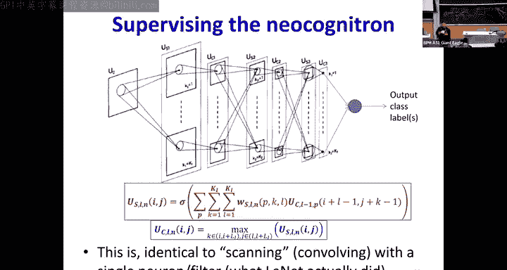

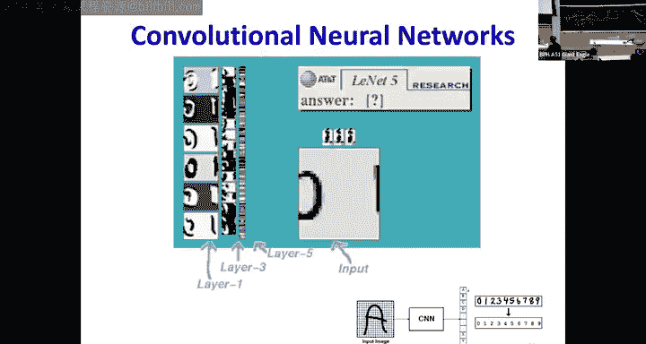

And also。Now， because this S cell。Has many elements， all of which have identical response。

 You don't need to actually create a network with so many。Identical neurons。 instead。

 you could have one neuron with just scans。Which goes back to what we were discussing in the last class。

 scanning。Convolt convolution is the same as scanning with an MP， right。

And so here was Jan La's original work。 This was。In the late 80s， early 90s。

 the Amnist corpus was one of the big corpus of those days。 This came from the US Postal Service。

Back in the day， peak people actually wrote letters。 They stuck them into actual envelopes。

 They wrote actual addresses on these envelopes， and they drop them in actual post boxes。

 Are you familiar with any of these terms。No right。 The modern generation。

 you don't know what these things look like。 But anyway。 So， and the post office。

Which is an independent branch of the US government， by the way。

That would get millions and millions of these letters every day。

 And somebody had to scan these things to find where it was supposed to go。

 And I don't know about you。 but my handwriting is terrible。 When I write a number down。

 I can't read it myself。 And these poor fellows had to do it。 And they were immensely accurate。

 But then they all they wanted to automate it。And so there there was this project and the offering on trying to automatically recognize hundredwritten digits。

And the Lecon's network was one of the first to actually do such a good job that that the Postal Service actually tried using it。

So here's the demo that he put up back in the day， right， He called it Lanet because。 it's La。

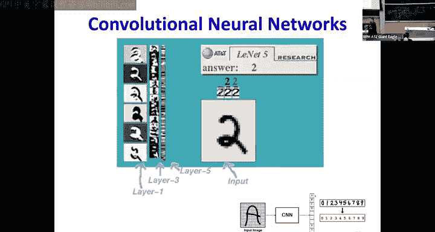

No。So here's the story so far。The mammalian visual cortex consists of S cells。

 which capture oriented visual patterns and C cells， which perform a majority vote。

Or actually a maximality vote over groups of S for robustness to noise and positional jta。😊。

The neocormetron emulates this behavior with par banks of S and C cells with identical response to enable position invari。

Only the S cell parameters are learnedt。 the C cells are fixed。

And unsupervised learning of this network results in learning useful semantic concepts。

Lecon's Let added external supervision to this neocogniron。😊，Where now。

 S planes of cells with identical response are modeled by a scan Ie A convolution。

And sea planes are emulated by cells that perform a max over groups of S cells reducing the size of the S planes。

 This gives us a。Convolutional neural network that we've already seen。

So this is where when CNNs were first proposed， they did not actually come from the perspective that I presented in the previous class。

 They came from here as models of mammalian vision。So what does the CNN look like。

 This is what it looks like。It's got convolutional and pooling layers。

 convolutional layers comprise neurons that scan their input for patterns which correspond to as planes。

Poing pooling layers perform max operations on groups of output from the convolution layers so they can correspond to sea planes and they to may occur in any sequence。

 but typically they alternate。And eventually， the final layer。

Of the sequence is followed or was followed And Le one's original network and still continues to be doing。

 So therefore， the output of the final layer is flattened and it's passed through an MLP of some kind for the final decision。

 especially theoretically widers of pooling layer。Improve the results。Theoretically。I'm not well。

 I'm。 I can't answer any theory about this particular operation。 It's just an activation。

 as far as I'm concerned。So these days， we don't even really use schooling days。

So I don't know if there' a strong theory behind this。

 This actually started off as a model of mammalian vision。嗯。

So maybe that's not the satisfying answer you wanted， but that's the best I've got。So。

Here's what the network looks like。 It's got convolution layers。It's got pooling layers。

 Only the convolution layers are learnable。 The pooling layers are not。

 So what is this convolution layer。Let's first take a look at it。So， the convolution layer。

Has got this bunch of claims。Each plane is basically obtained by scanning the previous inputs with a single neuron。

 as you saw。And so this neuron is simultaneously going to be looking at all of the planes in the previous layer。

 as we also visualized right。 So this neuron over here is going to be simultaneously looking at all of these guys。

😊，And what happens within an individual plane？ There's a two step process。 First。

 you compute an aine function of all the inputs。Then you apply an activation to it。

 So each of the strain actually has two sub components。

 The first is an AI map obtained by convolution over the maps of the previous layer。

 and this is done using a learnable filter。😊，And the next is the。

 the next is the application of an activation function， which which applies pointwise。

To the output of the convolution。So the aine map is is what the convolution produces。

 which is obtained by scanning the previous layer with a filter。

And the activation map is obtained by applying something like a sigmoid or a re or any other kind of activation pointwise to the output of the file map。

 so。Here's what it would look like。 The all of the previous layer planes are going to contribute to the to the computation of the Fine map。

And。Each f map produces the corresponding activation map。Ms clear， any questions。Any questions。

 right？ So let's see how this looks， okay。Let's actually look at the activation。

 how the convolution works。 Now， again， observe that when I'm computing the convolution over here。

 I'm actually simultaneously looking at all of the maps of the previous layer。😊。

But to understand how it works， I'm going to focus on the contribution of just one map over here。

 So let's see how that that brown map。To the left would contribute to the activations of the and the map I find map highlighted in yellow。

 So top left， right。So lets see what this would be like so let us assume that that brown activation。

 the brown map shown， which is one of the maps from the previous layer。😊。

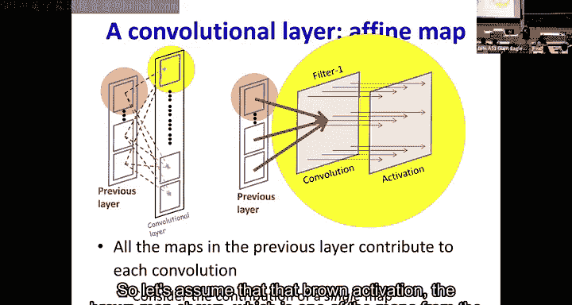

Ass given by this screen picture， right， and。

TheWhat we are trying to compute is the yellow map that it contributes to。Now， corresponding to that。

 there is going to be a filter。 So let's say this guy is looking at a three cross three region of of these maps。

 So then the filter is going to have a three cross three set of elements。 In my example。

 all of the elements are binary because I stole this example from the web。 And now a filter。

 an I find map。Has a bunch of weights。 It also has a bias。 Don't forget the bias。

 I'm just going to assume that the bias is 0 over here。So。Here's what it would look like。

This green picture is the output map from the previous layer。The orange。Shows you the filter。

 And this white box to the right is the corresponding output。

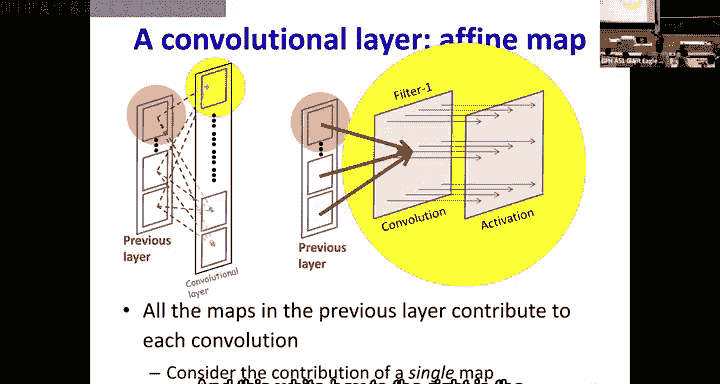

I find map shown in yellow， right， And I'm showing you how it is computed。

 So I would place this filter over here。

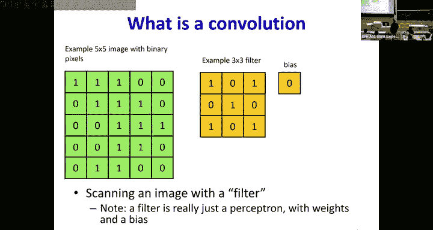

On top of this image of the。Previous layer map， starting at the top left corner。

 So the previous layer map has a bunch of values。 The filter has a bunch of values。

 I'm going to perform a component wise product。Of the filter values shown in red with the map values shown in black。

 And then I sum up the lot。 And then I finally sum the bias。 And that's going to give me a result。

 And that's going to be the result for the for the aine map at the top left corner。😊，Of the output。

 I find map。 And then I can slide the filter forward one step at a time。

And repeat this operation at each location。And that is going to compute the final output F I map。

Does animation make sense。I stole it it better be good。Right。So yeah。

Just to continue the analogy from like the T cell and C cell so whereas in the earlier model the C cell operation on the S cells was deterministic this is I mean now we have like a C cell this is an cell this is not a C cell this is an S cell okay right so I've just shown you what happens so far before one of those audit how one of the orange maps drawn maps contributes to the yellow map but then in in reality each aine map is computed by looking at all of the previous layer maps right so if this here。

Represents the entire set of maps over。From the previous layer， then in order to compute any given。

Yeah。In order to compute any given output map， I I was I'm going to have a filter where the filter has。

As many I'm calling the planes， or I can call this channels。

Which is a common terminology as the number of channels in the output layer。

In the output of the previous layer。 So here my previous layer has at least three channels。

 There's a triple dot showing you that there are more。 so corresponding correspondingly the filter。

 which I figured is going to be looking at a three cross three region is going to have one。

 three cross3 arrangement of weights for every channel of the previous layer。

 basically what we are saying is that there's going to be one， three cross3 for this one。

 one for this one， one for this one。 That's what the picture to the right shows。

 and there's no requirement that all of these values are identical as the color know code shows the numbers can all be different。

😊，And so I placed the filter on the top left corner， like so。

And now I'm going to perform a competent vice product。

Over all of the colored numbers and then sum them up。

 And that's going to give me the top left corner of the output aine map。

Then I' slide the filter one step forward。And that's going to give me the next position of the output I find map。

 And I， and I can repeat this operation again and again， too。Compute the entire output F map。

 That makes sense to everyone。I spent a lot of time on this animation， so。Yes or no。

 We're going to use it， right， But this is one filter， and it's going to generate one。

Output aine map。If I want to generate a second again， remember。

 I have multiple of these guys over here， right So what would I need to generate the second one。个是频。

A completely different filter。And now I'm going to be scanning the inputs for the second filter to generate the second output map。

And so I'm going to have as many filters as the number of output maps。

 And each filter is going to have as many channels as the number of input channels。

To this convolution。Right。I can also view the entire thing differently。

 Instead of drawing all of these planes1 on top of the other。

 I can stack them up in the form of a cube。In which case， my filter is also going to be a cube。

And so I can think of this entire operation as just placing this cube at the top left corner of the stacked arrangement of。

Explain。And then the actual computation and performing is an inner product。Which is to say。

 I take an element wise product。Of all the values within the filter and the corresponding values of the channel in each plane。

 I do this for all the planes and some over all of the planes。

 And that's going to give me one output。And then I can just slide my filter to con generate my entire output。

Does this make sense， the visualization。Any questions。Any questions， O。

So this is what is really happening over here。 Now。

 there are some little engineering aspects that you would have to worry about in doing this。

The we I pictured it。 It would appear to you that there there are going to be as many output。

 The size of the output is going to be the same as the size of the input。Which is not the case。

 And that's because your filter has some spatial。Expanse， so here。

When I place the filter to the top left。That filter is taking up three columns， right。

 I can only step to the right twice more before I fall off the edge of the input。So in general。

 if my。Input is。And cross n。So if this is n。And if my filter。Its some。K。

Then how many are left after I place the filter in the first position。嗯。N minus K。

 So I have n minus case steps I can take in addition to the first position。Right。

 so the total number of outputs is going to be。One output for being here， one plus the remaining。

N minus k。Steps that I can take， right， And this would happen in each direction。

 So if the image is 5 cross 5 and the f is 3 cross 3。What is the size we can generate。

 So initial three is there is going to produce one output。

 And then there are two more steps I can take， which is why the output is 3 cross 3 over here， right。

 or in general。If the input is n cross n and there are filter as m cross M。

 then the output is going to be n minus m plus 1。On inside。That makes sense， right， So this。

 although the the it's proportional in some sense， the output is proportional to the input。

 You're losing some stuff at the boundary。And and often， we don't like this。

 We want the output to be the same size as the input。 If that's what you want， what would you do。

I can just add zeros， right， I can just put a bunch of zeros distributed symmetrically around the input。

 And now I've got it。 And how many zeros would I add。And let's。 So I start。 here's what I would add。

 right。I started off at N。I ended up with。N minus k plus1。

So the difference is the difference between these two。Which is what is that going to be K？-1， right。

 These is， this is how many rows I'm losing。 So those are how many rows of zeros and columns of zeros。

 I'm gonna had the input that。And then I can mix。 And then the output would be the same size as the input。

 right。So easy。We figured out how to perform the convolution。 The next step is for us to。

Apply an activation。And so to apply an activation， we just pointwise。

 multiply pass each value through some some activation function。 in the original CNN。

 these were sigoids。And sigmaoids because sigmaoids approximate the threshold function these days you use the error because we find that it works better for the same for the reasons that we saw in the second lecture。

 right。

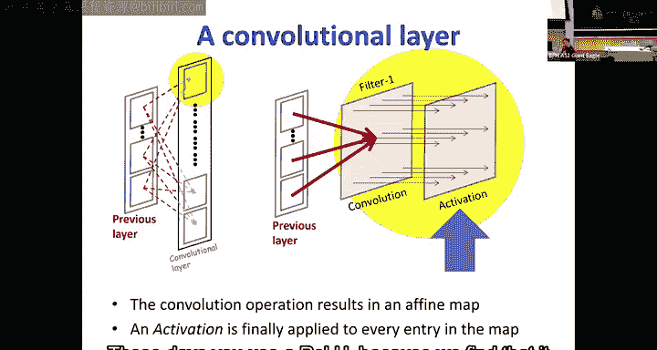

And I just say have su code， let's get the su collar。So convolution summary。

 convolution layers scan the input。Again， this pseudo code is exactly the same pseudo code that I showed you in the last class。

 We just arriving it at it from a different perspective。Which is， you know。

 as a model of mammalian vision。 And that's where CNNNs originally came from。

So convolutional layers and the input using a bank of filters。

 A filter is just a neuron in a scanning layer。Again， they call them filters terminology。

Each filter jointly scans the maps in the previous layer to produce an output aine map。And。

You get as many output I find maps as the number of filters。

Then we may have to pad the edges of the input maps to ensure that the output maps are the same size as the input maps。

 if not the convolution is going to lose some rows and columns and the output of the convolution is finally put through an activation which I have not mentioned on this summary to get you the final activation map。

 right。There was another component to， to the model。Puling， pooling was the same as the sea cells。

 right， and now。Again， remember that claim when we were computing the S planes。

 each S cell was looking at all of the planes， all of the maps in the previous layer。

And the case of the C， that is not the case， so。May I know your name there。

 you don't have your name tag。Do you want to go wash your face。 Yes， please do。Thank you。首。

He has his coffee， but still it's too early in the morning。 It's still dark， okay。

So what are these spooning layerss。And the pulling layers， remember， we。

 we mentioned this in briefly in the last class。The each S cell is composing patterns。

From the sub patternss seen by the previous layer。 So it might say I've got to put a little bit of a petal。

 a little bit of spper， a little bit of a statement。

 And this is going to look like look like a part of a flower。

 But then if the petal moves just by one pixel， it doesn't suddenly become a knot of flower。

 right And so we want to introduce jitter invariance。 And so what the pooling layer。

 which is the C cell does is to look at regions of the input and just pick the largest value。

 So that that region had 3，1，4， and 6， the largest value is 6。 So it is going to output of 6。

 And now it's done with that block。 So it's going to step forward。

 But then computationally for our purpose， it's always convenient to think of these things as moving one step at a time。

😊，In practice， when we perform pooling， you you'd be taking larger steps because you're done with a block you're moving on to the next block。

 But I'll explain why this thinking of it in terms of blocks。

And strides greater than one can become a tedious thing。

 And why it's simpler to think of this as performing strides of。

Performing its operations with a slide of one。 So that's what will be happening over here。

At each position， just be picking the largest value。

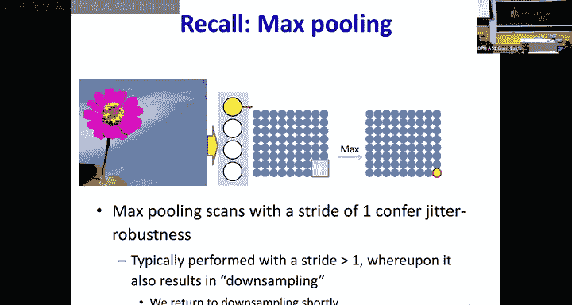

To compute the output。 So here I have pseudo code for it。It'd be going through the。

It would be within any layer。For each of the output maps from the convolution。

You'd be scanning it left to right， top to bottom at each position。

 you're looking at a window of the values， and you're picking the largest one。So， you's scanning it。

You are so see how the code is written。 You find the first find the position of the largest value and then copy the value at that position。

 You could just run a max operation and and have the same outcome。

 But it's four reasons that we will get to in the next class。

 It is better for us to actually first find out the location of the maximum。

Which is what is stored in this variable， called P， I， D， X。And then copy the value at the P。

 P I D X into Y。That's what this maxpoing does。You can have other forms of pullinging。

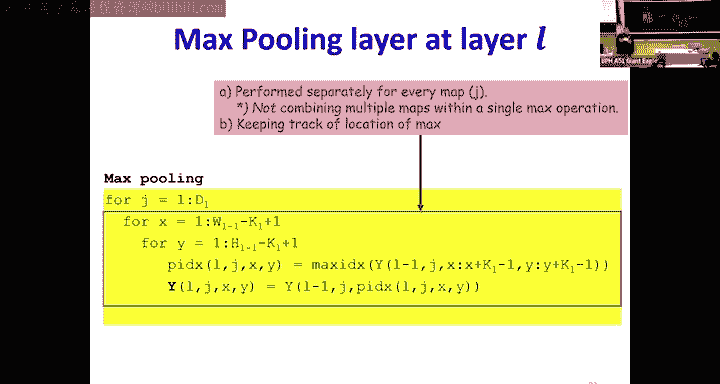

You can have mean tool。Where you compute the mean of these four values as you slide forward。

And so here in this case， it's much simpler。 You don't have to find the location of the maximum。

 You just compute the mean of all of the terms that you of the window that you're looking at。

And this is going to be performed separately for each of the maps。 Remember。

 this is the equivalent of the C plate， right。You can have other kinds of pooling。

There were things like P normm pull length， which compute a different function of the inputs。

 And people even propose that we can compute。 We can actually learn a network that does something better than either Mac or any kind of norm but。

It just， it's just adding complexity for no really great reason。

So pooling layers scan the input using a pooling operation。

 selecting the max from the K cross click block of input。Each pooling filter scans an individual map。

Compd from the convolution。And this produces a pooled map。

And so you get as many output maps of the pooling layer as you as the number of input maps， right。

 whereasas in the convolution， the number of output maps doesn't have any dependence on the number of input maps。

 It depends only on the number of filters。 If you add filters， you get more maps。 Where in pooling。

 because each pooling operation is performed on one map。

 the number of output maps and input maps must be the same。And for pooling。

 you generally don't pad the edges of zeros because。You could just end up losing information。

And so here are all the steps we've considered so far。Convolution layers and pullinging layers。

 There's the MP at Dan where we are familiar with MPs。

But there are a couple of other operations that we must think of。

And these operations change the size of the output。

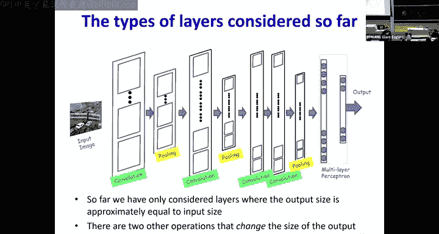

So the first operation is down sampling。If I start off with a 10 cross 10。Map， and I。

 if I want to shrink the size of the map。By a factor of 2。What is the simplest thing I can do。Anyone。

I can just drop terms， right， So here's what I will do。

 I start off in this case with fact with a six cross 6 map。

I want to shrink it to a three cross3 maps。 So guess what。 I'm dropping every second term。

 That's about it。 So here's the first position。 Then I drop this。 the black out region。

 And here's the second value。 I'm copying it。 Then I'm dropping the next one and so on。

 And so this is down sampling。 You're just dropping every S-1 out out of every values in every direction。

 They're down sampling by factor phase。 This is a very easy operation。😊。

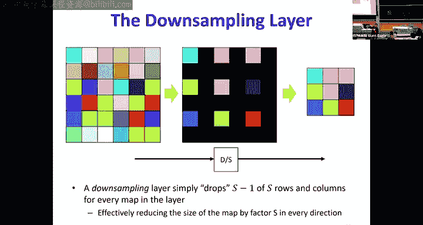

It's a code， right， trie。So reducing the size of a map is always performed by down sampling。

 Down sampling is always performed by just dropping things。 Now， in practice。

Convolution can be followed by down samplingling。Cooling can also be followed by down sampling。

And if you were actually implementing this in code。

 you're not actually going to perform the convolution with a stride of1 and then down sampleample by a factor S instead。

 what you would actually do is to perform convolution with a stride。 So here， for example。

 you might go like so if you want a stride of two and now which is going to do you know。

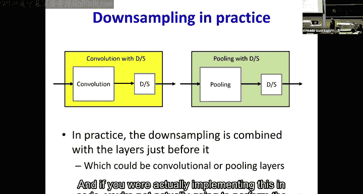

Where is the alphabe size bare factor of 2。So also with pullinging， right， so。

If the input is m cross hand and filter the m cross hand earlier， we just had n minus M O plus1。

If you factor in a stride， it's going the output size is going to be n minus M over S plus1。

So why am I explicitly teaching you about the down sampling layer instead just saying you can convolve with a stride or pool with a stride we will get to this when we talk about back propagation in the next class。

 but it's very important to think about it as think about down sampling as a separate operation。

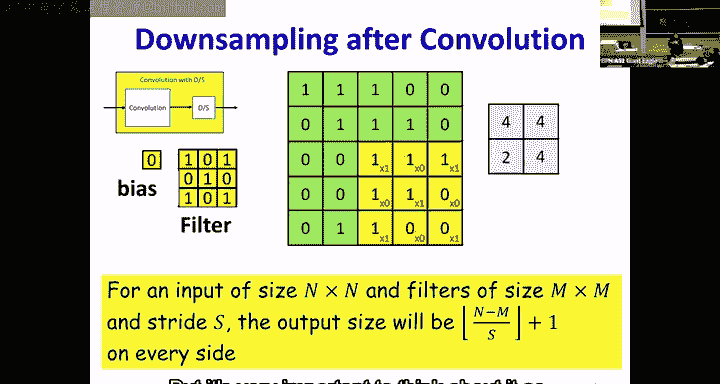

So， in practice。Again。You just be performing your convolution with a stride。

 Every time you move forward， you're going to move move forward by a stride。

 and you can do the same thing with pooling， right。

 You can pool with a stride of one and then down sample by some factor。

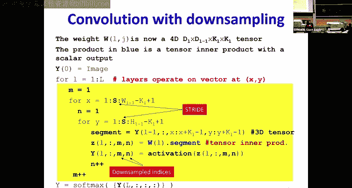

Or you can pool with a stride。And pooling is almost always performed with a stride。

 which is why the pooling layers were also originally just called down sampling layers。 They are not。

A real down samplingamping layer is one which。Just drops S-1 out of every S layers。

 columns and S-1 out of every S， okay。It makes sense to everyone。Ok， if I can shrink the image。

 what is the other thing I can do。pan。I can expand， right how would I expand？嗯。Can say。

 can someone say that aloud。哎对。Add average values here。like middle the six of the four six。

Make the six into four6es。 Can you give me something simpler I can do add zeros。O。So， this is。

This is what I can do。This is the most trivial way of increasing the size of something， right。

 And so this is what an up sampling layer does。 You literally take your。

 take whatever you've got and stretch it out and you leave holes in the middle。

 And that's your up sampling layer。And so to ups sampleample by a factor of S。

 you' are going to add S -1 rows， zeros between columns and S -1 zeros between rows。Make sense。

Very trivial， right， Nothing fancy， no averaging， no computing， magical things。Just put in zeros。

 So easy。And let the network figure out what to do with those things in the middle。So。

An up sampling or dilation layer simply introduces S-1 rows and columns for every map in the layer。

 effectively increasing the size of the fat map by factor S。In every direction。

 And this is used to explicitly increase the map size by some uniform factor。那好。

Here's what happened when we were speaking of down sampling， Down sampling followed an operation。

 Down sampling followed pooling。 Down sampling followed convolution。Up sampling。

 this cannot be the last operation because if you make it the last operation。

 you're just leaving the image with a bunch of zeros， right。

 So the up sampling always precedes in operation。And what kind of operation do you think it would proceed。

Does it make sense for up sampling to proceed a pooling layer？

You're just going to be throwing away stuff and putting in bunches of zeros， right。

 And so up sampling is always followed by a convolution layer。And so therefore。

 doesn't make any sense for this to be the final layer of a CNN。re just introducing a bunch of deals。

What do you expect the convolution to do over here。

 you expect the convolution to figure out how to fill in those zero do values with something meaningful。

 You are not taking the responsibility yourself。The network will learn what is the best thing to do。

To fill those values with， right。So up sampling here。

 I can just in initially allocate the something which is。

The ups samplele size and then copy values over into the non zero locations， right。So in terminology。

 very often， they speak up up sampling followed by convolution as convolution with a fraction of stride。

 So when I say convolution with a stride of 0。5， what this means is that first you increase the size by a factor of 2 by inserting zeros。

 and then you perform a convolution。😊，Thanks thanks， everybody。Questions。ok。

Are you often just doing the up sampling to like make the math nice or you actually get more information？

Can you apply the filter， because it's only looking at like one pixel。So， okay。

Let me go back to a very important point that I missed。 Thank you。So。And this has。

 this is only indirectly related to what what you just asked， but I will get your answer。

 Maybe I'll spend a couple of minutes on this。What is the， what are the operations we just spoke of。

 Let's think of an input， let's say。I have 100 class。Hundred image， right。

And then I perform some convolutions on it。 So maybe I got。So I'm going to get。

100 cross 00 over here。And 100 cross 00 over here。And 100 cross 100 over here， this is。

Going to be the result of my convolution， right， one per filter。Is this going to be a lossy。Process。

 am I losing information。No， yes。In principle， it doesn't have to be， right。

 The number of values I'm output footting in this step。Is the same。

 at least the same as the number of inputs I've got。

And so there doesn't need to be any loss of information， right， But then suppose I convertvol。

 S I have a pooling layer， and the pooling layer has a stride of 10。Just to be dramatic， right。

 This output is going to be。10 plus 10。Do we have lots of loss of information here。

 I've thrown away whole bunches of values， right， So how do I make sure that I don't lose information。

Anyone。I need to have as many numbers as I have here。Which means that this set。

We must have as many numbers as I have here。Right， every time I downs sampleample。I'm losing stuff。

 How can I compensate for that。Add more boxes。Right， and so the more layers I've got。

 the more filters I've got though more values I'm copying over。

 And then the subsequent pooling and down sampling is not。Necessarily going to lose information。

 right， And so what will happen here is that make sense to all of you guys。Right， and so。

If I start off in your color image， we'll get to that。 You， you。

 you are going to have an image of some kind。 And typically， if it's an R G image。

GB image you'd have。3 images， three channels， right。And so after the first convolution and pooling。

You're going to end up using still the cuboal representation that I showed earlier。

 You're going to end up with something that's where the face is smaller。

So how do I compensate for the face being smaller？Add increase the number of channels， right。

And so as I keep going through the layers， these things are going to get smaller and smaller in size。

 But then I'm going to be。Getting deeper and deeper so that I don't lose information。

Does makes sense？But art isn't pooling like inherently lossy because you're combining Yes。

 but I'm compensating for it by adding more channels。

The network's just interpolating like you're not actually using it。So here are the things so。

I am losing some information over here。I'm hoping that some of that information I loss ends up in this other guy。

Right， and so by adding the number of tenants。I maintain the ability to retain all the information because the total number of values that you've got at the end stays the same。

 If you didn't， youd definitely lose information。O， that didn't answer your question， right。

 So what happens next？ Supp now let's say I was building a network that starts off by analyzing pictures and ends up。

 the outcome must also be a picture， but just modified。So does this look like a picture。

This was  hundred cross 100。 Maybe this is 5 cross 5。But then a whole bunch of channels。

 Does this look like a picture。 It does not， right。

So the next thing I would do is to make it 10 across 10。By introducing。Or whatever。

 Im by introducing a whole bunch of zeros。And then when you fill it up at convolution。

 what does convolution do， Is it just looking at the local image。

It's looking at everything down down the column， right。

 And so it's using this using the inverse of the principle that we had over here。

 that by adding columns。I can still retain information。 Now， I'm using information in those columns。

To fill in the holes。Ma I answer a question。Right， so it's not just merely interpolating locally。

 You're looking at everything。Questions。Yes， can。 so here's what happened when we were going forward。

When we were going forward in order to account for the fact that we are losing information in。

Individual channels。We added more channels。So if this has 10000 values。

 so long as I have 10000 values after pooling。I have some hope of retaining all all the information over here。

对啊。So we're adding channels。We want to add channels in the pool layer。

 We can do that about adding channels。 Youre gonna， you cannot add channels in the pool layer。

 You you're gonna be adding channels on the。Convolution， and then the pooling happens， right。

 So this is actually planning for the future。And then you lost you lost stuff。 But you know。

 if you train it just right， you're still going to retain the information。Yeah。

 is there a requirement for many you if you don't want。

 if you want a guarantee that you will not or if you want。

A necessary but not sufficient condition that you won't lose information。

 Then you want to make sure that the number of outputs you get after pooling。

Is at least as much as the number of inputs that went into the entire。Convolutionly。

You can add more channels， just to be safe。But sometimes you really want to lose information。

 You know， if you're performing classification， you want to get it a crowd。

 So there's it's more complex than that。 But this is a general idea， right。I can't get how the。

sorry how thevolution after the get the information the later。 So here's what happened， right。

 So this I when I pulled down over here， I was able to afford to lose information here because this guy here captured whatever I lost。

啊，不对。You can think of it， for instance， as maybe some channel down there。

 which is just shifted by one。Right， I can always guarantee that that happens that the channel。

 there's a second channel， which is just a shifted value of the。Guy up there saying， you know。

 when you pull them down， you have all the values， right， So now if I'm going back。From this。

 I'm just expanding it out to fill zeros。 What are the values I'll be filling over here。

The values that I got from down there， right？So to give you an idea。

 I suppose I had something very nice，1，2，3，4，5，6，7，8，9，10，11，12。1314。1516。

Then I could be considering composing two channels， one。Some nonsense，3， some nonsense I guess pu。

Rightr 5， something，7， something。 And the second one could be just these values。

So now I have two channels， and together， they're retaining all the information。

 If I down sampleample each of them individually， each of the output channels look smaller。

 but the complete set of values is retained。That makes sense， right， So when I expand them out。

 I want to copy values from here up there。Did that。Makes sense， yeah。

So which is why you want to increase the number of channels。 And， you know。

 up sampling will still reconstruct things by copying things from other other channels， yes。哦，我去。

Add channels in the co there。 You're basically like creating information。

 there's no such thing as creating information。 There is the data processing inequality in the information theory。

 It says you cannot create information。 You're just spread it out of more channels。

 you have more stuff in。 Yeah， you're just adding it， it's like adding many more functions， right。

 So you're extracting more features， but you're never really adding information。

 You just sort of making the more apparent by transforming the data。You cannot add information。

 That's just a fact。嗯。嗯。いのよ。不ですね。When you're up sampling， you're just adding a bunch of zeros。

 Then there's a convolution here， right， So there's no initialization okay。Let me continue， right。

 So map sizes can be changed by down sampling or up sampling。

 down sampling drop S -1 of S rows and columns up sampling insert S -1 rows and columns， right。

 and again。This when you， when you go forward， could you would be down sampling。

 So the if you thought of the input as a cube， the cubes。

 the face of the cube is going to get smaller， but the depth is going to keep increasing。

 then when you're going back up sampling， you're going to be doing the reverse。

 You're increasing the face of the cube and reducing the depth。

And you would not have lost information in the rest case， right。就。

Down sampling typically follows convolution up pullinging up sampling occurs before convolution。

Questions， you ladies on the back， any questions？Sure， okay。So。The story so far。

 convolutional neural networks are supervised versions of computational models ofnemmalian vision。

 they include convolutional layers comprising learn filters that scan the outputs of the previous layer and cooling layers。

That vote over groups of outputs from the convolution layer in some manner。

Convolution can change the size of the output。as effects， this can be controlled via 0 to 0 paing。

2 layers may perform Max P norms means how they can be learned。

Free sampling layers increase or decrease the size of the map。

Down sampling can be merged to the preceding operation by scanning with a strike greater than one Up sampling must be followed by convolution。

 right Everything we've seen so far。 So that's here's a poll。我是期间不。This not showing up。

should be multiple choice Okay， al right， so。If we've set up the poll wrong， that's too bad。

 but somebody on zoom。Can you tell me the。Which of the first four statements is true for question one。

好州。Anyone on Zoom the first？The first one up sampling by S introduces s minus1 zeros between adjacent rows and columns。

What about the second one。Yes true。the second one true are up sampling layers followed by pooling layers。

followed by convolution layers， can they be combined？

Up samplingling layers must be followed by convolution layers， right， Otherwise。

 they're just going to be left with a bunch of zeros。

And then up samplingamping layers can be combined with convolution putting layers before them into a single operation with a fractional stride。

That's the terminology。 We just call it operations with a fractionractal stride。

 but not with the stuff before them。Is the stuff after them， right？

 So what about the down sampling layers。Down sampling by S3 places every S throw and columnumb zero。

 is that true。False， right。收。What about the next statement。

 down sampling by S deletes S-1 consecutive rows in columns， true， right。

Theyre usually merged with convolution of pulling layers after them， true or false。😊。

True or false guys， I everybody said， just shout your answer out loud。Okay。

 I'm expecting everyone to say something。 If I hear chaos I've lost you。

 If all of you are giving the same wrong answer， I'm happy。

 If all of you are giving give me the same right answer， I'm happy still。 Okay， go ahead，1，2，3。

 true or false。😊，Okay， we had noise， right？They are not merged with the layers after them。

 This is down sampling， right， Down sampling is merged with the layer。Before it。

 it's about the operation with a stride。Correct。手。Questions。No， okay， let me continue， right。

 So let's put all of these together in the last 10 minutes of the class in a typical image processing。

 image classification task。Here I'm going to assume max pooling。

 Do you typically start with a color image。Which can be zed down to a grey color， a grey shade image。

 or more likely just retain the red， green and blue separately。 So the red， green and blue。

 here is the input， three pictures， which I can stack into a cube。

 So now the input itself has three channels。😊，The R， the G and the Bs， not not just a single plane。

 right， And then the first thing I would do is to come up with a bunch of filters。

I have to decide the face of the photo， some L crossl。

And the each filter has a depth3 because the input has three channels， right。

 And so what is the number of filters， Ty we， the number of filters we use is a power of two。Now。

 why would this be a power of two， What would be a reasonable？Okay。

 based on what I have told you so far。Just by looking at these。

 if I told you that I'm going to use four filters， what can you tell me is going to happen next。我要。

You're saying something。I'm going to down sampleample by a factor of two， right？

 So this makes that way I make sure that I have all the information that I retain all the information。

 Having two filters makes no sense if you intend to downs sampleample， but having four makes sense。

 So always is' going to be some four or some amount of multiple right in those cases。

And the filter sizes are typically three cross 5 cross 5，3 cross 3 or even。You know。

 these are small enough to capture fine， detailed features with scaled on images。

What is a one cross  one filter， You will， You will encounter this again and again。

 And believe it or not， you have already encountered it in class。 What is a one cross one filter。好きな。

Essentially， an MLP。 So what was that。Have we seen this in class？What was the one cross  one filter？

We've seen this in class。And the last class， before we began speaking of。Distributed scans。

We spoke of。Non distributed scans， right， And when I had a non distributed scan， what did I do。

Each neuron produced a map。And the next layer neuron looked at only one neuron from each of these maps。

 Remember， what was that， That's just， you're taking all of these three guys and generating one output。

 That's your one plus one。そ的。That's a scanning width， a single perceptron。That makes sense， right。

 we call this。 That's the non distributed version of the scan， right。

 So it's simply a perceptron that operates over the depth of the stack of inputs。

 It's a non distributed layer of the scanning and。

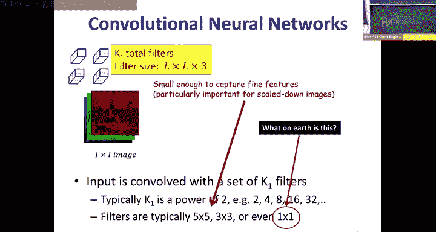

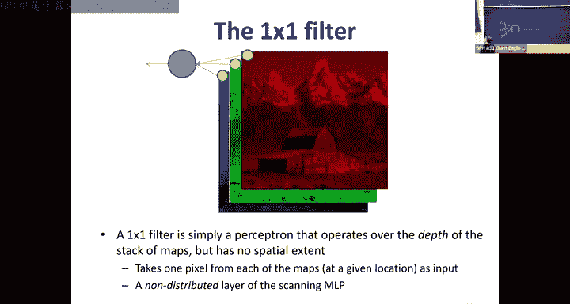

Okay， and。So。Better notation， filters are typically 5 cross 5。

 This cross 3 is to say how the depth of the filter itself。 How many channels the filter had。Sorry。

 good asked a quick question。If you have so we have four filters and three input channels。

 does that mean that your the output will produce four channels？If we have four filters。

 the output will be four channels。So you're increasing the channel because the input is three channels。

 right yes。Right， so over here。The number of parameters you're going to choose are， you know。

 the number of filters， the size of the filter， the stride of the filter and。

So you're going to have as many output channels as the number of filters。Second can stack up， right。

So。I'm going to skip all some of the numbers over here。 You can just check them up。

 I can perform pooling on each of these guys。 Now， here is something else that's important。

 We know exactly how to perform convolution and compute output at each position。

 you're computing the aine value Z。 Then you pass the aine value Z through an activation。

 so that it's a two step process You're going to be computing an aine value。😊。

At each location for each channel， the find value is going to be summing over the entire filter。

 And then you have a bias。 And then you pass that through an activation function。

 which which is whatever you choose it to be。Then subsequently， you're performing pooling。

And how did we perform pooling， We have a window size。 You have one pooled output per。Convolution。

Channel right， and we look at， we choose a window size and we perform whatever pooling operation we've chosen。

 In my example， it's Max。And perform the pulling operation over it， right。

 And so that's going to give you this reduced map size because typically pooling is performed with us with a stride greater than one because it makes sense。

And so the output of cooling is going to be the max of the wind the values within the window。

 But you never just directly take the max。Here's what he would do。So here。

 the parameters to choose are going to be the size of the pulling block and the stride。And choice。

 I it max pool or mean pool。 I'm assumingming max。 But here's the actual operation you'd perform。

 You don't just the pick the max value of this window。

If you do this in a two step process in the first step， you identify the location of this max value。

 That's what I'm storing in the variable peak。In the second step。

 you copy the value at this max position over。 Can anybody guess why I would be doing this。

Because the region is important。Because region where that's that not just the region， right。

 Why am I retaining the position of the max During back propagation。

 I need to know where the derivative will go。Right。Otherwise， I have no idea。 I picked up a max。

I know， for example， if I take a max of four values。

 the only value that I can perturb and change the output is the largest value。

 The rest of them must have a derivative of 0， right。

And if I don't retain information about where I got the max value from。

 then I cannot pass as the derivative backwards。嗯走。

And so that's going to give me some kind of an output。😊，And a jargon。

 the filters are often called kernels。The number of individual filters is basically the number of planes。

 which you often call channels。And so the number of filters is the number of output channels。

 The number of planes that you are working on， the filters works on work on the number of input channels。

And。Then you'd have a second layer of convolution with its own bunch of filters。

 which would generate a bunch of output channels， its own pooling and the parameters you must choose for it。

 its own pooling and so on。 And then finally， an MLP。

 So this is what the entire operation is going to look like。😊，走。Each convolution layer。

 with stride one typically maintains the size of the image。 If you have zero padding。

 If you don't have zero padding， you lose a little other edges。

Each convolution layer will usually increase the number of maps， the number of channels。

And the reason for this is that you're going to lose information Otherwise。

 if you have any kind of pulling with down sample， right。

 each pooling layer with stride decreases the size of the maps with by a factor of D on each side。

And filters within a layer layer all are all typically the same size， right。

 although the size of the filters may vary from layer to layer。And in general。

 the number of convolutional filters is going to increase from layer to layer for the reason that I guess。

Mentioned。So the parameters to choose it would be the number of filters。

 the size of the filters and all the kind of pooling and so on。 So all that is fine。 now here。

Here's a question。 I'm asking all of you。What is the relationship between the number of channels in the outward of a convolution layer？

And， and the number of neurons in the corresponding。Scanning ML LP。Anybody want to answer this？

there the same thing， right， So I'm not。你有个成。And we had this digit classification example that we saw earlier。

 But before that， so what we will look at next week。 By the way， guys。

 our classes next week are going to be on Zoom。 I will not be in town。So you。

 I will not be in town for the rest of the for all of October。

 So all classes in October will be over soon。So here's how we're going to perform training。

Youd perform it's just as in the case of a regular MLP。

 the only difference is in the shared parameter structure of the network。

So you'd have examples of data。Images and their class labels。In the forward pass。

 you're going to pass the data through the network until they get to the MLP。

 and then you have the output of the MLP。And then， you're going to compute。Divatives at the output。

 youre going to compute divergence at the output and the divergence is going to be propagated backwards。

😊，And the and the derivatives or the divergence are going to be propagated backward。

 As they go back through the convolution layers， they're going to keep track of this business of shared parameters to make sure that any update。

At one location reflects two updates at all locations。

 So you would do this by simply updating the filters directly。

So we'll go through all the rules of all of this， how back propagation is performed。In the next。

In the next。Any questions。Questions， no， thank you。Okay。

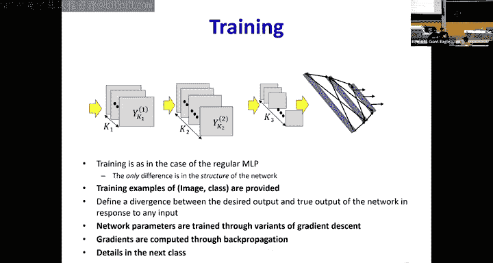

Yeah。