# CMU《深度学习导论｜CMU 11785 introduction to deep learning Fall 2024》中英字幕（deepseek - P12：Fall 2024 Lecture 11.zh_en - GPT中英字幕课程资源 - BV1CfsReEEw8

So all right， everybody， can you hear me？Yes， I can hear you both。这时间 here。So Tom。

 these slides should have been there at both Federal Levi。啊。

Send them out for posting if they are not there， they will be there shortly later okay？

They should be there intransal。哦，你比如说像。嗯。All right， let me the again folks。啊。All right。

So I assume everybody can hear me if you cannot hear me， then let me know， I mean。

 just post on chat and'm trackinging chat。We don't have a link for attendance because Zoom keeps track of everybody who is in the on on the。

on the meeting and so we know everybody who's here and for exactly how long you're been here。

 we are going to continue our series on。Convolutional neural networks。

 we're going to look at training neural networks， so here's a quick recap。

We've seen going to we're going to start at the recap we're going to go through back propagation through a CNN and so here's a quick recap。

 we've seen that pattern classification tasks such as does this picture contain a cat or does this recording contain hello or best performed by scanning for the target pattern？

Scanning an input with a network and combining the outcomes is equivalent to scanning with the individual neurons periodarchically。

 where the first level neurons scan the input， pilele neurons scan the maps followed by the lower level neurons and a final decision unit earlier makes the final decision。

And we saw that defformations of the input can be handled by pullinging。

For two dimensional and higher scans， this structure is called a time delay convolutional neural network。

For oneD scan a long time， it's a hand network。So。Here's what。

Thevol convolutional neural network looked like。It comprised convolutional and optional pooling layers。

Followed by an MLP with one or more layers。And。Why is this？Give me a second。And。

Here's what the convolutional land looked like。A convolutional layeror had two stages。

You worked on all of the maps output by the previous layer and from those you first computed an aine map by convolving a filter over all of the maps from the previous layer。

 so that gave you an aine map subsequently an activation map was computed by applying an activation for function pointwise on the Aine map。

So let's look at how these things work， computing this aine map。

Each a map has associated with it as we saw a filter。And so this is what the computation looked like。

You have several filters， one for each output aine map。And。Each of these filters。

Convolves with a set of maps from the previous layer。 again。

 we also saw that these maps are sometimes called channels and so each filter。

You have as many filters as the number of output maps on output channels you're trying to compute。

Each filter has as many channels as the number of input channels。

 one filter channel or input channel。And so the total number of parameters in any filter is going to be the size of the filter。

 three cross three over here times the number of maps or channels in the previous layer。

And so here's how the computation of any given output Iine map was performed。

Corresponding to each output II map was one filter。This filter can the set of input channels。

And we did it like so， you could place the filter on the top left corner。Of these maps。

And then youd compute an inner product which is basically a pointwise product of the filtered filter parameter with the underlying map and then you summed over all of summed over the entire filter and across all the channels。

 and you could add a final bias term so this is how you would compute the aine map term for the top left corner you got this when you place the filter on the top left corner。

And then subsequently， you could stride with the filter and scan the input with the filter。

And at each position， youve got a corresponding element of the output map。

So we saw this in the last case， this is how you computed the。Convolution。And of course。

 once you complete this Aine map， you next want to apply an activation to it。

So the activation function itself applies pointwise。Each ZL I X Y represents some X Y element。

In the Iat channel of the e layer。To that， you apply some activation function F。

 and that gives you the corresponding X Y element。Of the I channel of the E Claire activation map。

More explicitly， if you wanted to see how the computation is performed。

Every one of the input channels was used in computing every one of these II maps。

But then each ain map。Was contributed solely to the computation of the corresponding activation map。

So here's your first poll。Can the tears pull up the pole？嗯。ok。Let's say。

This poll seems to be the wrong one， let me end the poll， sorry guys。

There seems to be some mess up with the polls so let's skip the polls。

 can somebody just answer this is the first statement true？

The number of channels in and any filter equals the number of input maps。

 which is the output maps from the previous layer， is that true or false？First and fourth， Liu Zg。

 we don't need an attendance poll because Zoom keeps track of。Everybody who attended so the first。

Anybody else is the first can you tell me if the first statement is true？

Please reply just post to your son on the chat and we're good right I'll be tracking that。O。And。

What about the second statement， the number of channels in any filter？Equals the number of output。

Maps is this true or false。Number of filters equals the number of input maps。F falses。False。

 the number of filters equals the number of output channelss through or false。Thank you， right。

 so you get it。Bear with me guys， this is there seems to having some mess up in the polls。

So that sort of went through the that was the convolution layers。

 the other component we saw was the pooling layers。

 the pooling layers intermittently follow the convolution layers they don't need to perform follow every convolution layer。

 for example over here we have two convolution layers and only one pooling layer following it。

So here's how we saw the pooling layer operated， you had a pooling filter which looked at a window of inputs if you were performing a max pooling。

You picked the largest element in this window and copied it out and then you scan the input this with this cooling filter。

 so if you were performing max cooling here's how it would be done you first identify the location of the largest element in the window and then copy that element over。

If you are performing mean pooling， then you'd compute the meanme of all of the elements in the window and。

That's what we' go into the output。So you now scan the input using this mean mean pulling operation。

 so here's what the computation would look like but in each window you complete the mean of that window and then copy that over。

So we also saw something else， we saw recyclingmbling。

Wwhichch can proportionately increase or decrease the size of the maps by dropping or inserting zeros in the case of down sampling。

We draw s minus1 rows are columns between rows and columns。

This reduces the size of the maps by a factor S on each side。If you are up sampling。

 you'd insert S minus1 rows or columns of zeros between adjacent entries and this increases the size of the map。

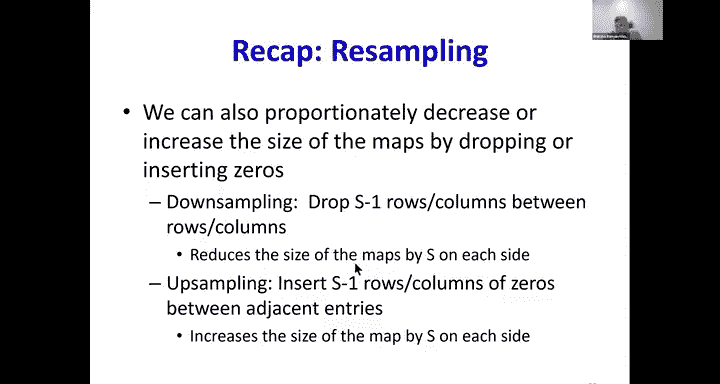

By a factor of S1 inside。So this is what the down sampling layer looked like if I wanted to reduce the size of this map by a factor of two。

 then all of these black elements in black， these are going to be eliminated。

So every second column and every second row is going to be deleted to give you this reduced map down sampling literally just。

Drops。Brozen crops。

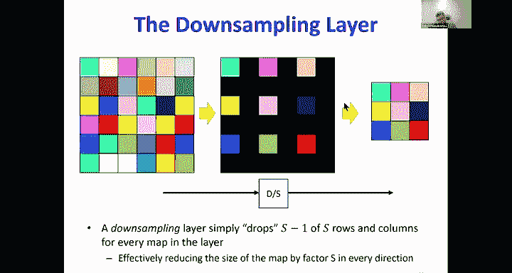

And。The up samplingampling layer does the reverse， the up samplingampling layer we saw if you wanted to upsample by a factor of s。

 you just insert S minus-1 columns and S minus-1 rows of zeros between any two adjacent element。

 and this is used explicitly to increase the map size by a uniform factor。

We also saw that in practice。DownDsling usually follows a convolution or a pooling operation。

In this case， you can just think of these operations as convolution with a stride。

Or down sampling with a stride， where the stride is greater than one。

So also in the case of up sampling， up sampling is generally followed by a convolution。

 otherwise it makes no sense。And so it's not useful to follow it by putting layer。

 it must be followed by convolution。And this is also often called convolution with a fractional stride so if I。

Up samplele。A man。I'd be introducing。Corros and columns of zeros and then convolving by filter。

And so this is the equivalent term often used this convolution with a str of 0。5。

For reasons that we won't get into over here， this is also sometimes called a transpose convolution。

Now， regardless。The point that we are interested in is back propagation， computing derivatives。

 and for the purpose of computing derivatives， regardless of the fact that when we actually perform downsamp。

 that gets merged with the previous operation， whether it be pooling or convolution。

 and the previous convolution is performed with a stride。

We can we want to disregard this fact and when we perform back propagation we will explicitly separate out the operations of down sampling and the previous operation so if you had cooling with down sampling you're going to separate it as pooling with a stride of one。

Followed by down sampling， if you had convolution with down sampling。

 you'd separate it out as an operation of convolution with a Str of one。Plllored by down sampling。

 similarly， if you're up sampling instead of having a convolution at the fractional stride or a transpose convolution。

Conceptually we will separate it out into an upsampling step followed by convolution and doing so is going to simplify your back propagation rules very greatly we'll get back into this later but did this point come across did you understand what I was saying here please say yes or not。

Why we have the one strip in the case of down samplingamping， par me？

Why we do have this stride of why we assume this straight of one in the case of down sampling so when you when you're down sampling here's how you think of it so when you're down sampling this is the equivalent of saying overriding every。

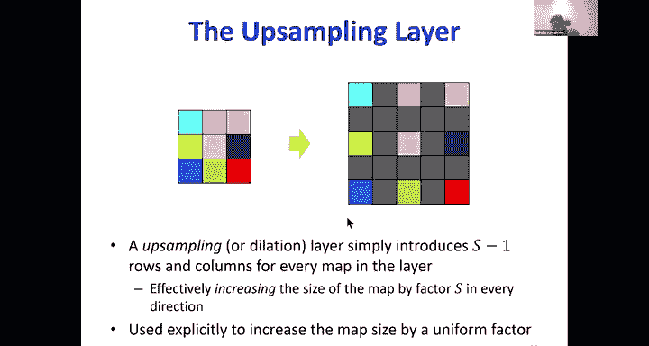

Al if I'm downs by a factor two。Then this is like saying I'm overr every second column in every second row with zeros。

And then dropping the zeros， right， so we are going to it's it's sort of。

And that gives us this guy over here， so that means before down sampling happened。

 you actually had this full map， right？Yes yes， so we're going to assume that for the purpose of back propagation。

 we are going to assume that we actually compute this map and then dropped elements to get this smaller map。

Go back for replication and law。Thank you。 okay。

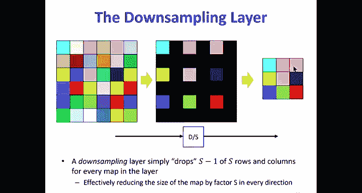

And you'll see why when we get to it in the next class。Any other questions？

So did this point come across， guys， I'll wait for a yes or no。Because I don't see any responses。

On chat。So， okay。And see a bunch ofy assets all right， great。So。Next。かテに。No。

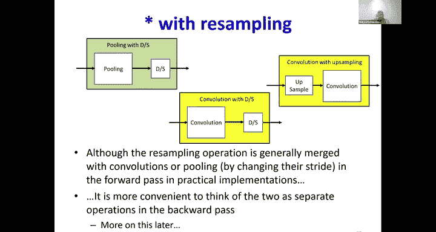

So we also saw。That when we had an end to end CNN。Youd for a typical image classification task。

 you'd have a bunch of。you'd have an image， an image had to have several channels， in this case。

 the color channels。You'd stack them up。

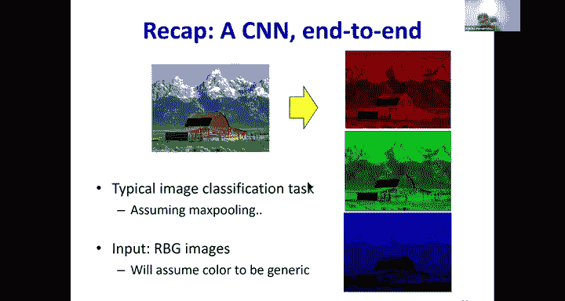

Wait。You stack them up and then process them with a sequence of convolution and pullinging layers。

The output of the final layer is going to be flattened。

Andten that flattened output is going to be put through an MLlP to get your final classification output。

Or regression or whether that's what you're performing。 So this is how we。

I will set up a typical CNN。The parameters over here are going to be the filters。

that operate on the various convolution layers and also the parameters of the final MLP and these are the ones that must be learned。

 these are the ones that must be estimated。So again。As a quick recap。Training。

We saw that a CNN is basically scanning with an MLLP which shared parameters。

 so training is just as in the case of the regular MLLP。

 the only difference is in the structure of the network。

You're going to be providing examples of the image in the class。We define the loss。

 which is a divergence between the desired output and the true output of the network。

In response to any input。And the loss， of course， aggregates the divergence on the training set。

The network parameters are trained to minimize this loss variance of gradient descent。

And gradients are computed through back replication。So here again， for any individual instance。

 you pass the instance through the network。There would be an output。

There's going to be a desired there's going to be a desired output for that input。

 you can compute divergence between the two。And so this is the divergence or the loss for a single instance。

The overall loss is going to be the average。Of this divergence for the entire training set。 So again。

 it'd be given a training set of input output pairs， which might be images and class labels。

And so if the divergence on an individual instance is represented as dive by II。

 YI is the output of the network。DI is the desired output。

 then the loss is the average of these divergences over the entire training set。

And we want to minimize this loss with respect to be。With the parameters of the network。

 all the filters and the MLP parameters and biases。So again。

The loss is the average divergence over the entire training set。So when you compute the derivative。

The derivative of the loss with respect to any parameter is also the average of the derivatives of the divergences for the individual instances with respect to the parameter。

And so this is the term that we would have to compute all over again。

 just like in the case of the MLP。So how would we go about it？For any individual instance。

 you're going to get an output of the network， you can compute divergence。

Between this output and the desired output。And。Then you can back propagate the derivatives or the divergence to the。

First layer of the MLP。And then from here on， so until here you'll just be doing a conventional back reputation for the MLP。

Now， here's where things get a little。Interesting。So let me see if I can get my。pointedin it out。

Bear with me， this is。So remember that at the final layer heres what we did。We took our maps。

 and then we unroll this。Into。A vector。So if we had several maps。

 all of these would be un jointly into a large vector。

 and this is what you'd be computing your MLlP over。So when you compute your derivatives backwards。

You'd get the diameters with all of these elements。These territories can now be folded back。

into the shape that they were unrolled from in the first place and so now you are going to have the derivatives of the divergence with respect to the elements of the maps in the final layer of the convolutional component of the network。

Did that make sense？That makes sense， guys。Okay， good。

 so that's where we're going to have to go back from。Now。Let me get back my pointer options。O。So。

Now we must perform backward application from here backwards through them。

Convolutional layers and this requires special consideration of the shared computation and the convolution layers and what happens in the pooling layers that's what we're going to look at。

So I'm going to assume that from the divergence for any individual instance。

We are going to get the derivatives for the maps。For the final output maps and from there。

Remembering the forward computation， during the forward computation。

 the previous layer maps were operated on by channels to get an aine set of aine maps。

From which the activation maps were computed。 So when you go back initially you'd have the derivatives for all of the for every element for every one of these。

Output activation maps and we must go backwards from there。And first。

 compute the derivatives for the aine maps， and then from from those you must continue backwards and compute the derivatives for。

The elements in the previous layer maps and also。The database is for the filters。

 so this is what we're going to have to do。And。Sovol for the convolution layers。

 we're going to have to figure out。How to compute the derivatives with respect to the aine combination Z。

From the activation output max y and then how to compute the derivative with respect to y L minus 1。

 which is the previous layer and the L layer filters。

 given the derivative for the aine maps of the L layer。Then for the pooling layer。

You had some pooling operations which operated on individual maps to get the corresponding pool maps。

So now assuming that we have the derivatives with respect to the output of the pooling。

 we have to figure out how to compute the derivatives for the input of the pooling。So。

For cooling layers， the challenge is how to compute the derivative with respect to y of L minus1。

Given the derivatives of respect by error。Which was computed by performing a pooling operation on。

Y L minus1， so these are the these are the challenges we must。あ、出ます。

So let's first look at convolution layers， any questions so far？

Did you get what we are speaking of so far？Questions。No questions， okay。So let's see this first。

How do I compute the derivatives with respect to the A in V terms from the output activation map here again？

We assume that we worked our way backward and have the derivatives with respect to all the vices。

But the ys were obtained by applying a point an activation function point y point wise on the z。

 so every for the amp channel of the air layer。The y value at position X y。

Was obtained by applying an activation F。On the X Y element of the m aine map of the earth layer。

So assuming now that I have the。So assuming that I already had this term。The derivative of。Is this。

喂be。With respect to。Why I'll drop the L&N， assuming I have this。Why is this not driving。

I'm trying to write， okay。R来ative。So from this。How can I compute the derivative with respect to the Z？

Anybody？How would I get this？Anyone。It would be the derivative of the activation function disease。

 so I can just say D dive over Dz。X， y。Is simply going to be D dive over D y X， y。Times。

The derivative of the activation function， correct？Eleement advice。

So we are not yet speaking of max pooling， this is the activation function which applies on the Z's to get。

Your are。Rice， okay？So that's what we're going to do。

The derivative of the divergence with respect to Z。

Xy is the derivative of the divergence with respect to y x。

Times the derivative of the activation function， computed and Zxl。So。Back clear so far。Questions。

 is this clear？Okay。This was the easy bit， okay？So I'm going to resume now。

That this is figured out we know how to compute the derivative respect to the aine term Z from the derivative for the activation values y。

So now we have to figure out how to compute the derivative for。

The previous layer maps and the filters。Given the derivatives for the A terms。So again。

During the forward computation， we computed these aine values。From the previous layer maps。

And the filters。So during back propagation， given the derivative with respect to Z。

 we must compute the derivative with respect to y。And the derivative with respect to the front is W。

Let's see how we can do this， right？First， let's see how we can compute the derivative for the previous layer maps。

So here again is where we are。We have managed to back propagate and compute the derivatives。4our。

Of the divergence with respect to every element of every one of these ae maps。

And so now we want to propagate the derivative backward and compute the derivatives of the divergence with respect to every element of every one of these。

Previously， maps or chas。Let's see how we can do this。

Now remember that every channel of the previous layer。Was used because。

The filter has as many channels as the input channels right。

 so every channel of the previous layer was used in the computation of any given aine map。

And so if I just want to shorten this， simplify the picture。第。

First channel of the L minus1 layer convol with the first channel of the ant map。

The second and so in general， the a channel of the L minus1 layer canvol with the amp channel of the endth map。

To give you the and channel of the a find map in the forward pass。

 so if you draw all of the all of the dependencies， every one of these input channels。

Was used in the computation of every one of these。Apo channels and every one of these output channels field turn was used in the computation of the diveverence。

So if I want to compute the derivative or the divergence with respect to any specific input channel。

 I have to track the dependencies from this input channel to the divergence。

And so if I chose this input channel。That's what the dependencies are going to look like。

So what does this mean？If I want to compute the derivative of the divergence with respect to this guy。

How does the fact that this one influences all of the output a maps affect our derivative， anybody？

How would it affect it？Anyone。So。Does nobody want to respond？那咪。See you fucking。Let's consider。

So what this means is that and I'm going to have the figure answers right here。

You're going to compute the derivative of the divergence with respect to this map。

 you're going to have to sum over all of these guides and so the actual derivative of the divergence with respect to this term is going to be the sum over all of the aine maps。

Of the product， of the derivative or the divergence with respect to the aine map elements。

Times the derivative of the a final lapse elements with respect to the mice。

So that's what this equation here says。And during the backward pass。

 we already have the derivatives of the divergence with respect to the Fine map elements。

So that term that remains to be computed is the second term。

 which is the derivative of these aine map elements with respect to one。That makes sense。

Did that make sense， guys？So。Now this is the term we need to figure out how to complete。

And to do that， let me focus on just one output I。How does this y affect this particular Z okay？

So to do that we'll do that using a picture again now as consider this element of why。

And let's see and so these are the this is the output F I the filter is shown in orange now clearly this element of of this input channel。

Is being used on the computation of this first output element， right。

 But then as the filter goes forward。You can keep track of which are all the output elements that that the that this particular element is being used to compute。

 and we find that this element was used in the computation of。Four of the output elements。

And in fact， in general， we can just assume that any input element over here is you know。

 going to be。In the worst case， involved in the computation of every one of the output elements。

Right。And not just of this one channel， because the filter itself has many channels。

It means that because this input channel is being used to compute every one of the output channels。

It means that this element was used effectively in the computation of a whole bunch of elements in every one out of the output aine maps。

And so if I want to compute the derivative of the divergence with respect to this。X Y element。

Of the input channel， I'm going to have the sum over all of the output FI maps。And。

Within each of the RFI maps， I'm going to have to sum all of the elements。And at each element。

 I'm going to compute the product。Of the derivative of the divergence with respect to that element and explained by th。

Times the derivative of that element with respect to。This guy so did this equation make sense？

Yes or no。Yeah， okay。And of this， we already know。This first term。

 we are assumings that during back propagation this has been computed。

 so the only term that remains to be computed is this second term。And what is the second term？

If I work it out， let's look at this piially right so here is an input channel。

Here is a filter corresponding to this channel and。

Ive represented the elements of the filter using two different codes， one is a color code。

 the other is a numeric code。So the color code shows you the position， so does the numer。

 the numer also shows the position， I'm assuming indexing begins at zero。

So when I place the filter at the00 element。And computing the00 element of Z right but in so doing y22 is multiplying the red element of the filter。

 which is the 22 element of the filter so z00 has a contribution from y22 times w22。

If I slide the filter forward one。Now z10 is obtained in part by multiplying y22 by w1 till。

 as you can see from the color， right？Z2，0。Has a contribution from the product of Y22 and。

What are we multiplying y22 by in this case？Anybody。😊，你都不。嗯。Z2 and so you can see how this works out。

At eat right。The Yt2 is multiplying a different element of the filter。

To contribute to a different element of Z。So what does its relationship look like if you go through all of these relationships。

 all of these equations that I showed over here， you are going to find in general that to compute the z value at any x prime y prime。

Y 22 is multiplying w of 2 minus x prime 2 minus y prime so you can verify this right so over here at let's look at z0 y22 when this this is00 this is22。

When this is 10， this is 12， so the indices of the z and the w add to give you the index of the w of the bar in every case。

Can you see that？And you all see this， right？So。And there's nothing special about y22 so I can write a general equation。

 I can say Zx prime y prime for any y x file。I'm going to get。

 you know z x prime y prime as y x pi times w of x minus x prime y minus y prime， in other words。

 the index of the z and the index of the W will sum to give you the index of the index of the y。

So this means that。The derivative of d z x prime y prime with respect to y X， y。

Is simply going to be the filter value at x minus x prime y minus y prime is making sense。嗯。

What about the rest of your guards？Okay， and so I can just plug this here right into mine。

Equion here， this guy。I can just replace that by x minus x prime y minus y prime。

 and so this is how I would compute the derivative。For every element of。Every input channel。Not this。

So here's a second poll， I don't know if we'll get up the polls。哪呀。

There was supposed to be two questions there some can for。Next up， nonetheless。So let me just try to。

Stop this poll and can you just tell me collectively what the first answer to the first questions？

So what about the second question？Also okay guys we fix the poll next week were having an issue this week right so in order to compute the derivative at a single aine element。

 we must compute the contributions of every position of every aine map at the next layer。

So the derivative of a single aine element will require summing over every position of every Z map in the next layer。

 right both of these are。So here is what the derivative looks like。But then this， it turns out。

 is actually a convolution， or is it a convolution。Let's see。So let's go back to this picture， right？

So y22 multiplied the red。Element of the filter to compute z00 so the so for2 to alone。

 I am painting the00 element of the output with the filter element that was used to compute it okay。

So is this notation clear？But just the22 element。I painting the zero， zero element with thee。

Red to show that it was the red filter element that was used to compute it。

Is this making sense to you？What about the rest of you guys， Okay， and so when I go forward。Y 2。

2 multiplied this element of the filter。 So for the 10 element， the pink element of the filter was。

Apply。And so on， and so as you go forward。What do you find？Is that。

Here'm computing when I'm computing the contribution of Y22。To every one of these Z elements。

Here is the pattern of weights。That was applied。So。Now I if I were to compute the derivative。

Of the divergence with respect to Y 2，2， it means that I'm going to have to。

Multiply the derivative for z00。By the red filter element。

The derivative of at z10 by the pink filter element。

The derivative of Z20 by the green philanthrop element and so on。So did this make sense？Right。

What does this look like now what is this pattern of colors。

 how does this pattern of colors relate to the pattern of colors over here？It's flipped。

 it's flipped left right， top on it's transposed right moreover。

 so this looks like I just flipped the filter both ways and where did I position the filter？

I position the filter。With the0，0 element of the filter， Act22。Have you seen that？And so in general。

 here's what we are going to find。If I want to compute the derivative or the divergence with respect to Y22。

 I'm going to have to flip this filter。And。And place it on the derivative map for Z with the stop leading corner now sitting at Q2 and then just performer。

An inner product。Or more generally for any Xy to compute the derivative for y Xy。

 I'm going to have to flip the filter。And place it with a bottom right corner。

At X bar and computer in a product。Did this make sense？Okay， and so， but that's just one channel。

 right， one artwork。So here's what it looks like。Here is the filter right let's say I have the derivative of the divergence with respect to the all the Z elements I want to compute the derivative of the divergence with respect to all the elements of y now here's a general principle。

Which I'm way to try to write if I can get my pointer options working。So。

Let's say if I have any number of elements。Take across hand。Going into some operation。

And the output is some say El cross。And right？And then this used to compute the derivative of the dimensions。

It doesn't matter what these guys are。When I complete the derivative going backwards。

Every one of these elements was eventually used in computing the divergence。Right。😊，Yes or no。

Which means what is the size of the derivative I must get over here？

It must also have K times n elements， correct？Exactly。

 because every one of them was used in computing the divergence。

 So which so what this means here is that although the。Let me get my pointer options back。

Although the Z map is smaller than the Y map。When I complete the derivative going backward。

 the derivative must have the same size as the original one。Does makes sense？Okay。

 now why did the y map become small over here， it became small because this filter could not fall off the edge。

 right？So we could only slide it for forward so many times， so the filter is key wide and k tall。

What we are going to do is zero pad。The derivative map for z with k rows and k columns of zeros on K minus1 rows and columns of zeros on every side。

And then subsequently， we， we are going to flip this filter left to right， top to bottom。

And then you place so all of this blank area are zeros and now I can place my flip filter。

Starting at the0 zero position。To get you the and perform an inner product。

To compute the derivative at the0 zero position over here。And so I can keep sliding forward。诶。

Performing computing the inner product and what does this look like， what is this operation guys？

What is this operation， anybody？Consolution right except that we are convolving the flipped filter。

With a zero pad。Divative map for the Z。It makes sense？And now when you flip the filter。

When you here's something else that happens。Let's see that the sizes cut to line up properly first。

That this guy was， say and cross N。Then end of this was K or K。Then the Z is going to be。And。

Minus k plus1 times n minus k plus one， right？So but then when I pair it with k minus1 zeros on both sides。

 it becomes plus two times k minus1， so this becomes。And。Plus K minus1 after padding。Right。😊，Yes色の。

But then when I convolve this n plus k minus1 with a K cross K filter， I'm going to lose k minus1。

Elements， k minus1 ruless and K minus1 columns。Because convolution loses the boundaries and that's going to give me a resulting and cross and derivative。

Did that make sense？Okay。What about the rest of you guys， do God makes sense， any questions？And so。

But then again， remember that each element。wa involved in the computation of all of the filters right what I assure you was the contribution of just one of these filters to this derivative so to compute the overall derivative of the divergence with respect to any map。

Here's what you're going to do。 You're going to pull out the corresponding channel of all of the filters。

So these are the so if I'm computing the derivative for the m input map。

Here are the AM channels for all of the filters。诶。Here are the corresponding derivative maps for quality。

Output channels， all of it， right？You're going to zero pad these guys and each of these filter channels is going to be transposeded left left to right。

 top to bottom。And then this one is going to be convolving the flipped filter。

Which is now going to have as the flipped。Enre over here is going to have as many channels as the number of output maps and that's because we。

Shows the an channel， right？So。I have。And output maps I have a certain number of output maps that's going to be the number of filters。

 but I'm pulling the a channel for all of these guys so this is going to have as many channels as the number of output channels。

And so when I transpose it， this is going to be the same size pass。

As the number of output channels and so I can just convolve it and that's going what is going to give me the convolution for the。

That's what iss going to give me the data I。快啲啊。Input。确。Did this make sense？So I。

 I'm not sure I understood。This is exact right， there's no sharing for any given input channel。

 I pull out the corresponding channels for all the filters transpose them。

And then I zero pad the output channels on the derivative maps so the output channels can convol them with a transpose filter。

That's it。So any questions？I sure did that answer your question？I have one clarification looked。So。

This is for one input map here。 What if we have four input maps？Then sophori input pardon me。

 this is for one input。Yeah， this is for one input channel right What if we have four input channels that you'll be doing this separately for each of the for or input channels for the first channel you'd be pulling out to compute the derivative of the。

Let me go back here。These animations are painful。嗯。So。

To compute the derivative for the first input channel， you'll be pulling these guys out。

To compute thes of the second channel you'll be pulling these data and so on， of course。

 the whole thing can be bashed into nice vector operations， which is what your Pytorch does。

 but this is the basic operation。Okay， thank you， doctor。喂。😊，So this is one Peter any questions？

Does it mean that okay？And so。This is if we do this。The size of the。啊。听懂吗？

There's some text over here， you can bypass those， but basically what this is saying is that the size of the derivatives that you get。

Is going to be the same as the number of elements in the original input。

And if the original input map was zero paded in the forward pass。

 the derivative map that you get back is also going to have。

Divatives for all of the regions that were originally zeros， so these things will have to be thrown。

Okay， because。This is zero， zero path。No。Hopefully， this sport works。Okay，10 seconds， guys。Okay。

This again。We have some issues with entering the polls this time， so I'll just end the poll but。啊。

We have to figure out what's going on with the poll zoom polls in a bit of a mystery。

 but anyways so just to go over this。啊。This zone means debued。Basically。

 can you tell me which of these elements are true？Just feeling this。Rachel， these， anyone？

To compute the derivative with respect to the AM activation map of the convolutional channel。

 you must select AMP channels right， they must be flipped up and down。

 they must control the derivative maps of the L+1 f maps。The output doesn't need to be flipped again。

 thank you， right？Again， my apologies for the masked up phone。

So we now have the derivatives for all of the bias。

And this can be compute by convolution with a flipped filter。

I have some pseudo code for it it's very straightforward you can just use the same convolution code you have going forward to compute。

 so this gives us the derivative for the voice。The next is the derivative for the。啊。

For the filter weights， right？How does that work？Now， this is。啊。

When I place the filter in order to compute the output at any location。Every filter element is used。

 but then every filter element is used in the computation of。Every output location， right so。

This is supposed to have some clear some。This is really horrible animation thanks to whatever core software I used to generate it。

 but the point is you can see that every single filter element is used in the computation of every。

Output element right so this means that to compute the derivative of the divergence with respect to any filter element I must sum over all of the output elements。

Exactly what will life song。Now look at it this week。See when I'm if I， if I am。

Operating on the previous layer。To compute a single aine map。

Then the filter is going to be placed on the previous layer channels。

But any given channel of the filter is going to appear。

Is going to operate only on the corresponding input channel。

And it's going to generate just a single output map。

 So the thing about the filters is that each filter channel。

Operates on a single input channel and generates a single output channel。Nevertheless。

 when I actually compute the derivative， so this is the forward equation， right？

So if I look at say a single filter element like this guy。

You can see that that filter element only influences a。Single output channel。

And only operates on a single input channel， right？Moreover。

 now look at the equations on the right hand side。So if you look at the equations on the right hand side。

Let's look at how filter element 12。Is used in computing the different Z elements。

Pilter element 12 multiplies by element 12。To compute Z element 00。Filter element1 two。

Multiplies y element。2，2 to compute Z element 10。A12 multiplies 32 to a compute Z element 20 and so on。

Is this relationship seeming familiar， we saw this earlier， right？Anybody remember what did we see？

Thiss a few minutes ago。The indices of z and w must sum to give you the index of y， remember？Right。

 and so if I actually go through this。Sequence of computations。Here's what you're going to see。Z x方。

好。To compute Z X Y。W x prime y prime must multiply。Y x plus x prime。This should be white plus yplan。

 right， because the indices of z and W。M sum to give you the index of what。That makes sense。Yes， no。

Okay。So in general， Z X y is going to have is a plus equal to， right which the。

Why is this thing not showing up。嗯。Zoom is much slower than。Yeah。So in general。

 you're going to get Z X Y is。Oh gosh。What I'm seeing on my screen is much slower。

 very different from what's showing up on someone。Zxy to compute zxy， this should be a plus equal to。

You multiply WIG by y x plus I y plus2。Oh gone on。Sorry guys。This flagag is killing me。Right。

So ZxY multiplies the WIj to get ZxY， the contribution of WIj multiplies。Y of x plus r， y plus two。

 right？And so。If I want to compute the derivative of。Z。

With respect to any ZXY with respect to any WIJ。That's simply going to be。Y x plus I byistic。Right？

So this making sense is a bit of a lag between my voice and guess what's on the screen because。

There seems to be a transmission delay， but is this making sense？嗯。

And so if you look at this equation at the bottom。The derivative of the divergence with respect to W Ig。

Must sum over all the elements of the output map。And the term that summed is the product of the derivative of the divergence with respect to Zxy。

Times the derivative of Zxy with respect to W5G。And the derivative of Z XY with respect to WIG simply。

This guy here， this is already computed。And this term is simply going to be y x plus I， y plus J。

And so I can plug it in here。And that's going to give me my。Divtor equation for the filter。

So this making sense？So far。Okay。But does this equation look familiar， what does it look like？

What does this look like guys？So it's a convolution， right？

I'm going to skip the next two slides simply because the lag is killing me。But。

You'll have to sort of delete me on this。Here's what actually happens。This is。I'm trying to。

 this is the equation we have。The derivative or the divergence with respect to any Ij element WIj sums over all the elements of the。

Derivative map for the output channel。And the term that sum is the product of the derivative with the divergence with respect to the。

X y elementli of the output map times y x plus s white plus chain。

And this is a convolution of this kind， right， here's what it looks like。If I can say。

 let's say these are all the input channels。These are all the output channels。

 one channel per filter， right？Then。Any single channel of the filter。

Connects the corresponding input channel to the output。And so。

To compute the derivative of the divergence with respect to this filter channel。

You consider the derivative of thee。Divergence with respect to all the elements of the output map。

And。Here's how you would do it。You literally just。Convolve。The derivative map for the output channel。

With。The original input channel。And this convolution。Well give you the derivatives of the divergence。

With respect to thee。That corresponding channel of the filter。That makes sense？and so can you check。

 can you verify that the sizes are now correct？Because the size of the filter output channel plus the size of the filter minus1 is going to be size the size of the input channel。

 right so also。The size of the input channel。Minus。

One less than the size of the output is going to be the size of the filter and so the sizes match。So。

If I want to compute the derivative。For all the channels of a filter。

I just have to convol all of the input channels。With a corresponding derivative map for the output channel。

 and that's going to give me the derivatives for。That's going to give you the derivative for the entire filter。

that makes sense？So there's just a single yes， what about the rest of you guys？Yess。Easy computation。

 nothing fans， right？So although the math looks very ugly。

It's actually very easy and of course you have to keep track of all of the stuff like zero padding if the input channels were zero pad four paded in the forward pass。

 it must be zero paded for backdrop。But this is really justie。

Equation4 computing the derivative for filter elements。

So I'm not going to go through the Zoom poll unless this works， let's see。This is my step。

 skip those reportss， right？No， this one doesn't work， the texts。Welcome。So。I'm going to do。Sip this。

Okay。All right， so is the first statement true？The derivative of the nth channel of the nth filter。

Is computed by conlving the end input channel with the end。Output layer， de。

And it doesn't need any flipping。Right， so the first is true and the second is first。

So I have the pseudo court for it。So we've seen the derivatives form。你。😊，Both the filter and the。诶。

And the input channels right， it turns out that if you look at it through the lens of code。

 it actually looks much simpler。And for this， we can do through the application of two simple rules。

 if I have y equals sigma of z， then dl over dz is dl over dy times sigma prime， right？Also。

 if I have z equals wy。Then Pl over D。Equals dl over Dz times2。Plus equals， right？

Because why they have right？哦。W may be contributing through but through other means to L also？

So also dl over dw plus equals y times dl over dz， so this is just a very simple rule for。

Computing derivatives。And so when you do the CNN forward pass。

 here's what the CNN forward pass look like。He was scanning。And within each at each position。

 when you've computed the aine term， you are multiplying the weight and the bar， right？

So this is output the input channel and the weight that multiplies it。

 and then finally when you got the fI term that was put through the Fine term Z that was put through an activation to getwa。

So because it's back， everything is going to be converted。

Instead of going from one to the end for the loops。

won be for the loops and then having y at the bottom。We're just going to flip everything。

Tk to bottom， left to right。And so this is what the code will look like。This。

Plus y equals activation z。Is going to become dz equals dy times the derivative of the activation。

And then we're going to use the other route， right， which is this guy。If I have z equals wy。

 then the derivative of the loss with respect to y。

Is the derivative or the loss with respect to z times w？

And the derivative of the loss with respect to W is the derivative of the loss with respect to z times y。

So that's what we do here。All I did。Was， I said， again， observe that z equals w times y。

Not the indices。I'm going to use the self same entitiestices and say the derivative for y。

Is going to be the derivative of Z times stling。And the derivative for w equals a derivative for z times bar。

 I just literally just took the code and flipped it。Flimpped all the loop indices in their order。

And within the loops， I computed the derivative of the last operation。And within the a computation。

I just very had z equals w times y。I said the derivative for y equals w times the derivative for z。

And the derivatives for W。Equals plus equals。Y times the derivative4 z。

 so just a simple flip of the code。And this is a lot simpler。Then。In terms of。

In understanding than the convolution， it would but。

Just pointing out that even when you're performing convolution， this is basically what you're doing。

And so。Okay， now let me try to move on if。And this whole thing can be cast as a tense robot to operations。

 we not to discuss this。For some reason， there's a terrible lag。Between my screen and your screen。

 and so this is really killing this class but。啊， here。

Weve figured out how to compute the derivatives for our F find maps as well as the data from the output maps。

And also how to compute the derivatives for the previous layers and the filters。

Given the derivatives for the aine。啊啊。Cos。So。I think what she's speaking of is in terms of computation it's going to really be very slow if you have those many follow loops。

 but then。If you were using some kind of tensor operations。And GPUs。

 you wouldn actually be writing formss。Anyway。So for our purposes， we have figured out。你 small。

How to compute derivatives for convolutional， I guess。The next is how to compute derivatives for0。

Wonning lands。So let's see how we can do this in the remaining 12 minutes。Again。

Remember that when we were performing pooling in the forward past。

 if you were performing max pooling。As you scan forward at each entry。

 you are simply picking up the maximum element。Of the window。And copying it over。So now tell me this。

If within this group， if I pertbed this element one， would this change the output？

Which is the only element in the input that I prefer to change the output。Right？So this means that。

For the first sleep。So the next operation is going to basically。

foollow the same sequence of operations as it scans， and I'm assuming that the stride is one。

 but when you're performing backdrop， here's the rule that happens。The derivative going backwards。

 you're going to get the derivative with respect to this element6。Now。

 that derivative is going to be copied directly over。To the position where the six came from。

And since the other three did not affect the outcome。Their derivatives are going to be zero。

Did this make sense？What about the rest of you guys？Right。

 and so if I were to look at it in terms of code。Here's what this is going to look like。

Remember when you were going forward。You actually stored the index of the maximum location at each position and they and during pooling。

So when you're going backwards。All you will do is。Increment the derivative at that position derivative now by using that。

都个日。3 what。we using a plus equals。So。Here's what would happen。The derivative of a constant number。

 sir Ban， I'm not sure I understood that。We know that the day we know that。The that the。

Previously a y element at this location was copied to the output， right？

So the data that so at this so。The derivative at this element must just obtain the derivative from the output going back and the rest of them obtain no derivative。

 but then what happens is that when you're scanning forward。

The same element may be the maximum element in more than one vendor。包括系。And so if this element。

 for example， is the maximum and two consecutive windows。

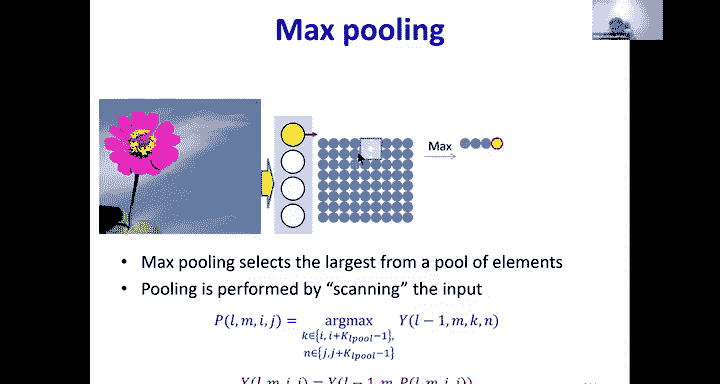

Then it's where you're going back， you're going to get contributions from both of those locations。

So the data over there。Do that make sense？Yes， no guyss。So again。

 my apologies for the very crappy internet connection， I didn't expect this。

 so things just look okay。

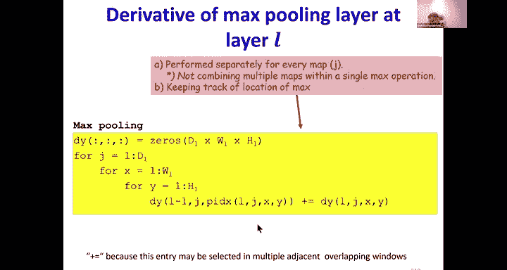

What about mean pulling？And meaningfully。You're taking the average of the elements in a window and copying it over。

 right？So what this means is that if this window has four elements。

This derivative is going to be one fourth。This element is going to be one fourth。

 the element here plus one fourth the element here plus one fourth element here plus one fourth element here。

So。When you're going backwards。This the derivative that you got at the output。Wch is this done here。

Is going to have to be uniformly shared。Across all the elements of the input vendor。

Because each of them contributed one fourth in this case to the computation of the output。

Did that make sense？Right。So why would the elements have different weights？Remember。

When you're going forward。你 just。Took the average of these guys。

 so this is going to be one over four plus three over four plus6 over four plus5 over four to give you 3。

75。So when you're going backwards， this derivative times1 over four comes here。

 this derivative times1 over four comes here， this times1 over four comes here and this times1 over four comes comes here。

Did that clear that particular doubt？

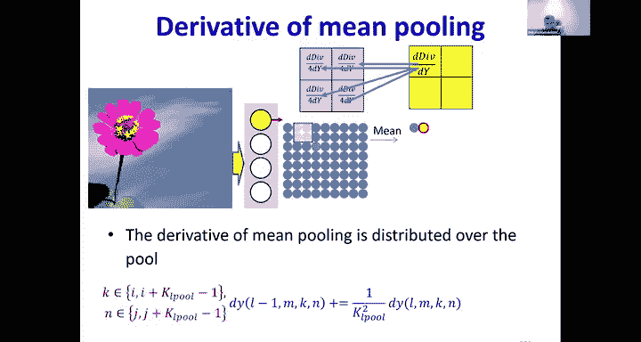

Right。So if I were to write the pseudoA code。This is what it's going to be right in the forward pass。

We just computed the mean。Of each window， so in the backward pass。

 you're going to just increment the derivative at each location by。One fourth or one over K squared。

Where K is the size of the pool window， right？Of the derivative at the output of the pullinging。

And is going to again， this increment is because the same element may be used in adjacent windows。

This makes sense？

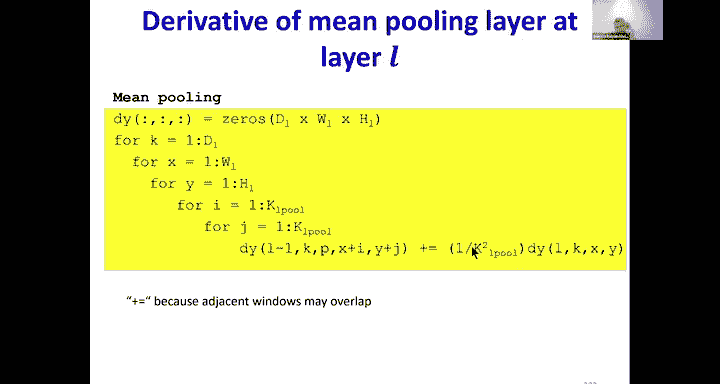

Okay。And so we have shown the derivative of the divergence with respect to every intermediate output and every3 parameter。

This can be。Embbedded in gradient descent to learn the network。

And we are still missing one the element， mainly reseling。

 so I'll cover re samplingling in the next class。And so here is this story so far。

The convolutional neural network is a supervised version of a computational model of mammalian。

 it includes convolutional layers。Comprising learned filters。

 the scan that scanned the outputs of the previous layer。

foollowed by an activation and cooling layers that operate over groups of outputs from the convolution layer and typically include down sampling to reduce network size。

You have optional resizing operations typically perform with stride greater than one for down sampling。

Or interpolation of zeros or absently。The parameters of the network can be learned through regular back propagation。

Max pooling layers must propagate derivatives smooth over the maximum element in each pool。

Other pooling operators can use regular gradients as sub gradients。

 and derivatives must sum over appropriate element sets of elements to account for the fact。

That the network is in fact， a shared parameter network。

And what we saw was were some of the rules for。Sharing。

 but all of this makes the computation of derivatives look just like a。啊。Convolution operator。

 so we'll stop right here。 the slide must should have really been a。Online。

 I'm not sure why this was not。But we'll make sure that the slides are out on the next class。

 my apologies for today。I did not check whether I made sure that the slides were online。So。

Any questions？So if we have no questions with apologies for the very messy。啊。嗯。没有。

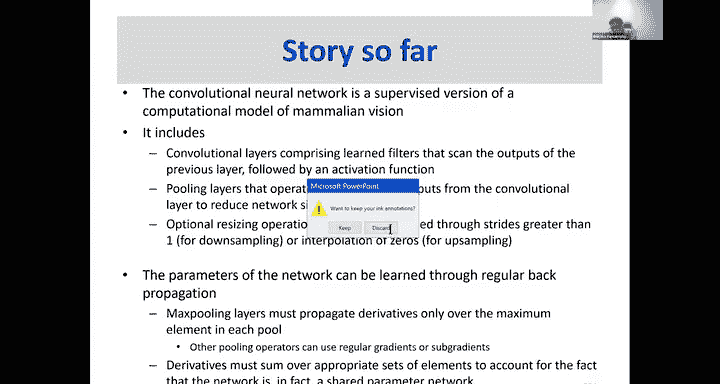

Thatsmission。I'm going to stop my。Slidedes share and。Pro it answer。Thank you all。

So I don't think it's just a question of the camera。

 I think I'm here at the Momed Din Z University of Hawaii。

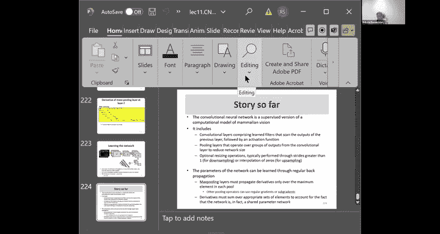

系。