# CMU《深度学习导论｜CMU 11785 introduction to deep learning Fall 2024》中英字幕（deepseek - P13：Fall 2024 Lecture 12.zh_en - GPT中英字幕课程资源 - BV1CfsReEEw8

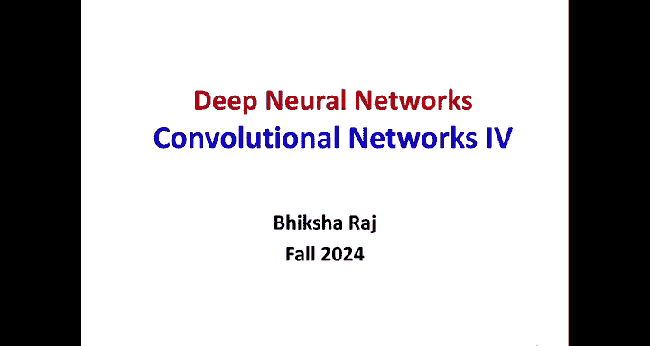

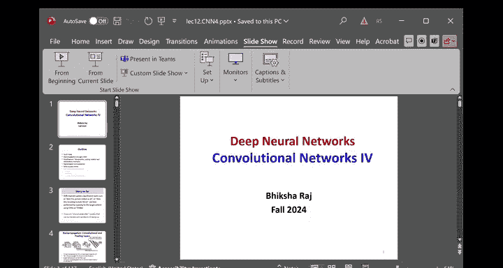

So can you hear me？Yes，Perfect。Let's start in for minutes。嗯。S Mia， can you see the polls？

There must be of them， I can't see them let me check。there are four。Tfect started。Okay。

 so release them when the polls come out。没个。All right， folks， let's begin。

So we're going to continue our series of lectures and convolutional neural networks。

 and this is the last lecture in the series。So here's what we're going to do。We are going to。

Have a quick recap。 We're going to finalize。Some of the topics in back propagation through a CNN that we did not touch upon in the previous class。

You're also looking， we're also going to look at modifications to the basic shift in variance property。

 namely scaling rotation and deformation and variance。

 and we'll look at segmentation and localization and some success stories and time permitting we' look at some so-called advanced architectures which are very far from advanced today。

 but we one of some of the earliest advances that were proposed。To CNs。So here is the story so far。

Shift invari pattern classification tasks such as does this picture contain a cat or does this recording include hello are best performing by scanning for the target pattern using convolutional neural networks or time delay neural networks。

These are shared parameter models that can be trained with variations of back propagation。

And so here's how back propagation was performed。For each training data。We first。

Pass the data instance through the model。To get an output。

You'd compute the divergence between the output of the model and the desired output。

And then you propagate gradient gradients backward using conventional back propagation rules until you came to the first layer of the MLP that followed the CNN。

Then the gradients with respect to the input。Of this MLP would be folded back。

to get gradients for the derivatives for all of the channels of the final layer of the CNN and from there on we would use the back propagation rules that we've seen earlier in the last class to propagate derivatives for the backward and this these back propagation rules must consider the shared computation and convolutional layers。

And the somewhat funky computation of the pooling layers。So here's what we needed。At each layer。

 if this was a convolutional layer， given the derivatives for the output activation maps y L where L represents the layer。

We would first need to figure out how to compute the derivatives with respect to the Aine map ZL。

And then given the derivative for the aine maps， ZL。😊。

We would have to compute the derivatives with respect to y L minus1。

 which is the output of the output maps of the previous layer and also the derivatives with respect to Wl。

 which are the filters。That were applied to y L minus1 to give us Z。For the pooling layers。given。

An output by the derivatives with respect to an output by L。

We had to compute the derivatives with respect to the input y of L minus1 to the cooling layer。

Now for the first one。The derivative is for the convolutional layers。

Given the derivatives for the output activation maps。

How would we compute the derivatives with respect to the aine map， this was easy。

 here's how we did this。To get the activation map from the find map。

 we applied up an activation function pointwise to。All of the elements in the Aine map。

And this this gave us the activations in the activation map， so y LM Xmi。

 which is the activation at the X Y position of the em channel of the L layer was obtained by applying the activation F。

To the X Y element of the a channel of the L layer。

Aine channel of the L layer so then just using standard derivative chain rules。

 this meant that the derivative of the divergence with respect to Z Lmx y。

 which is the aine term was simply the derivative of the divergence with respect to by Lmx y。

Times the derivative of the activation function itself computed at that z value。So this was easy。

 This tells us how to compute。How to propagate derivatives for the activation maps backward。

ToD Al fine maps。So this first。Deivtive。Operation is defined。

The second one was now how to compute the derivatives with respect to the input。

To the convolution and also how to compute the derivatives with respect to the filters。

Do you remember how these operations were performed？Anyone。😊，How were these operations performed？

Any answers？Hello。Plipping the convolutional matrix and。Going back on the can you repeat that。

 please？We were clipping the convolution matrix。And then multiplying that with convoling that on the DlDz that we got。

From the vercular and then going there are two different derivatives we are sticking of one is the derivative with respect to y。

 the other is the derivative with respect to the filters， correct？

So how did we compute the derivatives with respect to the filters？These guys。Anyone remember？Any。

Convolve。Why with D LDZ to give it to get W correct tell。And to get the database with respect to why。

 what did we do？Any burning？Okay。So。Convolve the flipped， the transpose W with DLDZ。

So that's exactly what we did。Let's look at the first one if I want to compute the derivative of the divergence with respect to the n input channel。

Then I would consider the AMped channel of all of the filters。

This em channel is now going to be transposed。Which is flip left to right， top to bottom。

The output derivative maps， the derivative maps for all of the aine outputs a zero pad。

And then these transpose filters are con with the zero pad。

Divative maps for the aine layer and that gave us the derivative for the。In Bau。

Do you guys remember this？There's a single yes， what about the rest of your art， right？

And that's very easy to do right once you see what this happened， what is done over here。So also。

When you wanted to compute the derivative for the filters。To get compute the derivative for the。

For the end filter。We convolved。The derivative map for the nth output aline channel width。

All of the input channelss。And that gave us。The derivatives were all of the channels of the filter。

Do you remember this？Right。So。Easy， right？And so we've seen how we can back propagate derivatives over here。

 back to here， and from here back to here， as well as compute derivatives for all of the filters。Now。

 the next operation was so this， this， this。Our termerm is down。

The next operation is figuring out how to perform compute derivatives with the cooling layers。

And we consider two kinds of pullinging， max pullinging and mean pullinging。

How did we compute derivatives for the max pooling， anybody remember？

How did we propagate derivatives for max pooling？Anyone？

Someone to which index the max came from and then sending it back to the maximum1 and keeping zero for the others exactly so here。

You know， max pooling pool groups。Or pools， groups of values to reduce data sensitivity， right？And。

When you perform max pullinging basically， you're just computing the max value over。

So and that's what we do through the scan。When没。Proroppaated derivatives backward。 We know that。

Only the max element was copied over， so the rest of them had no influence on the output。

Which means that the derivatives of the divergence with respect to these guys must be zero because they do not influence the output and the derivative with respect to the element that was copied over。

 this element was copied over exactly， so the derivative out here can be copied back exactly over here as well。

So this was the back propag for the max pooling layer。Everybody remember this？

How did we do the background propag for the mean pooling？

The minling is for each element in the kernels we divided by its kernel size。嗯。Fantastic right。

 so this is what so this is okay， this was the max for me。For min。We computed the mean。

For all the elements in the window to obtain the output going forward。So when we。

Perform back propagation。We just redistributed this derivative uniformly。

Over all of the elements within the window， so if this window was size four， it has four elements。

Then one fourth of this derivative went into each of these locations。

And you actually do a plus equal。Because we know that any element may occur in multiple adjacent overlapping windows。

 now does this operation look like something to you guys？What does this operation look like？Anyone？

What does this operation look like？鸭餐mbling。Upbs sampling。Not clearly。

What is what happens is so this was the main operation going forward， this is what we did。

This is the pseudo code for the back propagation for me in pooling。But then really。

What we do for me in pooling is we are since each element is being spread across。

Four elements over here， so this is like having a kernel of four， one folds。

And you' are zero padding the derivative map。And then you're convolving it with this kernel。

And that gives you the。Deivative map for the main pulling。

Back propagated derivative map up for the main pool。That makes sense。O。

So mean pooling is different from max pooling， you can't think of max pooling back propagation rules in max pooling as convolution because you're picking an element。

For mean pulling it simpler still， you can just back propagate using convolution itself。

Except the convolution is now performed channel bias。ok。😊，Any questions？Any questions， no okay。

So we've handled all of these， but there were a couple more operations for which we have not considered back propagation rules。

 what were those？Anyone。What were the operations for which we haven't considered back？

Back for re rules。Does anyone want to volunteer？Okay。Let me remind you。But before that。Here's a poll。

 MIor， can you release this poll？Yeah。Thank you， Tom， absolutely。All right。

 five seconds and we'll close the poll。Thanks MIa， can you close the poll Yeah， all right。

 here's what we got， right？So for the first question。

 what is the answer when back propagating from maxpoing layer。

 derivatives from the pooling outputs propagate only to the position of the largest true。

For the second one。Also true， beautiful， you guys got it， right？So。Let us continue。我都 visit。Now。

 the next operation we must consider is up sampling and down sampling。

Up sampling layers and down sampling layers increase or decrease the size of the map。

And we also said that up sampling must always be followed by a convolution。

 otherwise it doesn't make sense， so ups followed by convolution can or is often termed as convolve convolution with a fractional stride。

And。Arian yes， and similarly convolution is always followed by I mean down sampling always follows convolution or pooling。

 so convolution followed by down sampling can be viewed as convolution with a stripe greater than one and similarly cooling followed by down sampling can be viewed as pooling with a strip greater than one。

But then。How do we？Propagate derivatives through up sampling and down sampling layers。

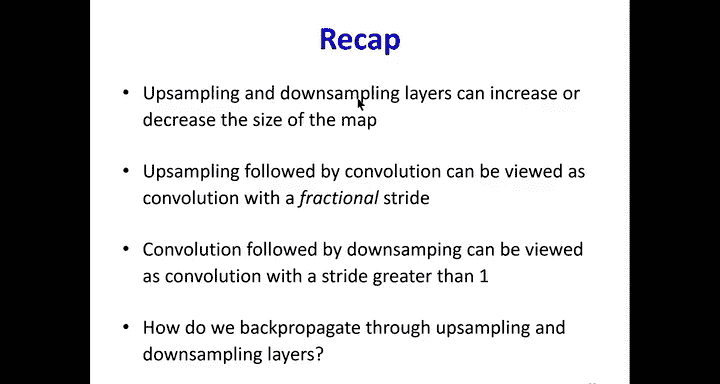

Now， here's what happens in dull sampling。You start off with this large map。Right。😊。

Then all of these blacked out entries。A essentially ignored， in other words。

 we can think of them as being zero because we are not going to use them and only the remaining entries are copied over。

When we are。Down sampling， this makes sense。As the down samplingamp operation。Guys。😊，Right， okay， so。

Do any of these blacked out elements influence the output？

So what do you think the derivative of the divergence with respect to those blacked out elements will be？

Zero， right， on the other hand。What about this guy here， this san element here。

 does that influence the output？What do you think the derivative of the diligence with respect to this element will be？

It's going to be the same as the derivative of the divergence with respect to this gap， correct？

Because it's just copied over for done sampling。Right。Yes or no。

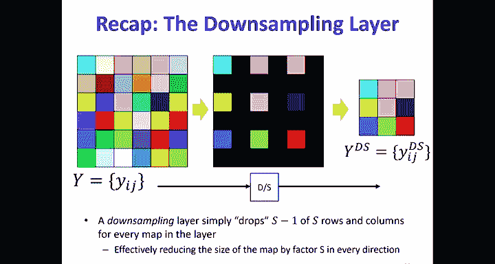

And so。Here's what we're going to get。When I want to first thing。Okay。No I guinea。

 you just put down sampling， you just literally dump things。

 you drop stuff right it's like you performing the convolution with a right so。First thing。

 we know that down sampling， the input of the down sampling is some size。

 down sampling is some operation and the output of down sampling is some size， okay。

 but then when I propagate the divergence derivative of the divergence back through the down sampling layer。

 what will the size of the derivative B， once it is propagated backwards through the down sampling layer？

What will the size be compared to the size of the input to the down sample？Anyone？

It's going to be the same as the size as the input， right？

If some variable x influences the divergence， the derivative of the divergence with respect to x is going to be the same size as S。

 so the first thing we will do is to allocate。A derivative map the same size as the input。

 you set everything to zero within this map。Then。You can just。

 you want to propagate these derivatives。Back。2 they。Into this map。And all you have to do。Right。😊。

So you want to allocate a map the size of the input that was downsampled。

 so you have to retain the size of the map or can be derived from the known size of the previous outcomes of the previous layers。

And then we know only these great elements。Are going to have non zero derivatives。

 the blacked out elements never influence the output。

 so what will their derivatives be zero right so I can just stick zeros over here。Right？

What about the rest of the elements， what do I do？What would I do for the rest of the lives？

Just copy them like so。Beautiful， right， so back propagating through a down samplingamp layer is really trivial is it not？

What is this operation？This back prop link for back propagation through a down samplingling layer。

 what is this operation？It's upsembling， so back propagation through down sampling layer is up samplingmbling。

 fantastic。Now you just copy these things over， so simple。没有。If I write code for it。

 basically I allocate some very the map， a derivative map， the size of the input。

 and then copy the appropriate element so。Now what about up sampling， what did we do in up sampling？

Anybody remember？What did we do in Oly？We just inserted rows and columns of zeros， correct？

They're not empty spaces， they're spaces of zeros， now tell me， consider this element over here。

Is there any。Element of the input which influences this value。

 this this this gray box is there anything in the input that influences the gray box not right。

 so is there anything from the gray box that can be back propagated。

Because that was not influenced by anything in the input， right？So what do you think I will be doing？

When I'm back propagating the derivatives from the output ofs sampling to the input。Down sampling。

 beautiful， I just throw all of those guys out so。I went to。When I back propagate initially。

 I'll have derivatives all over here。But only these guys were actually obtained from the input and those derivatives are going to be copied over what does this look like？

What does this operation look like？Down sampling right。

 so the back propagation of up sampling is down sampling。Back propagation of down sampling is。

Ubsssely。But then can I simply take a down sampling layer and use it？

To perform back propagation of up samplingling。Anybody。Or do I have to be more careful？Can I so Marm。

 can I just use my code that I used for down sampling？

And use that to perform back propagation for up sampling， no， why not？Why not？He's why。

Because when I do this， I know that the derivative map must be the same size as the input of the up samplingling layer。

And so you have boundary effects。Up samplingampling and downs layers have some fuzzy way of dealing with boundaries。

 whether you want to introduce zeros beyond the boundary or not。

 whether you you know how you deal with things at the boundaries and so sizes if I simply use my up sampling code and use it to perform back back propagation and down sampling I'm going to have some funky stuff happening at the boundaries and by c versa so although back propagation for down sampling is up sampling and back propagation for up sampling is down sampling these are not exactly the same operations。

As up sampling and down sampling when you're going forward because of what happens at the boundaries during back propagation。

 we have to make sure that the derivative maps are the same size as the inputs to the operations。

So here's the back propagation to the up sampling code。I'm just。Literurally。

 this just looks like a down samplingling operation。那。In your covolutional neural network。

Very often you're going to see convolution with a child greater than one。

If I see convolutions with a strip greater than 1， then the size of the output is going to be smaller than the size of the input。

Right。Yes or no。How would you perform back propplication？

Through a convolution with a stride greater than one。Any ideas？吓。😊，How would you do this？

Do you think if you wanted to do this simply？Exactly。

 if you try to directly perform back propagation through a convolution with a down sampling of two。

 straight of two。We are going to find that that arithmetic pay ends up looking very ugly and your code is going to look ugly。

But then it's more reasonable to think of convolution with a stride of two as convolution with a Str of one。

Followed by down sampling by a st of two。And once I do this。

 I know exactly how to propagate derivatives backwards。Through the down sampling。

 I also know exactly how to derivative propagate derivatives backwards through convolution with stripide 1。

 and so I can propagate derivatives through the whole chain back to this cup。Does make sense？

This makes sense to you guys， right？And so this is going to be much， much， much simpler。

Because each of these two back propagation operations are really simple to understand。

 whereas if you try to directly perform back propagation through this one。

 you're going to find it really painful and if you a look on the web for explanations on how you back propagate through convolutions with strides。

 you're going to find some pretty hideous。Explanations。

 but then when you when you realize that this is what you're performing。

 the whole thing becomes trivially simple this is going to be an up samplingling and then there's a standard back propagation for con。

Okay， so this is what you do right， and this is going to be simpler than trying to modify backrups to account first stride in convolution。

Now。Convolution layer with a fractional stride。This was when you increased。The size of the map。

 right？This。Is also part of your Pythwa toolkit， I think。How would you modify back propagation rules？

To perform back propagation through a convolution of a fractional st， anyone？Yeah个。

It's going to be up sampling followed by convolution， correct。

 it's not convolution followed by up sampling。This is going to be up sampling followed by convolution。

And once you realize that convolution with the fractional stride is the same as up sampling followed by convolution。

Then you can separate the operation out。We know exactly how to compute。

Perform back propagation through a convolution with Stride one。

We also know exactly how to perform back propagation through an up sampling layer。

 in fact it's very simple and then you chain these operations up and so now。

The result is going to be a back propagation from this output all the way to the input。

That makes sense to everybody。Any questions？Okay。So same thing， pooling is。

 typically performed with strides greater than one。And this results in a shrinking of the map。

 which is why pooling layers were often just called down sampling layers because you almost never perform pooling with a stride of lawn。

 you almost always perform pooling with a stride greater than one。But then。

If you want going to perform back propagation。Especially if you're performing mean pool with max pool it's not so hard because you just copy the derivatives into a single location。

 but with mean pulling， it becomes ugly。Because this effectively is。You know。

 convolution with a stride， right？So。In this case。You can啊。Once again。

 decompose this into two operations。The first is pooling with a stride one followed by。

A down sampling layer。And then of course， you can。Use the standard back propagation rules for down sampling。

And the back propagation rules were pullinging。2。F to propagate derivatives。

From the output here all the way to the input。This makes sense。Resence。嗯O。And so yes， we here。

 but then。As it turns out。If remember， I told in the last class that back propagation for convolution。

It is often just simpler if you think of it through the lens of code。

And you ask me why you would do that， you know， maybe that's not so efficient because you have all of this for loops。

But then once you begin combining these things at tried， you can see where the code is just simpler。

So here， for example。Is a standard convolution。You're going to be for。Within each layer。

 you're going to be scanning left to right， top to bottom， right？

And then you're going youre looping through all of the filters。Your first computing and find value。

And then you're applying an activation to it。 So this was the forward convolution。

 which meant that when we did the backward。APa。The loops， you just reverse the order of operations。

 so now the loops went from the highest index down to the lowest index。

And then the first thing you did was propagate the derivative back through the initial activation。

And then here。In theSo in the forward pass。The Aine term was always implementedement by the product of W and Y。

So in the backward pass。The derivative， you're going to use exactly the same location。

 the derivative with respect to w x prime y prime is going to be incremented by the derivative with respect to z X Y times。

Y x plus x prime minus1。Why my wifeless my prime minus as well。And so。

You don't even have to worry about the indices the actual indices are given to you right this code and so when you go back。

The derivative with respect to the derivative of bar at x x prime minus1 y5 prime minus1。

Is going to be incremented by the product of the derivative of Z at X y。

And the filter add X prime byon。Similarly， the derivative。

With respect to the filter at explained why brand is going to be increment。

By the derivative of Z at X Y。Times。Y of explicit y minus1， y of y1 minus1。

Do you guys see how this code is just basically literally inverting the operations of the forward pass？

喂。Elvin does， what about the rest of you guys？

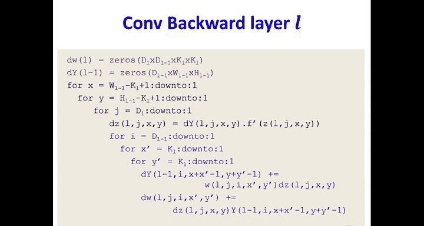

Right。And now here's where things get simple。If I were convolving in the forward path with a stride。

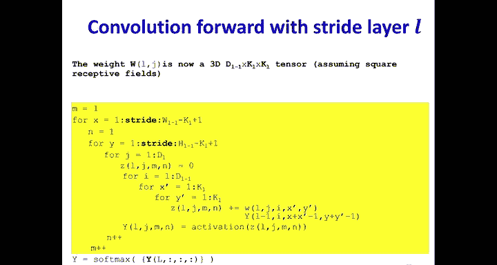

How do you think this code is going to change？Anyone？

If I were convolving in the forward path with the slide。

 how do you think this code is going to change？Remember that when I'm convovlving in the forward past with a stride。

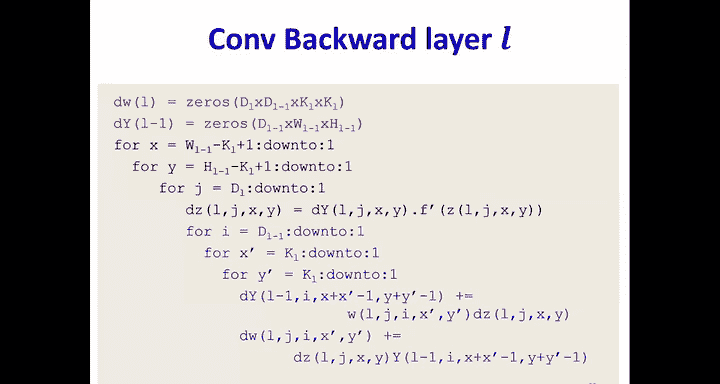

When I'm looping through X， I'm taking a step that's once tried at a time。

When I'm looping through why I'm taking a step that's once straight at a time， right？

So you're just going to be inverting this code， that's it。

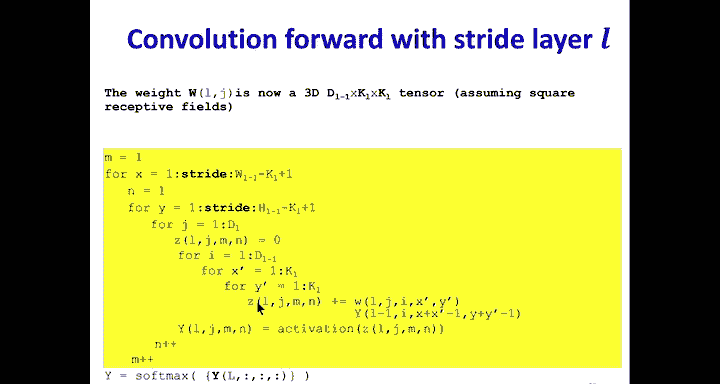

Using the same mechanism that we saw earlier。So when I do this。Over here。

I'm going to be skipping forward at each time by the stride I'm going to do。

The group is going to step one stride step at a time。

And then I'm just going to be using exactly the same query as before so this。

Llipping the cord makes things simpler because just as you。

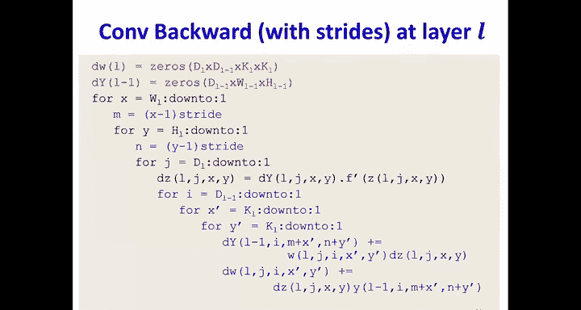

It's heading forward。

啊。One stride step at a time， you're going to be iterating backward， one stride step at a time。

 that's it。So once again， thinking of this in terms of code makes things much simpler。

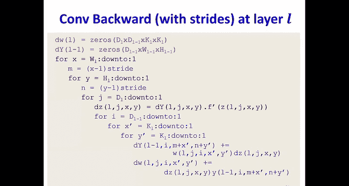

So also， you know， if I were performing Max pooling the slide。

Typically when I'm performing maths fully， I'm stepping forward with a stride。

So from performing the derivatives going backwards。Then。I'm going to be， in fact。

 this becomes even simpler。Because when I'm going forward， I'm retaining the position。So。啊。Again。

 it was what was the benefit of benefit of thinking strike。

 it's unlikely that you're actually going to be writing loops。

If you want to so conceptually it makes it much simpler to decompose the operations and in many situations you're actually going to be doing this I'm just presenting you two different perspectives if all I gave you was cold you wouldn't really see what was going on。

Right。So for max schooling， it's even simpler。For max pooling remember。

 you're going forward in stride steps， but at each location you are retaining。

The location of the maximum value and copying it over。So in the backward pass。It's so simple。

 all you do is copy the derivative over。To the location。

That the maximum value is copied from so that's about it you don't even have to worry too much about。

You know， looping back over strides because you know the exact location in the input that every output element came from。

 so the derivative of the max pullinging layer with stride。Is no。

More difficult than the derivative of a regular。Max pulling layer with a stride one for mean pulling it's more challenging for mean pulling that you actually have to consider the stride。

And so when you go back， it looks a little more ugly， so again to answer you， Mariam。

 for convolution or mean pulling with stride， it actually makes its conceptually and perhaps codewise simpler to separate the operations for max pulling you don't really need to do it。

So I'm showing you both the code and the operations for。Thank you。Yeah。Any questions？Any questions。

 guys？

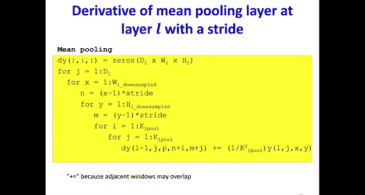

嗯O。So Miah can you release this poll？Okay， 10 seconds。All right， close the poll。

So is the first statement true our false guys。Second。Third。The third is false， right， beautiful。So。

Thank you， you guys a staying with me。And so we've shown how the derivative of the divergence are fit to every intermediate output and every you know free parameter filter weights can be computed all of this can be embedded in the gradient decentcent framework。

To learn the derivatives and those derivatives can be embedded in the optimizer。

 which could be you know simple gradient descent， stochastic gradient descent， momentum， atom。

 what have you to update your network parameters。So here's the story so far。

 the convolutional neural network is a supervised version of a computational model of the mammalian brain。

It includes convolutional layers comprising learn filters。

That scan the outputs of the previous layer。And layers。

 which are also down sampling layers typically that operate over groups of outputs from the convolutional layer to reduce the network size。

The parameters of the network can be learned through regular back propagation。

Max pooling layers propagate derivatives only over the max element of each spoon as we just saw。

And for other kinds of factor propag operations， we have to be careful。诶。As it turns out。

 all of the fancy math and the operations that we solve what they're really doing。

Is they are ensuring that we sum over the appropriate sets of elements to account for the fact that the network is。

 in fact， a shared parameter network， So this last bullet。

 although I have not made it explicit so far， this is important。

 Why did we have to do all of the stuff that we did。That's because our network is， in fact。

 identical to scanning。The input with a shared parameter network。

And so when you propagate derivatives backward。We have to make sure that any derivatives computed are distributed or shared over the appropriate sets of elements that have a common value。

 and that's what all of these operations been doing。So。

Is there any off situation where men pooling could be useful， honestly， I never thought about it？

So that question came out of left field。Pos it on Piazza。

 maybe I'll have an answer by then or maybe one of the others in your class will。ok。

That's a nice question， honestly。Now， we just saw that。

CNN's a shift in the that was the whole entire purpose of the convolutional network we wanted it to fire regardless of whether the flower occurred here or over here。

But then there are other kinds of operations。Like rotations。Like here， right？我好き。

Or reflection or other kinds of transformation。How do you introduce invariance to these kinds of operations。

 any ideas？Does anybody want to hazard a guess？Maybe that argument。Data augmentation is a good idea。

 but is there actually it's a very nice idea and that's in fact what we do。But。啊。So Chris。

 why do we use max pooling to decrease the size when average pooling will decrease it and preserve some information purely empirically。

If you post this on Piazza， I will get back to that question where there is some logic behind it。So。

But getting back to invariance， can you think of something else that you can do？Fantastic William。

 exactly， right。So here's what shift invari did。You had a filter。Which。Ha represented some pattern。

Right。And then when you wanted position in variance。

You use the same filter at the different positions at which you wanted to detect the pattern。So。

Position invari was abused by。Modifying the same filter to different positions instead of thinking of this as。

Scanning by the filter， you can see you can have the position of the filter as a variable and to have the same filter trigger at different positions。

 you sort of transform the filter to move to a new position， right？You can do the same thing with。

Other kinds of transformation， so for example， if I want rotation in vens。

And of just scanning with the regular filter， I can also rotate the filter itself。

And then scan with a rotated filter。So if I rotated the filterta by 45 degrees。

Then this is not only going to find the pattern of the original filter and it's also going to find the pattern of the same filter if it is rotated by 45 degrees Do this make sense to everybody？

Guys， yes， no。Right。So someone said kind of。W the kind of？Hector。Right， okay。

 so let me try this again， right？If I scan with this filter， let's say this filter is looking for。

Something that looks like a petal， righttting at。That is verticalica。

What kinds of patterns will this filter find？If the filter is detecting petal like vertical petal like patterns。

 then what will it detect in the input？Brian。So I'll get you on。So。

But does it as anybody wanted to ask also me if this filter looks like a vertical pedal？

What kinds of petals would it detect， what kinds of patterns would it detect？Only vertical ones。

 only vertical pets， right？Now if I rotated the filter by 45 degrees。

 what kind of patterns would it detect？Pals at 45 degrees correct is the same pal I just changed the rotation so now I can use the same filter。

And having it detect both has introduced。Invariance to a rotation by 45 degrees， correct？Right。

And so。If I want generic transformingvari， here's what I'm going to do。For each filter。

I'm going to enumerate all of the transformations that I would allow I want to permit invariance to so if I want to permit invariance to a rotation by 45 degrees one of the transform is going to be rotation by 45 degrees if I want to introduce invariance to a reflection one of the transformations is going to be a reflection of the original filter and so from each filter I will get all of these transform filters one per transform and Ill be scanning using all of the transform filters now clearly this is not going to account for rotation for every。

えグ。I choose the transformations。 It's a discrete set of transformations that I'm permitting。

 So in this example I。Permitted rotation by 45 degrees this。

But none none of these filters are going to be effective for rotation by 22。5 degrees。

So we have enumerated the transforms that we want convey variances to。

 and now each of these filters is going to be transformed through these enumerated transforms and then you're going to be scanning with each of these guys so now if I were not doing this if I were just using a regular filter。

Then if I scan the input with the regular filter。How many output channels would I generate？

When I scan the input with a filter， how many channels do I generate？Anyone。Just one， correct？

But then if I come up with five different variants of the filter based on five different transforms that I want in variance to。

 how many output channels will I generate？我不系。你吗。Again， look at this picture， right？

And if I decide that I also want invariance to a rotation of 45 degrees into reflection。

 this one filter ends up being transformed into a bunch of different filters， correct？Yesさ。Guys。Okay。

 and so。If I scan using all of these transform filters， how many channels will I generate？

You're going to generate as many channels as the number of transforms， number of transforms， right？

EachIf you permit T transforms， each filter is going to generate T channels。

If I have k filters in each of the and if I'm permitting T transforms instead of justucating just k output channels and where to get K times t output channels。

 would makes sense？Right。So here's the problem， we're trying to perform transform introduce transform invaris in this manner。

 the number of output channels can quickly blow up。So here's what。

Your standard operation was when you were performing convolution。

But then if I introduce transform in variance。For each of the filters， I'm going to go through。

All the enumerated transforms。Transform the filter and then scan with a transform filter。

So I'm going to get as many output channels as the number of transforms。

 one of which is going to be the identity transform。Now， clearly。

 this is going to cause some problems during back propagation。好受。

I know that all of these filters came from the same common filter， correct？

So when I back propagate derivatives。The derivatives from all of these variants of the filter。

Must be propagated back and aggregated。In the original filter。

So if I have a transform which is rotated by 45 degrees。

 those derivatives must be transformed back by rotating by minus 45 degrees。

The regular filter derivatives are simply going to be passed through directly if I have a transform which is a reflection in then the derivatives for this filterter must be reflected back before being propagated here and all of them must be aggregated to get the derivatives for this base filter that makes sense。

Yes。So you can't capture all the orientations， just the ones that you enumerate。That's S， yeah， very。

 it would mean rearrangement relevance， right？So。This actually ends up being very tedious and so as a result。

 we never actually use a transform invariant。Convolutional neural network instead we just augment the data and hope the network learns everything because if in addition to shift in variance you also introduce transform in variance firstly you have to enumerate the transforms and secondly the computation blows very quickly。

So here's the story so far。CNNs are shift in variant neural network models。

 pushing with shift in variant pattern detection， equivalent to scanning with shared parameter MLlPs。

With distributed representations。The parameters of the network can be learned through regular backdrop。

Like a regular MLLP， individual layers may either increase or decrease the span of the representation by up or down sampling and the backdrop must handle this as well。

The models can be easily modified to include invaris to other kinds of transfers。But。

This can be computationally painful， right？So so far so good。But then。We。The model that we have。

So far， only。Tells you， for instance， whether a flower。Was present in the picture or not。

But how about the location of the faf flowerer itself？Can we get information about it？Now。

 if you were using an unknown distributed。Scaamp， so a CNN where you didn't distribute the parameters over the various layers。

Then how would you if you discover that the picture has a flower。

 how would you determine the location of the flower？If you had a non distributed scan。Anyone？

If you had a non distributed skin， how would you do it？You could just take the。

We could find out which MLlP is contributing most of the softm， you could find the position。

Of the largest input， and that's going to give you the location of the flower。

That works for non distributed CNs， makes sense。The problem is when you have distributed scans。

 that logic breaks down。Because you really won't know at which level the flower happened， right？

We have we don't have full control over it because trying to analyze these distributed representation CNs and to identify the size of the base pattern can be quite challenging。

And so in this case， you're going to do something different。Typically what we would do。

Is add a regression layer， so here's your standard CNN。

You would flatten the output of the final layer。And then you put it through a classification layer to get class samples to decide if the input has a given pattern or not。

But then if I also want to find out the position。Of the。啊。Of the object。

Then this final output layer is typically put through another regression layer。

Which gives you the coordinates of the bounding box within which the pattern occurs。So。呃。Okay， Marie。

 I'll get you your question later， right， but is this making sense？

How you could find the coordinates of a burning of the object。Anybody？Right。

And this is happening okay， submit up。Here's the thing， we know that this final layer。

Ass information and it somewhere。About the location of the flower， correct？皆さの。

So you can just put that final layer through a regression layer。

 which is going to be predicting eight values and the eight values are the x and y coordinates of the four corners of the box within which the object happens。

During training， it will require labeling the data with a bounding box exactly。

So you train this model。You're going to have you're going to have to。

Provide the bounding box information for all of the objects and that is going to be contributing to the loss as well。

So the same mechanism can also be used for， for instance， to predict the joints of a stick model。

 so those of you who have seen。Well， we pulled down this demo in CMU after COVID。

 but there used to be a screen at the end of the corridor that connected gates to helmet。

And when you walked on actually new assignment to gateates。And when you walk down the corridor。

 it would draw your skeleton。On your image in real time you'd see all of your joints and your hands and your legs and so on it was very spooky and and scary。

 but was also very impressive because it actually found all of your joints。

How did it do that using exactly the same mechanism？If I detect a person over here in this box。

Then I can have a regression layer which also predicts the locations of all of these joints this can be trained using training data on which these things have been marked and now you have a model which not only detects it as a human being in the picture it also finds out where their shoulder joints are where there are knee joints and hip hip joints are and such like it can draw a scan drawer stick model your skeleton so to speak。

Yes， and when training， we're going to use a mix of both losses。2。Back properly。

So Mi can we release the purple？There are three questions here， guys。Okay。10 seconds。All right。

 can we close the paw？Do you want to answer the question？Is the first statement true or false？嗯。

A career。True。Let's see this is the case through to enter， right？Fantastic。So。H。😊，Sorry Kaaiasan。

 Zoom polls tend to be a bit of a problem， not everybody sees them。

 I haven't managed to figure out why this happens in many years。嗯。But anyway。So any questions so far？

Any questions？Hello。Okay， so we've gone through all of the basic ideas of CNNs。

 how is error and the bounding box back propagated to the CNN layers so what happens here is let me go back。

This error over here， error over here is back propagated to this layer。

So now this means that you have a derivative with respect to every one of these elements。

And so that means。The derivative maps over here are going to have our derivatives coming from both this loss and this loss。

Did that answer A？Okay， so and then the rest of it is just straightforward。So。

There are very many variations to this basic CNNN model。You can have very deep networks。

00 or more layers in an angle thing， so do these apply to when the object is found at multiple positions？

For both distributed and non distributed， so okay first Hector。

 if the training instance did not contain a flower， you would have no bounding boxes。

And so you would have no loss contribution from that instance， number one。And so it would be ignored。

And second， if you have more than one instance of the object。

 then the model becomes a little more complicated you're going to have to segment you're going to have to find out all the different objects in the image so're using a technique called Yolo which maybe will cover in one of the recitations and then you can apply the same。

Procedure within each of these regions to further localize the data， the class， the object。Anyway。

So there have many variations to this basic model can have very deep。Brian。

 shift is one instance of a transform。It's just that if all you're using is shift in variance。

 then the model is simple， but if you introduce other kinds of transform invaris。

 then it becomes more complicated that's。So again again， getting back to the lecture。

We're going to see variations very deep networks with 100 or more layers。

 the problem with deep layer networks is that the back propagation of derivatives becomes challenging。

 we'll see why this is the case in a few lectures from now。

And so for this we use a formalism called a resonant。

Then this other kind of convolution called depthwise convolution。

 which is a somewhat different way of sharing parameters where instead of multiple independent filters with independent parameters we use a common layerwise common layer layerwise waves and then combine the layers differently for each filter let's see what these things are so I'm going to be looking at。

Instead sort of resonanceates， let's first talk about the death versus convols。

Now in your conventional convolution， here's what happens。Using the Q view。

This cube represents the set of all input channels with a convolution。

The filter also has as many channels as the number of input channels。

So when you convolve the filter with the input， this is the equivalent of convolving each channel of the filter。

With a corresponding channel of the input， so this operation is going to give you as many channels。

As the number of input channels。And then finally， all of these guys are added to give you the final output of this convolution。

 is this making sense to you guys this picture？Yes， no。对。So basically。

 the filter has as many channels as the input。And so when you perform convolution。

 each channel of the filter is convolving the corresponding channel of the input。

 so the result is going to be as many channels as the number of input channels， these are collapsed。

To give you the final output of the filter。So if I have multiple filters， for example。

 if I have three different filters。Each of these three filters is going to have as many channels as the input。

So each of these filters is going to produce as many。

Output channels has the number of input channels。And then for each of these filters。

 all of these guys are going to be summed up to give you the final output of the filter。

Does making sense， this picture。Right。So。If I have， if the input has 10 channels。

And if I have three filters。How many。Convolutions， am I actually performing？

Remember that each of these planes here represents one convolution， right？Again。

 the filter must have as many channels as the input right。

 remember you have one component of the filter for every input channel。

So I had know if I had 10 input channels， if I had three filters， I am performing 30 convolutions。

 that is expensive。Can I induceuce that？So in depth wise。Convolution， here's what you do。

You have a filter。Just one filter and when I convolve the filter with the input。

 it's going to produce as many channels as the number of input channels。But then。

When I collapse them。Instead of just summing all of them up。

 I'm going to do a weighted sum and I'm going to use a different set of weights for each output channel。

So wait， is this making sense？The visualization。Yes or no。So。

How do you allocate the weights you learn those weights？Now， this is what it is。

Collapsing with a weight vector is the same as convolving this。As a non distributed scan of this guy。

 right？It's going to be one。Row of weights and that row of weights is scanning the input and the result is going to be a single point。

 so this weight is going to be a vector。In fact， this collapse is like performing a single convolution。

With a one cross one filter。This collapse is like performing a single convolution of the one cross one filter。

And this collapse is going to be performing。Is like convoling it a single one across one filter。

So now。If I want， if I have 10 input channels。And if I want three output channels。

How many convolutions am I performing？Anybody？How many am I performing？Anybody want to apply to this？

It's going to be 10 to get here。Plus these three， these are one class one convols。

RightAnd so you're going to get 13 convolutions。They tend to get here in the ministry。

As compared to the 30 that you had earlier。你 see that。Do you see how this reduces computation？Yesさの。

Right。And so。Here's what we have。In the conventional。CNN。If I have five filters。And if I have。

Sa in this case， seven input channels。Each of these five filters is going to perform seven convolutions。

And the result is going to be five output channels。Here。If I want to get five output channels。

 I'm going to have a single filter。With seven channels。

The single filter filter is going to produce seven output channels。

These seven output channels are each going to be。Good怖。

With five one cross one filters to get you five output channels and so as you can see this。

Is going to end up because one cross one convolutions are very very inexpensive。

 whereas these guys are much more expensive and so this is going to end up requiring far fewer convolutions than the scalp。

It's also going to end up。Requiring far fewer parameters than this one， So when you're shot on data。

Orre you shot and compute？Then instead of using the standard CNN framework， using this framework。

 which is called depthwise convolution， can save you both。In terms of parameters。

And in terms of compute。Does it make sense？你そ呢。Okay。And so can we？嗯。That's right。Okay。

 this was an easy one， 10 seconds。All right， let's close the poll。

So is the first statement to our false。And what about the second？2。

And so let's see if that is the case， yes。Filters and depthwise convolutions do not conver all the input channels simultaneously。

And depthwise convolutions require far fewer parameters and computation and regular convolutions。

 so Tom， anytime you reduce the number of parameters you're going to get some kind of a loss so given sufficient data depthwise convolution is always going to be inferior to regular convolution but。

It's a cleanoff between computation and。You know， accuracy。In this case。So， Kaaiiser。

 I'm not sure why you consider the quiz。And so here's the story so far。😊。

CNNs are shifting way in neural networks or shifting way in pattern recognition。

The parameters can be learned through regular backdrop。

Like a regular MLlP individual A may increase or decrease the spread of the representation learn。

 which is what we saw。While the model can be modified to increase invari to the transforms。

 you can also make predictions related to the position and arrangement of target objects。

Through the multitask learning here there were two tasks。

 one is classification of the object now that is finding the location。

And various variations of the basic model exist。To obtain greater parameter efficiency and the better better ability to compute derivatives。

 etc。So。Finally。What are the filters that？Now when we scan the input。

Each of these filters responds to some pattern in the input。Now， for the first layer。

The pattern that any particular filter is looking for is simply going to be the set of weights itself。

 so just by inspecting the weights， you know what pattern the filter is looking for。

But then when we begin getting to higher， as remember that higher the neurons can get。

Complex oring of patterns。A two layer network can compute an XR。

Which is going to which is going to fire both for10 and 01。

 So there are many different patterns that the higher layer。Neutons could firef。

So what is the actual pattern that they are responding to this must be determined on a case by case basis for any given input。

 you would have to sort of。To determine which pattern in the input any neuron responded to。

 you would have to sort of perturb the input and see if this is perturbing the output and based on the derivatives。

 you must determine the pattern that it responded to so that the receptive field for the higher level neurons must be obtained through back propagation。

And so here's some example of the kind of things that a CNN learns。

 this is from Hinton's original paper， we had Alexnet。This is a single model。

That has been trained to recognize different kinds of classes。And what do we see？

The lowest layer neurons。Simply end up learning。I can't see my mouse， can it？有没问题。

The lowest layer neurons simply end up learning patterns such as these。The ones at the bottom。

 what do they remind you of？The lowest lay in neurons。What do their？Itages， cortical neurons， right？

哎。So this goes back three lectures。It turns out that the first layer of a neural network of a convolutional neural network ends up responding in much the same manner as the neurons in your V1 cortex。

 isn't that amazing？That we have this computational modern and it seems to be learning the same kind of things that our brain does。

So we are getting something right。But then as you get to higher levels。

The actual pattern that they respond to depends on the input。

And so when the for the second level over here， some higher level。

 I don't know if it's exactly the second layer。When the inputs provided where faces。

 we find that all of these neurons are detecting to responding to parts of faces， eyes。

 bridges of noses， and so on。When provided with images of cars， they are responding to parts of cars。

When provided with images of elephants， each of them is detecting。You know， parts of elephants。

For chairs， each of them is detecting different portions of a chair。

And then when you get to even higher levels， you can see that by the time you get to the highest levels of the layers of the neuron。

They actually end up responding to full face like patterns。Where they are presented with faces。

To full car like patterns when they are presented with cars。

Full elephant like patterns and presented with elephants and full chair like patterns but presented with chairs。

 So this is much in the same manner that we saw in。In the original Google and diesel paper。

 they showed that as you went up through the layers。

 you got larger and larger and more complex patents。

 and that is in fact what even CNNs seem to be doing。Whi I don't know about you。

 I find that to be very impressive and in fact quite amazing that our computational model is responding in much the same manner as the brain。

So。啊。You have standard convergence issues during training。

 so typically we use Adamom around the momentum style algorithms。

Tricks such as batchsh normalization， or regulargularization。

The number of parameters can quickly become very large， even though it's a shared parameter network。

 and so then you can end up with insufficient training data to train the model well。

And so we will often do things like data augmentation where we modify the data without changing the class。

 so here are some examples of data augmentation， these are different objects。

And they've been modified to different gradients of the same object by maybe adding a little noise or scaling them or rotating them up by a little bit。

Or sharing them and these are。Transformations that keep the clocks。 So for example， this over here。

I'm trying to recognize what these classes are I'm not sure I can make out。

 but you can make out that in each of these examples， the class identity has not changed。

After the transform， so we tend to augment the data by modifying the data， right？

And we use that to train the network。And so coming to the end， convolutional neural networks are now。

One of the most frequently used neural network problemisms。They're used everywhere。

 not just for image classification， they're used in speech and audio processing。啊。And on speech。

 we often apply convolal networks and spectgrams， they are even used in text processing。

 text is a sequence of words， we often use them to analyze the sequence of words。

 we use them in financial by analyzing financial markets andll see that in the next last and so。啊。

And。To see how fonds actually work back when Andre Garpathy was a grad student at Stanford。

 he built a very nice demo， I believe it's still up he did this for Siarte so you can play around with it and see what these networks actually look。

And some examples， this is so some examples of success。

 the earliest convolutional network was Si Le Consaneette。Here is the architecture for it。

 this was in 1990 or thereabouts。But then after that， for the longest time。

 nobody really used convolutional neural networks because it was deemed too complex and we never really got it to work until this paper by Hinton et all on the imagenet。

So the imagenet challenge was one where you had billions of images and thousands of categories and you had to detect the category of the input。

And the typical error rate was 25%， so accuracy where was 25%。We would get。75% of the image right。

 but a quarter of the time we were rock。Until internet I cooking came up with Alexnet， this was in。

2012。The architecture of their model was so large for their time that even the picture that they posted in the paper got cut。

But then， and you know， they provided various details for their model and I believe this was the first time that somebody actually used rail loops in a convolutional neural network。

Previous to this， people only used sigmoids。And。This was the large model for that time， it had 630。

60 million parameters， 650，000 neurons， 6， 30 million connections， and then during testing。

 just use one image， they crop the image in many different ways。

Classified each of them and voted over the entire lot。And。More details over here。

 but eventually when they were done， they had brought this error down from 25% to 18。

2% with a single network。And if they used an ensemble of seven networks， that error went down to 15%。

And this was a huge。Jump in performance and this is what brought convolutional neural networks back into prominence after many。

 many， many years。And once they showed this was possible then a lot more people jumped into onto the bandwagon。

 so here are some of the kinds of things that they found。

These are the responses of the lowest level neurons and you see that will look like the cortical neurons。

And they also showed， so here are some typical classifications and for the first time。

We were getting really remarkable classification。And even when the classification was wrong。

 often it was reasonable， so this picture was supposed to represent cherrry's。

Where the classifier said it was a dealation。Is it wrong， I don't think so。Then also。

They showed that the representation derived by the final layer of the network was meaningful。 So。

 for example。If they resented the network with an example of a flower。

 use that use the representation that came out and then。

Retrieved other images with similar representations， they're almost always going to flower。

When they did that with elephants， they've almost always got an elephant and so on。

 so they've shown that these representations were meaningful。嗯。Shortly thereafter， Zeyler and Fergus。

Updated the model and reduced the error of 14。8%， this was 2013。Then VGGnet came about。

These were huge networks with 140 million parameters。

 they ran a ton of experiments and brought there down to 7。3%。Then Google。Doesn't want to be beat。

 they came up with inception， which brought that down to 6。7%。And then M Resnet。

And this was the most important contribution of those types。

This is where we we always knew that having more and more layers in the network。

Would improve generalization， but the performance problem was back propagating through 100 layers was quite impossible。

So these guys realize that instead of simply having layers in this manner。

If you thought of each layer as learning a correction。

That must be applied to the input so that you're adding things back。Now。

 you could have dozens or even hundreds of layers。And derivatives could be propagated backwards。

Reliably， and this is resonnet。And when they did that， that error， which was 25%。

 only a couple of years earlier。Was down to 3。5%。this was personal details and then Dannet came out。

And then things got clearly crazy， newer newer architectures were coming out every day these days。

 I think the error rate on imageists around 1% I may be wrong。

 but it's a far cry from where it was when the whole thing began right？So CNNs， you get the idea。

They beautiful models， they were originally intended for shift invariant processing of。

Images in audio， but they could be applied for any kind of data these days they are used for speech。

 they are used for language。And they going to see them everywhere。And in your homework book， right。

 see it in your homework book。So。I will stop here。

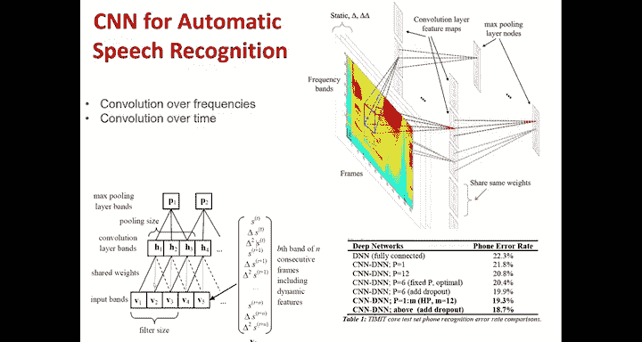

Because we are out of time。I'll wait for a couple of questions and a round of questions then we will end the lecture thank you for our time and patience yes。

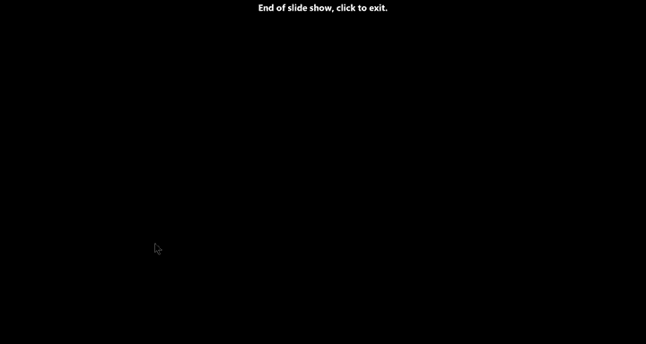

Sorry to interrupt Profess， can you go back to the depths wise convolution？嗯。That's。Yeah。

 because I'm quite confused about。嗯。For the input layer。

 like each channel may like focus on different part of the information of the input our input data。

 and so， so I think because in the depth wise C N N。

 we actually divide distribute our kernels in different to read to， you know。

 to read different channels。 So my concern is for the very beginning， the input layer， if we just。

Because each channel have a have a different information of the like like a local features or local information of the our input data。

 So I。fewew there might be some problem so okay， your question is what happens over here so。

You you think that patterns may actually be best determined by looking at all of the channels together and if you're only looking at one channel then you may get something suboptiimum is that correct yes okay that is that is indeed true and so you are so this is a trade off。

If you get far fewer parameters and much faster computation in exchange， you lose this。

 each of the convolutions is losing something now you don't actually lose it， remember。

That if I just sum them up， then I'm still combining the information from all the layers， right？Yes。

So。It's just that the sheer variety of patterns that you could find in this conventional convolution。

 that variety is going to be reduced。But regardless， for each of these opportunities。

 you are looking at all at。All of the input channels， just in different ways。I see I see。

 so I have another question because I think for the input from from the first initial convolution。

 I think each channel may like represent different like a local features but after that like each channel can actually capture the global features so I'm thinking about whether we can just use for the initial convolution we use the conventional C and the channels after that you can combine conventional and depth price channel depth price convolutions in any which way right this is just representing the computation of one layer so there's absolutely nothing stopping you from using a conventional convolution followed by depth price convolution layer followed by conventional convolution for instance。

Right。Okay，Thank you。 thank you。嗯。

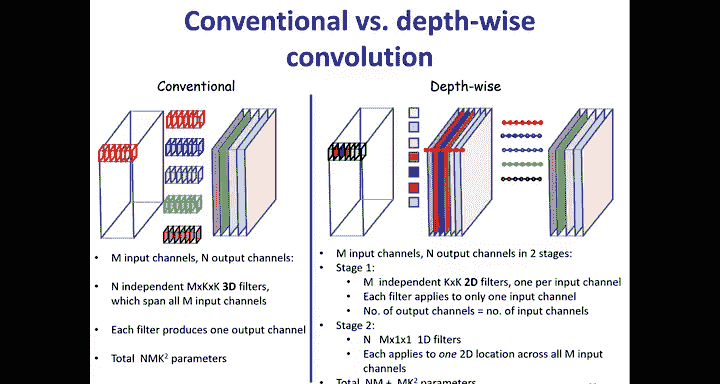

Okay， maybe I can install that。