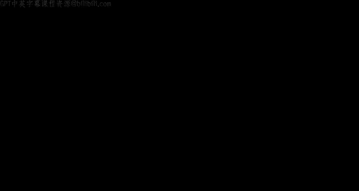
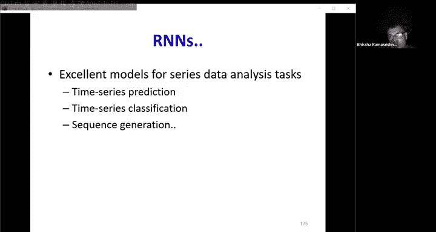

# CMU《深度学习导论｜CMU 11785 introduction to deep learning Fall 2024》中英字幕（deepseek - P14：Fall 2024 Lecture 13.zh_en - GPT中英字幕课程资源 - BV1CfsReEEw8

Are you dog can to hear me。边写有。Honestly。All right， let's begin。So。Again。Just checking am I out。Yes。

Yeah， might hear some odd sounds， there's a dog in the apartment downstairs which likes to howl。

And the occasional plane may go by， so the hear the sounds is very with me。啊， now。

What we've seen so far are that MLlPs are。Universal apps。They can model pretty much any function。

 and we saw how with how we could train them to model specific functions。 We also saw how we could。

Scan with MPs to get position invari detection of patterns and this gave us convolutional neural networks。

Today we're going to switch to a different topic where。

We want to model series of inputs there are many situations where we actually have to consider a series of inputs to produce an outputs。

And the outputs too， maybe in a series， here are a couple of examples， speech recognition。

When you're performing speech recognition， you must analyze an entire recording of speech before you can decide。

What the person said， so here the inputs are sequences of vector。

And the output is a classification result。Or if you are performing sentiment analysis or some kind of classification on text。

Then here's something the Steelers， meanwhile， continue to have struggled to make drops on defense they are allowed on average 30 points a game and have shown no signs of improving anytime soon now。

Anyone reading this by itself？Wouldn't find any hint to the fact that this is referring to a football team。

You'd have to infer this from analyzing all partss of the sentence。

 including the fact that a game has 30 points for a winning team that teams make stops and defense and so on。

 and only after analyzing all of that could you determine that this is football and not basketball。

 for instance， or if you are performing machine translation。

You would read an entire English sentence and output an entire French sentence once the English was analyzed once again you are analyzing a series of input to produce one or more outputs。

Or the stock market。Now you could analyze the stock market on each day you get a vector of stock values or stock indices and after having analyzed the sequence of。

Stock values with these vectors。You must decide whether it's worth investing in some stock for tomorrow or for the future and this decision must be taken considering how things have fared over time so again you have to analyze a sequence of inputs before making or taking a decision and in the case of the stock market you would be taking that decision every single day so on each day you would analyze everything that had happened until then。

To make your predictions for that day。So these are classification and prediction problems where you consider a sequence of inputs。

 input vectors and produce one or more outputs， and obviously this can be done using neural networks。

So before I continue a quick note on a shortcut， so Kira no attendance poll Zoom will give me everything I need。

So。A quick。Note on a representational shortcut。I have been showing MLPs using a figure like the one to the left so far。

 except those figures that have been shown face on this shows。

The MLP at at an angle of maybe 45 degrees going into the page。If I continue rotating this picture。

 it's eventually going to look like the figure to the right side on。

 so each box over here represents an entire layer of the network and each arrow represents a full connection between two layers of the network。

So is this representation clear all of you？How this actually represents this figure side lengths。

Okay。So continuing on， you know， this can be more complex。If this network had two inputs。

Then the side sidewalk figure is going to look like this。

And the second input first went through a hidden layer。

Before merging into the heaven layer the next time the cyon figure is going to look like this again all of this just illustratingly。

The visualization。So let's get back to our problem。

We must consider the series of stock values in the past several days。

To decide if it's wise to invest today because your prediction about how the stock is going to behave tomorrow clearly depends on how it has behaved in the past。

So what kind of model would would you recommend based on everything you've learned so far to analyze。

Stock values over a window of time。Before deciding， you know， before making a prediction。

 what kind of module you would work here， anybody？A 1Dcn， right， perfect。

So you'd have something like this。You'd have several hidden layers and a final prediction。And this。

Network is going to look at the current input。In the past several inputs。

 and then it makes its predictions so a CNN or a TDNN。You guys got it right。And so each day。

 the network is going to look at。A history of a few days and make its prediction。But then。

This network is a finite response system。Something that happens today only affects the output of the system for the for some n days into the future where n is the width of the window that the system is looking at so here for example。

This network is only looking at a window of four days。So if some event happened on day T。

 as shown by the thread box。As you begin making predictions。

 that event is going to influence your prediction on dayT。

It will continue to influence predictions on p plus1， p plus2 and t+3。But then when you get to T+4。

 that window has slipped past the event。And so the event no longer affects the output。

 so the response to any event。Only last for a finite amount of time。

 so this is a finite response system。Now。Clearly just having a window of four days considering only the past four days to make stock predictions is very unwiseed so just give me a second and me shut my window maybe。

The dogs don't sound less love。So looking at a window of just four days to make stock predictions isn't bias。

Because you know that market trends have longer patterns they can they have they have for instance weekly patterns things change and you know what happens on Monday predicts what happens on next Monday because things change over the weekend the entire market slows down over weekends and so on so if you wanted to make this model consider a window of seven days what would you do。

This one， anyone？How would you make it considered a matter of seven days？Anyway。

Just increase the vendor size， right n equals 7。And so you can keep considering。

with longer and longer windows， you also know that there are monthly trends people tend to spend more money on on the day on which they receive their paycheck and so to consider that this window would have to extend to 30 days but then you have even longer trends you have the BT trends in the market monthly trends you have annual trends what happens the the shopping spice。

Every Thanksgiving and so the shopping pattern of this Thanksgiving tells you something about what you may expect next Thanksgiving。

And so on， so if you want to consider all of these long term historic trends。

Then the size of the window will have to keep increasing。

In the limit you really want to consider everything that happened in the past and this window don't get really large。

 so what would be a problem with this kind of a model。What would be the problem here？Anyone。

We're that the number of parameters is going to increase absurdly， right？

Here is our first poll if I can release it。Now have 60 seconds， folks。All right， 10 seconds。Okay。

So here are what we got。Now。Can you tell me what the answer to the first question is true or false？

True， right？What about the answer to the second question？

 so I'm kind of surprised that a whole lot of people。

who said convolutional networks of finite response systems also marked two for the second statement which says an input at time T affects the output for all time clearly these two are contradicting right if it's a finite response system then by definition。

 something that happens at any time。As a finite window of time during which it can influence the output and that is the issue with convolutional neural networks and even if you have the entire distributed representation and such light that we saw in the plus paras eventually a CNN is just scanning with an MLLP and the MLLP has a finite width of input that it considers and so a CNN is a finite response system。

Now。What we want is an infinite response system， something that considers the infinite past in making its predictions。

And here's a very simple infinite response system where the output at any time is a function of not just the current input。

But also the output at the previous start。Now， of course， for this to work。

 you need to define y of minus1， which is the initial state of Tee equal0。

But then once you do that at each time， the output at that time is fed as an additional input to the next time。

 so an input at Ix0， which is a time zero produces some y 0 within y0。

 even if there are no further inputs。Because you have y0， y0 will result in some y1。

 then y1 will result in some y2 and so on， and so a single influence is going to single input is going to continue to influence the output for the rest of time。

Now this sort of network is what's called a NS network or nonlinear autoregressive network of exogenous inputs now why is it autoregressive。

 the term autoregressive refers to the fact that the output at time t minus1 is fed back to compute the output at time T so the outputs are regressing on itself and so here's what the network is going to look like。

At any time T， the network could make a prediction by T。But at the next time。

 the next input and both the previous prediction are going to go into the network and then it will make its next prediction。

 which is then fed in along with the next input at the next time to make the next prediction and so on and so as you can see。

And input at any time。Continues to influence the output。For the rest of time。

 even if there are no subsequent。Innings。That makes sense。What we just stay？Okay。

So does this network have memory of the past？Where is the memory？

Is the memory in the network or it's in the？And the previous output。

 so the memory is no longer the memory is not anywhere within the network。

The memory is external to the network in the previous output。

Which has aggregated things from the past。So I'm and so of having a separate yellow box over here。

 I can just draw the figure like so these two figures are the same that the output layers output feeds to them you know。

 next time， but the fact that we all stated remains that this network has memory but the memory is only stored in the output。

In the latest output now of course you can make this。

What is nonlinear because all of the activations are nonlinear that's what。Now。

You can make this network arbitrarily complex at any time it be it could be considering both the current input in a whole bunch of past inputs and a whole bunch of past outputs。

But nonetheless， so would still this would still be regressing。over its own outputs over time。

 so this here is a first orderer auto regression where it considers only one past output。

 this is a higher auto regression where it considers several mass outputs。So these Ns networks。

Were historically very popular for time series prediction and they were used in predicting the weather。

 stock markets， in tracking systems and in language。

 basically any phenomenon phenomenon where you have some pattern and some additional inputs that modify this time series pattern。

And the key here was that the memory of the past is in the output itself and not in the network。So。

It makes sense we'd like to make the memory more explicit within the network itself。

How can we do that？Again， remember the task is to remember the past。So let's introduce。Yeah。

 that's correct。So this would be， for example， it's this figure if you receive our inputs from the past K outputs。

And the current and past L inputs， then this would be a KL order logx network。Anyway。Going back。

What we really want is to be able to remember the past。

 but somehow we want some variable within the network that keeps track of the past。

So an obvious thing to do is to introduce an explicit memory variable those job it has to remember。

 and so the memory variable variable now is going to be some function of the past outputs。

 the past hidden states。And asked memories because you're always building on memories。

The hidden state at any time is now going to be a function of both the current input and what was in memory and the output itself is going to be a function of the hidden state so this is what the network would look like this was called a Jordan network。

Proposed by Michael Jordan was now a professor in Berkeley。He's famous for other work。

 but his thesis was on these Jordan networks which introduced the concept of memory into neural networks。

Now the thing here that what the Jordan network does is a very small increment over the K Nx network。

In the Nx network， if I had a first order Nx network， you were only looking at the past one output。

 even if I had a higher order， Nx network， you were looking at。The past few outputs。

But you were not considering all infinite outputs in the past。Now。

 if you want to consider all infinite outputs in the past。

 you would either have infinite taps into the vice or here's what you could do。

You can just have this little block over here。Which maintain maintains a running average。

Of the outputs， so at any time it's going to be updating itself as some mu times its past value plus the latest output。

And this block is what feeds into the hidden layer at the next time when it makes its prediction。

 so this was the famous Jordan network where you actually somehow considered all previous outputs when making the next prediction。

Now， the memory itself has a fixed structure。There's nothing learned about this memory all this block does is to maintain a running average of outputs and that is fed into the network or making the next prediction so when you perform back propagation there's nothing going back from here。

 this is just a running average operation。Does this make sense？Quss。Okay， there's a single vi。

 I take that as a yes。Now， what's the obvious next thing to do？And sort of just， you know。

 this is still you know recursing on memory， right？What we wanted to do is to transfer the。So Marion。

 this just means that if you're feeding just one output。

You're just considering the latest output but this is looking at。All infinite past outputs。

 in some sense。Did that answer your question？对。So。What we wanted to do is to actually have a variable within the network。

That toward me。Memory， so that's what Jeffrey Alman came up with in 1990。

He introduced something called a context state。All the context state did was to clone the hidden state。

From the previous time。And this cloed hidden state from the previous time was fed into this hidden state was used to compute the hidden state at the current time。

 along with the current input。And this hidden state was used to compute the next output。

Then at the next time， this hidden state was once again climbed。

And this guy would be used to compute the a at the next time。

So you're actually using the hidden state in the network itself as a way to carry memory。But。

The way this was set up。This is actually being cloned this guy was being cloned over here。

 so when you perform backdrop， for instance at this time， the gradient foot has backward。

It will go over here and so you would update these weight， maybe。

But then there was no further transfer of gradients。

 propagation of gradients back from this context unit into the previous time。

 So this entire sequence of inputs was used as a as a as a collection of single instant。

Predictions where at each time， along with the current input。

 the hidden state of the previous term is also an input。

And so this was what was called a partially record network。Because although in the forward pass。

You're actually adding information through the United States when you're learning the network。

All the updates are being done locally with no gradients being passed backward through time。

If this makes sense？Yes or no。So。The store the met the idea of memory is he wants something in the Mem network。

 which keeps track of everything that it has seen over done。So that was the that is the。

Requirement now how many layers neurons would such one of these networks have。

 but we're going to go some distance so we'll answer that later and later。

 but so what is exactly what exactly is cloned。Consider this network you have a hidden you have an input。

 you have an hidden state which is computed from the input and this guy and the hidden state will take some value。

This value is disclosed， you just copy it over， that's it。Right。So。Again， Jessica。

 this remember that if some input， if you have an input over here。啊。

So we don't in this model they you did not hackcker you're predicting my next slide right but。

So to answer the question， you can see that any input over here is going to continue to influence outputs for the rest of time because of this cloning。

 it's just that errors out here are not back propagated all the way here because there is no back propagation over these。

Jgged agentss。Right。So the output of the hidden layer is cloned into the Navyvy stick。

Into the Navy layer。The answer say Chris。Okay， so。This obviously leads you to the question why why clone right。

 why clone and why not pass the gradients back directly and that's what we will do next。

The story so far in time series analysis models must look past at past input along with the current input。

Looking at a finite horizon of past in Perths gives us a convolutional network。

Looking into the infinite past requires the cushionsion。

Nbs networks occurscur by feeding back the output to the input。

And with feedback a finite horizon of outputs， then the inputs too。Simple recurrent networks。

 Jordan networks maintain surrounding average of output in a ma unit。

En Liworth store a hidden unit value for one time instant in a context unit ass simple or partially recurrent because during learning。

The current error does not actually propagate to the past。

So what makes it better than the Jordan network， what makes it better here is really the fact that these things can be arbitrarily complex。

 whereas this is just going to be a simple prediction。Your hidden state can be very complex。

Did that answer your question， Lehan？Y。Okay。So this blocking of ras doesn't make sense。

Because when you're analyzing some， sometimes but it is sometimes。And input here。

may make influence the output way out in the future and not really make much of a difference all the way until you get way out into the future so in order to learn these influencers you need to be able to propagate errors all the way back to time and so for that。

We need a light modification to the。啊。Network。And well get to that next but request this four。

Not for any。And we never use cloning of this kind anymore in most architectures。

 we actually use the values because we like to propagate errors backwards。ok。20 seconds。All right。

 let me stop this。Okay。There was much confusion about the first question。

 first question true or false。Do memory neuro models have？Why is it false？Who else is correct。

 but why？Why because you have recurrence going forward in time。

But you don't have recurrence going back backwards in time when you're propagating gradient backwards。

 so recurrence occurs only in one direction， but not the other。And what about the second one？

这是房子 yeah。Was that a question？应导で。对。哦。I'm not sure if somebody's asking me a question。

 so I shall continue them。White fall central。So。If you must have had this thought in mind。

 why not have the recurrence going backward as well？And so that gives us。The state space model。

 which is what we have in current modern reendurural networks now instead of simply cloning the hidden state and making another copy of it through which gradients are no longer passed back。

We actually directly make the hidden state at any time a function of the hidden state at the previous time。

 so this was the state space model and this model there's a hidden state。

Which is recurrently computed based on the current inputs。And the hidden state at the previous time。

 and the output is computed only based on the hidden state。So H is the state of the network。

 it summarizes information about the entire past， so the model directly embeds the memory in the state。

 of course， for this to one and work。In order to be able to compute age0。

 you need to have an initial state h minus1， which you can think of as a parameter of the network。

Now this is a fully recordcurrent network， or a recordcur neural network。Why you will see this sharp。

 this is what the computation is going to look like。At any time， tea。

The input and the hidden state at the previous time are used to compute the current hidden state。

And the current hidden state is used to compute the current output。

So if you had a sequence of inputs， this is what the computation looks like。

 You have the initial h minus one。That and the zero input are used to compute the hidden state at time zero。

Which is then used to compute the output at time0。Then at time1。

 the first input and the hidden state at time zero are used to compute the hidden state at time1。

Which is then used to compute the output at time1 and so on so at each time。

The input at that time and the hidden state at the previous time are both used to compute the hidden state at the current time。

 which is then used to compute the output。So。This H minus1。

Can either be set fixed to zero or something of that kind。Or it can be learned。As part of cleaning。

Both of these are done。So now we can see through these arrows if I had an input at time zero and no further inputs。

Look at what happens。 This input is going to influence a certain state。

 and then that influence stays forever。And affects the output， so an input at type zero。Yes。

 that's correct。So an input at time zero affects the output for camera。

And so this gives us full recordscur also because of the way it's set up anytime you can find an error happening here if you are propagating to derivatives backward。

 it would propagate all the way back to the beginning so you have complete recurnce both going forward and backward this is a fully recurrent network as this picture making sense to you guys。

And the idea behind it？Okay。So。Now in this figure I've just shown you a very simple single box for the hidden state where the hidden state can be arbitrarily complex。

 it can have many layers， it can have all kinds of connections just so long as we define the h minus1 according to the setup we are fine so here are some examples heres a recurrent neural network where the hidden state comprises a single hidden layer。

So。啊。Or a small influence in age， it depends on the parameters of the network so we can answer that question at the end of next class。

Now。In this model， we just the hidden state has just one single hidden layer。

Now every column is identical to every other column because each column is using the same computation。

To compute its output as every other column does， the only thing that changes。

Are the inputs which name it namely the actual input itself and we hidden stated the previous term。

Now here's a slightly more complex model where the hidden state actually has two layers。

And correspondingly， you're going to need both of those layers defined at time minus one by initialization。

Or here's an even more complex network where you have S connections。

It doesn't matter if I can just put all of these central regions into one green box。

 you have the input going into the hidden states and the hidden states feeling the output。

Or you can have something like this， so I don't want you to get the idea that things can only go you know left or right bottom to top。

Here I have things crisscrossing and yet this computation is fully feasible。 Can you tell me why？

Why would I be able to compute this guy even though I have arrows going both up and down？Anyone。

Can you tell me？Thearrow is only going right。So I have all the inputs necessary to compute this guy when I compute this one。

 which is this and this because these are all in computed。

 so also have all the inputs needed to compute this box， which is all of these guys and this one。

 so you still know everything since there are no arrows going backward perfect。Again。

 the point is that the hidden state can be arbitrarily complex and there's no need to restrict yourself to looking at back only one time step you could be looking at looking back multiple time steps。

 The only distinction is that。Now you'd have to define your initial values for。

As many time steps as he look backward from。And that's it。And once again。

 all the columns are going to be identical because each column is performing the same computation。

Now， in practical implementations， we typically use the simplest structures like this one over here。

 where the hidden states are just a sequence of plate。So。Any questions so far？Any questions？NoO ok。嗯。

是。The more complex more。Again， at some point hector。

 this gets to be a little bit of an empirical science。

And so it will depend on the nature of the problem for having a structure such as this。

 you probably have to justify having to go back down。But having a structure such as this。

 you would need to imagine that the recurrence is deep and has multiple molds now once again。

We can return to this in the next class。Because we'll discuss some of these issues。没。Anyway。

When you actually look at the older books on our neural networks。

 this is how they would depict recordcurren neural networks so this one。

There is a single hidden layer record network in this red arrow looping around。

It doesn't mean that the output of this layer is going back in。

 it means that there is a recurrent connection over here。

 so also this network with two hidden layers。As recurrent connections in both layers， so does this。

 right？And so if you consider the one。This figure， the actual computation looks like this guy ruled。

Unroll over time。So as you unroll it， this red arrow keeps getting repeated like so。

And so this is the actual computation being performed by this re neural network at each time there a single hidden layer which is computed from the current input in the past value of the hidden layer。

This one here。Again， the actual computation is like having this network unrolled over time。

And so at each time you have two hidden layers， each hidden layers is computed from。

Either the input or the hidden layer below it and the same hidden layer at the previous star。

And the final output is completed from the。Final hidden layer， as given by this architecture。

Or this guy again， you can just see that the actual computation。

Is just this picture unrolled over time So this way you'd be unrolling this red arrow again and again to get these horizontal arrows。

 This is just to explain the visualization， the pictorial depiction of such networks。Now。

 what is the actual computation performed？Here's what it looks like。

 let's consider this simple network with a single hidden layer。At each time you have an input。

And the he state is computed by applying an activation。To an aine function of the current input。

And the hidden state at the previous time。The output is computed by applying another activation。

To an a find function of the hidden state at that time by an aine function。

 we really mean a weighted sum of all of the components plus a bias。So。

Observe that for the hidden state。The Aine function has two components， one is。B。

Term coming from below the weighted sum of inputs。The other is the term coming from the left。

 the weighted sum of the hidden state of the previous time， so there are two sets of weights。

This first set of weights is the set of weights associated with the verticalarrow。

 these are the current weights， the second set of weights is a set of weights associated with the horizontalarrow。

 these are the recurrent weights。Is this making sense， guys？你先咯。Okay。Same thing here。

 if I have two hidden layers in the hidden state。Then the first hill state。

Is computed by applying some activation。To an a function of the current input in the same state at the previous time。

The second hidden state。Its computerd byly a different activationation。To the first。啊，这啲啊。

First hidden state at the same time and the second second hidden state at the previous time。

And the final output is computed by applying in activation to the to an a function of the second hidden state now over here。

 can you guys identify the current and recurrent weights。In your picture。

Which are the current weights and which are the recurrent wordss？Everyone one。

So w1 and w2 our current， right， exactly because these are these vertical arrows。And W1。

1 and W22 are the recurren。So you can make out their recurren while considering the fact that w11 is multiplying h of t minus1。

 so obviously it's dragging things back from the past w22 is also。Multiplying H2 of t minus1。

 so it's dragging things from the past， so these are recurrent weights whereas w1 and W2 are considering x of T and H of T。

 which means they're only looking at the current time。Does that makes sense？Yes so。喂。

And also also have some equations for this third architecture just for reference。

 right so we get a basic idea of what re currentrent networks are。

And they can be applied for various kinds of tasks。I got this。

 I don't remember where I got these pictures from either from And Carpathy。

But there are a brilliant depiction of the things you can do so here's your standard MLlP each input generates a single output and only refers other things at the same time。

 so there is no recurrence of again。But then you can add something like this where you have a single input。

And the recurnce produces a sequence of outputs。So this could be， for instance， an image captioning。

Problem where I give it an image and it generates a sequence of words。

Or you can have a sequence of inputs and only any minute when you run out of inputs。

 you generate an output， this could be for example， for speech recognition。

 you consider all the speech and then decide which word it was。

Or you can have something like this where you analyze the entire sequence of inputs and only when they're all analyzed do you generate the sequence of outputs。

 so this is what I call the delayed sequence to sequence network。And this you would use， for example。

 in machine translation， you would analyze all the English text and when youre ran out of English text。

 you know the English was done。Then you can perform the translation and you would generate all the French text。

This last one。Is a sequential or or this this is a synchronized sequence to sequence model。

 This too analyze a sequence of inputs and generates a sequence of outputs。

 but then corresponding to each input， there is an output。So this you would use， for example。

 in things like stock， the stock problem where on each day you make predictions about the next days stock。

And so on， so you get the various kinds of problems that we can apply this basic infrastructure for。

And so here's the story so far。Time series analysis must consider past inputs along with the current input。

And looking into the infinite past requires。Ns networks achieve this by feeding back the output to the input。

Simple recurrent networks maintain several separate memory or context unitss to retain some information about the past。

But during learning， the current error doesn't influence the past。

State space models retain information about the past through recurrent hidden states。

 these are fully recurrent networks。The initial values of the hidden states are generally learnable parameters as well。

 although they may also be fixed。And the nice thing about state space models is that they enable current error to update parameters way back in the past。

That's why they are fully reckoned。Any questions？No， okay。So so far sub。

 but then how do we train the network？To train the network。

 we use a technique called back propagation through time。だです。First。

 for the first thing we must notice is that these networks work on input sequences and generate output sequences。

 So a training pair。Which consists of an input and a target output。

Actually consists of an input sequence， this entire sequence of inputs and the desired output sequence。

 it is the entire sequence of desired outputs。😊，And you want to train the network parameters to minimize the error。

Between the sequence output by the network and the design output sequence again。

 it's not the sum of errors at each time。The desired output is an entire sequence。

 the actual output is an entire sequence。And the error that we compute is between the output sequence and the desired output sequence。

 and the network is trained to minimize this。Yeah。So。And once we realize that。

 we also see that this unrolled computation over here is just a giant shared parameter neural network。

Because all columns are identical。And share parameters。

 this arrow and this arrow at the same parameter， this arrow and this arrow of the same parameter。

 this and this would have the same parameters。And so the network parameters can be trained by a gradient descent or its variance using shared parameter gradient descent rules。

 which we saw several classes ago， and the gradient computation。Is computed using back propagation。

 so for this， you first require a forward pass of the network。

And then backward propagation of the gradients and pooling of gradients for parameter sharing。

 so let's see how this is done。First， what is the forward pass for each training input？

During the forward pass， we're going to pass the entire data sequence through the network。

And generate outputs so all of the x as a sequence of xs go through the network。

And generate the sequence of hidden states， we generate the sequence of outputs。

And what does that look like？Assuming that the hidden state has several layers here a simple pseudo code for it。

You're going to go from the beginning to the end。And instead of calling this the input。

 I can call this the zero layer hidden state， so Ht0 is xt。You go sequentially through the layers。

Of the hidden states， for each layer， you compute the a fine term。

Which depends on the same hidden state at the previous time。

The same hidden' say to the previous time， this is the recurrent component。

The hidden state in the lower layer at the current time， which is the current component and the bias。

And this hidden， this aine term is put through an activation function。

 typically a tanage activation function for reasons that we will see in the next class。

To compute the hidden state。 And so then the hidden state or the F layer。

As passed on to compute the hidden state of the L plus one layer using this。

formulaula over here from compute to which you apply the activation to get the hidden state of the L+ one layer and so on。

When you get to the final hidden state， once again。

 we compute an aine terminal and put it through a spot max to make the predictions。

All of this is just sort of to give you an idea。But the fact that although the pictures are simple。

There are the hidden states are in fact multi layered， can be multi layered。

 The computation is not anything incredibly complex， it's just like an MMP。

 the only extra magic was that within each layer we had this recurrent component。

Which looked at the value of that layer at the previous time。So once the forward computation is done。

 all of these buys will be available。Then for each training input。

 we are going to perform a backward pass。Going from the end to the beginning and compute gradients through back propagation。

 which is why we call this back propagation through time。So now this figure。Gives us some kind of a。

You know， it could be interpreted somewhat bizarrely because I have this block over here and I have arrows going in from the side and the bottom。

And that might not make it clear that in fact， both of these are just inputs to this box。

 so to make it more obvious。I am redrawing the picture like this。The outfit of the hidden locket。

 each time。Goes both to the output layer。And to the hidden state at the next time。 And at each time。

 the hidden state gets two inputs。 The hidden state at the previous time。And the input at data。

 So this is just a。A redoing of the illustration to make the connections obvious。And now。

I can color these connections。Because every column is identical to every other column。

All of these arrows shown in blue have the same set of weights。

If a training RA updates the parameters here， obviously it updates all of these because it's updating the record network itself。

So also all of these red arrows。Have the same panmicus。All of these greenarrows。

Have the same weights as well， so in this particular figure there are three sets of shared weights and those are what we will be learning。

The output is going to be a sequence， the desired output is going to be a sequence and the divergence is going to be computed between。

The sequence of actual and desired componentss， and this is not necessarily the sum of the divergence is at。

The individual times， Unless we explicitly define it that way。 So as the set of clear guys。So。

Why is it incorrect assess errors？Individual， again， Miguel， this is a time series model， right？

Now let me give you an example of translation， machine translation。

I can generate a sequence of words。The desired sequence of words may be different， right？

Can you find a one to one correspondence between the words you generate and the words you desire。

Would you be able to do that again？So basically， you have to define that this you have to agree that this is just a divergence between two sequences。

And this。You know， in the abstract。we are。啊。Cannot really say we cannot make a one to one correspondence between the actual and desired outputs and so it's really hard to decompose most divergences into the sums of divergences at individual types。

 we will see in the coming classes how we can actually convert one of these complicated situations to a situation where the divergences can be considered at individual times because that's what makes the computation simple but in the。

But in principle， there's divergence is between two sequences， right？Okay。Let clear。嗯。Is that nice？

Okay， and now so I have to answer your question。This is the same recurrent network being used at each time。

 correct？原来。So that would mean that the weights。The weights over here are the same as the weights over here。

 right？Okay， all of these blue arrows represent the same。Okay。

 now let's see how the back propag happens。I just labeled a few variables。

By T is the output at time T。And there's a sub I is to indicate the component。

Which I won't actually use z superscript 2 T is the aine term over here。

H ofT is the output of the hidden layer here， this Iine term is computed from HFT。At any time。

Z1 of t is the aine term， add the input to the hidden layer。And x of， of course， is the input， right？

So we're going to have all of these weights， we are going to have the current weights from the input to the hidden layer and from the hidden layer to the output that's w1 and W2 we're also going to have the recurrent weights associated with this redarrow which is w11 these are the things we must love。

I haven't explicitly shown the bias， but those would be included in the wordss。So。

Where did I lose you guys？Okay。Did you understand the notation here？Did you have this slide？

Yes circle。Okay， so this is just a notation。At any time， so I'm using different notations。

 these are the aine terms h are the hidden states， so over here z superscript1 is the aine term at the input。

To the hidden state activation。And H。Is going to be the output of the hidden state activation。

 The term within the parentheesis represents the time。

 Similarly Z superscript 2 represents the the fine term at the input to the output activation。

And y represents the actual output。Did make that make sense？Did you get there？O。And I didn't tell。

 you know， there wasn't anything lost， right， and so here are some additional。Ts。

The weights of this network， the parameters of this network are w super step1。

Representing the current weights from the input to the hidden state。

W superscript 2 representing the current wayss。From the hidden state to the output。

And W11 representing their recurrent weights。These are the terms we must learn。

And I'm not explicitly showing the bias， but the bias must be learned to。Make sense。One of the camp。

O。And so on， right？Here， the thing is。No matter how you compute the divergence。

 the divergence is an error between the actual sequence of outputs and the desired sequence of outputs。

That divergence function must be differentiable with respect to each one of these outputs。

 otherwise the whole thing breaks down。And so we will see in coming classes how we make that happen to in order to be able to train these networks on different settings。

But for backdrop， assuming that the divergence is differentiable with respect to this MIT。

Then I would start off， we would start off with computing the。

Tevative of the dives with respect to Y。So。でる。And again， computing this can be a challenge。

 we'll see how to deal with it in online classes， right？

After this we're going to use two simple roots， the first is the chain rule or gradients if I have y influencing Z influencing y and so on。

And eventually influencing a loss， the derivative of the loss with respect Z is going to be the derivative of the loss of respect y right multiplied by。

The derivative of y with respect to z。 So also the derivative of the loss with respect to b y I minus1 is going to be the derivative of the loss with respect to z right multiplied by W。

 Do you remember these rules。Do you remember do you remember these rules guys？嗯。Also。For the weights。

 we saw that the derivative of the loss with respect to the weight was simply this y times the derivative of the loss with respect to Z。

 that's this guy。We saw this in class as well， right？So these are all rules， we've already seen this。

 we're going to reuse those。So also over here， if y goes out through multiple paths and influences L。

Then the derivative of the loss with respect to y must sum over all the paths。

 so it will be the derivative of the loss with respect to Z1。

Times W1 lost the derivative with the loss with respect to when Z eye。

Times the derivative of the loss of respect to Z plus one。呃。Times72， right。

 so this again is the distributed chain rule。You remember this， right？Yes， or not。Okay。

 so let's see how this goes right after this it's very easy。

We assumedd that you've already computed the derivative of the divergence with respect yt somehow magically because that's how we've defined the divergence。

 so the first step you are going to do starting at the end is to move a step down and compute the derivative of the divergence with respect to the aine term here Z2 ignore the pictures in the text in yellow those scale ofs of the derivatives。

 so the derivative of the divergence with respect to z2 is going to be the derivative of the divergence with respect y。

Times the Jacobbian of this activation function。You remember that？Yes and no。Or have I lost you guys？

Okay。And then what would I compute next？Once I have the derivative here， what would I compute next？

你哋过你。Which way would I go？Okay let me help you with this one right the next thing I'm going introduce to back propagate and compute the derivative I have the derivative of the loss of respect to Z at this point over here so I'm going to back propagate and compute compute the derivative of the loss with respect to page here correct？

And what is that going to be？That is simply going to be the derivative of the loss with respect to Z。

The divergence with respect to the Z。Times this week。Correct。也算老病。对。

And then I also need the derivative of the loss respect to this weight matrix。What will that be。

 anybody remember？What is the derivative or the loss with respect to this weight matrix？

We saw the formula a couple of slides ago right to this guy。So that is simply going to be。Yes here。

Which is going to be this age。Times the derivative of the loss with respect to the Z。你边你不得。

Actually h times the derivative of the loss with respect tozema column vector notation we IQ have the row vector notation right so we have compute derivatives out here。

Then what then I had to take a step back and compute the derivative with respect to this Z， right？

And the derivative with respect of this Z is simply going to be the derivative with respect to the H。

Times the Jacobial of this activation。And so now we have the derivative here。Thank you。This one。

 yes no， okay， and then what do I do next？I need the derivative with respect to these weight， right？

And that is going to be， what would that be？你你话。You're just trying to jog your memory。

 not that it's very important， but you've been through this a few times homework work on and so on。

So what is the derivative of the divergence with respect to these waves？O。

Since I'm running out of time， let me un you guys， that's simply going to be this x times the derivative of the loss with respect to this Z。

 right？So I have got these guys。Then if I'm propagating backwards。

 what is the next derivative I need to compute？It turns out I had to start from here， okay。

And so the next thing I would do。His。First。I also need to compute the derivative with respect to these waves。

And that's simply going to be this h of p minus1。Times。

The derivative of the dis with respect to the Z。That's a derivative for these trait。

If that makes sense？That's HF P minus1 times the derivative here。那你。Okay。

 so we finished with the last column， then we take a step back， right？

And I'm going to go down this line。And compute the derivative of the divergence with respect to。

I already have the derivative or the divergence with respect to yt minus1 again。

 remember I assume that derivatives are available for all of these guys。

From which I think I can compute the derivative of the divergence with respect to the z2 simply by。

Multiplying this derivative by the Jacobbin of activation here。And then I can take a step back。

And here is the interest。 Here is the important thing。 This output took two paths。

 one up and one to the right， correct。And so the derivative here has two additive components。

One is the derivative which came down here。Which is the derivative with respect to Z2。

Times this current weight。Plus， the second derivative which came out this way。

 which is the derivative with respect to。Z1 times the recurrent weight that makes sense。会会 here。

Did this make sense， guys， this equation？Okay。Thiss just four people， what about the rest of you？

Is anyone okay， five six seven eight， thank you。So so far so good， right。

 nothing has changed from your standard computation so far。But then here's the thing。

 I now compute the derivative with respect to the weights for this blue arrow。But then。

 I already have a derivative。With respect to the blue arrow out here。

 because these are shared parameters， right， So when I compute the derivative or the divergence with respect to these weights。

 I'm going to actually be adding them。To the derivative that I got out here。

 So the derivative of the divergence with respect to W2。Is going to be the previous。

Value we had for the derivative from the next time instead。Plus the local term。

 which is paget minus1。Times the derivative of the divergence with respect to Z2。

 so did this summation make sense？Yes sir。Because it's a shared parameter network。

And so that was one change here right then I can pass the derivative back here。

 I already have the derivative with respect to H， I can just multiply by a Jacobbian。

 so I have the derivative with respect to the Z。And now once again。

When I compute the derivative with respect to the weights here。

These are the same as the weights up here， so the derivative or the divergence with respect to W1 here。

Is actually it already has a value and I'm going to increment it by x t minus1 times the derivative here。

 so this is the local derivative Im adding it to the value that it already had。

So does make some sense here？Because these two green arrows are the same thing。Right。

So what about for this redarrow， what would happen？Yeah。These redarrow shared。Yes or no。And so。

We're going to see that out here。The derivative of the divergence for this。Dcurrent weight。

Is going to be in。 It already has value from here。 It's going to be incremented by the local derivative。

 which is the H T minus-2 times the derivative at。Z T minus1， right？

So and so we managed to quit the derivatives here， and then I can go back and go down the next column on the next column and keep using the rules and continue computing derivatives until it all the way to the beginning。

And eventually， I can also compute derivatives with respect to h minus1。

 which means that h minus1 can also be loved。Did this whole thing make sense？

I don't expect you to remember the equations just the basic idea of what we did and that since parameters were shared。

 we were actually incrementing the derivatives of parameters。

So here's the entire set of equations for the backdrop， so's on the slide here reference。

And I also have some studio code for it with I ski。Buritius explains everything。carefullyfullyly。😊。

And so it would make sense for you guys to look through and look through this because you're going to do this in your homework。

So。Any questions？Any questions？No。Okay。So here's a poll。好。Sorry。

 so what's the answer to the first question to our folks？Would you be updating after each input？

What was the actual input， the input was the entire sequence， correct？

So you'd have to process the entire sequence before you made a single SGD update。Again。

 your training instances comprised sequences of inputs and sequences of target outputs。

 so if you process the input you'd have to process the entire sequence before you made a single update。

Did that make sense？你三。Yeah。The time step is just one vector。

 but you'd have to process the entire input。And so。

And the divergence we minimize is is it the sum of the divergences for the individual inputs？

Or is it the divergence between the sequence of outputs and the desired sequence of outputs。

 which of these two is correct？First or the second。Yeah， I emphasize this， right。

 We are always minimizing the。A diveivergence between the sequence that we output and the desired sequence that we output。

Okay。So these are the two cases。So far server。So on to the final topic。Now。

 all of the stuff that we discussed before far assume that a left to write recurnce。

But in many problems， you have access to the future， for example。

 if I'm performing part of speech tagging in a sentence。Jus not there do we just have the polls。no。

 so when we were performing part of speech tagging。Then。I see the not just the current word。

 I see the entire sentence， and now the information about whether a particular word is a verb or a noun is not just in the words that preceded it。

 but also in the words that followed it， right？ So I'd like to consider both the the has and the future。

In analyzing any given word。 And I can't do do that simply by， you know。

Having this guy look both in the at the past input and directly look at the future hidden state。

 if I did that， then what would happen。If each node look directly both at the past and the future。

In this case， what would happen？What would we get？We get loops， will we not？Exactly， right。

 So you can't have things looking both into the past and the future in a naive way because you' end up with groups。

 This influences this influences this influences this。 Youd never。

 you are never going to get to the end of that computation。😊，So。We， what we do is。We break up。

But forward in the backward dependence。This is our bidirectional rec neuralural network。

Within any layer of this bidirectional recurrent neural network。You have two components。

 a forward net。Which processes the input from the beginning to the end and has this initial value h minus1。

And a separate backward net which processes the input from the end to the beginning。

 so here's how the computation is done。When the input comes into the layer。

The forward net is going to take all the inputs and simply compute。

Process them in sequence left to right。Then the backward net is going to take the same input and process them in sequence right to left。

And then finally， the outputs of both the forward and backward net are going to be concatenated or combined in some other way to give you the final output of the layer as this computation making sense to guys。

Yes or not， yes。That's fine， what about the rest of you guys？

Then wait for a few more right and do you see how this avoids the problem of loops？

Then you see however right because the forward and the backward computations are done end to end without invoking each other within any layer。

And of course， the entire network can be formed by stacking one or more of these bidirectional blocks。

Or the F final。They can， like I said， you can just concatennate the outputs or sum them or do anything that concatenation is probably the most common way。

Right， so。And then the entire network of course， is going to have many such layers now again。

 the forward network and the backward network individually might have multiple layers。

 though typically they tend to be just one layer。是。Is this making sense？All of this。Yes色 no。ok。

It's a small number physics， how is the loss function。

 the loss is still the loss between the sequenced final sequence of outputs and the desired sequence of outputs。

Did that answer question Jules？系 yes。Okay， what's the advantage of doing this like I said。

 if I'm doing part of speech tagging？If this is a word。

 the information about its part of speech depends can be inferred from both the words in the past and the words in the future。

 correct？In many data points， just as the pastor influences the future。

 the future is also predictable from， I mean。But just as the past influences the current。

You can also make deductions about the current based on how it affected the future。

 so you can look at the future and make deductions about today and you can look at the past and make deductions about today。

 so this is combining both。Now， how would you do back propagation on this before that leads to a point final poll？

Okay。Okay， 15 seconds， guys。55。Let me stop this。Again， lots of confusion over here。So。

Here's what we look at and you're saying。And。Okay， can someone tell me that answer to this one。

 true or false？So。Those of you who say it's false， you're correct， but why is it false？

Future data are not available， right？A day trader。If he's trying to make predictions。

He cannot use a backward network because the backward network needs to know things that happen after today and that data doesn't exactly the trader doesn't have a crystal ball。

 so this cannot be。Right， I would be rich here if I could see the future data so that so this can only be used in problems where。

They have the entire input data， like in powder speech tagging。Speech recognition and so on。

So I have some。嗯。So I have some pseudo code for it。 I'll skip that。 Okay。

 let's look go straight to back propagation。 So now this。

This might seem like it makes back propagation tedious difficult。

But then think about what happens after you've done a forward pass。

 you have all of these hs and can these can be propagated through the network and you get di things。

In the backward pass at any layer， you're going to start off with a derivative of the divergence with respect to the output of the network。

The output of the layer。The output of at each time。

 the output of the layer was actually the concatenation of two outputs。

 it was the concatenation of the forward of the output of the forward and the backward blocks， right？

So this derivative is going to have the same size as the concatenation of these two outputs。

And so I can split this derivative into two portions， the first portion。

Prespons to the output of the forward block。That was。

That was included in the output of the layer and the second portion was the output of the backward block that was also included in the output at that time。

And so from this derivative。With respect to the output of the layer。

 I can get the derivative each time with respect to the outputs of both the forward and backward blocks if this make a sense。

问个嘢。Okay， so consider this。How did we combine the forward and backward block outputs。

 so let's say this produced a three dimensional output and this produced a three dimensional output。

The output of the layer would have six dimensions， right Christine。Yes or no， okay。

 when you come back， the derivative of the divergence over here is going to have as many components as the output of the layer。

 so it would have six dimensions also。夜三。With hand。The first three components are， therefore。

Attributable to the forward layer and the last three components are attributable to the backward layer。

 right？Because the first three components of the output and the where from the forward layer and the last three from the backward layer。

 and so I can just separate out the first three copy exactly。

 I can separate out the first three components and pass them here and the last three components and pass them here and so now I have the derivatives of the divergence with respect to the outputs at each time for both the forward and backward。

Blocks， that makes sense。Right。And thereafter， the rest is simple。In the forward pass。

 I can just use a standard backdrop， except I'm going from。End to beginning and the backward pass。

 I can use the standard back， except I'm going from beginning to end because here the computation was。

From end to beginning， so the derivatives must go the other way that this makes sense。Over不 here。Yes。

 and so at the end of it， you're going to have the derivative of the divergence with respect to the input。

At each time。Of the forward north。You're also going to have the derivative of the divergence with respect to the input at each time of the back block。

But because this x is going to both， the actual derivative or the divergence with respect to x is going to be the sum of the derivative you got over here。

And the derivative we got over here。This makes sense。And while we just managed to get。

The derivatives respect to the input to the entire layer。So I have pseudo code for the same thing。

 I' get that。And but the thing is now we can just continue back for application as before。

 and so we also know how to train the network。And so to summarize today's lecture。

Time series analysis must consider past inputs along with the correct input。

Recurrent network networks look into the infinite past。To a state space framework。

These are hidden states that recurs on themselves。Training recurrent networks requires defining a divergence between the actual and desired output sequences。

Back propagating gradients over the entire and then back propagating gradients over the entire enough recursion。

 this is back propagation through time and pool gradients with respect to individual parameters over time because the unroll network is a shared parameter network。

Yes， shex， yes。So bidirectional networks analyze data both ways beginning to end and end to beginning to make predictions。

In these Denver networks， backpro must follow the chain of recursion and gradient pulling it separately forward and reverse notes。

So。That's a。And so these models they're really great for time series analysis。

 time series prediction classification sequence generation。

 we'll see more of these in the next class I'm done for today any questions。

