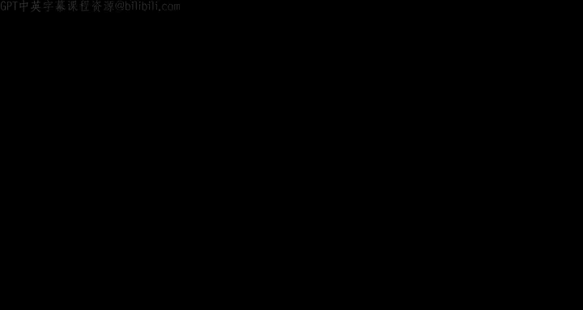
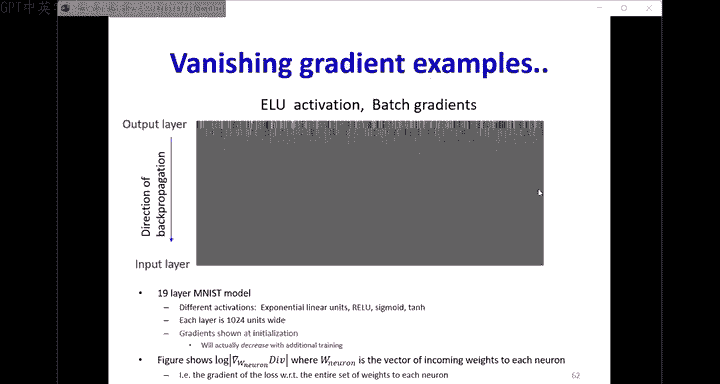
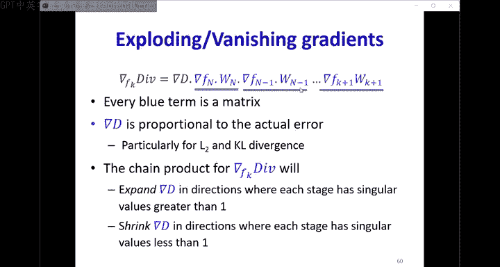
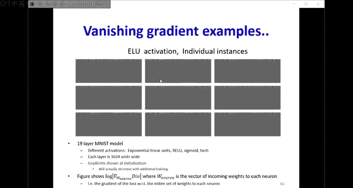
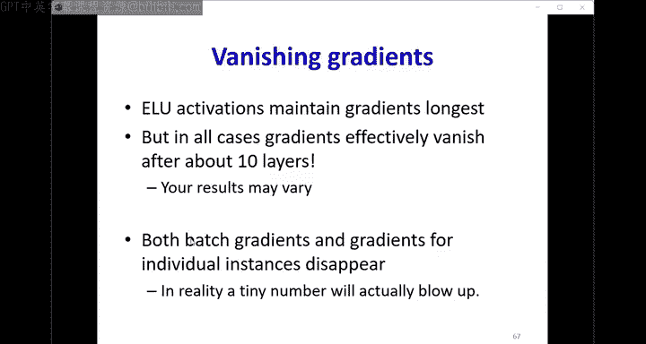
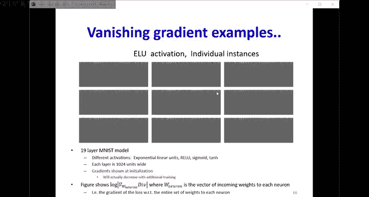
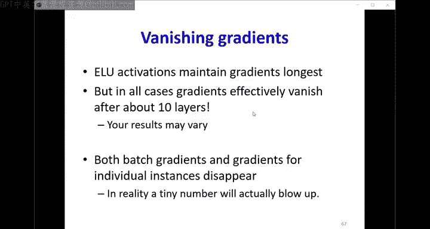
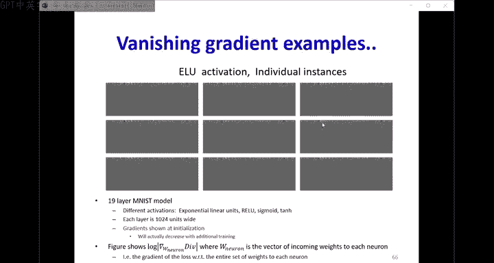
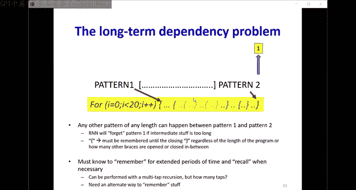
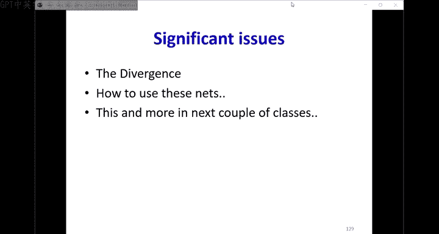

# CMU《深度学习导论｜CMU 11785 introduction to deep learning Fall 2024》中英字幕（deepseek - P15：Fall 2024 Lecture 14.zh_en - GPT中英字幕课程资源 - BV1CfsReEEw8

Okay all， can you hear me？Yes， we can hear you。ok。It's start in three minutes。And in some cases。

 it's like 700% of the last three years。 Now these swing state module are so thats 102000。嗯。Let me。

Okay， let's start in a minute。Okay， let's start。So we're going to continue with our series on rec neural networks and today we're going to be talking about stability analysis and LSTMs。

So the stories so far。We found that if you want to analyze times these data。

 then iterate instructor like convolutional neural networks are good for analyzing time series with short term dependence on the past。

On the other hand， if you want long term dependence where you must consider the infinite path to make any prediction。

 then you want recurrent structures， so these recurrent structures are recurt neural networks。那。

The way we presented reccurren neural networks， they were only good for analyzing time series where you had a great amount of dependence on the past。

But what about other kinds of regular problems？Let's see how they can apply there as well。

 now consider the simple problem。I want to add two binary numbers and suppose I gave I wanted to create a network that added two binary and bit numbers and I told you for instance。

 that the MLP is restricted to being four ASD。How large would this ML LP be。

Based on what you remember from the second lecture， anyone？Does anybody remember this？

How large would this network be？If you wanted to build a network that would just take into binary numbers and output the sum。

Anybody？Unless you want me to begin calling up people by name， and waiting for a response。So。

2 n and plus one。Is that how large a network would be？For adding to endbit numbers。

Anybody else want to take？guess。Our a fixed number of layers， Mari。

How large would it be safety layers？How much would it be？PM plus one。For a fixed number of players。

 was that 3 and plus3 and minus one。Anybody else to remember？We didn't actually address addition。

But take a guess， right， What you're going to need is。

It'sA network that can consider every possible pair of input patterns。And generate the output for it。

 right？So。That's going to be big， okay， in terms of training data。

 how much training data would it need？And someone guess。Guys， this is disappointing。

 you've been through the quiz， you've been through the second lecture。And you can answer this。Yeah。

 so three and minus one training instances。Would you be able to learn how to add two n bit numbers after just seeing three and minus one training instances？

All possible combinations， right， how large is that？How not just that。Anybody。2 raised to2 n， right。

 it's going to be the model is going to need an X。 Remember this Add is basically an ex soil， right。

Yes or no。You remember your Booleanriematic， right？So addition is an XR， yes or no， yes， okay。

 and how large did we say an XR network had to be？It had to be exponentially sized， correct。

And the input， so if you had a fake stamp。Sir Aunt Morover， boy wanted to train this network。

Because of the completely bizarre manner in which the exc are works。

 you'd have to see every possible combination of inputs to learn how to add every possible combination of inputs。

 so the amount of training data is also going to be exponential in N。That makes sense。耶稣了。Right。So。

And say somehow you magically learn to build this network that could add to n bit numbers。

 would you be able to add to n plus one bit and bit numbers？Yes or know。Would you be able to add no。

 right， Okay， so now suppose I go ahead from this and say， I'm going to use instead。

A record neural network。Then how large would the network be？But the same problem。

How large would the network be for the same problem？Okay， let me give you the answer， right？

The recurrent network just has to be this， you can add it one bit at a time。

All it needs is this recur structure which takes in the current bit from each of the two input numbers and a carry。

Right？And it's going to create two outputs。And that the actual bit output and the carry。

How big would this one be。This is going to be very small because there are only eight possible combinations of carry and the two inputs and two possible combinations of the output。

 so you're going to need a network which needs to remember any patterns that's it。

And that is going to be at most et units， even if you are very， very sloppy about it， right？Yes so。

喂微笑。Did this make sense。嗯。And how much training data do you need for this？

Would you need to see all two ways to end combinations or would something far less of work and log in？

There patterns， there are only eight possible input patterns， right？

So you're going to need no more than eight training instances， correct？

With just eight training instances， you should be able to know everything that you can do in the best case。

Yes sir。Right。And so here we are， its be a good situation， right， and moreover。

 because it's recurrent。you know it's not why because there are three bit inputs。

So how many possible input combinations can you have Mari？Right。

 so8 so that's it and so the amount of training data required is also going to be very。

 very small as compared and moreover a network that you've trained on endbit inputs is not restricted to adding nbit inputs because it's recurt you can once it learns what to do it can add inputs of any size。

Or here's another problem， the parity problem， right？

I want a network that looks at end bit inputs and outputs of one is the number of ones in the input is。

A odd and a zero if the number of n ones is even。So， in this case。If I want to train an MLP。

 how large would this MLP be？Anybody？How large is this going to be？For an endbittting。So。

I get one answer， what about the rest of you， what do the rest of you think？How large would this be？

Come on， guys。We've got to be better than this。You raised to end right because an ExOAR network。

 we explicitly saw this problem in the second lecture you can't forget within four weeks and so and how much how many training instances would you need to train the network even if you had the network of that size？

You'd have to see every possible and good pattern。To learn them all， correct？

So it's going to be exponentially large。Both in size and in the amount of training data。

 now if I did this here with a recurrent network， how big would the network be？Any guesses？

It's going to be， this is all I need to do， right？The current bit。And。

What the previous output was that possess， so there are four。

Possible combinations that's all I need to know。 if the previous output is1 and if the current input is0 I haven't changed the number of ones so the output remains a1 if the previous output is a0 you know where basically the output doesn't have to change right if this is a0 then the output remains the same as what came in on this line if this is a1 it has to flee so there are only four possible combinations。

This unit doesn't need more than。えの。For neurons， possibly and。

How much training data would you need for this？就 train this unit呢。For instances。

 right because there are only four possible inputs and so in the best case， only four instances。

 and it generalizes if you train it on n bit inputs， it can still work on n plus1 bit inputs。

But this makes sense。Yes soの。系。So。That's beautiful， right？😊。

Recurrent networks are much more powerful than you would imagine。And so yeah。

 it was my first thought。Any guys see the poll？Okay， 15 seconds。All right， let me end the book。

And share those results。So here's what。Yess what Paul you guys thought。Let me stop sharing。

 so can you tell me the answer to the first question to or false？

Some prediction and classification problems， yeah， we just saw this。What about the second one？perful。

Also true， and so recurrent neural networks are incredibly powerful。

Just so long as you know how to use them。And that was the point I was trying to make with this little lesson。

我托肘。And so the story so far。You know， record networks， structures that can be trained， you know。

 can be used to analyze。Time series data and。Even for data that are not time save。

 they can be really good at reducing the amount of training data and the computation if you can find record structures within the operations。

Now。Also？We saw that recurrent structures can be trained by minimizing the divergence between the sequence of outputs。

Look。And。So Isaac， the slides should have been up we' been slow， their tears are putting them up。

They should be up。If they are not properly， they should be up short link， right？So anyway。

 so we also saw this recurrent structures can be trained by minimizing the divergence between the sequence of outputs and the sequence of desired outputs。

And this difference。Can be back propagated to compute gradients and you train the network using creating the set。

But then let's look at something else that's important。The behavior of records。

Let's return to an old familiar model， this is the convolutional neural network。

Which is analyzing a window of the input to make the next prediction， the first thing we saw。Now。

 in a model of this kind if the inputs are bounded， they are all finite in value。

 will the output ever explode？How will the output also be bounded？What do you think？

All the input values are bounded。Will the output stay bounded or and blow？Any guys。I have one answer。

 what about the rest of you？喂。The wait are well。You're going to assume that the wigs are all bounded。

 right？So if the weights are bounded， here's what happens， these things are bounded。

 the aine terms here are bounded。The derivatives， the activations don't blow up。

 so the entire process is going to stay bounded， which means this net this。Kind of system。

 whereas is what is called bybo stable Boed input， bounded output， it has bybo stability。

Does making sense？Yes no。Right。And okay， what about this guy？Will this be Bible stable？

What do you think？The economic network。Many opinions。

Give me a favor guys just do respond because I'll wait for you and if you don't respond on time this class will not end today。

 so please okay。We can't say， we cannot say it， right， so。Well， if the activations are bounded。

 then you know， for example laughter if you use only sigmoid activations everywhere。

 it will be kind of bounded， but it will saturate so and become meaningless so if we consider active other kinds of activations then。

It will actually be unbounded and let's see why right to analyze this。

 it's right sufficient to analyze the behavior of this recurrent here because that's where you get potentially infinite computations。

And so let's analyze this recurant layer and see what happens。

And now this is a very nonlinear function because you have nonlinear activations everywhere and it's very hard to analyze very deep steadily nested nonlinear functions so we're going to back off something simple。

 the famous street light effect that we've alluded to in the past。You know。

 you can't search in this dark bar so you're going to look on the street light where you can see things we know how to analyze linear systems and so were going to assume that this is a linear system What I mean by a linear system is that every。

Cell over here has an identity activation， so at any time the aine value at any of these hidden neurons is simply the weighted sum of the previous hidden state。

And the current input。And the output is the aine value itself。So is this。

Recurres with linear identity activations。Cl to you。The simplification I've just made。喂。Okay。

 so let's analyze this， okay。Here's what we had HK。Because H was the same as z right。

 identity activation so Hk was Wh times hk minus1 plus wx times xk Wx is the weight matrix that applies to the input。

But then HK minus1， this guy itself was wh times hk minus2 plus wx x k minus1。

 so let me plug this guy over here and so you're going to get HK。

Equals Wh squared times h k minus2 plus Wh times Wx times x k minus1。Plus， W X， X， K。

So is this making sense， yes or no？Right here， okay。

 and just continuing this here is what you're going to get。

HK is going to be this series where the zero of input is multiplied by WHase to k。

 the first input is multiplied by WHA to k minus1 and so on。

 I just got this by recursively expanding this guy。And。Again。is this making sense。

 it should just intuitively it should we can work out the map。

But because I want you to get this because I'm going to analyze this， okay？And now here's the thing。

 I only need to focus on what happens here。What happened to the input at time zero？

If the input at times0 blew are， then the output has blown up。

If the input at time  zero did not blow up， then clearly the input at time1。

 which occurred later could also not have blown up。

 and so the entire response could not have blown up。Right？That big concern say。Right。

So it's sufficient for me to analyze this gap。The response to an input at time zero。

 if this does not blow up， then the responses to later inputs will also not blow up so this guy is not going to blow up right what do I mean by it blow up。

But I， we will see， okay。So。Glow up， meaning it just takes close， goes to infinity。

 but we'll see how that happens， right？Or other things can happen， nasty things can happen。

 so I'm going to analyze a situation where I have a single input at time zero。

I'm assumingum no initial state this is like having some inputs in the previous time so I can ignore it and no further bootss laterron and so let's see what happens to this I'm going to consider a single scalar case Ht equals w times ht minus1 plus xt everything are scalar if all I had was an x0 and all the subsequentent inputs were0。

Then the response at time T is simply going to be W to t times Cx0。This is making sense。Over here。

Yes， is this。Right。Okay， so what can you tell me about the response at time T？

If I give you a single input， which is just。One at time zero。

 what will happen to the response at time T？Is it going to stay at one or thereabouts？If this is one。

Will this always stay close to one or generally stay bounded。

And continue to carry information yes or no。And it's going to be。Times w raised to w times t， right？

So what happens if W is greater than 1， what will happen？What happens to it it blows up， right？

Goes unbounded， This is what I remember going up right what happens if w is less than one I like that So what happens if w is less than one。

😊，Bounded。It just vanishes to zero， right？And so here we are the response to the system only。

Stays stable when w is1， right？Now， what about this is for a scalar recursion？

What about for vectors because we really deal with vectors right in the case of vectors。

 we would still have the same thing H of T is w times ht minus1 plus Cxt if I just had a single input at time 0 and no further inputs。

 you're going to get H of T is going to be w raised to t times CxT Cx0。

This is the same equation as before， this makes sense。Does guy help？Right。

 so let's see what happens here。Let's consider W。Using eigen decomposition。

 I can write WsU Lada U inverse， this is just standard eigen decomposition。

 you're all familiar with eigen decomposition， right？

So and lambmbda is a matrix diagonal matrix of eigenvalues。Okay。😊。

And I'm going to assume without loss of generality that lambmbda1 is the largest eigenvalue Lambda 2 is the second largest and so on。

So this making sense？Yes so okay。What happens if I multiply lambda W with itself。

 If I multiply W with itself， you're going to get U Lambda U inverse， U lambmbda U inverse。

 and the U inverse U in the middle is going to just do the U inverse and U will cancel log。

 you'll end up with U lambda squared U inverse More generally W raised to T simply going to be U times。

You know， lambmbda race to T times the universeverse。

And this lambda race to T is simply diagonal matrix where all the diagonal entries are the individual eigenvalues raised to T is this sport part of it making sense？

Okay。I can pull out this largest tiigenvalue out here and say lambda 1 raised to t times u and so now this guy is going to become1 and all of the other things are going to be lambmbda 2。

 lamb lambmbda over lambda 1 raised to T， whatever lambda lambda2 over lambda 1 raised to T。

 lambmbda 3 over lambda 1 raised to t and so on。Does make sense？And as t increases。

 what happens to these at secondary daagon terms？What will happen？

They will all vanish because every one of them is less than one， right？

So the only thing that remains is going to be this guy， correct？Yes。😊，Okay。

 so what can you tell me about the response of this system？As with increasing T。

 so this is what we have， right？For any input for large t。

 the length of the hidden vector will expand or contract to the teethth power of the largest eigenvalue of the eigen matrix。

Do you agree with this？Yes or no。So what happens if this largest eigenvalue is greater than one？老吧。

And。What if it's less than one？What are this largest tagig invalue list and why it's going to shrink and manage to zero。

 right？If this magnitude is greater than one， it will blow。

 otherwise it will contract and shrink to zero rapidly。And so here's what we get。

 I have some simulations。Where we just gave a single input of all once at time0 here lambda max was 0。

9 two different cases， and you can see how boom it always goes to  zero。This is Lada x 1。1。

It blows up only if Lada x is 1， magnitude is 1， it kind of stays stable。These two are the same case。

 what do you think the difference is between the two anybody？What is the difference between the two？

This has， remember， when you perform eigen decomposition， the eigenvalues can be complex。

can occur either as real values or complex conjugate pairs。

 when they occur as complex conjugate pairs， you're going to see some kind of oscillation。

 otherwise you're going to see a blow up， a smooth response。That makes sense。

RightBut regardless here's the thing， so these are complex eigenvalues， these are real eigenvalues。

 but in every single case in linear systems the long-term behavior depends entirely on the eigenvalues if the recurrent weight matrix and the largest eigenvalue is greater than one。

 the system will blow up if it's less than one the response will vanish very quickly。

Complex eigenvalues will cause some oscillatory response， but with the same overall trends。

 magnitudes greater than one will cause the system to blow up those lift than one will cause it to disappear and the rate of blow up or vanishing depends only on the eigenvalues and not on the input is this making sense。

Yes。Right， okay。But that was for nonlinear for linear activations what happens with nonlinear activations so here I've replaced the same same thing as before。

 but now I put a sigmoid activation HFT is a sigmoid of WHT minus1 plus cxt plusB okay。

So I have three rows and three columns。They are those snowpoia。So the top row。Ass。Weight 1。

1 second one is weight is 1， the third is weight is 0。9。And within each picture， there are five。

Pots there represent five different values of the bias as shown in the figure。

 and then the three columns represent three different initial values effects x minus 0。5，0 and 0。5。

Okay。What do we see， And the X axises， in each case， represents time。

What do we see about the responses in the nine plots after say time t equals five？

Are they different or are they all the same？After T plus five。What does it mean？

What does the long term response of this recordscurnce depend on？

It doesn't depend on the weight for the different weights the responses are the same， correct？

It doesn't depend on the input for different inputs。

 the responses are the same the long term response of the system only depends on the bias。

 this is if you use a sigma activation。I get something very similar if that makes sense， guys。

 yes or not。喂。And so。Same thing if I use a tanh activation， I get much the same response。

Here it also has some dependence on the weights。It depends on the weights and the bias。

 but so what we will find is that within each row。The long-term response is the same。

 meaning each row has one by weight and different biases and you're going to see that within each row the longterm responses are the same there may be differences between the rows。

 so what you will find is that the final value depends only on the bias and the weights but not on the input。

Although in the sigmoid， it hits saturation in five time steps in the case of TNHage。

 it takes longer， which is why in recurrent neural networks。

 we typically use TNage activations in the recurrent layer because they take longer to saturate to their default value。

Is that making sense？Yes， or no。喂。Okay。With rail loose， things are horrible， you know。

 rails are basically like linear layers。Except it's one sided so things will either blow up or simply vanish and go to zero it's now we're going to retain anything so the those are absolutely useless in regularcur networks now this is for scalar recursion if I look at vector recursion where these Hs and x's are vectors。

Then I have a similar plot here， I have a seigoid activation。

So the top plot is when the input first input is all once。

 the bottom plot is when the first input is all minus ones。

 and so the two differ and the initial input。And what you will find is that in both cases。You know。

 if you look across the stigboard activations that the vertical axis scales are different。

 but what you will find is that the long term response is the same in both cases and depends only on the bias in the tanage the long term response is the same in both cases and。

Varies with both the weights and the bias， but not on the input the re activation is useless。

 so what do I mean by saturate？S saturators hits its final value like this guy。

This is the pattern it took and this is the pattern it's going to take regardless of grain protector。

That makes sense。If you have a bias of 0。5。It took five time steps to get to the final response 1。

6 for a bias of 0。25， it took this much time and so on。ok。😊，So。

This was with the maximum eigenvalue of w at 1。1。If here here I have the same thing with the maximum eigenvalue of w at 0。

9 and you see that these two plots are different。But the key thing is that， you know。

The upper rows and the lower row are identical in every case， which means that。There are differences。

 things change with the eigenvalues of the weight matrix， things change with the bias。

 things do not change with the input， which means that the long term response of the recurrent layer depends only on the weights。

 the eigenvalue of the recurrent weight matrix and the bias， but not on the input。Now。

 if you want to look at perform a formal stability analysis。

 you' to do you can go through the math and need to consider convergence of La of functions， roots。

 criterion， and whatnot。But even the math will tell you the same thing。

 bipolar activations like TH take the longest time to get to their useless default behavior。

Others get there faster， but in every case， the final value of the system in response to an input at time zero is going to depend only on the eigenvalues of the weight matrix and the bias。

And the best case， memory of what was the initial input is very short。

What the initial value was is forgotten exponentially quickly。Is this making sense？Yes， I。

What about the rest of it， okay。I'm getting six responses from six people。

 maybe I should wait for you know a comes up from up to 50 people people。

 which is what I used to do in the past。Just give me a thumbs up， I can count them。

And then I can see how many of you are responding， but here's a poem。As see we can see the quote。

15 seconds， guys。对不得。Give you five more seconds then stop it。And得。Here's what all of you thought。

But let's ask explicitly for the first question， which are the true statements？

Select all that are true about how long， how many time steps and RNN can retain some of the memory of the input pattern。

 only the first three depends on the weights of the recurrent layers。

 it depends on the bias of the recurrent layers， it depends on the activation of the re recurrent layers。

 but it does not depend on the input。What about so this is the length duration of memory， right？

What about what is exactly remembered even that only depends on the weights bias and activation。

 it has no dependence on the actual thing you're trying to feed in so are either of these behaviors useful？

If you're trying to analyze long term patterns。What do you think。Is this happening？

Do you think this is kind of useful behavior？Or would you rather have no right。

 you basically want the network to remember things until it is no longer required and what is remembered and how long it is remembered must depend on the input and not the parameters of the network and that's not what happens here。

So recurrent networks retain information from the infinite transine principle in practice。

 they tend to blow up or forget depending on the largest eigenvalue of the recurrent weight matrix。

 if it's greater than one， the response may blow up if it's less than one if they die。

And what is remember， the memory of the network also depends on the parameters and activation of the human emit sigmas activation saturate and the network becomes unable to retain new information。

 radio activations either blow up or vanish。10 each activations are slightly more effective than stoids。

 but still not for very long。Right。So is everybody good with this lesson so far？Yes sir。对。

Give me a thumbs up guys so I know that you can write okay so here's where we are our are excellent models time series。

In theory， for time series prediction classification sequence generation。

 they can even simplify problems that are difficult for MLPs as we saw， but the memory is terrible。

But then we also have an additional problem right now this problem is not just a problem for RNNs。

 but for any deep network。This is true for any deep network， not just recurrent networks。

The gradient of the divt is the loss with respect to the parameters is unstable。

 what do I mean by this？So here is what a typical deep network looks like。

You have some inputs know this is true regardless of whether it's CNNs orNNs or whatever。

 they're just very deep networks right even a CNN is scanning with an MLP and so if you have a deep CNN the MLP is which is just going to be you know。

Yeah， exactly Mcgu， I'm going see what， right？Eventually you just have a very deep network so the output of the network is going to be a function of the output of the the output of the final layer of the network is a function of the output of the penultimate layer is a function of the output of the previous layer and so on so final loss is going to be a function of the output of the network and so we saw that if we draw the sequence of influences。

 this is what it looks like the input X influences the first。

Aine term Z and the Jacobian of this influences the weight matrix first weight matrix。

 then the aine value influences the activation value and Jacob and the influence the weight of the influences the Jacobian of the activation function this。

Output influences the next value。Where the EJco is W2 and so on。

 so do you guys remember this from I think lecture number four？Yes or not。Right。

So when I compute the derivative of the divergence going back。What do I do。

 I first compute the derivative of the divergence with respect to the output of the network。

Which is Nala。And then each time I take a step back。What happens to the derivative。

 how do I modify the derivative if I take the derivative here and back propagate it here。

 what did I do？Anybody remember？What did we do and we took a bag derivative from here and moved it here。

Anyone。You seen the letter， you've being done the homework， Sir。So E chain rule， right。

 what happened with this guys？We have to do this every time when we move back here。

 we just write and multiply this this derivative by this Jacobian。Remember。

 then we move it back here， you right multiplied this derivative this Jacobian。

 which happened to be the weight matrix， then you take a step back you so each time you take a step back。

 you write multiply by the。By the Jacobbian that's on the edge。

 that's how the back propagation happened。 Do you remember this？At each step。

 the back propag was just a simple， right multipier。Right。I see a single thumb up。

 but can I get 50 200 people in class？Okay。I we for at least 25， please。Okay。

 so this is what happens， right？The derivative of the divergence with respect to the output or output of the k layer somewhere in between is going to exist a sequence of right multiplies of Jacobcobians in weak matrices。

All of these are matrices， both the weight matrices and the Jacobbians are matrices right so first let's analyze what happens when you pass the derivative backwards through a Jacobian。

Now， for any layer， the Jacobian is typically just a sequence of a vector of activation functions。

 independent activation functions， right？And so we saw that if you have a Jacobbian。

 so this is regardless of whether it's a recordcur network or any other kind of network。

 the Jacobbian。Of the activation， because each neuron is working locally。

The Jacobian itself was a diagonal matrix except for the final output layer。

 or if you have a softm where you had a full matrix。But the Jacobbian tends to be of this form。

 do you remember this？When you take it fast and activation。Right。

And what are the individual terms of the dial？我这里。These times。Anyone remember， these are just the。

 what are these guys？What are these？This is going to be the derivative of the activation functions。

 correct？These are the derivatives of the activation functions。

The derivative of the activation function for the first neuron in the layer。

 this is that for the second neuron in the layer and so on。And what do these look like？

So each of these termss if。For the Tage activation。

For depending on the input the derivative looks like this。

 when the input is0 the derivative is1 at all other inputs for all other values of z the derivative is less than 1 for sigoid the derivative is always less than 0。

25 for relo the derivative is either0 or 1 so I have a matrix where the diagonal entries at all。

One or more generally less than one。What happens to a vector if you multiply by a diagonal matrix where the diagonal entries are one or s。

 what happens to it？Can anyone tell me？What would happen to a vector if I multiplied it by a diagonal matrix of？

But the diagonal entries are lesson than one。It's going to get strictly smaller， right。

It's going to get back in best case。It's going to stay stay the same length。

 otherwise it's going to get smaller， so each one of these guys is going to shrink the derivative in size。

Do you see that？一三六。Right。So。What about these guys， these weight matrices。

 what happens when you multiply a vector with a matrix？Do you guys have any idea？

I'm assuming not it doesn't always get smaller， each weight matrix is going to have a bunch of singular values and corresponding singular vectors。

Some of the singular variants are going to be greater than one。

 the majority of them are going to be less than one， this is just a property of any random matrix。

And now when I multiply a vector by a matrix， then the vector is going to grow longer along the directions where the singular values are greater than one。

 and it's going to shrink in directions where the single values are less than one。Is that my sense？

Over不 here。Right。And so。What about the rest of you guys， do you see this？

If I multiply a vector by a matrix。Then the vector has components along the singular values。

 singular vectors， and the components along the singular vectors with singular value greater than one are going to increase in length。

The rest of them are going to shrink in length， but what happens is that you know。

 but this vector a vector goes past this guy and some components will shrink and shrink and others will expand。

 but then it goes past the Jacobian and everything gets changed so the components that may have expanded over here when it went past here can end up in a direction after going through the Jacobian where for the next。

Matrix there in a direction that's going to shrink。

So even the few components that do expand in any weight matrix， any random matrix。

 the majority of the singular values is going to be less than one and so as you keep multiplying backwards step you know。

 most directions will shrink， but because of the intermediate behavior of this Jacobian。

 you actually have to look at this big entire Jacobbian weight matrix block。

You're going to find that as you keep going backwards。At each step。This。

Mulipplication by this block is going to expand。Navlady in some directions where the singular value of block is greater than one and shrink it in directions where block is less than one and also because when you go from here to here the vector has been transformed a bit。

The directions which have singular values greater than one for this block。

 may be different from the directions where the singular values are greater than one for this block。

So as you keep going back， eventually the derivatives are going to keep shrinking， except in a very。

 very small number of directions。And so eventually the derivative this is going to result in insignificant derivatives。

In most directions and a small number of directions where the derivatives are going to blow up。

Did this make sense？Yes什么。喂。So you have the problem of exploding and vanishing gradients just for visualization。

 as an example， this was an MIS network。It's 19 layers。 Each layer is。1024 units wide。

So actually if this text is wrong， I'm showing you the derivative with respect to the output of the new each of the 1024 neurons starting from the output going back to the input layer and what we find is that。

This is an initialization and the derivatives are the largest magnet。The derivatives。

 if I use the activations， the derivatives have reason you know。

Decent magnitudes have the output layer， but then when you go back。Just five or 10 layers deep。啊。

The so。

Simply because the number， so if the number of directions think about this， right。

 if I randomly flip a coin。

And four times three times randomly roll advice。And one time out of six。

 I multiply by number greater than one and five times out of six I multiply by number less than one what do you think will happen in the limit？

Right so because each of them is different right so by the time you get to the fifth layer this thing is going to vanish this is for elu activations this is for Reello you can see that elu activations maintain gradients for longer than for relus right。

For sigmoids the gradients are made derivatives vanish even more quickly for tanh Tage is slightly better than sigmoids but not very much right this is for batch or all4 v or an entire batch if I look at individual instances I see much the same pattern。

What we find is that by the time we get。

You know， Alu activations maintain the gradients longest。But in all cases。

 the gradients effectively vanish after about 10 length。And this is water over the batch。

Where you would hope that the accumulation of gradients across many instances will give you something significant。

 it doesn't。

And also for individual instances now the fact is。That not all gradients are going to go to zero。

 there will be a very small， tiny fraction where the gradients are really blown up。

 but you can't really see those because they're so small in number and so what we find is that as you go back deeper and deeper。

This one was these were not individual instances。N in trainings that were。Here。

 this was a tannage activation sigmoid，For Ba Canadians。And this is what individual creates。

 did that answer your question？But 하나？

ok。So in both cases。The gradients when they sure disappear right so we have this business with。

Vanishing on。Exploring gradients the stories so far recommend neural networks retain information from the infinite past and principle and practice their current memorization。

The hidden outputs can blow up or shrink depending on the eigenvalues of the recurrent weight matrix。

The memories also function not just of the eigenvalues of the re weight matrix。

 but also the activation of the hidden units。Tanh activations are the most effective at retaining memory。

 but even they don't hold it very long。And so deep networks in general also suffer from vanishing or exploringd gradients because the gradient of the error at the output gets concentrated。

Into a very small number of parameters in the earlier layers and goes to zero for others。

This making sense。lessense策划。对。嗯。I'd like to see some thumbs up Okay， the last one so Maria。

 what do you mean which last point did I do that did。

The gradient of the error at the output gets concentrated into the。

So what happens like I was saying over here， right？

So the gradient is going to shrink in most directions。

And it's going to expand in just a small number of directions。Correct。

 so this effectively is going to be so direction is some combination。

 but it's going to be dominated by a small number of neurons and most of the neurons you can think of each neuron as a statistically independent independent operator。

 right？So that's basically what this means。was mentioning about can you go on a slide again。

 the last one？This， so far， a mystery。So like saying the into oh okay， yeah， got you。

 but like the earlier layers， I don't get y on the earlier layers。So。

This is earlier layers is like the lower layers， these guys。Oh， okay。That makes sense。Yeah。

 thank you。O。是啊。嗯。没。if you use relos， you used residual networks if you didn't use resnets。

 you would run into these issues， resonancesnets were specifically designed to avoid this problem by having the residual line over which the gradient never just is just one。

So。And now that was for general networks， but for recurrent networks。

 recurt networks are just real deep networks。This means that。

The derivatives of the error at time T are going to basically vanish or it's mostly vanish by the time you get to early in time。

 and so you will never be able to learn the behavior risk which says that something that happens here is going to influence something far away in the future。

But then it's so right？And so we have this issue， we have trouble learning things。

You have trouble remembering things， things disappeared even going forward and both of these are not things you want。

 so here's another quote。If the gradients are clip a， that means that it's going to get worse， right？

Because the things that are you don't have a flow on the gradients。

 you're just trimming the things that became too big。

Without doing anything about the things that died。So it' is going to get even worse。

Do that answer your question？诶问。😊，Yes not。Yes。Okay， five seconds， guys。

And I'm sorry for eulminating the poll so quickly， but it'll be running out of time。So yeah。

 let's just go go through this for the first point。

The derivatives for most parameters will become vanishingly small as we。

Our back propagate the last loss gradient through deep networks， through or falses。Second one。

 the derivative for a small number will blow up and become large and unstable true or false。喂。

The derivatives would be more stable。If the recurrent weight matrices had single values that were all equal to one through or false。

Right because the reason they were blowing up was that the singular values were either greater than one or less than one right similarly the activations where all identity transforms。

 the derivatives would be more stable true or false。Right so。Same thing that was for the derivatives。

 what about the memory？The memory of the recurt layer is limited because recurrent weight matrices are not unitary。

 true or false。Right， because。If if you have any eigenvalues that are greater than one or less than one。

 some things are just going to die， correct？So the memory is also limited by non nonlinear activations。

 through or formss。Right。And so the memory would be more stable if the weight matrices were identity matrices true or false。

RightBecause now it's not going to be shrinking or expanding things based on the vagaries of the weight matrix and the memory would be more stable if the activations were identity transforms to or false。

Because we saw the sigmoid， the relu， the tanage， all of them mess with the memory and cause it to saturate。

 right？Yes sir no。Okay， so let me move on， right， all of things were true。

But then here's what you have。We actually need long term dependencies。

 what is the kind of memory behavior we really want。

 let's say you're using the recurren neural network to parse code。If you're passing code。

Then once you encounter an open grace。You have to remember that an open breeze was opened。

That this Bra open， this brace was opened until the brace is closed regardless of how much other code happened in between。

 so you want the things in memory to stay there until you get a trigger in the input that this can now be forgotten。

Is this making sense？Right。So the memory behavior should be dependent on the input I remember something and I'm going to have to remember it till something in the input tells me okay now you can forget that because it's no longer required how long I remember something should not depend on the parameters of the network it should depend only on the input right so。

How can we do this？For that， let's get into， you know， mystery and magic。

And it stands。Let me go back here。We have this issue， the memory。Is affected by these ws。

 The memory is affected by these Fs。The ability to learn is also affected by the W's and by the Fs。

If I don't want the memory to be affected by Ws and S's， what's the simplest thing to do？

What can I do？Just the presence of the weight matrix is causing meing。

Just the presence of an activation is causing me grief。So what can I do？Any suggestions？

Get rid of that right， simply I don't want this guy， this guys causing me grief let me throw it out。

I don't want this guy， it's causing me greed， let me throw it out。But then if I throw it out。

 how do I modify what's in the input， what's in the memory？We can do that。

Through some mechanism which modifies it based on analysis of the input。

 so we want a network that just remembers arbitrarily wrong。

And it's not dependent on the varies of network parameters。

 but rather on input database determination of whether whatever is in the memory must be remembered。

And for that。We're going to replace this with something that doesn't fade or blow up。

We are going to use something that's based on switches。

This modification no longer has any weights or activations。

 something in the memory is going to if I encounter something at time zero。

 I stuff something in memory and thereafter it's going to be modified based on analysis of further inputs going back to this example。

Once it encode encounters the curry brace it's going to store it in memory and then as each additional character comes in。

 it's going to keep looking at them and only when it finally finds a closed brace that closes this guy is it going to delete this thing from memory that's what we're going to do and so this switch is a switch that analyzes the input and modifies the memory。

So that gives us the structure called the constant errorcharusible。See is the memory。

The sea goes through straight in time， it's not， but doesn't it has no weights。

 it has no activations。At each time， however， whatever is in input is analyzed。

And there's a switch represented by the sgmoid， which modifies box in memory based on what it sees in the input。

Is this picture making sense？C is a function， whatever this is a C of T is what is in the memory。

 is the memory。喂。The currency of Marim。I'm just calling whatever in every CFT。Okay。

So this makes sense， right based on what we just seen。But then how do we modify this？First。

The thing is you want nonlinear stuff， not really because you have things modifying it at aborn。

 so anyway。We want nonlinearity because in a record in a neural network。

 the actual work is bound done by the nonlinear activations so we want to keep things in memory in this manner。

 but to use it you're going to put whatevers in memory through an activation function to get the actual hidden。

State。And what is this？Gate， which modifies here， the input the gate is going to look at the current input。

 but also what is currently in memory。 There's no reason to be modifying a memory line which is counting number the number of curly braces if there isn't already a curly brace over here right So it's going to be looking at the input and say a I saw a close brace I also know that there's an open brace and memory。

 So I must modify what's in memory， So it looks at what's the decision of the switch must depend based on both on the input。

And what's actually in the memory？That making sense？Best of you guys， this make sense。对。So。

And of course， you want to consider that it's like a context。You know， is this in a。

In a comments comment section， a close race in a comment section should not count right and of course you just looking at this non nonlinear。

One linearly transformed version of the memory is not enough。

 so you may also want to add a direct line from the memory itself。

But this these are all the inputs that the gate could consider before it decides whether to modify what's in memory。

Is this picture making sense？Yes， no， give me a thumbs up if it is。Guys。

 can I request you to give me a thumbs up I'll wait for 25 of them？I have 22， I need4 more。

 so give me a few more thumbs off squeeze。You counted down instead of off， but it's okay。

 let me continue the next time， please do。So this gives us the so called long short term memory。冇盾。

This explicitly latches information to prevent DK or blow up and in the slides that follow are borrowed exp from this coal grid。

For the pictures now here's your standard rec neural network you have the input and hidden stated the previous time these are combined and analyzed by activation typically we use a tanh because a tan h remembers things for the longest time。

And the output of this is is passed on to the hidden layer the next time and also deeper into the network。

 this is a standard recurrent network， this entire operation can be thought of as a cell。

What happens at one time in aren standard rerent network， is this making sense？This picture。Yes什么。

Okay， and now this guy gets modified。By to this one in the LSTM and then if you look at this。

 you going to wonder who， what was that？So let's see what is happening over here， right， one by one。

first is this basic line called the constant errorcharousal， which is a remembered serstate。Again。

 remember that each line is actually a vector from our original pictures right there many there many lines so this is。

Several activations and it entire layer of activations so this is what's in the memory it goes through and it's not modified by any grades or activations it's only modified by these two operations。

Wwhichch can change what's in the memory， so let's continue using the open en closedsed braces example this could be remembering。

 for instance that I've seen eight open braces so far。Then。

The first way it's modified by these two units， the first one is something called a forget gate so by the way these gates they're all simple sigmmodoidal units they have the property that they can only shrink they multiply whatsapp whatever is going through by a value between zero and 1 because sigmoid is only generate values between zero and 1 and say so they cause these values to shrink。

And the first gate over here is a so called forget gate。

And it tells the memory whether it must forget。Some of what it remember， so for example。

 if this guy is carrying the number of open braces。

I've seen 16 open braces then this one here is going to analyze the input。

And get input and other things from the memory。And decide whether it has seen a curly closed race and if it has seen the closed race。

 whether that means that this count must be decremented。And so that's what this gave does。

What make consent sense。Yes or no。Comes up， comes down。I'll wait for 25 results now， please。

I see three。16，17。18，19。2020。So I see one thumbs down。 Who's the thumbs down。

 I only got 20 thumbs of skies， Some many of you not paying attention。

 Who's the one who's who had a thumbs down， can you。Explain your request what was unclear。

There was one person who didn't get it。Right。So okay， then let me just repeat this one。

Look for triggers that must。Diccrment works in memory。So if， for example。

 the memory sees I've seen a certain number of open braces。

 this would detect patterns like closed braces， and if it detects them。

 it's going to decrement what's in memory but it's going to do it multiplicably。Now， the second guy。

Is what's in memories， you know， you don't just decrement Wats in it， you also want to increment it。

 so this guy has the job of incrementing what's in memory。First， if this guy's opening curry brace。

 we' counting open curry braces。This one is going to detect open more open braces。

 So this first thing is a pattern detector which looks at the input in the current hidden state and determines if。

The pattern is something that。Could potentially in this guy， so this is a pattern detector。Seatility。

 right？But then the detected pattern is influenced by the context， for example， that pattern。

Could be in a comment block in which case seeing an additional open brace in a comment block should not modify what's in memory。

 so to control that behavior you have a gate over here。

 this is a basic pattern detector and this is a gate which determines how much of the pattern that's detected must be。

Must be accumulated into the memory。So this so this is called an input gate。

 just as this result gate， the input gate controls whether a pattern that has been detected will modify what's in memory。

And what's in memory itself is decremented multiplicly。

Byuy this sp gate and incremented addably by this pattern detector。

You're probably going to wonder why I multiply and an a。Why cannot both be err。

 so why cannot both be multiplants If you make both of them the same operation。

 they they become non identifiable。 You won't be able to say which is which。

 And so you can get confusing behavior。 but we have two distinct operations。

 an increment and a decrement。 And so we have two different operators a multiplication for the decrement and an addition for the increment。

Did this make sense？So to answer， how do I know what each is doing。

 the fact that let me go back here， this guy only generates an output between 0 and 1。

So the only thing it can do is to decrease what's in memory， right？你好。So this is forgetting。

And this guy。Is additive， so it could increment or decrement。

 but mostly is going to be it's an additive increment of。Of what's in the pattern。Now， finally。

 what's in the memory must be。Non linearly transformed。So that non nonlinear transform。Exactly you。

It's like saying， you know， I found an open brace， but this happened in a comment section。

 so because if it's a comment， I shouldn't really be adding into memory so that's what it's controlling。

It's limiting what is added。And the hidden state is actually put through a nonlinear activation。

At 10H because 10Hs are what we use on the recurrent layers of。A and ends as we saw。And。

That output in turn is modified by something called an output gate。

 I have never really seen why we need an explicit output gate of this kind。But。

Andrically it helps and so this is the non nonlinearly transformed version of the memory and so here's the and of course all of these gates get inputs from the direct input。

The non linearly transformed version of the memory in the direct memory itself。

 this is what they call a people connection。So you so for example， again。

 going back to the curly braces， if I find an open brace and I detect a curly brace， a closed brace。

What must I do with the memory of the open race？What would he do， Francis？

You'll forget it right so for example， if you're passing code。You keep counting the open parentheses。

 open braces， and every time you see a curly closed brace。

 you forget or you forget one of the open braces that you saw。That's basically what it's done， right？

So the output over here is just put through a nonlinear transform1h。

And there's a gate that's sort of。Used to modify because why not， that's all。

At some point it got too complex as far as I can see and so here is the entire LSTM structure。

You have the memory line。Okay， let me actually go through this poll。And Jessica， yeah。

 this is a zoom messing with you， I'm sorry but that。Guys。

 I'll stop this poll early because we are running out of time so。I'll end the poll。

 share the results， here's what everybody thinks。And。

Can you tell me is this first statemental LSteem stabilize the memory by eliminating the problematic pre weights and activation to or false to right。

 they update the memory based on patterns detected in the input。

To or false term right in the absence of external cuess now they can remember a pattern forever。

 two or false。是。So they are suited to building pattern analysis requiring long term memory。To a。

 right， okay，s all of them。So here is a complete set of operations。Do you have the CNH coming in？

And first， you compute the forget gate。Then you compute the input gate and the pattern and the actual pattern。

 such as the order of computation， right？You compute the forget gate and the input gate and the patterns。

Then these three are used to modify what's in memory。The forget gap scales down what's in the。

What's in the memory and then the combination of the pattern detector and the input gate increments it。

And now the modified memory what is used to compute the output gate affects which then multiplies the non nonlinear transformed memory。

 it looks complex there's a little bit of redundancy in it and there was a lot of work in the literature on trying to simplify this model。

So I have some pseudo code over here for it。You can just look through the pseudo code to see how it's actually implemented。

Es there。Now training that is still identical to training the regular RNNs with one difference。That。

Instead of back propagating gradients through an RNN unit。

 you'll be back propagating them through an LSTM cell and that's horrible right look at the two adjacent time steps。

Cul咧。The input gate is multiplying this pattern detector。

We forget G is directly multiplying the memory， so that that's why they will behave differently。

Could answer your question。嗯 ok。And so let's see how derivatives come down， you know。

 we can determine how Ct plus Ct minus1 influences the divergence。Through this line， right？

So this line。For this direct line。Through this line。Through this line。

 so if you try to do any of any kind of analysis。Using the influence diagrams we drew earlier you're going to find this gets very very complicated very quickly Similarlyly。

 let's see how this Hs。And how the HD influences that evidence through this line， through this line。

 through this line， through this line， right？And it gets very complex very quickly。

 so clearly trying to write out the math for this is going to be quite hard。Instead。

You know I'm leaving this as an exercise if you feedmaeistic。

 but it's much simpler to look at it in terms of code。😊。

And your homework will actually show you how to do this using code now。

 do you guys have five minutes to spare？Because in that case， I can spend a little time。

Just over this， okay， so here's what the forward computation did。In the forward computation。

 you first computed the aine value for the forget gate。

Then put it through a sigmoid to get the forget gate value。

 you computed the aine term for the input gate and then put it through a sigmoid。

Then you put a compute graph term for the pattern detector and detected the pattern。

And so the memory was modified by multiplying what was already in memory by the forget gate and then adding to it the product of the pattern detector and the input gate。

Then， finally。You computed the Fine term at the output gate and put it through a sigmoid。

And this output gate multiplied a non linearly transformed version of。What was now in memory， right。

 and that's what we returned。So back propagation is going to go backwards。

So let' let's see what happens over here， this is what it's going go。

The last operation over here was this one。咩食。So H equals o multiline 1 h of zero， right？

This is what we look convertward I'm assuming that when I'm coming back in。The output。

The derivative of the divergence with respect to both C and H。

Which is what went out of the cell are available。And so just looking at these two guys。

 I have DC and DH。So inverting this。I can say that DC is going to be。So do。I is going to be Dtaned C。

Sorry no D O is going to be the h times10h and DH is available right you can see how I just this backwards then this one if I thought of it as a variable D1 h is simply going to be。

The H times zone。So do you see what these three guys are and here？These three terms。

I have the derivative for H and C right so I have h equals O O10 H I have Dh so the derivative of O is going to be dh times 10 the derivative for 10 is going to be dh times 0 that's all。

This is the same rule that is of guardion。This making sense， guys。Yes， or no， right？

And then I have the derivative for10h。So from the derivative of tanH， I can actually， you know。

 I can compute the derivative for C。Just using the standard derivative rule for tanage。

 so I basically use the same computation going backward for every single operation that I performed going forward。

Eventually I have computed the derivatives for every time and set the slides I suggest that you go through these slides。

 but better than this is's actually a。Slide deck that we are handing out on how to compute derivative。

 take a look at it and it will explain things very clearly it' part of your homework。Now。

 one thing you might have wondered， why have a separate age line， memory line and an age line？

Lots of others have wondered about it and so there have been various modifications to the LSTM unit like the GRU。

 which tries to get rid of that by being a little more logical。

This one combines the input and forget gates， doesn't bother to maintain separately maintain compressed and regular memories。

And there have been other variants。And also to round off now。This cells。

Would now be LSTM cells instead of RNA insect。That's all。And you can do this。

 you can use them both and forward and both in Unii directionional and bidirectional。Netlace。

So the story so far。I hasn't rushed through the last bit， but did this make sense？

All I did was to replace the celllu and Lestteium cell。What about the rest of you right so that's it。

And so the story so far recommend networks are terrible memorization。

 memory can explode or vanish depending on the weights and activation。

They suffer from the vanishing gradient from them during training。

The error at any time cannot affect parameter updates in my two distant parts because of the Spanish ingredient problem。

And so for example， what this means is that seeing a closed bracket cannot affect its ability to predict an open bracket if it happened too long ago in the past。

 so if you're wondering why the vanishing gradient problem is an issue for recurrent networks。

 this is one， right？LSTMs are an alternate formalism where the memory is made directly dependent on the input rather than network parameters and structure through a constant error carousal memory structure with no weights or activations。

But instead， direct switching and in theement from pattern license。

They do not suffer from a managing gradient problem。

But they do suffer from an exploding gradient tissue， which。

You have which you can deal with what things like。Clipping and so on。So。

We've covered the basic idea of recur neural networks。The big issue is， you know。

How do you compute this divergence between sequences and how do we use that？To train the network。

 how do we use these networks in general， what can they do this and more in the next couple of classes after the break。

I'll stop here， any questions？

