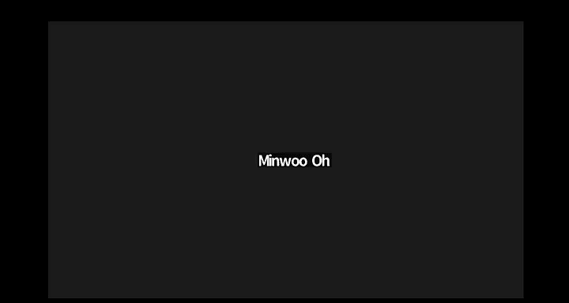
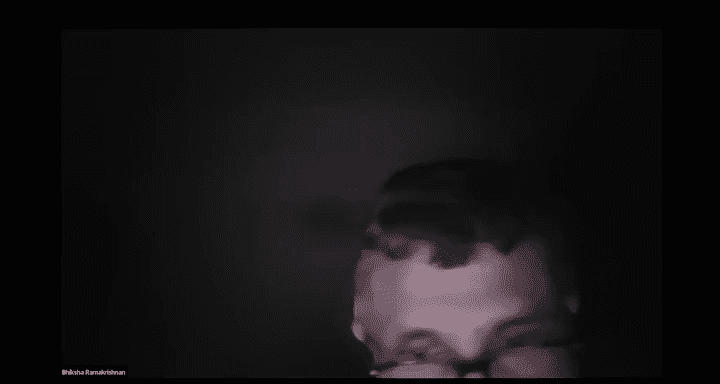
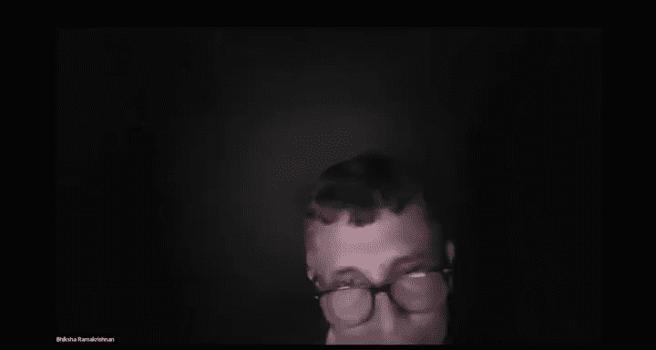
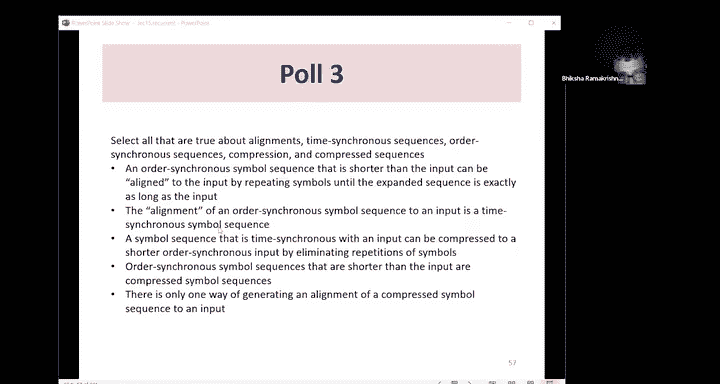
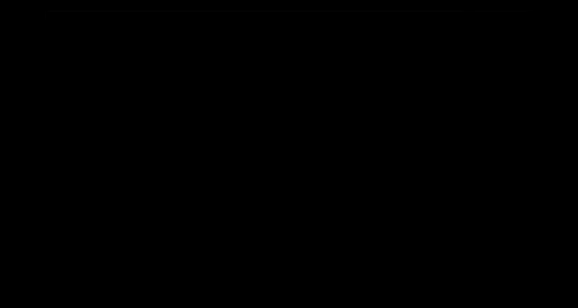
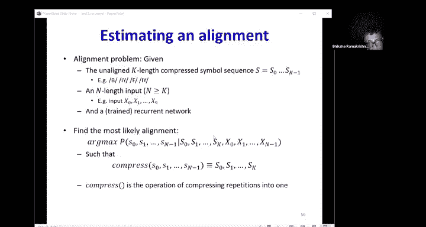
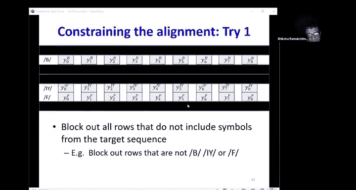
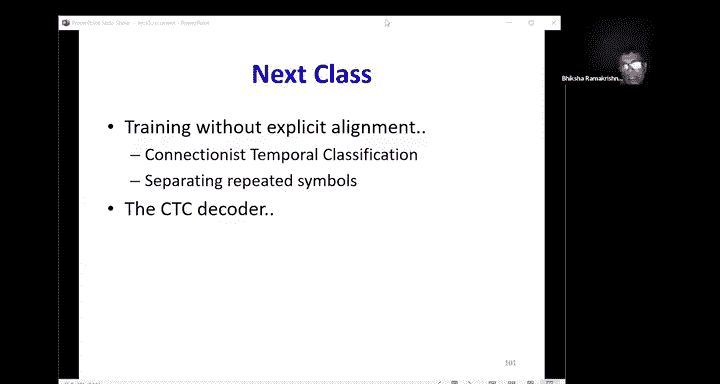

# CMU《深度学习导论｜CMU 11785 introduction to deep learning Fall 2024》中英字幕（deepseek - P16：Fall 2024 - Lec 15.zh_en - GPT中英字幕课程资源 - BV1CfsReEEw8

啊 the。We're going to。Move， we're going to continue the second half of the。Course。

In the upcoming lectures we are going to be covering the rest of recurrent networks。

 we'll cover transformers and then get into generative models。

 we will have some guest lectures over the coming weeks and one particular guest lecture that we will have is on November 6 by Omar Ktab who's now going to be joining MIT as a professor as an assistant professor Omar finished his PhD from Stanford and did an amazing dissertation he was one of the hot candidates on the circuit earlier this year and we wanted him at MIT managed to get MIIS。

So he was also an ideal student and an ideal TA。His work is on large language models。

 and so Omar will be doing a guest lecture on large language models on November 6。

 so please be there。Because he's one of the best。He's a fantastic teacher。

 and he knows the setting he knows idea， so you're not going to get a better combination。

And he's world famous。 All right， so continuing on。

Here's where we were with recurrent neural network so far。 We saw that recurrent structures。

Are good at modeling time series。So a task like predicting the stock market or speech recognition or any of any similar task where you have to analyze a series of data。

And then come up with some conclusions you want recordcur structures like record neural networks。

But these models are trained by minimizing the divergence between the sequence of outputs that they produce and the sequence of desired outputs。

And so the actual divergence that you define is between two sequences。

We compute gradients of this divergence and we'd betrain the network through gradient descent and back propagation。

So the main challenge over here is how do you define this divergence again these are time or series analysis tasks。

 so one such task might be machine translation。Now， when the network produces some output。

The output may not be related in any manner with that desired output may have a different number of words in the different order。

 and then you have to somehow define a divergence between the two and this divergence must be differentiable and this differentiable divergence must then be used to guide the update of the network parameters。

 So how do we define this divergence and how do we perform the training。

This is the task that we are going to consider over the next four lectures。

The challenge here is defining the divergence because the inputs and outputs may not be aligned or even synchronous so before we get into that。

 let's just look at the kinds of tasks we can perform with a recurren neural network。

I got some pictures from Andre Carpathith's old page。

 So here are different kinds of task you can perform。

 This figure to the left is just a simple network where the input goes to a hidden layer。

 which goes to the output。 This is just a regular MP。 There's no re。

The kind of networks that we saw earlier。And in earlier lectures where the kind was the kind that we saw that weve got seen in the figure to the right。

You have a sequence of inputs。Each input is used to compute a hidden state which is computed not just from the input。

 but also the hidden state at the previous time， and the hidden state is used to compute the output so you have as many outputs as you have inputs。

This is。😊，Time synchronous， the outputs are synchronous with the input This is the kind of network you might use if you want to do part of speech tagging of of text or if you want to predict this stock market on a daily basis。

But then we can have other kinds of networks。Like this figure to the left。

 where you analyze the entire input。 and when once the entire input has been analyzed。

You produce an output， so this you would use， for example。

 if you were performing speech recognition or if you were performing sentiment analysis of text。

And this figure to the right is a little more interesting。Here。The output is a sequence。

 it's not just a single output like the figure to the left。

But the sequence of outputs over here also differs from the sequence of outputs that we saw earlier in this figure。

And the difference is that。The outputs are now you don't have one output per input。

 The outputs are intermittent， so the output is as order synchronousity with the input meaning this portion of the input corresponds to this output。

 this portion of the input corresponds to this output。

 this portion of the input corresponds to this output。 So if you permuted the inputs over here。

 the output would also change their order， So the order of the outputs is related to the order of inputs。

 but there is no time synchronicity。Meaning the number of outputs is not。啊啊。

The same as the number of inputs and moreover the spacing between the outputs can be arbitrary。

 so do you guys understand what I mean by order synchronous but not time synchronous from this figure。

Yes， no guys。 Can you just answer with， yes。不事。So this we're going to see。

 this is what we're going to be focusing on。And the next couple of lectures。

 And then it can have other kinds of。Models like this figure to the left。

This figure to the left is one where the entire input is analyzed。

And then the entire output is generated。 So again， there's no one to one correspondence between the input and the output。

The entire input must be consumed before the output is generated。 This is what you would use。

 for example， If you are performing machine translation。 you must analyze the entire input sequence。

 say a sentence in English， and then generate the entire output。

 which could be a sentence in say French。 And unless you'll analyze the entire input。

 you really don't know what to produce， because the very last word in the input would change the entire meaning of the sentence。

 So this is a many to many model。And then this model to the right。

Is one where a single input generates an entire sequence of outputs， so this you could use。

 for example， if you were captioning an image， the image would feed in a single input and output come the entire caption。

So these are all the different kinds of analyses。So Isaac。

 for the live translation you would still be using in live translation thinks you you get some engineering。

 but until sentences are complete， you really cannot say what the sentence is， for example。

 in German， the word comes at the very end so you don't know if the guy wants to kiss the other person or punch the other person till the sentence is complete。

 you obviously cannot begin translating before the last word is in。So。You cannot actually do。

You cannot。To performerform the translation in real time， you have to wait for chance。Anyway。

 continuing on。So let's see how we're going to look at these。These four models。

And today and today and in the next class。 So let's start with the conventional MP this。

We know how to use it a single input produces a single output。

But it can also be used to analyze a time series。And the way you would do it is that every single input in the time series would be independently analyzed by the MP to produce an output。

And so what this means is that the analysis at time T。

Has no relationship to the analysis at any other time， because each input is independently processed。

Nevertheless， you can still use this to analyze time series。 And in this case。

 the way you would actually factor in the the fact that the input is a time series is through the divergence。

 the sequence of outputs。😊，Is going to be compared to a sequence of desired outputs。

 and so now the divergence over here。Would be a divergence between two sequences and that divergence would be used to train the model。

 So although the model itself is just a straight up MLP。

The fact that the model is being used to model time series is somehow brought in through the divergence。

 it's not a great model for time series， but you can use an MLP to analyze time series in this model。

Even in this setting， a common setting is to say that there is some kind of a one to one correspond。

re output and the actual outputs that simplifies the definition of the divergence。

When we have a setting of this kind。This is what we do。

 We define the divergence between the sequence of outputs and the desired sequence of outputs。

And this divergence must be differentiable with respect to the outputs at every single time。

 This is going to be necessary。 So you need to be able to compute the derivative of the divergence with respect to each output Y T。

 namely with respect to each of these outputs。This is essential and once you can compute this derivative。

Then you can perform back propag and once again， when you assume a one to one correspondence between the output and input the output sequence and the input sequence。

 meaning every output in the actual output sorry the output sequence in the desired output sequence。

 so meaning that every output in the actual output has a corresponding term and the desired output。

Assuming this kind of a one to one correspondence。Gives you the ability to make one further assumption that the divergence between these two sequences can be viewed as the sum of the。

Local divergences at each time。And then computing the derivatives becomes smart。

So this is when we're using an MLP to analyze。Time series。 Did this make sense， questions。

Give me a yes or know if this makes sense to you。喂。Okay。so。Now， here is here。First， all。

Which people please。Can you guys see the ball。Five seconds slides on two3， four five。All right。

 let me end the poll。Here's what most of you thought。And。Let me ask you so this first question。

 true or false。はい。For some reason， every time I get a chat message on the chat box I get a little beat here。

 I hope this is not filtering through over Zoom okay， the second question true or false。哦 so right。

Conventional conventional MLs can be used to model sequences when we use them to model sequences。

 the sequence nature is captured through the divergs， right？So great。

Now let's look at the second model where you have time synchronous outputs corresponding to every input there's an output but the model is actually recordcurren。

 so this is what you might use for example in predicting stock market on a daily basis or performing art of speech tagging。

In text， so every word， the input would be the sequence of words and every word as a part of speech tag and the specific。

Tag for any word depends on every all the other words in in the sentence。

 So whether this word yellow is a verb or a noun depends on how it is used。

 So you'd have to look at everything else。 So it's a recurrent model。

 and there's an output corresponding to each input。So here again。

 you can have a one sided network where you process the input left to right。

And produce one output after each input， or you could have a two sided model where you process the input both forward and backward。

And generate and output each time in all cases。Regardless of the nature of the network。

 there's one output corresponding to every input。And this is the key piece。

 the fact that there's one output corresponding to every input that's what we are focusing on。

My illustrations will show one sided network， but pretty much everything that we are talking about here also applies to two sided networks。

So， here。Here's how you train the model， you'd be given a sequence of input and output pairs。

 desired output pair so the input would be a sequence。

There is going to be a corresponding sequence of outputs by the network。

 You would compare it to the desired output sequence and then define a divergence so the divergence is between this sequence and the desired output sequence and as the first this is what you'd use to train the model。

So as the first step of back propagation you need。The derivative of this divergence with respect to。

Each of these outputs。 and so the assumption is that this divergence is differentiable。

With respect to each of these outputs。Once we can compute those derivatives。

 then you can back propagate them to train the network。And so again。Once you do that。

 then the back propagation rules are just as before。Now， again。

 because you're computing a divergence between two sequences， this can become challenging。

And so one common assumption is to again， assume a one to one correspondence between the desired output sequence and the actual output sequence。

 And further， we will assume that the divergence between these two sequences can be viewed as the sum of the divergences and the individual times。

Once you make that assumption， then the sequence divergence becomes just the sum of the divergences at individual times。

 So the derivative of the sequence divergence with respect to any given output is simply going to be the derivative of the local divergence with respect to the local output。

 and this can be back propagated I this making sense。对。Is two of you。 What about the rest of you。

 Okay， and so this is actually a very easy。Moel to deal with if you have this kind of for divergence where you have one to one correspondence and the divergence can be decomposed into the sum of local divergences and so much of what we do when we train the model。

Is to take， you know， the actual divergence that you will be given may not have this form and say we are going to twist ourselves into knots and trying to to somehow modify that divergence into this form。

 where the divergence can be viewed as as a sum of local divergences， which can be differentiated。

 And then once we bring it down to this form， we know how to train the model。 again。

 we'll be seeing more of this and the coming lectures。 So here is our。Second point。

Can you guys see the poll？So Marian， what was the question again， why does it not have any sun？Yeah。

 the the divergence derivatives So because。So the derivative of the divergence with respect to the output at any time。

Is going because the divergence is the sum of many local divergences。

Then the subsequent subsequent divergences have no direct dependence on this YT， right？Yeah。

 but the left side is like white target for from time one to time T， which become equal to just。

Which become equal to just one time at the if I don't make mistakes so let me answer this one as the poll is up done。

 we have five seconds for the poll。Until let me stop the poll guys。Here's what you all thought。

Let me go back and。Qust。Which of these statements are true？So is the first statement true？Second one。

Take in one now， right？And the third one， true or false。Perfect， right。

 and so to answer your question， Mariaio Pierre。The sequence divergence is the sum of all of these divergences。

 You got that。Yes， yes， okay， then when I get a plus b plus C right and I take the derivative so this is just a function of this guy。

This divergence is just a function of this guy， this divergence is just a function of this guy。

 right？그。Yeah。So that's that's why that's why it's only this term but I think I want complete the derivative of the divergence with respect to this Yeah I got the yeah notation。

 thank you。Right， okay， so let's count it， right， so now。So having defined the。

 so we've we've looked at these two models so far。 Now let's go and look at our third model。

 which is the guy here where you analyze an entire sequence and produce a single or single output。

 Like you look at the entire sentence and say， a， this is about the Steelers， right。

So on in question answering， you just look at the entire text and you say， you know。

 this is what is the color of the sky， blue， red， green， right？Something of that kind， so here again。

Our speech recognition， you have a sequence of inputs and you have to decide the funding。

Our sentiment analysis， you name it。Now。Here again。The way their model would be trained。

 you're going to be giving sequences of inputs and the single output that you are expecting at the end of the sequence of inputs。

So when you train the model so over here， once again， an inference at inference time。

 the same thing is going to be performed。You analyze the entire sequence。

 and once the entire sequence has been analyzed， you are going to produce a single output。

But what happens at other times， Can anybody tell me。We are looking at the output of the final input。

 but what about the other times？Knowing what we know about recordcur networks。

 are there any outputs over here or not？Yeah。So here's what is happening， right。

 and output is still produced。 We are just ignoring it。As you guys pointed out， right？

We just look at the opera at the final time。So now， when I trained the model。

At the end of the input at Tnet， the model produces some output。 I have a desired output。

 a compute divergence between the two。And this divergence can be the derivative of this divergence can be back propagated。

But in doing this， Im missing something and ignoring something that I could potentially use。

 what is that？Anybody want to guess？What could I。The hidden states。Here's what's happening。

These divergences of the desired are these， these ignored outputs， right。We are ignoring those。

 but say I performing speech recognition， right？If its if the input sequence represents the phoning R at the final input。

Then are the previous input too， it's reasonable for us to assume that it continues to represent R。

 right？And so I could just say， you know what， I'm going to replicate this guy at each of these times。

 And this is the divergence I'm going to use。 And what have we done over here。

 we've converted disiler timeynchronous version all over again。 Now， specifically。

 you can think of it as the weighted sum of these guys。😊。

And the reason we're looking at the weighted sum is that how you use this is going to be problem specific。

For speech recognition， if I'm recognizing speech， then if the input represents the phoning a over here。

 it also represents the phonening a here and here， and so I'm going to just sum these three guyss。

On the other hand， if I'm performing something like sentiment analysis。

 then the sentiment is really not apparent at these times。

 So the weights over here are probably better of being 0。 So a generalized setting is to say。

 I'm going to take a weighted sum of。I'm going to assume outputs at all times。

 I'm going to compute derivatives at all the divergences at all times and I'm going to take a weighted sum of all of these guys and the setting of the weights is going to depend on the problem。

This makes sense。Yeah。Yes色 not。What about the rest of you guys okay guys give me a thumbs up so that I can see 25 thumbs up out of the even 190 attendees and I know that some fraction of the students are paying attention okay thank you。

So this model has been dealt with。Now let's look at this model。This model is order synchronous。

 but time asynchronous。 But in reality， this model is just many copies of this guy， right。😊。

So Christina over here， I would give a weight of 0 to these guys in some problems and not in others。

 For example， if it is sentiment analysis， or if I'm in answering this question。

 answering color of sky， till I get to sky， theres now have no business saying blue， right？

 So in this case， I probably don't want to be considering these things。 So speech recognition。

 If it's all over here， it continues to be I in these cases， too。

 So here I just said a weight of one。You got to answer your question， Prey。喂 ok 。

And this is what we're going to be？Okay， well we're going to get to that right。

 so now this is the problem you're looking at。But this problem this problem really is just many copies of this network except they're attached to one another。

 so you can think of this as this block， but another block of the same kind and another block of the same kind。

 so here I have a sequence of inputs。And I have to recognize that this represents the po sequence。

 but。And so given the sequence of inputs， their inferences M must produce by and。

In an order synchronous but time asynchronous manner。Now。

 this seems to be a very simple extension of this guy。

 but it causes a complication Can someone tell me what that complication might be？Anyybody。😊。

What could this complication be？Anyone。A back propag。The model needs to know， right。

 How do we know when to output symbols。 The model is producing outputs at every time。

 and we have no way of knowing which outputs to consider。That's a challenge， right， so。

How do we deal with this？诶。Well， no you're going to see this。

 right that's why we're spending time on this。 So how do we deal with this first？

To see how we deal with this， we have to consider that at each time the network actually outputs a probability vector。

 so if you have a vocabulary of possible outputs like if you're performing speech recognition。

 you'd have a set of phonemes， you're going to be computing the probability of each phoneme。

 a probability vector over the phonemes at each time。And so specifically， at any time。

 this probability vector is going to giving you the probability of the different phonemes。

 given the entire input sequence。 If it's a one sided model is giving you the probability of all of these phonemes。

 given all the input until here。😊，If it's a two sided model。

 it's giving you the probability of all of these phonemes at time four。Given the entire input。

 So that's what each of these vectors is， the probability。

 this vector is the probability that the fourth。Bector。Belongs to these phonemes， different phonemes。

Given the entire input sequence you're considering and computing the probabilities for just the fourth vector that's what this vector is you're going to have one such vector at each time。

 did this make sense。miss favor。三。Give me the thumbs up guys those I have those helpmate， right。

 Okay， let's see。I see to five times up of seven times okay， so now。Again。

 any network with a softmax output is actually perform while outputting an estimate of the a postteiary probability of the classes given the input and so at any time you're computing the probabilities of all of these phonemes given the entire input right？

And when we perform classification， you typically just pick the class with the highest probability。

 and that's basically the same principle we're going to use here。Except。

Here's what we want to do when I'm performing recognition I'm generating when I'm performing the sequence generating this output sequence。

 I'm generating an output sequence。But the number of symbols in the output sequence is lesser。

 or at least not more than the number of symbols in that input。And so I'm going to。

 I'm trying to find。The output sequence， whose length， I don't know。

All I know is that it's lesser than n or at attmost n。

 and I'm going to try to find the output sequence， which has the highest probability。

Given the entire input sequence， is this making sense？This statement here。

Because everything else depends on this。Yes， no guys， guess we science。Okay。

 guys give me the thumbs up right， so here actor。I'm given the input sequence and I want to find the output sequence。

 right？I don't know how long the output sequence is I could give you， for example。

 in speech recognition， a sequence of 100 vectors representing one second。

 but the output could be a sequence of just four phonemes。Right。😊。

And so I want to find the output sequence that is most probable given the input sequence。

Except I don't know how long they output put sequences， that makes sense。That that make sense to you。

Okay， so。啊。Well， hang there with me Hector， so how can I do this？I can do something trivial。

 I can just pick the most likely symbol at each time like so， right？

And then this is greedy legally right， so I can just the most likely symbol at each time。And then。

 I know that the output is。Sequence is short， so I can just merge all the intermediate guys and say all of this。

And when output a G， when the sequence of Gs ends。F when the sequence of F sends and so on， right？闹。

And then I'm going to get four outputs。What could be a problem with this？Anybody。😊。

What could be a problem with this？Right， you cannot distinguish between two as。

And a single and a single app。This distinction vanishes。

Exactly right so you have a problem and so the resulting sequences could also be meaningless now it can marked improve on this by imposing external constraints on what sequences are allowed。

So you could allow only sequences corresponding to dictionary words for instance。

 or you could use special separating symbols to separate repetitions we will see this in the next class。

 but in any case。This sum， we have some semblance of an idea of how to generate output sequences given the input。

 I'm going to refer to the process of obtaining an output from the network as decoding。We'll select。

 right？Now， this is， in fact， a subopmal decode， which just finds the most likely time synchronous output sequences and producing one output at every time。

And so the output is time synchronous and I'm picking the most likely time synchronous sequence。

 which is not necessarily the most likely order synchronous but time asynchronous sequence and we'll say why this is the case。

 okay， but anyway。We've sort of partially addressed how to perform influence。

 we're going to see more of this in the next class。The more interesting question is training。

 how do I train？Now， let's say in my training data， I'm going to be given。

An input sequence and an output sequence but。So for example。

 I might be given the sequence of 10 vectors and be informed that the output sequence represents the phones bur and the。

But I'm also given information about where the bur occurs。

 where the U occurs and where the term occurs。If this information is given。

Then training is simple and this business of telling me where I must output the B。

 where I must output the where I must output the term， this is what we call alignment。

 we are aligning the sequence of three outputs with the input。

Now if I have a sequence of three outputs it can be aligned against the input in many different ways。

 so for example if have these 10 inputs but could be aligned like so with bur coming at time x3 or at x7 and t at x9 or like this be at x1 or at x6 T at x9 right the only constraint is that t always of course at x9。

And so。Simply knowing what the sequence of characters is doesn't tell me the alignment。

Because I have many alignments for they for the same sequence of comps。So。

If I have information about the specific alignment， If I'm told， for example。

 that the output is B R and T and bur comes at 2， Er comes at 5 and T， T comes at 9。Or B comes at。

 you know， two comes at six and tail comes at nine。 Then it's easy。 All I have to do is to。

Compute the divergence as are these three cases。And the sum of these three divergences is what I'm going to be minimizing。

 But in doing this。Is losing something important， what am I losing again？If I do this。

What would I be losing guys？These things right so all I can do is what I can do is to repeat each symbol and over all of the input sequence until the previous。

Sible。And so now this is how I compute the divergence。

And the total divergence is going to be the sum of all the local divergences。

 and that's what I would。I would minimize and of course。

 if I'm using the kale divergence or the cross entropy。

 then we know that the divergence between the desired output and the actual output is simply the negative of the log of the probability assigned to the desired output at that time by the network This we know from our previous work。

And so this。Gabvagen is simply the sum over time。Of the ne negative of the log probabilities assigned。

To the target symbol at each time。Is this making sense？Yes什 not。Some comes guys。

 I yesterday to say I only see too。Maybe 10 would be nice。ok， thank you。So the problem is。

That when you actually provide。Data for speech recognition。

All you're going to give is the output sequence， you're going to say， here's a recording。

And this recording corresponds to the phome sequence or butt。

I'm not going to tell you where the bur occurs， where the bur occurs， or where the term occurs。

In this case， how do I compute the dirgence， clearly I'm missing information， right。So。

This is the problem of training without alignment。We know how to train if the alignment is provided。

 The problem is the alignment is not provided。So we have a couple of solutions。

One solution is I'm going to guess the alignment I might to somehow look at this on the input and try to figure out where the and term has been placed。

😊，The alternative is say， I have no idea how this must be aligned。

 there are many different ways of aligning it I'm going to consider them on。

And so both of these also， we will discuss both of these。So here let's consider the first solution。

 guessing the alignment。Here， here's what we are connected to do。So we can， Buranno。

 it's actually not。So here's what we're going to do。I have。In this case。

 I've changed my example from butt to beefy。And this is an example I don't seem to be escaping from I've had it for many years。

 but yeah， so let's say my input is。Being， right。The symbol sequence。

 then I'm going to guess just quite arbitrarily。And the first bird really must come at one。

The E must come at four。The firm must come at eight and the next second E must come at nine。

 this is just a completely arbitrarily， arbitrarily assigned alignment。

But once I have an alignment of the kind， I know how to claim the model。And so I can train the model。

 But once I've trained the model， I can use the trained model to go back and reest this alignment and come up with a better alignment。

😊，And I can use the improved alignment， too。Go back and retrain the model。Is that making sense？

This process。Can I see some thumbs up if I got out of you guys。So Elvin， here。Here's the thing。

 right？Im not given where these symbols occurred。So I can just take an initial guess and say B must occur at1。

 E at4，5，8 and e at  nine。Completely arbitrary， that just my initial book。And then， I can。

We应 get do that。The Loier， all right so。This once I come up with this completely arbitrary assignment。

 I can train the model， right Elvin？Yes， Emma。But then if I train the model。

 I can use that model to go back and refine refine the alignment， correct？Yeah。没信号。And那 then I can。

Use O Hector。 Here is what we're going to do， right。This is what we're going to look at。

 How do you reest the alignment。I'm assuming that you understand that given an alignment。

 you can train the model， so we will focus on this， okay。Now， again， what is an alignment。

 and alignment is placing these symbols against time。

And so it basically tells you which portion of the input。Corresponds to each of the output symbol。

 So here， for example， I again going back to my butt example， this portion corresponds to B。

 this to ur and this to top。Here's a different alignment， right。

 so there are many different ways of aligning the same sequence to the input。

And in the case of each alignment using this trick that we performed here where we just replicate the symbols and the empty space before it。

I can do the same here and which is basically by。Duplicating each symbol in the strip before it。

And so these are all different alignments of the same。ASy sequence to the input。

 is this making sense？How I can get different alignments of the same input， same sequence to input。

Right can you give me some thumbs up guys？Right。Yeah， so I see five thumbs ups can I see 15 at least？

6， are you paying attention10125 all right thank you right， so here's what I'm going to do。

When I replicate the symbol into the space。The resulting sequence is time synchronous。

 Do you see that。in the process by replicating each symbol into the blank before it。

I have now created a sequence where there's a one to one correspondence between the inputs and the desired outputs。

 So now the target sequence is as long as the。Input sequence with perfect correspondence。Is that。

Do you see that？没有。And so this。Here， the original sequence was three long。

But once I align it and then I replicate things， I'm going to get a time time aligned sequence。

 which is10 lock， So I'm going to call this time aligned sequence which represents actually represents an alignment of the symbol sequence to the input as an expansion。

Of the symbol sequence。So this guy。Is an expansion of this code。

Is this making sense what I'm calling an expansion？Sorry。Can you give me the some comes up， guys？

4our。Be nice。 Okay，15。No， it's only 130，195 all right， okay， and conversely。

 if somebody gave me a sequence of symbols of this kind by eliminating repetitions I'd end up with something of this kind。

So this I'm going to call a compression of this one。Did that make sense？An expansion is。

Expanding this to be time synchronous by repetition。

 a compression is removing this the repetitions to give you this Red sequence so expansions and compressions and so the same asynchronous compressed sequence can be expanded in many different ways。

 as you can see。And conversely， many different ex alignments。Can compress to the same secrets。

Do you agree with the statement， these two statements。没。

Those of you giving me thumbs I'll be a little more active if I see only four them。Dis courageage。

 so can I have 1。Okay， right， so now our problem is this， I'm just given this card。

And given this guy of all the possible alignments， I must find the most probable。 That's what I mean。

 when I say I'm refining the alignment。 and given the compressed sequence。😊。

I know the compress sequence can be aligned against the input in many different ways。

 I want to find the most probable one。 So here's the alignment problem。

 You're given a K length compress sequence， like this B P over here。It has S0 through s k minus1。

 and you have an n length input sequence where n is going to be greater than or equal to k because we are looking at order synchronous outputs right so the outputs can be the number of inputs has to be equal to or greater than the number of outputs。

And now。If I give you， when I'm trying to give you an alignment， I'm going。

Sorry， guys， we are having a thunderstorm and the powers out。 So I am w。

Working off my phone now。

So where did I start？Did you get this we？'s okay。And so again。

probablybably lose a little bit of time I'll try to hurry up。But because of this now。

 so here's the problem。We want you're given the input x0 through x in x and minus1， these guys。

 you're also given the symbol sequence you're told that this is but for example。

And we want to find this expanded sequence and there are many different expanded sequence corresponding to any given input sequence right。

 so we want to find the expanded sequence， which is time aligned， which is most probable。

Given the compressed sequence and the input。So this is the problem that we want to。

 so we want to define the symbol sequence time synchronous symbol sequence。

That is most probable given there。Compressed sequence。And the input。Is this problem making sense？

Yeah。哎。诶有咩 talk。So can I get 10？Thank you。Right。So here is a poll。And like Middle East。吹。

Can you see the pole。8。You should be able to see it now。ok。Yeah。帮忙。

The city is dark with a complete power out。Yeah。Im in India。没有。嗯。嗯。对。因系。Rrains for the past week。

All right， five seconds， guys。Ining attention。We are we check the poll responses just to be sure。

 right and so。

嗯嗯嗯嗯。is。Getting to be a， I'm not sure what happened with the poll I is to ask you。First statement。

Allright。Thank you guys with is auto muts all right here's the sequence of answers right an auto synchronous simple sequences that is shorter than the input can be aligned to the input by repeating symbols until the expanded sequence is exactly as long as the input。

😊，You agree with this yes or no just give me a thumbs up I'm running out of time so please。

Be a brown， right。The alignment。Often auto synchronous symbol sequence is a time symbol synchronous sequence。

 synchronous symbol sequence。Yes， so， right？You agree with this？The second statement。Right。

And what about the third one， the symbol sequence that is time synchronous with an output can be compressed。

To a shorter order synchronous input by eliminating reputations through her fault。True， right。诶。

So order synchronous symbol sequences that are shorter than the input are compressed symbol sequence。

 and the last statement is there only one way of generating an alignment of a compress symbol sequence to an input。

Yes or no， box， right， clearly。So。So here's our problem again。

 we want to find the alignment given the compress sequence and the input。

And again。At each time， so here is the input， let's say I'm trying to align。

 say the symbol sequence B fee to this。I've got the inputs and at each time the network is going to produce a Pro sequence of。

A vector of output probabilities。So a cheap thing for me to do would be to just say I'm going to pick the most likely symbolette each time。

And let's say I really want to be generating the symbol sequence being feet。

If I just pick the most likely symbol at each time。Will this be an alignment of beefing。Yes or no。

What do I think。No， right， why not。Why not。Somebody tell me why not， right。Anyone。

This R is not even B， right， So you want the first portion to be B， the second to be E。

 the third to be for。 So you're going to have phoneme here。That are not in this symbol sequence。

 correct？Yes or no。Right， so。HowHow do you resolve this？Any suggestions？How would you resolve this？

How about I block out all the。Or names that are not in my symbol sequence。

I know the symbol sequence is by， so it only has bur E and for。

 so I just block out all the rows of the table that don't have these phonenis， correct？And。

So this is the same as saying I'm going to be pulling out the E and4 rows and making a separate table on the top and I'm going to be working just off this table。

Now I am guaranteed that every symbol I produce is part of my target sequence。In this table。

If I just decode on this or and on this reduce grid。

We are assured that only the appropriate symbols will be hypothesized。

But now if I just go ahead and just pull the most likely symbol at each time from this radio table。

 is this going to be an alignment of beefy？Yes色龙。Why not。Why not。

They may not be in the correct order， right， so this is beef birth B。Wrong order， right。

 So we want to this it doesn't assure that the decocode sequence correctly expands the target simple sequence It's in the wrong order。

 You need additional constraints。So here's what I'm going to do。

I know the symbol sequence I want is beefy。So I'm going to copy the burrow of this table over on top。

The E， second。The furrow third。And E again a second time。 So E has occurred twice。

 So it's actually occurring twice in this table， right？So Adam。

 I'm assuming that this is training data， so I'm trying to align Bfi Bfi has been given to me。Right。

So is this the construction of the table making sense？Over him。Give me a thumbs up guys。

 everything works off the table。So I'll wait for 15 thumb up， please。1134。 okay， thank you。

And so now here's what I will do。This table， I'm going to work off this reduced table。

And I'm going to find a path through the table the way I will find a path and start at the top left corner。

And I'll keep travelling through the table。 But the rules I will apply is that from any node。

 I can every any cell。 I can either walk。One step directly， right。Or one step。

Down sideway So it is right and down。 So the only kinds of。

Movements allowed are horizontal or diagonally down one step。And I want the final。

End of the path to be in this node。If I consider parts of this kind。

Then observe that it's going to start with。Repetitions of B， repetitions of E。

 repetitions of fur and repetitions of E。 every single part。

 which follows this rule as these rules are is going to be a。

Composed ofition repetitions of B E for and E in that order。

 and so it's going to be an alignment of B fee to the input do you see this？嗯。Yes or not。

Give it thumbs up， guys， I want to see 15 of those please。十班。Thank you。

And so this guarantees that now。If I just find paths through this。

I can draw this constraint in this manner by making it a graph。From each cell。

 I'm going to draw an arrow either sideways or one cell down。

 because these are the only kinds of movements allowed when I find a path through the stable。

 And so this collection of edges。Composes a graph。 and any path through this graph from the top left to the bottom right is guaranteed to be an alignment of beefy to the input。

Do you see this？一三六。Yeah。嗯。Okay。So exactly， if a phony occurs twice。

 you're going to have the row repeating twice， otherwise you don't get the structure， right？

And now the problem is of all the paths。 I want to find the path that is most probable because I want to find the most likely alignment。

But then what is the probability of a path？I'm going to assign a now these are all probability values right I just copied a row of probability values that the network had outputed to。

Compose this table。 So these were probabilities。 I just， so this table is a table of probabilities。

 which means that every cell here has a probability assigned to it。

I'm going to assign a probability of one to each edge。 So if I take any partial path through this。

 the probability of this path is simply going to be the product of the probabilities of the cells in the path。

Is this making sense？So this one is going to be， you know it's y0 b is the probability assigned to the symbol B at times zero by the network y1 b is the probability assigned to the symbol B at times 1 y2 E is the probability assigned at time 2 to the symbol E and so on。

 and so the probability of the sequence is going to be y0b times y1 b times y2 e times y3 e times y4。

If。So。The path。With the highest score give the we'll give the order。

 the problem is you'd have to compute this path score for every path through this graph， right？

But then in the wolf's case， the number of such paths is going to be exponential。

And we want to find the path with the highest probability。So how do we do this， any suggestions？

Those here with。Basically， you're going to use dynamic programming， right。

 not beam just simple dynamic programming。So here's what we're going to be doing exactly。

I want to find the most probable path from Sorsto。Sink。

 and I'm going to use a dynamic programming algorithm like the Viby algorithm。And so。

And this algorithm is based on a very simple principle， very， very simple principle。

Here's what it is， right， consider。The best path from this node。

 which is y0 B to this node and red y3 f。Now， this y3 F node has only two arrows。

Only two arrows coming in。 So it has two parents。 A parent to node is any node from which there's an arrow to that node。

 So this node has only two parents， right。Which means that the best path to this note。

Must go through one of the two parents。Was that making sense？

The best path to this this node is either going to go through this node or through this node。

Give me some thumbs ups， guys， please。I see three of them。Just be a little more proactive。Okay， so。

How do I find the best bat。Now， assuming that I have the best path scores to all of the nodes out here。

 right？Then there's going to be a best path score to this guy and a best path score to this guy。

 So the best path node to this path， this node is either going to be an extension of the best path to this node or an extension of the best path to this node。

 It cannot be an extension of the second best path。 Because the second best path is already lost。

 right？ So it's either going to be an extension of the best path node to this。😊，hy do you。

Ad an extension of the best fat。To y to F。So how do I decide？Right here。

 I can look at both parents and say， what is the best path score to this node？

What is the best path score to this node？And I know that if this guy's best fat score is lower than this guy's best fat score。

 then extending this one is going to result in a higher overall probability than extending this one。

That makes sense。Can you give me some thumb ups， guys？Yeah。So啊。Okay。

 and this is basically what we're going to be doing。So the best path from y0 B to y3F。

Is either an extension of the best path from y0 b to y2 e by y3f？

Or an extension of the best path from y 0 B to y2 f by y 3 f。Al。

 I can say the best path from y0 b to y3F。Is going to be the best path from wise he be to the best parent of these two。

Extended by y3F。And the best parent is simply going to be the parent， which has the highest。

Best paths go to that note。So is this entire algorithm making sense？And draw show this pictorially。

 right， Bham。Okay， so here's what we're going to do。

I'm going to be dynamically tracking the best path and the score of the best path from the source node to every node in the graph。

😊，At each note， I'm going to keep track of the best incoming parent edge。And the score of the。

Best fat from the source。To the node through this parentage so and then eventually I'm going to compute the best bathroom source to sync that's a lot of words words but let's let's look at it。

 you know。啊。Your pictures。First some not。I' have already introduced this notation y0 superscript B。

 so that is the subscript is time。The superscript is the symbol， right。

 So y subscript T superscript S of R is simply the probability assigned to the symbol and the R through here。

 the third row is for， right。At time T， so。This is just y34 is going to be the probability assigned at time three for this symbol4。

Just this notation， okay， is this notation here。It's got to be straightforward， nothing fancy。

 right let me just continue。And so。Now， consider the very first time， right， at the very first time。

 what is the best parent to this guy， Nothing as the first known， right。And these guys。

 so what is the probability of the best path from the source to this guy。

 it's simply the probability of the node itself。So the best path score。Do。Sybol0。I'm indexing0，1，2，3。

 right so the best path scored to symbol0 at times0 is simply y0 as0 as 0 being B。

And the best parent over here is going to be， not。But all the rest of these guys。

 we know that these cannot be the first node in the in the alignment。

 So the best path score to all of these guys。Is going to be zero。

 so is this initialization making sense？Comumbs ups。Please。Okay， and so then。

I can go to the next column。What I'm going to do is to go through time。

And then at each time I'm going to go down the row。And for each node。

 I'm going to find the best parent。And then once I find the best parent。

 I'm going to store the identity of the best parent。Then I'm going to compute。

 I'm going to pick up the best hat score to the best parent。

And multiplied by the probability of the current node itself to give me the best pass score to the current node。

This is basically what I'm going to be doing so here for example。You know。

 not all nodes will have the same number of parentsts， so here， for example。

 this drop node has only one parent。So if it has only one parent。

 then the best parent to this guy is this guy itself。Which is zero， right。

 so I'm just going to be saying stor the best pair to this one is nor zero。

And the best fat score to this guy is y 0 v times y 1 d。Does it make sense？Did this make sense？喂。

R of， just keep giving it thumbs up， please。I C6， can I get 10？And wait。Okay， so then。

This is from the top guy， but then I can now go to the second one here。This second one。

 so this highlighted blue arrow。Over here is telling me who the best parent is in my illustration。

Now I can go down to the second one， and the second one has two pairs。

I picked the parent with the highest probability， best path probability。

 Now the best bad probability for this guy is 0。 So the best path。

Probability the best parent is this one， so over here I'm going to store the index zero。

And the best path to this noded is going to be y 0 B times。Y1， y1 E。

 so I get both the best parent and the best fat score of both of these notes。That makes sense。

Or any questions，And these these guys， it doesn't matter。

 both parents are just have zero probabilities， so just matter to pop them out because they're irrelevant。

 okay？喂。I could just use the same logic， regardless of what you store here。

 Does't matter the best parts score to these nodes is going to be 0。Then I go to the next time。

 Once again， this node has only one parent。So the best parent is going to be this one here。

And the best path score here is going to be the best path score to this node。Times y to be。

And then the rest of the nodes。They each have two peros。For each note。

 I'm going to find out which parent had the highest best passport score。

And I'm going to store its index。And the best path to that node is going to be。

An extension of the path to the best parent and the score of the best path。To the node。

Is going to be the prob the best paths score to the best parent。Multiplied by the node probability。

 So basically， the best fat score to the best parent multiplied by the node probability。

 I can do this for every node in this column。That makes sense。

Is the overall logic here making sense to you guys？

So I'd like to see at least 25 thumb up over here because you're going to build on this。

So please continue。Indicating that you did get this site。And here。

 and then I've gone down this column， then having computed all the nodes best paths close to all the nodes here。

 I can go to the next column。And compute the best fast goes to all the nodes here。

Which means that for each one of these guys I'm going to find the best parent， store their index。

 and then compute the best path score to all of these。

So that's because you know that the best path must start from the top left corner。

So the probability that the best batch starts from these three guys is zero。That makes sense。

And each of these only has zero probability methods。And so now I can compute this。

The best parts and the best parts goes to all of these nodes， take a step forward。

 do this for these nodes and these nodes and these nodes and these nodes and these nodes。

And now the computation is very simple， right， because in the way I've done the algorithm for each one of these norms。

 I only compute the number of terms I evaluated or was equal to the number of parents。

And here the number of parents was two in the worst case。

 that's going to be the number of symbols on the。The number of rows on the table。

 so if I had K rows in the table。Then at each time for each of the K symbols Im performing k comparisons。

 so I get K squared computations， I do this n times。

 and so in K squared n computations I can compute this entire table。

And so that computation is very cheap， right？So this is external。

 these are just the probabilities assigned to the symbols by the node by the network that on， right？

And now。How do I find the best alignment？I know that the final note in the in the alignment must be the scar。

So this is already known。Now I can go back and say， what is its best parent？

Then I can go to the best parent to say what is its best parent， all of that is stored right。

 and I can loop my way backwards and when I loop my way backwards I'm going to find the best part。

This makes sense。Yes or not。And so I have found my most probable alignment。

Given the symbol sequence and the input。Beautiful， right？And now once I found this。

 the rest of that I'm going to demonstrate， so here's a point。Assuming I can。嗯。Yes this。

Can you guys see the poll？没。Okay，10 seconds。Oh mind missed on the point yeah。

This is what you guys thought。Whening back， okay。First statement to our false。Okay。Second one。

Rer false。Heard one tour falseox。right you're not doing something you're not just speaking the most pro symbol from each column on the table。

 so the first two are true。Wter the alignment finds the most probable alignment for a compressed。

Order synchronous sequence to an input。It's run on a table of probabilities constructed for the compressed sequence with one row for each symbol under the sequence。

Derived from the probability table generated from generated from the output of the recordcurren network。

So I have some pseudo code for it。basically。I just first create the output table and then just from the simple algorithm that I just showed you。

 you can check out the code on the slides and you can do this without explicitly creating a table flow direction。

Anyway， so here's where we are， right？Once the alignment is done， you're going to get thee。

Most likely， alignment。Given the symbol sequence and the input。

But that most likely alignment was computed based on probabilities that you obtained from the current model。

Right。😊，So it's dependent on the current model。And now this most likely alignment is to can now be used as your target symbol sequence。

 and then you can compute your divergence。And the divergence again。

 is simply going to be the sum of the divergences at the individual times。

Which as we saw is simply the negative of the sum over time of the lot probabilities assigned。

To the symbols and this target sequence。By the network。

And now if I compute the gradient of this divergence or the derivative of this divergence with respect to。

 so this is not really the gradient of it， it's the derivative。

But if I compute the derivative of this dimensionence with respect to the output of the network at time T。

Then that is simply the。Neick， you know， it's got a bunch of zeros and。

The only term that's active is going to be the term corresponding to the。

Time to the target sequence symbol at 10 and it's going to be minus1 over。

The probability assigned to this target symbol at time t by the network。

 this is just the standard derivative formula that we had earlier。

Observe that the derivative of the staravs at any time。

Is simply dependent only on the probability assigned to the target symbol at that time by the network。

And the target symbol itself is the symbol on the best。Is this making sense？夜稣咯。Yeah。ok。😊。

And so this is what people do。I'm going to initialize my alignments。

I'm going to train my models given my alignments。And use those alignments to use that model to realalign my data。

So what we know is that the new alignments are more probable than the。

Initialized initial alignments because we were always finding the most probable alignment。

But then once I get these alignments， when I go back and train the model。

 because the model itself is maximizing the likelihood of these alignments。

The new model is going to assign even greater probability to these assignments。

But then I can use this model and find newer alignments。

 and so each step of the loop is guaranteed to increase the overall probability assigned to the symbol sequence or alternate to decrease the negative log likelihood。

Of the symbol sequence。啊。As computed by the network。So is this process making sense。

 each of these is locally optimal， So you're just， you know， there are two things over here。

 the model and the alignment。We are fixing the model and finding the most likely alignment。

 we are fixing the alignment and finding the most likely model。

 So this loop is going to keep increasing the probability of the data， or alternately。

Decreasing the negative log likelihood of the data， this make sense。Give me some thumbs up， guys。

Can I get 25 of the thumbs ups， please？Have 21。2 to guys， I didn't get 25 thumbs up。

 I will wait can you give me 25 thumbs up splits。Okay， 25， thank you right。

 And so this is the overall training model approach where we guess the alignment you're given the symbol sequence。

You're going to use the symbol sequence to guess the alignment and then use the alignment to train the model again。

 and then you're going to guess the alignment and keep repeating the process process to that converges。

 So if you wanted to implement it。That's right Elbas right if you want to implement it you could do this either in batch mode where you just first realign your data。

 your entire training data， and then update your model。

 or you could perform the alignment and and update the model for each instance within a batch that that would be the SGD or mini batch version so there multiple ways of implementing this。

But then， as Elvisstius mentioned。This will really work and if you have enough data it's going to give you a very decent model。

 that's going to be efficient。St that， you know， the approach is very heavily dependent on the initial alignment that you guessed if you guessed it wrong。

Then your model is going to quickly go into a poor local minimum。So this is because at each step。

 you're guessing a unique alignment。Here isnt he has a different way of doing it。

We don't commit to an alignment during any pass。 We can， instead。

Just consider all possible alignments and this is what we call the CTC training framework。

And we're also going to look at and that we will cover in the next class。

 well also look at the issue of repetitions and how repetitions can be dealt with。

So that's the end of today's class。Fortunately over a time in spite of the interruptions。

 I have some time for a few questions。Was this clear。Did all of this make sense to you guys？

Any questions？If there are no questions， they will stop the recording。

