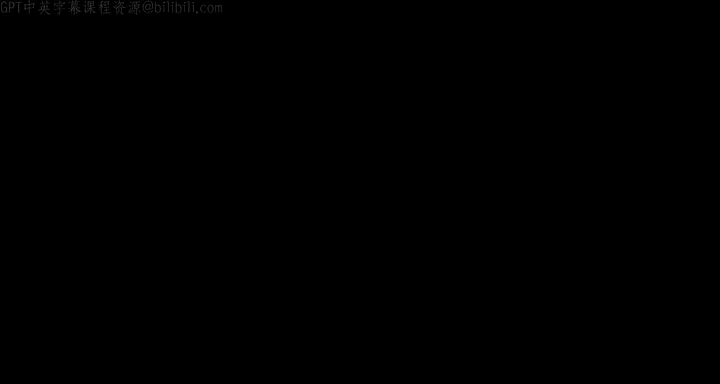
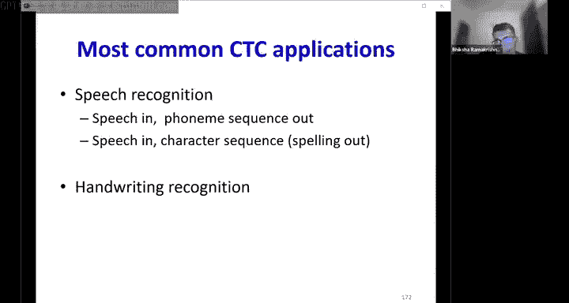

# CMU《深度学习导论｜CMU 11785 introduction to deep learning Fall 2024》中英字幕（deepseek - P17：Fall 2024 Lecture 16.zh_en - GPT中英字幕课程资源 - BV1CfsReEEw8

So hello all， can you hear me？Yes， we can。Okay。Let's start in two minutes。All right。Let us begun gun。

We're going to continue our sequence of lectures on record networks。

 specifically we're going to be for the next couple of lectures on sequence to sequence models。

And the particular form of model that we will be talking about is connectionist temporal classification。

 so what is sequence to sequence modeling？It's one where an input sequence goes in some X1 through Sn。

And a different sequence， y1 through I M comes out。For example， in speech recognition。

 speech goes in， a word sequence comes out， or in machine translation， one word sequence goes in。

 a different word sequence in a different language comes out or dialogue systems。

Where the user response goes in and the system response comes out。So in all of these。

The length of the input sequence need not be the length of the output sequence， in fact。

 there need not even be any notion of synchrony between the sequence of inputs that grow in and the sequence of。

啊。Of values that come out。So we've seen one example of this speech recognition here。

 a speed signal goes in。And the text comes out。 Now。

 this has a very specific ordering relationship between the input and the output here。

The output is order synchronous with the input but not time synchronous do you guys remember what I mean by that？

Order synchronous， but not time synchronous。Do you remember this？

RightSo for every section of the input there's a corresponding symbol in the output。

 if you change the if you permute the input， the output will get permitted in the same order。

In other cases like in machine translation there may be no notion of such synchrony if you're trying to translate English to German。

 I8 an apple goes in a Javan and upelegsison comes out and observe that you know I over here becomes H but8 becomes ha and Gaus and there's really no one to1 correspondence between the input and the output。

The specific form of sequence to sequence model that we've already seen in the last class is this one。

Where this order synchrony between the input and the output and that's what we'll close out the lecture on today so here the input and output sequences happen in the same order。

 so the output is order synchronous asynchronous in that the portion of the input that corresponds to this output is the portion immediately preceding it so the portion of the input that corresponds to this output would be this portion of the input and so on。

There is synchrony， but not time synchronic。So here the questions were how do we perform inference on such a model？

That is out output times in asynchronous sequences and then how do we train such models in this。

 the problem of influence is something that we partially interest。

 we will come back to it at the end of this lecture。

The more important problem is how do we train such models。And we started with this notion that if。

The training data included the input。And the output sequence。

 along with the alignment of the output sequence， does anybody remember what we meant by the alignment over here？

Anyone， do you remember what we meant by the alignment？Some活。But yes， no would do。

The so the alignment basically tells you which input。Time corresponds to each output time。

 the correspondence between the input and the output。If that were given。

 you'd be informed where each of these output symbols were generated。And you of course。

 you can replicate them in the gaps before them and then you can compute divergence。

Between these two sequences。And the way we define it now， the divergence between the target sequence。

And the actual output sequence is going to be the sum of the local cross entroies or KL divergences。

 which simply becomes the negation of the sum over time。Of the log likelihood。

 of the log probability of the target symbol at each time， now this is something。

He will just observe this， this we going to use this again and again， okay？

Now this comes out because we know that the cross entropy law。

 cross entropy loss is simply the negative of the log log probability of the target symbol。

 so we are summing key cross entropy losses。Now， if I take the derivative of those divergs with respect to each of the outputs。

Then what I'm really doing is taking the derivative of the sum of several。Gale divergences。

But then the overall divergence， if you look at the what component of the overall divergence depends on any specific YT。

 that's simply going to be the local divergence at that point。

And so although the divergence itself is the sum over time。Of all of these scaled divergences。

The derivative of the overall divergence with respect to any specific Yt is simply going to be the derivative of the local。

Proross entropy with respect to that yt， which is simply going to be the derivative of minus log。

Of the probability assigned to the target symbol。With respect to。

The probabilities assigned to all sampless by the network。

And since this loss only factors the target symbol。

The derivative of the loss with respect to the other symbols in the vocabulary is zero。

And the derivative has only one nonzero component corresponding to the target symbol and that's simply minus1 over the probability assigned to the target symbol again。

 this is nothing new we saw this at few lectures ago。So is this making sense everybody。

 is this clear， we're going to use it。Okay， easy。The problem was how do we deal with it when there is no alignment provided for the training data。

 so you're given the output sequence like Bfi。But not timing information， what do we do？

So we saw one example where we could try to guess the alignment。

And do so itritable so you initialize the alignments。

You train a model with the initial alignment and then using this strain model。

 you go back and realign。The training data using Vi realign。

 and then you can use the realigned the new alignments to go back and retrain your model and iterate this process。

 this is what we saw in the last class。We said this would work。

 but there was a problem with it and what was that problem， anyone remember？

What was the problem with this？Anybody？Oh。So。It's highly dependent on the initialization， but anyway。

 first that me release the first point。Can you guys see the poll？Okay。1 seconds。All right。

So here's what everybody thought。And let me ask you again， right。

 is this first statement true or false litby training explicitly estimates the alignment of each training instance and computes the divergence show。

It requires reestimation of alignments and abiteration through or false。The second one also true。

 right， because when you update the model， then you might get a better alignment。

The problem here is heavily dependent on the initial alignment and so it's proven to look for local optimum。

So how do we get founded as an alternate solution， we do not commit an alignment during any pause。

And so what does this mean we're going to be doing training。

 we're going to be training without augment。We know how to train if the alignment is provided。

The problem is that the alignment is not provided。One solution was to guess the alignment。

 The second solution is to say， I'm going to consider every。And of the symbol sequence to the input。

What do we mean by this。 Now， remember， again， when we wanted to align the symbol sequence to the input。

 the first thing we did was to grab the rows of the probability table generated by the network from the input。

And create this reduce table。Do you remember this table， guys。Right and so this table。

Any path through this table， which started from the top left corner and ended at the bottom right corner and always either proceeded horizontally or dially one step down was guaranteed to be an alignment of the symbol sequence to the input。

And then。We could compute， we were computing the most likely alignment。

And then we were computing the divergence with respect to this most likely alignment。

 and this divergence was simply the sum over time。Of the negative of the log likelihood。

 log probability assigned。To the symbols on the most likely alignment。In the current iteration。

 right， this was what we had。But then the most likely alignment is just only one of many possible alignment。

Input to the symbol sequence and the set of all possible alignments we saw could be represented using this graph。

Do you guys remember thisから？It's also called a tllis。Do you remember this graph， right， yes？And so。

What we really got is。That each alignment that you can obtain from this graph has a probability。

All we did was to pick。The alignment that was most probable。

 but every other alignment also had a probability right， so in other words。

 if you consider all possible alignments that you can derive from this graph。

They have a probability distribution。And the most probable alignment is the one alignment that has the highest probability in this distribution。

 do that make sense？Well so。Instead of just picking the most likely alignment。

Why don't we use a statistical expectation over all possible alignments？So in other words。

 Im going to compute the divergence with respect to every single alignment。

And the divergence with respect to any alignment is simply minus sum over t the log of the probabilities assigned to the symbols。

A they？Aign path right， so I'm going to compute the divergence with respect to every single alignment。

 but then I'm going to multiply this divergence by the probability。Of that sequence。

Of that alignment， and then some were all possible alignment。

So this is using the entire distribution of alignments。

 the more probable alignments will get more weight。

 the less probable alignments will get less weights。That makes sense。Yes啊。

Can you see some issue with this？The computational cost， right。

 So before we get the computational cost， let's have our。Second floor。Okay，10 seconds。That's right。

 Theod。Okay， five seconds， guys。Okay I end this ball？And here's what you guys thought。Let's verify。

 right？The first statement， the training without alignment computes the average divergence over all possible alignments through or false。

True， right， you're taking the expectation。It requires explicit estimation of the alignment through or false。

It doesn't right， you training without alignment literally。

 so you should not be requiring the estimation of the alignment， so true and false。

So how does this work？We want to take the expectation overall of the of。

The divergence over all possible alignments。But for any given alignment。

 the divergence is simply the negative。Of the sum over T。Of the log。

 of the probability assigned to the symbol assigned to time T by that alignment。So is this strong？

Which is the divergence for any alignment making sense and is this larger expectation making sense to you guys？

Yes or no。Right。So， okay。But then the expectation operator is linear， okay， so Christine。

What we are really doing is taking the expected divergence over all possible alignments， correct？

Chrisristine。And the divergence for any given alignment is simply minus off。

The sum over time of the log of the probabilities assigned。

To the symbols on that particular alignment。That makes sense。

And so this is what we are taking the expectation of。

But then this is the expectation of a sum from the linearity of expectations that's the same as。

The sum of the expectations。Is this making sense？Are we here。The second term。

And so the divergence is minus with sum over all time of the expected log。

Expectation of the log probabilities assigned to all the symbols at all possible symbols at timekey。

 so what does this mean， right？You still get the minus of sum over time T。But then this inner term。

 you're going to sum over all the symbols。And what will you sum over all the symbols。

 the log of the probability assigned at this node， which is this guy over here。

 multiplied by the probability。Of the。Nord itself。But what is this problem this is as the standard formula for expectation the expectation is the variable that you're taking the expectation of multiplied by its probability right so this is the log of the probability assigned。

To the Tx symbol in the sequence。And this is the probability that the T at symbol and the sequence is that particular symbol now there's a given capital S and x。

 which is to say they're working off this graph。We are given the input and we are given the compress sequence。

 So what is the scar here？This is the probability of aligning a specific symbol S at time T。

 So this overall summation is the probability of。Lets see if you'll consider any given time。

 say this time， right， this guy is the log of y4B。And this term is the probability that a randomly chosen alignment is going to go through this node。

So what we are doing is summing over all these rows。

the negative log of this term multiplied by the probability that a randomly chosen alignment goes through this node plus。

 the negative log of this term。Multiplied by the probability that are randomly chosen。

Alignment goes through this node and so on， sum down the column， that's what this inner sum is。

And the ultrasound is summed over the entire sequence， so Maria I will answer that question shortly。

 but is this making sense？The rest of you is this making sense。喂。Any questions， okay。

 so we're going to work off this， right？So what is this guy， now the focus becomes this term。

This is the probability that a randomly chosen alignment goes through a specific node at time T。

That is nothing else， so what is the probability that a randomly chosen alignment goes through this node？

That's going to be the total probability of the entire subgraph。That goes through this node。

Is this making sense？Right now I want you to remember something。If you look at this overall graph。

What is the total probability of this overall graph itself？

What is the total probability of this overall graph no， it is the total probability of all paths。

 all alignments of the symbol sequence， correct？So the total probability of this graph。

Is basically every way of aligning this symbol sequence to the input。

 which is simply going to be the probability of this symbol sequence。Across all possible alignments。

 does that make sense？If you multiply all of these and sum them up there's no constraint that they will sum to one so this is one way of generating BP this is another way of generating BP so this encaptures every possible way of generating BP if I sum all their probabilities I'm just going to get the probability of generating BP。

That makes sense。What about the rest of you guys that makes sense？Yeah。Okay， so。When I do this。

The total probability of the subgraph that goes through this node。

Is the probability of generating beefy such that。The third input aligns to it。Did that make sense？

The probability of the sub。That's what we mean so the probability of this sub graph is the probability of the entire input sequence and having the specific。

State at time T corresponder to the art symbol of the sequence，So this is what we want， right？

And so this is the term we must compute， Are you guys with me？Over here。The rest of you， okay。

So can you give me a few thumb at the this？The for each node。

 the probability was generated by the nu by the network。

 remember this entire going back way back when。This was generated by the network we just copied these probabilities of。

Remember that， Mariaion？Right。So we have all of the things。

 so the question is how do I compute the probability of this subgraph basically how do I compute the probability of the sub graph encapsulated in pink that is the total probability of。

Aligning the third input to this2 E and generating beef。Now I can decompose that into two parts。

This subgraph has two parts， the first part is this portion leading from the source to the node。

The second part is this portion。Which comprises all paths going out of this node to the end。

So I can see the total probability of this entire graph subgra is the probability of this portion that's encircled in blue。

Times the probability of the portion encircled in red。Given。

That the initial portion of the input lay in the subgra aligned within the subgra。

Did this make sense？So the probability of the blue graph。

Times the probability of the web sub graph given。That the early alignment lay within the blueprint。

The rest of you do that makes sense。good okay。So give me some thumbs ups， guys。

 I'd like to see 25 of them。And so then。Here's the thing。What is the condition X， this is the input。

All of these probability everything is conditioned on the input audio。That answer죠。Right。So。

Jo let that answer。Well lets continue， I assume so okay。

Because everything and so here's what we were we were given this input。We computed this probability。

 so these probabilities are conditioned on the input。

 which is why everything is conditioned on the input， but then here's something you observe。

These probability vectors are just drawn off this recurrent state。

 which means that the probability vector over here that was compute。

Was computed of the hidden state and did not directly influence this probability vector。

This probability vector is only dependent on this hidden state and the hidden state of course is dependent on the input sequence。

 so these vectors have no direct dependence on each other they are only related to each other through this input。

Did that make sense？Right。So to explain this better。

 if I were to randomly sample some symbol from this distribution。

That is going to have no influence at all on the probability vector that I will compute here。So。

Anything I do with this vector will not influence this guy these two are independent given the input。

 they are conditionally independent。That makes sense？Okay。

 so what this means is that when I go to the sky。If I look at this one。

The probabilities that I get in this portion of the graph。

Have no relationship to the probabilities that I get in this portion of the graph because these two are conditionally independent。

Which means that the probability of lying within this entire subgraph can be simply broken into two components。

The probability that the initial portion of the input。Also within the pink subgraph。

And that the latter portion of the input falls within the second graph subgraph。

 so the probability of this entire subgraph is going to be the probability of this pink subgraph。

Times the probability of this blue subgri。With no conditioning。Did this make sense？

What about the rest of you， this makes sense。Okay。I'm going to call this first portion the forward probability。

 I'll call it alpha t R Al tr is the probability of the subgra that ends in the r through at time t。

I'm going to call this beta Tr beta Tr is the probability of the subgraph that starts from the r lower at time T so are these symbols making sense。

 do you understand what these symbols are。Okay。So。Let's see how we can compute this gap。

We don't pass through x what do you mean we pass through x x is the input given what is the probability of all path in this portion of the subgrad is it gone？

没有。They are passing through the node but after there there are many possibilities right and are all of these going to this is just a portion of a graph remember the entire graph is the probability of B fee correct。

 which means that any subgraph is going to be less than the probability of B fee correct？一3了没好。

So well let we want them。RightOkay， so let's see how we can compute this guy， the alpha TR。This term。

Is simply the total probability of all paths that end up at the art symbol at time t， so Al 3 E。

 for example， is the total probability of all paths that end up。Against the first E at time three。

It makes sense？Over here。Okay。And then how can I decompose this， Look at this。

There are only two ways to come to this guy。So if you're going to end up in this node at time three。

 there are two ways to do it。You can end up。And either B at time two。

And transition to E at time 3 or somehow end up at E at time 2 and transition to E at time 3。

 these are the only two ways to get to this node。Right。So。Is this making sense over here？

So the probability of this entire subgraph is going to be the probability of。

The subgraph that ends up at this node。And extending that by y3E simply by multiplying y 3 E plus the probability of the subgraph that ends up at this node。

The second node extending it by y3 e， so is this one making sense here alpha for 3 e。都括 here。

And can someone tell me what is this guy here， the probability of the subgraph that ends up at 2 B？

What is that？That's alphapha 2 B right and what is the probability in the subgra that ends up at2 e？

What is this？The probability of this subgra。Using the same logic， guys。Alpha to e， correct？

And so this is what you have。The probability of the subgraph that ends at E at time 3 is going to be。

 which is Al 3 E， is going to be Al 2 b。Times y 3 E。Plus alpha2 e times y3 e is this making sense。

 this one here。Right。A to generalize。They are alpha for at any TR at any node。

Is going to be the sum over all the parents of that node。

Of the alphas at the parent nodes multiplied by y by the probability of the node， which is Y TSR。

 the probability assigned to the art symbol in the sequence at time time。

So is the situation making sense？This one。Here。Okay。

 I'll pause you for about 25 thumbs ups because this is kind of key。1820， okay， it's stop it。

 So this is how it is the alphapha NTR。At any noia is the sum over all the parents of the node。

Of the alpha of the parent times Y TR， that's it。But once I have this formula I can do something magic right。

 so here is here's how it worked out for this particular example。Alpha Tr。

 there are only two parents with the Tr node， one is at t minus1 r minus1。

And the other is it t minus1 r right so this is this is t so this is t minus1。

 this is R so this is R minus1， the two parents are t minus1 r minus1 and t minus1 r。

So the alpha Tr is going to be the sum of the alphas at t minus1 r。N t minus1 r minus-1。

 and the sum is multiplied by the node probability， it is Yt SR。Is this making sense？都俾 here。Okay。

 and so here's how we're going to do it， right？Now we define a forward algorithm。

How does the algorithm work， I'm going to start computing the alphaphas left to right， top to bottom。

Now at the very first time I know that the graph cannot begin in any of these nodes right so the probabilities of the subgraphs that end in these nodes is going to be zero。

The probability of the subgra that ends at this node is simply going to be the node probability itself。

It started here and ended here。So there's this initialization making sense here？ですか？Okay。

And then I take a step forward。Over here。This node only has one parent。

 so the only parent I have to consider is alpha t minus10。And then I multiply that with。

You know yt is0 this is the zero throw in this case。

 I just consider that I multiply the alpha here where the probability here to get the alpha will be smooth。

 but for all of the other nodes down the row， I'm going to be summing two alphas。

 the alpha immediately to the left and the alpha diagonally above。And multiplying that by one。

So I can use this formula to compute the alphas all the way down the column。At this time。

Does this making sense how I did this？I just basically use this formula here。And。

' usings this formula。I computed the alphas down the entire column。

Alpha 00 is simply going to be the node probability right what is the probability of the sub graph？

That ends here。The subgraph is just the node， so it's just the slide right。

 and then I can use my recursion to compute。The end of the subgraphra。

 the T earth node is the so Ill start here， what is the alpha for the subgraphra that ends here？

I compute that alpha for each of these， then I go down here。

 what is the alpha there for the subgraph that ends here I'm doing this for every single node。

 every single node has a subgraphra that ends there。that answer't answer a question， ever。

RightAnd so I can compute the alphas here， and I can use these alphas to compute these alphas and then I can use those to compute these alphas。

 I work my way all the way to the end， and I'm going to have the alpha for every node in the graph。

So do you see how this happened， is this making sense？Yeah， okay。And so here we are， right？

We know how to compute and of course， the alpha for this final node is going to be the alpha for the tote graph。

So the alpha for the final node is simply the probability of this sequence。O。Are you okay with this？

I look here。Okay， and so we got。So。That means we figured out how to compute the。For any given node。

 if you just apply the alpha run this forward algorithm， which computes all alphas， you pick a node。

And I know the probability of the subgra that ends at the node， which is alpha T R。

 I can just replace that this first term with alpha Tier。

So now the gun that remains is the second gun。How do I compute the probability of the subgraph that's hemons from here？

Now just for convenience sake， so this subgra doesn't include this node， right？But for convenience。

 so this is the we want to， beta Tr is the probability of the subgraph that comes after the Tr node。

 everything that follows。Do you understand this？What better address you？Yes， I no。Right， and so。です。

We don't consider this node because this node is already is actually part of the alpha， right？

But then just to simplify things， we will temporarily include this node in the sub graphra。

And we can compute the beta for so we can compute the beta。Including this note。

 I'm going to call that beta hat。And then once I have the probability for the sub that also includes this node。

 I can just divide it by the probability of the node itself。To get the actual beta。

This is just for convenience。So is this。Is this working for you， guys you understand this？那个 here。

What I've done， I just included the node and then once I computed the probability of the subgraph。

 I just remove the probability of the node easy。Now let's see how beta here works at。

I want to see the probability of the subgra that starts from this node and ends at the final node。

But this node has two children， right？ So the probability of the subgraph is the probability of going from here to this green note。

And being in the subgraphra that starts at the green node。Plus。

 the probability of going from here to this red node y for F。

And the probability of the subgraph that starts from this red node。So is this here？This one。Right。😊。

And what is the probability of this subgroup？我不晓。What is this one？

What is the probability of this subgraph？Anybody。That's just spider y for F， right。

Does everybody agree that that could just be beta y for F。 Remember， beta。

Beta y 3 e is the subgraph that started from here， so the subgra that starts from here is going to be beta4 f right so I can just write that this beta or beta hat so the beta hat 3 e is going to be the probability of y3 E。

Times the sum of the betas of all the children of this node。Is this making sense？Here。Okay。

And so here we are， right， the beta hat for any node is the probability of that node。

Times the sum of the beers for all of its children。三宝。

And so now I can use the simple recursion to compute betas going backward。At the very first。

 but except I started the end when I started the end。ThisI'm still doing the beta hat。

 which includes the node。The probability of the subgra that's。

That starts from here and ends here is just going to be the probability of the node itself。

For the rest of them。You cannot start at these nodes， these nodes are impossible。

 so the probability of the subgra that starts from here and ends over here is going to be zero because starting here is impossible so for these nodes the beta terms are 0。

Is this initialization making sense？There we here。Okay。

 now I have the betas for all of these000 and the beta at this node is y 8 E。

Then I can take a step back。And then I can compute the betas for all of these nodes。

 the beta is simply going to be the probability of the node times the sum of the betas for its children。

 I go down I compute the betas for all these nodes and then for all these nodes from these guys and these nodes from these guys and so on。

 I can work my way back and compute my betas for every single node in the graph。W。So Clements。

 why is it impossible is it possible the graph doesn't have any path to this this node。

 does it does it Clementens？You are restricted to be within this portion。

 otherwise it will not be an alignment of beefy。그래。If you start it from here。

There's no path that ends at this guy。So basically you can't start at this。

 you can't start here or end here， it's not part of the graph， that's why it's zero。Okay。

That makes sense， Elvis and Clementens。Okay。And so we know how to compute this beta hat。

 but all the nodes on the graph of the beta hat includes the probability of the node itself。

 so you want to divide by the actual probability of the node to get the real beta。And so therefore。

The actual recursion looks like this， you're going to use this little recursion we just saw。

To compute the beta hat， which includes the node probability。

And the actual beta is obtained by dividing the beta head by the node probability。So。

Is this sounding okay， you guys？要。And so we know how to compute the probability of the blue graph。

 which is simply the backward probability， we call it backward because we compute it backward。

 going backwards。This is beta here， and so the probability of the graph subgraph。

That goes through the node that TR is simply。There product of alpha Tr and beta Tr。Is making sense？

Okay。So now this。Is the probability of the subgra， but what is the problem what is the term。

 this is the probability of generating BP and aligning the third input to P。

But if I want to take expectations。Then I want a probability distribution that sums to one if I'm given that the input is the symbol sequence is P。

Then there are only four possibilities over here。For the alignment at time three。

 so the probabilities of these four nodes must sum to one， so how do I make it sum to one？

I take the product alphapha beta。For each of these nodes and divide it by the sum of the alpha betas。

And that's going to give me the posterior probability of the node。

 given the input sequence and the symbol sequence。Because I'm dividing by the probability of the symbol sequence itself。

Right。So。No， it doesn't show because look。We actually computed beta hack。

And then we divided by y and it got rid of y3。That answer looks right。Right， okay。

 and so this we can compute this normalization。I'm going to call this gamma and so gamma T is simply the product of Pine beta divided by the sum of the products of Pine beta on the call。

 and this is the posterior probability of this node。Given the input and the simple signals。

And once you have the posterior probability。Okay， so。

If I'm taking an expectation across the columnbar， then the probabilities of these four nodes must sum to one。

 correct？But they won't because the product of alpha alpha and beta is going to be the joint from here。

 okay， that's it。So you normalize and so this is the actual。Divergence that we got。

 it's a sum over the negative。Of the sum over all time。 And at each time。

 it's the sum over the entire column of the product of gammaer at each node and the log probability at that note。

 This is the divergence that we finally got。 And this divergence is the expected divergence over all possible alignments。

😊，And that is what we're going to mini。 And so let me。啊。Give you the。Herport。

Can you see the third book？Okay， 10 seconds guys。Having been too slow。All right。

 let me end this ball。Here's what you thought。And first statement， true or false。

The second is also true， quite both are true perfect。And so here's what we got。

We got this aligned table， this table， we computed the divergence from this。But from this divergence。

 what we really want to compute is the derivative of the divergence with respect to the output of the network at each time。

 that's what we are going to back properly， correct？

This divergence from this divergence we want to compute the derivatives for all of these guys right yes。

 so which means that we're going to have to compute the vector of the derivatives of the divergence with respect to each of these probabilities at any time to get the derivative of the divergence with respect to the output of the network at that time。

What are these probabilities now， if any symbol doesn't occur in this table。

 which means if any symbol is not part of the symbol sequence。

 then clearly that symbol doesn't affect the divergence and the corresponding derivative time is going time is going to be zero。

If any symbol occurs for the rest of them。You want to compute the derivative。So again。

If I want a derivative at any particular time。Then I can ignore the other times。

 and I just need to compute the derivative of this inner summation at that time with respect to all the。

The probabilities for all the symbols in the vocabulary。And clearly。

 if any symbol doesn't occur in this column， then that derivative is going to be0。For the rest of it。

 what does it look like？These terms are what we must compute from this one here。And this。

It's the derivative of the divergence with respect to so if I take a look at any given terms。

 say this probability。Then I want to compute the derivative of the divergence。

With respect to that probability。Which is the negation of the sum over the column。

Of the derivative off。The contribution of each cell。In that column to the divergence。

 which is gamma times log y， right？So the derivative or the divergence with respect to any symbol is the sum over the column。

Of the derivative of the。Gamma product of gamma and the log probability with respect to this term。

So is this making sense here？Just the map。等 here。If it doesn't。No matter， discuss me。

This is the term that we are now left。Compute， what is the derivative of the product of gamma again at any given time。

 the diverggence is simply。The sum over the column of minus of gamma times log probability right so you want to compute the derivatives for each of these cells。

And sum them up。So if any symbol doesn't occur for for example， this symbol T doesn't occur here。

 so the derivative or the divergence with respect to the probability of t is going to be  zero。

B occurs。啊。没什么。I'm losing something ever， right？So B occurs once。

So I'm going to get the derivative of。This guy。The gamma for this node times the log by 4 b。

The derivative of that with respect to yb is going to be。The term corresponding to B over here。

 e occurs twice。And so。The term for E is going to be the sum of the derivative of gamma for E over here。

Times lock。Y 4E plus again。The derivative from this contribution。So for P。

 we would be summing two terms for B， there's only one term for F。

 there's only one term for the rest of them， the derivative will be zero。ok。😊，And。We are left with。

 what is this guy here？What is the derivative of gamma times log with respect to？喂。And of course。

 if you just use your standard derivative rules。The derivative of gamma times log by with respect to y。

Is going to be gamma over by。If I take the first derivative。But this time。

Times the derivative of wisdoms， which is gamma over y。

Plus this term times the derivative of this term， which is the derivative of gamma。Times long。

 so this term is this equation making sense？The second one。Okay。This is easy。

 we've already computed gamma。We know what Y is。This term。

 this gamma term was computed through a horrible forward backward equation。

Computing this derivative is devilishly hard。When something becomes too difficult to compute。

 what do you do as an engineer？What would you do？If it's very hard to compute it。Just set it to zero。

 right？You don't even bother estimating it， you ignore it in this case and come up with a mathematical justification for it。

And the mathematical justification here is that if you think of this as a maximum likelier estimate。

 then that term， the second term doesn't matter。And the derivative simply becomes gamma over。

And this is so easy right once you know that the derivative for any cell。

 the contribution of any cell is simply the gamma of that cell divided by the probability within that cell。

Then all you have to do to compute this。The derivative of the divergence with with respect to the network output at any time is first。

 you set the derivative terms for all the symbols that don't occur in this column to0。

For the rest of them， you just count the number of times the symbol occurs and then just multiply。

Gmma over。So you know the gammas are going to be different in these two cases。

 so you're just going to sum the gammas over all of the cells。We have the same symbol。And。

You divide the sum of the commerceas by y， so this is the very simple formula for the derivative of the divergence with respect to the output probability assigned to any symbol。

So is this here？But we're here。Next one。And so easy， right？

And so what is the overall training procedure for this model？

Given input and the output sequence without alignment。First， I'm going to set up the network。

 typically a mini layer LSTM。I initialize all the parameters of the network。

Then from the initial model， I'm going to run my data through the network and get these。

Probability vectors at each time。From which。And create this reduced probability table。

And construct the graph。Then on this graph， I run the forward algorithm and the backward algorithm to get alpha and beta。

From the alpha and beta， I can compute the gamma for each node。And then once I have the gammas。

 I can compute the derivatives or the divergence with respect to the output of the network at each time through this very simple formula。

 the derivative or the divergence is simply the vector of。with respect to any IT。

Is the derivative of the divergence。With respect to the vector of the derivatives。

 partial derivatives with respect to the probabilities assigned to each sample。

Some of these will become zero because they don't feature and in the symbol sequence for the rest of them you just sum the gammas for all the rows in which that symbol occurs and divide the sum of the gamma by the。

Probability assigned to the sum and the negation of that。

Is the derivative of the divergence with respect to thee？Probability of the symbol。

So you have now got the。Tiving of the divergence with respect to the output of the network at each time。

It just takes this。And then I can back propagate these derivatives through the rest of the network and train my model。

Right so that this whole thing makes sense， it's really very efficient that there's nothing fancy that this algorithm makes sense。

司否。Yes， sir。Can I see some thumbs ups？15 very maybe， okay， right。It's not so hard， right。

 so here's the story so far sequence to sequence models， which are regularly output symbols。

Can we decorcodeate through greedy record？For training， they require the alignment of the output。

The target output which we don't have， so training can be performed by it iteratingly estimating the alignment。

and time synchronous training or it can be performed by optimizing the expected error over all possible alignments and for this one the posterior probabilities of the expectation can be computed using the forward backward algorithm。

So so far so。But then there was one problem I referred to briefly early in the lecture which we didn't quite address。

Consider the problem where the output symbols are characters like we have a decocode read。Right？

Is is this expanded sequence read or read？Both of them are valid birds， right？

We don't know if these four E's correspond to1 E or two E's， we saw this in the last class。

 so how do we deal with this？Here's how we deal with this so you know this is you can't distinguish between an extended symbol and repetitions of a symbol。

So。How do we deal deal with this to deal with this way， introduce an explicit extra symbol。

Which serves to separate discrete versions of the symbol。

 this extra symbol typically represented by a plank or a hyphen is used to be viewed as an invisible character。

 it's there。But it's invisible。If I have an alignment of this kind， RR R， blank， blank， blank， EE。

 blank blank， blank DD， when I compress it， these three R's are going to become1 R。

These three blanks are going to compress to they are invisible。

 so you won see them these two e's are going to compress to1 E。

 these blanks compress and become invisible， these these compressed to this 1。Similarly。

 if had something of this kind， the two R's will compress to an R， the blank disappears。

 this e stays， these blank disappears now these two e's compress to an E and the de compresses to a D。

 so this becomes the lead。And so this one over here。The two R's become an R， the blank disappears。

 but the blank separates these two right， so this1 R becomes a new R。Then these blinds disappear。

 then I get an E， then nothing， then I get a D， then nothing， and then these two Ds collapse to a D。

 is this making sense？How the blank works that we here。Yeah。Okay。

 so can anybody tell me what this last sequence is going to become？If I compress it。It's RR。

 R2 E's and3Ds， right？Beautiful。And so here is a poll to make sure that you actually got it。

啊Let's see。Okay， five seconds， guys。All right， let's stop this code right here。

Here's what you guys thought。So I'm not sure why anybody thought this would collapse to Billy right this is going to be B。

 single B， single I， single L by， so it will not have two L。This is going to have two Bs。

 because the two bes are。Yes Tin we'll get to that right are separated by a blank。

 this is going to be B I， but then two L will collapsed to a single L。

The only thing that becomes a billy Billy is this one。

Because the blinds are separating the two paths， right？So。

Did this make sense why this is the only thing that becomes billy？

Or does anybody have any doubt about this？Last chance to ask， otherwise I'm moving on。Okay。😊。

So this is the only correct answer， right？So how do you deal with that？

Clearly now this invisible symbol is going to become part of your vocabulary。

Which means now the network must also compute the probability for the black。

RightSo why do the Ls need to be separate I'm asking you for Billy the ILL。

So the two Ls need to be separated。Did answer your question， Jake。Right。So。

So now the blank is going to be an extra symbol that you compute probabilities for。

And so now if you perform a greedy deco and just pick the most likely symbol at each time。

These two bes will collapse to a single B， So this is B E。For。

You know the four fuzz collapse in R and E， so this becomes BP。On the other hand。

 if I have something like this， the blanks disappear， but they separate things on either side。

 so this becomes B。Phi also， right？But what has this become， can anybody tell me？Over here。

What will this become？Anyone？嗯。Double left right， this blank disappears， you're going to bur it bur。

These two E's will collapse， you get an F。This is you have an invisible symbol separating these two fs。

 so you're going to get a second F， these two fs will collapse in。

So this is going to be B I B E448 again。Is this okay for your guys？Yes， no。Okay。So we good， right？

But this is going to change how we train things。Oh。Remember if I had a word sequence like 80 before。

And a pull out E， A， pull out the pull out the pull out E， right？

But if I've composed a graph like this， would I actually get an alignment of 8 with twoDs？Over here。

Why not？What would I get？It would be e single D， right？What are we going to do。

 here's what people do。Here's how a blank works a blank is an invisible symbol right so if I have for example B V。

 I can say B followed by E followed by first followed by E， but if I introduce a blank。

 this is what the graph looks like。I can have an initial blank because it's an invisible symbol。

B can be directly followed by E。Or it can be followed by an invisible。

 invisible symbol followed by E。E can be directly followed by F。

 or it can be followed by an invisible symbol and then an F。

F can be followed by E or it can be followed by an invisible symbol and then an E so and of course E could potentially be followed by an invisible symbol so do you see how this introduction of BP changes the graphical representation of what follows what？

If I'm trying to generate bP over here。I this making sense？What about the rest of you guys。

 can I see some thumbs ups？Oh。it's hard， okay， a few more。Happy comess Can I get 10， at least。

That's 120th of the class。That's okay。So。Observe what happened。 The moment I introduced a blank。

 I got a blank between every two symbols， okay。And。😊。

You're allowed to skip a blank if the symbols on both sides are different。

But if the symbols on both sides are the same， they must be separated by the。

Invisible glance of Pierre， where have I lost you？So did this one make sense。

 the notion of an invisible symbol here？Okay。So if I want to generate B fee。Here's what I said。

 I can have B immediately followed by E。But then B could also be followed by an invisible symbol and followed by E and both of them are going to give me B B E。

Does that make sense？Here。😊，So same thing in each case。

 so is this figure making sense and with that understanding？

E can be followed directly by F or you could have an invisible symbol in between because you can't see it。

 right？But if you have something like Eddie， things change。

I cannot skip from D to D because if I produce a E。

 the  two ds would collapse so anytime I have two symbols which are the same。

 I must have a blank in between。This invisible sample separating the two copies of the。So is this？

Making sense why we need， we cannot have a skip。When the symbols on either side are the same。Yes no。

Youive me some thumbs up guys。And I see some 10 times times at least I have three， eight， okay。

Allright。So how does this change my？Alignment。Earlier， I just composed a graph like this。

 but that's not going to work for Eddie。 This is wrong， right， So here's what I'm going to do。

I know that when I'm going to use instead of using this graph。

 I'm going to use this graph as my template。😊，With optional blanks on either side of each symbol and except when the two symbols are。

The same in which case the blank in between is not option。

 so this graph here is in a blank a blank B， you can go straight from A to D。

But to go from D to the next day， I have to go through the blank。

Then I can move from through D to E or or directly from D to E right so this is the same graph over here just drawn vertically。

And then。I'm going to create this table by pulling out rows corresponding the rows of probabilities corresponding to all of these symbols。

 so observe that the blank rock many times， right？And not the graph that I compose。

Is going to have this kind。I'm always going to have。I'm allowed to stay within the same role。

Anytime I have a connection between two symbols over here。

I'm going to have an diagonal connection going down so I can go from the blank to pair。

I can go from the air。To the blank， but I can also go from n directly to D。

I can go from D to the blank。And the blank to D but I cannot go directly from so there's no connection of this kind from one D to the other。

 but from the second D I can go from the D to the blank like so or go directly from D to B as shown by thisarrow so this graph here is basically unrolling this graph across。

Do you see how this graph is compressed？Here。N of you guys。Okay， let me sometimes I'll be quick。

 please I have to else should go all right， thank you。

And so now this is the graph that I'm going to be using。Observe though。

 that earlier we only had an air in the beginning。 Now you can have either a blank or an air in the beginning Earl。

 you only had an E in the end。You're allowed to and either at this node or at this node。

 so there are two possible initial nodes and two possible terminal nodes。Other than that。

 nothing else has changed。And these dark blue arrows show the skips that are permitted。

No skip is permitted。From this D to this D because they are separate symbols。

 they must be separated by a blank。And now with that in case I can actually change my forward algorithm。

The forward algorithm still follows the same logic。

 I'm going to go down the column and compute the alphas for every node。And for any node。

 the alpha for the node is the sum of the alphas for the parents of that node。

Times the probability of the Norditz。The two major differences are that in the first column。

I'm going to have non zero alphas for two nodes because。

A path can either begin here or over here right so this the alpha for this node is going to be y0 b。

But this one is going to be y0 y0 a， okay？And for the rest of them。

 because no paths can begin from here。啊。The alpha 0 then。When you're going forward。

You're going to be summing over all the parents。For some rules。

 specifically for the row corresponding to blanks。There are only two parrots because you can either have this horizontal connection。

Or a connection immediately above it。For other rules。Or you know。Or something or this deal over here。

 right？The D， you cannot， you cannot directly go from this D to D。

 so this D has always has only two parents。For other rules， like say this E。

You can either come from E or from the blank before it or the D before it， right？So。啊。

No it won't right the alignments are just going to there blank is an invisible symbol period。ok。

And so you either some two alphas or three alphas and then multiplied by y1 by the probability。

And this is the algorithm you'd used to。For the forward computation。

 it's exactly the same algorithm as before。😊，Except that the number of parents were any node。

It's not always true。For some node going for nodes corresponding to blanks。

 there will be two parents。For notes corresponding to symbols where the previous symbol was also the same。

Then an intervening blank is required， so there will be two parents。For all other notes。

 there will be three parents， that'。And the actual equation stays the same， did this make sense？

How the alphas are computed。Yes sir。O。And how do you think the beta's computation is going to change？

Anyone？How was the beta computation going change， so any thoughts？For the last column。

 what will the beta hat be？Beta hass going to be zero for these guys。You'd have did has。

Only these two nodes， right and then when you go backwards， what will happen？

We will have a sum of the bes， except some nodes will have。3 children。And some will have a。Right。😊。

So GIU， why is there no connection between y4D？what that is， doesn't matter， right？Yeah。ok。

And so that's about it。Some will have three children， some will have two specifically。

You can actually check。Anything that corresponds to a blank will have only two children。

Any node where the next symbol is also the same symbol will have 22 children。

 the rest of them will have three children except the one at the bottom。And that's it。

Ots and derivatives are computed same as before。But using the extended graphic blood。

 so you are going to have to compute gammas for all of the nodes in this graph， right？1三不。Again。

 because the blank is a generic symbol。You don't necessarily need to put it over here。

But you will see why when we talk about decoing in a minute， okay。

 the plan can also be thought of as a symbol that says nothing interesting happens here。

And so that helps， okay？And so now the overall training procedures， same thing。

 given input and output sequence without alignment。Set up the network， initialize all the parameters。

 except now we include a blank symbol and the vocabulary observe that although the blank is not explicitly。

Ened。In the vocabulary， it's implicit。We will now include it and we are going to compute the forward pass。

 we are going to compute probabilities for the blanks as well。Then we compose this graph。

And you use a forward pass， the forward algorithm to compute the alphas for all the nodes in the graph。

Then you'd completely use the backward algorithm to compute。哦，你你啊。啊。

The betas were all the nodes in the graph。And then you'd use the alphas and betas to compute the gammas where the gamma is simply the product of the alpha and beta。

Normalized so that the gamma sum to one another the column。And then you can use the gamaas too。

Compute the derivative of the divergence。With respect to the network output at each time。

And this derivative can then be back propagated to train the rest of the network。

So did this whole thing make sense， what we've done so far。Yes， sir。Give me some thumbs up quickly。

 please。A wait for 15。7 eight nine， okay， one more。Thank you。😊。

So this overall framework that we just saw as connection is called connection is temporal classification。

And it applies to mon that output order aligned， but time is synchronous outputs like speech recognition。

 optical character recognition， and so on。Okay。So we know how to train it。

I mentioned that decoding was suboptimal， right？Why is that the greedy decocode simply pulls out the most likely symbol at each time and earlier we said we had this problem that we cannot identify repetitions。

 but once you introduce a blank even that problem has gone away so why is this still subopable？

For that， let me give you this example。Let's say I have these six possible alignments。

And for an input during inference， okay？And T T E E E D。

 if I look at the probability of this sequence， that's 0。71。But Tt hyphen EED is 0。3。

 Tt hyphen hyphen E is 0。29， observe that all of them collapsed to tap。

These are three different expansions of the red。And they all have probabilities， which are less。😊。

Then the probability of。The most likely。Expansion of。Ted。

But then if you look across all possible expansions of TED。This。Overall has， you know。

 every possible expansion of red has a high probability。

 whereas only one of the tens has a high probability given this。

Would you say would you choose T or red as your decode， which would you choose？Over here。

Right clearly， right， because red is giving you the if you sum over all possible alignments。

Red has the higher probability。I this making sense？对。And so。That's what we want to do， right？

A greedy deco would a pickup cat。But a decocode that considers all possible alignments will select red。

Red is more reasonable。Yet remarkably greedy decoding can be very effective on using blanks why it turns out that the blank symbol ends up being a do nothing symbol。

So here's an example from the original paper for mygras。And he shows that， when you just。

Print out the probabilities of the various symbols， you find that in most of the regions。

The blind symbol has the highest probability and only when there's a transition that does the symbol corresponding to that particular segment。

 so a greedy deco over here would actually give you the correct Bcode because。

In all of these steady state regions， the black simply dominates and manages to capture。

The probability， nonetheless。What we really want to do is to find the most likely order aligned symbol sequence rather than the most likely。

Im simple as synchronous symbol signals。So we want to find the order and align of sequence。

Which is the confess sequence。That is most likely given the input。

 find the order line sequence as0 to sk minus1， where the number of symbols k themselves might be unknown。

Since then， this has the highest formability given x。How do you do this。

 we how to first compute this one。And for any symbol sequence。

 we know how to compute the probability of the symbol sequence。

 you would have to compute just compose this graph。And the total probability of this graph。

 which is the alpha at this node。Is going to be the probability of this simple sequence。And so。

Do you remember this？Wly as well。Yes I no guys， okay。And so what we'd want to do。

Is to compute the symbol sequence for which。This alpha term at the bottom right is the highest。

 so for every possible symbol sequence we compose this graph。

 compute the alpha here and pick the symbol sequence for which the alpha is highest。

What would be the problem with this？你点话。😊，What would be the front of this？

I'm going to go over a with guys。The problem is that for every simple sequence you'd have to compose this graph。

 run the forward algorithm， and then compute the forward probability here， correct？

Is that feasible computationally？It's going to be impossible computationally right。

 so how do you deal with it？So first。Answer this question。

 the actual objective of decoding is to identify the compressed sequence that has the highest probability to or false。

B our fall， guys， quick。Okay， second statement， this is the same as finding the compass sequence with the highest forward probability。

For the final thing， symbol at the final link。This is also true， right， the true。

So you want to find the symbol sequence with the highest alpha at the bottom right now。

This cannot be done explicitly。So here's what people do。

 we will organize all possible single symbol sequences as a symmetry。

So let's say I'm explaining this give me two minutes。

 I'm explaining this using only two symbols in my vocabulary。As1 and S2。

 but then a blank is also there， right， as part of it。So your initial symbol to be a blank。

Or could be an S1 or an S2。Then S1 could be followed directly by S2。

But then S1 could also if S1 is to be followed by S1， they must get an intervening invisible symbol。

But then S1 can also be followed in rank and S2， so this upper path。

Is showing every possible way of generating S1， S1 and S1 S2。Do you see this。Over here。

This is every possible way of generating S1 S1 and S1 S2。Same thing over here， right？

S2 S1 can be going directly from S2 to S1 or through an invisible symbol。

 but S2 S2 must go through the invisible symbol， so this is showing all possible ways of generating sequences of up2。

Of two symbols。I can expand this out。And make this infinitely deep and it will represent symbol sequences of every possible length but each node over here。

Represents a symbol sequence of a specific length， this node represents just S1。

 this node just represents S2。This node represents S1 S1。This node represents S1 S2。

This one represents S1， S1， S2。Right。So I can place this tree。Like so against the vertical axis。

 this is starting and just as I compose my graph before。

 I drew it from the top to bottom here I'm drawing drawing it from the bottom to ta。

I can unroll this tree across time and I get this crazy graph。

Each row over here represents one symbol sequence， for example， this row。Represents。S2， right。

 just S2， which can be either directly S2 or blank S2。This row represents。S2。S 2， S2， right。

 so each of this is just。This miss click。And so now I can run my forward algorithm。At any time。

 if I look at the forward probabilities for all of the nodes over here。That's going to give me the。

Forward probabilities over here for。Every possible。

Symbol sequence of length4 of corresponding to an input of length4。给。And。Except this one will grow。

Arbitrarily， it will keep growing as a tree and so the way we do it to restrict the computation is to use beam s。

Within each column， we are only going to retain a small number of。

The entries and expand only those I won't get into this too much because beam search is part of your homework。

I'll stop right here and apologize for。They going over time。And I'll take any questions。

