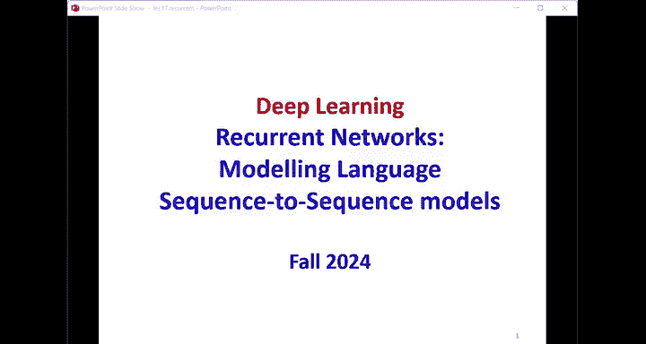
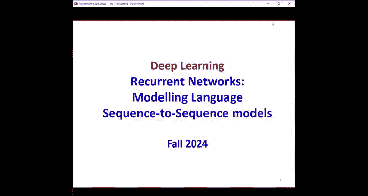
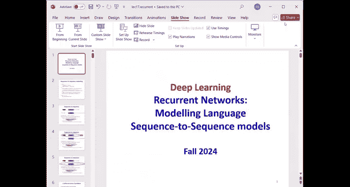
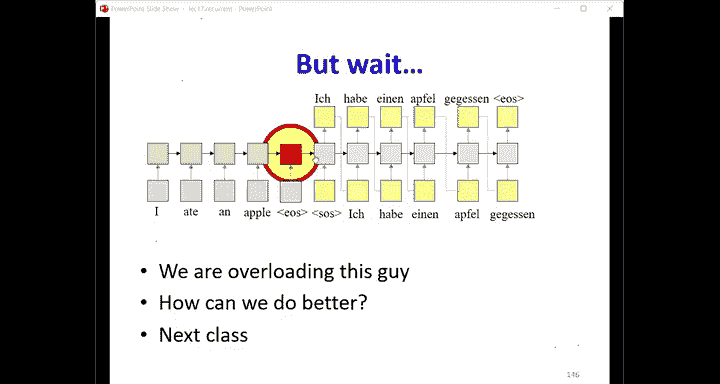

# CMU《深度学习导论｜CMU 11785 introduction to deep learning Fall 2024》中英字幕（deepseek - P18：Fall 2024_ Lecture 17.zh_en - GPT中英字幕课程资源 - BV1CfsReEEw8

Can you guys hear me？Yes， we can。喂。All right， let's begin。

We are continuing our series of lectures on recurt networks， specifically。

 we're going to be talking about sequence to sequence networks。

We also spoke about sequence to sequence networks last week。So what was。

Special about the kind of sequence to sequence。Problems we dealt with in the previous week。

Anybody remember that？That there was some。Restriction we had。

On the kind of transformations that could be。Perfect。Does anyone remember。

They were order aligned right so here's what the sequence to sequence problem is a sequence of symbols like con through xM goes in。

A different sequence y1 through by m comes out。And speech recognition is an example where speech goes in。

 word sequence comes out。Machine translation， a word sequence goes in a different word sequence comes out dialogueog systems。

 a user statement comes in， a system response comes out。

 all of these are sequence to sequence trans problems I mean who have thought that a dialogueog system is basically just a little mathematical function which converts one sequence to the other that's exactly what it is。

And in general over here， the number of symbols in the input sequence need not be the same as the number of symbols in the output sequence and no synchrony may be assumed。

 so we saw two kinds of sequence to sequence problems。

The first was speech recognition as an example where there was an order correspondence between the input and the output。

 the portion of the input that corresponded to the first output symbol。

came before the portion of their input that came that corresponded to the second output symbol。

 so the order in which the outputs happened had a corresponding order to the inputs。

In the more general case， you don't have this， for example， in machine translation。

 you say the input as I ate an apple。 You try to translate it to German。

And the output is a ha and an upel gig acid。 So then here the H of course corresponds to I。

 but8 corresponds to ha and gig acid it' split。And so on， and in fact。

 if you had a dialogueg system and the input was my screen is blank and the output is please check if your computer is plugged in。

There's no real visible， apparent word level or symbol level correspondence。

So we've already dealt with this problem where you have part correspondence。

We're going to be talking about this kind of problem today where you do not have order correspondence。

So。This is the kind of problem we have where the input and output may not have order correspondence is the difference between the two problems。

Clearly you got just please mark caseon thumbs up。O。So。Before I continue。

 I'm going to go through a brief detour， right？And we're going to be talking about language modeling so we're talking about recurrent networks。

 we're all very familiar with language models， but then you know。

What exactly is language modeling so here's a little bit of a piece of code from some open source project。

Wwhichhich open source project ist well you wouldn't have to look very hard to realize that this is not from any open source project at all。

 a system randomly generated code by a language model。And look at the surprising thing about it。

 this was a program。It was a recurrent neural network。

 a very simple recurrent neural network with I think two or three layers of LSTMs that was traineded on the Linuxux source code。

 and then it was run in generation mode and look at how perfectly learn the structure of。Programs。

So every open breeze is got a corresponding curly brace， corresponding close brace。

 open parentheses have corresponding close parentheses and what comes between the two is perfectly consistent with parentheses right here's an if block。

It ends with an else can and all。And as block。And so on， right， So if you look down the code。

 it's perfectly。In。Code， it doesn't think it's going to garbage， but still。

That's because this is a very trivial language model so here again as a simple recurrent neural network which produced。

 which was trained on Wikipedia text。Actually， this is traineded on mathematical papers。

And just has to generate stuff and it generates what appears to be perfectly plausible math complete with pictures it actually generates it lateic with a little bit of tweaking you can compile the latex and this is what comes out。

哦。Here's something which just strained on Wikipedia text and nothing else。

 not a very large amount of Wikipedia text。So naturalism and decision for the majority of the Arab countries capital capitalite was grounded by the Irish language。

 it's garbage but looks very plausible right so all of these where examples generated blindly by a very simple record neural network。

 a few hellosian layers， the example can be found in Andre Carpathy's Github page。These days。

 of course， you get something。Far fancier than what he did in 2015。

 but the point was I'm trying to make here is that the complexity of the model that is able to do these really fancy things。

Is not very high， it's basically a couple of layers of an Lte。So neural networks。

 even simple neural networks are very， very powerful at modeling language and of course C GT is so much more awful。

 right？So what do we mean by modeling language？Right。

That's what we're going to do a pre detour on modeling language using recordcur neuralling networks and more generally we are going to talk about language models and embes so does anyone here can is anyone here willing to。

Take a stab at telling me what a language model is， what does it do？Anyone。What is a language model？

Anybody。Okay。Nobody wants to。Yes， probability of next words。Next tos probability okay。

 I have a bunch of ways， mathematical representations of words that' that's valid probability of the next word given the previous words that's also valid represents syntax hopefully but that's also perfectly valid。

😊，All of these are perfectly good descriptions of what a language model is。But。From our example。

 from from our perspective。啊。The definition given by pi over here language models generate text in human language。

 that's probably the closest one what exactly is a language model a language model models the probability distribution of symbol sequences in the language。

And of the symbols are you know or tokens are words。

 then the probability of word sequences Now if I just gave you a random sequence of words。

You could take one look at it and tell me it's garbage， right？In general。

 some word sequences are much more likely than other word sequences and these are word sequences。

 you know for a word sequence to be likely it should have proper syntax。

 it should have proper semantics， it must mean something it's very unlikely for people to go about spewing completely nonsensynical sentences。

 right。In other words， you can think of the language as a probability distribution over word sequences。

Where some word sequences are very highly likely and others are less likely， does that make sense？So。

Basically， that's what real language really is。 I mean。

 there's nothing stopping you from say going about。You know。

 saying Ga Google Abalha or whatever nonsense， right？

But you don't the odds of coming up with encountering something completely nonsensical are very small on the other hand pretty much everything that you encounter in real life makes sense and it's trying to communicate something so different word sequences have different probabilities。

And so that's what a language model actually tries to model the probability distribution of sentences in the language。

And if you had such a probability distribution， you could do various things if I gave you a sentence。

 the token sequence， you could compute probability the probability of this。Token sequences。

I could also use this in generative mode to generate sequences basically to draw samples from the distribution of。

Word sequences from the probability distribution or word sequences and if you drew samples from it and if your language model was accurately capturing the probability distributions of word sequences in real language then this randomly drawn sequence is probably going to be a pretty valid sentence right so。

啊。This is what you could do if you had a decent language model。 And in fact。

 a whole lot of research has gone in over the past decade into coming up with excellent language models。

 which do a better and better job of modelling the probability distribution of symbol sequences in the language。

So。You so far， is this making sense？Because pretty much everything that you see that's related to AI these days。

you see this as modeling language， in fact that's what it is it's that。

Different languages have different probability distributions， math has。

 you know if you consider the language of math， then you're unlikely to encounter Shakespeare。

And a mathematical textbook， but you will encounter simple sequences， which are theorems。

 so that has a probability distributions over simple sequences that' very different distribution than if you looked at the probability distribution of word sequences in Shakespeare。

But in each case， you have a language。In the language。

 every possible single sequence has a probability。Some have very low probability。

 some have high probability and capturing this district probability distribution well is what language modeling is all about。

So basically， you want to compute the probability distribution of simple sequences。

 this is the actual target。But the way we typically do it is by using basees rule if I have some word sequence。

 w1， w 2， w3， w4， and so on。The way we do it is to decompose it， this is the probability of W1。

Times the probability of W2 given W1。Times the probability of W3 given W1 and W2 and so on。

 And so as it turns out that if you're able to compute these。Probabilities。

 the probability of the next word perfectly。In the process you've actually also managed to capture the probability distribution of word sequences in the language。

 which is why very often we think of language modeling as the problem of predicting the probability of the next token the next word or the next symbol。

 but that is simply，呃 step。Towards computing the probabilities of entire sequences of wordsbs。

So again。Language models generally perform next symbol prediction。

Always predicting the next symbol given all previous symbols， but never forget。

 they actually model the probability of N sequences of sentences of paragraphs of books。

So in the universe of all possible books， which are basically long word symbol sequences。

Why do some have to occur and others not， some are more probable and others are not when capturing this probability distribution is also more linear language。

So。Give it this。We can still focus on this business of predicting the probability of the next token。

And so there you would have something like this that gave you this sequence force code and  seven yards。

And I asked you， what is the next word？What would you say it was anyone？

What typically comes after to a fourth score in seven years？Go， right。

 this was from the Getsburg address。And。呃。Abraham Lincoln called the next one will beM so this。

Not everything was possible immediately after this sequence。

So there was this conditional probability we're seeing all of this immediately gave you a strong idea of what could follow。

Knowing learning this， having the ability to compute this， do what you guys just did。

 compute the probability of the next symbol and the sequence given the past。

That is how we are going to approach language modeling， again， keeping in mind。

That the eventual objective is to compute the probabilities of entire simple sequences。So for this。

 of course。You've got tokens， you've got words， you've got symbols which are in language。

And our models are not working on language， they're working on mathematical representations。

And so the first thing we are going to do is to convert these things to one hot vector。

So that you can feed it to a model， so you might pre specify vocabulary of some n words。

And some fixed， say lexical order or ensembles。And then each of these is going to be represented by an n dimensional vector with n minus1 zeros and a single one in the which occurs in the lexical position。

Of that symbol in your original ordered arrangement， so here for example。

 artwork is going to have a one in the second position because artwork is the second word in our lexicon in our arranged lexicon Erin would have a one in the third position。

So you could do this with words， you could do this with you know。

 word fragments with characters want to create if you want to model the probability distribution of character sequences。

The vocabulary is just about 100 characters， so every character is going to become a one hot vector of some hundred dimensions。

And so once you're past all of this。The problem is now。Predicting the next symbol in the sequence。

 So you are given W0 through W10 minus1。And you must predict it don。

This is done through some function where all of these are represented as one hardware。

So if I want to illustrate it vi， this is what it would look like。W0 through Wn minus1。

 all of these being one hot vectors。Go into your function F。Which generates a one odd vector。

 which is WA。So is this figure making sense？The one to the right。Okay。

 so what could a problem be with。啊，是是。How would the one hot approach work towards mis spellings。

 things that are not in the lexicon are not going to be representable period， right？

They will never not they can neither go in nor come out W here these are just words not reads okay。

Word sequence now。What would be an issue？With a representation of this kind。Very， very sparse， right？

All the inputs are very high dimensional and very sparse if you're working with words and in English。

 then in English you need about 100，000 words。To get most of the language。

 which means that every single word is going to be represented by 100，000 dimensional vector。

 of which only one element is nazi。If you are working with Russian， you need 400000 words。

 So each vector is going to be a 400000 dimensional vector where all but one dimension is 0。

 So why do we even bother using such a sparse， ridiculous representation。

Why don't we use other vectors？Why couldn't I know， for example。

 if I've got a thousand words in my vocabulary then。Logged at the base2 of thousand is what。20。

So in principle， I could just be using a 20 dimensional vector to represent all words， could I not？

Yes or no。So why don't we use that？Why don't we use that right。

 so guess why right first why one hot representations Because a one hot representation makes no assumptions about the relative importance of words if you began giving them other。

Values then some vectors， if read if you read the bidstream out that's going to be represent a number and some numbers will be larger than others。

 so you're implicitly assigning some kind of an importance to the words this word is a big number so it's more important than this other word which is a small number like it or not that in that represented that implication will exist。

In a one heart representation， every vector is exactly the same length。In an n image。

 if you have n vocabulary hences a vocabulary of n symbols。

And all the vectors live on the corners of her。And dimensional cube specifically you're just using the N axisx。

 right？So if I have a vocabulary of three words， then three vectors are 10，0，0。

10 and 1001 observed how all three vectors are length one。But then here's the other thing。

 what is the distance between any two vectors in a one0 representation？

The distance between any two vectors。So， and what is that distance？

Between any two vectors and a 100 square root of2 right so basically you are not assuming a priority that word word a is closer to word B than it is to word c。

In the absence of other information it is improper for us to make this assumption and so a oneho representation has this property that it makes no assumption about the importance of words。

 they're all equally long and it makes no assumption about how those words are to one another because theyre all equiist from one another that's why we use one heart representations but then。

LikeThis comes at a cost。It's extremely sparse。 Look at this。if I have 100，000 dimensional。Vectctor。

100，000 words。In this0000 dimensional space， I am using only 100000 points。Look at it this way。

 if find an entire plane go down to just a plane of two axes if I told you I gave you an infinitely sized sheet of paper。

But then the only two things I'm going to use on this infinitely sized sheet of paper are these two points。

Is that good use of the space？What do you call that good you， it's horrible， right。

 because think about it。This 100 represents a word if I just go off away from it by a small epsilon and I go to one epsilon delta。

 this is a meaningless thing， it has no interpretation at all。

 so it's the total volume that you're using from the space is 0。

Because each point is just a zero and the density， if you assume that you are only considering this unit cube。

The density is going to be， you know， the volume of the cube is to raised to n。

 the number of points is just n。And so the density is going to be of the order and over。You know。

R is to end the art is the。啊。Size of the edge and this is going to be very low， is this making sense。

 the business or the density。And fact that a small perturbation has no sin， no meaning。嗯。Yes。

 not makes sense， right。We can't do anything about this guy。

The fact that it's occupying zero volume cannot be fixed， it's a problem with machine learning。

 but they can try to increase the density。And the way we will do it is to project this one dimension。

 this one hot vector into a subspace by multiplying it by some matrix speed。

 the speed is a projection matrix， which zs all of these points down onto a lower dimensional hyper play。

And if you do this properly， then。And if this P is properly learned。

 then both the absolute values of these points。And the distances between them will begin to make sense。

And so we leave the business of figuring out the relative importance of words and the relationship between words to a learning problem and that is specifically the problem of learning this project。

So how do we do it first？We assume that every word is first going to be projected down like so。

And so you're going to be projecting meaning every one hot vector is going to be。

Has stood through this projection matrix。And the projected downwards are going to are not to this function。

The function predicts words， so the function is not going to be predicting the projected downward the prediction is still one hot because this is a classification problem。

the projections apply to the input。And so。Of course。

 we know that a projection matrix is just a linear layer。

 so it's like applying a linear layer to every one of these one hot vectors before the same linear layer。

To each of these vectors before passing them into the function。

 so you can still now view this entire prediction model。

Which is a language model as a network with identical subnets because these guys are all identical。

It's a shared parameter network， this making sense。Yes， no。嗯。Okay。Right so now having set us up。

 let's look at what we can do。First。If I'm predicting the n word based on the previous n minus one word。

What kind of a model is that。Can anybody tell what kind of a model is that？Yes， but what kind？

An R anN，s a time series and printing the current word based only on the previous n minus1。

 what kind of a model is that？Is it recurrent。That's a TDNN， right。Yes， so here's what it is。

And predicting the TDn in model of predicting each word based on the past n words。

 This was originally proposed by this in this paper， Benger at all in 2003。

 where each of the words is first passed through the projection layer。

And then you just have a simple。TDNN model。Where it's trying to predict the next word in the sequence。

By looking at the previous n words， so you don't need explicit labels because you know。

 the label at time T is the input at time T plus one。Nevertheless， this is your stickD in market。

Is making sense？And this is just TD in it。嗯。Okay， so。This is not recurrent。okay， Miguel。

 if it were recurrent， how many passwords would it be considered？Infinite。If it's finite it is。

 is it recurrent when it's just a short window。It's not right， so this is a convolutional network。

 this is it， so you can have other kinds of bodies when people figured that you could do this。

This business of trying to find out the best projection matrix became a bit of a cottage industry。

 so we had these other models this was the so called soft bag of words。

Where you are going to predict a word based on neighbors on both sides or the skip gras where a word was used to predict。

The name was on both sides。And various other things。Regardless when you did it。

 you ended up getting very nice results of the scan。

 so once you projected that in the lower dimensional space。

 you would often find relationships like this， see the relationship。

 the vector vector distance between China and Beijing。

It's very similar to the vector vector that connects Russia to Moscow。

 span to Tokyo Poland to Warsaw right so the relationships between words seem to be the arrangement of words seem to capture semantic relationships。

 this is clearly a country capital relationship。And had other examples where they showed that king。

Plus woman minus man gave you queen because the vector that connected man to woman was the same as the vector that connected came to queen。

 so very nice。And so that's what these embeddings do， so these things， these projected down。

Vectctorors that we get after projecting the one hot down vector down with P is called an embedding。

And that's what he's embeddings to， so that leads us to our first poll。Let me release the passport。

Can you see the poll？Okay， 10 seconds， guys。Aha， what is the meaning of the one I I tell me at the end of the class？

Okay， let me terminate this poll。I'll give you extra credit if you tell me what the meaning of the one at all。

 Okay， yes what do you think that all of you guys think these are are。😊，Guesses。So。

Is this first statement true， the distance between any two non identical burn heart vector is the same。

True or false， the first one。True right， second one words are represented as one heart embeddings because these do not impose any a priory assumption about which words are closer than others true or false。

True， word embeddings derived from language models are lower dimensional real valued representations where the distance is a meaningful representation of the film closing story false。

Low dimensional embeddings enable you to find representations for words that were not part of the training vocabulary to our f。

This last one。Youca that's fixed right， so the first three are true and the last one is false。

 thank you。So here's where we are， now I could do the same thing with a recommend market。

In the case of the recurrent model， the entire model looks pretty much the same。

 except now of just having a convolutional network as going to be having a。

 it will have a recurrent network。 And when I have a recurrent network。At any point。

 what is the probability distribution being compute being。Comput it。

 is it the probability of the word in isolation or the probability of the word given just the previous word or the probability of the word given some history of word or the probability of the word given the entire past。

 What is being modeled at any time。Of these four choices。But the model is recurren。So at any point。

 what is being computed is the probability of the next word given the entire past。Right。😊，Perfect。

 that is the key it。So。If I have this， how can I use this to generate text。

 I can I can just take a whole bunch of text， I can train this model where the label at any time is the next word in the sequence。

 so I don't need external labels I'm always using the next word in the sequence as the label。

And now I can use this to generate more text， I might have some initial text W1W to W3 right so four score and。

And then based on these， at time three， you would get the model would compute a probability distribution for the next word。

And then from this distribution， you could sample a word。And then feedback back in。

And now you have four words going in。And the network is going to compute the probability distribution for the next word from which you can draw a sample and。

Keep doing this until you stop。那文队长。There are some cases where termination is obvious， for example。

 if you are generating。Ccord。The moment you see the final curly brace， you know， the thing is done。

 right？In know the cases not， so here in this one， this was just an RNN trained on the Linuxux source code。

 you know that this was the first open race。So as soon as this guys still， the court is done。

And this was a very nice example， I don't know if I can play this and whether you can hear it。

It was getting。Sound going through to you guys。I guess not， let me reshare this。

啊。Soppshare。Let's share this again， this one， but let's share some。

え。Some。咩。This was interesting。Someone just trained a little LSTM on MIdi。

And used it and generate more and it generates perfectly plausible music this was in 2015。

 10 years ago these days of course you can get and have symphonies not a f way。So。

These are easy you know in the case of programming tech code， you see the final cur brace， you know。

 it's time to stop。And the。Case of music， you does not need to stop。

 you can just keep going on and on and on， right？But more generally， you need to stop。

So when we stop， do we just keep going on forever， that doesn't make sense。

We need to have some way of indicating this。And。So， here。

We actually like to mark beginnings and ends。A sequence of words by itself does not indicate if it's a complete sentence or not if I just look at four score and8。

 I don't know if it's the beginning and I don't know if it's the end。

So to make it explicit I'm going to add to additional symbols， a start of sequence。

 a start of sentence marker and an end of sequence or an end of sentence marker， so here for example。

 four score and 8 has neither an EOS nor an SOSOS so this is clearly the middle of a sentence。S。

 O S4 score and 8。 So it means that。Four was the first word in the sentence because it is preceded by a start of sequence marker so this is a fragment for the start of a sentence。

Or scored an8 US。So after eight， you've generated an end of sentence marker。

 so clearly this is the end of a sentence。S O S4 score and 80。

 So this means that the sentence began at4 and ended at gate。 so this is a full sentence。

So these tags make the beginnings and ends very explicit。And for engineering purposes。

 you may often not have separate SOOS and P tags and simply have a single tag for book start and the end。

Not nevertheless， the key thing is that determinations and initializations must be tackgged。And so。

When I generate text。I can keep drawing stuff and keep producing stuff until。

I draw an end of sentence marker， or I might have other criteria。

 generate note no more than 100 symbols， in which case， you know， I'd use this additional cr to stop。

And so the story so far， language models model the probability of words。

are word sequences or symbol sequences in the language。

This is typically performed in the form of next symbol prediction。

Given the symbol sequence w0 through WK， it computes the probability distribution of the next symbol E of wk plus 1。

 given w0 through WK， and this could be computed using a accurate neural network， that's why Rns。

And they can be used to both compute the probability of an entire single symbol sequence。

Or to just conditionally generate or extend symbol sequences given an initial plot。

Both of these can be done。So。啊。With that said， here's your second one。Okay。

 this one's easy 10 seconds guys。Okay。嗯。I'll terminate poll here。And here's what you guys thought。

What's the answer， guys？Perfect， right？This is the吗。And so now let's return to our problem。

This is the problem you're dealing with。Where we do not have。

 we've already handled the order correspondence。This is the one that you want to deal with。

 no correspondence between input and output， they may not maintain the order of symbols or even。

Have any kind of immediate apparent relationship between the output and input。

What kind of model can deal with us？For this， we've already seen the market。

The obvious one is the SC， the delayed sequence to sequence model that we saw a couple of classes ago。

 this model takes the entire input。And once the entire input has been processed。

 there's a hidden state compute， and this can be used to generate the entire output。

So this model has two parts。The first part processes the input to generate a hidden representation from it。

And then the second so here's the pseudo code for it， right just this one。

You're going through time at each time。You're taking in the current input。

And the previous hidden state to generate the next hidden state。

And the final the hidden state after the final input。Is the keybit？Once that is computed。

 then you can use that。To generate outputs。Now， what does the code for that look like？Like so right。

 here's the bit which process the input and generated a final representation。Now for the output。

 this final representation is going to be the initial hidden representation。

 and then at each time you do two things。Good each time。You generate a hidden state value itself。

And then you also generate the output probability distribution， so because from this guy。You know。

 when you take in this hidden state。Youre computing this one and from this one。

 you're computing this as well， right， So you generate the hidden state。

 current hidden state and the。Output probability distribution， but what is the actual output word？

The output word is going to be。A drawnra from this output probability distribution。

 and we'd keep doing this till the end of sequence marker is produced。But then。

 so is this making sense so far？It's broken， but is it making sense？What we do。Okay。

So I have eight DSs order。But so how is this broken？

This business of generating an output work is actually growing from a distribution right so consider the case。

Let's say at this word， you had a probability distribution computed， which is this one。In one case。

 the word that you drew from it was the word A， in another case。

 the word that you drew from it was the word and。Now， if you sample the word a from this。

 then what kinds of words can follow if the word that you generated here was a。

Is the set of words that can follow unrestricted， no they must start with coincidence。

On the other hand， if you drew an an， what kinds of words could follow？Words starting with w， right。

Is there anything over here which says that。Which informs the model that I drew an A。

 and so only words with consonants are acceptable over here。

 is there anything in this model that does that？So how would you fix this？Yes， right。

 so how would you fix it？RightSo so the issue here is that changing this output at time t doesn't affect the output at time t plus one if you have drawn it was E versus it was n。

The probability that the next word is dark remains the same。

 and this is because the output at time T does not influence computation at t plus1， right。

 As you guys just mentioned。 So what we wanted is to feed the drawn word back as input。

And so this is the actual model， not the one to the left。😊，But the one to the right。

 because this makes more sense。喂。And this begins to look at the dark step。Just give me a second guys。

And sorry guys， I'm also in the middle of hour。Family emergency so。

I will get some classes and some some phone calls， right？好，O。So。

I'm assuming that everybody's with me so far， so here's what they this is what theyll called a simple translation model。

The input sequence feeds into this recurrent structure。

And the input sequence is terminated by an explicit kind of sequence symbol。

And then when we get this when we encounter this end of sequence symbol。

 then the hidden representation over here stores all information about the sentence。Subsequently。

 the second recurant network uses the Sain activation。

And this start of Sig block as an initial symbol。Proceeds to generate the outputs。

And the output at each time becomes the input at the next time and the output output production continues until and end of sequences produce so you know over here。

 this guy would go in here as the initial state and the start of sequence marker that's why you need a startup sequence marker to say initiate generation and then you generate a word which would go back in and you'd keep doing this till you eventually generate n。

End of sequence mark， and then you know the output is complete。

So observe that because things are going back in as input， drawing a different word over here。

What does mean that the subsequent output is going to be but it's going to all change。

Now I've drawn a very simple model with just one hidden layer。

But keep in mind that this is only for illustration that hidden layer can be arbitrarily complex I'm just not。

 you know the complexity of the hidden layer is kind of slightly irrelevant to the immediate topic it's only relevant to the effect that the more complex it is the more powerful the model gets but for the purpose of understanding the underlying concepts。

 we can hide it all under this simple illustration so this is what I'll use。

So here's what the generation looks like。Over here now。You'd get the initial hidden state。

Your initial input is going to be a start sequence marker then at each time the current hidden state and the last symbol output。

Are going to be fed in and then this will result in a new value for the hidden state and an output probability distribution from which。

The word is generated。 right。 So again， observe that if I sample a different word over here at the next time instant。

 that's good that guys going to go in and change the outputs all the way down the line。

So this is our simple translation， model the portion that？Processes， the input is called an encoder。

And the quo that processes the generate the output is called decoder， so this is terminology。Now。

 let's take a slightly more detailed look at。啊。How this is done。Firstly。

 words are all going to have tokens are going to be represented as one heart representations。

 but they will be compressed。To embeddings through the standard projection approach that we saw。

And these embedding matrices could be relearned， or often they are just learned as part of the model itself。

In my in the rest of my lecture I'm not going to show these piece here I observed observe I have different piece for the input in the output because I'm using an example of translation。

 so this one over here would be the projection matrix that's appropriate for English。

This would be the projection matrix that's appropriate for German。But again， you know。

 there are different ways of setting this up and not going to show these theses。It' a hit not。

What is the network actually。Produce。For that。Here。Obsserve。The input has been processed。

And then you've given a start of sequence marker。It computes a probability distribution。

 What is this probability distribution， This is the probability distribution for all the for the next word in the sequence。

Given everything that has come in so far， there is the input。And the start of sequence mark。

That's what this distribution is， is that making sense？Okay， so。The symbols over here。

This y zero superscript anything y zero superscript word。Is the probability of。The word beer。

 for example， y0 beer is the probability of beer given that the input was the sequence and that a start of sequence marker has been。

Has been initiated。So you would draw some word from this and you feed that in。At the next time。

 you now have a probability distribution that's being computed。

This probability distribution is the probability of words， the next word。

 given that the input was Iate and Apple and that the first word in the output was isish。

So it's going to be the probability of code2 given the entire input and01。That makes sense。Okay。

 so if I have sample dish， right here。That has gone back in。

 so ACE is part of the input that was used to compute this probability， right？spir。

I'm going to draw it， I'm going to generate it， so we'll get back to how we got the H from this distribution。

But we got it somehow。 Okay， so， and then that goes back and so at each time。

 what you're really computing is the probability of this。Of the next word。

Given everything until then。 So why Subscript K superscript W misses the。Output。

Computed for the word W at time K。Is this set of this set of values is the probability distribution。

For the k word， given the input and the first k minus1 words， so is this making sense？Yeah。The idea。

Right。So。When this goes back in。That's going to go through the projection matrix。

 So we always have the P， okay。Like I said， I'm not going to actually explicitly show these piece。

 but these pieces are ever present。And so this is how the generation is done， okay。

 so here's what the su code does。You know， at each time you have Y of T and you are drawing the next word from this Y of T through some magic operation。

 what is this magic operation？And what's the point behind it， sir？Again。

 observe what is the probability distribution of any output sequence， 0102030405。

 given the input sequence？The probability of an output sequence given the input sequence。

 I can break it down using base rule sp of01 given the input sequence。Times。

P of 02 given01 in the input sequence times P of03， given0102 and the input sequence and so on。Right。

So this。The composition makes sense to you guys。Okay， and what is PF01 given the input sequence？

That's basically the probability computed for01 out here， right？

What is P of02 given01 and the sequence that's the probability computed for O2 out here。

The probability for any given output sequence is simply the product of the probabilities computed for those symbols on the sequence by the network。

To make it more explicit， here's an example， let's say is I and Apple went in。

What is the probability of Ishwar's Nshwa east？Which is not a correct translation， right。

 but if you sample stuff。You could well have sampled these two right right so what is the probability of this。

 This is going to be the probability of iswise N to us S is。

Given I ate an apple is going to be the probability of ish。

 given I ate an apple times the probability of Y。 given the sugar ish wise this sources， right。

I I ate in apple times the probability of N given H wise， I ate and apple and so on。

Right is this making sense？Over here。M of you guys。Okay。And this term here。

 pH given I8 an apple is just simply the y value computed for a at time 1。

And because Ih has gone back in here， this term we had from a pe of rice。

 given is and I ate an apple。It simplyimply the probability computer for viceS。

In this column and so on， so the probability of this word sequence is the product of the probabilities assigned computed for each of these words in the sequence by the network again。

 is this making sense。So far。Yes or no。Okay， I'd like to see 25 thumbs ups because this is where it。

I have T four。I wait for the 25， I'm still at 15。20 I need five more guys this give me the thumbs up。

 it's going down rather than up。Oh my good God。All right， I have to continue。All right。Now。

 what is the model really trying to do？And from performing translation， given an input。

 it's trying to obtain the most likely output， right？Yes or no。And so。

The objective of drawing is to generate a sequence of symbols here， such that。

The probability of that sequence， given the input。Is maximized In other words。

 you want to compute the symbol sequence01 through OL such that the product of the probabilities assigned to O1 through OL is maximized。

Does make a sense？Good right here。Okay， and so this is the。Objective。So how do I draw words。

 remember the word that God is drawn， okay？That。Just bear with me guys， this doesn't always happen。

 but I have a minor emergency。Sorry about that。My mom's fls away， but her phone is dead。

And my sister is supposed to pick her up and they are using me to coordinate， okay so。All right。

 so again the question is this right， how can I remember that any word that I drew over here is going to change the future。

 correct？イさの。Okay， so given this， how do I derive words from this corroability distribution that maximizes？

The overall probability of the sequence， any ideas？How could I do this？Any ideas？

How many combinations could check every possible combination， how many do you have？Infinite。No。

 right， so okay， is there a better idea than that that's the correct thing to do。

 is there a better idea so。Be searched exactly， no， though。So again。

 let's explain you guys have the answer， but let's go through that， right？

The greedy answer is to select the most probable word each time。And it's very。 So basically。

 I would just say。Pick the most likely out at each time。

And this so Yt is a probability distribution I can just do an a max and I get in。Get the next word。

Why would this not work？Let's see why， right？I cannot just pick the most likely symbol at each time because that can cause the distribution to be more confused in the future。

And choosing a different， less likely word could cause the distribution at the next time to be more peaky。

 resultingult in a more likely output overall。 So let's see how。 let's say I have this。

Maybe I'm performing speech recognition， right？And so the first word drawn was the word he。

Then at the next word。The word knows with NOSSC and the word knows with k knows with KN orWS。

 both sound very similar and have very similar probabilities。

But the probability for nose this object on your face is slightly higher。

So if you pick the nose here greedily because it's more probable。

 now you get this crazy word sequence he knows what kind of a word sequences he knows。

 it's not clear this it doesn't sound in proper English。

 So when the model tries to see what the next word could be。

 it's confused and is going to assign a somewhat flat and low probabilities to all words。

So when you draw the third word and factor and the probability for the third word。

 all the no scored higher thannos。After factoring the third word。

 the overall probability is not going to be very high。Whereas if you had chosen nose with a K。

 even though it was slightly less probable than nose。

Because he knows there's a very structured language， if you look into the future for the next word。

 some words will just stick up like W2 over here， and so choosing that word is going to give you a higher overall probability for the third words。

 three word sequence。Than in the first case， even though the second word was less likely than the second word second word here。

Is that making sense？As example？Overre here。Okay。And so。啊。But then， the problem is。

You don't really know， you don't have to look ahead， right？You don't know here。

 I've given you an example where the confusion occurs immediately。

But the confusion could occur anywhere down the line， and so you don't have the liorhead。

 it's impossible to know a priori。You know which word leads to the more promising future。

 so in know shouldn be nose or nose？Locally those look better。

But the nose was better if you looked into the future， right？But then it could be worse， right。

 Maybe in the very first word， you had a choice of he and the。And he scored slightly higher。

 so he chose he， right？That gave you the nose confusion at the next time。

 and then subsequently you got he can knowss something， but then if you had chosen B over here。

Then the choice of no with the n at the second time could be would be more reasonable。

 and it's very likely that when you get to the third word， the overall sequence is more likely。

And so the fact this。So you know the fact that。You had to choose the and not he only becomes evident after some time and we don't have look ahead。

 we don't have particles。Now an alternate solution is to just randomly draw word from these distributions and we all know how to draw a sample from a category distribution。

Obviously， this is not going to be optimal。And all this could just be a random sample layer。

And so random sampling is not guaranteed to give you the most likely output。

 but strangely it can sometimes give you more likely outputs than grade such。

But what we really want to do is something slightly different。And before I get to that。

 we have our third poll。Wait a minute。I should stop sharingdding this。Immanending this poll。

This is what you guys thought。O。First statement， true or false。Second one。Hard one。

I haven't told told you this here we're paying attention， right？And yeah， okay。

So we see that our choices can get you stuck， making a poor choice at any time commits us to a poor future。

But we cannot know at that time that the choice was poor， so the solution do not choose。Right。😊。

Here's what we are going to do。From this distribution， we could have picked any of these words。okay。

 from this distribution， we could have picked any of these words， right？😊，Instead of picking a word。

 we clone this portion of the network and make one copy of it for every possible word。And then。

Out here once again， you're going to have a probability distribution of all words。 So out from here。

 I'd make one copy of the network。For every possible word。 And I be feeding all of those guys in。

 And so I can actually generate the entire tree of。😊，Possible。summble sequences， word sequences。

 and then I can compute the probability of any word sequence by simply multiplying the probabilities all along the tree。

And then I can pick the highest one。And this is going to be the correct thing to do， right？

Do you agree with this？第三个。Any responses， guys？Okay。And it's the problem here。Someone mentioned it。

 what's the problem？What would the problem be with this？Right。

For an output vocabulary of size V after T output steps you would have forked out from these race3 branches。

 you know， you're going to run out of compute and memory。It's exponentially branching very。

 very quickly， so this is not feasible。So how do we deal with this and many of you gave me an answer。

 how do we deal with this？给我了。The beam， right。So。I'm going to。Bloe at each time。

 So Iended all of these guys。But at this time I only keep。

 I decide I'm only going to keep the K of choices， and I keep only the top K。

And only these service examples， my talk is two， right？And so the top case based on the probability。

 the probability of this symbol based on the input。

And then I'm going to be making two copies of the network， one taking he， the other taking V。

At this point again。The model is going to compute the probabilities for all the words on both branches。

And then。From across these two sets of branches， I'm going to pick the top two。

And the criterion for picking the top two is going to be the product of the probability here and the probability here。

 So here， for example。for nose， I'm going to be choosing the probability of noses given the input and he times the probability of he that's the input here given the input。

And for this one for the NoAC knows， this would be the probability if no given。

The entire input sequence in the word B times the probability of the given the input。

 so I'm multiplying all the probabilities down the path to each one of these guyss。

And then picking the tube was likely。And those are the only ones that would stick。Now those two。

Can be expanded again and at this point again， the network is going to generate our compute probabilities for all words of which I think to talk to。

 but then to choose the top to I'm going to be multiplying。The probabilities down the entire path。

Because you really want to pick the word sequence， the two word sequences with the highest probabilities。

 and those are the ones you choose。I know this sounds confusing， so any questions if you don't have。

 if this made sense， this gave me a yes or thumb。Does make sense？Okay， so。This is what we got to do。

 right， and we can keep doing this and。So each time you're going to use the top k where the top k is based on the product of probabilities all the way down the path。

And you stop when the current most likely part overall bad ends in it。

End of sentence marker it's not enough for one of the top K to be have an end of sentence marker。

Firstly， once you generate an end of sentence marker。

 you do not continue generating down from that point on because that sentence is complete。

At any point you have a bunch of hypo partialial hypotheses。

If the hypothesis that ends with the end of sentence marker is the highest。

Current lease scoring hypothesis。 That's the one you're going to output。Of course。

 this also gives you the ability to generate the n most likely hypothesisses instead of just the top one hypothesis and that way you can do。

So。One of the things paths cannot continue once you output any US so this thing is never expanded。

 these are not expanded。And so the paths may different length。

And you're going to have to pick the most likely sequence ending in an EOS across all cinating sequences。

 and that comes with its engineering problems because。

This tends to have a bias through us towards shorter sequences。

I have some pseudo code for the beam search， and I'll skip it。And this is our final poll。

After this poll， I'm going to。嗯。😊，嗯嗯。Al right， that so。所一个的。嗯， all right。

Let's go around in the four and five seconds。So。Here's what you guys thought。And so first question。

 true or false。Second one。I the second one true。Being said doesn't necessarily pick the most likely hypothesis。

To be certain of picking the most likely hypothesis you'd have to do the entire tree。

 so this is still an approximation it's just a better approximation than greedy search because you know you're considering more than one hypothesis that makes sense。

Yes no， Okay， so let me continue， right？In good job。So how do we？Sorry， how do we train the system？嗯。

Its。😊，We must learn to make predictions appropriately。So given I ate an apple。

 wish we must learn to produce a shaba and an apple guess， right？And so for this。

Something interesting。In the forward pass， I'm going to input the source and the target sequences sequentially。

 Now there's something。That。In your standard。Neutural network training。And input goes in。

And then you get an output。And this thing is compared to a desired output。And your computer loss。

 right？This is what you minimize。So。You remember this， right？This one啊。Okay， in this case。

I am giving the input。And。I also passed the target sequence。

Because the target sequence is being treated in much the same way as we work for language modeling。

 okay？And so。We pass the input and the target sequence and。

You keep predicting the next word in the target sequence。And at each time。You have the next word。

 the actual next word in the target sequence is the label。

 you compute the divergence between the next word in the sequence and the output。

And this divergence is the one that is。The derivatives of this divergence are what to pass back to learn the model。

Now， did someone observe the difference between how this is trained and how models are normally trained？

Did someone observe a difference？Twoour of data sets。No， in your standard。Neural network training。

So what is the difference？Okay。In a standard network， here's what happened。And input went。Right。

And output came out。And then。You computed a divergence， right？Is this what is happening over here？

What is happening here is something different。The input。And the output are going in。

And the output is coming out， correct？It's not merely that it's auto aggressivegress。

 do you see that this is what is happening here？Is this the same as this？Are these two comparable？

Come on， guys。No， right。 If you were training this like a proper neural network， what would you do？

What would you do？Only the input would go in and then you just run this thing in auto aggressivegressive mode。

And generate an output， and that output would be compared to this guy， correct？Yes算 no。

Right why don't we do that？Why don't we do that？Because any guesses， I'll give you five seconds。Okay。

 a few more seconds， someone guys。It's not。Because if I just fit in the input。

 imagine what the model is they in the initial stages and the initial stages。

 the model is going to be crappy， right？And instead of producing。

Anything close to Ihaba and an upegs and equiquious produce。Like a 500 word sequence of jbbberish。

 right？Yes or no。Exactly， but Elvis is right， yeah。Could you compare that of Hshaba and Opelgis。

A 500 word sequence of generation now they are not comparable。

 they don't even know how to compute the loss， it breaks down， right？Because。You know。

 you want to Shain and Ael Gason。And this is going to say， good morning， America。

 I'm going to read you the Gettysburg address or it's not even going to be anything that structured。

 There's no way it's going to be comparable。Whereas so what we did by。

Peding the input back in cheating。 This is basically cheating， right。

 This is what we call teacher forcing， where the desired output is being fed back in。

And that makes it possible for us to obtain one to one correspondences between the output of the network and the desired output of the network。

And then the divergence can be computed。That makes sense。Yes， I no guys。

What about the rest of you have two asses。 Can I get 15 assess。Some thumbs ups， Okay。

 so this is not really。Training in the standard approach， we are doing something different。

 We are feeding the output in along with the input。 It's a bit of cheating。

 We call it we get a fancy name。 We call it teacher foresake。

 but that is it essential if we want us to behave if we want to be able to compute these divergences in a meaningful manner。

 right。And then once you do that， there are a bunch of engineering tricks that people have tried on this model instead of computing divergences everywhere it is randomly thick one。

 so Brian。啊，中。When the model is still in the initial stages。

 it could just say it could just produce a an。Blah。Go。Go。Good， right。

And keep producing this can you compare this to ahaan and Opelgison and computer loss。

 a differentiable loss？Right。Can you do that。So you don't want this right。

 by cheating in this manner， you always know what the next target word is and so you can compute loss。

That's why you do this。Does that make sense， right？ok。

And so that's basically what we do and there's some engineering tricks which I won't get into but here's the overall training you're given several training instances of input and output sequences in the forward pass。

 you compute the output。But then observe that both X and D are used in the forward pass。

 unlike in your standard training， where these is the desired output。And then in the backward pass。

 you compute the divergence and propagate derivatives backwards。So。Some applications。

 machine translation， my name is Tom， which I has a Tom。Speech recognition。

 speech record comes my name is Tom dialogue， I have a problem。

 how may I help you all of these can be addressed using this。Approach。

You can even do the image captioning， so give me two minutes extra guys。

 here's something very interesting。So all of this is done because the input is processed and you get a hidden representation for the entire input in this hidden state。

So this in the hidden stage should， in principle capture the semantics for the hidden input。

 for the input does it。Here are some examples that people have that the original author showed by projecting everything down to 2D。

So what do these representations look like John Ads Mary， Joe John is in love with Mary。

 John respects Mary， Mary Ad John Mary's in love with John。

 Mary respects John observe that the three are similarly structured sentences just that the order of the subject and object have changed。

And the two have the same arrangement， right。Male to female is down here。

 female to male is down here up here， I was given a card by her in the program and in the garden in the garden she gave me a card she gave a card in the garden。

This is this flipping it two she was given a card by me in the garden in the garden I gave her a card。

 I gave her a card in the garden again you can see that even at the sentence level it's keeping all of the structure so it's doing a fantastic job of actually computing structure。

So you see this？我没咩。Since they're out of time， I'll assume you do。

 they have some examples for machine translation I'm told they are good we're going to have to believe it。

Here's one that they did for a dialogue system。And if you go through it the machine sounds almost humid。

But then there's something else you can do， right？う。😊，你好。

Once you break it up into encoder and decoder， the encoder could be encoding anything。

And so this was where the first really good image captioning model came out。

 the encoder for the encoder， they used a CNN。And the CNN's output was used to generate the。

Deerate sentences。 and this first paper on。Image captioning。

 the first really good paper on image captioning basically use the model。Where they just replace the。

Encode it with a CNN and use that to feed the network。

And it does a really good job I won't go into the example we've seen this before。

But there's one problem。And the decoding， so give me this extra minute because we're going to follow up on this。

And that is that if you look at this model here。The entire input。

This input is now the entire input is represented by this one box。

And that's fed down the recurrent network into the decoder。

 So what happens is that this information keeps getting diluted as you go forward。

 By the time it gets here， this guy is being messed up。

 not by because of all of the dilution that happens through time。😊。

So when this is generating the next word， it's looking at a much weakened version of this representation。

 is that make sense？So how do we get around that？A couple of different solutions have been proposed where you say。

 I'm going to feed this in at every point。And so even for the image captioning， they did that。

 they did the same thing called video captioning and they found it works really well。Abs it occurred。

So the story so far is language models model the probability of word sequences in the language typically through an external prediction。

The simple， this is is what the model we saw today is a simple sequence to sequence to sequence model。

For tasks such as machine translation， they are performed using an encoder decoder model where the encoder extracts a feature representation for the input。

And the decoder is actually a conditional language model。

 The decoder that we saw is no different from the RnN language model we saw initially。

 except that it gets one more input and that is from the encoder。

 So it's a conditional language model。😊，That uses this representation to conditionally generate the output sequence。

And inference is performed to find the most prob output sequence。

And the same mechanism can be used for other conditional generation tasks like image captioning。

 video captioning， etc。But then here's a problem。The entire input is being represented by this guy。

 this is being overloaded。We can do better how we will see in the next class。

So thank you for your patience， I ran a little over， I hurried up at the end。But。嗯。Yes。

So I haven sure I got the answer， I'm hoping to be back。In person on the 4th of November。

Any questions thoughts？

