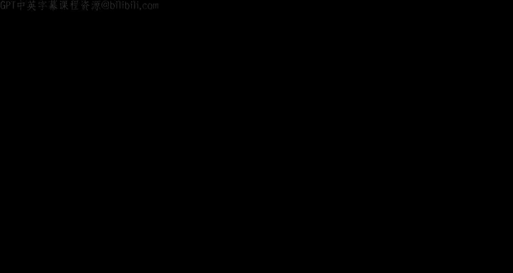
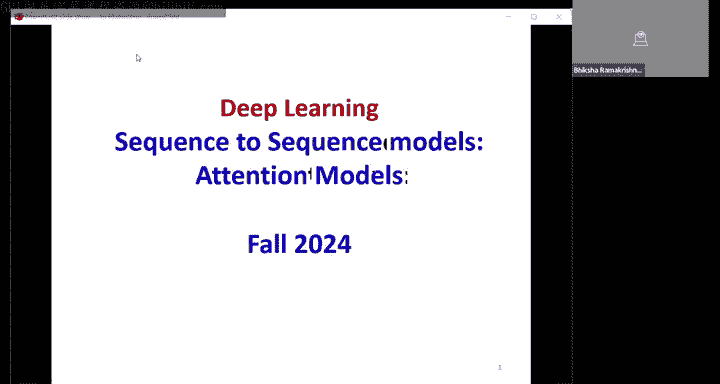
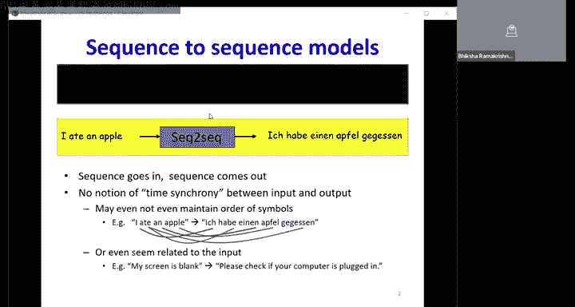
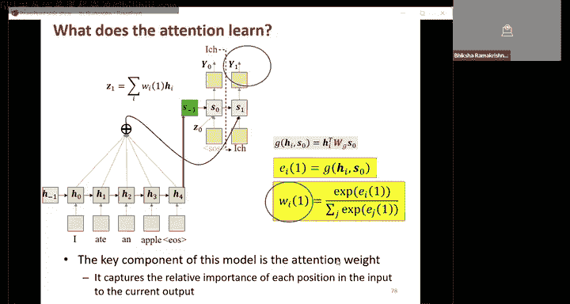
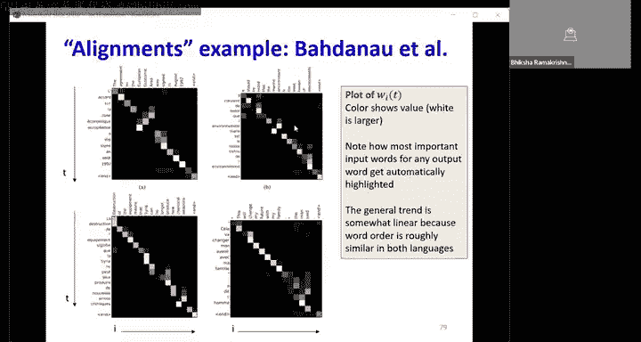
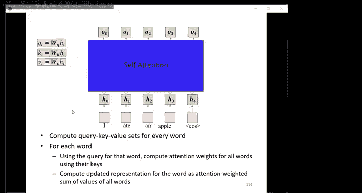
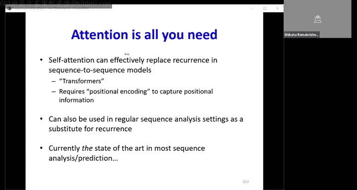

# CMU《深度学习导论｜CMU 11785 introduction to deep learning Fall 2024》中英字幕（deepseek - P19：[18]Fall 2024 Lecture 18.zh_en - GPT中英字幕课程资源 - BV1CfsReEEw8

Can you hear me。AndYes。Okay。I think my camera has gone bad， so you may not be able to see my face。

In case， I suggest。ok。Let's begin。This is。The last of the series of lectures that I will be doing on。

Sequence to sequence models， which is the last component of the series on recre neuralural networks。

But this is not the last lecture on the topic next week we have two lectures the first will be a lecture on transformers。

 but that lecture will be delivered by Howard Chen。

Who's one of my PhD students and who's an expert on the subject and who has a lot of really nice papers on it。

And on Wednesday， we have a guest lecture on large language models by a professor from MIT。And so。

Perhapss Omar Katab， and he used to be in TA for deep learning， so this is actually pretty special。

And he again has name made name and fame on Roseberg on large language models。

 so it's a lecture that I highly recommend all of your dead anyway， let's begin with today's lecture。

So here's where we are we've been looking at sequence to sequence models where the model takes in a sequence and produces an output sequence and there may be no apparent correspondence or synchrony between the input and the output。

And here we saw that the kind of model we could use was this delayed sequence to sequence model。

 which would analyze the entire input。

And then once the input was analyzed， it would use the result to generate the output。 Now。

 the naive model shown on the screen we saw wouldn't work but still， so here was the process。

 the input was processed by this first block， the end。

And the result was processed by the second block， the decoder to generate the output。

And this was too naive because each word that is output depends only on the hidden state and not in previous output。

So we saw that we really had to feed the word， the generated word back in to the model。

 and so this was the simple translation model that we saw in the last class。

So here's how this operated if you gave it an input like I ate an apple。

Then I could draw the first component of the model。

Would process it and generate hidden representation at the end of sequence marker。

And then subsequently， the second network would use this hidden activation as the initial state and the start of sequence marker as the initial symbol and go ahead and produce the sequence of outputs。

Till it encountered a terminal of terminal and of state market。So this portionion。

 which processed the input was what we call the encode codeder。

And the portion that process that generated the output was what we call the decoder。

 So the terminology derives from the fact that this first block derives some representation from the input which captures the essence of it。

 so in some sense， it encodes the input。The second block decos the hidden representation into whatever output must be generated。

 so it's the decoder。And so here's where we were in the last class。Now。

 there are a couple of problems with this simple framework。And there's a problem on the encoder side。

And there's a problem on the decoder side before I just spill the beans。嗯。

Before I just spill the beans I。I'd like to give you guys a chance to take a guess at what the problems might be。

body want to take a guess？嗯，O。Okay。So here's this。Theres that here's the problem with the deco site。

This hidden representation is being recurrently processed by the decoder。 Now。

 this input could be some length。 The output could be output could be any length， right。

 It would be like 200 words of test。 So in that case， in that sense， in a case。

By the time this recurrence has proceeded through 200 steps。

 the initial state over here is quite forgotten because the recurrence is getting a lot of stuff being fed in through here right and so the input that is。

Being given to the decoder will get progressively diluted and so towards the end。

 whatever you generate might not have very much relevance to the input。Is this。

Do you understand what's happened， what I'm saying here？Right。And if you do。Again。

 what is the meek main problem， The problem is that this thing is getting diluted through time。

 So if I were to ask you to fix this problem， how would you fix it。Any ideas？Any suggestions？

The problem is that this one here。Aha so Theodore has the right idea right instead of having this be diluted regularlyly we know that every last one of these outputs needs to needs to refer to this hidden representation so here's what we will do we can just pass it to every decoder step。

Suddenly， this is no longer art of the recurrence on the decokota side。

And end of portable has been computed by the encodeder。

 And so that decoder's evaants has its own initial hidden state， which could be a level parameter。

So this solves the problem of dilution only。Bcoride。 But as several of you have mentioned。

 theres also a problem on the encodecoride。All the information about the input is being embedded into a single vector。

 So the single vector over here is supposed to capture everything that happened and the input and。😊。

It might work if they input a short like I ate an apple。

 but then if this were a long sentence or a book with hundreds of words。

Then by the time you got here stuff that happened early in input is going to be quite forgotten。

And so this one。啊。Hidden state。Gets overloaded。 And part of the reason for this is that there's recency bias。

 This is going to have much more information about the most recent inputs just before the end and much less about those in the in the far distance。

 Now， when you are performing some deco。The outputs over here are can be related to any part of the input。

 and the fact is every one of these hidden values actually carries information。

So the recurnce of input actually loses k and end up losing this information because of the dilution through recurnce。

 right？And there's also the fact that。The output words aren't just related to this one vector。

 because， again， this vector， although it supposedly encap encapsulates everything that came in。

 is going to have some recency bias。 There is a much more direct relationship between the individual output words and the individual input words。

 So H for here for here。 is directly related to I。 Aber is related to8。

And Gason is also related to it， you can see from these arrows that each word over here is more dependent or more related to some words in the input than the output right than others and so。

This is also lost by the smug。How can we fix this？Now。

 how do I make sure that haour actually refers to 8。More than it refers to Apple。Now。

 one thing is one way to make sure that every one of these things is represented。

When it's being fed to the decoder is to just take all of these vectors and average them。

And pass this average to every decota step， this ensures that every single output has some kind of an access to every single input。

But， you know， that's kind of inadequate。Because when you look at this。The same average applies to。

Every input， which means that each one of these outputs sees the same average vector and the process of averaging also dilutes information。

 so I a an apple n is going to just have one fifth of the total weight of all of the inputs and so whichever portion of the decoder is supposed to refer to an is going to have some trouble discerning it。

Right。😊，And so we need something slightly different。What we will do again。

 just build on this basic idea， okay？Is everything I've said so before making sense？Okay， kind of。

 somebody says kind of Pre， so where did I lose you？Can determine where did I lose it？没了。O。

Im assuming that。Okay。Over here， we'll slide this one。Pre put it okay。

Does it make sense that ish is more related to I than to apple？都是。No。😮，What is Asia translation of。

 is it a translation of HCO？Or is it a translation of pi？This is German。 is is the word I in German。

 right？ So over here， this word ish is related to I and not to Apple。Okay。

Do you get it that each output word over here is more has bears greater dependence from similarity to some of the input words than others？

不能。RightSo upfill is clearly from Apple and not from I or8 or M。It's not the order。

 It's just that each of these words is related to a different。咩。

We never assume there was an order correspondence， right？Well， you'd be training at I， that's right。

So okay， and so as we assume that we have the train model already and we are going to or we' trying to。

Understand how the model could operate before we begin considering other issues。

And so averaging all of these。Now， one issue is here is that if you're only depending on this final hidden state。

I is going to be quite forgotten by the time you get here。

 so when the decoder is trying to produce is and searches for ish in here。

 it may not find it at all because is is way back when and the recurrence might have forgotten it。

Does that make sense？Over here。So。Okay， can I get a few more positive responses here。

 so I know sense to everybody？Okay。And so one way to make sure that we don't lose things to recur is to just directly average these guys。

This way， you at least make sure that when is is performing its decoding， it's seeing sum of I。

 not quite as much as you know as it wants， but certainly when you average these guys in and has that to ish。

 is is going to see a lot more of I than it does in this case。Does that sound right？Right， okay。

But it's not going to see enough because in the process of it has to sort of。

Discern the eye from this average， and the average is munching things up。

So what we would really like to do is something different。We would。

'Like to have still compute weighted average of all of these hidden states。

Except the weighting would be different for each one of these output words so this I'm sorry this this should not be a1 over n over here I keep forgetting to delete it。

 ignore this one over n。The 1 over n is a carry over from here， okay？So。So how does this work？

When you are generating is， you would be computing some weighted sum of these hidden state values。

And the weights are specific to this first output。And then you'd compute whatever you did and draw a word。

And then when you compute the next word。You are still going to use a weighted sum of these hidden values as input。

 but now this would be a different weighted sum， so the weights are going to be different。

And so you get a different so this C0 is the context that has been derived from the input from the encode when it's producing H。

 that's one weighted sum of these hidden state values on the encode。

That outward has fed back to the network as Asia。 And at the next time in。

Drawn from the encodecoricide is going to be a different weighted some of these hidden state values。

 so these weights over here are going to be specific to the first output number one over here。

 assuming this is output number 0。And so then you drop ha。And feed that back in。

 And now the next time instant for the next output instant。So。

The difference is that these weights are different in each case， aella。Look at the。

 so I'm everything these eyes with the specific values。Are going to be are different for each column。

 right？And so yeah， I'm we'll get to that right， and so this is basically what we're going to do。

At each time。How did this arrow get lost okay， at each time we look at a different weighted sum of these hidden state values。

 and that is the context we'd be feeding in along with the input。And。

This would work if this weights could magically somehow be made to focus on the appropriate input word。

 for example， when you're generating upfi。Somehow， the weights must figure out that。

You must give maximum importance to H3 when you're computing the context vector。

And that is the context vector that goes in when you're generating often。

 if you can figure out how to do that， then this would work。Does this make sense to guys？So far。Okay。

So。So please guys be active on the thumbs of if you don' you know。

 if you don't want to hold me up because I am looking at that to make sure you're making no assumption about the length of the output。

 shui。Because the output can keep continuing， the only thing you're assuming is that at each output you're computing a different weighted some of these hidden state values。

Did answer answer question， sir？So are the weights that。

Weights for each of the inputs are they the same for each of the calculations。So the weights again。

 so for example， when you're generating outfill， it'd be some you'd have some w0 times a0 plus w1 times H1 and so on。

 except those weights are very specific。To this。You know， to this time instant。So me。For each batch。

 we will have different sequence length than you would generating the input the input length is the same every time。

 right？So regardless of you know， I could be generating this forever。

 and at each time you're looking at a way different weighted some of these file values。

So if the number of weights are dependent on the output length， then。

The number of weights for the values of the weights is dependent on the output。So here， for example。

 we're going to havem generating gigSN。I'm going to have some weighted some of these five guns。

 correct？嗯m。Those weights would be very different than when I'm generating ha。

It still awaited some of these。But how how would it be different with this there is the weight is of the state which is respective of the particular item the input。

SoOkay， so now okay， now we answer this question or how would we generate such rates？Clearly。

 these debates cannot be fixed， right？The weights must be dynamically computed。For this to work。

Right， makes sense。And the expectation is that if the model is well trained。

 this will automatically highlight the correct input。😊，And so。That's what we're going to figure out。

So C is a single vector。It's an average of all of these ages， Leong。

It's a weighted average of all of these ages， that makes sense。It doesn't have a length。number。

 this one over here， you see this is a context vector。

And the context vector is an average of these hidden state values。

So there's one vector going in theres a vector going in at each time。

 and the specific vector that goes in is awaited some of these ages and the weights differ by the output。

So here's how the weight is computed， ignore the one over and that's a bug， okay？

So this is the key piece， the weights must be dynamically computed as functions of it as。

Functions of whatever was happening in the decoder， right。

 but then let's consider what happens when you're generating this output。

So the input was8 and apple end of sequence， you started off with the start of sequence marker you generated H haba IN。

And so Ian has gone in here。And now you have to figure out somehow hard to compute that arrive at the weights with which to average these guys。

To compute this context vector。Now， clearly， the only things that you can use to compute these weight are stuff that you already have。

And what is it you already have at this point。What do you have at this point？Can anybody tell me？

When you're out here， what does the decoder have？It's going to have this S 2， correct。

 the most recent thing it has other stuff。 it has S2。 That's the most recent state。

 That's what is going to influence the sky most and the word ion it， correct。So。

We are going to ignore this word because it's randomly drawn。

 so the the only deterministic information that the decoder has is the state S2 so clearly。

Whatever weight it's computing for each of these hs is going to be a function of the H itself。And S2。

 we don't have access to anything else。Does that make a sense？Yes so no。RightSo for example。

 if you want to compute the weight for H2， which comes from n。

 that weight is going to be a function of H2 itself and S2， the weight for H3。

 which is from Apple is going to be a function of H3 and S2 and so on。

 so the weight at any output time T for any input I is going to be a function。

 some function a of the hidden state at I and the output state at time t minus1 is this making sense。

The equation at the bottom of the pitch。Then we can sense。Okay， so。

As C3 only added to the decota's most recent states or the call SI C3 is specific to the third output。

Over here are the four people。This guy this column over here you'd have C2。

 so we'll go through this in a little more detail， right？But then this is not enough。

If I just randomly if I computed a bunch of weights。

And I have a bunch of ages if I keep computing weighted sums of these ages。

And if you know then there's no bound on what this context vector could be right because as the input got longer you're adding more and more and more things and so the context vector that you'd compute is going to become a function of how long the input is。

So how can you avoid that problem， how do you make sure that the context vector here is somehow bounded into the same range as these pages？

Anybody。Sigm write softm， so here's what were going to do。

We are going to put this additional constraint， we' are going to say that all of these weights are positive and they sum to one。

 which is to say the weights from a distribution。So if the weights form a distribution。

 then basically you're computing a convictx combination of these。He in state values and so whatever。

Context vector you compute is going to have rely in the same general region of the space as the hidden state values itself。

 it's not going to exceed it on either side or go group。

 it's not going to exceed the largest age value or become smaller than the smallest age value。

Is this making sense this requirement interviews？What about the rest of you guys。

 can I actually see some thumbs ups， please， I'll wait for 25？

Since there are 170 people in class year， there are 25 people who can。Affirmed that they got us。23。

 two more please， 23， okay， why is it so hard， okay， anyways？😊。

So this one here doesn't guarantee that the weights will sum to one and form a distribution。

And I have one weight for each of these guys， so how do I convert these weights to a distribution。

 anyone？How would I convert them to a distribution？Anyone？Softmax， right and so here's how it works。

Your first computer raw weight。For each of these guys。

 which is just the function of the hidden state and the previous。State。You know。

 it is a decoative state， and then you put I'm representing them as E IFT E IFT is the raw weight。

Computed for the I。And quo a state。Add the Teth decoder time。

And so these EIFTs are going to be put through softms。

 and now you end up with a set of weights across all of these guys which are going to sum to one。

And so here's your first call， let's see if I can pull this up。Can you see the poll？They don't。😊。

It tells you are three questions， okay， five seconds go。😊，All right， let me terminate this。

There are only 171 people in class， here's what you guys thought。And。Let's see。

 the attention framework computes a different context vector at each output time step true or false。

Last one。Okay， the context method is chosen as the hidden encoder representation of the input word let's assign the highest attention rate to our false。

Is this true？You're computing the context vector as a weighted sum。

Of the hidden statess so you know the one with the highest attention rate will get the largest weight obviously。

 but you're still always going to be computing a weighted sum of all of these guys right so this is false。

And the last one， the attention weight is a function of the hidden encoded representation for the word in the most recent decod state true or false。

SureO。So true， false and true， okay？And so。Finally， what is this raw function。

 how do we compute this raw attention rate？For that。啊。No。

 because assumingsum that you're assumingsuming that at least on the decota side。

 it's retaining a keepingap track of information。And so。系啊。It is an issue though， Okay。

 so let's look at how we would get this。Heden state， this raw weight。They are different functions。

 The simplest thing is to say， I'm going to compute an inner product between the state here and the hidden state here。

 That only works if H and S have the same size。 If they have different sizes。

 then you have to stick a matrix in between the two and you'd be computing a matrix in a product because this guy must be a scalar。

 right。And so this matrix can be learned and there have been other uglier functions that have been proposed in the literature。

So all of these basically are different functions that take in this S and this age and give you a scalar。

You can come up with your own， but these inner products make are the simplest and make a lot of sense。

And then once we do that， these values can be put through a soft。

So let's look at a typical conversion process。And I'm going to be assuming this one here where H and S have different sizes and there's an intermediate intervening matrix。

 which makes it all。Computer scale。So you'd have the input。Initially。

 the input is going to be processed by the encoder。

 you'd have a hidden state computed for each input word。And then。啊。On the decoder side。

 the decoder has an initial hidden state， which could be a learned parameter or a fixed vector。

 you know， of all ones or all zeros， all of these have been tried。

 reported or you could even take an average of these guys as the initial hidden state or some transform of it。

 the different possibilities， all of them work just as well。And then。This one。Initially。

 at the very first output time， the only state that you have available on the decoder side is S minus1。

 so you're going to compute the raw。Attention weights for each of these guys as the matrix in a product of s minus1 and these hidden state values as given here。

And then once your computers， you put those through a submax and you're going to get one weight for each of these。

Meters。You take a weighted sum of all of these vectors， this annoying one1 othern must be ignored。

 you take a weighted sum of all of these vectors， and that gives you a context letter that is fed in to this recurrent state along with the start of sentence marker。

And now the decota is going to produce an output probability distribution。

For the first word in the output side from which you draw word。And then feed it back to the network。

Now， when you come to the next output time， you already have S0 available because S0 was computed in the previous time。

 so now S0 is going to be used along with these hs。To compute a matrix in a product。

whichhich will give you a raw weight for each one of these terms， those raw weights。

 the E's are put through a softm to compute obtain the actual weights for each of these edges。

And then you can compute weight it on。Of these Hs to get the next context vector。Observe now。

 the weights are going to be different than the previous time， right because。

We used a different argument as zero。And so this weighted sum。

 which is the new context vector is now to be fed into the network along with H。

To produce the next output， which is going to be a probability distribution again。

From which you draw a word and now that word goes back in， but now you have S1 available。

 which is going to be used to compute all of these weights。And with using these weights。

 you'd compute the next context vector， which is the weighted sum of these hs。

And the next context vector is fed into the recurrent network along with Ha。

To produce the next output and so on， and you'd keep continuing continuing this process until you finally generated an end of sequence marker。

 so is this process making sense to you guys。Did this process make sense？都 ok。

It's not have been very hard to code。So I see four thumbs up， can I thumbs up。

 can I have more please？Like one sixth of the class。

I will the output is going to be a probability distribution over words。

 I'm sampling that to get the words。Just as we did in the last class。 did' say a question？Yeah，O。

So this is attention based decrent， right？Yes。At each output time， you process the input。

 then at each output time， they use the previous state and these hidden states to compute raw attention weight。

 put them to throw softms。And used the resulting weights the computer awaited some of these hidden state values to obtain a context vector which is fed back into the network。

So this is the basic attention based decoding， but then we can have some modifications to this。

The most simple modification is something to call a key and is to split this hidden state into something called a key and something called a value。

Now what is the idea behind this， So let's say I am at this date and am at S4。

Then I must compute a weighted sum of all of these hidden states and clearly I'm speaking of the weight the sentence is forming up it looks like you know I have something that's。

That I can have one item off。So possibly a food item。 So now when I get here。

Is it important to know that this is actually an apple？That I have one off。

Or is it enough to say that it's a foodite。For the purpose of deciding which word to give most weight to。

 do do you need to know the specifics of the word are just the general category。What would you take？

For example， I say， if I said I ate an， do I need to know that it's an apple to focus on it。

 or is it sufficient for me to know that it's a category or that that's an edible something， right？

 So clearly， the weights don't need to know the details that this is an apple。

 It's enough for the weights to know the general category of the word。But the actual context factor。

For that， is it enough for it to say that you something edible or should it know that it's an apple？

whatever goes in here。It should know that it's an ample right。

 so you get two different levels of granularity required。When you're computing the weights。

 you don't need to know that it's an Apple to compute weights。

 it's sufficient for you to know that it's something that's a food item。

But then when you're computing the actual context。You really need to know that it's an apple。

 so for the W， it's enough to have the category， but for the age， the specific item is required。

 is that making sense？Yes or no。In have。Little more enthusiastic。Guys in class。

 if you don't want me to just randomly call out needs and ask you if you've understood。

 then please give me the thumbs up so I can see some 25 thumbs up each time I ask a question all right。

So。At this point， I will be scrolling down this list of participants and seeing who doesn't have a thumbs up and I will ask you。

Un yes， you actually got you know。Actively respond， okay。

And so we have two different levels of resolution required and so here's what we will do from the age we are going to derive two vector。

 one is called the key The key gives you the coursearse level of resolution enough to say that it's a food item。

The other is called the value， it gives you the finalr resolution which tells you this is an apple and so when you compute the attention weight。

 you're going to use the key now you have to transform this guy to have the same size as the key so the transformed version is called the query and the query is going to be compared to the key to determine the attention weights。

And then once you have determined the attention ratess。

 you're going to compute weighted sum of the value。So the key tells you it's a food item。

 the value tells you it's specifically an apple， and to compute the weights you're going to use the key。

 but then to compute the context， you're actually going to use the value， do that make sense。多了费。嗯。

So this is a big step up from what Peter just saw。And so here。

 the raw attention rate is going to be a function of the key and the query。

And you get a weight and the input of the decoder is going to be a weight in some of the value and therefore you get both the course granularity for attention and the fine granularity for the actual context factor。

And the special case is where you know， you don't bother to actually make these distinctions。

 the key key and value are the same， the queries simply the state itself。

This is just you know us being not bothering to make the distinctions。

 but this actually simplifies explanations so this is how I'm going to be presenting the rest of the slides except when necessary okay。

So again。So far， Sir， so have you understood the model so far， the whole thing。

Can I get 25 thumbs in the I proceed see？Okay， thank you， right？Once again。

 like in the previous lecture。What is the objective of this whole process？

What do we really want to do， I gave you an English sentence。

 what is the characteristic of the German sentence that came out， what do you want it to be？

As an objective， anybody？What would it have to me？Are you going to pick any or German sentence or is the？

It's going to be the most probable， right？ This is simply a statistical model。

 We don't care about meaning。 We don't care about anything。 From a statistical perspective。

 you want to have the most probable German sentence， given the English sentence， right。

If the model is learned right， it'll capture meaning and all the rest of it。

 but from a purely statistical perspective from the machine's perspective。

 what you want to do is to pick the most probable sentence。

And what is the probability of any particular word sequence is simply the product of the probabilities assigned to those words at each time。

And once again， this is auto regressive， meaning each output is fed back。

 So another word that you choose here is going to affect everything downstream。

 And so this is the same problem as the one we saw in the last class。We must pick the word sequence。

For which the probability of the the product of the probabilities of the individual words in the sequence is maximized。

Given the input。Is this making sense？Here。And how would we go about this？诶喂。

So you can see the complexity， right？Anytime I draw a word over here。

That's going to change everything downstream， so all the problems that we mentioned in the last class still old。

And we need to bypass that。Right。😊，So。If instead sort of issue where he had chosen a different word。

 then I'm going to get an entirely different sequence and so you know we saw how these choices can affect our ability to get the most likely sequence and so we suggested a solution in the last class。

 what was that？Anybody remember？What was the solution？The beam sucks right。So。At the first time。

 you're going to get a probability for every word。You think all of the words。

But then you keep only the top K in this case too， and so if you only expand the network out。

 you make two copies of the network on the decoder and you're going to keep the two most probable words。

Then at the next so， but then。When I'm performing this computation， I need a context。

And each of these is going to come， you know， because I'm in different branches of the tree。

 they're going to have different they're going to have different previous states and so the context vectors will be different。

Then once again， over here， each of these is going to produce a probability for all the words。

So I can expand the network out fully and then just keep the two most likely， right？

This is what I will have and again， the context vectors for the two are different because this guy is going to use the hidden state from here。

This guy is going to use the hidden state from here。

 And so the weighted sums will be different and you'd have different context vectors going in And then once again you're going to have different。

Each of these is going to produce probabilities for every word in the vocabulary so you can expand the whole thing out and keep the just the top two and so on and keep continuing at each time when you pick the top two。

 you're not just picking the top two based on the local probability。

 but based on the product of probabilities down the entire path。

Wwhichch is what is being shown over here， because that's these are the two most proable partial hypotheses for which you have a pattern。

 all the words on the path。And you can keep continuing this until。

The current most likely path ends in an end of sequence marker。Or he could continue to say。

 I'm going to produce it and most。Probable outputs， which is fine too。So is all of this making sense？

The being such。Okay。So。It's a hypodynamic element。You can have four you can have10。

 the more parts you have the better your deco is going to be the more probable it is going to be now how do we check if this works for that we have to look at these attention ratess do they really work right and so here's the some results from the first paper where they used it for machine translation here they were trying to translate English into French so here's the English sentence the agreement on the European economic area was signed in August 1992 period。

So。When it's translating the first word， the word the。

You know the word lure is most related to those， you would expect the attention weights to be most focused on them。

 and that's indeed what it is， right？The word accord in France， French relates to agreement。

 And so you'd expect to see the most attention weight to agreement。 And so you can see， you know。

 there's a want almost a one to one correspondence between the English and German and French words。

 And so the entire attention thing has a roughly diagonal pattern。Ext when it comes to here。

 this is very interesting。 in English， we say the European E area， the word European comes first。

In French。The order is changed， zone， E， European， right， and so。Zone， you know， La La zone。

 My pronunciations awful as。Zone relates to area。And so you see that the attention the maximum attention rate is actually to area。

Ecomomic Week。Pays attention to economic。And when it's trying to produce European。

 it actually it pays most attention to European and so you have this attention pattern which for which。

Follows the correspondence between the input and the output and where the order correspondence is flipped。

 the attention pattern actually flips。This is very pretty， Do you think so？

Or did you even understand what this figure means？嗯可以。So。

The meaning is distributed across the three akcronym words is that contribute to confusion if you have one meaning distributed across across multiple words you're going to see spreads of attention like this guy paying attention to two words。

Right。😊，And so on。So generally the whole thing reallyworks it's very nice and they have some examples of the original paper for machine translation and。

This。Attention based method was the one that actually made Google Translate really functional suddenly in October 2016。

Because we went from being able to not being able to translate things very nicely being better than humans pretty much overnight。

So we've seen how a train network can be used to compute articles。

You convert one sequence to another， right？But then how about training again？

When we train the network。You're going to be given the training input。

 the training data I' going to have the source sequence in the target sequence。

 so it could be IE an appal by an alphaier guess。During the forward pass。

You're going to pass the input sequence to the encoder。And。

On the decoder side at each time you have an output that's a probability distribution over words。

 so we have an issue over here， what is the issue， how does this differ from the standard forward password inference。

We saw this even in the previous class， what was the issue？Anyone？How did this？Order。

Both input and output are being fed in， right we saw in the last class that in your standard model。

 the input goes in。The output comes out。And this is compared to target。

But that's not what's happening over here， the input and the output are going here。

Whereas you wouldn't have the output inference star。And that's because we need them out here。Right。

So this differs from a standard。Treining。And of course， and this。

 again now you can compute the divergences at each time where the divergence is the cross entropy between the probability distribution output by the network and the next word。

And these divergences can then be back propagated。And in the process of back propagation。

 you would also be updating any parameters of the attention。

Function because if you have a performing a matrix in a product there's a matrix in the middle。

 that's a learnable parameter， you'd also be updating those parameters。Now， here's the key piece。

When I give it both the input and the output this in fact perform what is called maximum likelihood estimation of the model。

 the forward pass training takes in both inputs and the ground truth labels for generation。

 so the forward passes we just saw is not like regular inference because both of these are going in。

Where ast regular inference。Only this would go in。This would not go so why again are we not using regular inference for the power pass。

 why are we also passing the output in？Anybody remember from the last class？Why don't we just do？Yes。

 right。The input goes in。你开那种转呀。Why can't I just have input？And。Output and compare it to the target。

Anybody？So exactly right when you start training。You know， why would this not work？

The target is a Shabby and an optical gigson。But in the beginning。

 the network could be producing something like this。

Because the network is really bad at the beginning， how do you compare these two guys。

 we cannot really right， how do you compute a loss between these two sequences， quite impossible。

Which is why we sort of。Passing these guys also to make sure that there's a one to one correspondence between the actual output and the target output。

Is this making sense？Why we do this？嗯。😊，Okay， and this is what they call teacher forcing because the output is the label itself is also being passed into the network。

So of course， now this is completely cheating because you're passing the label back in so you have something of a midway solution where every now and then。

You draw draw the word and feed it in， so some of the words are the words far from the ground truth。

Some are not some of them are actually drawn and then you compute your dives so you if you do this carefully enough you will still have a one to one correspondence between the actual and desired outputs and you can still compute your。

Divergence and train the network。So but then the process of drawing a word from a distribution and feeding it in as a nonite differentiable procedure。

 and so in order to back propagate derivatives through this business of drawing we use something called a gumble trick which is on the slides。

 but I'm not going to go over right now。So that's the basic model and there's some other things we can do like bidirectional processing of the input sequence where you have the encoder has bidirectional inputs or it can have different forms of attention local versus global attention there have been a whole of papers on this。

On these various extensions。And one common extension is the so called multi head attention。

So in what we just saw， we just computed a key value。And use that to compute the。

Attention in the context。But then you could compute two different sets of keys and values here and two different queries over here。

And if you train it properly， maybe the first key and value。

 look at parts of speech when they decide to figure out what to pay attention to。

 and the second set of keys and values look at something else like the syms。

 and so you manage to capture different aspects。Of the data， when you compute your context vector。

So this is a simple extension of。The standard attention model。Is this making sense to you guys？

The multity had attention。Yes， no。A sh if a single head is going to only capture one aspect right so for example。

 if I look at if I consider the first this one， if I think of the input in terms of you know the semantics。

Maybe I have to look at， I want to focus on I。But if I want to look at it in terms of parts of speech。

 maybe I want to focus on this sky， right？Depending on the view that you take of your data。

 there are different portions of the input that are important。Does that make sense？

That is right and so when you just have a single attention here， you are picking one of these。

Why pick one why not have multiple so we're going to have multiple keys and values and so for instance the attention that you get based on the first first key and value。

K key and query might be focused on part of speech and the one that you get on the second one might look at part of at semantics。

 so you get two different context vectors and you feed both it， that's the multi head attention。

That makes sense to one of you guys。Yeah。Can I see some thumbs ups？Andless。Like 25 of them， okay。

So that leads us to our second set of our lives。Okay，10 seconds， guys。就系。Okay， let me end this fall。

So here's what you guys thought。Let's ask him。Which of the following will give you the optimal decocode will tree a beam search。

The full tree， right， the beam is a heuristic。Over here。

In a very key value based retention mechanism， the key and value are used to compute attention rates to or false。

It's false， right， you're using the key and the query。Remember。

And so key and value come on the encodeta side， the query comes on the decota side。

The key is the crude information， the value is the fine detail information。

Multi head attention computes a separate set of keys and values for each head at each input true or false。

It's true， right。And so。The multi head attention computes a separate query for each head at each output through accounts。

Also true， right， you must have one query corresponding to each key very pair。

Training with teacher forcing computes a theoretically correct loss and minimizes those true false。

It's false， right？Because what the theoretically correct loss must be based on3Dcode we are cheating。

It makes sense。Then this last one as falses。This is嗯。Okay。

That may continue right and these models change the world attention based models are basically at the heart of all AI。

But with a minor twist and we'll get to it in a minute right so here and you can apply from everything from machine translation to captioning images。

 this is a beautiful example where they use it to caption images。😊，The encodeer is basically a CNN。

 which goes over the image， The decoder is paying attention to different parts of the image input when it's generating its outputs of this one is captioned as a woman is throwing a frisbee in a park。

When you look at what it's paying attention to when it produces frisbee。

 it's actually looking at the frisbee。A dog is standing on a Harvard floor， not the caption is wrong。

 but even so when you look at what it's paying attention to and it says dog。

 it's actually looking at a dog， right？And this one is really nice。

 a giraffe standing in a forest with trees in the background。

When you look at what it's paying attention to when it says trees。

 it's everything except the giraffe， beautiful， right？These things really work。And so to recap。

We've looked at various forms of sequence to sequence models。

 which are generalization of recurrent networks。And lots and lots of papers on this。

 and it's going to appear in homework4。Except that we're going to be looking at a small variantalt transformers。

So the recap is the simple sequence to sequence model had this structure。

The input sequence spread into a re structure。And the hidden activation at the end of sequence marker was the final representation of the input。

 which is fairly to the decoder， right？And this overloaded this guy from both sides。

So the attention based mechanism。Otained a context directly from the input and fed it directly as input on the decoder side without recurrence。

 moreover， the context vector is computed as a weighted sum of the hidden state values on the input side where the weights were specific to the output time and so it solved a couple of problems。

But in this。If I am actually explicitly paying attention。To different ages。

When I'm generating this context then。Does this recurrence have any meaning any more， Remember。

 the point of the recurrence was for the hidden state to somehow aggregate information over time。

So and that made sense when you were passing it to the decoder。

But if the decoder is explicitly looking at each of these guides。

 does this recurnce make sense anymore？What do you think？Yes or no， I see one no。

What do the rest of you think， does it make sense？So。It shouldn't， right。

It could complement each other， but okay， Daniel， why does it make sense。

 why do you need to aggregate information into H4？You might have a point， right in this。

Superficially， at least to maintain order maybe。And let's deal with that effect superficially。

 at least this makes no sense， right？At least from the perspective that the decoder is explicitly factoring in each of these。

Means that you don't have to load all of these guys into H4。Yes， there are some other issues。

 but H4 doesn't need to capture I8 and Apple， H4 can just represent EOS in context。

Does that make sense？都明啊。Without rence H4 is not referring to80 through H3， is it mega？

Hwar is not even looking at these guys， correct。And so。

Each of them is just representing the local information， and it's not。

Trying to aggregate the entire sequence， preceding it。So without recordscurnce。

H4 is only looking at E with recurnce， H4 would be aggregating I8 and apple。Right， yes I know。

What do you guys think？So， and this makes more sense， correct？Because。

The decoder is explicitly looking at each of these guys。 So okay， let's get rid of the records。

 records is pain。😊，But then。This still has an issue， right。So。

That problem is this eliminates context specificity in the encode embedded。For example。What is this。

 forget about an。I'm learning a representation from Apple。Is when I say Apple over here。

 am I referring to the company， the computer or the fruit？In order to make that out。

 I have to look at everything in the neighbour， right。

So although it makes sense for everything to be local， like so。

It doesn't make sense for it to be completely local。Because you'd be missing information。

 is that making sense？Oh呀。Right。So I still don't want to use recurrence because it makes no sense for this apple to be overloading I8N。

I just want to represent Apple。But then the specific representation for Apple must take the context into consideration。

 so how would I do this？So David， if I use a DNN。You know， I went to the store and bought an app。

 you know， I went to the Apple store and bought an app and bought a Macintosh。

so now the Macintosh is clearly a computer， but I had to look way back when， right？So in the DNN。

 it had to keep expanding the windows。And at the same time， this is。When I'm looking at a window。

 Im looking at a whole lot of other garbage， which Im not really interested in。

 When I'm generating the representation for Apple， I just have to look for cues as to whether it's a computer。

 a company or a fruit， and the rest of it is irrelevant， right。😊，So how could I do that。

 how could I get an appropriate context specific representation for Apple， anybody？

How would I do this？Have we seen something that already works？Here's what we are going to do， right。

 I'm going to use the attention framework itself。To introduce context specificity。

So here's what I would do for every word in the input sequence。I'd have。啊，咁诶。Initial representation。

 say using an MLlP or an M。Then for each one of these， I'm going to compute a query。

A key and a value。And then。Let's say I want to compute the update the representation for I。

I'm going to look at the query of I'm going to pick up the query for I and apply it against the keys for every other word and the input。

And so that was going to give me and then I put those raw attention weights through a softm I'm going to get a bunch of weights。

 these weights are the weights with which I must be combining all of these edges to get an updated representation for I。

Yes。Paying an attention， paying attention to both itself and to everything else。

 And so then I'd used these weights to get a weighted sum of the values for all of these guys to get the updated representation for art。

 Is this making sense， this process。有。Right。Can I see some thumbs up guys some 25 options because I'm just going to take up from here？

16， 17 18 I'm counting I need six more， Okay thank you。I thinkI can do the same。Okay， thank you。

 right did you did you get this that from each of these ages， I can get a query key and value。

Yes just by having three different matrices， correct？

Then I can take the query for H0 and apply it to K0， k1 K2 K3 K4。

 and that will give me a bunch of attention w。Or 80， H1， H2， H3 and H4， right？Yes， do you get that。

Okay， and then I can use those what was the query， the query is computed from80 using this WQ， right？

成面。From H， I have three matrices which will give me the query key and value。Did' answer a question。

 Sir。Yes， okay， and so then I can use these weights against these values and get an updated representation form。

Bye。Then I can use the， you know， so the updated representation for I is going to be the weighted sum of all of these values。

And so this is the self attention block， there this thing the input string is paying attention to itself。

I can do the same thing， now I can use the query for eight。

And compare it to all the keys for80 through age4 to get their weights and then get aed some of their values。

 and that's going to give me the updated representation for8。Then I can use the query for pan。

And get use those use that to get an updated representation for an and so on。

I can get an updated representation for every one of the words in the sequence。That makes sense。嘅。😊。

Okay， so。Can I get。喂。So what do you mean by normal attention， Ryan？Here。This is all you've got。

So you're paying attention to everything you have， that's it。

That is normal attention in this setting， right？Okay， again。

 can everybody confirm that this was understood， I'd like to see some 25 thumbs ups before I jump jump ahead。

Also the self reference the self in this case is just because it's paying attention to itself in addition to others。

There's nothing else that it's paying attention to just itself。Right。AndThat's kind of confusing。

Because I thought it was paying attention to itself and others。

Wait， so I'm looking at only the encoder， there's nothing happening at the Bder。

 just this left hand side。So。The input is paying attention to。The input。

 that's what is meant by the self attention。Okay， got it。Right。So yes。

 David well give if if the input was super long and eight was paragraphs away away in this simple setting it would still influence self attention in the same way。

 okay， we'll address that in a minute okay。And so we can now， but David。

 that's a good question and we'll see how we can do this， how we can address it。

And so this is what I'm going to call myself attention block。Now I can have， this is a single cell。

Single head sent for tension block。But then I can generate multiple sets of。Keys， queries。

 queries keys and values。 Each of them is going to generate a different， updated value of。

I and I can concatenate all of them to get an updated representation for all the words and so now this is a multi head cell potential block is this make sense。

The market had set attention。Okay， and so that's a multi head for attention。And then。

We typically mix the whole thing up and you get your updated representation。

 which is your multiS and potential mark。But then this。Is going back to David's problem， right。

 and the encoder can include。Many such blocks， no need for records。

Now encoder in a sequence to sequence model can replace records through a series of multied cell potential blocks。

But this ignores relative position， this is to answer David's question when I get an updated representation for Apple。

Is the importance of n the same？Whether it's the word immediately preceding it or whether it's the word 20 words of it。

Would it be the same in every case or should I be paying more attention to Anne when it's the immediate preceding word than when it's far away？

What do you think。报土地址。It has to be immediate， right。

Because the word an occurring out here has no relevance to Apple。

 but if the word an occurs right here， then I certainly know that this is not the name of a guy。

Right。😊，你收了。Can the best of you give me some thumb ups on that？Okay， I'll wait for 25 and proceed。

 okay。22， can I get five more， please？Oh my good God， 23， die at 23， Okay， so how can I fix this？

Here's what I'm going to do， right？This is something crazy。goingSo I have my sequence of vectors。

Why is it vanishing only Molly， how do I keep it from vanishing？Okay。

 so I have my sequence of vectors， right？And。If the word so if this is Apple。

This is my foot you apple。If the word n occurs here versus the an occurring here。

I want them to be entirely different。 I want to pay more attention to Anne here and less to Anne over here。

 So how can I make this happen。 Here's what I'm going to do。To each these guys。

 I'm going to add some noise。And the noise has a very specific characteristic。

 What is the self attention， attentiontention is basically correlation， right。

 You're looking at the correlation between the query and the key。 That's what an inner product is。

 That makes sense。😊，They're an inner product as a correlation。Yes or no yeah。

 so here's what I will do。 I'm going to add some noise。

And the noise is going to be such that it's a time series。

And the noise is going to be such that the correlation between the noise at any time。

And the noises further away falls off with that。So because I'm adding this。

 that means that the correlation between this A and an n that occurs immediately before it is going to be greater than the correlation between this A and an n that occurs far away from it。

Is this making sense？Over会 here。Okay， but then this must have a specific property。

I want to pre computeute this noise sequence。 and then if I pick up this。Any one of these guys。

 the correlations must fall off like this if I pick up this guy and look at the correlations with its neighbors that must fall off like this right so that's the kind of noise we're going to generate。

And the distance， the correlation must depend on the distance。 So how do we do this， right。

 Note that the。What we are looking with are actually word embeddings， right？And so。

What we will do is generate something called a positional ending。

And the position of encoing is got some properties。It's noise， so because it's noise。

 no two positional encodings at identical meaning looking at the positional encoding。

 if you had a table of positional encoding versus time just by looking at the positional encoding。

 you would know the absolute one。But that's not the important piece also you don't want the noise that you' have added at one time to be you know bigger or smaller than the noise you've added at any other time。

 so these positional encoding vectors will all have the same norm。Does this been sense。

 this one here？This this down here， okay， and then finally。

 the positional encoding will have this property that the positional encoding of T plus staru。

Is going to be some m of tau times P of T。What this means is that now the correlation between PT and PFT of P plus star is going to be the same。

Regardless of T and it's only dependent on top at any tea。

The correlation between PTt plus star and PFT is simply going to be a function of hand top。

Is this making sense？So we got this property， right？So how do we create MT what it's a matrix？

So and so how do we create such a sequence， this is where the original paper had this position vectors computed from science and cosines。

 the position vector always had the same norm each time。No two position vectors were identical。

 and you could show that P of t plus tau equals mu times Pt where m towerus a rotation matrix whose values dependented on time。

And so as he went further and further away in time。

 the two position vectors got further and further apart an angle and their correlations died。

This makes sense。WhatWhat we have here？The general idea。And so let me go on faster。

You just add these positional encoings to these guys。Initially。

 and we just have the rest of the month， we had attention block。

And so this is the self attending encoder， no re， you manage to capture context。

 you manage to capture recency， and everything is in one place。And now this。

 these representations can be used with your recurren deco， but then。

If we can do the encodeder with reference recordsnce can we without recordscurnce。

 can we not do the same thing with the decoder， it turns out yes， right again on the decoder side。

In the encode code， we computed query and value。And when you're computing the update for8。

 you had all the words， including I and Apple。So we were looking at the updated representation for it and the encoder side。

To update this guy had computer waiteded some of all of this and get the update。

 both stuff from the past and the future。But on the decoder。

 because you're generating words one at a time， is as a ion an up file， right？

When you're generating ionN， upfill has not yet been generated。

 so you cannot be paying attention to the future， there's nothing in the future。

And so this this this is something calledma attention。

 where at each time you only pay attention to itself and everything in the past。

And everything in the future is mastered。That's that one change on the decokota side。

But besides that， you still have everything just like the encode a ma cell retention and an MLLP。

 you can even have multi you typically have multi head ma cell potential followed by MLLP to mix things up。

 which gives you a mask multi head self retention block。

And the decoder itself has many such blockss to generate the output。So did this make sense。

 how we eliminated records on both sides？Mosking Blue Instituteut， yes。No。

 it doesn't prevent the cheating I mean if in inference during inference。

 you just don't have access to the future， there's no notion of cheating， right？

During inference you don't have these guts， you could prelocate them and mask them out。

It's more like an engineering thing， right？So we just ignore。O。😊，So。And this is here。

And entire model I mean。Give you this final goal。Actually change isn't third point。

Can you guys see the poll？Okay，10 seconds， guys。Let me end up poll and ask you the questions。

Here's what you guys thought。And。Let's see。You cannot have bidirectctionality in the decoder because you don't have access to the future hazard。

 so here self attention computed for an end length input sequence requires the computation of an end cross in attention weight matrix for each head2 or false。

Because everything is paying attention to everything else so N crosscent must L self retention is only requiring the first layer of the decoder subsequently I see the entire output of the previous layers and can use full self attention to our false。

This one。It's going to be false， doesn't matter which layer you're in。

 you don't have access to the future。Right， you cannot combine recurrently as would sell potentially as to our f。

You can combine anything with anything， right？Positional encodings are different in the encoder and decoder because self attention in the decoder is master or false。

Well， something doesn't really matter， right？So only need the first list。

And so this was this famed attention is all you need paper。

Where they eliminated recurrence and of course， one last thing they did was to make these things residual networks。

And this thing changed the world。So I have a bunch more slides on this。

There's an encodeder a decoder model， GPT is just the decoder side， it's a language model。

 but it is the encode side， it derives representations from the data。And。

As we know on self attention property replaces recordscur。It can。

We used to in regular sequence analysis settings as substitute for reference。Currently。

 it' these state of the art。In pretty much call of AI。

 I'm not going to continue on this because we have a complete lecture on transformer models。

On Monday。So stop right here， have some more slides， you guys can look them up if you wanted。

 actually you must because they may just appear in the quis。And I'll take any questions。

Any questions？

