# CMU《深度学习导论｜CMU 11785 introduction to deep learning Fall 2024》中英字幕（deepseek - P1：[1]Lecture 0 - Logistics.zh_en - GPT中英字幕课程资源 - BV1CfsReEEw8

Hello， welcome to Intro the Deep Learning， this is the lecturec Ze on logistics to help you get started for fall semester 2024。

A brief outline of what we'll be going through， an intro to the class， who should take this course。

 the objectives and syllabus， the logistics of the class。

 as well as the an overview of the homeworks， quizzes， projects and grading。

And the preparation teamwork and mentoring that will go into this course and the challenge of it。

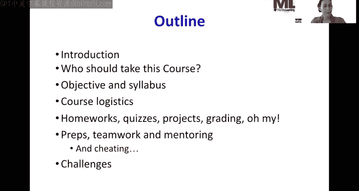

So。What are neural networks， they are a method in artificial intelligence that teaches computers to process data in the way that is inspired by our human brains。

 they've become one of the major thrust areas recently in various pattern recognition。

 prediction and analysis problems。They establish the state of the art in many problems and they often exceed the previous benchmarks by large margins。

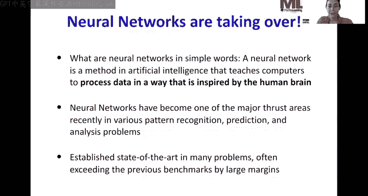

Some breakthroughs， I'm sure we all recognize these， Siri， Alexa， Google， Googleo Home， and Corana。

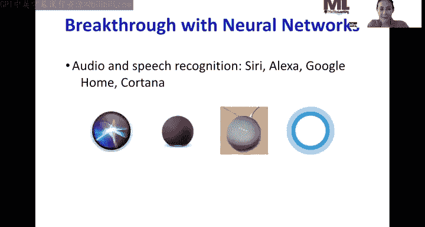

Vision and perceptions such as face detection， face recognition， object detection。

 semantic segmentation， and et cetera， these are all breakthroughs with neural networks。

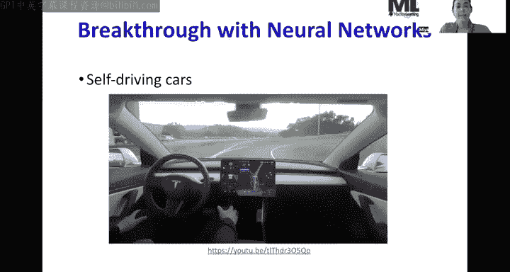

Self driving cars。Music generation。Dli， as well as chat GPT4。

 these are all examples of neural networks。

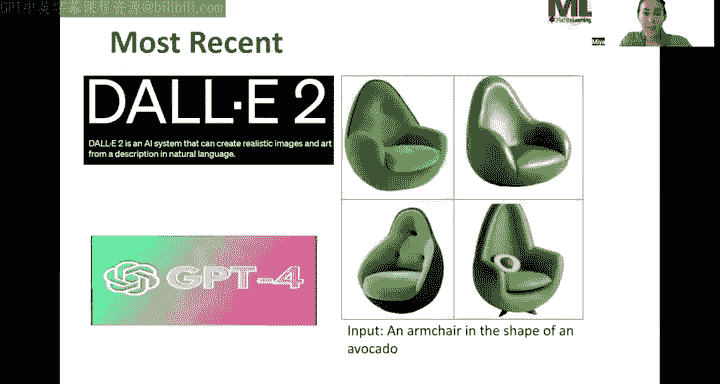

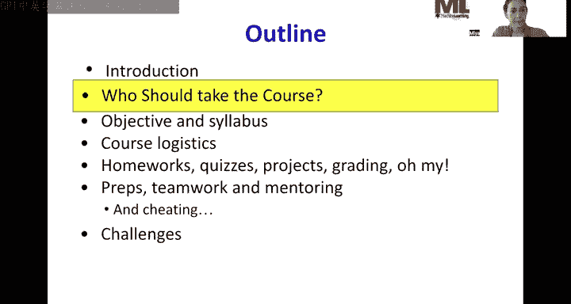

Who should take this class？The course is designed for anybody who would like to learn deep learning。

And who are willing to put in 12 to 20 hours a week on this course。

 depending on how much previous knowledge they have。

We're looking for students who are willing to continuously give feedback and engage on TheISza since that's our main method of communication for the course。

 and we want students who want to be challenged and want to be ready for AI research in the future。

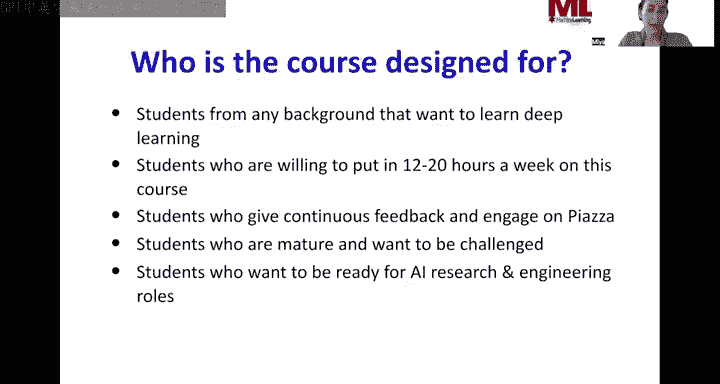

To prepare for this course， you should know Python will be using PyTrch and so at least have taken fundamentals of programming。

嗯。And you'll need to。now some calculus and linear and algebra it would be good if you have some vector calculus in software engineering in your background。

 but it's most important that you know Python calculus and linear algebra。

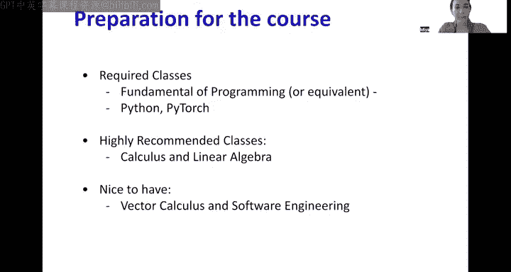

From a high bird's eye view， the course is to get you to understand neural networks and comprehend the models that are able to do the previous tasks。

We went over in the intro， we want you to be able to fearlessly design and build and train these networks for various tasks。

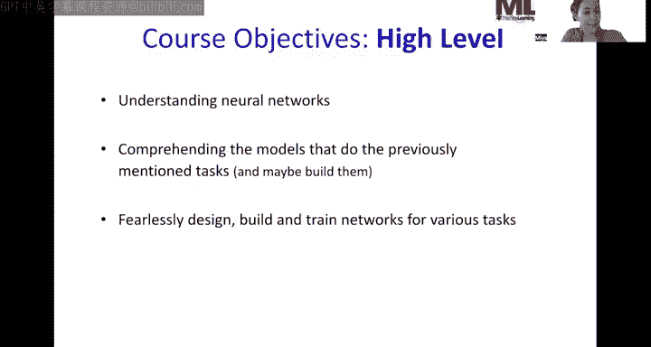

嗯。A closer look at the course， the concepts we are looking kind of at a slight historical perspective of how neural networks developed。

 the types of neural networks and the underlying ideas， how learning occurs。

 and the architectures and applications。That neural networks have。On a practical level。

 we want you to be familiar with training， we want you to be able to implement various different architectures and the state of the art solutions for some problems。

So overall we want to set you up for more work in your research area。

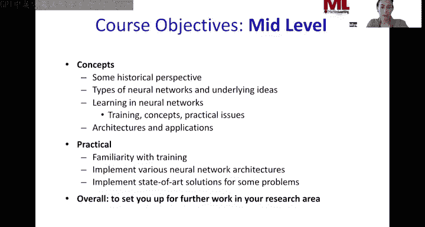

And the topics that we'll be going through in class basic network formalisms includes multilayer perceptioncepts。

 convolutional neural networks， recurrent neural networks， bolten machines。

 some advanced formalism would include generative models， adversarial models。

 graph neural networks as well as transformers， and we'll also touch upon computer vision。

 recognizing images， text processing modeling and generating language。

Machine translation or sequence to sequence modeling， modeling distributions and generating data。

 as well as speech recognition。

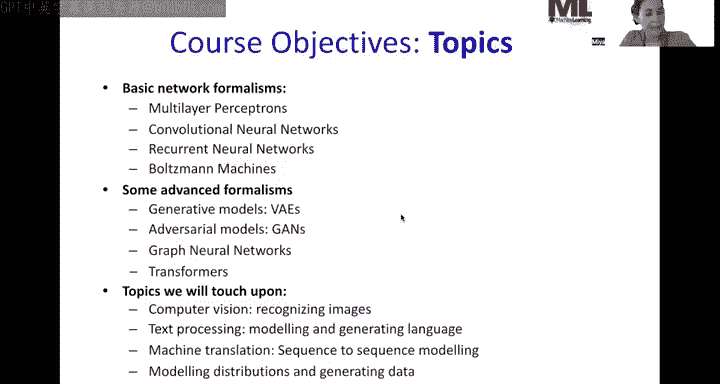

There's a list of books on the course webp page and we also have additional reading material articles that will appear in the the。

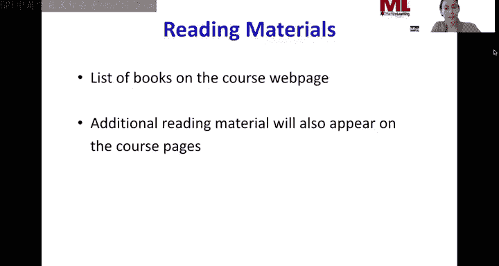

Lecture section of the course web page。

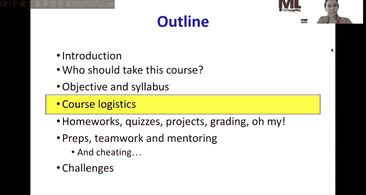

So course， logistics。The instructor and TAs， our instructor is B Shaaw Raj。

He will be giving all of the lecturers for this course readtain is also an instructor。

 however you'll be interfacing with Professor Raj the most。

The TAs for the course are listed on the website with their email IDs and we have TAs from Pittsburgh and Kigali。

 we have remote and inper office hour offerings and the times may change but for the most part they should stay the same every week。

You can see more information on the website， this is the link here。

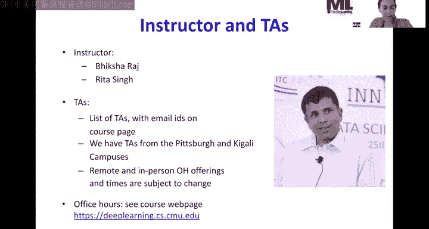

Lectures in class lectures so we'll be live streaming for remote sections and they'll also be recorded and uploaded to the course website it's important to view lectures even if you think you know the topic because first of all the quizzes depend on you viewing the lectures and also we monitor your attendance。

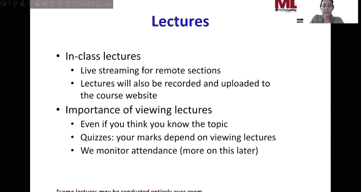

呃。The discussions for the course will take place on Pga so please be updated with the recent thread there download the app on your phone the compute infrastructure we will provide Amazon tokens for all students and will help you with Google Cloud。

And Call， please check out the recitation zero videos if you need any help with those。

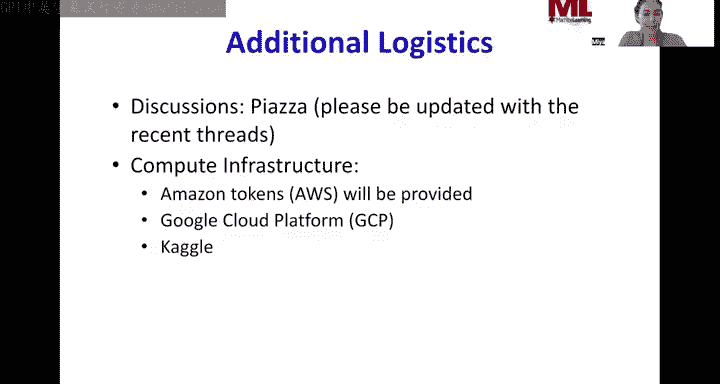

You'll get marks for attendance so we've noticed that students who attend class do better and students who do not do more poorly。

 so we encourage you to attend and so we're giving you a 1% grade for for your attendance we do track。

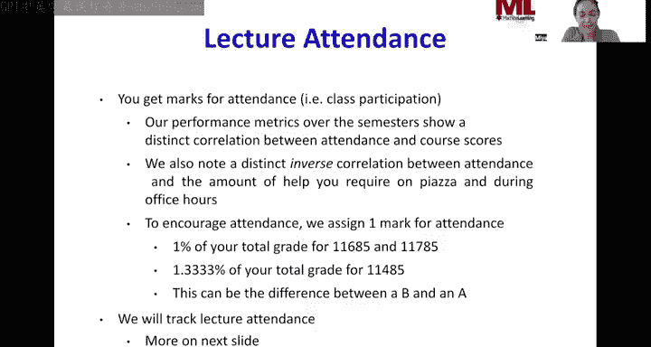

Whether or not you were there。The the main way that we track whether or not you attended is through participation during N class polls。

 so the professor will have a poll up and on a piazza you will be required to fill out your answer at the correct time they'll only be open for 30 seconds and so you have to be really paying attention and able to answer it whether or not you get the poll right or wrong is not that important as long as you were there and you're participating you will get the 1% attendance point。

If the lecture， if the professor is not in Pittsburgh and he's conducting a lecture via Zoom。

 the poll will be on Zoom instead。Please use your phone for the in class polls。

 the professor did not like you to use your laptop。So you will need to download that。

For students in Silicon Valley。If your time zone is a little difficult。

 we allow you to watch recorded lectures through media tech and we can track your attendance through how long you watch the video。

We also know how fast you watched it， but you have to watch the whole video in order to get。

The attendance point， and it has to be within a week of the lecture。Otherwise， it does not count。

So please attend。The website， the schedule for the latter half of the semester topic wise might change a little depending on the professor's travel schedule and the guest lectures。

 so we will have that up later。

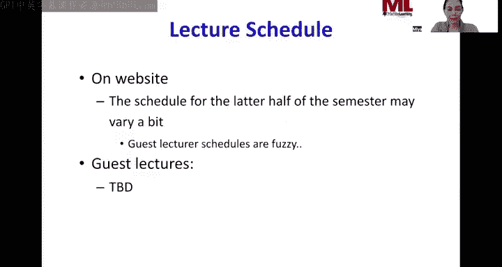

There are 14 recitations in total， and this doesn't include the homework boot camps。

The recitations are held on Fridays， we call them labs actually。

 and they are hands on and they cover implementation specifics。

Through a notebook that you can follow along with and the topic is listed on the course schedule and we really recommend that you attendees because they're extremely helpful for the homeworks。

Homeworkquiquises projects and graing。How are you evaluated。

 you're evaluated on three types of tests， the weekly quizzes。

 the homeworkmarks and the team project。So please note for 11485， there is no team project。

 but for the rest of the students， these are the three。

Questions on the quiz are related to the topics that were covered during that week in the lecture slides。

Quzzes are released on Fridays at 1159 pm Eastern and they're closed on Sundays at 1159 Eastern。

TheThe Sunday following that Friday the days might change occasionally。

 but for the most part these other days and they're released and closed there are 14 total quizzes and we accept the best of 12 so in case you have a bad week or something happened we will not count your two lowest scores for your final grade。

Also each quiz has 10。Multiple choice questions and you get to try the quiz three times to get your best score。

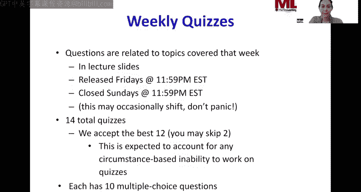

The slides will often contain more information than the professor will talk about in class and so the quizzes will contain questions from topics that are on the slides。

 but maybe the professor didn't mention。But also it can sometimes include topics that the professor mentioned in class but didn't put on the slide。

 so yeah you will sometimes there are also papers that the questions will refer to and you'll have to go and read that article in order to answer that quiz question。

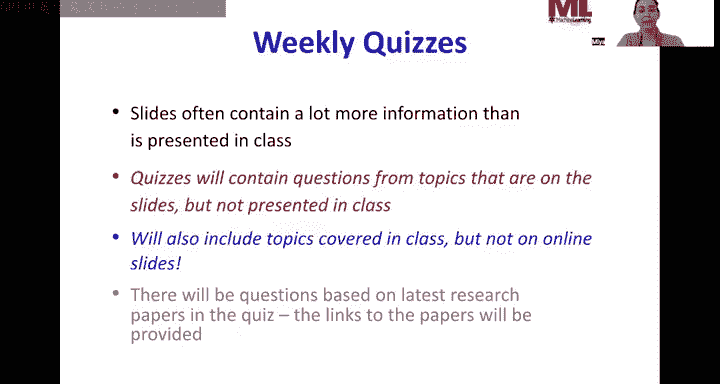

There are four interim homeworks during the semester。Yes。

 and a recitation zero recitation zero is just recommended， it's preparatory material， not graded。

Homeworks1 through four are neural network exercises and each of those have two parts。

 part one of the homeworks are autograded problems with determine six solutions。

 so you must upload them to AutoLB and part two， those are open problems posted on CAL。

There are bonus and autograd bonus homeworkmarks， those are more closely affiliated with part one。

 and those marks for bonuses don't count towards the final curve of the cho grading。

They're only meant to help you catch up if these missed points。

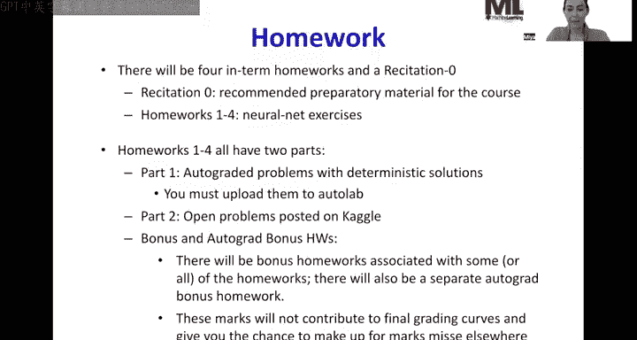

The part ones evaluate your ability to code neural networks on your own from scratch。And。Yeah。

 we have instead of pieytorrch， we have my torch， so you have a little neural network toolkit of your own。

these homeworks are autograded so you have to be careful with the specific versions of packages that you're using。

 if you're not conforming to the restrictions， then your auto grader might give you a zero。

 even if it's running on your own computer so please be wary of that。And。further part one。

 you will get a bonus point if you submit early。

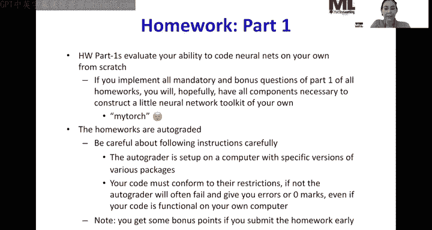

The homework part two is test your ability to solve complex problems on real world data sets。

 so unlike part ones。The initial early submissions， those are required you won't get a bonus。

You will instead be deductive if you do not submit early the point is just to get you started you can put you can submit like something worth zero points and you will get the early submission just to show that you started the remaining 90 points are determined by how well you do in the competition。

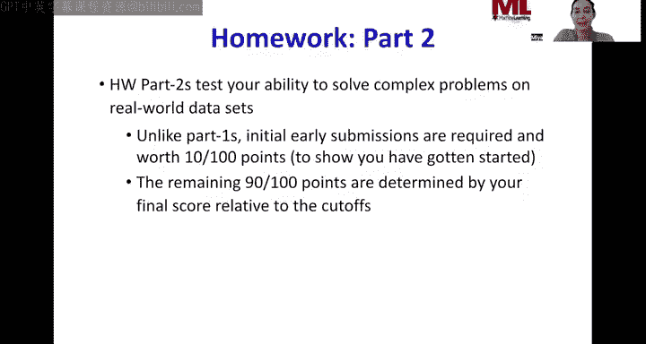

standardard cutoffs after the 10 point early submission deadline， high cutoff is 90， medium is 70。

 lowest 50， very low 30， and then if you don't submit。Or if you submit with nothing， it's zero。

Your score is linear interpolated between cutoffs。If the cutoff is determined to be an 85% for the high cutoff。

A 75% model for the medium cutoff， if you submit an 80% accuracy， you'll then get 82。

5 out of 90 points。There is a fifth bonus that you can get if you surpass the high cutoff and so if you are the highest scoring student。

 you will get 10 points more automatically and then you know people who are getting points between the high cutoff and the highest scoring student will get points relationally equivalent to。

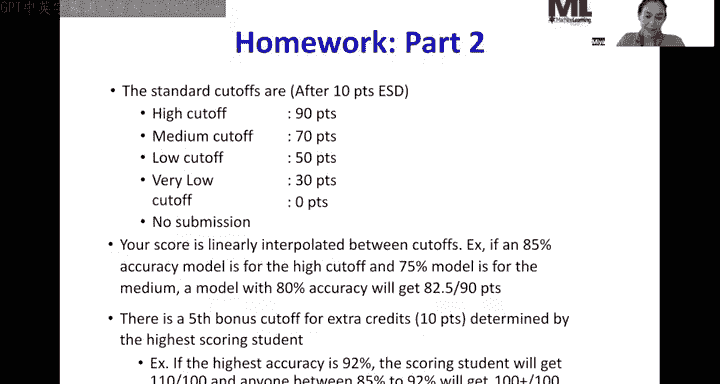

The next。There are separate deadlines for homework part one and part twos the part twos have a lot of deadlines there's the early submission deadline that I mentioned worth 10%。

And just to show that you started， there's the on time submission deadline。

 which is 90 points and then there's the slack the late slack deadline everybody gets 10 days。

To submit late across the entire semester it's not 10 days per homework it's 10 days for all homeworks you cannot use slack days to try to submit for the early submission deadline so if you。

You know， yeah， that doesn't count you can only use it for the on time submission deadline。

If you miss the early one， you lose 10 points automatically。嗯。

And to note the CAL leader boards won't be showing updates for full submission deadlines。

If you submit late， but you submit anyway， don't worry about that part。

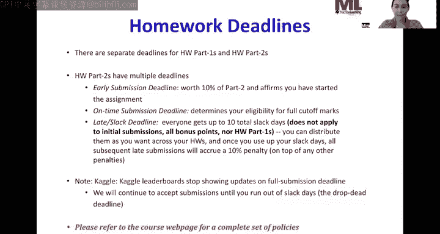

If you're taking 11485， you don't have a course project， 785 and 685。

 you will have projects an original one if you're in 785 and a assigned course project if you're in 685。

The projects are meant to exercise your ability to comprehend and implement ideas beyond those that were covered in the homeworks and the projects can range。

 you can implement and evaluate cutting edge ideas from recent papers。Or you can。

Try to solve a problem and if you do it really well， you can have it lean towards publication。

And you can even try out completely new things just to see what is working new learning algorithms。

 new techniques， new models just to show that you're experimenting any of these ideas are fine。

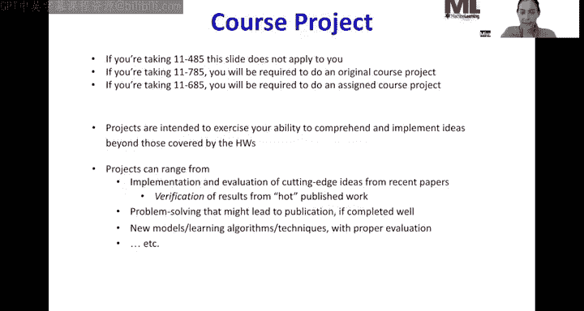

Team wise，785 students will need to make groups of three to four。

Students maximum 685 are of two student teams。And。We'll help you make a group if you're having trouble finding people。

The requirements for the projects is a report so you will have a few submissions but the final report during finals week is the most important and that's what your grade will be determined on initially you'll need to make a project proposal I believe that you get five points for that or。

Yeah， and then。The deadline will be listed on the website it's within the first half of the semester。

 you'll also need to submit an initial report three quarters of the way that's just to make sure you're on track。

And then submit an updated report for the video presentation。

That's also just meant to encourage you to stay on track， but yes。

 the final report is the most important。The video， you'll need to make a five minute video presentation。

One person can report it or all three or four people can report it that doesn't matter what's important is that you you explain the problem the solution and the evaluation clearly and you'll also need to defend your video project once it's up on piazza everybody's required to ask questions to other project groups to。

It's part of the grading process and so you'll need to answer questions that are given to you on your piazza post for your project。

Every group will have a TA mentor。Every group will have a TA mentor and if you like you can seek out a mentor that is a PhD student or a professor outside of the class。

 that is okay， but you will have at least one TA。And the project is often really fun。

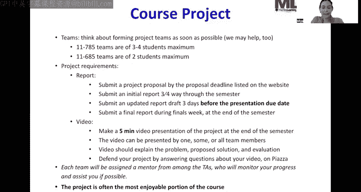

Something to look forward to。Grading 24% of your grade is the weekly quizzes。

 the assignments constitute 50% of your grade， and then the team project is 25%。Here。

 the midterm report is five points， not the proposal。

The midterm report is when you need to implement the baseline for your project。Obviously。

 this only applies to 785 and 685， 485 just create the calculation based on not having the project。

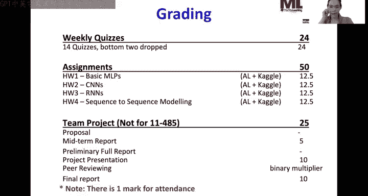

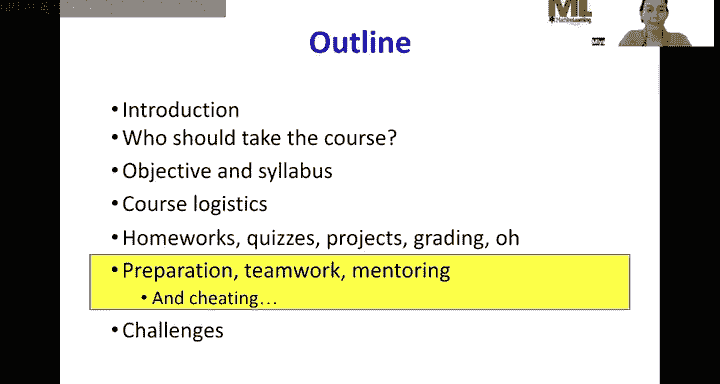

Preparation， teamwork and mentoring。To prepare for the course。

 it's implementation heavy and there's a lot of coding and experimenting and you'll be working with large data sets。

Using Python and Pytorrch， you're welcome to use other languages or other toolkits。

 but the Ts are most adept with helping with Pytorrch。

You can go through recitation zero if you really。Feel like you might start out behind in the course。

 it's not createdd。

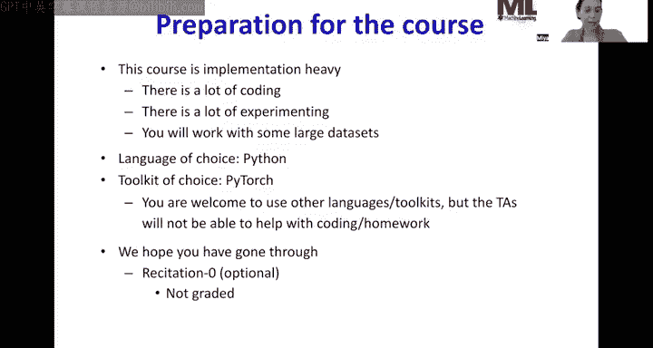

Corse communication。Everything is done on Piazza， all of the class polls for attendance。

 questions you may have and answers that Ts or their instructor will give， everything's on Piazza。

 announcements， reminders， you can collaborate with your team members there and the professor may occasionally send out notes for everyone on Piazza as well。

 so please download that。

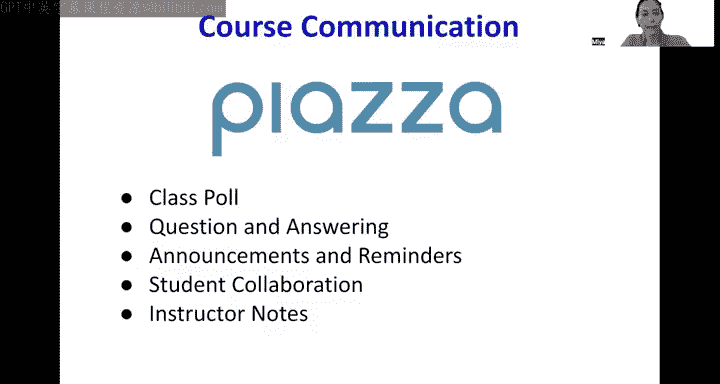

Study groups， everybody must join a study group and you'll be assigned a TA mentor。

That you can reach out to throughout the course we recommend groups of three to four people and we can help you find a group if you're having trouble forming one you'll just need to fill out a Google form that we post on Pazza and we'll get you together with a group。

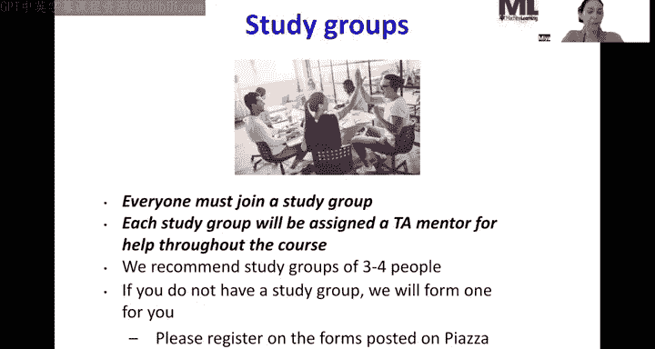

In study groups， you can discuss homeworks and solutions， papers， classwork quizzes。

 and we really encourage you to meet regularly to discuss the Intro to deep learning work。

And you can also make have the same people on your project team as well as your study group。

 that's okay。

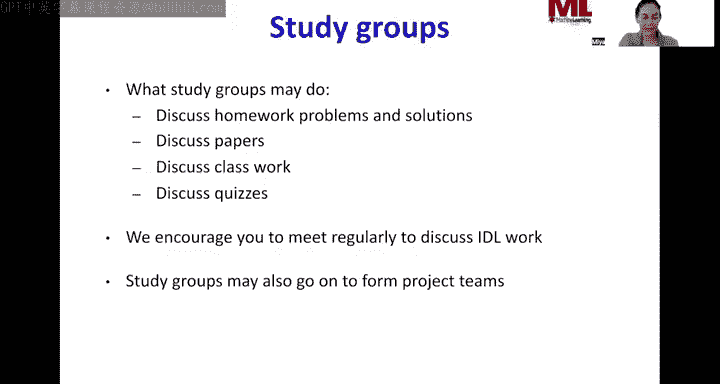

So yes， learning happens best together， more heads are better than one。However， there are some rules。

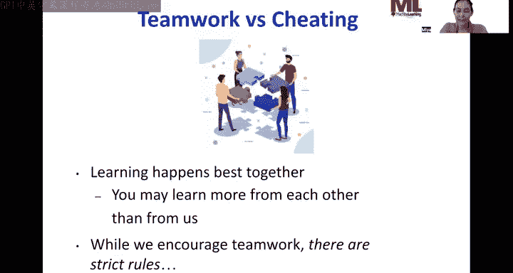

You have to do the quiz by yourself you can talk about the questions and and figure it out together。

 but when you're actually。Taking the quiz， you have to do it alone。

You have to solve the homeworks by yourselfsve you can talk about the code again and get help debugging。

 but when you're actually writing it up every line of code has to be written by you the solution has to be your solution if you're。

Plagiarizing， that's cheaty and we don't want cheaters。

You're here to learn deep learning and you're also a student at CMU。

You're one of the smartest students in the world， so challenge yourself and do not lower your standards。

 don't cheat。If you don't know what cheating is， you can ask us and we will help you know。

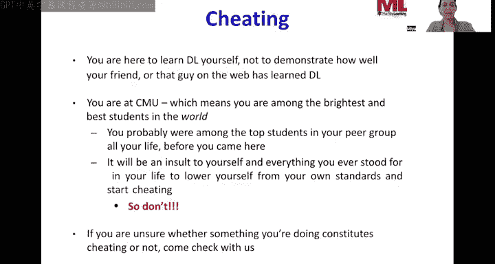

Study group mentors， so every group will have a TA mentor。

And the TA mentor will reach out to you if it seems like you kind of started performing really poorly on your quizzes or your homework grade like really down compared to the previous homework。

 but if you're in trouble you can reach out to your TA mentor or any TA or their instructor if you're falling behind you're struggling or if you feel pressure outside of class those are reasons to reach out and we will do our best to help you。

rReitation zero， if you're stuck or feeling overwhelmed。

 there's a specific video about when you're struggling。

We're aiming to make this a successful course for everyone in our ideal world。

 ideal for intro to deep learning， everybody performs well enough to get an A。

And we want to make sure that you get an A and an A means something。We want people to become。

Experts and deep learning。

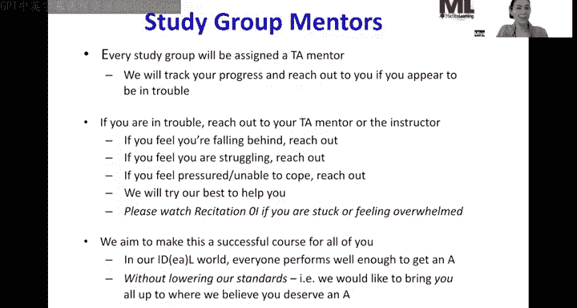

The thing is this course is really hard， it's a lot of work。

Lots of hours every week you will be working very hard on this class。

But it can be fun if you stay on top of stuff。It's masterybased evaluation。

 so the quizzes are meant to test your understanding of the concepts covered in the lectures。

 the homeworks teach you to implement complex neural networks and optimize them。

 and the projects are meant to expose you to what it means to do to solve real world problems。

anybody who gets an A in the class， they're technically ready to take a job in deep learning。

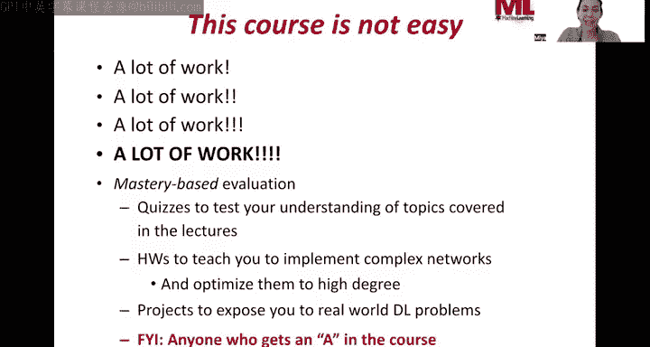

Again， recittation zero， if you have any doubts about how well prepared you are for the class。

 please go through the videos and complete the notebook exercises。

 it'll help you gain comfort with the coding requirements early on。

Homework 1 part one has components that are intended to help you later in the course。

 it's worth getting 100 on that and it's also the easiest homework。

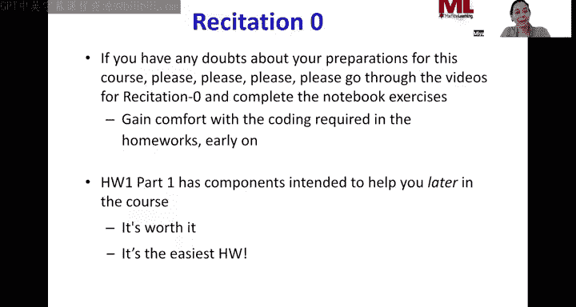

Please post on Piazza if you have any questions， feel free to post for any clarification or doubts and we do strive to respond within five minutes that is our goal。

Yeah。Thank you very much for。Enrolling in the class and we hope to see you in lecture and in office hours。

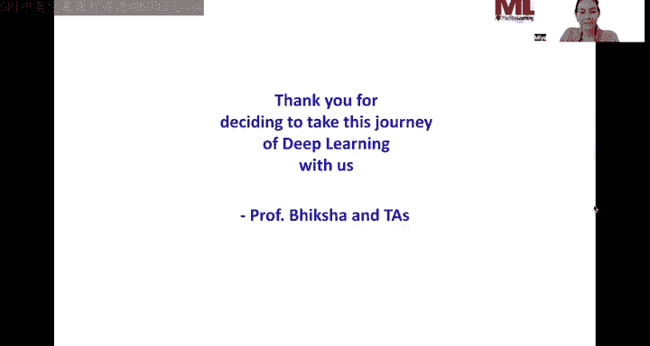