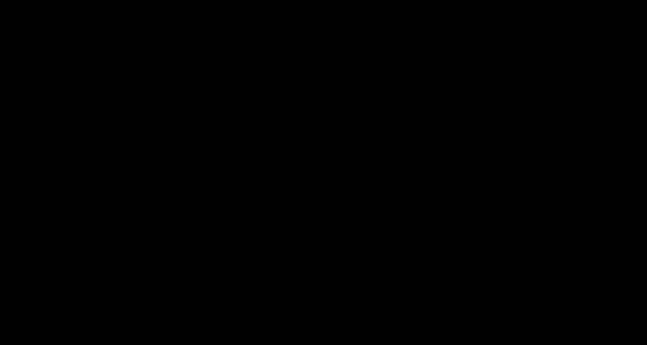
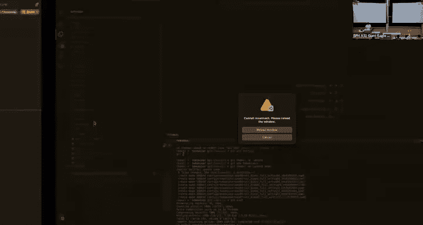
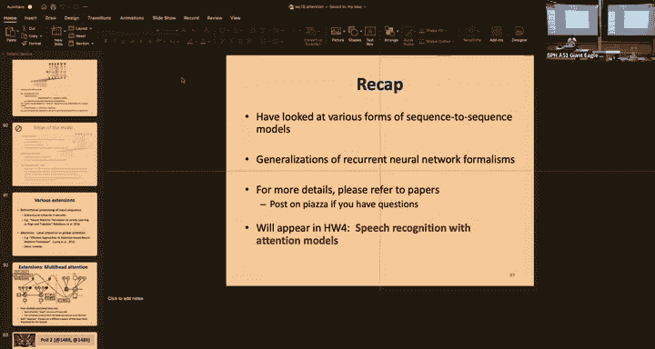
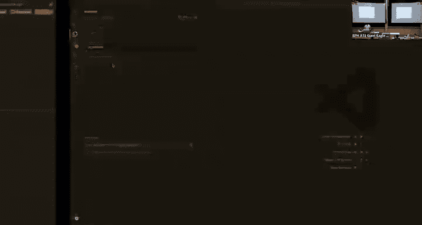
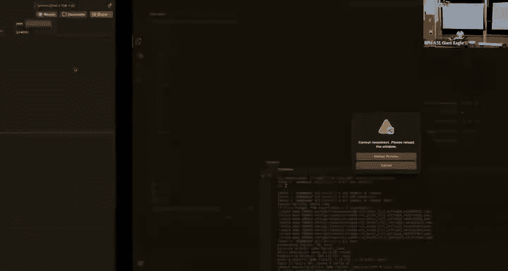
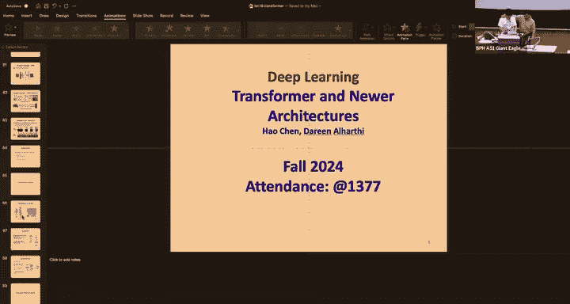
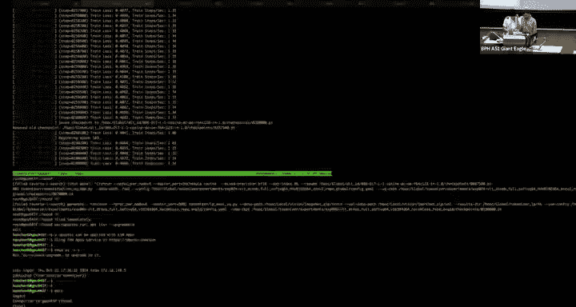
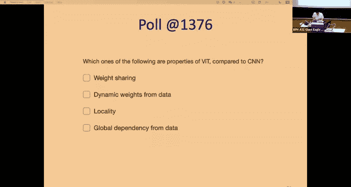
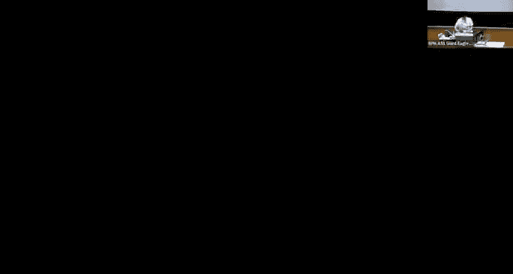

# CMU《深度学习导论｜CMU 11785 introduction to deep learning Fall 2024》中英字幕（deepseek - P20：[19]Fall 2024 Lecture 19.zh_en - GPT中英字幕课程资源 - BV1CfsReEEw8

关你这是。Microphone， do I still need open this microphone I you。

Okay。

Yeah。

Allright delivery。I come back to the nostrils， another rooms ce， laptops， et cetera。

It's all piece sparks。还多。Haveapp know for a month。Well this today's lecture is nominally。

The lecture today is on transformers and neuro architectures。

 this is we're going to be picking up for。来 cross theま。How前。要实大将你有。That goes。

You don't just download the architecture that has spoke about us briefly in the last class。

And then Kenya， there's a lot more than。Have you be to do that。再多插一个就子。Greatates confidence of。

believe has a pretty good lecture on it。On Wednesday， the class is again on Zoom。

 primarily because our guest。どれですの？Ksburg is not even in the United States。不吧。啊。様方。He was A for us。

暂就。Yeah，Because not only agency fame was not only。Wednesday's class will be on agenda。

 anyway let me hand over to how。O， so hello， everyone。

 Welcome to lecture 19 Transformer and newer architectureits。

And please sum up your attendance in the attendance pool on the piazza。 So let's get started。

The content of this lecture would be the following first we'll introduce the architecture of the transformer。

 the basic architecture and how transformer are being used in language。

 vision and audio tasks and we'll go into parameter vision training which is the default way of adapting pretrain transformers on various downstream tasks and as then I briefly go through the skin laws basically the magic power of transformer architecture。

So let's get started。 So before diving into the architecture of transformer。

 we want to ask one question， So why do we need to learn about transformer？呃。

The quick answer is that almost everything today in deep learning。

 especially the state of art systems are about transformer。 So you will seen this inGPT and G 4。

 which are based on transformer。 and we've been using it in your daily life。

 And in the state of our text2 image or text video models。

 they are also been using transformer as they are architect back back architecture。

And the transformer has also been used in like protein structure prediction， as in alphava float。

Well， these are all kind of superficial reasons why do we need care about transformer and there are some like underneath reasons why do we exactly want to use and study transformer because Transformer architecture has several very promising properties。

 for example， it has some flexibility and universally to handle to handling old modality。

 including images， audio and text。And it has good scaling property with data and parameters。

 which means as a model being scale too large enough。

 it presents some emergent capability and income text learning ability。

 which well show later in the this lecture。😊，And it also allowed us to do parameter efficient training。

 which means you can just adapt a small portion of the pretrain parameters of the transformer and apply it to a downstream task。

 which is quite efficient in both training and inference。So let's first look into the very basic。

 start with a very basic transformer architecture。And here is the overview of transformer architecture。

 you perhaps have seen this figure like many times everywhere else。

So the core of the transformer architecture is basically the multi had attention as shown in these red boxes。

And it has some other components， for example， the embedding layer and the position embedding and also the fifth forward layer and also the at and norm layer between and after each attention and fifth forward layer in this figure is actually showing an encoder and decoder architecture。

 but you can either use only the encoder on the left part or only the decoder on the right part which will show in the letter of this lecture。

So a brief recap about the attention we've learned from last lecture。

 So here is the attention in sequence to sequence model。 Actually。

 you will find the sequence two sequence model quite similar to the encoder decoder architecture with Jeff Sha for the transformer。

 So basically you have an encoder on the left and you have a decoder on the right。

 and the task would be machine translation for this example here。

 So basically you input a sentence in English and you want the decoder to decocode the sentence into French or some other languages。

And we introduce an attention mechanism between the encodeder and decoder。

 so basically the attention is a weighted sum of the hidden states from the encoder with respect to the input of the current state in the decoder。

We'll see that the self attention and also attention variance in this lecture is basically a variant of this attention mechanism。

And last lecture， we also mentioned about self attention。

 So basically self attention converts the hidden states between the input and decoder into the same hidden state form or input only。

 So basically， you compute three values， Q K and V， which we we term as query K and value。

 and you compute the attention weights based on the query and value only。

 and then you you you compute the weight sum based on the attention weights and your value matrix to compute as output of the self attention layer。

So this is a brief recap of what we've learned from La lecturec。😊。

And here's a general components of the transformer architecture so we have a word organization and we embedding so basically is converts some role signal in each mod。

 for example， language into some features we can handle as for our transformer input and we have multi head attention block。

 which is basically multiple which is basically a multiple stack of the self-at layer and we have position embedding which injects the position information into the attention rates and we have fifth forward layer which we show is just a normal MP layer and we have also residue at normalization in the transformer architecture which used for stabilizing the training and at the end it has similar to like hallmarks we have output projection layer which is used to do pretrain or the downstream task using the transformer architecture so let's go through。

Are each component。By the way， first， we usually term the multi head attention and the fifth forward layer and add a norm layer together with position including as a transformer block。

So let's first get into the word to。 So before your transformer can handle the input of different modality。

 we need first to tokenize it and embed it into some feature input features So for example。

 take text for example， when we have real text or transformer architecture usually cannot directly handle the string of the text。

 So what we do is code toization tokenization basically maps the words in a string into different either one or multiple sub wordss or tokens。

 we usually termize tokens and as shown you this figure here is basically split the words in the sentence into sub wordss。

 So which means one word can be split into different sub wordss and different words can be also combine into one token according to the method you choose for your token。

And after we split them into the subors， we build a vocabulary and the vocabulary basically provides an index for each subward we have split and weapon that each token as an index。

 or we can coas class because eventually we want to use to predict this index from our transformer to train the transformer。

So after we have the index or we have the tokens， we can do another step。

 which is called word embedding。And the word embedding basically represents each discrete token index as some continuous token embeddings。

 which we can fit directly into our transformer as our input。 So recall in your homeworks。

 we basically want to expect the instead of the discrete tokens as our input。

 we want some more continuous input features as our input。So how do we do that， for example。

 here is an example， we have a sentence about CMU learning is the best learning course。

 and we first do the organization convert this sentence into a list or a set of discrete tokens。

 so basically an index of vocabulary or an index of tokens。And we have an embedding layer。

 The embedding layer basically maps these discrete tokens into a set of continuous token embeddings。

 So how do we do this with an embedding layer。😊，An embedding layer is essentially a just lookup table that converts the token index into continuous vectors。

 So as so here we may have a lookup table where we have the key SO token index。

 where each token indicate a subward with use from form or tokenization method and each token index is mapped to a token embedding。

 which is a set of continuous value and the dimension is a heavy parameter use you need to set。

And in total， we have a V token index， which is our vocabulary size。

And these token embeddings are are trained together with our transformer during training。

 and the embedding layer intor is actually cr just embedding。

 But we'll see why what is inside an embedding layer。

 embedding layer is essentially just linear layer because it compute the linear transform over your input x with with matrix W。

 And here we can view the input x as a1h vector of your token index。 So， for example。

 here or token index its2，3 and vocabulary size。 So we convert into a1 vector which of dimension L by V where each row indicates a1 vector of the token index。

Which means， for example， the first row it has a token index of one。

 So the first element of this row is set to one。And we have a learnable weight matrix。

 similar as we see in all or linear layers， it has dimension of your vocabulary size times by dimension of your features。

And by using this one， by multiplying this one hot matrix with your read metrics is。

 is essentially just selecting。The rules of of your matrix as token embedding for to compute your Y。

 So embedding layer is essentially a linear layer， where is input is one heart。

So after knowing the organization and embedding， let's move on to the Mody head and perhaps mask Mo had attention。

So here is the self attention， the essential block of the Mo head attention。

 so the self attention has the following operation。

 which we've seen from last lecture is essentially computing the attention between query K and value where query K and value are linear or fine from the input X itself。

So the attention operation basically first computes the attention weights using a softmax operation by this do product between your K and value and is usually scaled by the square of your dimension of of your query and K metrics to ensure the softm operation gives smooth enough attention weights。

 and it multiplized attention weights by the value metrics。

 which essentially computes weighted sum of way based on the similarity and or the correlation between the your query and K matrix and because it's normalized by the softm operation。

 it tokens weight some to one in the attention weights。

 So let's first look into how do we compute the Q KV。

So the Q KV is essentially actually just three linear or fine of your input x。

 So here we have our input x of dimension L by D， where L is your input and D is your input feature dimension or essentially your embedding dimension。

And we have3 D fine with three learnable V matrix， W Q， W Q and W V， and we。

Conducting your fine for x with these three with metrics to get the query key and value vectors。

matrix。 And after we obtain the Q K and V， we compute the self attention or the attention weight using a soft max operation between Q and V。

 So it converts。the matrix of Q and K into a attention weights by computing the matrix multiplication between these two metrics and still by the dimension of the this two way metrics。

 And after we obtain the similarity between Q and K。

 we apply a soft max operation on top of it to get the attention weights。

 which is look similar as in this figure show here。

 So basically compute some you can understand as a correlation or the similarity between Q and V as your attention weights。

So after obtaining the attention weights， we are multiply conducting another matrix multiplication by multiplying the attention weight of your value metrics by obtaining the final output of your self attention operation。

😊，And multi head self attention is essentially multiple self attention operations over the channel dimension of your input X。

 So you split your x in the feature dimension into several different， which we call heads。

 and you conduct the self attention for each head。And you conduct this output final together as a final output of your multi head attention block。

 So the purpose of the multi head self attention is initially。

 we hope that different attention maps to capture different relationships。

 So here is a demonstration of multi head attention。

 We can see that these are attention weight of different heads in total， we have a heads。

 and we have different。Haad to capture the different relationship between the input。 So for example。

 the last attention head essentially captures alignment between the input and between the input。

 which gives us a diagonal attention map and other head is captured either locally or globally dependencies between the input or between the key value and query value。

So sometimes we want to use attention masking in your attention ways， because， for example。

 in the encoder and decoder architecture， task the task we want to handle is usually for example machine translation so when especially in the decoder part when we do the machine translation it's a sequence prediction task So we don't want the decoder input to be seen by like we don't want the time step or as we don't want the input of later time step as a decoder input to be seen by the previous time step of the decoder when we make the prediction So we usually apply some attention mask。

 which we call as casual attention mask as a decoder and for encoder because its compressrising the context for more input mod So it usually apply with the bidirectional attention mask which we don't need to care about which which part we want we want the self-at to be attain。

And it just learned。The global dependency of all the inputs。

And here are illustrations of bidirectal and casual attention mask， so in bidirectional attention。

 we want each position can be attended to every other positions。 however， in casual attention。

 we want the later positions only to the previous position and the previous position cannot attend to the later positions getting into more into the attention mask in the later。

Yeah。This architecture makes sense to me when you're doing training。

 but obviously you friends you don't actually have。Now， put greater。嗯哼。😊。

Does this architecture stay the same and you just feed in？sequence output generation yes。

 that's exactly what we we doing inference。 So during training， you have your other input。

 for example， apple and translation of app either in or other languages。

 And during training especially for the decoder， you want to input your target language or target translation into the transformer。

 But since you want to make the sequence prediction。

 you don't want the second word to know you don't want the first word to first see the second word to be like make the prediction otherwise。

 it doesn't learn anything。 So we apply the casual attention masking to prevent the previous word to be attending to the later words in the decoder part。

 But in the encoder part， we don't have that concern。

 But during inference is actually just sequence token by token。

 So we the first token and use the prediction of first token as a second input to the decoder transformer。

And will afternoon knowing the Mo head attention will introduce the position encoding。

 So the importance of the position encoding is that。

The reason we need position including is that selfat is permanent environment。

 So what do I mean by that。 So consider here two examples。

 we have a sequence of A and B and C and a sequence of C and A and B。

 And we compute the we treat them as input and compute the attention width from our self attention operation。

 and on the left， I'm showing the attention width of ABC。 And the right。

 I'm showing the attention width of C and A and B。And what can you see from this attention with。Yeah。

 so essentially， when you， your sequence has different order like ABC and C A B， for each pair。

 when there is no position incoding for each pair between this input。

 the attention weight is essentially the same， no matter how you per the order of the input。

 So we don't want this because in transformer will sometimes we want to handle the sequential tasks like prediction of our machine translation。

😊，So what we do is introduce the position encoding。

 and we hope the position encoding to capture the absolute or relative distance between the tokens。

So the very naive version of position includingd is that for each dimension over over each token。

 and we select every two dimension and introduce a sine and cosine values。

 and we repeat this for every two dimension until it fulfills or the old dimensions of all tokens and with set the angle of each sine and cosine like to some is actually a you want to set to to make them is never repeat for the position。

 So the position including encode the position for each token and into the selfat weights。😊。

And here are like examples after， after we have the position including on the top。

 I'm showing the previous attention rates we've seen without position including speak little because okay。

😊，So on the top， there is no the attention with without the position encoding。

 and on the bottom is the attention with with position encoding。

 You can see that after we introduce the position encoding。

 the attention width of different pairs is no longer the same。

 according to without the position information。And especially for this kind of position including。

 we can see is always give us the like。High waist for towards the end of the sentence， In sentence。嗯。

Yeah， so after knowing the position， we can move on to the faithful forward layer。

 and we can see that the fifth forward layer is actually just MP。 and it's a。😊。

multi layer perceptioncept with architecture looking like this。

 we firstbed like we first expand the dimension of the input like usually from conventionally is from the dimension D into four times of the dimension D as our input and there is a activation layer in between and we map the wide dimension into the original dimension using the another linear layer。

And the fifth forward block usually in transformer is used to store the pre knowledge。

 so basically the protein knowledge is usually stored as a weight of the fifth forward layer and people find that changing the like widths of the fifth forward layer usually can change the pre transformer like to change to edit the knowledge of the pretrain transformer and usually people also found that the fifth forward layer is essentially related to the in context learning ability of the pre transformer。

So another component in the transformer architecture is the add and norm operation。

 So we have the residue between each self attention layer and each favorable layer。

 And we also have some normalization layer， as we saw in conventional networks。

The residue is quite simple， Its similar to ournet as a residual connection before and from the before and after the favorable layer and body head attention and after that we also have a normalization layer and in transformer。

 the normalization layer is usually selected as a layer normalization because it's normalized each token by its embedding size dimension and instead of the batch normalization we've seen in training of con neural networks and this adding the normalization gave us more stable training of these transformers。

And here are something more interesting about the normalization。

 Usually there are two types of or two position of normalization we can insert into the transformer。

 We call it postnm or prenor。 So postnm basically means you're adding the normalization after the residual layers and after the residual operation and prenorm basically means youre adding the normalization before the input of your fifth forward and multi attention block。

😊，And the difference between this two normalization is that preno is usually easier and more stable to train。

 and it often used in like architecture we've seen these days。

 And post norm tend to present better better performance。 if it's properly trained。 actually。

 it's more difficult to train compared to pren。 But once it trained， it's present better performance。

And here， better performance means better downstream performance。

 So you may observe the similar performance in pretraining with these two types of normalization。

 but usually you can observe better performance with postnm as a downstream task once you adapt the pre traininging pretraining networks and the reason of this is that from the equation of the pre norm。

 you can see that。Is adding the normalization inside the each block essentially is the function of F。

 And in in that sense， it's more close to identity map for each transform block。

 So during once you increase the depth of your transformer network。

 the pre is essentially actually just making each block identity identity mapping。

 So it's essentially reducing the depth of your network and adding the width of your network。

 So it's easier to train and than the， Yes， you say the more what are the steps that we can take to make。

Treining。So its kind of it's a good question actually。 So when I mean the properly trend。

 it means usually post normm require much more data to train them pre normorm and the training is less stable compared to pre normorm。

 So you may observing especially for large you more9 issues compared to your prenm。

 So you need to handle either from the mixed precision or the tuning of your learning rate。

 that kind of stuff to be properly trend the post normm。

And this is especially true when you train very deep networks， because as we just discussed。

 Reorome is implicitly reducing the depth of your architecture because it's more close to an identity map and postome doesn't have that。

 so it's more difficult to train than prenom。Yeah。And the final component of our transform architecture is the output projection layer。

 So you plug a linear layer at the top of your transformer architecture。

 and it can be used for different tasks。 For example， ining。

 it can be used to predict the next token or it can be used to predict the the word from mass token and in translation is used to predict the tokens of your target language。

 So it just a linear layer。 And when you here thing here。

 is usually the linear layer you will find it usually can have the same dimension as your embedding layer。

 So people have some trick in training the embedding layer and linear layer by tying the word embedding weight matrix with the weight matrix in your final output linear layer。

Some language model users， some， some are not。And putting this component together we actually obtained the very basic architecture of our transformer。

 so it has a wordorganization and word embedding， which converts the role signal of each modality into an input continuous features into your transformer。

 and it then has stack multiple transformer block， which has a multi head attention。

 which has a faithful world and which has a residual and normalization between each operation。

 and it also has a position coding which is important to encode position information into selfat weights。

And it has a output projection layer to further transform marketing to。

 to conduct any task we expect。So any questions available here？Yeah， so。

They 아래도 the 이런 presentation of to。Oh sorry， can repeat the country。Yes， I showing that figure。

 the position including is adding to the embedding after your embedding layer。 Yes。

 the same position including is add to every input。😊，And this is for absolute position encoding。

 And later， I'll introduce the relative position encoding and also other version of position encoding。

 which you directly adding the positional information into the attention ways。😊，🤧。Yes。Oh sorry。

 I't all coming from like outside of the。It's across the engine。Oh， yeah。 So here is I。

 I'm the architecture of the decoder part。 So in the decoder part that a cost attention layer instead of the instead of just a self attention layer。

😊，Let me see cross。Do we take。梯嘴。对。What's actually the。Css attention yeah， in cross attention。

 you take the hidden state。 It's actually in like in sequence per sequence model。

 you take the hidden states from your encoder and you compute the key and value from your encoder hidden states。

 and query is your decoder input or your deco hidden states。 But the origin is essentially the same。

 It's just a key and value is set to different values。😊，Yeah。

 so we'll move on to the first poll of this lecture。Sure is open。Okay。

 so let's move on to the second section of this lecture。So it's transformer architecture in L P。

 So we will talk about the coming architecture in natural language。

 how we use transformers So the first one。在干嘛？Guys， it was then inspired with me in the formula up。

挂着挂的词。Yeah， so the transformer architecture in natural language processing。There are very。

 various tasks we can handle with transformer in natural language processing。

 such as question answering， machine translation， codegen， all kinds of tasks。 and before tryGBT。

 we usually handle this task with pertraining and fine tuing paradigm。

 which means we pertraining the transformer on very large purposeus and then fine tuning the transformer on each task of this downstream tasks and we get different models for each task and use that for our downstream and our downstream But after GP or like afterGBT。

 we usually handle this all kind of different tasks using one transformer after the pertraining and after post traininging。

 which we will see later。So the overview of this section is that we will first introduce the common architecture of using transformer in natural language process。

 which is essentially three types， the encoder and decoder and encoder only and decoder only。

 and well introduce two variants of position encoding the relative position encoding and rotary position encoding。

 which adding directly the position information into the attention width instead of the absolute absolute positionding into the input embeddings。

And at the end， we'll introduce。We briefly introduced the efficient attention mechanism。

So let's first look into the architecture ofP transformers。

 So here are the three architectures of transformers in natural language processing。 Actually。

 the architecture， this three architecture are being used all kind of tasks。 So first。

 encoder decoder architecture is usually used in as we see in the sequence model， for example。

 in machine translation tasks。 So we have an encoder as strong in the bottom and decoder as strong in the top。

 And we conduct the encoder and decoder by cost attention。And the in the encoder set。

 we usually provide the context we want the decor to use。 So in the encoder set。

 we usually use a fully visible attention， which is by direction attention widths。

 And in the decoder part， we usually want to make the sequential prediction。

 So we use the cor attention in the decoder part。And you will also see the decoder only architecture。

 which means we only have the decoder part of the transformer and don't have an encoder。And。

The attention for the， the attention mask for the decoder only architecture is usually just the casual attention we mask we use。

 and the decoder only architecture is usually for generative task。 For example。

 the prediction task and the generative some like in terms of generation gene means is model the distribution about the data itself。

And the encoder only architecture。 So is is certainly just the encoder part of the encoder decoder architecture。

 and the encoder only architecture is usually for some understanding task because it has a fully visible attention。

 For example， we want to do classification on top of the embeddings of the encoder only architecture。

 So well see examples of each architecture in the following。

The first type of architecture is encoder decoder architecture。

 which is actually first exploring the natural language processing task like widely exploring the natural language processing tasks an example of this is Google' T5 and T5 is an encoder decoder architecture as in the original transformer paper So is a text to text model on various NLP tasks here various means during training it has different tasks between the encoder and decoder。

 for example， it can be some translation tasks by input translate by input sentence like this in the green box translate English to German and plus English sentence and your output is a German translation for the input sequence。

And it can also be is also being trained on the some other task， like summary and question answering。

 And all of these tasks are trained together in the of this encoder decoder cluster。 So basically。

 you input some prompt plus your input sentence and you predict the output sentence from your decoder part。

And the decoder encodeder decoder architecture is more similar like we seen in the original transformer paper。

 So basically， you have a set of encoder blocks and a set of decoder blocks。

 And you first process or feed the input or and prompt into your decoder encoder and get the hidden state from your encoder。

 And in the decoder， you predict。The target this step according to the contacts you gather from your encoder。

 so in the encoder part you can see why it's using a better decoder better actual attention because we want the older contacts from the encoder part and in the decor part is just a sequence prediction tag so we are using the carrier attention in the decoder part to predict any target step by step step to generate the answer。

And this is actually the first tab widely is built in natural language processing tasks。呃。

And you will also heard of the B， which is essentially just an encoder only architecture。

 The birds we call bidirectional encoder representations from transformer。

 So it's an encoder only architecture。 and the training of bird is actually quite different from encoder decoder。

 like T 5 in T 5， we predict basically the target sentence we want from the input plus prompt。

 But and we train the encoder decor architecture with that objective。 However。

 in B with the encoder only prediction with the encoder only architecture。

 the training objective different is different。 usually in birds use two types of the per training objective。

 The first is called mass token prediction。 So given an input sequence。

 the random mask out some words as a different positions of the input。

 and use the training the encoder only architecture to predict the mask token like what'。

 for example。Here we have a mask sentence， and we must some words in the sentence。

 and we train the encoder to predict the mask out word in the sentence。

 and usually it's trained with another objective， which we call next sentence prediction。

 So during training is as a pair of sentence here， sentence A and sentence B。

 And except to predict the mask token in the sentence is also predict whether this two sentence are。

Whether sentence B are after sentence A， So they may be sample from different documents and sentence B might not be con coherent as sentence A。

 So its another prediction preing task for the bird。 So you can see that for basically。

 the encoder only architecture is target and learning at learning the understanding from the input sentence。

That global understanding from the input sentence and capture the relationship between different sentences。

And no， we need to mention that in B actually is where the pro training and then paradigm like develops。

 So in B is actually first pro traininging the transformer architecture on some prox task。

 So here in B is mass token prediction and less sentence prediction。 And after pre traininging。

 we apply the network into different downstream task with very different objectives。 For example。

 machine translation in the question answering。 So its actually quite different from what we see in T 5 in T 5 is directly trained with。

different doctrinestream tasks。 However， in B， we first train with some unrelated proxy task。

 like a mass token prediction and mass token prediction， which we never use in some downstream task。

 And we then the protein network into some doctrinestream task and to adapt them as a downstream。

So it doesn't do like next token prediction， it just outputs the entirety。呃。Yeah， I believe in。

So there are actually two types of bird architecture。The very first tab is encoder only。

 which is doesnt do next token prediction。 So it only learns the understanding from the mass token prediction and the next sentence prediction。

 But later， people actually tried to encode decoder architecture of birds， too。

 which they also use next token prediction as a decoder part of the bird， actually is not。

 I forgot the exam。 but they are data variant of a bird， which also do the next token prediction。

So the point is the fleet ending is applied on the encodeta。He could actually use physics。对猜。

B trainingning is applied on the encoder。じゃ。是ひさん。And once launch records Gen generate records。

Those can be used。当。And finally， we come to the decoder only architecture。

 which we've seen like we've actually used them in our daily life， which is a G。 And G。

 the full name is generally pretrain。 So it's a decoder only architecture。

 and it actually has been trained with the simplest objective， which is the next token prediction。

 in the next token prediction is essentially just language model。

 So you want to predict the next word I got into the all the preceding words。

 as shown in this graph here。 So basically during training。

 you want to predict the word by words and。😊，That's the entire proing objective for decoder only models。

And the one magic of this decokota only models is that。In G2 with some relatively small size models。

 they still conduct the protraining and fetuing on specific tasks。 So in protraining。

 they use net token prediction to per the language to pro the language model。

 And after pretraining language model， they apply the decoder only architecture on different function task and finetuing it。

And the magic comes from actually， G3， where once they find when you scale the model size and skill the data size。

 the model actually presents some zero shot capability and in context learning by zero shot here zero shot capability basically means you don't need to fine tuning on the specific classroom task。

 And as long as theing covers are large enough， the model can actually understand the tasks as we see in5。

 So basically your input prompt and you will give you some we desire， for example。

 for machine translation or for question answering。

 and it doesn't need any kind of finening on that tasks。😊。

And is also present in context learning capability。

 In context learning basically means is' actually similar to the shot。

 which we sometimes co fair shot capability。 So we input the input prompt with some examples of the different task。

 For example， the machine translation task。 We input a prompt to query the transformer to do machine translation。

 and we gives some example to the machine translation and it's actually output the desired translationative sentence from the in learning capability。

 The in text learning is not really learning。 It's actually just retrieving the knowledge from the。

F earlier， as we saw in the late papers。 and TraB is actually developed from G3。 And later on。

 we also see G B4， which is a multimod heading model。

 which can also be trained with a decoder only architecture。So any question here？Yes。Ances。Yes。

P is about part of the time。嗯。You can understand it as a part of fineun。

 but usually people nowadays call it as post training。 So in pretending。

 you're preaching the decoder only architecture on very， very large covers。

 like trillions of tokens and using the next token prediction。

 and othering exactly has already the capability to complete the sentence or doing some doing some real short tasks。

 But for safety reasons， we don't want the like language to produce some an ethical or harmful response。

 So we do do some alignment in the post training stage to make sure it produced some like。

Most positive responses。But I think the question might relate later。

Knowing how does my know what to do。他应该暂0的。こサラン。系。第二。Recognisizing的。It's a big challenge by itself。

 but that's part of the year。Because' a trying to make sure that not only doesn't do that task。

 right？Yeah。These GD like model also trained on mass standards modeling。 No。

 it's only trained based NA prediction with only。And character attention。D it to generalize the task。

The training cor would include extensive of。Yeah， I think the answer is yes。

 because people use very large cors。 Its essentially the entire Internet。

 So it encompass every kind of task。 and usually people。In purpose。

 add the coding tasks and mathematical question task into zero protein purpose to in make sure the model learns that kind of stuff。

🤧嗯。Yeah， so in the decoder architecture we need and we use some of the information the no。

 in the decoder， only architecture is only has the decoder part。

 It doesn't have any of the encoder part。Yes。You can think of the decor architecture as。Andこれ。はいせば。

So that you haven't good architecture。But then， you know， if I just have only the decoder。

Is not really be generated。So you can think of what was he from being interpret on the process。快。

Comp you should have that temperature。And so， the architecture is。

Very analog to and quarterly called architectural growth。Exactly the same architecture。Yeah。

 so we'll move on to the different variant of position encoding。

And we've seen absolute position including before， which is basically the sameoid。

 adding to the input embedding。 and people actually using the learned absolute position embedding。

 So basically a set of learnable parameters directly adding into the input embeddings。

So the basic idea is input some different information in the input embedding to make them discriminable from the attention rates。

 However， there is one problem with the absolute position embedding is that it you usually is of fixed length。

 which means it's not usually very good to generalize to longer influence once after。 So。

 for example， in protein， we might use a fixed maximum of 512。

 but in inference we might encounter different length of input， which is longer than 512， so。

In that case， absolute position embedding usually do not generalize very well to longer in sequence。

 And here is an example why they are not generalized well。 And from the figures on the bottom。

 you can see as well access is theplex perplexity of the protein model on somestream tasks and on the axis is the inference input tokens。

 and you can see that for the syn soil。 So basically the absolute position embedding。

 it has very worse exroplation when you increase the inference input tokens to be longer than your protein tokens So is perplexity gets very like significantly decreased after。

We， we apply the protein model on longer input tokens in during inference。

 and we will introduce relative position including， which is basically A A IBI in the figure。

 And you can see that when even though when train it's trained on 512 or 10124 tokens。

 it's actually present very good generalization for different length of input tokens。

 which present very consistent performance on the per when we increase the inference token input tokens。

And the relative position， including is actually very。E idea。

 So the position en we want the attention ways to be discriminable according to different position。

 So the idea of relative position including is adding some relative position bias into the attention matrix。

 So here the attention bias is basically encode the relative position of your input sequence。

 So you can see that the diagonal is basically has a alignment with itself。

 So its relative position is0。 And once you have the other position you add some offset to the position to to the position of the diagonal。

 So you traces as some bias into your attention ways and adding this to before computing。😊。

Before computing the Som operation。呃。Before completing the softmax operation。

 And that's the idea of relative position encod。 So you can see that it also includes the position of your your different input sequence。

 your your different input sequence， but is directly applicable to attention with instead of doing that in the input embeddings。

 And it's actually more generalizable on the compared to the absolute positionbedding。😊。

And there is another variance called rotary position embedding。

 which is commonly used in current large language models as in Lama。

And the rotary precision embedding basically abstracts the position embedding as a kernel function between your query X Q or F Q。

 And with position M and your key value X N of position N as some kernel function between X M X N in the relative position between M M。

 N。And they formulate with this in your equation and。So basically。

 they add some exponential multiplier by the。They multiply by some exponential sensoroid in the attention ways as a relative position。

 including。 And here is the illustration of the rotary position in building。 So it still。

 So here we have a set of input sequence。Of dimension D。 And for every two dimensional。

 we get this two elements and compute ista as we did in absolute position， including。

 and also is encode a position M into this two position into these two embeddings。

 and I basically rotate each position into two dimensional space。😊。

That's why the rotary position encoding and it has some more general form as shown here so basically we've also seen this form in the absolute position embedding so basically is a large matrix of sine and cosine values according to the position M which is set by the different positions and the theta which is set by hyperparmeter as we saw in the absolute position ending。

And one good thing about rotary position， including is that it a loss the extension of the contact window。

 which means during training， you have a。😊，Some like short written maximum lens， for example，2048。

 But during inference， it actually gave us very good explanation by rotating。

 which means it's more generallyable on the different or longer inference token lens。😊。

And another part of the NP part is efficient attention mechanism。

 So we want the efficient attention mechanism because naive self attention has usually quadratic complexity to the influence due to the soft max operation。

 So in the soft max operation， you want you do the metric multiplication between query and K matrix。

 which give us a quadratic complexity over the lens dimension。 and is in total。

 have a square of lens and times by your dimension Ds。 And in the literature。

 they actually have many attempts of reducing the quadratic complexity into linear。

 and we briefly introduce a linear attention variance here。😊。

So the linear attention is basically a modification in the softmax operation。

 They extract the softmax operation， which is this equation here。

 which is a normal So max operation over the Q and W like taking the exponential and by normalizing the exponential values into they abstract this softm operation into some kernel function by computing the similarity between query and Qs query and cases and the kernel function。

 you can set them to any value any form actually。And by having the kernel function， we can。

We place the exponential between Q and K into these kernel function forms。

 and due to the association property of the matrix multiplication。

 we can first compute the a key and value part instead of directly compute the query and key part。

 which reduce the quadratic complexity in terms of lens into the quadratic complexity in terms of dimension。

Which is usually give us some better complexity， especially during the inference of this attention operation。

And the second part of this lecture。Yes。我啲。Is it criminal bunch this。有。Every。Like what are。Actually。

 people tried different variants in the literature。

 So they use just linear transform between K and values or K and queries。

 and they also use cosine similar between K and the queries。So actually。

 there are different kind of kind function people use。 and they。Present different properties。

 But eventually， people still found that the softmax gives the best performance。

 even though linear gives a better efficiency compared softmax。What is think you should be。不讯。Sorry。

 what is the in behind。So the rotation present enco is essentially we want to make the position encod can extrapolate to different token length during inference。

 So the rotation， especially the rotation matrix is give us some good exlation extraroppolation properly during inference。

😊，So the basic idea behind the position recording as simple。这个 job单。さの？Here's what you've got。

 I've got a sequence of vector。And forget about the fact that you're actually using。You know。

 projecting things now when this one pays attention to this。

And if I have the same vector in both these locations。

 you're not end up paying the same attention to both places。And so that's a problem， right。

 So what you really want is the attention paid to this guy that doctors in different locations too。

好了。What falls off in that matter， So if you dig get any stationary。アコネーの。As you go away from。

So you want to generate an auto quo and write sequence。Who'se our operation fall over the that。

And this is what you're going to add here in balance。 And so the position of encodeing mats sideides。

 all of them are white。 meaning every frequency is present to the same。Extend。

And so they look the whole lot， like， quite noise。Or the coalition is fall of the time。打呢。

Generating these sequences kind of hard。 So the better thing is for me to do is to just say have some vector。

And in high dimensional space。And this thing repeats。It's time。 I mean， high dimensional space。

 can keep roting forever。 And so now， the only thing that matters is the cosine between the version of project and D。

I'll put it now back。 That's okay。And so by continuously increasing the angle。Can actually get the。

あたも成跡的に。roughly260 weeks in high dimension in three dimensions or p。Yeah。

 so the actual this is actually quite easy。 I think。 So G 2 is insert a deco on architecture for。

Let's put。And the next， we'll move on to the transformer architecture in computer vision。

And the transformer actually has been also widely used in vision tasks。

 like in classification segmentitation and actually any kind of vision tasks。

 And we'll first introduce introduce the vision transformer architecture。

 and then introduce some efforts on the efficient vision transformer architecture。

 and we'll talk about the connection between the self attention and conclusion。

 and we'll introduce the similar encoder decoder and decoder early encoder early architecture in vision of different tasks。

So let's first get into the visual transformer architecture。

So this is the first like an introduction of a vision transformer and it actually has basically exactly the same architecture we seen in natural language。

 except how we deal with input images。So in in in natural language。

 we basically use organization and embedding to convert the input string into some input embedding features。

 But how do we do that with like row images instead of the input strings。

So in recall that in convolal network， the design of convol or the convolal kernels is actually quite natural phase to to dimensional images。

 So basically， we take patches of from the images and compute the convol with the convol kernel together get features input features or to get intermediate features in the convolal neural network。

😊，So in vision transformers， they actually adopt a similar design。

 They split the image into a sequence of patches like pixel patches。 For example。

 for a image of resolution H by W， they select some patch size of P and split the image into these different patches。

 and they convert this two dimensional patches into a sequence of one dimensional patches。

And then you can apply a linear layer or a convolutional layer on top of the patch to get the input embedding dimensions。

 So mimicking to the organization and embedding in the natural language is actually just an embedding layer on top of the row images in the embedding layer actually have two types of implementation。

 The first implementation is to use a convolutional layer with the kernel size of P and spread of P。

 So it's actually go through the images by the stress size of P and to get the embedding features of each patch size。

 and another implementation is first to split the image into patch convert them into one dimension sequence and apply a linear layer on the flattened pixels from the patch to get input features of the images。

And after we get the input features of the images， the remaining is just the same as a transformer。

 we have a normalization layer and the residue between each block and the code block is still a multi self attention。

 and we also have a favor layer which is essentially a MLP in the transformer block。

And one interesting with the vision transformer thing is here。

 So the vision transformer is first introduced to do some image classification tasks。もっとでしね。Oh yeah。

 the position encoding is also still similar to vision transformer。

 So people first adding the absolute positioncod into the embe of the like after we get the em of each patch。

 So it can be either the learnable position end or the signaloid positioncoding as we see in the very live transformer architecture。

 Yes， distinguishing jump the next row。😊，Or is that just。Oh， yeah。 It's actually a good question。

 So in the first variance of vision transformer。Sorry， how can I see the question answer No。

 I just repeat it out loud because you can't get a question there flatten。I different roles。

So is there any of distinguishing the rows from the clouds。 Yes， yeah。

 so in the vision transformer architecture。 So people actually try two types of the absolutes positioncod。

 The first one is one dimensional， which you don't disc the rows。

 And the second one is two dimensional， which they thed with two dimensional and cosine and flatten the two dimensional into one dimensional。

 which adding to the embedding and actually in the first vision。

 people also use the learnable position embedding like like directly learnable one dimensional position emdding。

 which turns out like the position bedding can also be learned from data。

 which I'll show in the later slides。😊，啊。So which one。Yeah， I， I saw the question。 Yeah， so。

Essentially， there is no quite difference between a convol like the convolutional layer of a patch size P and strip by P with a linear layer on Tabao the like flattened patch pixels。

 And theres no one better than the other there essentially the same thing。

 Its like onevol is similar to linear layer。 So here we have a P by P conclusion。

 And it also the similar to just a linear layer as we flatten or the pixels in the patches。Yeah。

 so here。哦，给那个都可。So here the position encodings have to be different from N because here in the image when we bake it out of the patches。

 the patches above it， the patches below it should also matter right because in MLlP。

the world all you。here you can understand each patch at a token E LP。 So it's busy the same thing。

 actually that's what mentioned can。Distances along A。Yes， and if you apply the learnable position。

 you actually can learn the two dimension zone spatial relation from the data。Yeah。

 so the vision transformer is first introduced to do the image classification vision tasks。 However。

 people find that when the pretraining samples is very limited， for example， on the X axis。

 when we're using just 10 million images to train the transformer and to train C。

 the vision transformer actually present inferior performance compared to the conventional neural network。

 And only when they increase the pretraining images into like 300 million or 100 million。

 that's why that's where vision transformers starting performform conventional networks。

So the reason behind this is because of the inductive bias between theal neural network and vision transformer。

 So recall that in neural network， we assume the image presents some locality in the input dimension。

 and we design the conal kernel to explore this kind of locality because we for example。

 use a three by3 kernel or5 by5 kernel to move the kernel along the image to capture the locality within each kernel and in networks。

 we also have sharing ways from each kernel， which means for every position in the input image we are using the same ways from the kernel to compute the input features。

 However， in transformer or in self attention， we don't have this kind of inductive bias of locality or sharing ways So the transformer has to learn the locality and dependency from our data and it has to learn from a lot of data to be able to learn that And here on the bottom showing the。

Ebedding embedding filters from the vision transformer。

 which you can see that once the data is enough， it captures the different textures and shape from the input as we saw in the filters of the network。

 And on the middle is showing the position embedding similarity。 So basically from this figure。

 you can see that with learnable position emdding is actually learns the two dimension spatial information from the data。

 And on the third， I'm showing the attention the distance between the attention has in the vision transformer and the access is the number of layers and one access is the distance between within the attention has。

 And you can see that for vision transformer when there is enough data as the shallow layers is first learning the locality。

😊，Relationship between different like classic patches or tokens in image tokens。

 and on the deeper layer is actually starting capturing more global depend with much longer distance captured by the attention rates。

So any question here you。What exactly is the。OrIt's just。I think its five shots。

linearar imageagin accuracy。 So once you per the vision encoder on top of the proteining data。

 you frozen the image backbone and train a linear layer on top of the frozen backbone and you compute the top five accuracy from the top five prediction。

So when you say accuracy。icThe cause of this image， yes。Yeah， is it。Ttrain using。So I'm Mexican。Yeah。

 VI T is encoder only detector。 So is， you can see that it is also being used for image classification。

 which requires for understanding for the encoder only。Oh， the proy is a classification task。

 so they train on very large covers with a very large number of classes as the beginning to train this vision transformer。

Like a cat dog toating the classes of the images。For yes，Viion transformer。

 so for here it cannot be doing image generation， but later I'll show that the color only architecture which of vision transformer doing the image generation tasks。

So you can see there is' kind of drawback of a naive image transform which is must learn the locality from a large couple of perunion data or and large couple of prouning classification data。

And there are some later variants to make vision transformer training more efficient。

 And the first variant is actually we call spring transformer。

 And the screen transformer introduce a window attention。

 which restricts the attention to be computed by the a window of tokens。

And what we do with the attention did is actually， it brings back the locality by into the transformer。

 So original invasion transformer as shown on the left， is computing the attention over the。😊。

OrLike a whole whole batch from the input images。 But in its swing transformer。

 it's not only split the image into patches， but also split the patches into into different windows and compute the sub attention within the windows only。

And one question first wing transformer， once we introduce the window attention is that how do we compute the attention across the windows and the swing transformer introduce some shift window operation So after the shift window operation is shown on the figure in the top。

 So basically you can see that the in the first layer。

 we split the patchries and we split different patch into four windows and in the second the layer after that we divided we divided the patch into different windows and we conduct some shifting。

By moving the windows across to the like to the to the right bottom of this reddirected window。

 and we compute the self attention within this shift window as the second layer to to make sure it learns different information not only within the window。

 but also across the window。And after they compute the attention across the window they reverse this shift。

 which the co aic shift and took back to the original window partition。

 so swing transformformer introduce both the with window attention and cost window attention and make the reason window attention and cost window attention as a two consecutive layers in their transformer block。

And there are actually more variant which introduce locality back into the linear transformer。

 so basically CVT， they incorporate both convolution and selfat into one transformer block and also there is next next V so basically they replace the selfat into a block of convolution with some kind of large kernel like 7 by 7。

 but still keep the transformer architecture as we in the linear transformer。

 and there is also max V， so basically they compute they split the selfat operation over the spatial access as the channel access。

To make sure we introduce more inductive bias us。 And this allvari present like easier training and more efficient training compared to the naive immune transformer。

And there is another very interesting architecture which know as metaformer。 so metaformer。

 they explore two metal architecture for transformers。

 they explore four variants for the transformers and they find that basically the metal architecture design is what matters for transformer。

 So what they did is basically replace the multi head self attention with different variants like identity mapping。

 So basically you keep the input and output as the same for the self attention block。😊。

And they also have random mixing。 So basically you random， you random select the patch and mix them。

 and they also have a for the block。 And eventually， they also have the attention as a variance。

 and they find that this variances produce very similar classification results。 However。

 on the downstream task， you need to select the best one for the downstream because some tasks are more suitable for segmentation for and some tasks are more suitable for detection。

 depends on the variance， how you compute the locality or how you compute the dependency between the input tokens。

Yeah， so a question on Z。 So the question is come has considered a transformer or only a mimic。

 So the come actually， from this architecture， you can see the come is essentially a same meta architecture as in transformer。

 except we when we compute the a relationship between the patch is using a relatively large kernel convolution instead of a global dependency self attention。

Mandai is actually not。Meba is broadly。 Theres another question。

 iss Meba by CM MO A of a transformer。 Actually， Memba is a more。

More like a linear variant of transformer。 So it'。Also keeps the metal architecture。

 but replacing the operation of self attention as a sub linear operation of member。🤧嗯。

And we briefly introduce the connection between self attention and convolution。

 So you can see that convol and the transformer they have different properties。

 So for convolutional neural networks， they share some locality in the they explore some locality in their convol filters and also for different input tokens or different inputpositions。

 they use the sharing width of the kernels to process the input features or the input images。

 However， in transformer， you have to learn the global dependency or the locality from the data itself。

 and in transformer is also have dynamic ways from the data。 I'll explain the dynamic widths later。

 So basically。😊，But so we want to answer the question whether composition and transform are really unrelated。

So here are some interesting findings。 So basically people find vision transformer actually learns very different features compared to networks。

 so for the first row of images， I'm showing the similarity between features across layers for vision transformer and for Renet on the on the left I'm showing the feature similarity for the vision transformer across layers and on right I'm showing the feature similarity for Resnet 50 and you can see that selfat in vision transformer actually learns more uniform features across layers compared to resnet which has a very discriminative stage in the shallow and the deep layers。

And it's also interesting to show from the bottom figure that lower layers of vision transformer actually have both local has both learned to attend locally and globally。

 and hair layers basically mainly attend globally。 And they also find that， especially from the。😊，呃。

especially from the data perspective on the left， they are showing the vision transformer trained on 300 million of images like the left figures and on the right two figures。

 they are showing the vision transformer trained on on the image that。

 And you can see that when the data sites reduce from 300 million to just one meaning。

 the lower layers doesn't learn to the local attention very well。

 which means all the attention are globally。 That's kind of explain why vision transformer needs like much more data to learn both the locality and global dependency from just data。

And。We can actually convert a convol into self attention。

 So here are some difference between conclusionvol and self attention。

 So the difference we have is locality versus the global dependency， which is learned from data。

 And we also have way shing in self attention compared to the dynamic ways computed from the input itself。

 The dynamic ways here basically means the attention ways。

 And you can recall that is dependent on the data X itself from the key and the query matrix。

 So here you can actually gradually。😊，Convert itself convolutional into a attention。

 So on the figure A is actually illustration of a convolution。

 You can see the input has special access as the channel access and convolal basically takes the explores the locality in the spatial access and computes the final features from this range of the input features。

 and attention basically takes all the spatial positions and computes that for each channel。😊。

And you can also have the swing like a local attention in swing。

 which also restricts the attention within just a small portion of the spatial axis。

And this variance basically allow like showing some connection between the convol。

 And you can actually adapt the convolal into a selfdi layer by also making the kernel waste computed from the data itself。

 And people actually do that。😊，And another difference between the convolutional and selfat is that self attention kind of learns the global dependency between the input features。

 so it captures relationship over all the input tokens， however。

 convolutional only captures the relationship within the kernel and the kernel previously are set to some kind of number like 3 by3。

5 by5，7 by7。And this work basically is explore some very large kernel size convolal They scale up the kernel to 3331 by 31。

 and you can observe from the top figure， which is shows receptive field of the convolal。

 So basically essentially how this conversionvol network captures the regions in the original input images。

 And you can see that once you increase the kernel size into 31 by 31 is kind of captures the global depend by the convol network similar to。

😊，Or region transformer and its presence also better fragment when you using larger kernel on the segmentation and detection detection tasks。

 But skip the kernel size to very large number is not like that easy There will be optimization issues and other training stability issues。

 So people use some repair trick， which I'm not mentioned here to train the networks。🤧。

And at the end， I'll show some different architectures in。

 as we saw in decoder and in decoder encodeder decoder encodeder only and decoder only。 So theres a。

Pching pattern in images， which is shown mask auto encodeder。

 So basically is similar to B adapting encoder and decor architecture。

 and the preing task is predicting the mask patch from the is predict the mask patch from the mask。

 as we saw in Bch。 And we call it mass talkingken modeling。

 This is a similar architecture in decoder and decoder and used for preing and other preing。

 the model is adapted。 The encoder is adapted on different understanding tasks。

And we also have a decoed encoder architecture for segmentation and detecting tasks。

 So basically you have an encoder which encodes the information of the image and you inputs information of the image into a decoder to decocode the volumeing box or segmentation masks of the input images。

And we also have decoder only architecture， which is here I'm introducing the mask Yet。

 So it's basically a mask gene image transformer。 So one interesting thing here is that for this decoder only architecture is also trained with mass token prediction。

 So during during training random mask some input patches and predict those pixels from those mask patches。

 but during inference is used for。juing images。 So during inference。

 it has several steps as in diffus models。 So for the first step is generating some you input all the mass token for all the image patch and generate the predict pixels for each token and you keep only the high confidence tokens as a partial image to be generated。

 and you treat the remaining as a mass token again and puts them again into the transform to predict like to refine the mass token as pixels。

 And this way， they can use the deco only model to for generation。

 And actually recently people has using purely auto generation pure request of like token prediction for image generation。

And yeah， and that's the third pull for this lecture。 And also， I think the time is up。

So let's repeat the colour for this wholees structure。

关个。Before they close。What are they answer？不。

can inform。Thank you， again。

