# CMU《深度学习导论｜CMU 11785 introduction to deep learning Fall 2024》中英字幕（deepseek - P21：[20]Fall 2024 Lecture 20.zh_en - GPT中英字幕课程资源 - BV1CfsReEEw8

And blame for。

Some of your travels with your homeworks because he was once many years ago at TA for IDL。

And some of what he designed is still there in our homework， so he knows our course。

 he knows as well， and whommar over to you。

Thanks a lot， I really appreciate the kind introduction and you know taking this course was extremely foundational to everything I've done since and you know vicious support ever since has been really。

 really tremendous for me and I actually took this course remotely from CMU and Qatar and I tad it from there and it was you it was a wonderful experience to be able to do that and you know be exposed to a lot of these ideas as an undergrad I basically this was。

I think just a few months after the attention is all you need paper had come out。

 it was a sort of a very exciting time so before Bt， for example。All right， so。

I prepared a little lecture here on。

Large language models。诶 let me。And the compound AI systems， which is a term I will define。

 they enable us to build。I adapt a ton of material here from a lot of amazing folks。

 many of whom are at Stanford。So the context of this lecture is that as we're all aware。

 it's never been easier to prototype and build really impressive AI assistance and AI demos in general。

And it's not a secret that this is largely or almost entirely due to large language models which is a class of deep neural networks and perhaps the best example of this is none other than chatd GT it's this one interface where not only you can ask whatever questions come to your mind but also you know you're likely to get answers that are synthesized specifically and conversationally for the information that you provide and what's really amazing compared to like earlier sort of AI systems we've had before like search you can actually ask it for help with tasks。

 so this is an example of me asking it to parallellyze sequential loop I had in Python and lo and behold it does exactly as I asked。

So this lecture is sort of about like how do we take the things that you know we learn in this class and you what are the steps at the high level that are involved in using them to build large language models and then you know applications and systems with these large language models。

So basically how deep learning got us to this stage and here's an outline of everything I'll discuss in today's lecture。

So first of all， sort of this is all thanks to neural language models。

 the notion of using transformers， which sort of turned out to be this really powerful architecture。

 I don't think you know I could have sort of expected it to be that great but I think it was instilled already sort of from the spring 2018 version of the class that I took that this was clearly going to be a really big deal So transformers and autoaggressive decoding is sort of have given us this really powerful foundation for doing everything else that we'll talk about but alone they're actually not enough we've had this for a long time we didn't have the advances that we have now so what what givesbbs one of these sort of key stages here。

 which is sort of an old idea but applied for language models in a sort of。😊。

Sting of sort of creative ideas， string of engineering at scale， lots of powerful things。

 which is pretraining in order to give language models broad knowledge of language of the world of various skills and tasks and maybe also to teach them some quote unquote reasoning that can help them solve tasks that we care about。

😊，Now pretraining by itself doesn't get us all the way。

 although it's extremely foundational posttraining， it has other names after training alignment。

 reinforcement learning from human feedback， these names are slightly sort of different in scope。

 but the idea is that we want to teach language models， not just things。

 not just language but actually teach them how to behave as user facing assistance that you can put in front of somebody and they can ask it questions or ask it for help and it should just follow their instructions。

 it should not swear at them， it should otherwise be safe etc。

And then basically once we have this foundation of you these language models that are acting as instruction following sort of components。

 how do we actually go beyond that and build modular systems。

 how do we sort of engineer these sort of applications or architectures in which these little or very large deep neural network language models or operating to solve tasks。

 and this is what I'll sort of discuss towards the second half roughly of this lecture。

So I'm aware that you guys covered newer language models at a high level。

 you covered transformers in particular as an architecture for deep learning。

 and so I have sort of just a recap here in which I just described autoaggressive decoding to make sure we're starting on solid ground。

😊，So the idea is extremely simple， we have this architecture that is going to be able to encode text for us and also project it to sort of the space of vocabulary and that's going to be really helpful for predicting words for decoding words and in particular is one of the simplest things we can do that's already going to be incredibly powerful is we can do autoaggressive decoding in a greedy way so what we could basically say is we have this loop while sort of we haven't finished a sequence sort of we can tokenize the input text that we have。

😊，Feed it to this architecture that's a transformer it's going to compute these representations。

 it's going to sort of go through the forward path as usual and it will give us output probabilities。

 we can use that to sample the next token maybe the highest probability token maybe we can add some kind of random sampling in there based on these probabilities and then we can basically take these token re sampled append it to the input and just simply repeat repeat this process and in doing that we are sort of able to generate long sequences of text。

😊，Now it's very believable that this can capture a lot of tasks you know everything we're talking about today is like here is some input give me some output in English or in some natural language it's just a very general function that speaks a natural language the question is now how do we sort of take this and actually train a transformer that is able to do this well so that's able to actually serve in solving tasks or answering questions or you know doing all the cool things that people use language models to do？

😡，I'll focus in this lecture on decoder only architectures because that is basically the entirety of the last few years of language models sort of used language models used for generation。

 but encoders are still around and in some sense they might be even deployed more widely if you count by like number of individual deployments because they are the backbone of tasks that sort of require actual encodings like search like web search information retrieval so this is where I spend a lot of my time working I'm not going to discuss it in depth today but basically we've covered sort of encoders in the past lecture and you can build incredible things with them you can basically use them to represent documents and give you weights of importance for every word in every document and you can actually take that and build representations that allow you to search where the weights of this search are coming from a neural network you can simply use the embeddings that they give you。

In a contextualized way to do this also in a highdial space without going back to token space and you can actually just use them as sort of scores in which you can take the query that somebody is searching for。

 take a document that you sort of want to assess this document relevant or not in the context of a search engine and basically train them to give you high quality scores and if you have a set of documents you can sort of loop and repeat this process in such a way that in such a way that you can score these documents and as you can see at the bottom of the slide。

 these approaches are all using encoders but they actually vary drastically in the trade-offs they pose so if you do something like the thing in the middle here where sort of a transformer is actually just encoding every item in isolation encoding documents alone and queries alone you can get really scalable systems because basically you can precompute these representations for all of your documents in advance and store them。

But if you want to really leverage attention and all the power you get from you know the alignment of tokens you can pay the extra cost of encoding the document in a way that's conditioned on equityity and you can get you know higher scores this is just an aside to make sure that encoders are not forgotten but the rest of this lecture will entirely be focused on decoders so this was just kind of like a remark。

So let's jump into pre training where our goal is to give the language models broad knowledge by training them on broad web data。

So think of we're going to basically crawl the whole web if we can。

 and we're going to filter things that we don't want in there and then we're going to aggressively clean it。

 but basically the idea is the more data you can cover from more sort of diverse sources。

 generally the better。And obviously， so here here is an example from one of the earliest sort of data sets released for this purpose in open source it's called the pile and you can see here that。

You know including academic papers like archive and things from BubMed。

 it includes just general webCs， CC is Common C， very popular sort of general webC。

 it includes question answering and community sites like stack exchange of which stack overflow is a subset。

 it includes code like GitHub includes general sort of human knowledge in Wikipedia and includes a bunch of other stuff that is sort of you can refer to in the original paper from the pile。

😊，And now that we have all of this data， what can we do with it。

 well the interesting thing is the very simple you know traditional task of language modeling or in this case simply just next word prediction is going to actually take us really for so all of what we're going to do is we're going to use a standard classification loss class entropy to basically just you know teach this transformer that given you know the first you know Tword predict the next predict the next words in all of this data that we have gathered and cleaned from the web。

😊，And this is sort of the paradigm we operate in in the past I guess eight or so years in deep learning where for many。

 many tasks in general you do not start from scratch。

 your initialization instead you pretrain some sort of foundation model， if you will。

 that is trained on this broad scalable data that's generally not task specific in any obvious way。

 and in particular you could train any architecture here or transformer and LSTM or something else。

 in this case on next word prediction， and once you have done that。

 you have this sort of good initialization that you can adapt for your task through training and in particular what we call fine tuning。

😊，So there is an interesting question sort of as an aside of why does pre-training on broad data help and you know this is kind of a whole area one could study but sort of two vague hypotheses one could have is that maybe it helps the gradient flow better during fine tuning when you start from really pretty good initialization that has proven it can reduce the loss on this interesting wide range of data。

 or maybe something very different， maybe know gradient descent really just likes to stick very close to initialization and so when we spend a very long amount of time getting to a pretty good initialization。

 even a small amount of fine tuning learns a task is able to learn a task but also in a way that generalizations really well because it stays close to this very general pretrained parameters that we're able to find what there's a question how is filtering and cleaning done？

This is one of the biggest factors that tell you how much engineering goes into this stuff in general the short answer is we don't know how the state of the art sort of closed models are sort of processed the data is not public for all sorts of reasons some of these reasons are it is really sort of a cutting edge highly competitive you know commercial space other reasons include well if you're training on all of this data。

 all of the stuff in in the know common C and other stuff sometimes you don't have copyright to do that and so you know companies have a lot of tradeoffs to contend with as to what is fair use and what is not fair use and obviously this is something that is worth reflecting on that said that said。

The concerns you have as far as like cleaning such data or things like。

First of all is this page like does this page have any meaningful content or not and you can basically just take existing language models and say something like if the perplexity here you know is way too high。

 if basically if the model is really confused and is unable to predict tokens that exist in this page let's say that I got from the web then it's probably like just random noise and I should throw it away because it's just going to ruin my training it's going to like distract from actual learning。

 that's one signal another signal could be well I know Wikipedia is pretty robust and people spend tons of human effort to like what's the word to like curate it and to shy their sources and to write in an auditorium away and so that's something I want my model to sort of learn more from so I can up Wikipedia and make sure that it's very well represented much much more represented in my data than it is in the web by essentially ups samplingling or upweighting it in the corpus。

Another sort of factor could so this is a heuristic right this is if someone decides I like Wikipedia I'm going to to make it to make it a larger fraction of my training batches other factors are things like。

😊，嗯。There are automatic methods for trying to do this that field in general is highly promising but I would say it's like very early very early stage one reason is that research is done by academics and so to be able to really show ablations and studies at large scale is very hard in general but there is literature and I can share sort of more links after the lecture there is literature on trying to do some sort of assignment or some sort of learning that tries to tell you which subsets of your data you should you should wait weight more heavily in in your training so these are just some of the some of the heuristics and processes that go into this but it's mostly highly secret and it's mostly a ton of engineering and a ton of trial and error with theory that's kind of trying to catch up and to advance at the same time。

Awesome， that's thank you。So there's a question of， you know。

 we're doing all of this pretrain and we have limited understanding of like。

 we know it's very successful， we have certain intuition on what we want to include and what we don't want to include。

😡，And we have certain heuristics for filtering data and increasing the representation of certain data。

 et cetera， but what is it trying to do and what does it actually achieve before we go through the other steps that we have in a pipeline where we do post training and other things。

And so there is this sort of two broad things that one can consider the first is it gives us strong representation of language which is going to be really helpful for you know knowing which words are related。

 knowing you know basic syntax of human languages being able to just recognize and generate you probable sequences that look like human speech and all sorts of all sorts of these like basic skills the other thing it gives us is as we said earlier it gives us this foundation that we can easily adapt to downstream tasks you know in language like if you want to do if you want to classify the sentiment of text。

 you know is it positive text， is it highly negative text， is it something else。

 if you want to discover the toxicity if you want to generate reports。

 if you want to do you know retrieval all these types of downstream tasks that benefit from having a good representation of language。

😊，So I sort of copied this list from Chris Manning where he has a bunch of。

Language modeling like sort of completions here or like closed tasks is what it's called where you're trying to basically fill in the blanks and it's meant to illustrate the sort of scope or sudden subset of the scope of what a language model learns just simply during pre training without any。

Kind of custom adaptations that specialize to language any in any finegrained way so this is massively scalable the only kind of clear inductive biases we're adding here is where it sort of tokenizing which is really important and we are working with embedding so that words kind of can learn relationships and we are just simply training with that at the massive at a massive scale and with simply doing that you know a model can learn that Stanford is located in well Stanford California or Palo Alto if you will it can learn you know syntactic things I put the for on the table it can learn co-reference the woman walked across the street checking for traffic over while not its shoulder but instead it's her shoulder and all other types of things including things that look more like downstream tasks。

 not just not just syntactic。FaturesLike for example。

 overall the value I got from the two hours watching a movie was the sum total of the popcorn and the drink。

 the movie was you know presumably not very good presumably bad and the nice thing here is that you can see the emergence so to speak of a lot of task specific learning if the input to the model lift the prompt if you will you know basically encourages the prediction of something that would align with what we call a task so here is another example where this person went into the kitchen to make some tea standing next to them was this other guy who pondered his destiny and then you know probably lift left the kitchen maybe the tea so you kind of need to reflect on it's not simply syntactic you need to sort of understand and model this situation and perhaps do some reasoning and maybe they can also learn from reading all these math papers some la notation and maybe they can even。

Simple proofs that they remember， et cetera。So this kind of pretraining is able to encode a lot more than simply predicting the next word that would lead you to believe in a highly limited sort of interpretation of it。

So I know that in the last lecture， you guys covered scaling laws where for decoder only models。

 people you know work from Ka and E was able to find that。

There are highly predictable so two things first of all scaling really helps in general you want to be training sort of the the gist of a lot of the last few years is you want to be training massive models on the order of tens or hundreds of billions of parameters maybe a couple of trillion in fact and then you really want to train on a lot of text as much text as you can get your hands on in a way that is that sort of fits fits whatever requirements you have and the interesting thing here is that there's lots of individual aspects you can study but basically the more parameters you have or the more data you put into this or the more of the more you look at sort of their product which can give you sort of a proxy to compute how big is the model and how much data it's trained on is actually something that will not only improve the model but improves it in a highly predictable way empirically and so you know。

Could be described as a skating law， although you something sub saidity， something that。You know。

 we necessarily have a deep foundational theory behind。

 but it can help us make informed choices when we're training these models， for example。

 because you can tune the hyperparameter， learning rate and other choices about your architecture at a smaller scale with an understanding that you can sort of have predictable scaling as you start going to the largest model sizes that you want to train and that you need to train to get the best possible quality。

😊。

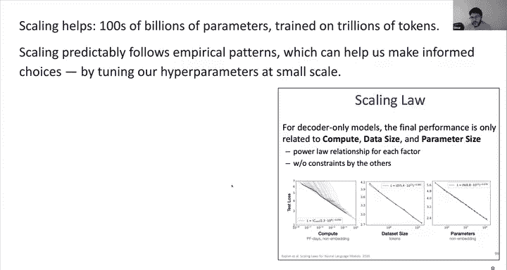

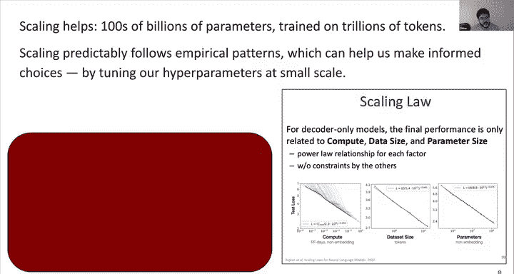

So the sort of takeaway here is that in general you have a fixed budget when you're training a large language model。

 you have a fixed budget for pre-training compute， which might take the form of how many GPUs you have and how long of a time budget you're allowed to have so you have a number of GPU days and what you are really deciding is what set of hyper parameters do I choose。

 how do I exactly set the transformer up for my task， which activation and other decisions like that。

 how many layers but fundamentally should you increase how many parameters are in your model or should you increase the number of tokens that the model sees and this is not a trivial choice because well there's also a question of compute at inference time once you've built the model you're likely to reuse it for many months。

 potentially even years for many downstream task。😊，So the smaller it is。

 the more efficient it will be in the long run and the more things you can run with it。

 but the smaller is it more data you will need to train on and that increase in data is more than linear and so it's a difficult choice the increasing in data in order to sort of reach a specific quality level is more than linear and so that's a difficult choice that folks are faced with。

 but increasingly the pattern over the last two or three years has been actually towards training models that are not necessarily much larger but training them on much。

 much， much more data because that gives us the ability to use these models on a smaller machine or by more people etcter。

 so you could think here of like Lama3 releases for example。

 and increasingly we get models that are1 billion or 9 billion parameters but they are trained on several trillion tokens of data。

So the interesting thing here is that yes， scaling is predictable in general when you look at something like the test loss or the validation loss。

 but it appears to create some discontinuous or sudden jumps like the capacity for in context learning which I know was in the previous lecture so I'll touch on this briefly。

 so the high level here is that we've been sort of discussing pretraining as this foundation that allows you to fine tune in which you go ahead and you say my task is translation I want to translate from English to French。

 so I'm going to collect a data set of 10，000 data points of English French pairs and I'm simply going to do gradient updates to my system to my transformer in order to sort of teach at this task but instead of that with large language models that are large enough certainly doesn't seem to happen directly at a small scale you can start you and sort of the GPT3。

😊，observeer that you can actually start to simply give them examples of the task and they can take that and follow the pattern and this seems like something that really only occurs at large enough model scales and or enough compute in general。

😊，And in some sense， it's really striking， maybe not anymore。

 but this was sort of you know a pretty striking observation that。😊。

You know you could actually have two or three examples， you don't even need to do a gradient update。

 you just tell the model like here are some， you know here's a pattern and the model can start doing this you know following this pattern at scale' as if it's you know being trained at test time without gradient updates and there's all kinds of literature on like what is actually happening here and this is this like simulating gradient descent or is this a completely different potentially much more efficient you know learning paradigm。

In general though I would say in context learning as perceived here didn't actually go very far。

 I think it was a very cool toy， it didn't really support you in a way that you allowed you to do any tasks in particular better than you could before and what unlock that with a set of things that we'll talk about later nonetheless the ability of these models to recognize and to generate these types of sequences is really key to being able to give them more capabilities more intentionally down the line。

 so this basically emerges from scale alone but you need a lot more than scale as we'll see you need to be a lot more clever than simply scaling in order to in order to fully really leverage the potential that you get from this scale。

😊，Another sort of sudden jump is the ability to do what is called chain of thought reasoning。

 so this is simply you know the following in standard you know prompting as sort of was established through in context learning you go to the model and you say here's a question here is an example of the answer。

 here's another question I don't have an answer for and through in context learning a model might be able to generate something。

For many things， the problems themselves are highly compositional。

 so you know if I give you a difficult maybe you know statement to prove or I give you a task to write a report。

 you generally don't immediately spit it out off the top of your head you generally have to plan you have to you know go through several reasoning steps if you have some scratch paper that you can write some notes on it's very helpful so chain of thought is simply that in the form of in contextext learning so the author is basically simply discover that if you give the model examples of reasoning of thoughts before it sort of is asked to generate the actual final answer it can imitate that pattern for new questions that require a different reasoning chains and that can lead to much higher quality on various tasks but again it's something that we generally。

😊，Mostly only observe at larger scales of models and or compute。

So you can imagine how this is helpful for math， but in general it's a pattern that can appear for tasks that have certain nature。

 you they require multiple sort of steps of reasoning or computation in order to solve。

So I' the question。 is there any。Rule of thumb for the size of the quant of the model there where this phenomenon begins to emerge。

I think it's an interesting question of。How tight it is to model size versus compute versus the quality of what you're pre training on I would say it used to be believed and you can see this in the figure here this is from。

Very early 2022 this was January 2022 it feels like it's ancient work but it's very you know in again scheme of things it very recent paper and you can see here that it would seem as if you really want to be over 100 billion for anything to really matter with respect to both the task being you know。

😊，effectivelyffectively tackled as well as with respect to the blue chain of thought really surpassing standard prompting in both cases it would seem across some of the tasks at least maybe GSMAK which is great school math it would seem that you really need to be in the over 100 billion parameter models which is GPT3 in order for this to work but increasingly that's really not how looks you know you can actually get very large lifts from chain of thought nowadays with models that have1 billion parameters if you look at like for example Lama 3。

2 there's a variant of that model that has 1 billion parameters and I don't have immediate numbers for this but。

In general it's so it's much more natural now to expect these gains from far far far smaller models so first of on one hand。

 theres something fundamental happening heres it is really truly the case that being able to explicitly kind of you know I think that this two competing hypothesistheses is it more compute a test time you're just kind of going through the transformer many times and that is more computation at test time is purely what's happening or the ability to actually concretely call out and encode you know intermediate assumptions is inherently useful because it gives you like you know you can sort of。

😊，At the very least align with how this pattern of reasoning would look in your training data in a way that leads you to assigning higher probabilities to the you know to the right answer at the end either way。

 I think you can increasingly see this with very small models。

 but there's a lot of confounders these small models now are trained on far more data than you know GPT3 was trained on so GPT3 was trained on。

I think on the order of 100 billion200 billion tokens， whereas now， you know models like kma 3。2。

 even though it has1 billion parameters， I believe it was trained on。

A couple trillion or4 trillion or something like like that in terms of in terms of tokens right so the model is far smaller。

 but it's strained on a lot more data more than 10x the amount of data。

 but there's another big sort of factor that's different which is the next slide basically which is post training So these models you know no one really。

😊，Although we'll see sort of how that evolve， but at scale in general we almost never talk about base models that are just pretrained anymore。

 although we need them so theyre deserved as a starting point but they're not out of the box good enough for almost anything because they're just too too raw in the way that I'll describe next so the short answer is for base models with limited training data。

 you need to be very need to have a very very large model and it seems not too hard to get chain of thought to work with very welltrained models that are sort of aggressively post-trained as well chain of thought is something that you can expect to help at very small scales。

嗯。So this leads us to post training So at this point we have a model that is perhaps very large that we pre trained on。

😡，Tons of data and that is sort of really good at sort of just producing likely sequences similar to the sequences of text it saw at training time。

 but you know it it's。Well。If you think about it， that by itself doesn't necessarily give you an assistance。

 it doesn't give you something that knows it should solve tasks and that might not be intuitive if you didn't play with these models you know three or four years ago before everything got posttrained so there's this guy a nice example from Chngal here where you know if you simply go to a really well pretrained model and you ask it something like in the following sentences。

 you know explain you know basically something about coreence or trying to thisambiguate it will discuss reporter。

The reporter and the chef will discuss their favorite dishes。

Whose favorite dishes are being discussed， will they both discuss the reporter's favorite dish or the shift's favorite dish？

And you know you try to use chain of thought so you tell it let's think step by step the model has no reason to expect that it's supposed to answer this question because as far as it's concerned it's simply completing this string in a way that looks like you how text looks on the web and the web text rarely looks like cleanly delineated here's a question end of question please help me immediately now because most of the time people are just writing their own articles or or you know just going you know and describing things now this is not always true if you get your prompt formatted in just the right way you might convince the model that is operating on stack overflow and it's a helpful answer which is why you get which is how you get all of these kind of crazy prompt engineering tricks historically is you're trying to sort of get the model into the mode of being sort of in the right parts of the training data where。

People are more helpful and are sort of providing useful answers。

 but by default and in general you're not going to get that behavior and so the goal here of post traininging is how do we sort of。

😊，Leverage the fact that the model does know a lot of things and actually just get it to understand that it is now an assistant that is user facing and whose job is to answer questions in a concise accurate you know helpful safe ways this is often called alignment and a simplest thing you can do is what is called instruction fine tuning but it's really just like massive multitask learning which is to say。

😊，Well， if you want to teach the model to answer questions of various sorts from all types of tasks。

 from you know answering factual questions to answering math questions to writing code to analyzing sentiment to you writing reports to translating documents to extracting entities to all the other types of national language processing tasks you have。

 we'll just get a lot of data sets and build a ton of data and collect a lot of questions from people and write great answers for them and then fine tune in the pre-trained model that we have in order to do this。

And so this is really the simple idea behind instruction fine tuning is we'll use the standard same cross entropy type training that we have for pretraining。

 but now the inputs and outputs are not just next word prediction there's actually a clear separation between inputs which are you original question we want to answer and then basically the model will generate tokens and we'll learn to do that autoaggressively in the answers so this obviously is a huge step forward and I think it's sort of under under reflected sort of how essential this actually was because without this what you get is a really cool toy that's incredibly powerful you can tell the potential but it doesn't actually do anything even semi reliably what makes it sort of get there is this form of training but obviously the shortcomings are not too subtle like if you want a model to do so many different things it's going to be basically dependent on how much data of what variety you can collect and how you're doing that。

Obviously much less scalable than pre training， pre training was scrape the web train on it。

 this is like， well， what task do we want to solve？Where do we get questions。

 who should answer these questions， what's the quality control here like。

 how much data do we actually need for every type of question。

 how do we generalize to slightly different types of questions， etc cetera。

 how do we format the questions in the training because we don't want users to like ask in a slightly different way and the model is like completely perplexed by that you know being out of distribution so it's much less scalable and much more you know engineering driven although it's essential。

😊，So on top of that， which I think is perhaps an even bigger kind of fundamental problem to tackle。

 partly because people have shown that small amount of data could take you far。

 although I think these sorts of a still an open question how much data you didn't need the big problem is。

😊，We're sort of people looked at language models and decided to be very ambitious。

 so we're not asking them anymore the types of NLP questions that existed you know just five or six years ago where they can answer like you know you know give you a number for your math question or give you like a factoid name of a president in your answers we're actually asking them to write you know longer things to brainstorm ideas people have published literature on。

Can language models， brainstorm research ideas or not and irrespective of the answer you know people are expecting models to help with very open-ended things like generating stories or whatnot and the problem here is you know when there is no right answer when the answer is long and it's certainly not like the only kind of formulaic response simply training with next token prediction does not really teach the model。

 which parts of the answer actually mattered and which parts it had choices about it doesn't really matter if you inject some commentary if the final number you give me in a math question is the right number but conversely if if you're acting as a teacher the actual English you say before the number might really matter because well some instructors are just more effective at teaching than others and what they say actually does matter the other sort of problem that exists。

With this paradigm instruction fine tuning is that and this is subtle。

 but it's sort of hypothesized to encourage what is called hallucination。

 So hallucination is a subtle term， and I would define it as it's whenever the system we have here。

 which might be a model decides to produce text that is like ongrounded in what you give it and in any assumptions that you want to make。

 So if you ask the model you know。What is the capital of a country and it gives you the wrong answer？

And it gives you that wrong answer on no basis from the prompt you gave it。

 you didn't you know tell it assume that the answer as follows。

 that's a form of hallucination the model just made something up and when you train with instruction fine tuning the answers encode a lot of knowledge that the model may never may not actually already know and so by simply kind of maximizing these probabilities the model learns to like that the right behavior to do is to sound knowledgeable even when it doesn't know because that's what it's。

know that's what we reinforce essentially when we teach it this way。

 I see that there's a lot of questions in the chat let me。Take a look at some of them， unless。嗯。

Oh I think some many of them are already answered， I appreciate that Okay。

 but if there other questions please feel free to let me know so one one thingma in case of these others how accurate are they in determining。

😊，What task they are performing， because when you pose a query or a prompt。

Then there are many different ways of interpreting what the LLM must do right and so is it supposed to be answering a question or is it supposed to be paraphrasing how does it know what to do and how accurate is it and determining this I think。

This is something that will be really， really essential in the second half or so of the talk。

 which over the lecture。But ambiguity is the name of the game I mean the reason you want to use a language model is because you don't know what else to do like many of us you know all of us are computer scientists we're all programmers。

 not everyone in the world is so that's another important thing but like generally you resort to a language model when you don't know how to code it up is one way to think of it。

Um and that means that inherently like there's a lot of ambiguity in the questions and increasingly。

😊，Even though I said that instruction fine tuning is a form of massively multitask learning。

 you know， it's not called massively multitask learning for the reason I think。

 which is that people want to think and this is increasingly very true。

 it probably wasn't true when this term was coined that there are no sharp boundaries between tasks because there is。

What might as well be infinitely many sort of or might as well be sort of just combinatorly massive combinations of like subtle compositions of these you know slightly different tasks like for example you know you rarely just ask for sentiment analysis as a classificationification task anymore you might want the model to also give you a justification which is a form of you know maybe grounded generation you might you might want the model to you know cited sources as it does that so there's a lot of these kind of like。

😊，compositions that we increasingly increasingly want and how does the model understand this well in general it's very fuzzy and the goal of post training is to get you into a stage where minimal prompting can get that to happen and so basically the goal of post training is to give you this architecture that if you ask it clearly enough and in plain you know in plain language it can manage to do things but because we haven't succeeded fully isolating out this ambiguity that's why things like engineering are still。

😊，are still pervasive even for simple tasks because you would want to convey to the model。

 I don't want classification， I want question answering or the opposite and know obviously it's a highly。

 you know all these factors sort of come together when doing that。

So I said that this approach or this paradigm has been really transformative and powerful on top of pretraining。

 it gave us things that are actually usable， you know there's for example models like AlPAca the early instruct GPT models up to the early 3。

5 GPT3。5 in its early phases we're simply trained this way they didn't do anything more you know sophisticated than this。

 but if you think about this problem sort of a little bit you realize that you actually want the models to try stuff and to learn from trial and error which is to say you want some sort of reinforcement learning what if you take the best model you have。

That you trained with supervised fine tuning with instruction fine tuning like in the last slide and what if you just use it to actually generate stuff and then you give it feedback maybe in the form of you know generate two sequences and get the human to say which one was better and then you want to reinforce that sort of in you use that as a source of reward where you tell the model you know you know this was better than that one might however much know it was and so this is kind of the paradigm of reinforcement learning from human feedback very large sort of area of space and this is。

Fundamentally， we're almost the entirety of the innovation of closed source models and whatnot used to be happening。

 and this is sort of what distinguishes。You know Claude from you know GPTC GP4 etctera is like how careful they are with with the process here for doing this so OpenI published a couple of years ago almost three years ago their process for doing this it really is the most you know sort of you know natural way I think you would approach this even if you don't know reinforcement learning it's basically just get users to ask questions to the model that's step one get users to ask questions the to the model。

Or just ask questions in general。They have this cyclical thing where you know it's explained reinforcement learning to a six year old and get a human to write a good answer that that is very hard because now you need these answers to be consistent you need to define what's a good answer。

 etc cetera， but it's an important step。😊，And then basically， now you have a data set of many。

 many question answer pairs that reflect the types of queies users might ask to your system。

You can then take this and train your language model with simple supervision。

 just like you do next to and prediction things。😊，This gives you the step we had on the last slide。😡。

Now that you have this model， you can actually get this model itself to take the question maybe new questions and generate many answers and you can have a human labeler。

 let's say two answers and they select which one is better or four answers and they rank them or something。

That data itself is really valuable because we can actually use it to train a classifier essentially that tells you which answers are good or bad。

 or maybe maybe you can have a classifier that's pairwise or something that says you answer A is better than answer B when I see them together there's sort of lots of combinations you can have here。

 but the point is you can just take train the language model on a closed form on a closed sort of setting task like classification or regression or otherwise in which it's just essentially predicting how good an answer is。

 so this model is trying to distill the humans that are trying to compare these answers and trying to basically act as a reward model that tells us when the model is doing well or doing a bad job obviously this is really hard and if you get it wrong。

 everything else doesn't work。😊，And then now that you have this reward model。

 you can go to reinforcement learning as a literature。

 grab sort of an optimization algorithm from there like PPO and basically plug in your reward model and then run the algorithm in a way that seeks to maximize to maximize these rewards。

 so now what we're doing is we're teaching the model that when it can you know given our distribution of prompts。

😊，It should sort of， you know， we want to reinforce its behavior when the reward model really likes its output at a high level。

And this sort of is the foundation of like getting to a stage where you have something like GPPT4。

 and this is what people talk about primarily when they're referring to things like alignment and whatnot。

😊，And obviously there's a whole literature here of is PPO that algorithm。

 do we really need reinforcement learning， can we do something else。

 and in general I think you need the essence of reinforcement learning in the sense that you need the system to sample its own outputs。

 you need notions of the word， whether you actually need exactly PPO or not or what optimizes you need or is a different question because many of these algorithms and RL were built。

😊，For tasks that had many more moving parts whereas with an language model you have such a good initialization and you the trajectories and steps you're playing with are typically much shorter and you in the formulation we have here that a word model is actually evaluating the whole answer there's not a lot of actions sort of with sequential decision making that said things like 01。

 which is a reasoning model from Open AI that came out a couple of months ago and it sort of maybe you've played with it it's supposed to be much more powerful for certain types of things and it's much more computationally intensive at test time。

😊，Is actually using much more involved reinforcement learning where presumably the awards are applied at various actions that are smaller than the whole sequence to gene。

So I started this talk I started this lecture by saying it's never been easier to prototype impressive AI assistance and demos and I showed you guys these two examples here when I asked ChaGPT and it did an impressive really cool job what I didn't say was that both answers were actually wrong they just found it really fluent because we have a language model that is trained to be fluent Stanford was not founded in 1891 although it's close and that's why it was very believable and the whole reason I had asked for help with this piece of code was that there were dependencies between the iterations of my loop so when the system decided to give me code that had not removed these dependencies it gave me code that had dataases give me buggy code I was glad I spotted that and didn't simply plugged this thing into my codeb so the big picture here is language models are awesome and they are sort of really really great manifestation of what we can do with deep learning but by themselves as mono。

😊，systemsThey don't get us to the bar where we can deploy reliable AI systems in front of users。

 by themselves， especially for hard or out of domain types of tasks。

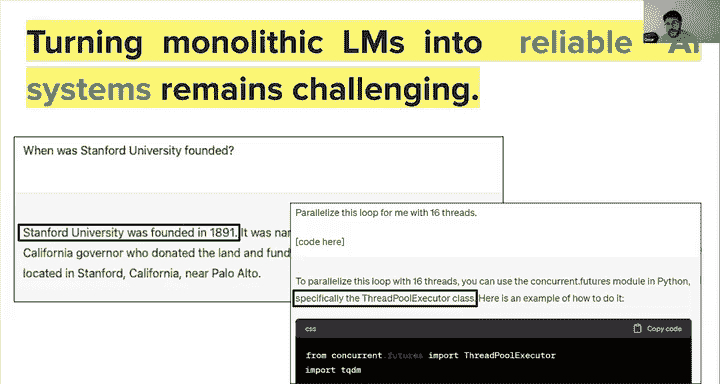

And this has a lot of real implications in practice。

 you know it could have gotten me in the two asked questions I asked you know to chat GT but like what's the worst that could happen there。

 maybe with the code one it could have been bad but the other one is fine。

 but in practice people are sort of really facing very serious consequences when their AI systems don't behave and so this is one that it's just one example of these from out there。

Now I'm not saying language models are bad because it made three mistakes and that's because everything will build and every AI system and every deep neural network will make an of mistakes I think the problem is when working with language and you're trying to sort of build systems that are user facing the way in which transformers are so monolithic which is what makes them so powerful makes them really hard to control when our goal is to build a user facing system to debug when they seem to be making mistakes and to improve when we have a sense of what types of changes we want to apply to our system。

 the way in which you improve GP4 is you well for me I we just wait until they do it。

 but if you're working on it is you try to basically figure out what more data you need to add how to improve their word models。

 very coargrained opaque process that leads to dramatic improvements because it's very general。

 but it doesn't give you the control。That you need when you're building an actual system that you're responsible for。

And to tackle this AI researchers increasingly build what you might call compound AI systems。

 so this is just a term that means modular functions。

 modular programs that use language models that use transformers that are pre-trained and post-trained like we discussed as not as the endto- end user system not like Chad GT for example。

 but as actually specialized components in a bigger architecture and that architecture itself may not be traditionally a neural network。

 but it's composed of neural networks。So an example of this is none other than rag a rettrival augmented generation。

 so this is basically the architecture in which we want to take questions。

 we want to generate answers but instead of the monolithic language model just like guessing or remembering and telling us an answer that maybe right maybe wrong but is' just generally ungrounded we remove this and we have a sort of more modular architecture in which we break things down into steps and these steps are conducted in actual the actual program there is an actual sort of software that's running this and so for example in Ra in the simplest form。

 the question is consumed first by a search engine by a retrieverier which by the way is also another transformer like I discussed at the very beginning in a remark it's also a transformer but that transformer is not generating text auto aggressivelygressively it's generating embeddings and those embeddings for the quiie are used to consult a text corpus so just a big kind of representation of Wikipedia for example。

or of the web and to retrieve the most sort of similar or most relevant under some notion of relevance we can train it for this documents and these documents are then fed to the language model which is then instructed or asked know to answer the original question by reference to these documents what's great here is that well this is not going to guarantee that this suddenly can answer every question in the world correctly but it will give us a bunch of different things that will be really helpful first it gives us transparency when the system gives us an answer you can go back and say why did it answer this and it can actually see the documents that it saw the documents that retrieved and looked at and assess for yourself if it's looking at relevant documents that are actually useful and answering the question based on these documents and you can actually see cases where you you can build this grid where the model answers the question correctly but not using the documents or when the model answers the question correctly because it retrieved the right。

😊，Tings and use them properly or when the model answers the question incorrectly。

 but it kind of is citing a document that was relevant， it might be outdated。

 can basically get a much better understanding of why the model is doing what what it's doing and whether it is doing what it's doing based on attributable sources or not The other thing is efficiency we talked about trillion parameter models。

 very large models and the reason they need to be that large could be hypothesized to be among other things that it's not just learning general patterns it's not just learning whatever reasoning is it's also trying to remember all kinds of facts and if you didn't need the model to remember these facts。

 perhaps because it could just look them up maybe we can get away with much smaller models whose job is to just play these smaller modular roles when we have the right control flow when we have the right system design that offloads knowledge and other things that you don't need the model to just remember to more specialized components so that is rag that you might be familiar with than。

hear about all the time， but RaG is not the only example of compound AI systems there is a big sort of limitation to the standard formulation of Ra which is a very large field with many different papers。

 but the biggest limitation there is what was the question here。

 how much of the result is based on the documents retrieve from RaG versus the intrinsic reasoning of the model？

This is a great question and it's a trade off that to some extent you can you might want to control there's a ton of research there and to some extent you might want to look back and analyze it so what I'm trying to say here is。

If you simply do what I have here， different models and different types of questions and different types of documents will lend themselves to drastically different patterns of behavior some models are trained at post-training time to be really faithful to the context if you give them context that is clearly ridiculous they will still stick to it so if you give them context at retrieval time maybe because your corpus has spam and that corpus says the compounds that protect the digestive system are you know gastric alkaalline maybe the opposite of this answer alkaline solutions。

😊，A lot of models will actually say like well that's what you're giving me I will just repeat that and it's hard to blame the model in that case but the point is you can actually inspect it and then decide that that is not a behavior really like you want to remove that document you want to tell the model to like filter out documents that are clearly ridiculous whatever it is other models will try to sort you could think of this as almost like a Bayesian sort of system happening where the question is like you have a prior the model has a prior and it's also given some information and then basically the question is is what should it actually generate and there is no short answer but it's a large space you can you sort of read papers that come out every month that many papers every week really that are trying to study this type of tradeoff it's not a solved problem but the nice thing is through building this type of compositional system we actually have the tools to iterate on this type on this type of problem and to say like for example。

You can have a step in which the language model is actually inserted between the retriever and the final answerer here in order to maybe select some documents or otherwise applies some kind of filtering to them and you can build these bigger compositions which is exactly what a multihop retrieval augmented generation system tries to do so the big challenge a multihub which is a term I will define a multihb rack system needs to exist。

Is that one of the reasons we love language models is that they help us tackle ambiguous things that are hard to square into any you know into any preexisting category。

 they can really synthesize， they can really compose fuzzy things so for example you can go to Chad GT and ask questions like how many floors are in the castle that the physician David Gregory inherited in the 1600s。

And there is no single paragraph in Wikipedia that actually answers that question because the paragraph that says who David Gregory is and what Cas he inherited does not speak about the details of that castle another document talks about that so the nice thing about language models is that they can actually take these kind of questions that Google you search standardly cannot give you a single result that answers that question and they can generally synthesize answers now the problem is they're very unreliable at that so they often hallucinate and I had sort of these examples which unfortunately don't have right now where if you ask it one time it gives you a wrong answer if you ask it another time it tells you that this guy is fictional and doesn't exist and gives you yet another answer and so basically not only does it not know it also does not know that it does not know and it does not know that in a consistent way in the first place and so what you can do here is and I don't want to sort this is an older system prior to sort of G3。

PIs and whatnot。 So this is actually using entirely encoder based models like B and E。

 And so it looks slightly different。 but the highleve picture I want to convey is you can actually take the  queryri。

 use it with a language model that's behaving as a retriever use the retrieved sources and instead of taking these sources to answer the question you can actually have another language model that is adapted as a summarizer that just extracts the relevant pieces from many documents and uses them to actually update a  queryri so that we can loop more retrieve more things and repeat this process until the process decides that hey。

 I have found all the information I need now it's time to generate an answer so the question I said verbal was how many floors are in the castle that David Gregigory inherited Well first question is who is David Gregory and what castle did he inherit and once we know what that is we can easily say like how many floors are in Cale X and it's called Casle Kinadi Kinadi Castle which is sort of。

😊，That will involve looping through this a couple of times。

So the big advantage that we get from these types of compound AI systems here is we can iteratively improve the system。

 we can say it's it's messing up on some questions because the questions are compositional I can add a loop in which the model is adapted as a condenser as a sumr in addition to its role as a retriever and an answerer and I can actually see improvements on my task without the language models being changed in any way and so that allows me to move much faster than I could move otherwise。

 and this gives me in particular the ability to ground the whole system via tools like search or calculators or Python code execution or other things that I can control in software。

😊，So this one question in multihop scenarios， could you use two LLMs where one act as a judge？

Of the other's answer。You absolutely can， you have a lot of control and you want to you know。

You want to think of this in one of two ways， you want to think of this either as software engineering where you're building these systems。

 you sort of have an evolving set of tests and you sort of he climb on your qualitative assessments。

Or you can think of this like the way I still remember kind of doing some things in the deep learning course and I hope you guys still do that despite how fast things have moved where building architectures out of building blocks。

 so one of the things that led to dramatic advancements in deep learning and I know that this course in particular just makes this incredibly clear is abstractions like Pytorch and before that Kiras and before that Theianno and others that really give you building blocks that you can compose in various ways that would be much harder and I think it would be much harder if you had to write everything from in Matlab or even in Ny and what's really cool here is even though that is less essential nowadays because transformers are just so general。

 this is back to being important thinking of the architectures and intuition of which pieces to compose adding a judge。

 adding a condenser， adding a  queryie generator， adding a reader， whatever。

These these components are sort of back to being innovative at the architecture level not necessarily inside you know around the activations inside the neural network。

 but potentially you know of composing the neural networks themselves so this is where you have a ton of control and there is no right answer it's very early it's extremely early like this this system I have here。

😊，I did this at the start of my PhD， I did this in exactly four years ago and you know it's extremely simple。

 I think now you know with language models that are themselves much more powerful。

 the sorts of things that you can build are just are just incredible。😊。

And here's one example of this， which is sort of the storm system that takes multihop reasoning to a whole other level where you can give it a topic like the Colbert Reever and you get this massive system with so many components that go through many loops that will not explain and you actually get a massive table of contents that look like Wikipedia page with each section having its own paragraphs with actual references to actual pages and this is a system that you can sort of try online that we built here at Stanford led by Gi Shao and it's sort of using a lot of the ideas I will describe in the next few slides around building compound AI systems。

😊，What cool here is by being able to compose language models into these little sort of specialized。

Ros that they were taught really clearly， they were taught to act someone asked about judges right they were taught to assess relevance。

 they were taught to answer questions given documents。

 but they were not taught to write entire reports accurately about Colbert because they have not heard of you know they have heard Colbert。

 but they have not heard every single paper about Colbert in a way that you know a compositional system like this can tackle。

And the last sort of direction in compound AI systems。

 everything we talked about so far has been through adding inductive biases。

 if you will to like building these systems compositionally。

 but there is also things that are just based on scale so systems that are focused around generating code I'll try to go a little faster here in the inches of time but in which and this looks closer to the judge question in which we give the system and input problem description where it's supposed to generate like the piece of code and instead of just directly spitting out code it reflects on the problem it tries things out on some public tests it runs those public tests that gives us a ranking of the solutions that work on past many tests or fail many tests and then we can basically we can basically loop in which the solution code sort of is improved we again on the tests and that sort of loop just grounds the system in an actual feedback mechanism but importantly it just。

alows it to do much more computation at test time in a way that is known to sort of potentially scale the way that training data。

 for example， helps us scale model learning and this is applied everywhere not just for cogeneration for SQL generation etc cea。

 and many of these are general strategies chain of thought was one example of these。

 but there's all other sorts of agents and self-reflection and types of applications that are beyond the scope of what I can cover today。

😊。

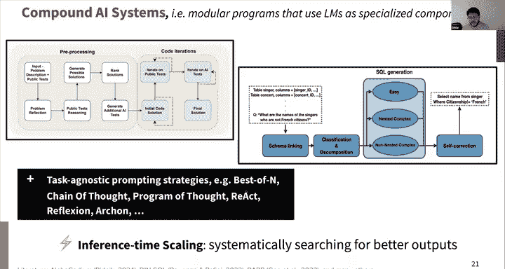

Now this is awesome， so I've just been telling you that if you have a language model and it's been pretrained and it's posttrained。

 you can do a ton of things through composition or what I call compound I system systems in the set of slides and know it's a name you can sort of read up about。

😊，It's not all great though because language models。

 the sort of items or the modules that we're composing here are themselves very sensitive to how they're instructed to solve tasks and part of this is we just haven't figured out how to train them to be very reliable yet and we're not close but something is actually more fundamental is even as we figure out how to make them more reliable when when you're building a system composed of many pieces like the thing that makes deep learning so attractive is you can jointly sort of optimize all these layers or all these pieces towards some general kind of objective towards some unified downstream objective so when you're composing these models。

 these pieces need to talk to each other well they're talking to each other in language usually or in vectors oftentimes they're coding tools。

 they're running executables， they're searching for things so gradients can't flow directly。😊。

And so when you're simply prompting them by hand you end up with systems that can be very fragile and we're losing a lot of what makes deep learning attractive and that's a problem so under the hood I showed you all of these really pretty diagrams with you doing all types of stuff but under the hood the implementations and I'm guilty of this as well all of us are guilty of this our long messy prompts where there is no clear sort of way they were built but they were built through painful random trial and error done by a person in order to sort of solve different types of tasks where our system that looks like a pretty diagram is actually tens of kilobytes of raw strings in J1 files that is serving as the implementation and maybe that would be a cost that is okay to pay if having done this work we get a sort of reliable system that is portable to new language models as the models improve so I build this for GT3 GT5 comes out the same prompt still works it works very well it maximizes the quality。

😊。

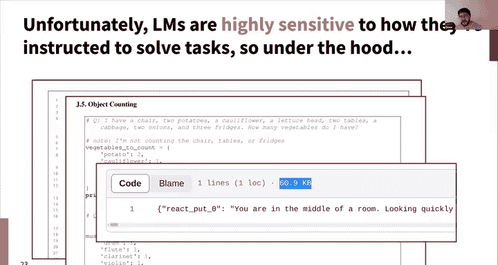

I get from my model and I'm very happy， unfortunately that is not the case and what you see in practice is that people basically you know in industry and elsewhere。

 they look at these types of systems。😊。

Three months later after the paper is published， the model that this was built with is obsolete it's either too expensive or just basically doesn't exist anymore if it's an API and they run this stuff and it doesn't work as well because whoever was building this was essentially overfitting to the language model that they were working with it's not bad that they're overfitting to it they're not sort of overfitting to the test set but they're overfitting to the infrastructure of the language model that they're working with the way they're asking it the way they decide to basically phrase these things and so they look at this and say you I like the ideas I can't really use it because it simply does not generalize to my use case or to my language model or to my data distribution or to my slightly different pipeline and fundamentally this happens because every time you write a prompt you're coupling and this is a scary number five very different roles that I cannot really cover in depth but I'll try to nonetheless give you a sense of what they are five different things are encapsulated in every long prompt you write the first is what is the function signature what is the input output behavior you're trying。

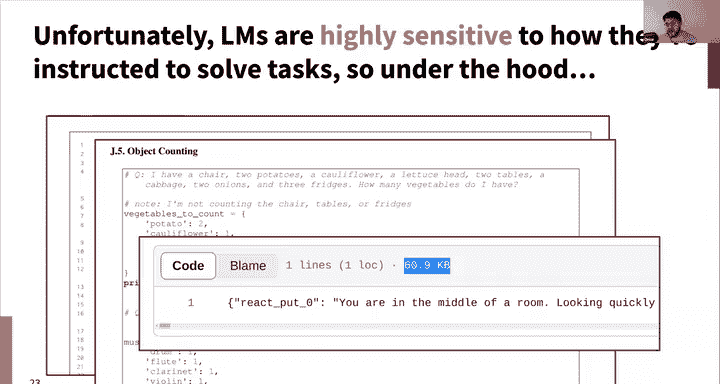

To describe， I give you two integers and a question string， and I want an answer that is a float。

That's one signature or I give you a sentence and I want the sentiment which can be positive。

 negative or neutral that's another signature that's the most important thing in the prompt。

 but it's kind of very short and the prompt is very long so's what gives what gives is that there is also the computation that you're trying to apply you know in your head in order to specialize this prompt to a specific inference time strategy for example we saw the chain of thought prompt earlier and it looked like this it looked like one or two questions at least in which you provide actual reasoning by hand and then you show the answer and then you ask it a new question and hope the model can do that behavior but who's writing those examples who's writing reasoning and how do you know that this reasoning actually works without trying it and then realizing it's not good so it until the model gets it that's also happening in your prompt you're also sort of you know if you're asking the model to give you a bunch of different things and you know you need numbers and you need you know。

😊，That you send to retrieves， you need code that you can execute while you need to be able to parse these things。

 the model is giving you a bunch of text。And that text may or may not be easy to parse because while it can give you any text so that is this notion of an adapter that needs to exist in your code logic。

 you're also encoding a lot of your objectives you know do not hallducinate or you know always use the calculator to add numbers or these types of assertions that you might want to encode and then you're actually applying this process in your head of how do I come up with prompts or how do I create supervision pipelines for labeling data for example。

 that allow me to teach the model through prompting or through fine tuning to actually fit the desired behavior not end to end but in every single one of my five modules for example。

 so you actually are acting manually as an optimizer of sorts over this compound system。

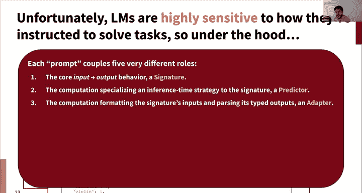

So the big picture here is that compound AI systems that exist now are very modular in principle。

 which makes them very attractive and very powerful， but they're very stringly typed， if you will。

 they couple the fundamental system architecture you want to build。

 which is the diagrams you looked at earlier， which are actually very good。

 I argue with incidental choices that are not portable to new language models。

 to new objectives to new pipelines and that simply don't generalize across these choices。😊。

And to tackle this， I'm going to make the statement that we do know in computer science how to build controllable systems and how to improve them in a modular way and this elusive concept。

😊，It's called programming。So there is this ambition that sort of you know exists in a a lot of my work。

 for example， of could we and what if we could build these abstract compound AI systems。

 is actual computer programs that have sort of highly deterterministic pieces but that inherently acknowledge the ambiguity and the fuzziness in functions or modules that process natural language typed inputs。

 so normally in code， you can say my function takes a string and gives me back an integer。

 but here you want a system that takes a string that is a question and gives you back another string that is a  query and there's this subtle distinction that is very hard to measure。

 but that like you can specify and the language model has a sense of prior what that means。

 but you actually want the module to align its behavior across the whole system with your objectives so the queries that generates should be helpful to the retriever and the retriever should be helpful to the answeror and the whole system should not hallucininate for example。

😊。

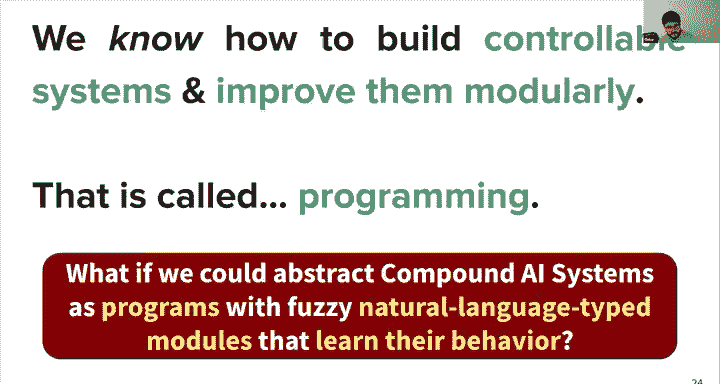

So this is sort of the line of work that's called DSP。

 which stands for declaratively selfimping Python it's Python。

 but it can self improve because it has you know leveraged these language models in a really powerful way。

 and so it allows us to express these types of systems through sort of。😊。

A set of abstractions and a set of algorithms that I think in the interest of time I will have to spend a lot less time on this than I had originally planned so the big picture is that we are interested in these compound AI systems which take input that has natural language sort of type andnotations like takes questions and produces outputs that have natural language type and notations like answers and our goal is to take the set of modules。

 these little boxes across different tasks and actually teach them together to to solve problems in a way that maximizes a metric very similar to how we train deep neural networks except that we are now operating over a slightly actually potentially very different space of objects so just as an example this is real DSpi syntax where we say I want this chain of thought trick but I want it as a module and this might remind you of using Pytorch where you say I want a you know an R and end。

😊，Or I want a linear layer or a convolutional network and you give it essentially the dimensions or the signature。

 but the dimensions are not numbers that define a tensor you know tensor sort of space it's actually basically two things it's the name of the field which carries meaning in English and then an optional type so I want to give you claims which will be sort of a list of strings but I'm omitting the type here and I want you to give me a list of verdicts which is a list of bulloles and I'm doing a chain of thoughts I want reasoning so now I can actually it would be great if I could give this a list of claims and get back some reasoning followed by a bunch of bulloles that tell me know the first statement is true and a second statement is false。

😊，So this actually under the hood can help us define an optimization problem where we're saying for every module。

 my goal is to find the setting of the prompt， you know how do I come up with the template and the actual weights in which I'm applying let's say Laura or some fine tuning to the language model one or the other or both so either optimizing the prompts or the weights or both in order to basically just maximize the expected score I get on my data when I have a metric that I want to maximize and similarly to how we define losses in neural networks usually you're interested in labels if you're doing supervised learning you're interested in labels at the very end of your network but you're trying to learn the whole thing with all of its intermediate layers and this is hard you can't just simply do gradient descent because the gradients may not flow we have all these pieces like code execution for example。

 but there is a lot of tools that are at our disposal from discrete search for prompt optimization to reinforcement learning for updating the weights。

And it's a very large and interesting space here in general I will have to basically skip the following I'm just showing you what I'm skipping so I will skip how prompt optimizers work had some slides here on the results and sort of the different types of approaches for doing that I will share the slides though and the relevant papers so you could learn more about this and I will probably just simply tell you that there are three types of really interesting prompt optimizes that you could explore that know this line of work has explored one is what if the model itself can build few short examples for the prompts what if we could leverage in context learning but over examples that the system itself generates for all of its modules the second is what if we can actually go to a language model show it the program show it the data set show it the module and ask it to actually write prompts for us language models are not good at writing。

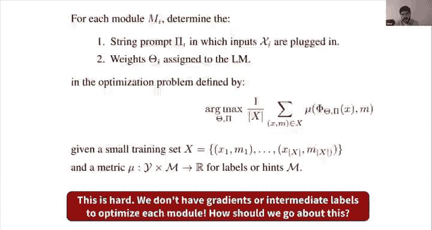

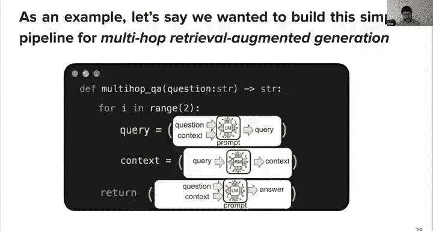

pros， but they are good at trying many prompts and so if we are can intelligently try these combinations of instructions across these systems and sort of build signals from that we can actually generally try a lot more than you can try and we can do it in a way that's portable because that algorithm can be ported to different models in a way that leads us to really effective quality and practice so a few months ago University of Toronto researchers participated in this me competition by DSP and they beat sort of sort of competing teams by pretty large margins where one of the biggest distinctions of what Wang lab did was they sort of optimized with the Mapro optimizer and DSP for their prompts a month later University of Maryland researchers ran a direct case study where the first authors spend 20 hours。

😊。

Optimizing a prompt by hand and they simply ran DSI in comparison with one of its optimizers and they were able to boost quality by double digit percentage points on suicide detection task and many of the systems sort of alluded to today or even described sort of have been built using theI for example the storm system but many other types of things where composition is really key different forms of leveraging these types of abstractions and modules and or optimizing the prompts or the weight of the system is really key so to conclude here the SI makes it possible to program the language models we discussed pretraining and posttraining you don't write handwritten prompts you talk about these signatures which I alluded to but probably aren enough depth given the stuff I skipped。

You build modules instead of talking about prompt techniques as this abstract string you're writing and you know you sort of e through things like manual prompt engineering into thinking about general algorithms for optimizing prompts and weights through reinforcement learning or discrete search or Bayesian learning and other things you know the tools that exist or disposal in this space so I will conclude here happy to take a couple of questions and thank you all very much and thank you Profesor Becher for hosting me for this great class fantastic and that's amazing there's a lot of stuff we put up the slides folks we have time for a few questions but indeed this was amazing and extremely informative do we have any questions。

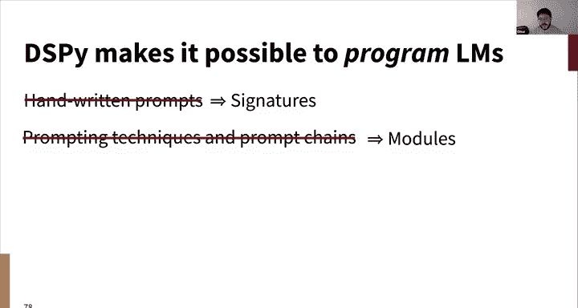

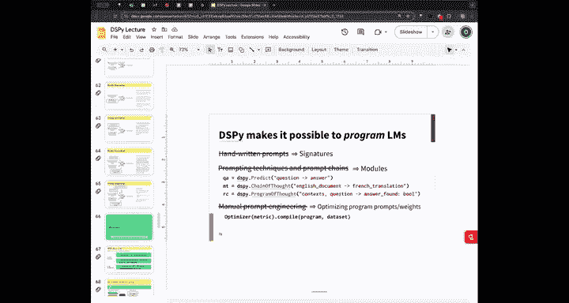

So。Mostly thank you notes in the chat。It's。All right someone there don't seem to be a lot of questions lots of thanks thank you again this was if we have any questions i'll post a note on Piazza i'll ask them to post all their questions there and I'll send them to you by email and people also want to know if they can reach out to you for questions let them know that they can absolutely I mean you are some of the best students in the world and one of the most enabling courses in the world so I think I cannot say no to something like that for sure。

😊，嗯是。Thank you very much。 All right， thanks all and we will stay touch and again。

 Omar hope to see you soon。 Thank you again。😊。

