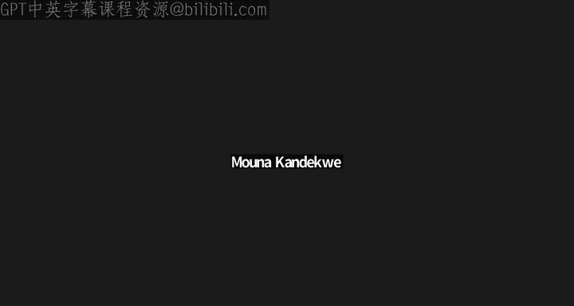
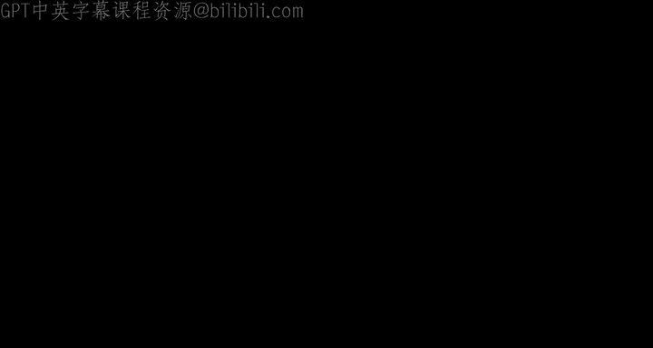
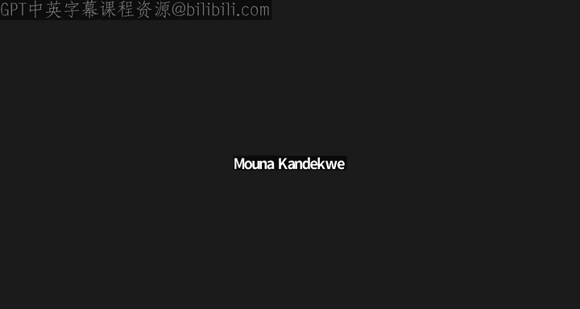
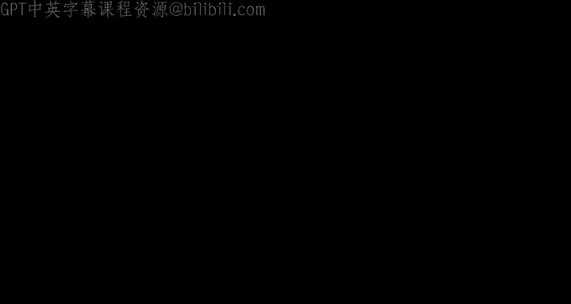
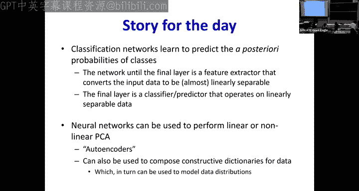

# CMU《深度学习导论｜CMU 11785 introduction to deep learning Fall 2024》中英字幕（deepseek - P22：Fall 2024 Lecture 21.zh_en - GPT中英字幕课程资源 - BV1CfsReEEw8

す。It looks why people are basically given up either one the semester or in the class or board。

So we have1，2，3，4，5，67， eight， nine，10 students in class zero Ts now our Ts are supposed to be here shame on us。

 we're not here。り。な外週。我退个这个查80。For a quick at。Do we have any questions from everything you've done so far？

the attendance poll is not。The sharing my kids guys a of。They're going to get help from it。

If I take off for a month for a day， they just disappear for a month。anyways。

I keep cutting off my feet， but is。走。Here's the story so far。Neuturalnets microphone？

Neural networks are universal appros。If found they can model any。

Bolean categorical or real valued function。They can check static。And puts for patents。

They can scan for patterns。 They can analyze time series for patterns。

 All of this we have seen must be trained to make their predictions。Exe me pro。I please。

 the audio is not clear on the。Okay， I'm speaking into the mic。 that does that help。YeahIt's。

 it's better， but it's still difficult to hear。 Okay， I'm going to try meantime。

And you run to my office and get my microphone， it's in a file it' say it' 117851。没。So。Alright。

 anyway， so I'm going to try to speak into the mic and this sort of hamper is my style a bit。

 but here's what we are going to be looking at。 Guy on Zoom bear with me a minute。

 Just look at what's on the board because I'm going to be writing something on the board。So。We can。

Standard neural network。Weve looked at what is fixed scan。So， and then that we have。里面 input嚟啊。

Let me take lazy and then finally maybe take classification rate。

 So what we've learned so far is what these things can。Let's good of this off that， right？

What we've done so far is what these things can do train them and so on。But this cl today。

 let's look a little bit into the network because we're gonna build on this。睡。So here's my network。

What does this entire block really do？That's our question number one。Question number 2。

 this network really comprises two fortunes， One is。There's lower block。

 everything below the classification layer。 and then and then something that performs classification on it。

 What does the lower block just before you perform classification really do。

What happens to data as it goes through the network？We're going to look at that。

What do these guys here represent what do they learn and what does the first and there So we're going to try to look at every one of these pieces of the network to get some idea of what really goes on inside the network。

So what do the networks learn internally。I should have had a picture of for this on my slides。

 I don't， But then。So here's what happens when we when we learn。But the next one。

You're given a collection of input output pairs。The objective is to learn a function。And。

When the network must learn to classify， then you want to learn the classification boundaries that separate the training instances。

 So you might be given better cares of this kind。And， you know。We have to fact build a network that。

Fures out on which side of the boundary any given data instance lies。Now， in general。

 you're not going to get data of this kind where all the red data red points are on one side。

 All the blue points are on the other side。 Things are nice and cleanly separated。

 And you can just learn about learn the network。It's more likely to be something like this。

 You have some blue dots on the red side， some red dots on the blue side。

 And somehow we must learn to make sense of it。 So what is the function we actually learn in the setting。

I'm going to back off to a very simple， trivial linear example。Guys on Zoom， can you hear me。Okay。

 so I'm going to back off to a simple simple two dimensional example， data and two dimensions。

And furthermore， we're going to simplify this to the point where the the decision boundary that we are trying to learn is a linear boundary that separates the red class from the blue class in my example。

Except in real life， you're not going to find a nice。

 clean boundary where all the red data lie on one side and all the blue data lie on the other side。

 So you're going to have some red spots suspended in the air about the blue points。

 some blue spots lying on the floor on the red side。

 And somehow we have to learn how to perform the classification。😊。

So even before we're looking at it from the perspective of in two dimensions。

 let me back off to something even simpler， just one dimension。

So here's what the data are going to look like。Now。

 what is a linear classifier when the features are one dimensional anybody。What would it be。

It's just gonna be a threshold， right， You're going to say everything on one side is one class。

 Everything on the other side is it as is the other class。 And if your data like this。

Then you are not going to be able to find a nice， clean threshold which separates the red class from the blue class。

 because regardless of where you plot plot the threshold。

 there are red points on the blue side and blue points on the red side。And then things can get worse。

 right， We know that the neural network is an arbitrarily versatile classifier。

 So instead of learning this。It could learn some function like this。

 where it goes up and down with your training data and matches your training data perfectly。

Even if you are willing to accept this。 Now， firstly。

 would you say this is a good classifier for this data， really not， right。

 But then even if you are willing to accept this， what happens if you have something like this where I have data from both classes。

 both the red class and the blue class had the same input value X。In this case。

 what must the output be， Because clearly， there's no function。

 It's no longer really a function because a function by definition generates a single output for a single input。

 This is not even a function， right， So what would you actually learn。Now， here。

 let me expand on this a little bit， let's say。I have a whole lot of data points at the X。

I have 90 data points with。Which belong to the red class， my class， label 1。And 10。

 which belong to the blue class， class label 0。What would you want the output of the classifier to be in the setting。

Red blue yeah。Probably be。9， why。Its the expected value。It's the expected。 So the point is。

 if I just go with the majority and call it red。You're losing information about those other 10 points。

 which are actually blue， right？ So you want to the way to carry maximum information about what。

 about the data is to say 90% of the data points here for this particular value of x are red。

So which is to say you're giving the fraction。It is really the equivalent of saying that。

The probability， if I call the red class 1 and the blue 0。

You' are saying the probability of one given x is 09。 That makes sense。喂。

So this is basically what you really want。But then。

I'm assuming that I have a whole bunch of data points at the same exact x。

What if they were slightly perturbed。I have a whole bunch of data points。 They're all off by。

 you know， the floating point resolution of。Of a computer of 32 bit floats。

 So everything on no two of them are identical。 They're off by 10 race to -17。

Would you still want the function to go up and down。

 or would you wanted to say the output must be 09 in this region of X， which makes more sense。

 The latter， right， because this minor perturbation hasn't changed the world。

And so you still wanted to say， you know， around this region of x。

90% of the data points belong to class  one。What do we mean by around？

How much are you willing to let these data points jiggle by before you change your answer。

How do you even decide。It's not my， There's no clear answer to this， right？

 So we're going to have to change that perspective。 And here's what I will do。

I'm going to look at a small window。Of around the data。

Starting from the left hand in my one dimensional example， scanning all the way to the right。

And within each window。I am going to report what fraction of data have that X value。

What fraction of data within that window。く。Second。定。这个。嗯。这算。So guys on Zoom， can you hear me。我系。Okay。

 perfect。So， thank you， Seak。This makes things easier。Okay， so here has baby that， right。😊。

I'm going to look at a small window。Aro the current x and I will I will note what fraction of dimension turning your phone upside down you there please do not open your phones okay I'm just going to note what fraction of training instances within that window had a class value1 here at zero right But then as I begin sliding left to right the fraction of training instances with class value1 is going to begin increasing at some point。

😊，And eventually， it's going to be all once。 So what we are really， we are still guessing。

We are still approximating the probability of。The class one。At each x， except that。

 instead of looking at just that one x， we are looking at some window around it to make this count going back to。

The situation， right。Because we don't know how much a perturbation must be。 and so。

This is really the kind of answer we want。 This makes a lot more sense。 You would agree， right。

And what does this curve look like if I actually， this is just a logistic regression， right。😊，And so。

This is why we like the logistic function。 That's why we look like the softm function。

 The softm function actually gives us。😊，This curve as given by the formula over here。😊。

Easese 21 over1 plus era to minus w 0 plus w1 x。Classic logistic。

 and you can see what happens if x becomes a very large negative number might assume that w 0 and w1 are output both positive。

 If x becomes a very large negative number， then。😊。

Easese to my eraasese to minus x becomes a very large。

What does it become positive number and what will this value become。

 And if x is a very large positive number， what will this become？One。

 because e is to minus x is going to become  zero right and the function is differentiable it's smooth。

 in fact it differentiable arbitrarily differentiable so that this means is that it's not going to suddenly suddenly jump from 0 to 1。

 it's going to move smoothly from0 to 1 which is why you have this curve and so this function is actually giving us the probability of y being 1 given x it's a model for it。

😊，And so the sigmoid perceptron with a single input。😊，Actually， models this。Sorry。

 thats Arthur called got it。Nobody， thank you。Thank you so much Okay。

 so the sigmoid perceptron with a single scalar input actually models this posterior probability of one given x。

😊，Right。And that's for one dimensional input。 even in the two dimensional case。

 the the situation is much the same。 And the two dimensional case。

 you're going to have the situation that we saw earlier。You would have。

 you still want a linear boundary。But then as you go from one side to the other。

 you are going to see initially some blue points on the red side。

 eventually it is going to become dominant with red and you know right hand then。😊，Actually， yeah。

 some red points on the blue side。 And then as you keep moving at some point。

 it's going to become red dominant with maybe a few blue points， which we can eventually disappear。

 And so the kind of curve you'd want over here is going to be。😊，A sheet。With a sigoidal chip。 now。

 and this is exactly what our。Logistic function here is it's still P of y equals1 given x。

 except this probability now looks you know， like a sheet of this kind。

And why is this this is clearly not a linear function。 it's a curve， right。

Why is this a linear classifier？Anyone here。You have to decide on the threshold。Yeah。

 so if I set this value to be a threshold， regardless of what the threshold does。

 what we are really saying is。1 over。Once plus era raiseds to minus Wx。 If I said， say that。

I'm going to decide that class is one， if this is greater than theta， then this is like saying。

 you know。啊。1 over theta equals is less than or equal to1 plus era raised to minus wx。

 take and take the one over on one the other side， take the log。

You're going to end up with a linear function， right。So if I take the log。

 you're going to save minus wx。That's greater than equal to log of。1 over kta minus1。

So this is the equation for a hyperplane， this is a linear classifier regardless of what the theta is。

 which is why although the function itself is nonlinear。😊，The classifier is linear， okay。And so。

That's why we like to have the sigmoid。At the output。

 But then we are looking at the case of the sigmoid width which operates directly on the features。

 So Let's continue with this exercise a little bit。I said we like we like it to be a sigmoid。

 And then I also motivated it saying we're going to look at a small window。

 but how big is the window。😊，Do we even need to explicitly consider the window or can we just go ahead and try to estimate the model？

😊，So， in fact， it turns out that you don't need to have any notion of a window。

Here's what we are going to have。 We can just learn this without explicitly specifying the width of the window because of the nature of the model。

 Now what you would what you would be given here are a bunch of training data instances。

 X Y X y pairs。😊，Are there wise is going to be either。0 or 1 or in this case。

 I like to use plus 1 and minus1 as my examples as my y values。😊，And so given so。

 then I can say that era or the probability that y equals1 given x we just saw this formula right1 over1 plus eras to minus w 0 plus w1 x。

 So what is the probability of y equals minus1。😊，It's going to be 1 minus this， right。

 And if you just work it out。1 minus。Does this go up？Right right。But p of y equals -1， given x。

Its going to be one or1 minus。1 over one plus era raiseds to minus。

 I'll just try this as w axis shorthand， which is going to be。1 plus eras to minus。W x -1。

 these cancel out over one plus e raised to minus w X。 I can divide both y e raised to W X。

 which is1 over。1 plus E raiseds to W X。 All that happened is that the minus went away。Right。

 and so p of y equals minus-1 given x is 1 over1 plus eras to plus Wx。😊。

And the probability of y equals1 is1 over1 plus era raiseds to minus w x。

 I can write them together in a single formula and just say the probability of y given x。😊。

Its1 over 1 plus eras to minus of y times。W X， and you can see that when y is plus 1。

 you get the formula to the left and when y is minus-1， you get the formula to the right。

 So it's a nice compact way of writing it。😊，And then things get interesting because now you're given a bunch of training data。

😊，And how many of you are familiar with the notion of maximum likelihood estimation。Everybody is。

 right， So if I gave you a bunch of training data and I asked you to estimate the probability distribution for it。

😊，Giving you a parametric model for it， what is the technique we use？Anybody。北京。

we just maximize the likelihood。 That's the maximum likelihood estimator， is it not。So。

You'll just be saying。I'm given a collection of data。In this case， they are export pairs。

 and your standard maximum likelihood estimator was just， just did this。 You did an R max。😊，Per。

Probability of your entire trading data。Using the model with parameters theta。

 this was a standard law。Maximum likelihood estimator。 In fact。

 we like to use the log over here because it makes things much more convenient。😊。

And so if I have a collection of training data， that's。Going to be art max。推着。啊。Subation of log of。

Be off。X， I， Y， I。睇懂。Right， this is the sum of the log like use of all of the training data。

 But then here again， or， in fact， without even using the log， let me just write this。

Enter in product terms， right。P of X I。Y I， which I can write as just this term。

 I can separate it out as P of X。Probability of P of。

Why I given X I I am not writing the semicolon theta。And this。

 this would be a standard maximum likelihood estimator。 Everybody remember this。

RightAnd the only now in our model。We have actually modeled P of y given x。

P of X is just the natural distribution of the data。

And so P of Y given x is actually given by the sigmoid。

 So I can just replace the P of Y given x by the sigmoid。 I can separate things out using the log。😊。

And so the log likelihood of the training data is the summation of all training instances of the log of PFX。

😊，Plus， per R model。The summation of all training data instances of the posterior probability of y given x。

 which is given by this sigmoid。😊，Right， and so if I were to just perform maximum likelihood estimation。

😊，Of my logistic regression model。Then by the way， you at the back and you turn your phone upside down。

 I'm just holding my class。Okay。Then I would just be。Maximizing only the second term。

 because only the second term has any dependence on the model parameters。 The first one does not and。

So I can either maximize this guy。Or minimize the negative of it。And that that term at the bottom。

 does that look familiar to any of you？😊，So what does it look like？I' will just give you a hint。

 It' is a nice formula over here。 But then you don't really need a formula。

 What we are really saying here is that we are。Minimizing。We are minimizing log of submission I。

Log of one over。P of Y I， right？And this is basically just your standard cross enpys。

And so when you minimize your cross entropy loss， youre basically just are the callback label divergence between your label and your。

😊，The probability given by the model， that's exactly the same as maximizing the。

Log likelihood of the data， itself。And so it turns out that when you actually perform maximum likelihood training of your logistic regression classifier。

😊，What you're really doing？Is minimizing the cross entropy loss between the label and the label predicted by the model or conversely when you minimize the cross entropy loss between the label and the predicted label。

 you are actually performing maximum likelihood。😊，Estimation， and so this is beautiful right。

 it turns out that if all I'm doing is training my logistic regression classifier or a softmax classifier which operates directly on data。

😊，Using the cross entropy laws and performing maximum likelihood estimation。

 It's a statistical estimation estimate。 We're not doing something kind of ad hoc with a strong statistical principle behind it。

 But that's what linear classifies。 What about data like this。Now， in this case。

 the boundaries are not linear， right， The boundaries are something ugly。

 and this is the worst case where you have red data leaking into the left side into the blue side。

 the blue data leaking into the red side。 So let's look at a cleaner problem where the boundaries are nice and clear。

 So in this case now what exactly happens。😊，Before we see the general problem， let's look at。😊。

The a simplified situation where the data are perfectly classifiable and when the data are perfectly classifiable。

 we actually know what kind of architecture can classify the data。

 This is this simple model we saw in lecture2 where the left sub determines of the if the data belong to the lower Pentagon。

 the right subnet decide if they belong to the upper Pentagon the neuron on top doesn't R right。😊。

But。This final perceptron on top。That's just a logistic， a sigmoid， a logistic classifier， right。

 So if that is a sigmoid， what kind of a classifier is the is that perceptron， the one and L yellow。

😊，I it nonlinear is it linear what is it its a linear classifier right if it is a linear classifier then and we know that with this architecture the model can separate the red and the blue perfectly right so what can you see about the features that are going in to that yellow perceptron there are two values going in。

😊，What can we say about them？They must be linearly separable， right。

 So for that classifier to be able to separate the data。😊。

This final perceptron is a linear classified over those two outputs。😊，Which means that。

By the time you get here y1 and y 2 in the y1 and y2 space， the red and the blue st。😊。

Cleanly separated， separated by heart clip。And so somehow， magically。

 what has happened is that the lower portion of the network， which is what we were looking at， right。

 is transform the data which are distributed any odd how。😊。

Until they are perfectly linearly separable。And then you can apply a linear separate linear classifier。

 So you can think of the network as two parts。 The first is the uppermost linear classifier。

 This is regardless of the data has a single output on many outputs。😊。

And the rest of the network below it as a transformation that transforms your data and moves things around until they are perfectly linearly separable。

😊，That makes sense to everybody。And so。This is not true。

 this is true not just of the you know optimal architecture regardless of the architecture。

 if it is capable of classifying your data。😊，Then it means that when it is properly learned。

 what has happened is that the lower portion of the network has made the data move the data around for them to be linearly separable and the uppermost layer has now applied a linear classifier to it。

😊，Now， if the structure is insufficient， meaning I don't have a sufficient number of neurons or a sufficient or some of the edges are missing。

😊，Then what will happen。Because we are still trying to。Perform classification。

 maximum likelihood estimation， which we saw as really maximum likelihood estimation using as a。

Linear classifier， the logistic regression on the output node。😊。

The model is still going to try to move the data around so that the two classes are linearly seable。

😊，If the architecture is insufficient， it may fail to actually separate the two classes。

 but it's going to do as good a job as it possibly can and make them as separable as it possibly can and then separate using the linear classifier。

 right。😊，Does that makes sense。So here's the point。嗯。啊。嘘。Alright，10 seconds， guys， this is easy。O。

Those are 10 seconds。 The first question， true or false。Second。Also to right。

 the portion of the network until the second to last layer is essentially a feature extractor that linearly separates。

😊，Extracts linearly separable features。And the output is a linear classifier that can only perform well if the rest of the network transforms the input space so that the classes are linearly ce。

 right。😊，How is it possible。The network architecture is sufficient that you really cannot know。

 which is why we trying to make them very large。Because we don't really know the complexity of the problem that we are dealing with。

 right。In the simple， in simple cases， yes， you can。 but more generally， you cannot。

So that's so far so good， but then that was the situation where you could actually draw boundaries which separated the two classes。

😊，More generally， you're going to have a situation like this where you have data leaking from one side to the other。

 And then for this one。We're still going to have the same situation。

The feature extraction layer or the feature extraction block， the one in gray。

 you can think of it as a block that extracts linearly separable features from the input data and when the data are not separable using the kind of architecture that can be modeled by your network so that is where it comes in。

😊，It's still going to transform the data so that the posterior probability of the classes can be modeled by using a。

Sigmoid。And so here's what again。Remember this is what the sigmite was right in let me go back here。

😊，So in the standard sigmoid。If， if I had a bunch of inputs。These were x。

Then the model was computing P of Y。Give an X。But if these guys here are now actually some derived features and instead of being x。

 these are some f of x。😊，Then the sigmoid is actually going to be computing P of y given。Ero effects。

Right because its operating on the features that have been derived by the feature extraction portion of the network。

 but then what is the distinction between P of y given x and p of y given F of x nothing really right its exactly the same thing from a statistical perspective they are identical。

😊，And so this is。P off。I given X。And so what we really have is that。

The output logistic computes the posterior probability of the class。

You know the output class from the features derived by the head。😊。

Which is simply the posterior probability given the input itself， as best。

Within the capacity of the market。And so， it turns out that。

The output of the network is always P of Y given X， regardless of。

Or at least tries to approximate P of Y given X as best as it can。

And so your neural network is always a statistical estimator。Which tries to derive CMU。Guys。

 can you please mute yourself， right so。It turns out that the neural network is always a statistical estimator that tries to learn。

 derive the posterior probability of the classes given the input。😊。

And so if the network is trained to minimize the cross entropy loss。

 the parameters of both the final logistics of Max and the network are learned to maximize P of y given x。

 so your standard training is actually a maximum likelihood estimation procedure。😊。

Which learns a statistical model。Now， what we have done in this process is answer to questions first。

 what is this entire block？😊，Learn what is the network actually done？

It learns to compute the posterior probability of the classes， given the input。Number one。

And number two， what does the portion of the network below the classification layer learn。

It learns to extract features that are。As linearly separable as you can possibly get within the capacity of your network。

 yes。So。I'm got like linear stuff for data that isn't linear linear or reseparable。

 I know like in SVM right you can like manually penalize an error term to kind of figure out like how sensitive you want to be to outliers in this particular case。

 is it better to like。do some data engineering before because you know that like if you're explicitly deciding a threshold that you should get rid of all of those there are no thresholds over here。

 right you still here， you're just maximizing the posterior probability。

 the threshold is never really considered。 In fact。

 instead of maximizing P of y given x you could include a margin keeping in mind that the model actually comprises two components。

 a linear classifier and something that makes the features linearly separable。

 And so if you use a hinge loss but slackla variables instead of your likelihood。😊。

Then you're going to learn a classifier where the maximum where the margin in the feature space。

 meaning just below the。Classification layer is maximized。 Now。

 that's not necessarily the best thing to do。 But in fact， if you've done your homework， too。

 that's a bit of what we did。We try to maximize the margins。In the feature space。

 just below the classification layer。Right。But yeah。

 there's a slide there It says you could use the hinge loss。 so I'm not actually display it。Okay。

Okay。Anyone want to tell them me the first statement is true？Second one， third， and the fourth。

Right because once you make the features linearly separable you could throw an SVM on top of it for instance right and so a statistical a classification network is just a statistical model that computes the posterior probabilities of classes given the input。

😊，Training the network to minimize the K divergence。Is the same as maximum likelihoodlier training。

And it is valid and possibly beneficial to train the network and subsequently subsequently replace the output layer by other classifier。

 which is what what he did in fact。😊，For one of your homeworks， right？

And so heres the story so far a classification MLP actually comprises two components of feature extraction network that converts the input into linearly separable features or nearly linearly separable features。

😊，And then a final linear classifier that operates on these data。😊，Now， using a soft Mac。

 the final layer of the network actually computes the a posteriary probabilities of the classes so far so good。

😊，And so we got some rough idea of what's happened and what happens here。

But then how did this data become this one？Which are linearly se。That's the next question。

 How does going through the network actually move data around to。Make them linearly separable now。

That's。You know， a bit of， it's a complicated question。 things happen。

But let's try to get an intuition for it， right。Now， let's look at what happens to the lower layers。

The lower layers， you can think of each of the lower layers as computing some kind of features。

And there， and you can。Think of the data in your input space as lying， you know， they're not。

Lineally separable， they may not even be in connected regions you could have， for example。

 in an X or you have one portion out here and the other portion out here。

 which both should generate an output of one and they're not connected right。

 So what happens to these different regions with different with their crazy boundaries as they go through the network How do they actually become linearly separable。

 So one hypothesis， which seems to be valid。 is that the data are actually linearly separable and some crazy nonlinear manifold。

😊，But and so what happens as the data goes through the network is that this crazy nonlinear manifold on which the linearly separable keeps getting straightened out。

😊，Until when you finally get to the penultimateimate era of the network。

The manifold has been straightened out， and the data are linearly seable。 Now。

 let's see that indeed have that's indeed what happens。 So let's start with a very simple example。

 right。😊，And this is a very nice visualization， which my ex student Andrew Holland。

 he's now graduated。😊，Made for me many， many years ago。 I still like to use it。

 Let's say we have this example where we are trying to separate。Data。

 which lie within a circle from those which lie outside。 Now， are these linearly separable classes。

Okay， how can you make them linearly separable？Any ideas。So can somebody give me a sheet of paper。

Here's one， perfectf， right， So here have I am sorry about this。So when I have， when I say I have。

Data， which lie in a circle。 So it's like saying， I have。You can't see white on white， I'm sorry。

Just assume that you can。And then， and。You know， there's a circle in the middle。And all aha。

 Thank you， right。And everything inside is。Class 1 and everything outside is class 0。

 How are you going to make these linearly se。K。Go。Transform it how。 cut out cut out the circle。

That's There are no scissors in the network。 So how would you do this。

 the dimensions increase the dimensions。 So here is what this simple network is going to do。

 This is a tan。 This has got three neurons。And it's got with Th activation。😊，Now， obviously。

 I cannot do linears classifier in two dimensional space。 So I'm going to take this off the table。😊。

And I'm going to stick this in three dimensions。Then I'm going to poke the center of the circle and push it。

And when I push it， what's going to happen to it？It's going to become something like a。

 it's going to balloon out， right， And then I can project it on the line that I'm pushing it。

Pushing it wet and if I get the line just right， then everything on one side of the circle is going to be towards the tip of the line and everything outside the circle is going to be below the on the lower half of the line and now I can have a linear classifier I mean is that visualization making sense to you guys and if you don't believe me I'll actually show you how this works。

😊，So I'm going to start with this picture， so this is there are three operations going on over here。

😊，First。This our network is drawn top to bottom。 These are data in my two dimensional space。

Note that I need at least three neurons。 I'm not going to be able to do this without three neurons。

 So the first operation is a linear transform， right。😊。

A linear layer that takes it from two dimensions to three。

So this is like saying I'm taking something that's just two dimensions。

 And if I transform a two dimensional surface with a three cross2 matrix。

 I'm still going to get a two dimensional plane， but in。😊，3D space。Subsequently。

 it's going to be a plane。If I apply a 10 H， a nonlinear activation。On every point on this plane。

 what's going to happen to the plane？그 있어요。It's going to warp。 It's going to become。

A non nonlinear surface， right， And so， and then maybe it becomes something crazy。Then。

The next layer is a linear layer， which has gone from three dimensions to one。What happens。

 What does that do， It takes this three dimensional surface and squishes it down to a single line。

And then I have a linear classifier， which is a threshold。Right， so。

It makes sense to me that like an MLOP is like a giant kernel function， but。I guess for。

And classification tasks and like regression tasks， this makes sense。

 but does this hold true for like？Other types of networks like CNNs and So CNNNs are。

 what are CNNs What are Ns。Thank you。Right，Do answer your own question。So。Here's what happens。

That figure to the top left shows the laws now the top right is the actual plane。

 the middle left shows you how the plane is being positioned in three dimensional space。😊。

The middle right shows you what happens to the plane after you pass it through a tanage。

The bottom left shows you what happens when the you know the 108 is swap the plane， right。

 when you zap it down to。Or single line， because it's gone from three dimensions to one。

And then I can if I apply a cutoff on that line， what is the decision boundary in the original space。

 that's what is being shown to the bottom right， and you can see how the evolution happens， right。😊。

The， the process of training is about trying to figure out how to position this point in 3D space。

So that would apply a1 age。The center balloons out。 And then how to find the line on which to。

Project the balloon out surface so that when I apply a threshold。The circle separates out。

 The inside of the circle separates out from the outside。 So it's a complicated thing。 But magically。

 the whole thing just happens， right， And you can see。😊，It's always ready。

You can see how it searches too。For the right orientation， that's the first weight matrix。

 The 1 H is a standard transformation。 So the position of the weight matrix would depend on the transformation。

And the second one is trying to figure out how to project that。Surface onto a single line。

 and when it's done just right， all the blue points are on one side of a threshold。

And all that that points out on the other side of a threshold here。It'sか。Not exactly related。

 but from the homework and whatever we are seeing right now。

 we got that some we need to increase the widths of the network。

 like some layers to get some higher dimension and a feature and then extra。

Exqui to or to do the but we know some other idea of the other deco decoder we actually want to find the lower dimension but they do have shape we will get to that。

Right， so anyway， and。So here's another one this one was actually forsifier this is10 classes that was just two classes and so each class is colored by different dot this was a 11 layer network so you're seeing the outputs of each layer of the network and each class is being shown by the colored dot now the network has is high dimensional but if we projected it down to two dimensions for visualization。

😊，This is what how the data points cluster when the network， when you start to train the network。

But then as I mean the animation is a bit too fast， but you can see what happens。😊。

As the data go through the network， the classes begin to get separated。

By the time you get to the tenth0 layer or so all the classes are linearly separate。Right。

 and additional layers。😊，Just do one thing。So， you can see how the linear separability between the classes keeps increasing as you go through the layers。

😊，Eventually， by here， they are actually linearly separable。

 and subsequent layers are just increasing the margins between the layer， between the classes， yes。

Is this sort similar intuition about why if you take like the large model and just you unfrce the last couple of layers that you can actually get better results because you're going to increase the margin pretty much okay。

 here that's here so to answer that question， let me just see this so you can see how this happens in two dimensions。

I have a three dimensional view of the same thing。So you get a better idea of you know how the classes actually become linearly separable and notice that they are linearly separable way before the final layer。

 they' are actually separable by layer 7 or theirabouts out here So in fact。

 if you trained your 11 layer network then throw away the final three layer stuck a classification layer at the end of it and then you know tune the weights of the classification layer you would get the same performance on these data。

😊，Which means this is one way of actually making the network smaller。

 start with something big and then keep trimming off the ends because the model has the final few layers are what are increasing the margin between classes。

 but what does increasing margin between classes really imply in most cases。😊。

Some level of overfitting， you can get rid of this， right？But also to answer your questions。

 just tuning those guys is also going to move things around， right？😊。

So this is basically what happens。All very pretty， which also gave answers this other question。

 What happens as data go through the network。 Any questions。建于嚟。Also to if if we are， let's say。

 a resource constrain environment skip some of the middle layers， which do not。Add too much per。

You would have to tune your model right so what does happen if your model is improperly constrained is that some layers are basically going to be do nothing layers is pass the data to through。

Yeah。And there are many techniques for pruning， which will sometimes get rid of neuron symptoms andus。

Anyway， so questions。Here。RememberAnother question。

If you were to like take off the final classification layer and then maybe feed what that input is。

 let's say into like a generative model， I do you think。Do they have any sort of bearing。

It does the feature extraction， I guess sexually cold true and do you think it's like across give me a few minutes。

Right， so。Any other questions？Okay。So we've seen what the network learns there。

 we've seen what the network network learns until the penultimate layer。

 we've seen what happens to the data as it passes through the network。

 what happens to the first layer。😊，What happens to the second layer， right？Now。

 let's look at the very first layer of neurons。 What is the very first layer of neurons。

Remember that our neurons are basically perceptrons。

 which compute weighted some of the inputs and then apply some kind of an nonlinear transform on it。

It's kind of convenient to think of it in terms of a threshold activation because it threshold activations are good for intuition more than anything else。

 they' are not very good for math， but they are great for intuition。 So here's what happened。😊。

We saw this way back when。You look at a weighted sum of the inputs， you compare it to a threshold。😊。

Now the weighted some of the inputs we saw if I just set all of the inputs as a vector。😊。

All the weights as a vector then the weighted some of the inputs is just the inner product between the weight vector and the。

😊，Input reactor， right， and so。What we are really saying is that the inner product between the input and the weights。

😊，Exceeds the threshold。The network files， otherwise， it does not。 Now。

 what do we know about inner products， If I give you two vectors and I compute the inner product。

 what am I really computing。So let's say， for example， that both vectors are the same length。

Then what is the inner product computing。The angle。The co signine of the angle between the two。

 right？ So here's what we we we really got。Why does my chalk always disappear。Can you see a cha？

Thank you。I need to attach it to myself。So。This is what we've got if I've got。Some vector x。

Somelected guubling。Then w transpose x， which is w dot X。That something。Cass of data。

RightNow here's the other fact in high dimensional spaces。

 if you put almost all data of the same length。😊，Why would that be if this has to do with the volume of a sphere。

Now， on a straight line a data are uniformly distributed， but if you take a circle。

 the majority of the area of the circle is close to the。😊，Perimeter。If I take a sphere。

 the majority of the volume of the sphere is close the skin to the skin。

 As I keep increasing the dimensionality of the sphere。

The mass that lies very close to the surface increases till eventually it becomes almost one and high。

 very high dimensional species。 The entire mass of the sphere is right on the surface。

 very close to the surface。 So what does this mean in terms of probabilities。

 It means that pretty much all of the data。😊，In high dimensional spaces where you put any kind of a cap on the length of the data vectors。

 pretty much all the data vectors are going to have the same length。Now。

 this might seem counterintuitive， but this is actually true， mathematicalmaticly true。

 And so what this means is that any time I am computing the inner product between two vectors。

 X and W， what am I really computing。😊，It says the cosine of the angle between the two。

And so here's what we've got。 I have x transs post ws got to be greater than threshold T。😊。

Which is the same as saying， you know。If I， if I。Here it goes。I'm just trying to say that。

Magnitude F， magnitude of W cost theta has got to be greater than or equal to T。

 That's when that's when the neuron fires， right。Which is， which is like saying cost theta。

That's greater than R equal to T over。And I can ignore these the all vectors at the same length。

 They are some constant， as far as I'm concerned。 And so this is like saying theta。

That's less than or equal to co inverse。Does that make sense？

And so what this means is that you can think of your weight vector as some vector。

And because the weight is fixed， the only thing that can change is your input。

And the neuron is going to fire when the angle between the input and the weight vector is。

Smaller than some threshold up。That makes sense to everybody。Right， in other words， yes。

 Why is the inequality sign。What happens as theta increases to cause theta？Right。

 so if course theta is greater than some threshold， theta is less。😊，Some other threshold， right。

And so。Basically， what this means is that for a single perceptron。

 can think of the weight vector as a template。And the inner product is basically telling you how far your vector is from the template。

You say， okay， this template， this vector matches a template， matches the template。

 matches a template。 And then at some point， you exceed the threshold。 You say it no longer matches。

 That's all you're really doing。 And so。😊，Given that。You know， if I wanted to。

 many of you might have seen these ancient LED displays。

 some of you are old enough to have actually used them the rest of you might have seen it seen them in museums。

 but they are these LED grids。Wwhichch could be arranged to form pretty much any character any number。

 and so let's say I wanted to look at one of these grid outputs and decided this was the number two。

And I asked you to build a little perceptron to determine this， how would you do it？

Just based on what we just saw。Anyone。You're saying。I me。

You just have the correct to be the weights of the perceptron， right？

And then so when you compute the perceptron， you're computing the inner product between the actual input pattern and the weights。

😊，And if this exceeds the threshold， it means that the actual input pattern is much is close enough to your weights and you can call it a two。

 otherwise it's not a two。😊，Right， so that's basically what you'd be doing。

 So this is really a correlation。Filter， your perceptron is a correlation filter。

 It's computing the correlation between the weights and the。Andmputs。

And if the correlation exceeds some threshold， it's going to fire a device it doesn't。

 That makes sense to everybody。And so。If I have something like this。

 still working with the LED grid patterns where I am trying to determine if the input is a digit or not。

😊，Then what you would expect the lowest layers to do is to end up becoming feature detectors。

 detect individual features。That characterize the inputs and how do they become feature detectors。

 their weights are going to tell you exactly which feature they are looking for。

 So if you have a perceptron which is looking for， say this vertical bar over here。😊。

Then that perseron is going to have close to zero weights everywhere。

And weights of one in that vertical region。And so if you end up with the lower layer perceptrons becoming feature detectors which actually detect individual features。

 we know this will happen because the lower layer perceptrons are correlation filters。

 they are looking for features that's what we just saw right and so the subsequent layers of the neurons a network are simply going to figure out how these features must be aggregated to build more composite patterns so for example the second layer of the network might actually have a bunch of neurons one of which determines if the lower layer features combined to form the number one another one might see if it's they combine to form the number two and so on and the final neuron could。

 for instance， say have any of the second layer neurons fired in that case there's a digit otherwise there is none Now of course it can get a lot more complex than that you can have second layer neurons saying this is definitely not a one right and so you can get a little more complex logic。

 but you get the idea the key point is that the lower layer neurons。😊。

Identify features and the input because they are correlation filters。

And the rest of the network basically puts these features together to form more composite patterns。

That makes sense to everybody。And so to answer your question。

 Virginia and somebody else asked me as well。😊，Knowing that， Sir。

The lower layer neurons are detecting features。 I can put them back together。 Can I not。

So for example， let's say I have。Some， I have my grid。And then I have all of my lower layer neurons。

And let's say this neuron has a weight pattern which looks like this。😊。

One's over here and zeros elsewhere。Then if this neuron fires， what does it tell me about the input。

If this neuron fires， what does it tell me about input， anybody？嗯。It has that feature， right。

 so I can make an empty template over here。😊，And anytime this neuron fires。I can fill this guy up。

Right， so let's say this neuron over here。😊，Detects something like this。

Any time this neuron so that's what its weight pattern looks like。Anytime that neuron fires。

 what can I do with the output。I know that pattern has occurred in the input， right。

 and so I can just fill this in。Now， what is this business of。Feeling this in。

 What have I done by filling it in with this。With this pattern。

 what I done is basically replicated the weight pattern of the sky。In my output， right。

 because the feature is the weight pattern。 Make sense。Right， and so I can say this is。Neutron1。

Times weight pattern1 plus neuron 2， times weight pattern 2， and so on。If neuron fires。

 I'm going to stick in weight pattern 1。 If neuron2 fires， I'm going to stick in weight pattern 2。

 etc ce。That makes sense。 I right。And if I do this。

Do you think I will what do you think the final output will be if I just combine the outputs of all the neurons together in this manner。

嗯。如果。It's going to look somewhat like the input， right Is it going to be look like like the input exactly。

😊，Why not。哦。The features might not be identified。All features。

 basically if this new network has been trained to detect digits。

 then the first layer neurons are going to detect features that give you some definitive answers about whether this is a digit or not。

😊，Features and the input that are not relevant to the classification are not going to be represented。

Right。So you are going to pick up the you are going to reconstruct the most clearly digit like or the most clearly non digit like portions of the input。

 but you basically going to be reconstructing much of the input。That makes sense， everybody。

And so that's what this network is going to look like。

 So this is the input is going to be a bunch of weights。😊。

The output is also the weights I'm reconstructing the weights。

 but because Im putting it back together is a transpose of the weights。😊，What。

Everybody good with it so far。Okay， so this。Network is not necessarily going to construct the digits。

 because。The network is optimized， recognized digit。 it will only retain distinctly digit like。😊。

Or obviously not digit like features， the rest are irrelevant and will be lost。😊，But then let's take。

 make this more explicit， right。I can make the network try to predict the input itself。

If I try to make the network predict the input itself， this is what is called an autoenr。

 and then you would expect that the features that it learns from the input are the features which the distinctive features of the input which when combined back will reconstruct the entire input not just the most digital like portions of the input。

😊，Does this make sense， okay。And so this has a lower portion。

 which somehow encodes the input into these speeches， the upper portion， which。

ComRecomposes the signal from these patterns。 So the simplest version of the auto angle。 Now， again。

 let's look at this and， let's try to understand what happens in this setting。Again。

 this lecture is all about trying to look into what happens in the network， right？😊。

Let's take the simplest encode。There's just one neuron。

And there is only one neuron and I'm going to make it simpler still。

 I' am going to assume that that one neurons's activation is linear meaning is just computing a weighted sum instead of putting it through a threshold or anything。

 whatever comes out is exciting the output weights。😊。

RightAnd Im going to train this network to reconstruct the input。

If I train this network to reconstruct the input。What is the loss had been minimizing？Anyone。你不认说。

I would be minimizing the difference so the output x hat is simply going to be w transpose W x。

 right？😊，And I'm going to be minimizing the L2 loss between the input and the output。

And that's what I would be maxim optimizing for W。 Does anybody recognize this equation。

If you've taken any machine learning class， you should， what is it。quaQud。

 but what is this optimization？PC8s principal component analysis。 What is w over here？

It's going to be。The principal direction， right？So when I just have。

A single neuron with a linear activation。😊，All that's going to be performing a PC。

That makes sense to everybody。 I see some questions on people's faces。 Okay， here's my talk。Now。

 here's the interesting thing。The network itself has this characteristic that。It can。Only compute。

 So the input。Theres some X out。 This is。W times x。 And whatever I got here。 Let me call the Z。

 right， Then the output is going to be。W transpose times z。This is the input side。

 this is the output side。😊，Now observe something regardless of what I gave over here。😊。

The output is going to have this nature， have this form。

 it's some scaling of w right So what does the output look like。

 What is the distribution of the output。Can does it fill up the space。

 can it lie anywhere or does it is it restricted？Yes。Let's， can you say that about， please。

 I it restricted to the input or is there a greater restriction than this。😊。

It's going to be regardless of what the output， what the input is。

 this is some scaling of the weight vector W， correct？And so if this is your weight vectoror w。😊。

The output is always going to be on。This claim。It doesn't matter what the input is because the output always has the form。

Z times W， that makes sense。And so。The auto encode over here finds the direction of maximum energy variance if the data are centered。

😊，And all inputs。Are mapped on to a point on this principal axis what this means is that regard you know the output always has the form z times w So once you have trained this network。

 it doesn't matter what you feed the input data might have a isotroppic distribution you know covering the entire space the output of the network is always going to be on this。

Lyine on this principle， on this principle line。 That makes sense to everybody。Right。

 so what is that line it converts everything that goes in to a point on the principal axis。 Now。

 this is with one hidden neuron。 if I gave it gave you。Multiple neurons。Then as the same thing。

 it's still going to have the form Z times W。Our w transpose time Z。

 except now W is going to represent。A hyperplane。It's a linear combination of a bunch of weights。

 And so regardless of the input， the output is always going to lie in this example on the pink surface。

Which is a hyperclate。 That makes sense to everybody。

You are still performing principal component analysis。

You are really finding the principal subspace and it's a principal linear subspace。

 Every data point is going to be mapped onto it。😊，Make sense。Yeah yes。Thank you。We will get to that。

嗯。All right， first question， to our phones。Second one。

Also true right an auto encoder with a linear activation in the hidden wave performs principal component analysis。

😊，好。And auto encode with linear activations in the hidden layer that has been trained on some data can only output generate outputs on the principal subspace of the data。

😊，And this is to answer Maria's question， what happened to the activation functions。

 Do assume linear activations。😊，But。You know what happens with non nonlinear activations first terminology。

 this is an auto encoder， it has an encoder which converts inputs to some hidden representation。

 it has a decoder which resynthesizes the inputs from this。😊，Headden representation。

 So the portion that generates the。Hen representations。

 the z is the encoder and this is the decoder right and we have assumedd everything that has a linear activation now。

😊，May I have the sheet for a bit， Okay， in a10 H example。

 What happened to this sheet when I put it through a non nonlinear activation。It work。It warm， right。

 it became something funky。And so。When the decoder has non nonlinear activation functions。😊。

It's no longer a linear plane linear surface， right， You are feeding， if I feed a linear。

Maifold into the decoder。 And if the decoder has nonlinear activations。

 what will happen to the manifold。It's going to bend。 It's going to become a nonlinear surface。

 And so if I have everything linear。😊，Then you are performing linear principal component analysis。

As everything is say I I allow non nonlinearities。😊，Now， you begin to perform non nonlinear PC A。

 right， And so the decoder is going to find。This nonlinear manifold that explains most of the data。😊。

And， moreover。So this is the auto encoder。If you have a nonlinearities， it becomes nonlinear PCA。

 nonlinear， it principal manifold analysis rather than component analysis。

 if you think about it that way， right？😊，And deeper networks can capture more complex manifolds。😊。

Here are some examples， that this make sense。To guys， right。そ question the PC pointsで。

P likePncal linear subspace has the energy but in the case can be no theres no there's no ordering so the pre PCA only when you perform the eigen decomposition you get an ordering if I just did this straight up auto encodeder it doesn't tell you which direction is more important and which is less it just gives you the principal linear manifold the moment I put in nonlinearities it gives you the principal nonlinearar manifold。

😊，Right， so to give you an example here some data， this are these data lie on a。On a spiral。

And we train a network over here with a whole bunch of neurons。😊，For them， what is the principle。

Direction or variable in a spiral。 It's the position。 If I know the equation of a spiral。

 a single variable tells you the position， right， So in principle。

 I should be able to reduce these data into a single variable and the decoder must be able to reconstruct the spiral。

 And if I put it through this。😊，This PC this this auto encoder over here。 This is， in fact。

 what happens。 guys， I'm going to go a couple of minutes over。 Please bear with me。

 And so I bring it down to a single variable Z。😊，And we now know that the decoder side can only reconstruct a single。

It is transforming a single line into something right so the decoder is not going to introduce fastuzz it is going to give you some warping of a single line and so the decoder is going to put everything back down onto。

😊，A single curve。 And if you've learned the structure of the data perfectly。

 the decoder should be getting the spot。😊，That makes sense。

It doesn't really because it depends on how much data you have， so in this case， it learns this。

 but then instead of continuing the spiral it jumps out here。😊，And then goes here。

 and then when you go beyond the range that your training data have。

There's no saying what the what behavior it will it will have。

 So the blue regions are where when I keep feeding at Z's outside of the Zs in the training data。

And then it goes off， right。 here's another example。 This was an data on a sinuside。 And once again。

 you can see that the decoder is only able to reconstruct the perfect sinuside。

 And when the Zs go outside。😊，If the range in the training data， then， of course。

 the behavior is kind of unpredictable because you don't know what functions it has learned beyond that region。

 right。嗯。Okay， so。啊。Anyway。So continuing on。When the hidden representation is lower dimensionality on the input。

 this is called a bottleneck。😊，Normally nonlinear your PCA。

 it learns the manifoldt for the data properly trained。😊，And that gives us something interesting。

In real life data are not uniformly spread， they don't lie everywhere。

 any real life data lies close to some kind of a manifold in some high dimensional space learn learning about the structure of the data is always about learning the structure of this manifold right and if you learn the structure of the manifold that means this decoder。

😊，Once youve learned the structure of the data， it's only going to be able to generate data on the manifold。

 just like you know， in the linear case it it could only generate data on。😊。

The plane right in this case， the decoder， regardless of what Z you gave it。

 it was only going to generate data on the spiral or some extension of it。

 or over here on the sinusai or some extension of it in general。

 the decoder can only generate data on the manifold that the training data lie on。

 which makes it an excellent generator。For the distribution of the training data。

So what do I mean by this， right？ Any values that here that are applied to the at the hidden input。

Are going to result in some output from this manifold。 So here。😊，If I use my digit recognizer。

And I built an auto encoder from it， and then I just fed something on the as input to the decoder side。

 whatever comes out。😊，Its going to end up looking something like a digit。Or here is a better example。

 this was an auto encoder that was trained on。Saxophones， sounds。

And then you just speed some random input at there and the output looks like sounds。

 it doesn't sound like noise。 it doesn't sound like anything arbitrary， it sounds like。

Curiously enough， a saxophone， right， or here's another one。嗯。There。Come on。This is。嗯。Yeah。

Like a saxophone， right， here's another example。 This was from a clarinet。😊。

It doesn't sound like a pure clarineinate note。It sounds like something a clarinet could have produced。

And it doesn't matter what you feed it。 Every single output is going to sound like something that the alarinet could have produced。

Now， that's quite magical。 If you think about it， right， that's what it has learned。

 the manifold of clarines。😊，And so。Here's a poll， and then I will go over by two minutes。

 just bear with me。That's because my next instructor is not yet here。Alright。

 maybe we're out of time。 Can somebody tell me the answer to the first statement or false。

An auto encoder with nonlinear activation performs nonlinear principle manifold analysis is more appropriate right it finds the principal manifold near which the training data lies true or false okay the decoder can only generate data from this manifold to or false。

😊，Right， so it is a dictionary。😊，好意思。Actually， it's also true， right。

 which compose because any time you can just use this data and feed it any odd input。

 And it's going to produce data that。Looks like whatever the model was traineded on。

And here so heres a very cute little application for it just to close off right signal separation I'm given mixed sounds from multiple sources I want to separate out sources so you know you know I give you a combination of a guitar and a drum and I say separate out the guitar from the drum。

 how could I do it。😊，There's something called a dictionary based approach standard。

 I learn a dictionary for guitars， which can only produce guitar like sounds。😊。

And then maybe I learn a dictionary for the drums， which can produce only drum like sounds。

 And then when I'm given a mixed signal， I try to find out how。

The dictionary entries from the guitar dictionary and the dictionary entries from the drum dictionary could be combined to generate this mixed sound。

And then。H know。The portion that came from the guitar is the separated guitar。

 the portion that came from the drums is the separated drums。 So I can do that here， right。Here。

 what we do is。We have auto encoders， I'm going to train an auto encoder for the guitar separate and from a bunch of guitar recordings。

😊，A separate one for drums from a bunch of drum recordings， training working on spectrograms。And now。

 subsequently， the decoders of these auto encoders are dictionaries。

 The drum guitar decoder can only generate guitar sounds。

 The drum dictionary can only generate drum sounds。😊，And so when I get a mixed recording。

 the mixed recording is really some combination of outputs。😊，Of this guy and this guy。Right。

And so if I have a mixed recording， I have to figure out how to。

 what inputs to give these two guys so that when their outputs are combined。

 it produces my mixed sound。😊，So here' is a situation where I've given you the entire model。

 I've given you the output， Im asking you to determine the input， how would you do it。😊。

Back back location is going to give you the derivatives for the input as well and then you can use that to derive the inputs and then once youve derived the input I can feed the input to this guy here and trap the output here that's my first sound。

 I can feed the input to this guy here。😊，And grab the output here。 And that's my second sound。

 And those are my separations that seem that works， right， So here's a。And it's very trivial。

Why is this not？Magic， every time I want to do this， it won't work。Two instruments here。

And let me try to separate them out。🎼，🎼This is在我的 know。ある？And here's a second one。うんうん。うんうんうん。I mean。

 there's a point I'm trying to make。That if you train these models properly and it's constrained enough。

 it actually learns the。😊，Mananafold for the data， which you can use for other things， right？I mean。

 there's a lot more that people have done on separation of sound， but this was。

You know this was a simple five layer dictionary with 600 units。

 something more complex with a lot more units and a lot more training data would have been much better it learns it's going to learn the structure but better。

😊，And so the story for the day， two minutes over as I promised。

 classification networks learned to predict the a posterior probabilities of classes。

 the network until the final layer is a feature extractor that converts the input data to be almost linearly separable and the final layer is a classifier that operates on linearly separable data。

😊，And neural networks can also be used to perform。Non-linear principle component analysis which can be used to generate constructive dictionaries for data。

 and there's a whole lot of other stuff in between that's not being summarized here。

 namely that what the networks really does is to detect features。

 but in the process of learning to derive features it actually progressively transforms manifolds the data manifold till the class has become linearly separate。

😊，Thank you。

あ。はい。You weren't here， so I abuse my latitude it took a couple of minutes。Go to run back。

