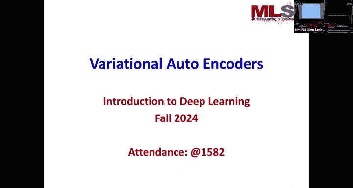
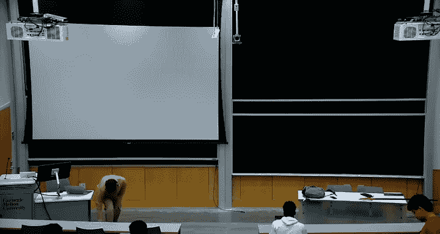
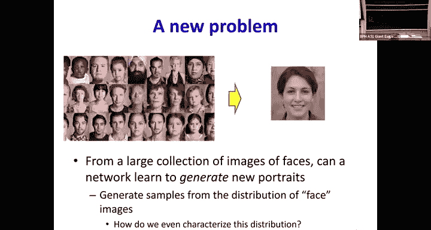
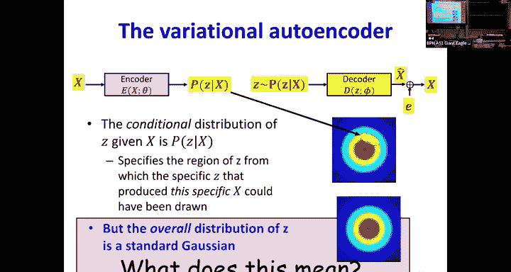
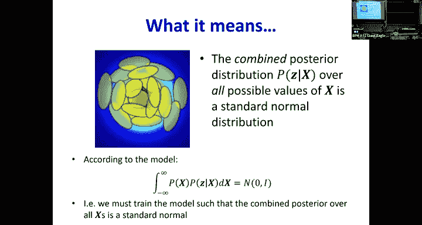
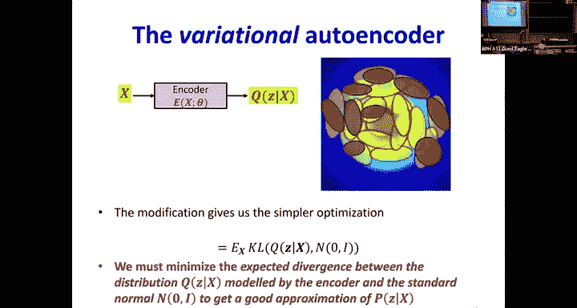
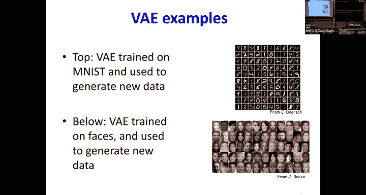
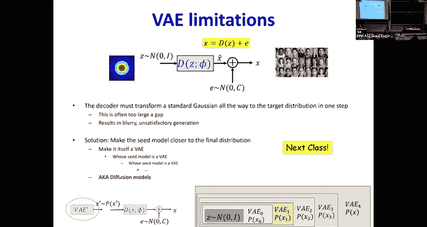

# CMU《深度学习导论｜CMU 11785 introduction to deep learning Fall 2024》中英字幕（deepseek - P23：Fall 2024 Lecture 22 and 23.zh_en - GPT中英字幕课程资源 - BV1CfsReEEw8

对面三。

Your seconds and then please shut your laptops， all the usual stuff。Okay。Let's begin。Alright。So。

What we've seen， what neural networks be used so far was to perform classification and。

Paggression tasks， right。Where you used the network and try to predict a class。

 you given a bunch of data， you learned how to predict the class for the data。

 or given a bunch of data， you learned how to predict some continuous value variable from the data。

Here's a completely new category of problems，You're given a large collection of images。

 say your faces。And from this collection of images。

 you must somehow learn to generate new portraits Now what is this problem here。

 this is a problem of generation now when I'm asking you to generate new portraits from learn to generate new portraits from Maha。

A collection of portraits。The idea is that there is some high dimensional space。

 So let's assume that all of these images are million million pixelel images。

 Then every one of these pick images。Is a。Point in this million dimensional space。

And so the collection of all possible faces has some distribution in this million dimensional space and the problem that we are trying to address is how can you draw a sample from this mini million dimensional space。

 that looks like a face， How do you draw a sample from this distribution or another problem right。

 the same thing I give you a large collection of images of landscapes。😊。

How do， how do you train a network to generate new landscapes， Again， it's the same problem。

 If there's some high dimensional space， which is the dimensionality of the images itself。

And every image is a point in this high dimensional space。And what we really have is a distribution。

And this high dimensional space， some region in this high dimensional space。

 where every point is a landscape。And we want to figure out， we want to learn。

 train the network to such that we can use it to pick points from this。Region， so。Problem， right。

 This is a high dimensional space。 It's a million dimensions。Are you a aware of any？

Examples of drawing points from a distribution。Anyone。Sampling right， okay。

 what kind of distributions have you learned to sample？Unform distribution， anything else？

Gussian distributions。 So in a high dimensional space。

 you have a mechanism for drawing samples from from uniform Gaussian distributions。

 What or other distributions， La plaian distributions， Whats。

Special about these distributions that makes allows you to sample them。

Or even know what they look like。Like。st。LikeIt replicates every phenomenon of the nature。是。Yeah。

 but there's something more。Why were you able to draw a sample from this distribution。

 Why were you able to characterize it a mathematical There's a mathematical formula for it right so when I ask you to characterize a Gaussian distribution you ask me what's the mean。

 what's the variance you can just draw you can plot the distribution for it for a uniform distribution I give you the range you should be able to plot the distribution for it so we have a mathematical form。

😊，The number of distributions for which we can get such obtain in such a mathematical form is。

Hetically small， right now， on the other hand， when I'm in this high dimensional million dimensional space and I'm trying to characterize the distribution of faces。

 facial images in this。 Do we have any idea what kind of mathematical form this distribution would take。

😊，Right， we just don't， and we have no way of knowing。

So how do we learn to characterize this distribution and draw samples from it？

That's the problem we have here。 right， It's a very challenging problem。 Again。

 this is a million dimensional space。 We have no idea， you know。Even in three dimensions。

 besides two dimensions， besides a Gaussian。Or or in one dimension。

 we know how to characterize a Gaussian。 A Gaussian looks like this。Roughly， right。

 I can characterize a uniform distribution。 I can characterize maybe a person or a classian distribution。

 How would you characterize a distribution， which looks like。This。No idea， right。

 So we don't have a mathematical form。 We are not going to be able to sample or do anything with this guy。

Makes sense。 And now the scale is up to a million dimensions。 And here's where we are。So。

To even begin to。Address this problem。 We are going to make an assumption now， first。

When I'm in million dimensions， is every million dimensional point an image of a landscape。right。

Is every a millionion dimensional point even a meaningful image？

So what's special about the characteristics of landscapes in this million dimensional space？Okay。

 he does tell me。Why can't。Every million dimensional coin be something meaningful。

Can the universe exist and fill up the space of million dimensions， the universe of pictures。

Couldt make senseWhat would what fills up the entire space， noise noise， right。

 If anything is occupying the entire space， it must be noise。

 That's the only thing that just can take any value。

 So what is the characteristic of million dimensional images of faces。Conected to each other。

This is structure， right， faces have structure， what does structure mean？been some summer。

ConSo the point is， anytime you have structure， you are placing restrictions。

It cannot take every value。 It can only take this subset of values。

 What is a restriction You're eliminating degrees of freedom。Right。

 every time you eliminate degrees of freedom， what are we really saying about the data？

We are saying that you're eliminating dimensions， right。 And so when you eliminate dimensions。

 what this really means is that if I've got。Images of landscapes。In this million dimensional space。

 there is some low dimensional surface。Maybe a 10 dimensional surface。

 maybe 100 dimensional surface and pretty much all million all landscapes are going to lie close to the surface if you go off of it。

 it's not going to look like a landscape， the structure is captured by the surface that makes sense right because and the degrees of freedom that you lose before faces is going to be very different from those for landscapes and such like。

😊，And so the hypothesis is that the data are distributed about a curved or otherwise no nonlinear manifold in this high dimensional space。

 they must be simply because they are structured， right？😊，And so。

The principal components of all instances of the target class， be it faces。

 be it landscapes lie on or close to the surface。Again， they must be。

 And so if I want to generate a data a new instance from this class first。

 I need to characterize this manifold， then I need to pick a point from it。 And if I， if I do this。

 right。😊，That manifold would be the manifold of faces。 If I pick a point。

 it's probably going to be a face。Questions here that we must address。

 how do you characterize this manifold。 Again， this is a million dimensional space。😊。

We have no idea what it looks like， right？And how do we pick a point from it。

 So have we seen anything in the past classes that helps us address this problem a little bit？

A do I go。Auto encoders， what did we do in auto encoders？We project it will more we went。

The auto encoder actually love， learns a。Princiipple manifoldt， right。

And so it captures the underlying manifold of the data。

 it perform some kind of nonlinear principle component analysis。

 we saw deeper networks with morely and linearities can capture more complex surfaces and so we could use a auto encoder to learn。

😊，The structure of the manifold without even knowing what it is。

 because the network just learns this right， And then thereafter the decoder of this auto encodeder is going to generate data on this manifold。

If I excited with any odd point is going to generate a data point on this manifold。

 we saw this examples of this for example for instance with music。

 I could train an autoender on a clarinet any time I triggered the decoder of the auto encodeder。

 I generated a clarinet like sound， or I could train one on ss and anytime I triggered it I generated saxophone like sounds。

😊，So。If I want to generate faces。This would tell me that I need to train an auto encoder。

Tth faces and hopefully at the bottleneck， I'm going to capture the dimensionality of the subspace。

The manifold on which faces lie and then subsequently anytime I feed anything to the decoder its going to generate data on this face manifold which hopefully will look like a face。

 what would be the problems here？Anyone。Yes， the principal manifold might be too high dimensional for this to currently country。

We don't even know what the dimensionality of the manifold is， right， Even when we do so， you know。

 another decoder could be used to generate instances of from the face manifold。

 But even when I know the dimensionality of the manifold， we are inious。😊，Here， for example。

 we had data which lay on a spiral。And so the primary degree of freedom in a spiral is the movement along the spiral。

 So if I had an auto encodeder which brought data down from two dimensions to one dimension and then back to two dimensions you'd expect that the z value in the middle captures the position along the spiral and。

😊，2 things happen。 Now， the decoder can only generate。Data on that curve。

 can it generate data off the curve？No， right， is that curve actually going to capture the spiral exactly？

Why not？觉得你一步。你还有。超级先。So the thing is it only learns the nature of the spiral within the range of the training data。

So you know， you could learn when you train this data。

 when you train your auto encoder on on the spiral， right， it might learn to map。

Z going from 0 to 1 to the region of the spiral on which the training data lie。

 and once you go outside， all bets are off， right？Sub secondly， theres no。

 there's no control over how it actually maps the uniform this line onto a spiral。 So here。

 for example。You sort of assumed implicitly that if I took。

 even if I assumed that I'm just looking at the range Z Z equals 0 to1。Please don't go。 come on。

 All right， so I'm had to hold it。 You sort of assume that when it became a spiral。

 this is going to sort of continuously war this guy on the spiral。 Will that happen。😊。

Is there any control on this， There isn't any control， right。

 It might well be that this region of Z becomes all of this。

 And then this long region just becomes the small region。 You have no control， right。

 It could well be that this region。Becomes all of this。

 And then this entire region just gets mapped onto this。 And then this region gets expanded。

 Any odd thing could happen。 We have no control on how Z is。

Map on even if you get the right dimension， you have no control on how it is mapped onto your surface。

So what this means is that if I pick an inappropriate value of a Z。😊。

What comes out is not going to look like what I want it to look like， right？Given this background。

 how do we address this problem？So additionions。That thing next to。 either ignore it， right， Yeah。

 I this the I。Beauform distribution， not uniform， right。Normal distribution on that。So。

We want to impose some kind of a restriction on Z。And specifically， right。

 I want to say that I don't want any odd。Transformation of of Z。I want to say， for example。That。

I want Z to be such that the most frequent points are out here。

 the less frequent points are out here。 I can I want to rest the range。

 I want to impose a distribution on Z。 That's how I have some control over Z itself。

And so we want to impose a distribution on Z and what is the distribution well first is a problem。😊。

This makes sense to everybody so far。Okay。Time sir。The answer to the first question， true or false。

住出住吧。Everybody agree that it's true。I'm not hearing。Okay， can I hear a true from everybody。

 Thank you。 Please wake up， right， The decoder can only generate data on the low dimensional surface of the space。

 That's the you have a function。 It can only generate a curve。 You cannot go off the curve， right？

 It must be obvious。😊，What is true of the dimensionality of this manifold， Can it be predicted？No。

 we have no idea what the dimensionality of。Landscape imagess， right？But then。

If I actually have an auto encoder over here， what can you see about the dimensionality that you' are zooming for the manifold？

入れた。It cannot be greater than whatever the dimensionality of the latent variable itself is right if I feed in a plane it is going to give me a curved plane if I feed in a three dimensional variable is going to give me a curved three dimensional manifold。

😊，And is it always going to be the same as the input of the encoder？😊，Could be less， right， I mean。

 did these answers make sense？ You guys are very unenthusiastic today。

So I'm going to expect louder answers。The next set of questions will be answered on Zoom。

So we want to impose a distribution on Z。And the simplest distribution to impose is the standard Gaussian。

 you' are making no assumptions and why in particular the standard Gaussian。

 So you need to impose a constraint on the variance unit variance is a nice constraint。

And given a specific variance， the least。The distribution that makes the least assumptions about the data。

Meaning the maximum entropy distribution for a given variance is the Gaussian。

So we are assuming a standard Gaussian because it's the。One， that makes the fewest assumptions。

Make sense， right， I mean， if you had more knowledge about the data。

 you could make stronger assumptions。And so if you actually learn the auto encoder so that the Z only always had a standard gaussian distribution and of 0 I。

😊，Zero is the mean I is the variance， meaning in every direction the variance is 1。

 then once you learned it to generate new data you can just sample a point from a standard Gaussian and feed it through the encoder and with high likelihood it iss actually going to generate something in the right range it is going to generate a phase right。

That makes sense。Okay。The problem is， how does one train an auto encoder？To have this constraint。

 How do I train it so that the Z values。Are drawn or have the distribution of z values。

Follow a standard gasian。Now， for this， first。You're going to use a simple principle， right？

So let's say I have a distribution of this kind。Standard Gaussian。

 I'm drawing this for a one dimensional variable， but you have to imagine this is in many dimensions right。

 And I have several different histograms。 Here is one histogram。Here is another histogram。

 here is a third histogram。Here is a fourth histogram， right？Of all of these histograms。

 which of these data are going to have the highest probability as computed using the standard Gaussian？

Anyone， so let's say I got histograms， this is a histogram1 got obtained from some data。

This is the second histogram obtained from some other data， right。

 This is a third histogram obtained from yet another data。

 a fourth histogram obtained from yet another data。 Okay， and now here I have my standard Gaussian。

And I just say this is the mean unit way， right？Now， which of these histograms。

 which of these data sets is going to have the highest probability as computed using standard Gaussian。

Second one。怪嗯。It matches the distribution， right， So basically。For any given。Distribution。

 the data that follows that distribution are going to have the highest probability for that distribution。

Right， and so now， if I decide that I want my Z。To have。This distribution。And。I train a network。2。

Generate these's， right？Which and say one network generates this histogram。

 the other there's the third disk and the fourth this。 which network would we want。The second one。

 what is the characteristic of this guy， the Zs generated by the network have the highest probability as computed using the standard gausing。

 So we are going to use the maximum likelihood principle。 We are going to be given any encoder。Of x。

 right， we want to set it up such as such that the probability of the encoder of x computed using a standard Gaussian。

It's maximized。That makes sense， or ultimately the log probability is maximized。😊。

Does makes sense to everybody， right。How does one train and auto encoder to ensure that the hidden representation has a specific distribution？

This is this is the issue again we want to train the entire auto encoder the encoder and decoder may have completely independent parameters。

 I'm calling them a phi and theta。😊，Fhii are the parameters of the decoder。

 theta the parameters of the encodeder and the standard gausian。

 we all know what it is it's isotropic it doesn't matter it's basically in every direction the variance is 1 the mean is 0 right and so this means that it assumes that all of the dimensions are independent meaning if I have because it's symmetric right and so if I have a vector z。

And it has， I can say I split it up into any two sub vectorctors z1 and Z2。

Then z is basically the concatenation of Z1 and Z2。😊。

Then it means that because if all the dimensions are independent。

 the joint distribution of Z1 and Z2 is simply the product of the individual distributions of Z1 and Z2。

 and furthermore， because it's an isotropic standard variance Gaussian。

 the distribution of P of Z1 is going to be a standard normal。

 the distribution of Z2 is also going to be a standard normal， right。😊。

Just this is just a characteristic of standard numbers。 Everybody with me on this。 right。

 The mat gets very much more complex。 So bear with me， right， you have to。

 And so what is the probability of any particular vector Z。On the standard Gaussian。

 that's the formula for the standard Gaussian。The variance is one。

 So it's just one over square root of two piase to D is the dimensionality of the data times E is to minus05 the squared norm of Z。

So the log probability is simply going to be minus 0。5 d log 2 pi minus。5 times。

That's squared norm of Z， right， And the negative log probability is going to be just going to be the same thing with you know plus 0。

25 D log 2 pi plus 05 squared norm of z。Nothing nothing fancy over here。

And so when we get to our auto encoder。😊，First， the auto encoder must reconstruct the input， right。

 So you want to minimize the error between x and x hat。 Otherwise， it's not an auto encoder。

 But then second。We are going to try to design the encoder such that the distribution of the disease。

Generated by the encoder matches the standard normal most closely， in other words。

You are minimizing the Kbacklib divergence between the distribution of z's generated by the encoder and the standard Gaussian。

Which in turn simply ends up as we just saw maximizing the log probability of all the these generated by the encoder。

 which is the same as minimizing the negative log probability and as it turns out the negative log probability is simply proportional to the positive squared norm。

😊，Right， and so this is what we will do。 We are going to be。Minimizing the negative log probability。

 which is to say we are minimizing the positive squared norm of the z vectors， right？😊。

And so the overall model that we will train is going to be trying to do this。 Very simple。

 It were going to minimize the error between。What is reconstructed and what goes in while at the same time minimizing the squared norm of the Z。

That come out of the encode。This makes sense to everybody。对是。Any questions？Right。

Go on a back it should be。But loves you， right。They expected that this is the law right Sir。

Z is1 coded output， right， and so now this is how we can train theta and phi。😊，This。the second book。

Okay， this was an easy one。 someone not Zoom， what's the answer to the first question？

Z is there anybody true， okay， and what about the second question？Two or false。Oh， it's right。

When you minimize the squared norm， youre maximizing the likelihood that the data actually matches a standard gaussian。

And it doesn't matter what restriction you impose on Z。 The decoder can only construct the manifoldt。

 You are not going to go off the manifold。Right。So everybody with me so far。

 so do you think this model would work？😊，Is it going to be able to construct all phases。

 for instance。So Virginiarg says no， why？Is it that doesn't account for all the very usually？です。

If I get the entire manifold。Right， yeah， still losing some information。

 What information would he lose if I got the manfold。What information you lose。I think it's fine。

 I think it's。 So here is the issue， right， Yes， you are both all of your right here a。

 make you will be able to if you got the manifold and the distribution right and if the distribution your data did lie on the manifold。

 you're going to be able to make new faces。 the issue is。😊。

What is the dimensionality of this manifold do we know No， right。

 So you are restricting yourself to whatever dimensionality you chose。😊。

Which might be completely wrong， right？Then， Virginia is also right that。

There is always going to be some variation from the manifold， even if you got it perfectly。

Whi is not going to be accounted for， which means this can generate faces probably。

 but it's not going to generate all possible faces， right。

This simple formulation does not adequately capture the variation in the data。😊。

The generative portion of the model is just the decoder inputting decousian data into it still only produces what the decoder is capable of producing。

And the decoder can only generate data on the low dimensional manifold in the space。

 so for the spiral case， the decoder can only generate data on the spiral and in enough the training region it can generate it will generate garbage and you know if a fed and two dimensional data Gaussians isotroppic Gausians to a decoder it generates。

3D outputs that what the decoder is really going to be doing is to take this planar surface and convert it to some curve curved adulating。

 not very categorizable surface in the higher dimensional space。

 but every single data point that it generates is going to be on this。Surface。And， of course。

The actual dimensionality of the data manifold cannot be known。 So you。

 we may have just chosen a wrong dimension。 numberumb one， right。

 And even if we capture the dimensionality of the principal manifold perfectly。

 there's always going to be some variation off of it。

The actual distribution lies close to this manifold。

 but there's no guarantee that it's going to be on this manifold。 right， So we have these two issues。

And so our simple model is not going to be able to capture either。

Having the inappropriate dimension or the fact that the actual data can have some variation of it。

 right， So do mind turning the phone on phone upside down， please， you lady there。Hello。

Look you fine。Flip the， please。Thank you。All right。You， can you suggest how I would fix this。Yeah。

 that's why you pay attention in class。 Can you put the phone back in your bag。

I was trying to look home。Okay。So anywayss。Yeah the objective function。

It does not just control we're enforcing but yes， but still， you know。

 there's nothing structured about the model itself when it comes to the generation， right？

 So how do you characterize the generation so。What we can do is to assume that the actual data are obtained。

Not just as a point on the manifold， but as a point on the manifold plus some noise。Rightright。

Or plus some variation。 And so we are going to assume that the actual data is obtained by adding noise to the output of the decoder。

 And now here's the thing。 we will train the model to minimize this noise。😊，Why does that make sense。

 Because when you minimize the noise， then that's when you're going to get the best approximation to the manifold。

 right， So number one， number two， So a couple of different things happen over here。F I。

Minimize this noise。Then。Firstly， if I have data with by。And some。Some blob。

Minimizing the noise means that the amount of correction I have to make overall is minimized， right。

 which means I'm going to get the closest possible banifold to the distribution of the data itself。

 but then there's something secondly that happens secondary that happens to it。😊。

Because you allowed we are letting the decoder learn。And you are manifold， right。

So it means that if there's any structure in the noise， for example， if the noise has a mean。

Can you have in the ideal case what the noise have a meanme that's not zero？The mean is predictable。

 right。So I can just add it to the decoder， and then I've corrected for it。That makes sense？Right。

 suppose the distant noise always lies in a particular direction。Then。Can you have that situation。

I just tilt the。Function captured by the decoder in that direction。 Then now that trend is gone。

Right， so what does this Tell me about the noise。What does this tell me about the noise？

The connection term。The mean is。If the model is properly learned。Please。

 the mean will be  zero and furthermore， what can we say about trends in the noise？😊。

Will it have any trend？If you increase x， y will increase。It cannot have that right。

 so what does it mean about components？What does it mean about the various components of the noise。

 Can somebody say I hector？They would have to be independent right。

 because if one component predicted the other you just that's like saying there's a slope in the distribution of the noise。

 that means I can just adjust my decoder function to capture that slope and the noise is going to be independent。

That makes sense to everybody， right， and so。This， you are going to assume that the noise is 0 mean it is going to be uncorrelated and it is going to be unstructured。

 what is the most unstructured noise。😊，We just Gaussian， we just said this， right。

 given a variance of all the possible noise， the distributions。

 the distribution that has the least information is the Gaussian so。😊。

We're going to assume that the noise is he。Gaauusian with zero mean and the covariance matrix is diagonal because all the components are independent。

 that makes sense。Right。But then this has a。 So what this means is that。When I give you a Z。

 it's generating an X hat， and then you're adding some noise to it。 So is there to produce the X。

 is the relationship between x and Z deterministic。😊，No， right。

 So what this means is that x is no longer a deterministic outcome of Z。 It has a distribution。

 The noise has0 mean variance C。But then to the no as you are adding the output of the decoder and so the given and z。

 the probability distribution of x is still going to be gaus in with the mean which is simply the output of the decoder for that z。

😊，Make sense， everybody。So this is a distribution，And so this just con thing to what is called a generative model for the data。

 it has a generative story。 this model says， you know。

 here is how according to me the data were generated I picked a point I sampled a K dimensional vector from a standard Gaussian and K dimensional space。

😊，And then I pass this vector Z through my decoder。

 then I sample some noise from this standard Gaussian from this Gaussian。

 which means 0 and variance c。😊，And then I added it to the output of my decoder， and that's what。😊。

Gave me my final data point。 So this is the generative story that we have。For the。Moty， right。Again。

 everybody get this， right。And now， how do you train this？

For every x so you know I'm training the distribution for faces so what I need is to come up with a decoder D which to which I can feed in z values from a standard goess in and iss going to be outputting faces right and then I need to learn the z which means for every training point X every face image that I've got I need to know the corresponding z so that I can I can figure out what the relationship between the two was right and so the z that went into the decoder to produce every training instance is known along with the x。

😊，Then the way we define the noise have just had to minimize the error between the output of the decoder and x。

😊，Make sense， right， What is our problem here， Do we have the Z for any data point。

If I give you a picture of a face。Right， and I can do we have a value Z standard Gaussian saying this was the Z that generated that phase。

 We don't have it， right？ And so then if you don't have the Z。You can't really estimate the model。

 but then we need the Z， correct。 So what we are going to do is to estimate the Z。No。

 this is a chicken a egg。I need the Z to estimate the model， but I don't have the Z。

 I'm going to estimate the Z。 How will I estimate the Z。Rly chose it， can but random stuff work。懂。

Right that's where the encoder comes in。The M corridor's job is to estimate the z for each x that produced x again。

Does make sense？Right， so。I see a lot of puzzle faces。 Did this make sense。I see。😊，Okay。

 so where did I use you？I think just noise variance that exists in the or so all I'm saying is that you know。

 in the model if my model were perfect， it would always be on the manifold that is the assumption right if I want to。

 but。😊，The data that you see。Are not going to be。On the manifold。 So how do you account for it。

 That's the noise。 And we want to say I'm Gu toola， That's the variation。 It's not just the variance。

 It's the variation off the manifold， right。And so。Then encode a Z estimates。

 encode estimates Z to permit us to add。Estimate phi， and the encoder has its own parameters。

 So this means now the encoder parameters must be estimated， right。Now， here's a problem。The。

 the model that we have。 So this is something that we want to。Look at。So as z goes into the decoder。

And it produces an exactat， right？Then we're adding noise to this。And this is giving us X。Correct。

So what this means is that。If I get some values Z now。

 we know that X hat always lies on some manifold， some curve， so for any particular Z。Going in。

This X hat is going to be。A particular point on this manifold。But does knowing X act tell us X？No。

 right， the actual value of x depends on this noise。And so depending on the noise。You can get。

You know， what noise you add， you could have gotten all of these different x points。

 So which means knowing Z didn't didn't tell us exactly what X was。

 It just gives us a distribution for x now， conversely。If I tell you that this。

 this was the X I observed。For the same reason， that x could have come from this Z by adding this noise。

 right？But that x could have also come from this z by adding this noise。

Or from this Z by adding this mice。So annoying X。Doesn't tell us what X hat was。

There's a distribution of x hat values that could all have generated the same x because the noise itself is。

Friend。And we don't know what the noise is， right？ And so the Z。

 which means that the x hack that could have produced x is not unique。😊，Taking a step back。

 the Z that could have produced X is not unique。The relationship between X hat and Z is unique。 But。

 the relationship between X hat and X is not unique。That makes sense， right？

So what this means is that there's an entire distribution of these。

There's an entire distribution of x hats that could have generated x going back。

 this means correspondingly， there's an entire distribution of Z's that could have generated x。

So if the encoder must find the z for any x， can it find the z？

Can the encode quarter find the z for N x， No， because there is no unique Z， right。

 So what must the encoder do？Esation distribution， It must estimate the distribution for Z， so。

And so the encoder's job is going to be estimating the distribution for z and this whole thing is called the variation auto encodeder because once you begin sticking distributions on the latent variable you have to use variational approximations to optimize it the learning procedure utilize utilizes a variational bound on the likelihood of the data I won't spend a lot of time on it if you want I have a very detailed set of slides on it。

 but we won't over it right so the encoder computes the distribution P of z given x for any x。😊。

The decoder tries to convert。The expected output for the Z you know， given any x。

 the encoder is going to have an entire distribution of z。

And the decodder is going to say somehow be learn says that over over the entire set of possible x's。

 it still minimizes the error to over the entire set of possible z's。

 it still minimizes the error to x right now instead of doing this over the entire distribution。

 it makes more sense to just do it on a typical sample from the distribution。And so typically。

 the decoder will convert a typical sample from this distribution tool。

Exha and then try to minimize the error。 That makes sense right。 So what this means again。

 here is that。For any X。The encoder is going to give you this range of z's that could have generated x。

And the decoder。Must。Comp must learn to predict x from all of these guys that's too much。

 so you're going to randomly pick a point from this， a typical point from this。😊。

And you're going to try to transform that to x， okay。So to train the encoder。

 now here's the crazy thing you're trying to first you want to train the encoder so that you want the encoder can accurately predict P of z given x。

Right。And。The decoder。Must be trained， such that。Samples from this distribution。

 P of Z given x will all generate。X。Right。And then we have a constraint on Z。Don't forget。

What was the con we had and say。standardard Gaussian， right， because we said。

 the decoder was transforming a standard Gaussian the。Distribution of。The data。Now。

So we know that the standard Gausian looks like this， it's isotropic， I'm looking at it from the top。

What does it mean for there to be a probability distribution Z given x。

 It means that not all of those zs could have generated x， right， If I give you any specific X。

 there's some subset of Z's。That could have generated that x。

 because that's all the noise can account for。 right， So corresponding to every X。

 there's going to be a distribution。Which is in some subreg of the entire set of z's。

 which is P of z given x。The overall distribution of Z still has standard ga。 This makes sense， yeah。

Can you draw。Dirctor issue between like。The distribution of your noise to the distribution of。

Yeah we go， right。So we'll get that in a minute。What is the overall distribution of z I said the overall distribution of z is a standard Gaussian。

 but the distribution of the set of z's that correspond to a given x is going to be some small subregion of it right so how does all of this match up。

😊。

What this means is that if I take all possible X。And look at the set of Z's that could have generated each one of these x's。

 That combined set of Z's is going to have a standard Gaussian distribution。That makes sense， right。

 And so what this means is that were all possible x's。😊，啲。

Average of P of Z given x is going to be a standard gausing。Does make sense to everybody。Right。

 so whereas for any given x， that P of Z given x can be anything else。

Now， what the encoder does is it doesn't actually get P of Z given x。

 We don't know what the encoder does。 The encoder generates some distribution and we're trying to make that distribution look as close to P of Z given x as possible So let me call that distribution that the encoder computes as Q of z given x。

 this is only to distinguish between what the encoder is currently computing and what the encoder really wants to compute right and so if you want to。

The encoder to do a good job， then you want to minimize the divergence between what the encoder computes Q of z given x。

And the actual。Distribution P of Z given x， which is the distribution of Zs that could have compute product produced that specific X。

 Again， is this making sense， It's getting a little complicated， but it's not very complicated。

 right。And so， this means that。When I train my encoder over all of my training data。

I want to minimize the k divergence between。The posterior probability computed by the encoder and the true posterior between  Q of z given n。

P of Z given x， okay。I go through a whole lot of math。And。Well。

The problem over here is that we don't know what P of Z given x is again。

 Why don't we know what P of Z given x is， Maybe I have。

Some pictures。I'll actually get to that， okay。Yeah， I have things in wrong order。

 and the reason for this is this， okay？What the decoder does is to this the problem lies with the decoder。

 The decoder is going to take this。Flat manifold and convert it to a curved surface， right。

 of some kind。 Now， if I take any particular X。There's a region of range of x hats that could have all have generated this x。

 And so the probability distribution of the x， because E is Gaussian， the distribution of the X hats。

Which could have resulted in that x is going to be Gaussian also Im adding Gaussian noise to x hat and I got to get x。

So on this X。This is the set of x hats that could have generated x。

I want to find the corresponding Zs， but this guy is a very ugly function， right。

 We don't know what the de could risk， which means it's going to be impossible for me to go back。

And characterize， you know except for some very specific kinds of decoders。

 I cannot actually go back and find out what the set of Z's was for for that correspond to the set of x hats that could have produced x。

😊，Hector， you looking confused makes sense。 confused So very confused。Can you send last。

So here's the thing。If in the X hat space， the the set of x hats that could have generated x is a Gaussian。

Has a Gausian distribution， right。But then if I go back and see what is the set of Z's。

That gave you this set of exes。That depends on this guy。 and it's a very non nonlinear function。

 right， Like I said， we can warp anything to anything。

 So it's impossible for us to characterize the specific set of Z's that gave you this Gaussian set of X hats。

 which could have produced X。So this means going back here。

 sorry for jumping back and forth when I'm trying to minimize the k divergence between P of z given x and P of z given x like I don't know what P of z given x is。

 and so this becomes a problem right？So。We are going to do something。Interesting。

 we're going to go through some squiggly math， which I won't spend a lot of time on。 but here。

 here is the。Math here， the Kl divergence between  Q and p is simply the expectation over z of log of Q over log of p right given x but then using basees rule I can write p of z given x as so which is the expectation of log of  Q minus the expectation of log of。

P of Z given x。 I can write P of Z given x as P of Z times P of x given z。Divided by P of x， right。

 so I can decompose that further。Lg of Q given to a log of Q minus log of P of z。

Mine minusus log of P of x given z plus this last term this guy doesn't， this is just P of x。

 it doesn't depend on the parameters of the network at all。Right， I can ignore this guy。

And so it turns out that minimizing the error between Q of Z given x。And P U of Z given X。

 which we don't know。Ends up simply being。The same as minimizing the error between  Q of z given x and the standard Gaussian。

There's a second term， but the second term really has to do with training the decoder。Okay， so。

Without spending too much time on this。So on this slide， you can believe me。 It just turns out that。

What we really want to do is to minimize the average divergence。Between the。

The posterior probability of Z as computed by the encoder。And the standard goes in。

 But this also makes intuitive sense。 It It makes intuitive sense。

 because if you look at the aggregate。Of the posterus， but all the training data。

That aggregate must look like a standard Gaussian， right？

That makes sense and so basically all we are saying is that over the entire training data。

I want the K divergence between my。What the encoder computes and the standard goes into to be minimized。

 This is the trickiest portion Okay is the second trickiest portion of the entire model。

But did this even make sense？What we are really trying to do is to minimize the divergence between the distribution。

 the average divergence between the distribution computed by the encoder and the standard Gaussian that we have assumedd for the。

Lant variable Z， okay。So。You guys at the back that makes sense， right？Makes sense。

How do you actually like。Okay， that's what's falling。 All right， So this is。

 so this is basically what we're going to have to do。

 We're going to minimize the average Kl divergence between Q and P。But then we still have a problem。

 right， what is Q？Right。The encoder must model the distribution P of Z given X。 That's right。

 And that's what Q is。 What is this distribution Now， going back。The decoder。

That converts z to x is very known nonlinear。We know this， right。

 And so to go back to our slide the picture that we just saw again。

 it is for it is quite impossible for us to say what kind of function P of Z given x is going to be。

 The decoder is an ugly thing， except for a very small class of decoder functions。😊，Knowing X hat。

 the distribution of X hat tells you nothing about the distribution of Z。

And so we want an encoder to model a distribution whose structure we do not know。When we do this。

 what do we do？As engineers， we make approximations right。

 and one of the approximations comes from the behaviors of a standard Gaussian， right？😊。

So although P of x had given x as Gaussian。Since e is Gausian going back through the decoder。

 p of z given x is not characterizable， which means we don't know what the form of the function of the encoder must be for it to learn this properly。

😊，But then here's what happens。 This is what a standard Gausian looks like。

 And one of the properties of the standard Gaussian is that it does if you take if you slice the surface along any line。

 it doesn't matter what the line is。😊，And look at the distribution of z values on that line or on that hyperplane。

That distribution is going to be。Standard Gaussian right this is0 mean this is what we said because I can just reorder my bases and it's always going to be my a standard Gaussian and so this property will hold regardless of which hyperplane I slice the space along。

 I take a the space with a standard Gaussian on it I slice it at some point。

 look at the distribution of z on that hyperplane is going to be a。Standard Ga。And that makes sense。

 right， okay。What if this。So what if the function is not？If the slice is not a hyperplant。

This only works for hyperplanes， right？But if the slice is a curve。Like this guy。Like this red one。

Then what happens？Obviously on the curve， the distribution is not going to be Gausian。This。听到。

Which is why we couldn't characterize P of Z given x for any X， but。If。

This curve doesn't diverge too much from the hyperplane in high probability regions of Zine。

Then I can roughly approximate。The distribution of Z on the curve to also be a Gauzi。

This is an approximation。It has to do with the fact that the curve is roughly planar in high probability regions and when it begins going away from the high know when it begins diverging from the plane at those points。

 the probability of the data is very small。Right and so if this property holds。

Then I can just model for nearly linear functions you know a curve has a function P of f of z equals c right this is the equation of the curve but this is the equation of a curve surface so this guy is going to be some Gaussian also except we can't really say what the mean and variance will be it's no longer going to be standard mean zero mean unit variance the actual mean and variance。

😊，That best。Characterize this are going to be dependent on。The function itself on z， right？

And so in our court， okay， get a。嗯。Okay， anybody want to answer that first question？Okay， and Zoom。

 what about the second question？On Zoom。If anyone that true right so if z is a random vector with an isotroppic Gaussian distribution。

 the conditional distribution on any ae plane， any plane is also going to be standard Gaussian。😊。

The distribution on any curved surface。There's also approximately Gaussian if the function is not too curved。

This is an assumption， right， The function is not too curd， and that actually causes problems。But。

Regardless now。I'm going to， yes。し就埋て休なか。If the curve is very steep。

So if I were to D her of this kind。Then there's no such thing as you know， no。

 it's always going to be very curved in the high probability regions。 So if it's nearly linear。

 then it means that。It's where it deviates from a plane， the probability is low。That's all。

 if it's not， then that assumption will fail。Okay。And so here's what we have。

 the encoder is going to compute the distribution P of z given x for anyx。

The decoder is going to convert samples from this distribution too。Back to x。

 And so to estimate the encoder。We want to estimate the theta， the encoder parameters again。

 the encode is estimating the posterior distribution， right。

 So we want to estimate the encoder parameters， such that。

When samples are drawn from the distribution that it captures。

And those samples are put through the decoder。What comes out is the original X。 That makes sense。

Right so the encode is。Parameters are behaved dependent on。

How the decoder transforms what a web produces。Right。And for transforming the decoder。

I'll have some Z's from whatever。The distribution they incurred a guard。

And that is going to produce some x hat I'm just going to minimize the error between x and X hat。And。

 finally。We have the constraint on Z。On Z， we said that all we wanted to do was to。

Minimize the average Kl divergence between the posterior probability computed by the encoder and。

The standard gaussian， right， So let's look at this first guy。

 The encoder must compute the distribution P of Z Z given x for any X。

 It turns out we don't know what the P of Z given x is。

But we saw that we can approximate it as a Gaussian。

But the mean and variance of the Gaussian depend on x itself。

 and so the encoder is actually simply going to compute the mean and the variance of the Gaussian and it's going to assume that it's Gaussian。

😊，They encode a parameters R。Just fine。Does make sense。Right， and so the posterior probability。

 as captured by the encoder is。A Gaussian with mean and variances which are dependent on x and the encoder parameters。

But， and。I'm going to further assume that the Gaussian posterior probability distribution has a diagonal covariance matrix this is only to make things。

😊，For arithmetic convenience。 and this is probably not a great thing to be doing。

 And then we are going to be using this  Q of Z given x as our posterior for P of Z given x。

 And now here is the key here key bit。 We want to estimate the encode of parameters。😊。

To minimize the error made by the。理コラ。Right， and so this is where。Things get。

This is the second place where things get tricky。First。

The decoder is going to be drawing samples from the encoder。

 the distribution captured by the encoder， right， which is a Gaussian。

 and then it's going to be putting it through the function D and obtaining Xat。So given and Z。

 we know that the probability distribution of x is just gouns in， right？Because if Z is given xat。

 deterministicative static noise。Now。The I can define the probability I for using the maximum likelihood principle。

 the probability of observing any particular X hat。😊。

Its simply going to be this log of the standard Gaussian log of this Gaussian。

The log probability is going to be this loglog of this Gausian， which is。And furthermore。

 we are going to make this assumption that the noise has the same variance in every direction。

 sigma squared。Again， this will not affect the model itself， right？

And so when I take the log probability， this this thing is going to be just minus d over two log sigma squared。

 minus1 over two sigma squared。😊，X minus the squared。

The square norm of the error between x and the output of the decoder again。

 you don't need to memorize the math。 It's very easy to derive once you see how it comes across。

 it comes about， right。😊，And so you want to estimate the encode of parameters such that again。

 you are using the maximum likelihood principle， right。

 So you want to estimate the encode of parameters such that the log probability of。

The data generated by the decoder are maximized。 Or alternate。

 you want to minimize the negative of this。 I can define a loss because we like losses。

 which is simply the sum were。All the training data points are log of sigma squared。

Plus1 over1 over6 minus squared the squared normm。 The problem here is that we need theres no direct dependence on m parameters over here。

 right？This is just looking at the decoder。 The dependence on encoder parameters comes from the Z。

And the Z was sampled from the encoder distribution。 and so here is what we're going to get。First。

We know。That。嗯。Enco of producers。A distribution， which is mu sigma， right， It's mu of x Sigma of X。

 I'm not writing of X。 How do you generate a distribution sample from this distribution。

You won't find a function for this in your Python library。

If you look at the code in the Python library， what kind of Gaus in does it sample from？Rrand end。

 right， what does it sample from mean  zero mean 0 and y variance one in every direction， right？

 How do you convert that to a sample from this distribution。我。So you're going to generate some。

Sm Z hat from a standard Gaussian。Then you're going to multiply z hat by the square root。

Of the variance to give it the spread。Right， and then。Addmin。

And that is going to give you a distribution from the sample from this guy， right？

So that's basically we're going to do what we're going to do。 We're going to。

Gerate the way we generate a sample Z from this is to generate this term epsilon from a standard Gaussian multiplied by the square root of the covariance of the variance matrix and then add the mean。

Is this guy a function of a decota parameters。Why not， what about the mu sigma？

The mu and sigma for any x are generated by the decoder， right？This guy is a function of。The decoder。

Oh sorry I have the encode a parameters， right， I'm sorry， right， So theta， and this is theta。

 So this is a function of the encode parameters。 So I can compute the derivative of z with respect to encode a parameters theta。

Which is what we've got over here， right， And this is specific to each x， so which means that。😊。

When I want to pass the derivatives back， this loss is actually a function of theta。

But this is a function of theta through the Z。And sorry about the misalignment here。

 something happened to my slides。So you can compute the derivative of this loss with respect to Z。

 this is straightforward， this is just a quadratic。

 and then using that chain you can multiply that loss with the derivative of z with respect to theta。

😊，And now that' is going to give you the loss the derivative of the loss with respect encode a parameters theta。

That makes sense。To everybody， right， yeah。Like I fake the boys he。Yeah。

 if you' are assuming that youre sampling properly from a standard Gaussing。

 then it should not is a random sample from a standard Gausing， right。

 and if you have sufficient training data again。O。So， that told us。

So we managed to figure out how to compute derivatives of the loss out here with respect to theta once you have derivatives。

 you can you know， you can put it through a standard optimizer。The second thing is。

 how do you estimate。The decoder itself。 Now， you have sample Z from the。

Encode a distribution already。 So now we have Z， which means you have X hat。

And so that means you can actually define the loss between x hat， which is this guy and x。

 if you're doing a maximum likelihood estimate you also get。

 you try to minimize the variance of the error， right。And so you just have a standard loss。

For the decoder， and this can be minimized to train the decoder。Make sense。Nothing complicated。

 right， And then there was one last bit missing。The last bit missing was we wanted a constraint on。

 you want to make the average P of z given x as close to。😊，A standard goes in as possible。Right。

You guys with me so far。The math looks ugly， but it's not。

Once you we break it down into all of its little pieces， every last bit makes sense。

And then you can just write it out on your own， right？And so。How was this。

 We know the K but divergence between any。Gues in Q。

which has its own mean and a standard goes there's a formula for it that you can derive。

 but I don't recommend it， you can ask Chad GPT， but I don't recommend it because it lies。

 but you can check a textbook and it will give you this answer right and so。

This is just the trace off， half of the trace of the。Of this variant。

Plus the squared norm of the mean。Mineus the log of the determinant of the variance and an additional constant deep。

 Okay， so if you just do this。This is the KL divergence for a single instance。

So over the entire training set right， we wanted to minimize this over the entire training set。

 so this is what this term here。😊，Is what？We get from this one the first term iss the average kL divergence between。

😊，The distribution from the encoder and a standard Gausian。And the second term。

 the second term is what I had over here。😊，This guy。This term。

 we saw that we could minimize it optimize it with respect to both the encodeder parameters and the decoder parameters for the decoder parameters we had to further multiply this derivative by this guy here。

For the decoder parameters， we had to compute the derivative with respect to Z。

And then multiply it by。The derivative of Z with respect to theta。 So the second term。

 we can compute the derivatives of this with respect to both Phi and theta。We've seen this。And。

Furthermore， we have this additional term which imposes the constraint on C。

 and so overall you get this very nice Q tutle loss formulation。😊，Which looks ugly。

 but really is not。Which has two terms， The one is the negative log likelihood of the output of the decoder。

Id over all the training samples。And the other is the kale divergence between the posterior probability computed by the encoder and the standard Gaussian average over。

All of the training samples， you can compute the derivative of this with respect to both the encodeder parameters and the decoder parameters。

 the math is we just sort of went through the math briefly， but it's on the slides。😊。

And I assure you， it's not complicated， it's very simple。You know。

 so long as you believe that back proctor through encoder and de will work。And so once you do this。

You can just minimize this to train the model。 And this is your variational auto encoder， okay。

Questions， yeah。You could。ist give the second is the probability distribution of Z， right。

 you could we just but if you're looking at it from a purely maximum likelihood perspective。

 there's no weight。 that's all。And so here is the complete training pipeline this is the encoder for any x you are deriving the mean and variance of the posterior which is an approximation right you are sampling a Z from it you are putting it through the decoder and you are generating x hat。

😊，Then you define a loss， which is the error between x hat and x。Plus， the log of。

The variance of the noise， the error itself， because you want to make the error as small as possible。

 you want to minimize its variance。Right， and and the second term here。Is the term that we got。

 which is the average kale divergence between the output of Q and。

The standard Gaussian over the entire training center。This loss。

 we are going to be minimizing with respect to both theta and phi and we'll be updating our parameters。

Now， this is generically stated D mu sigma， they could have been any function。

 you could have chosen any odd function， so where did neural networks come in？The neural networks。

 D is the neural network here can be a CNN， can be a transfer model。

 you can choose your architecture。😊，And this guy here， this encoder is also a。

Can be a neural network， or it can be something simpler。 In the next class。

 we will see a variant of this model where the encoder is a simpler model。

And the encoder's job is to compute the mean and variance of the。Poserior probability， right。

 So that's where neural networks come in and gradient decent can be used to train this network。So。

 and then once you train it， remember， we wanted a generative model， right。

 we wanted a model that could generate faces。😊，The only reason we wanted the encoder was for us to be able to obtain the z's corresponding to each x so that we could train the decoder。

 but once it's trained you can throw away the encoder the decoder portion of it is the ja now if you want to generate a new face you sample Z from the Gausian。

😊，And from a standard Gaussian， pass it through the decoder is going to give you a face。Questions。No。

Very pretty， right。The basic model we started off with auto encoders。

 then we imposed a constraint on Z。And then we said but then you know data may not lie on the manifold and then we said so we added a noise with a distribution and at each step we came up with a solution and the solution was not that much more complex when you just did an auto encoder you were just minimizing the error between the original and the reconstruction when you impose a distribution on z minim the squared normal Z。

And then furthermore， when you said， okay， I can have an additional error at the output。

 the only thing that that you got eventually in addition was this first term which is the kl term。😊。

Each additional constraint。It's just adding one more term to this loss。It's very pretty， okay。And so。

This is。Once trained the encoder can be decoded， discarded the rest of the network gives us a generative model for x generative data using this part of the model should ideally give us data similar to the training data。

 so an auto encode statistical of the variation auto encoder is an auto encoder with statistical constraints。

😊，On the hidden variable Z， right？The encoder is a statistical model that computes the parameters of an approximate。

Poserior probability for z given x and the decoder is a model which converts samples from Z to samples that look like your training data。

 okay？And the decoder is a generative model which when excited by standard gaus and inputs generate samples similar to the training data。

Everybody good with the sofa， right。Yeah， does the decoder generate outputs when it's excited by standard Gaussian inputs or from the C that we have estimated whatever z you give it is going to generate something right but the point is if you want to generate a novel phase then you better sample from a standard Gaussian。

That's up。Okay。And so。The decoder heres the actual jator model。 The encoder is needed for training。

But then it can also be used to generate the approximate distribution of z for each x。

 and so people have used this to manipulate and z is a latent space representation for the data。

So the mean computed by the generator。Can be thought of as a hidden representation is a point on is a point on the manifold。

 straightened manifold。For each x， and so you can do some interesting things， but first。

Your final poem。嗯。Okay， anybody want to answer that first question？Throughrue or false。

 the VAE is a generative extension of auto encoders that models probability distributions， right？

The standard VAAE assumes a latent representation that's a Gaussian PDF， statue true or false。Right。

 it requires addition of Gaussian noise to the output of the of a regular AE to permit the output to fill the space beyond a low dimensional manifold true right and the decoder can be used to generate samples from the distribution it is traineded on。

If the input is drawn from a standard gaian， true or false， true， right。

 this pretty much summarizes everything that we have to say。Ccil。

These are from the original papers so here。They train this on digits。

 and then when you sample it with a Gaussian， it actually produces。To all digits。

 it's lu to the distribution of digits。In this space， right now here they learned it on faces。

And see gender its faces。 But there's something。Curious。About this。 How these face First。

 Do we agree that these are faces。Are they the best faces you can generate？Why not？

 It's kind of blurry， right， It's not very well done。 So why do you think that happened。

The noise that we've added。

Couple of reasons， right？ So by before we get to that。 So here's something that you can do。

 you can feed an input X。 you get a Z right？ And so that's going to give you a latent。

 which is that the mean is a latent representation of the posterior probability of x。

 So here they start off。 They feed in two distributions to inputs this one and this。😊。

And you get a or the send this， right？And so you get two z values。

 And then you take a Z which between the two。 You average the two and pass that average n through the。

Decoder， and it actually generates an expression that's halfway。Through the end。

 so it actually learns the distributions and every point you know lines in this Z space represent continuous variations of the input。

 it's kind of cool。But then。Going back to。So this was a quick summary right it' is a simple a statistical extension of the auto encoder。

 it's an excellent geneedative model for P of Z and you have various extensions by conditional VAEs where you can say generate you train it on all kinds of faces building it but then you can say generate a mustachio face or generate the face of a person who's got a mohawk and it can do that。

😊，The literature is vast， but then let's go back and look at why those faces were blurry。😊。

There were two reasons for it。The first reason had to do with this。

 it was impossible for us to go back and actually characterize the posterior probability of z given x。

😊，Right， because D was an ugly function。😊，But if it was possible for us to characterize it exactly。

 you'd expect the model to be better。Right。And so， it turns out that。We want know。

 because we could not invert the decoder， we needed an encodeder that approximated the posterior probability distribution。

And instead。If the decoder model were of the kind where you could actually compute the posterior P of z given x。

Then you'd expect better generation。It turns out there's a class of decoder functions which allows you to do that these are called normalizing flow models。

 invertible decoders that allow you to characterize P of Z given x。😊。

There's a second reason for this。😊，Which has to do with the fact that I am trying to span the distribution space from standard Gaussian to the distribution of faces in a single step。

 that gap can be very large， right。😊，So if I started off with a seed distribution， P of Z。

 which was closer to the distribution of real faces。

Then the transformation that you would have to perform would be smaller， right？

Where would that seed distribution come from？嗯。

For that， we go to this fact， right？The standard VA is already giving me something like faces。

So why don't I just use？A V Ae。Itself， as a stand， as a seed distribution for my V A E。

But then where does the seatd to that VAE come from？It tuurtles all the way down。

 right that can be seated by another VE， which can be seated by another VE。

 which can be seated by another VE and so on。😊，Eventually， when I'm tired。

 I'm going to give it a standard Gauss。This is what's called a diffusion model。

A specific category of it。And so we're going to learn about diffusion mark in the next class。Okay。

 any questions？Was this clear？Kind of I see some。 I， I see wobbly faces。 But yeah， thank you。

 You're done， so。😊，Thank you guys。

